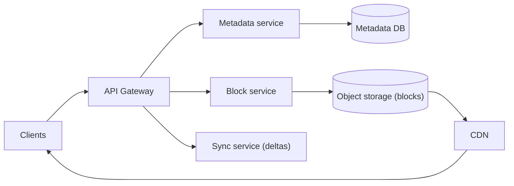

# Эталонное решение — Файловое хранилище

> [!warning] Не читать до попытки
> Сначала заполните попытку по `scenarios/08-file-storage.md`.

## 1. Требования

**Функциональные:** загрузка/скачивание (в т.ч. больших файлов); синхронизация устройств; версии; шеринг с правами.

**Нефункциональные:**
- Durability данных — критична (не терять файлы; 11 девяток на блоках).
- Большие файлы → чанки + докачка + дедуп.
- Метаданные синхронизации — eventual.
- Скачивание — быстрое (CDN).

**Скоуп:** `in` — блобы/метаданные/версии/sync/ACL; `out` — редакторы документов, поиск по содержимому (упомянуть).

## 2. Уточняющие вопросы и модельные ответы

| Вопрос | Модельный ответ |
|---|---|
| Размеры файлов? | средний 1 МБ, макс 10 ГБ |
| Дедуп между пользователями? | Блочный content-addressed, но с оговоркой приватности |
| Конфликты sync? | Last-write-wins на версии + сохранение конфликтной копии |
| Шеринг? | ACL на файл/папку, read/write |

## 3. Оценка нагрузки

- 100M пользователей, 500M файлов, 100M загрузок/сутки ≈ **~1.2k upload/s**.
- Объём: 100M × 1 МБ = **100 ТБ/сутки** (до dedup), ×365 → ПБ/год.
- Скачивания ≈ ×10 загрузок → **~12k download/s** через CDN.
- Метаданные: 500M файлов × версии — реляционно/шардированно, десятки ТБ.

## 4. API

```
POST /v1/files            {name, parent, size}              → 201 {file_id, upload_session}
PUT  /v1/uploads/{id}/chunk/{n}  (chunk bytes)              → 200 {etag}
POST /v1/uploads/{id}/complete  {chunks[]}                  → 200 {version}
GET  /v1/files/{id}/download?version                        → 302 (CDN/block URL)
GET  /v1/files?parent                                       → 200 [entries]
POST /v1/files/{id}/share  {subject, role}                  → 200 ACL
GET  /v1/sync/delta?cursor                                  → 200 {changes, next_cursor}
```

## 5. Модель данных

- `files(file_id PK, owner_id, parent_id, name, latest_version, deleted)`.
- `versions(version_id, file_id, size, hash, created_at)`.
- `blocks(block_id = hash, size, refcount)` — content-addressed, в объектном хранилище.
- `file_versions_blocks(version_id, block_index, block_id)`.
- `acl(resource_id, subject_id, role)`.
- `devices_cursors(device_id, cursor)` для синхронизации.

Dedup: блок идентифицируется **hash'ем содержимого**; refcount; загрузка только новых блоков.

## 6. Архитектура



Поток загрузки: файл → чанки → hash → дедуп (залить только новые блоки) → зафиксировать версию в метаданных. Скачивание — через CDN/подписанные URL.

## 7. Масштабирование

- Метаданные шард по `owner_id` (все файлы пользователя на одном шарде).
- Блоки — объектное хранилище, бесконечно масштабируемое по ключу-hash.
- CDN для популярных (шеринг) файлов.
- Sync-delta по курсору на устройство.

## 8. Отказоустойчивость

- Блоки реплицируются в объектном хранилище (multi-AZ) — durability.
- Докачка: незавершённые upload-session по чанкам.
- Метаданные: репликация + бэкапы; восстановление версий.
- Refcount-guard: не удалять блок, пока есть ссылки (иначе битые версии).

## 9. Consistency

- Метаданные: strong на уровне файла/пользователя (шард по owner).
- Блоки: immutable, content-addressed → идеальная идемпотентность.
- Sync между устройствами: eventual, конфликты — LWW + конфликтная копия.
- ACL: read-your-write на шарде ресурса.

## 10. Bottlenecks

- Большие файлы → чанки параллельно, докачка.
- Горячий публичный файл (шеринг) → CDN обязателен.
- Metadata hot-shard у «тяжёлого» пользователя → саб-шардинг.

## 11. Trade-offs

- **Dedup vs latency/приватность:** cross-user dedup экономит место, но утечка «файл уже есть»; часто делают per-user dedup.
- **Delta vs full sync:** дельта дешевле по трафику, сложнее в реализации.
- **Strong vs eventual метаданные:** strong проще для пользователя, дороже; sync-replica компромисс.

## 12. Вопросы интервьюера (follow-ups)

1. Что при конфликте правок с двух устройств? — версии + конфликтная копия.
2. Как безопасно удалять блоки? — refcount.
3. Прерванная загрузка? — resume по чанкам/session.
4. Шеринг файла на команду? — ACL на папку + наследование.

## 13. Rubric оценки (сценарий)

- **Сильный ответ:** content-addressed блоки + дедуп + refcount, метаданные шард по owner, CDN на скачивание, sync-delta, multi-AZ durability.
- **Зачёт:** чанки, версионирование, ACL, объектное хранилище.
- **Red flags:** нет дедупа/чанков на больших файлах; блоки удаляются без refcount; метаданные и блоки в одной БД; нет CDN на скачивании.
