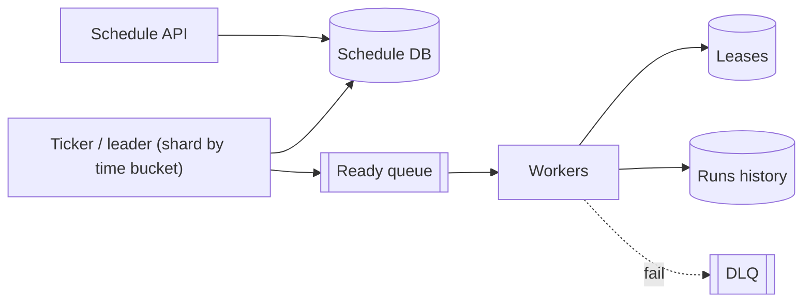

# Эталонное решение — Планировщик задач

> [!warning] Не читать до попытки
> Сначала заполните попытку по `scenarios/09-job-scheduler.md`.

## 1. Требования

**Функциональные:** регистрация cron/one-off; запуск в назначенное время; ретраи + DLQ; история; отмена/обновление.

**Нефункциональные:**
- Не пропустить и не выполнить дважды (или дедуп) — зависит от гарантии.
- Нет единой точки отказа.
- Точность срабатывания — секунды.
- Масштаб: миллионы задач.

**Скоуп:** `in` — расписание/тики/воркеры/ретраи/история; `out` — реализация самих задач (чёрный ящик).

## 2. Уточняющие вопросы и модельные ответы

| Вопрос | Модельный ответ |
|---|---|
| Масштаб? | 10M задач, 100k срабатываний/с в пик |
| Гарантия? | at-least-once + идемпотентные задачи (по умолчанию) |
| Пропустить или продублировать? | Лучше дублировать, но дедуп по run-id |
| Таймзоны? | Поддержка, храним в UTC + tz |

## 3. Оценка нагрузки

- 10M задач, из них активных ~1M.
- Срабатывания: 100k/с avg, но «шторм» в полночь (много cron `0 0 * * *`) → **пик ×10**.
- История: 100k/с × 86400 ≈ **~8.6B запусков/сутки** → партиции по дате, TTL.
- Чтение истории — OLAP/архив, не в горячей БД.

## 4. API

```
POST /v1/schedules        {cron|run_at, target, payload, retry_policy}  → 201 {schedule_id}
PUT  /v1/schedules/{id}                                                  → 200
DELETE /v1/schedules/{id}                                                → 204
POST /v1/schedules/{id}/trigger                                         → 202
GET  /v1/schedules/{id}/runs?from&to                                     → 200 [runs]
```

## 5. Модель данных

- `schedules(schedule_id PK, cron, next_run_at, target, retry_policy, enabled)` — индекс по `next_run_at`.
- `runs(run_id PK, schedule_id, scheduled_at, status, attempt, worker_id, started/ended)` — шард по дате.
- `worker_leases(run_id, worker_id, expires_at)` — защита от дублей/зависаний.
- `dlq(run_id, error, payload, created_at)`.

## 6. Архитектура



Тикер выбирает задачи с `next_run_at <= now`, помещает в очередь; воркеры берут с lease (дедуп), выполняют, пишут результат, планируют следующий тик.

## 7. Масштабирование

- **Временное колесо/бакеты**: шард по времени + `schedule_id` hash; каждый «лидер шарда» тикает свой диапазон.
- Очереди партиционированы; воркеры масштабируются отдельно.
- Полночный шторм: размазывание (jitter) + бакет-очереди.
- История в партиционированную таблицу/OLAP.

## 8. Отказоустойчивость

- Лидер шарда упал → выборы нового лидера (consensus/Raft или lease в БД).
- Воркер упал по время задачи → lease истекает → повтор (или в DLQ после N попыток).
- Пропущенный тик при простое → при рестарте догоняем по `next_run_at <= now`.
- Дедуп запусков через `run_id` = hash(schedule_id, scheduled_at) + lease.

## 9. Consistency

- Дедуп тика: `run_id` детерминирован → идемпотентное создание (UNIQUE).
- Лидер на шард времени — strong (lease/consensus).
- История — eventual на чтение (асинхронная запись в архив).

## 10. Bottlenecks

- Полночный «шторм» cron → размазывание + бакеты.
- Горячий шард времени → саб-шардинг по `schedule_id`.
- Запись истории — батч/асинхронно.

## 11. Trade-offs

- **Central clock vs distributed timeline:** центральный проще, но SPOF; распределённый (шарды времени) — отказоустойчив.
- **Exactly-once vs idempotent:** exactly-once почти недостижимо → at-least-once + идемпотентность задач + дедуп run_id.
- **Пропуск vs дубль:** при простое выбираем догон (возможен дубль, гасим дедупом).

## 12. Вопросы интервьюера (follow-ups)

1. Задача выполняется дольше интервала? — overlap-политика (skip/queue).
2. Два воркера взяли одну задачу? — lease + дедуп run_id.
3. Сервер был offline 5 минут? — догон пропущенных, backfill-политика.
4. Задача всегда падает? — DLQ после N попыток + алерт.

## 13. Rubric оценки (сценарий)

- **Сильный ответ:** шардинг по времени/лидер на шард, дедуп через детерминированный run_id + lease, шторм полночи, DLQ, догон пропусков.
- **Зачёт:** тикер + очередь + воркеры, ретраи, история, выборы лидера.
- **Red flags:** единственный планировщик без failover; нет дедупа (двойные запуски); игнор шторма полночи; выполнение в БД-транзакции.
