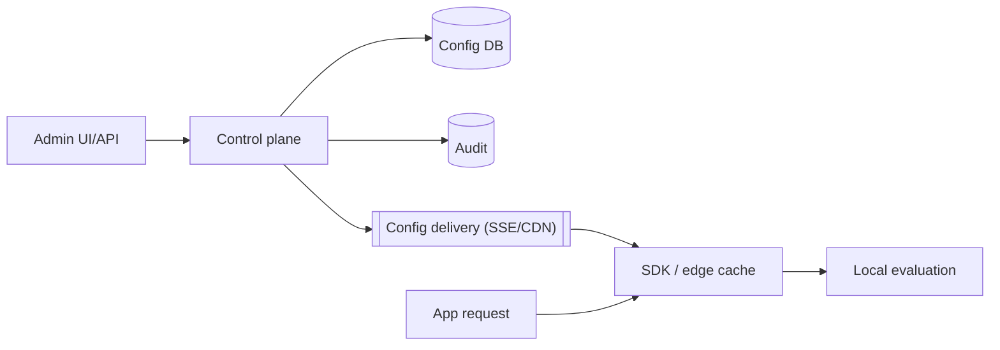

# Эталонное решение — Платформа фиче-флагов

> [!warning] Не читать до попытки
> Сначала заполните попытку по `scenarios/10-feature-flag-platform.md`.

## 1. Требования

**Функциональные:** CRUD флагов по окружениям; правила таргетинга (%, атрибуты, allow/deny); evaluation API/SDK; аудит; kill-switch.

**Нефункциональные:**
- Read-heavy: evaluation ≫ изменений.
- Локальная оценка — микросекунды; по сети — единицы мс.
- Низкий staleness применения; высокая доступность.
- Fail-open/fail-closed — политика per-flag.

**Скоуп:** `in` — управление + оценка + доставка конфигов; `out` — A/B-аналитика результатов (упомянуть).

## 2. Уточняющие вопросы и модельные ответы

| Вопрос | Модельный ответ |
|---|---|
| Evaluation QPS? | 10M/с суммарно (локально в SDK) |
| Staleness? | секунды (push) / минуты (poll) |
| Fail-open или closed? | По умолчанию fail-open (старое значение), критичные — closed |
| Окружения? | dev/stage/prod изолированы |

## 3. Оценка нагрузки

- Evaluation: 1M сервисов/инстансов × высокая частота → **миллионы/с**, но **локально** в SDK.
- Control plane: изменения — редкие (сотни/с максимум).
- Размер конфигурации: тысячи флагов × правила → мегабайты, влезает в память SDK.
- Аудит: изменения (низкий объём) + история оценок (опционально, выборочно).

## 4. API

```
GET  /v1/evaluate?flag&entity&attributes   → 200 {value, variation, reason}   (bulk: POST /v1/evaluate)
GET  /v1/stream  (SSE/WS конфигов)          → stream {config_version, flags}
POST /v1/flags        {key, environment, rules[], default}  → 201
PUT  /v1/flags/{key}                                        → 200
GET  /v1/flags/{key}/history                                → 200 [audit]
```

## 5. Модель данных

- `flags(key PK, environment, type, default, enabled, version)`.
- `rules(flag_key, priority, conditions, variation, percentage)`.
- `segments(segment_id, conditions)` — переиспользуемые сегменты.
- `audit(flag_key, actor, before, after, ts)` — append-only.
- Конфиг-снапшот: `config_version` + полный/дельта-набор флагов для SDK.

## 6. Архитектура



Два плана: **control plane** (редактирование, версии, аудит) и **data plane** (SDK кэширует конфиг и оценивает локально, почти без сети).

## 7. Масштабирование

- Evaluation — **локально в SDK**: масштаб бесплатный, сеть не участвует.
- Доставка конфигов: CDN/SSE-поток, версия-снапшот, дельта-обновления.
- Control plane — низкая нагрузка, шард по environment/project.
- Горячие флаги — кэш на эдже.

## 8. Отказоустойчивость

- SDK недоступен к сети → работа с последним валидным конфигом (fail-open/closed по политике).
- Недоступность control plane не влияет на evaluation (data plane автономен).
- Консистентность кэша: версионирование + атомарная замена снапшота.
- Защита от «плохого» правила в продакшене: валидация + canary окружение.

## 9. Consistency

- Изменение → применение: eventual (staleness сек/мин), версионирование конфига.
- Оценка флага: детерминированная (hash(entity_id, flag_key) % 100 < percentage) → стабильный бакет.
- Аудит: strong (append-only, read-your-write для админа).
- Нельзя менять правила неатомарно: переключение по версии снапшота.

## 10. Bottlenecks

- Массовая рассылка конфигов при частых изменениях → троттлинг/дельта.
- Неправильно спроектированная серверная evaluation → горячий сервис (поэтому SDK-local).
- Hot flags с тяжёлыми правилами → предкомпиляция правил в SDK.

## 11. Trade-offs

- **Pull vs push конфигов:** poll проще/дешевле, но staleness; push (SSE) свежее, но сложнее.
- **SDK-local vs server-side eval:** локально быстро/масштабно, но нужна рассылка; серверно централизовано, но латентность/нагрузка.
- **Fail-open vs fail-closed:** открыто — не роняем продукт, но возможен включённый непроверенный флаг; закрыто — безопаснее, но риск отключить нужное.

## 12. Вопросы интервьюера (follow-ups)

1. Как гарантировать одинаковую оценку на всех инстансах? — детерминированный hash бакетов.
2. Изменение уронило продукт? — kill-switch + мгновенная рассылка + аудит.
3. Как раскатать на 1%? — percentage-правило на стабильном бакете.
4. Устаревший конфиг на инстансе? — версия снапшота + staleness-метрика/алерт.

## 13. Rubric оценки (сценарий)

- **Сильный ответ:** разделение control/data plane, SDK-local evaluation, детерминированные бакеты, версионирование/дельта-рассылка, fail-open/closed политика, kill-switch.
- **Зачёт:** evaluation API, правила %, кэш конфига, аудит, окружения.
- **Red flags:** каждый вызов флага ходит в БД/сеть; нестабильная рандомизация (разные ответы на разных инстансах); нет версии конфига; нет плана на недоступность конфига.
