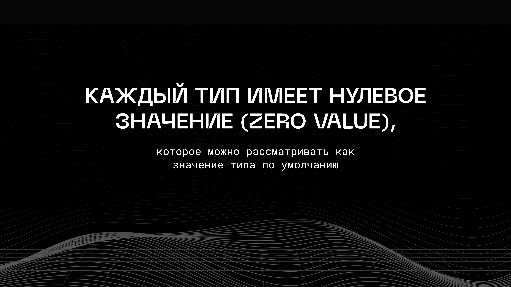
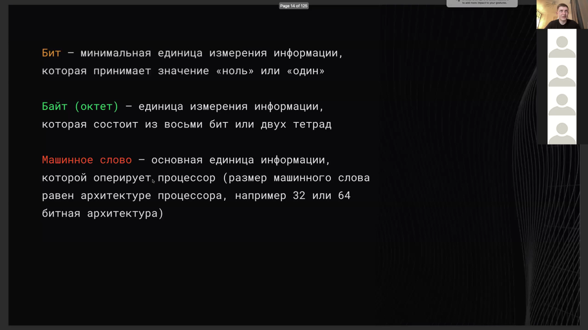
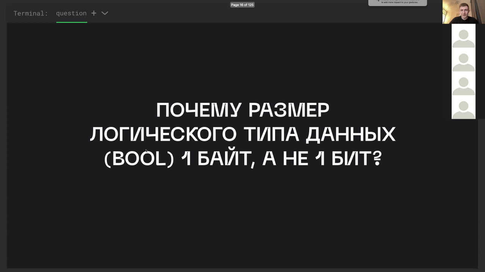
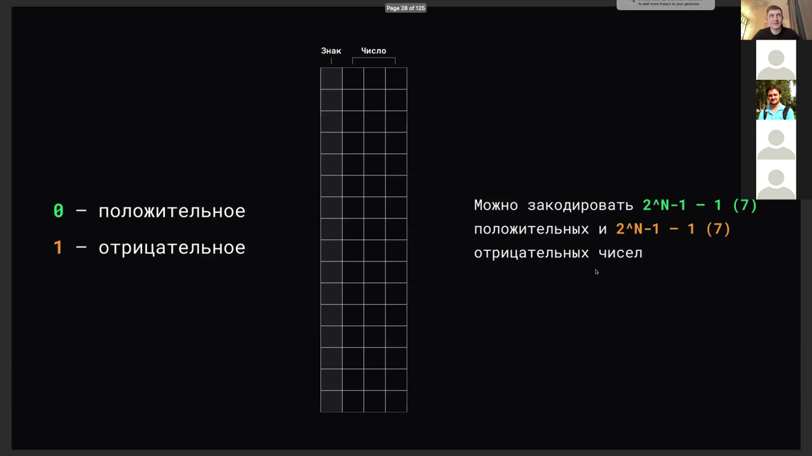
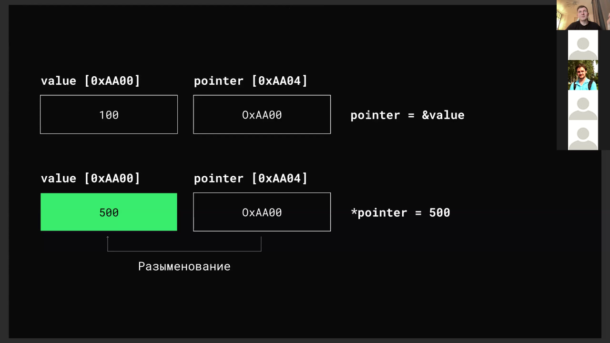
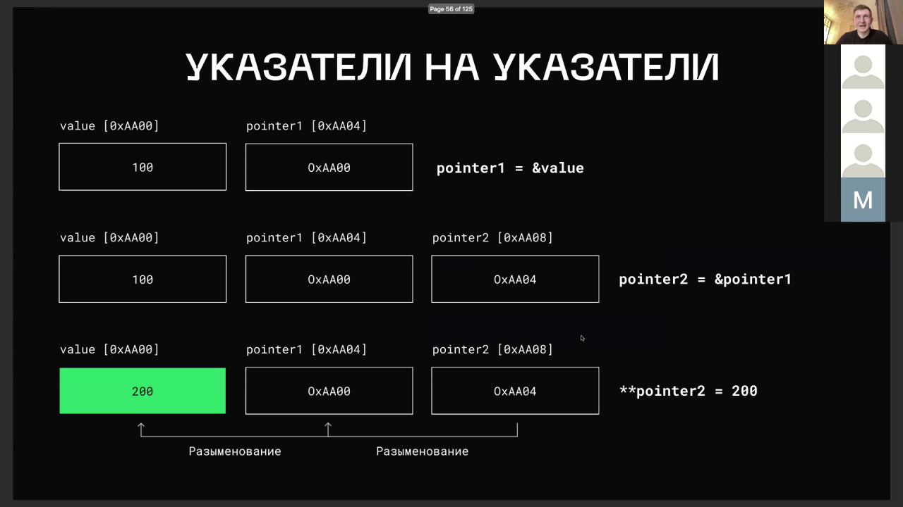
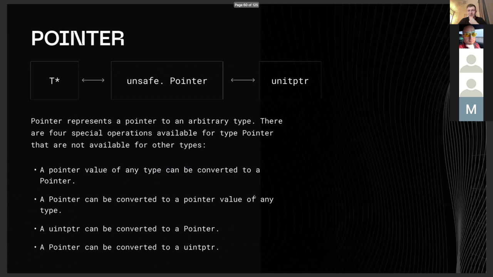
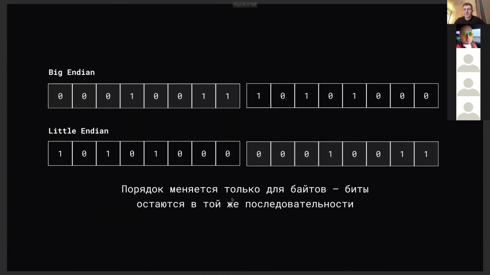

# Основные типы данных в Go

> [!abstract] Обзор
> Лекция по основным типам данных в Go: примитивные, агрегирующие и интерфейсные типы. Обсуждается выравнивание данных, машинное слово, представление bool, указатели, обратный и дополнительный код, порядок байтов и битовые операции. В итоге понимается, как типы данных влияют на работу программы и память.

> [!info] Курс
> [[index|Оглавление курса]]

## Оглавление
1. [[#1. Нулевое значение типа]]
2. [[#2. Бит и байт]]
3. [[#3. Десятичное число 121]]
4. [[#4. Переполнение при преобразовании типов]]
5. [[#5. Целочисленные литералы]]
6. [[#6. Арифметика указателей в Go]]
7. [[#7. Pointer и uintptr]]
8. [[#8. Сегменты памяти]]
9. [[#9. Битовое И]]
10. [[#10. Байты и степени двойки]]
11. [[#11. Тип данных — множество операций]]
12. [[#12. Размер типов данных]]
13. [[#13. Выравнивание памяти]]
14. [[#14. Машинное слово]]

## 1. Нулевое значение типа

Каждый тип в Go имеет нулевое значение, которое используется как значение по умолчанию. Это позволяет избежать неинициализированных переменных и упрощает работу с памятью. Нулевое значение зависит от типа: для чисел это 0, для строк — пустая строка, для структур — нулевые значения полей.

> [!info] Зачем это нужно
> Нулевое значение обеспечивает предсказуемость и безопасность при работе с переменными.

> [!quote]- Слайд
> 

## 2. Бит и байт

Бит — минимальная единица информации, принимающая значение 0 или 1. Байт состоит из 8 бит. Это основа хранения данных в памяти и обработки информации процессором.

> [!info] Зачем это нужно
> Понимание битов и байтов необходимо для работы с низкоуровневыми структурами данных и оптимизации памяти.

## 3. Десятичное число 121

Число 121 в двоичной системе равно 01111001. Это демонстрация перевода чисел между системами счисления, что важно для понимания работы с битами и байтами.

> [!info] Зачем это нужно
> Знание перевода чисел между системами счисления помогает в работе с битовыми операциями.

## 4. Переполнение при преобразовании типов

Переполнение может привести к катастрофическим последствиям, как в случае с запуском ракеты Ariane 5 в 1996 году. Это происходит при преобразовании чисел из большего в меньший диапазон.

> [!info] Зачем это нужно
> Важно избегать переполнения, особенно при работе с числами, где точность критична.

## 5. Целочисленные литералы

В Go используются префиксы для указания системы счисления: 0o для восьмеричных, 0b для двоичных, 0x для шестнадцатеричных. Это позволяет работать с числами в разных форматах.

> [!info] Зачем это нужно
> Использование литералов с префиксами упрощает работу с числами в различных системах счисления.

## 6. Арифметика указателей в Go

В Go не поддерживается арифметика указателей, но можно использовать пакет unsafe для работы с низкоуровневыми операциями. Это ограничение связано с безопасностью.

> [!info] Зачем это нужно
> Арифметика указателей может быть опасна, поэтому Go её не поддерживает.

## 7. Pointer и uintptr

Pointer может быть преобразован в uintptr, что позволяет работать с адресами в виде целых чисел. Это используется в низкоуровневых операциях.

> [!info] Зачем это нужно
> Преобразование pointer в uintptr позволяет работать с адресами в виде чисел, что полезно в определённых сценариях.

## 8. Сегменты памяти

Сегменты памяти включают .text (код), .data (инициализированные данные) и .bss (неинициализированные данные). Это позволяет организовать память эффективно.

> [!info] Зачем это нужно
> Понимание сегментов памяти помогает в оптимизации и анализе работы программы.

## 9. Битовое И

Операция Битовое И возвращает 1 только если оба соответствующих бита равны 1. Это используется для маскирования и проверки битов. Битовое НЕ преобразует 0 в 1 и 1 в 0. Это используется для инверсии битов.

> [!info] Зачем это нужно
> Битовые операции позволяют работать с данными на уровне битов, что полезно для оптимизации и контроля над памятью.

## 10. Байты и степени двойки

1 КБ равно 1024 байтам, что соответствует 2^10. Это основа работы с памятью и файлами.

> [!info] Зачем это нужно
> Понимание размеров данных в байтах и степенях двойки важно для работы с памятью и файлами.

## 11. Тип данных — множество операций

Тип данных определяется как множество значений и операций, которые можно выполнять над ними. Это позволяет понимать, как работает каждый тип в языке.

> [!info] Зачем это нужно
> Понимание типов как множества операций помогает в работе с низкоуровневыми структурами данных.

## 12. Размер типов данных

Размер типов данных зависит от архитектуры процессора: на 32-битной системе — 4 байта, на 64-битной — 8 байт. Это влияет на производительность и использование памяти.

> [!info] Зачем это нужно
> Понимание размера типов данных важно для оптимизации памяти и производительности.

## 13. Выравнивание памяти

Выравнивание памяти влияет на производительность, так как не выровненные данные могут требовать дополнительных операций чтения. Это важно для оптимизации.

> [!info] Зачем это нужно
> Выравнивание памяти влияет на производительность, особенно при работе с низкоуровневыми структурами.

## 14. Машинное слово

Машинное слово — основная единица данных, обрабатываемая процессором. Его размер определяет архитектуру процессора (32 или 64 бита). Это влияет на выравнивание и размер типов.
Почему bool занимает 1 байт: Тип bool занимает 1 байт, потому что процессор работает с байтами, а не битами. Биты не адресуются отдельно, поэтому требуется минимум 1 байт для хранения логического значения.
Обратный код: Обратный код позволяет корректнее представлять отрицательные числа, но не позволяет выполнять арифметические операции. Дополнительный код устраняет проблему отрицательного нуля и позволяет выполнять арифметические операции.
Указатель как переменная: Указатель — это переменная, которая хранит адрес ячейки памяти или nil. При разыменовании получается значение по этому адресу. Указатель на указатель хранит адрес другого указателя. Указатель на указатель позволяет получить доступ к значению через два уровня косвенности. Он используется для изменения значения указателя внутри функции.
Разыменование указателя: Оператор * используется для получения значения по адресу, на который указывает указатель. Разыменование позволяет изменять значение переменной, на которую ссылается указатель.
Unsafe Pointer и управление памятью: Unsafe pointer позволяет преобразовывать указатели в любой тип, но сборщик мусора не отслеживает их, что может привести к утечкам памяти.
Порядок байтов: Big Endian — старший байт записывается первым, Little Endian — младший. Процессоры часто используют Little Endian, сетевой порядок — Big Endian.
Абстракция битовых операций: Битовые операции следует скрывать за абстракциями для улучшения читаемости кода и уменьшения ошибок.
Проверка на степень двойки: Число является степенью двойки, если в его двоичном представлении только один бит равен 1. Это можно проверить через операцию вычитания и побитового И.

> [!info] Зачем это нужно
> Определяет, как данные хранятся и обрабатываются в памяти.

> [!quote]- Кадр [00:07:15]
> 

> [!quote]- Кадр [00:08:59]
> 

> [!quote]- Кадр [00:09:59]
> 

> [!quote]- Кадр [00:24:47]
> 

> [!quote]- Кадр [00:41:13]
> 

> [!quote]- Кадр [00:46:08]
> 

> [!quote]- Кадр [00:41:13]
> 

> [!quote]- Кадр [00:49:36]
> 

> [!quote]- Кадр [01:12:24]
> 

