# Основные типы данных, представление в памяти, указатели и битовые операции в Go

> [!abstract] Обзор
> Материал охватывает основные типы данных и операции в Go, представление данных в памяти и битовые операции. Рассматриваются определение типа данных, классификация типов, нулевое значение (zero value), биты, байты, машинное слово, разряды, диапазоны, знаковый бит, обратный и дополнительный код. Разбираются указатели, копирование при передаче, указатель на указатель, арифметика указателей, `uintptr`, `unsafe.Pointer` и связанные риски. Отдельно обсуждаются выравнивание, сегменты памяти и рост стека, порядок байтов (endianness), переполнение целых, битовые карты, битовая маска (BitMask), режимы открытия файла, поиск уникального числа и дубликатов, IPv4 как `int`, размещение типов Go в памяти, встраивание функций (инлайнинг, inlining), форматы даты и поведение `defer`.

> [!info] Курс
> [[index|Оглавление курса]]

## Оглавление
1. [[#1. Типы данных и их размещение в памяти]]
2. [[#2. Представление данных в памяти: биты, байты, адресация, копирование]]
3. [[#3. Целочисленные типы: кодирование, границы, переполнение, литералы]]
4. [[#4. Указатели: основы, уровни косвенности, unsafe и арифметика]]
5. [[#5. Выравнивание и сегменты памяти]]
6. [[#6. Порядок байтов (endianness)]]
7. [[#7. Битовые операции: И, сдвиги, ^, степень двойки, чётность]]
8. [[#8. Применение битовых операций: BitMask, уникальные числа, IPv4]]
9. [[#9. Встраивание функций (инлайнинг)]]
10. [[#10. Форматы записи даты]]
11. [[#11. defer фиксирует аргумент status]]

**Схема** — [[#Схема]]
**Итог** — [[#Итог]]

## 1. Типы данных и их размещение в памяти

Тип данных — это множество значений и операций над ними, а также выделенный объём памяти и правила работы с ним. В Go типы делятся на примитивные (логические, строковые, числовые) и составные (указатели, каналы, интерфейсы, контейнеры, массивы, срезы, словари); также выделяют категории Basic, Aggregate, Reference и Interface. У каждого типа есть нулевое значение (zero value) — значение по умолчанию. По размещению в памяти типы делятся на две группы: `boolean`, `numeric`, `pointer`, `unsafe pointer`, `struct`, `array` размещаются в одном блоке (Solo Direct Value Part); `slice`, `map`, `channel`, `function`, `interface`, `string` могут размещаться в нескольких блоках по схеме «прямая часть → нижележащие данные» (Direct Part → Underlying Part) — например, строка хранит длину и указатель, а сами данные лежат в другом месте.

| Один блок (Solo Direct Value Part) | Несколько блоков (Direct Part → Underlying Part) |
|---|---|
| boolean, numeric, pointer, unsafe pointer, struct, array | slice, map, channel, function, interface, string |

*Источник: [00:02:42], [00:03:39], [00:04:33], [00:04:50], [00:05:50], [00:05:59], …*

> [!quote]- Кадр [00:02:42]
> 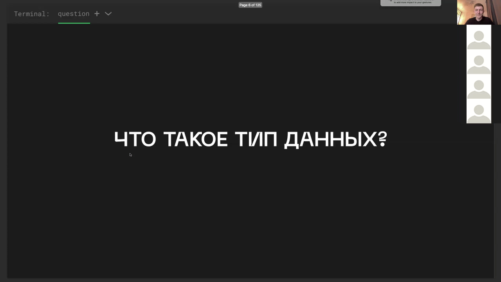

> [!quote]- Кадр [00:03:39]
> 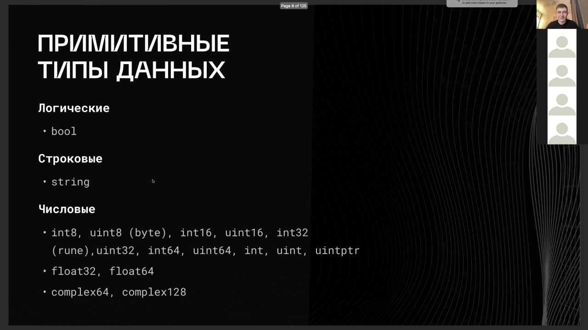

> [!quote]- Кадр [00:05:50]
> 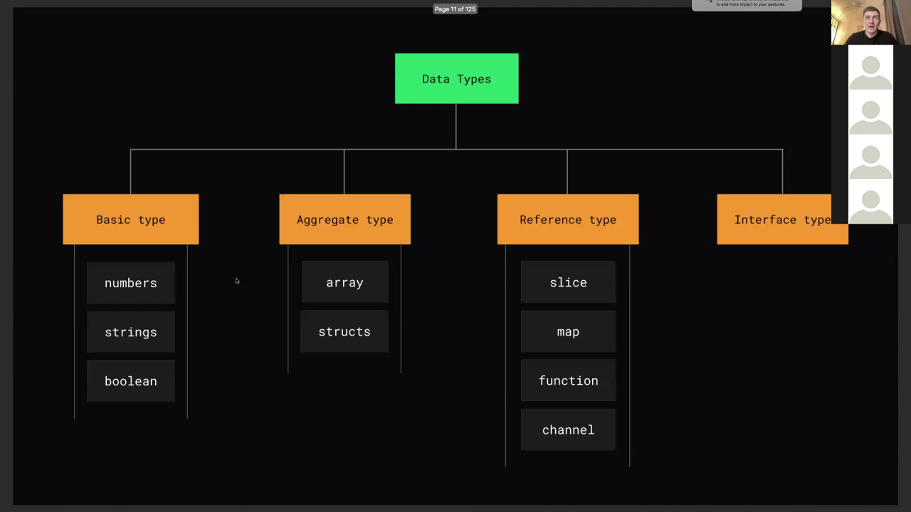

> [!quote]- Кадр [00:04:50]
> 

> [!quote]- Кадр [00:04:33]
> 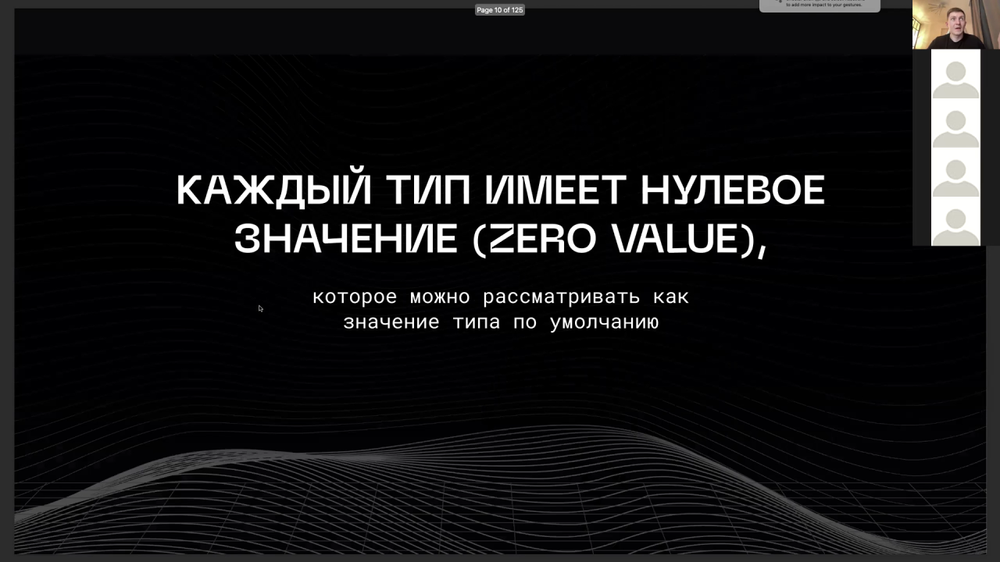

> [!quote]- Кадр [00:05:59]
> 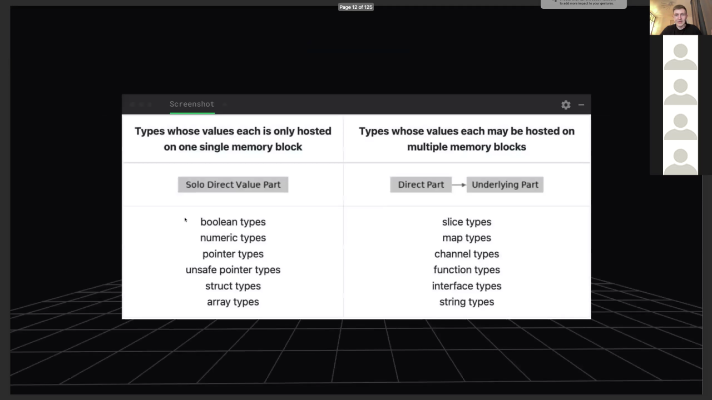

> [!quote]- Кадр [01:48:19]
> 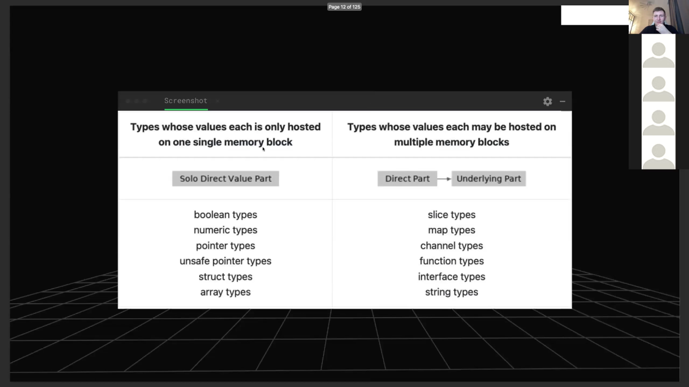

## 2. Представление данных в памяти: биты, байты, адресация, копирование

Бит — минимальная единица информации (0 или 1); байт состоит из 8 бит. Машинное слово — основная единица информации процессора, его размер равен разрядности архитектуры (32 или 64 бита). Разряды нумеруются от младшего (0) к старшему (7); 8 бит вмещают 0–255, 16 бит — 0–65535 (то есть 2^N − 1 значений), а старший бит может обозначать знак. Байтовая адресация позволяет обратиться к произвольному байту памяти, словесная — только к словам; размер `int` и `uint` зависит от архитектуры (при машинном слове 4 байта — 4 байта). Логический тип `bool` занимает один байт, поскольку минимально адресуемый размер памяти — байт. При копировании переменной происходит побитовое копирование: её биты переносятся в другое место памяти.

```go
func main() {
	var x int8 = 5 // 0000 0101
	var y = x      // 0000 0101
}
```

| Адресация | К чему позволяет обращаться |
|---|---|
| Байтовая | к произвольному байту памяти |
| Словесная | только к словам, а не к байтам |

*Источник: [00:07:15], [00:08:26], [00:08:59], [00:09:59], [00:10:09], [00:21:05], …*

> [!quote]- Кадр [00:07:15]
> 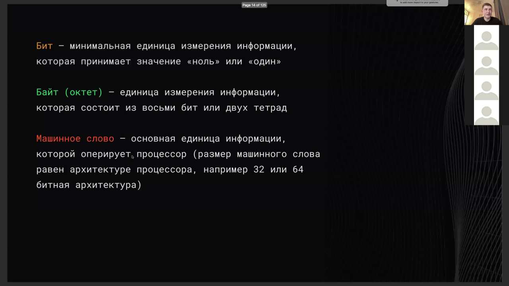

> [!quote]- Кадр [00:21:31]
> 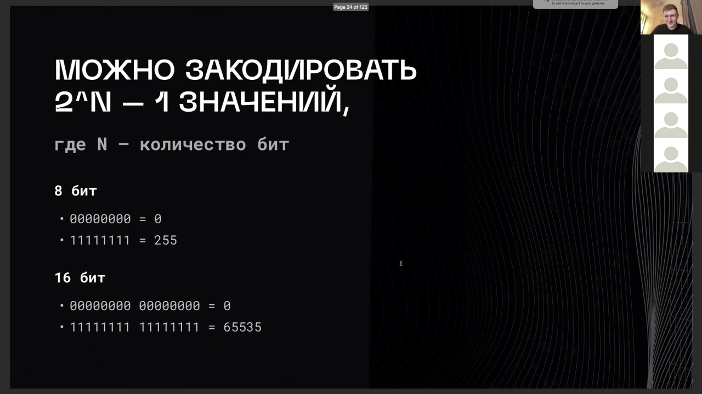

> [!quote]- Кадр [00:21:05]
> 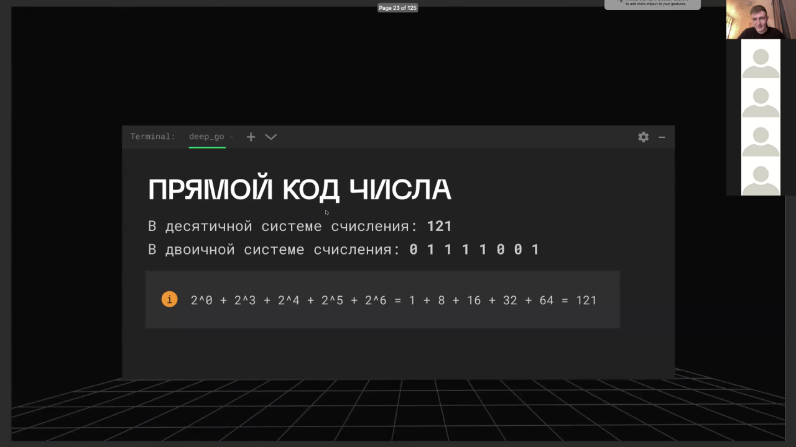

> [!quote]- Кадр [00:10:09]
> 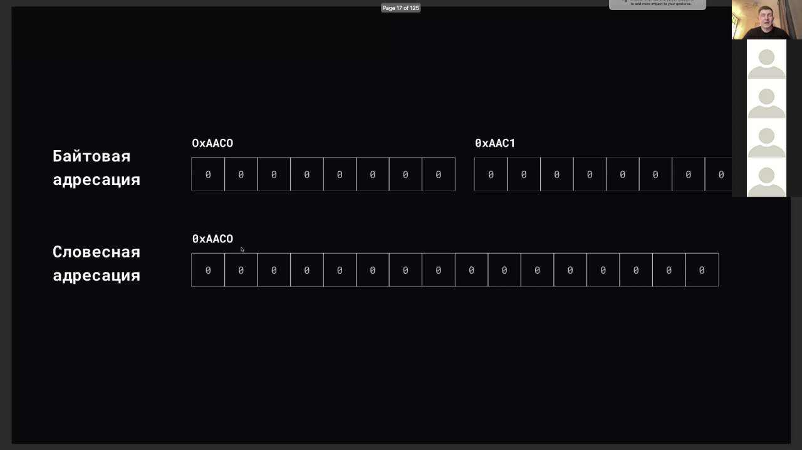

> [!quote]- Кадр [00:08:26]
> 

> [!quote]- Кадр [00:08:59]
> 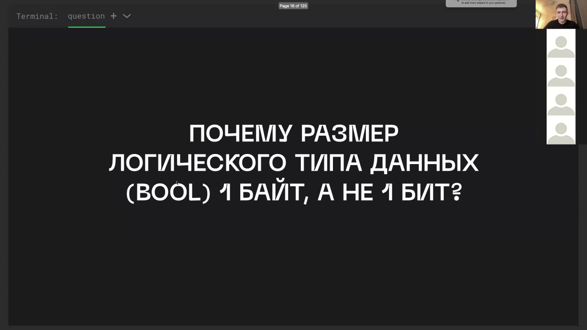

> [!quote]- Кадр [00:09:59]
> 

## 3. Целочисленные типы: кодирование, границы, переполнение, литералы

Отрицательные числа кодируются с использованием знакового бита: 0 — положительное, 1 — отрицательное. Чтобы убрать «отрицательный ноль» и сделать арифметику корректной, применяют дополнительный код (инверсия всех битов плюс единица). Это позволяет закодировать 2^(N−1)−1 положительных и 2^(N−1) отрицательных чисел; знаковые числа можно сравнивать лексикографически по старшим битам. В Go целочисленные литералы могут быть восьмеричными (`0` или `0o`), двоичными (`0b`), шестнадцатеричными (`0x`), мнимыми (суффикс `i`); можно использовать `_` как разделитель (`1_000_000`). Переполнение знаковых и беззнаковых целых в среде выполнения (runtime) «зацикливается»: максимальное положительное становится минимальным отрицательным. Для констант компилятор выдаёт ошибку, а переполнение переменной не обязано вызывать ошибку или панику. Переполнение `int` детектируется до операции: для `rhs > 0` проверяется `lhs > math.MaxInt-rhs`, для `rhs < 0` — `lhs < math.MinInt-rhs`; при переполнении возвращается `ErrIntOverflow`.

```go
package main

import (
	"fmt"
	"math"
)

func main() {
	var signed int8 = -128 // math.MinInt8
	signed++

	var unsigned uint8 = 0 // math.MaxUint8
	unsigned++

	fmt.Println(signed)
	fmt.Println(unsigned)
}

func main() {
	var signed int8 = math.MaxInt8
	signed++

	var unsigned uint8 = math.MaxUint8
	unsigned++

	fmt.Println(signed)
	fmt.Println(unsigned)

	// var signed int8 = math.MaxInt8 + 1     -> compilation error
	// var unsigned uint8 = math.MaxUint8 + 1 -> compilation error
}

var ErrIntOverflow = errors.New("integer overflow")

func Inc(counter int) (int, error) {
	if counter == math.MaxInt {
		return 0, ErrIntOverflow
	}

	return counter + 1, nil
}

func Add(lhs, rhs int) (int, error) {
	if rhs > 0 {
		if lhs > math.MaxInt-rhs {
			return 0, ErrIntOverflow
		}
	} else if rhs < 0 {
		if lhs < math.MinInt-rhs {
			return 0, ErrIntOverflow
		}
	}

	return lhs + rhs, nil
}
```

*Источник: [00:23:47], [00:24:47], [00:25:47], [00:26:54], [00:27:21], [00:27:44], …*

> [!quote]- Кадр [00:23:47]
> 

> [!quote]- Кадр [00:24:47]
> 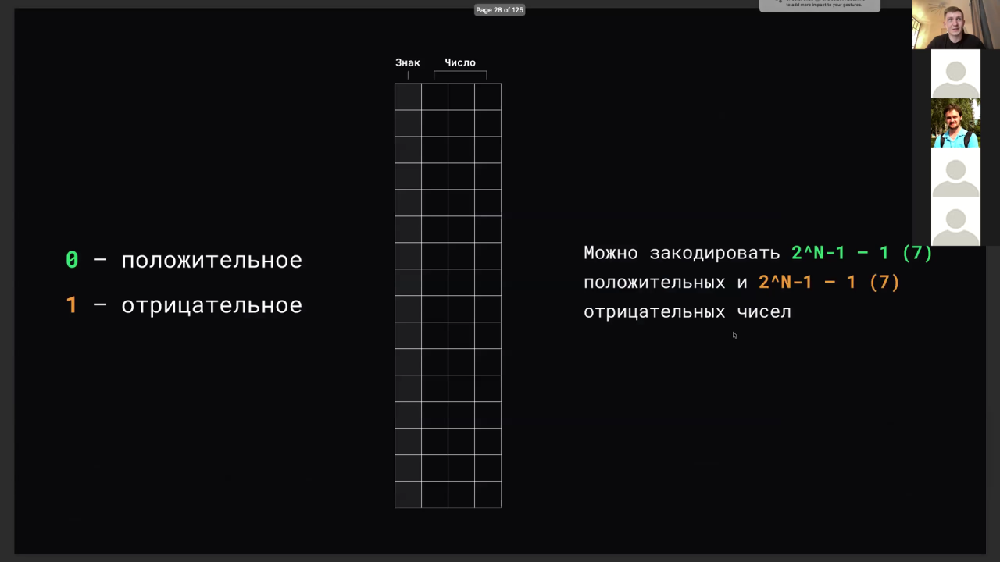

> [!quote]- Кадр [00:26:54]
> 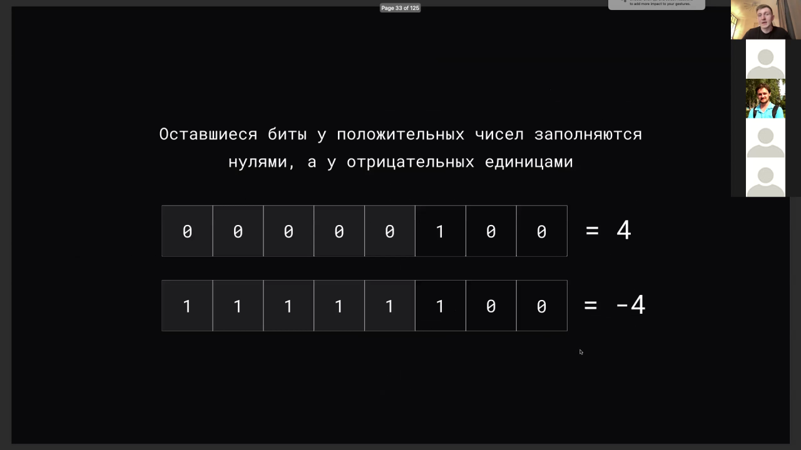

> [!quote]- Кадр [01:20:04]
> 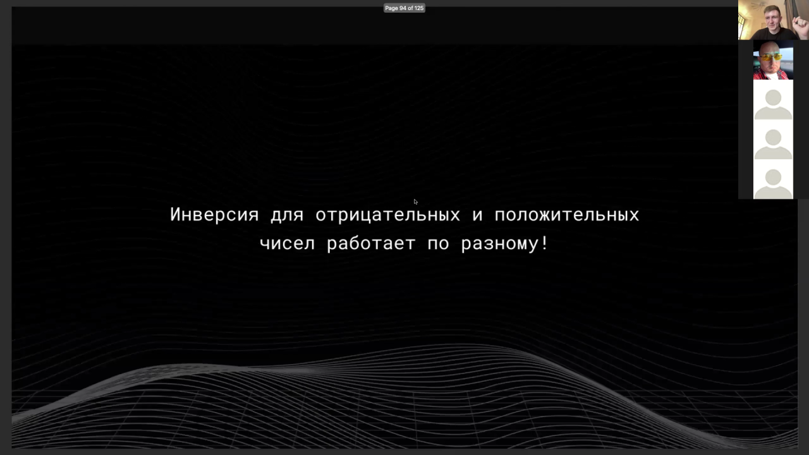

> [!quote]- Кадр [00:37:47]
> 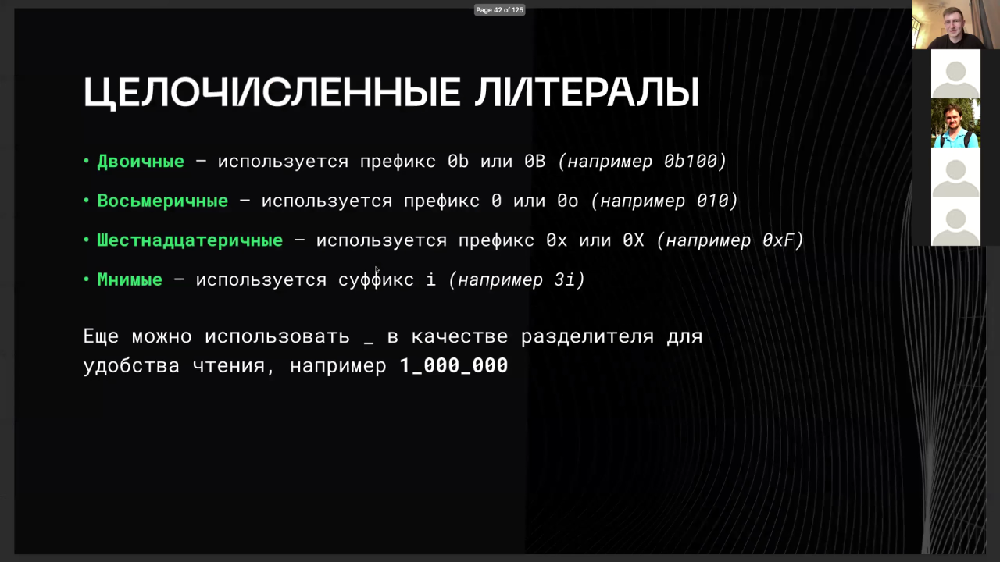

> [!quote]- Кадр [00:35:51]
> 

> [!quote]- Кадр [00:29:20]
> 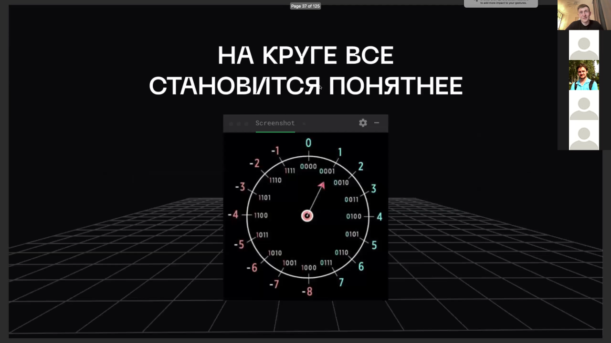

> [!quote]- Кадр [00:31:30]
> 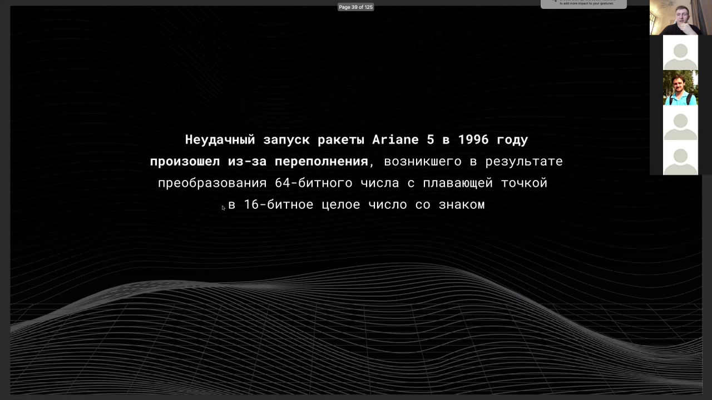

## 4. Указатели: основы, уровни косвенности, unsafe и арифметика

Указатель — переменная, хранящая адрес ячейки памяти или `nil`; адрес берётся через `&`, разыменование — через `*`. В Go параметры копируются, поэтому чтобы изменить значение, нужно передать указатель и разыменовать его; при передаче указателя копируется сам указатель, и переназначение локальной копии не меняет оригинал. Указатель на указатель (`**T`) добавляет уровень косвенности: для доступа к значению нужно разыменовывать несколько раз. Чтобы изменить сам указатель, в функцию передают `**T` и разыменовывают один раз. В Go нет арифметики указателей, как в C/C++, но можно использовать пакет `unsafe`: `uintptr` — это просто число (адрес), семантически не указатель, и сборщик мусора (GC) о нём не знает; `unsafe.Pointer` позволяет конвертировать указатели любого типа, но код с `unsafe` не защищён правилами совместимости (compatibility guideline) и легко приводит к трудноуловимым багам, поэтому его следует использовать только при реальной необходимости и прятать за абстракциями.

```go
var value int32 = 100
var pointer *int32 = &value

*pointer = 500

func process(temp *int32) {
	var value2 int32 = 200
	temp = &value2
}

func process(temp **int32) {
	var value2 int32 = 200
	*temp = &value2
}

func main() {
	x := new(int)
	y := new(int)

	ptrX := unsafe.Pointer(x)
	addressY := uintptr(unsafe.Pointer(y))

	// arithmetic operation
	_ = addressY + 2
	_ = addressY - 2

	runtime.GC()

	*(*int)(ptrX) = 100
	*(*int)(unsafe.Pointer(addressY)) = 300 // dangerous
}
```

*Источник: [00:20:53], [00:39:08], [00:39:38], [00:40:26], [00:42:02], [00:42:42], …*

> [!quote]- Кадр [00:39:08]
> 

> [!quote]- Кадр [00:39:38]
> 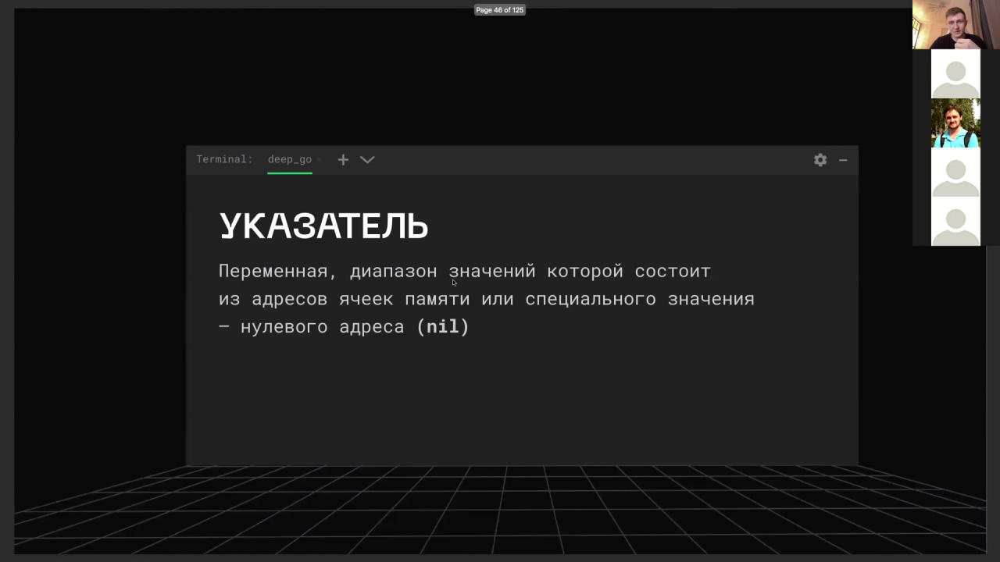

> [!quote]- Кадр [00:52:29]
> 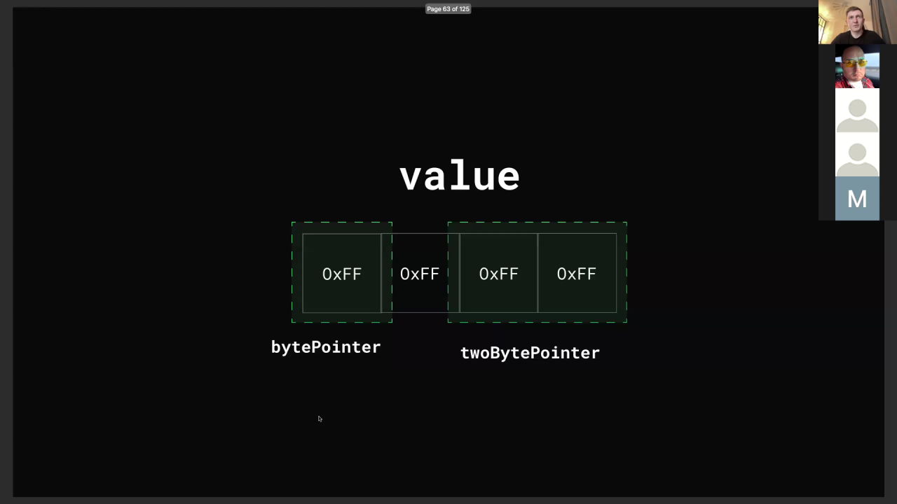

> [!quote]- Кадр [00:54:36]
> 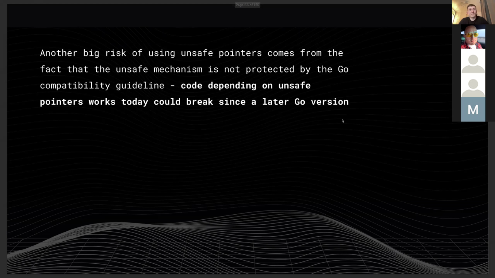

> [!quote]- Кадр [00:49:36]
> 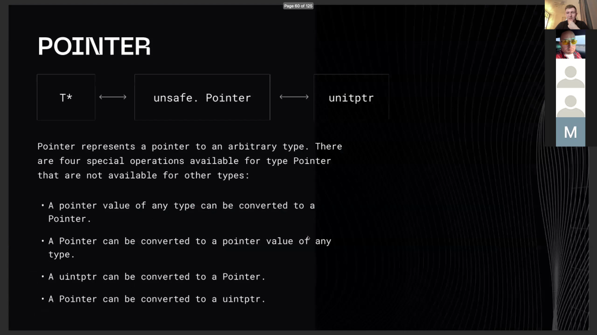

## 5. Выравнивание и сегменты памяти

Выравнивание типов данных нужно для более быстрой работы процессора: компилятор задаёт выравнивание, жертвуя памятью. Выравнивание N означает размещение по адресу, кратному N, что позволяет процессору прочитать данные атомарно за одну операцию. 8-байтовые значения (`int64`) на 64-битной системе выравниваются по 8 байт, на 32-битной — по 4; выравнивание не связано с размером переменной. При загрузке программа раскладывается на сегменты: код, глобальные переменные, стек и хип (heap). Стек в Go растёт вниз, к младшим адресам, поэтому арифметика указателей «вверх» к соседней переменной бессмысленна. Операционная система защищает чужое адресное пространство и «роняет» процесс (крашит) при попытке работы с ним.

```go
ptrX := unsafe.Pointer(x)
addressY := uintptr(unsafe.Pointer(y))

*(*int)(ptrX) = 100
*(*int)(unsafe.Pointer(addressY)) = 300 // dangerous
```

| Понятие | Что означает |
|---|---|
| Выравнивание | адрес памяти должен быть кратен определённому числу байт |
| Размер | сколько байт занимает переменная |

> [!info] Зачем это нужно
> Нужно для более быстрой работы процессора.

*Источник: [00:10:43], [00:11:43], [00:12:43], [00:12:55], [00:13:55], [00:14:35], …*

> [!quote]- Кадр [00:11:43]
> 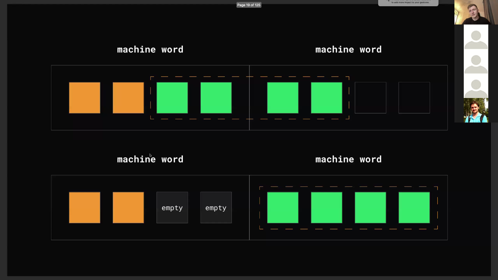

> [!quote]- Кадр [00:12:43]
> 

> [!quote]- Кадр [00:12:55]
> 

> [!quote]- Кадр [00:19:31]
> 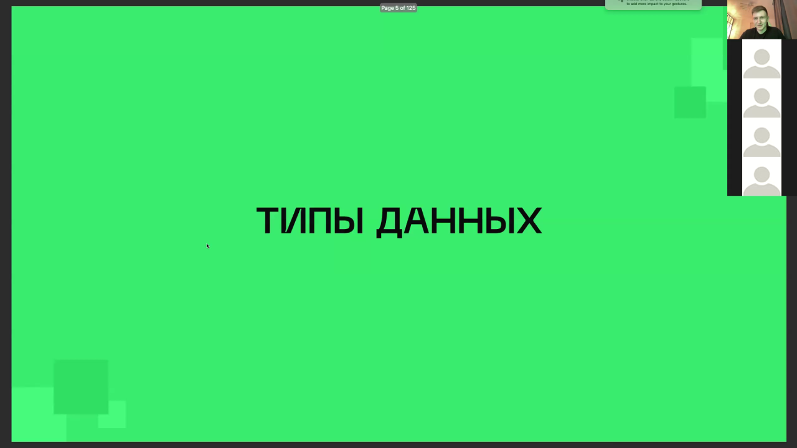

> [!quote]- Кадр [01:02:16]
> 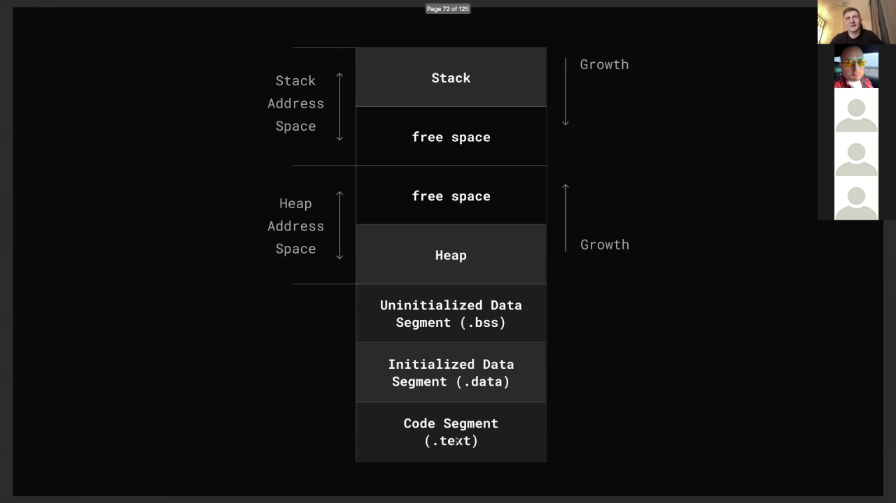

## 6. Порядок байтов (endianness)

Порядок байтов (endianness) — это вопрос о том, в каком порядке байты многобайтового числа записываются в памяти или передаются по линиям связи. Проблема порядка байтов возникает и для строк, представленных более чем одним байтом. **Big Endian** — порядок байтов от старшего к младшему: число записывается слева направо, как мы привыкли (например, 123). **Little Endian** — обратный порядок (число 123 записывается как 321), от младшего к старшему; он принят в памяти персональных компьютеров с процессорами архитектуры x86. При переходе между порядками меняется только порядок следования байтов, а биты остаются в той же последовательности. Big Endian — стандарт для протоколов TCP/IP, поэтому его часто называют «сетевым порядком байтов»; порядок записи байтов в памяти x86 иногда называют интеловским порядком. Современные процессоры x86 работают с одно-, двух-, четырёх- и восьмибайтовыми операндами; при little-endian увеличение размера операнда не меняет значение первого байта: `3210 → 3210 0000`, тогда как при big-endian значение изменилось бы, например `0123 → 0000 0123`. Пример из практики: сервисы на JVM-стеке (Scala или Java) общались через in-memory базу данных; это антипаттерн, но в тех ситуациях он был оправдан из-за низкой задержки (low latency) — нужно было отвечать за 100 миллисекунд. Старая версия базы не умела сжимать данные, поэтому сжатие делалось вручную: в первые 4 байта записывался размер исходных несжатых данных, чтобы C++-приложение при разжатии понимало, какой буфер выделить. Java-приложение на JVM-стеке, как правило, использует Big Endian; если забыть про порядок байтов, возникает баг: при разжатии числа приходят в другом формате и интерпретируются неверно — размер локации в 10 килобайт превращается в гигабайт.

| | Big Endian | Little Endian |
|---|---|---|
| Порядок | от старшего к младшему | от младшего к старшему |
| Пример 123 | 123 | 321 |
| Применение | сетевой порядок (TCP/IP) | интеловский порядок, x86 |

> [!info] Зачем это нужно
> Оправдано из-за низкой задержки (low latency) — нужно было отвечать за 100 миллисекунд.

*Источник: [01:10:49], [01:11:21], [01:12:08], [01:45:58], [01:46:58], [01:47:59]*

> [!quote]- Кадр [01:10:49]
> 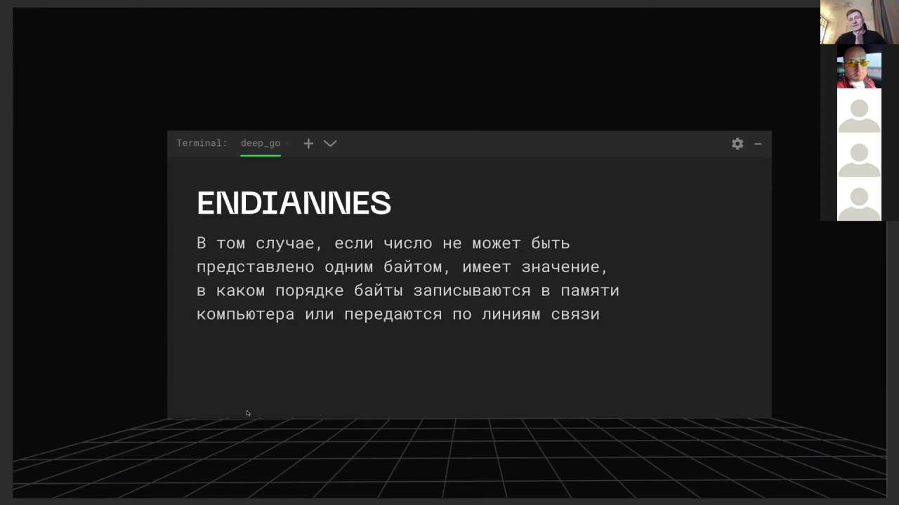

> [!quote]- Кадр [01:47:59]
> 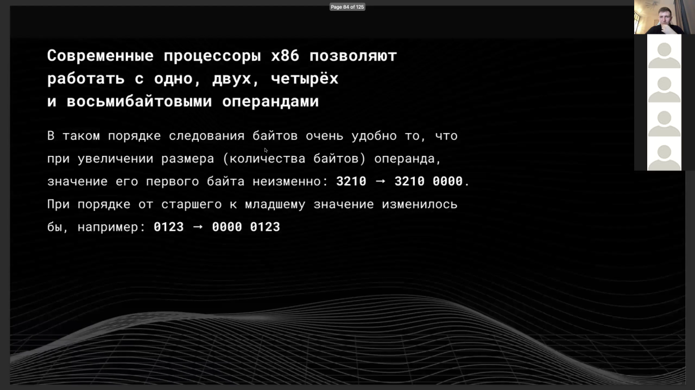

## 7. Битовые операции: И, сдвиги, ^, степень двойки, чётность

Побитовое И даёт единицу в результате только тогда, когда оба бита равны единице: в примере `3 & 5` даёт 1, так как `0011 & 0101 = 0001`. При сдвиге влево на N битов биты перемещаются влево, всё вышедшее за границы отбрасывается, а освободившиеся биты становятся нулями. При сдвиге вправо вышедшие за границы биты пропадают, а сам сдвиг выполняется так же. Число, являющееся степенью двойки, в двоичном представлении содержит ровно одну единицу: чтобы проверить это, из числа вычитают 1 и применяют побитовое И — если результат равен 0, число является степенью двойки. Функция `IsPowerOfTwo` возвращает `true`, если `value > 0` и `value&(value-1) == 0`. У чётных чисел последний бит равен 0, поэтому `IsEven` проверяет чётность через побитовое И с 1; с точки зрения математики 0 — чётное число. Проверка чётности через `i & 1` может работать быстрее, чем через остаток `i % 2` (это подтверждается бенчмарками), но если разницы нет — значит, компилятор сам преобразует операцию: это «магия компилятора». Сдвиг `n << m` эквивалентен умножению `n` на 2 в степени `m`: например, `1 << 10` — это 2^10 = 1024, то есть 1 КБ. В примере переменные `x` типа `uint8` и `y` типа `int8` инициализируются значением 3; оператор `^` применяется к обеим переменным и демонстрирует побитовую инверсию, результаты `^x` и `^y` выводятся через `fmt.Println`.

```go
func main() {
    var x int8 = 3   // 0011
    var y int8 = 5   // 0101
    var result = x & y // 0001
}

func IsPowerOfTwo(value int) bool {
	return value > 0 && value&(value-1) == 0
}

func IsEven(number int) bool {
    return number & 1 == 0
}

var result int

func BenchmarkEven1(b *testing.B) {
	for i := 1; i < b.N; i++ {
		result = i & 1
		_ = result
	}
}

func BenchmarkEven2(b *testing.B) {
	for i := 1; i < b.N; i++ {
		result = i % 2
		_ = result
	}
}

package main

import "fmt"

func main() {
	var x uint8 = 3
	var y int8 = 3

	fmt.Println(^x)
	fmt.Println(^y)
}
```

| Операция | Как проверяет |
|---|---|
| i & 1 | чётность через последний бит |
| i % 2 | остаток от деления |

*Источник: [01:18:16], [01:19:16], [01:20:10], [01:21:56], [01:22:23], [01:22:45], …*

> [!quote]- Кадр [01:20:10]
> 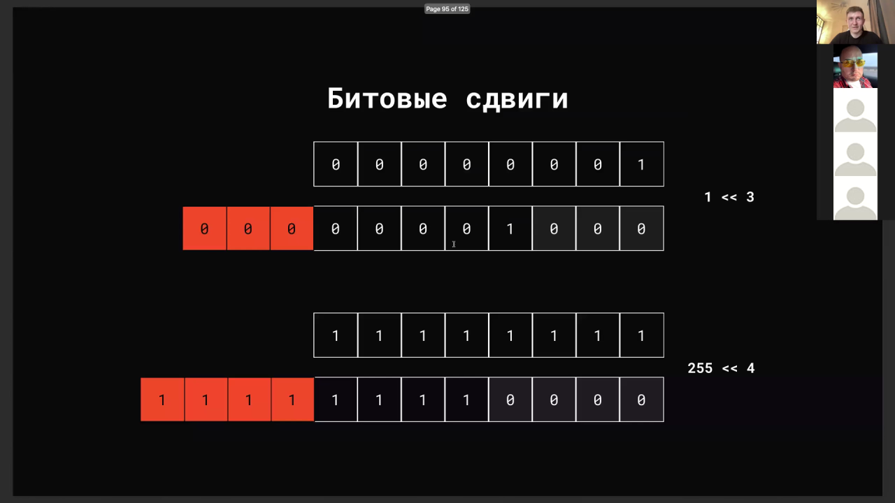

> [!quote]- Кадр [01:22:23]
> 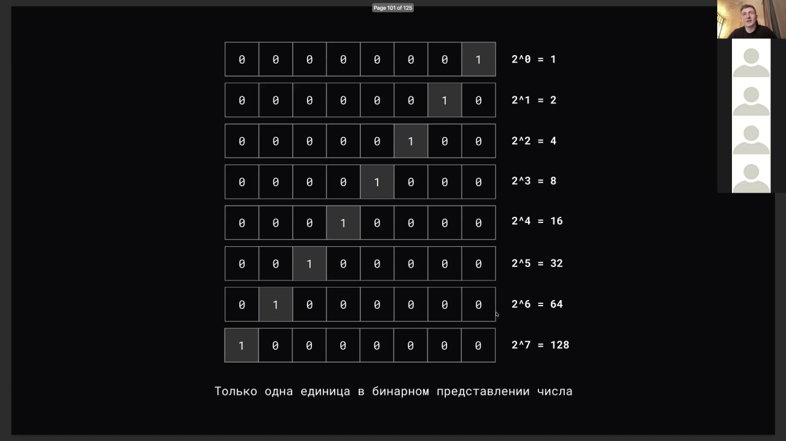

> [!quote]- Кадр [01:37:35]
> 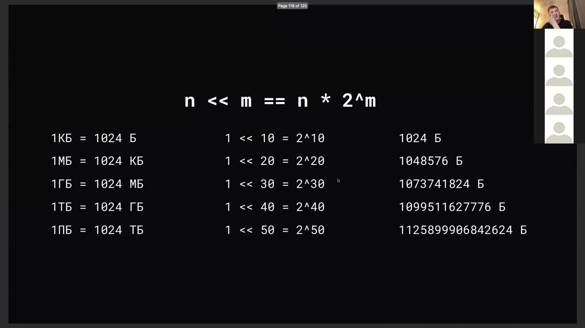

> [!quote]- Кадр [01:21:56]
> 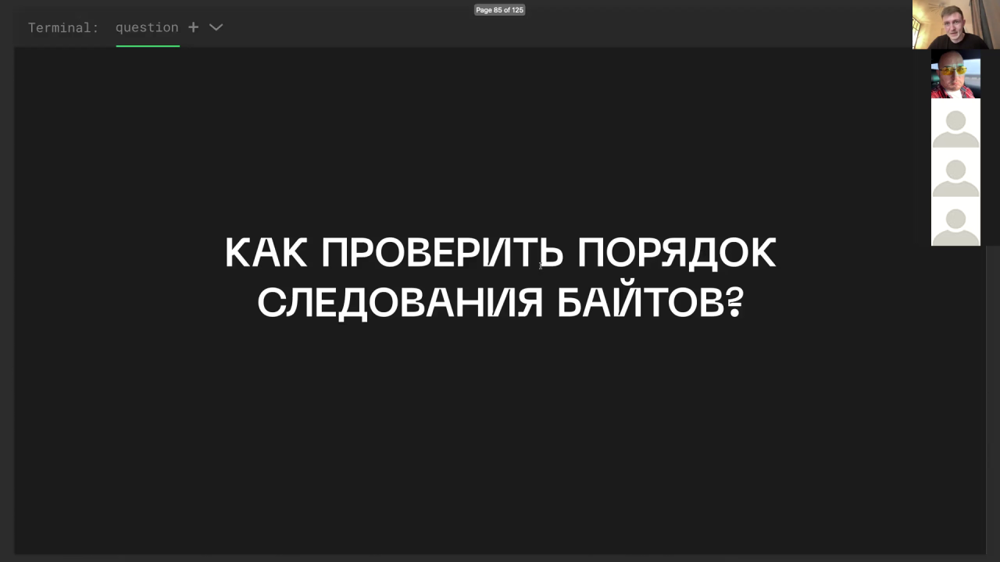

## 8. Применение битовых операций: BitMask, уникальные числа, IPv4

Битовая карта (битсет, битмап) — последовательность двоичных разрядов; каждый атрибут кодируется отдельным битом, единица означает наличие свойства, что позволяет компактно хранить дискретные параметры. Паттерн битовой маски (BitMask) комбинирует флаги через побитовое ИЛИ, а проверка установленного флага — через `mask&Flag`; альтернативно режимы можно описывать структурой с булевыми полями. XOR ставит единицу при разных битах и обнуляет одинаковые, поэтому для поиска числа, встречающегося один раз среди дубликатов, достаточно XOR всех элементов. Дубликаты можно искать через `map` или битовую маску: для числа проверяют `lookUp&(1<<number) != 0`, иначе устанавливают бит `lookUp |= 1 << number`. IPv4-адрес (четыре 8-битных числа) можно хранить как `uint32` (4 байта вместо до 15 байт строки), разбивая строку по точке и собирая число через сдвиги, но применять это нужно только при необходимости, пряча за абстракциями.

```go
func Open(filename string, mask int8) {
	if mask&OpenModeIn == 1 {
		fmt.Println("in mode")
	}
	if mask&OpenModeOut == 1 {
		fmt.Println("out mode")
	}
	if mask&OpenModeAppend == 1 {
		fmt.Println("append mode")
	}
	if mask&OpenModeBinary == 1 {
		fmt.Println("binary mode")
	}

	// implementation...
}

func main() {
	Open("data.bin", OpenModeIn|OpenModeBinary) // 0000 1001
	Open("data.bin", OpenModeIn|OpenModeOut)    // 0000 0011
	Open("data.bin", OpenModeAppend)            // 0000 0100
}

type Mode struct {
	OpenModeIn     bool
	OpenModeOut    bool
	OpenModeAppend bool
	OpenModeBinary bool
}

var (
	OpenModeInBinary = Mode{OpenModeIn: true, OpenModeBinary: true}
	OpenModeInOut    = Mode{OpenModeIn: true, OpenModeOut: true}
	OpenModeAppend   = Mode{OpenModeAppend: true}
)

package main

import "fmt"

func main() {
	var array = [...]int8{2, 3, 4, 2, 3, 3, 4}

	var number int8
	for _, element := range array {
		fmt.Printf("%08b ^ %08b = %08b\n", number, element, number^element)
		number ^= element
	}

	fmt.Printf("\nResult: %08b\n", number)
}

func HasDuplicatesFrom1To7WithBits(data []int) bool {
	var lookUp, number int
	for _, number := range data {
		if lookUp&(1<<number) != 0 {
			return true
		}
		lookUp |= 1 << number
	}
	return false
}

// 4byte => 15byte
func Convert(address string) (uint32, error) {
	const octetsCount = 4
	segments := strings.Split(address, ".")
	if len(segments) != octetsCount {
		return 0, fmt.Errorf("invalid IPv4 address")
	}

	var result uint32 // also possible [4]byte
	for idx := 0; idx < octetsCount; idx++ {
		number, err := strconv.Atoi(segments[idx])
		if err != nil {
			return 0, err
		}

		if number < 0 || number > 255 {
			return 0, fmt.Errorf("invalid IPv4 address")
		}

		bitOffset := (octetsCount - idx - 1) * 8
		result |= uint32(number << bitOffset)
		fmt.Printf("%08b = %d\n", number, number)
	}

	return result, nil
}
```

> [!info] Зачем это нужно
> Битовый способ применяют, когда ограничены по памяти или хотят её экономить: при петабайтах экономия даже одного-нескольких процентов даёт существенный результат, а при гигабайтах и терабайтах не стоит усложнять код.

*Источник: [01:25:15], [01:25:32], [01:25:36], [01:27:19], [01:27:38], [01:27:49], …*

> [!quote]- Кадр [01:25:32]
> 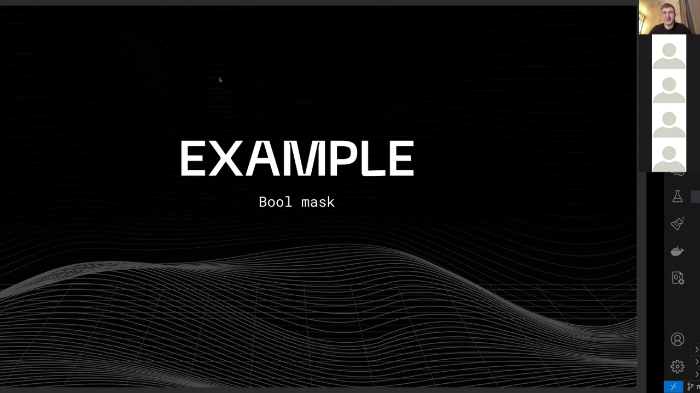

> [!quote]- Кадр [01:27:19]
> 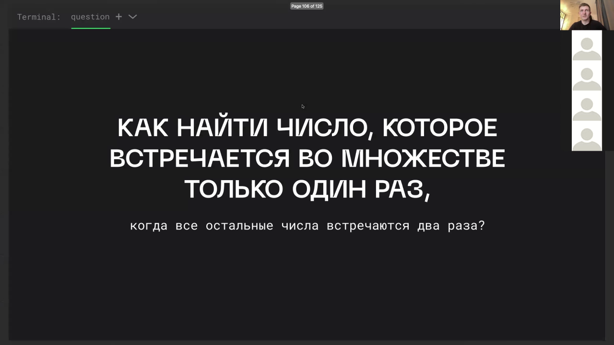

> [!quote]- Кадр [01:30:36]
> 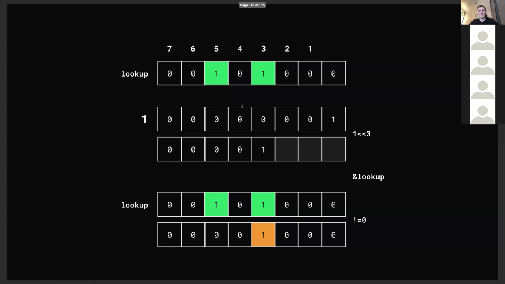

> [!quote]- Кадр [01:31:08]
> 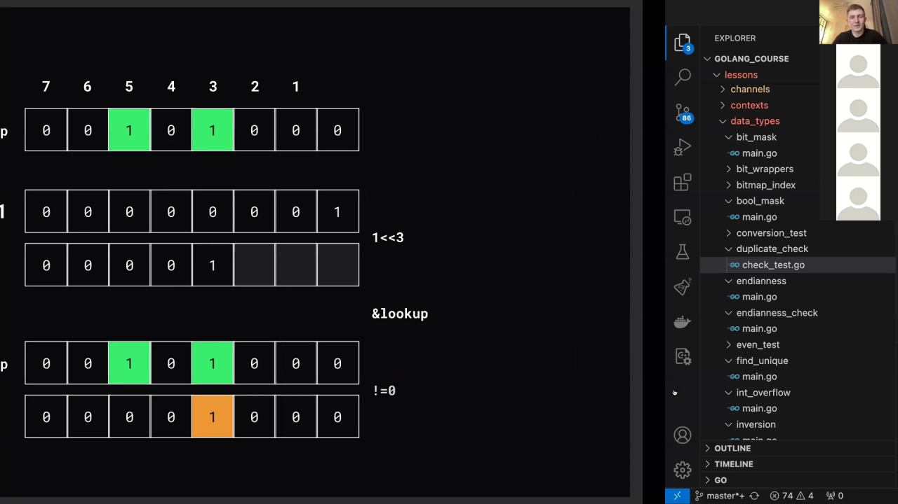

## 9. Встраивание функций (инлайнинг)

Компилятор может встраивать функцию прямо в место вызова. Выигрыш не теряется даже при вызове множества функций.

*Источник: [01:42:22]*

> [!quote]- Кадр [01:42:22]
> 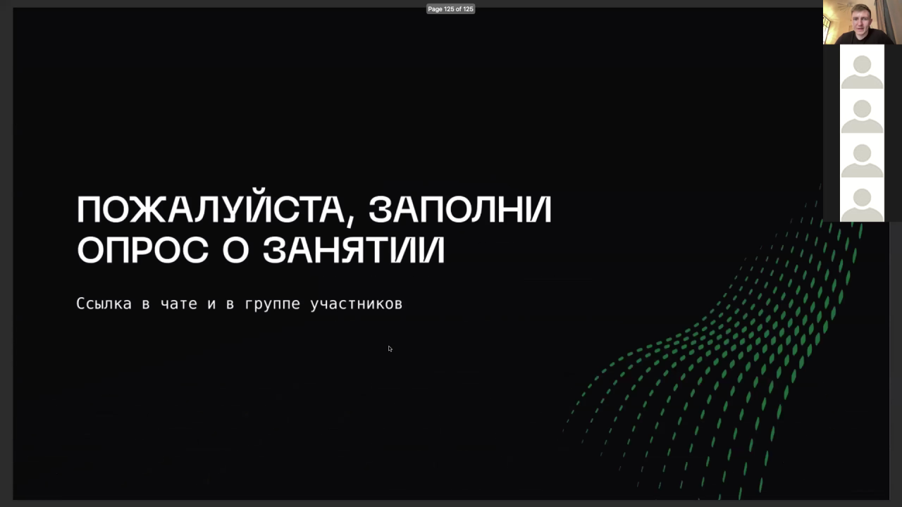

## 10. Форматы записи даты

В России дату обычно записывают в формате день/месяц/год (23.04.2023), а в США — месяц/день/год (04.23.2023). Если получатель или знакомый в США увидит дату в российском формате, он может неправильно понять, когда произойдёт событие. Это особенно актуально, если день меньше 13.

| Формат | Пример | Регион |
|---|---|---|
| день/месяц/год | 23.04.2023 | Россия |
| месяц/день/год | 04.23.2023 | США |

*Источник: [01:12:49], [01:14:00], [01:16:42]*

> [!quote]- Кадр [01:12:49]
> 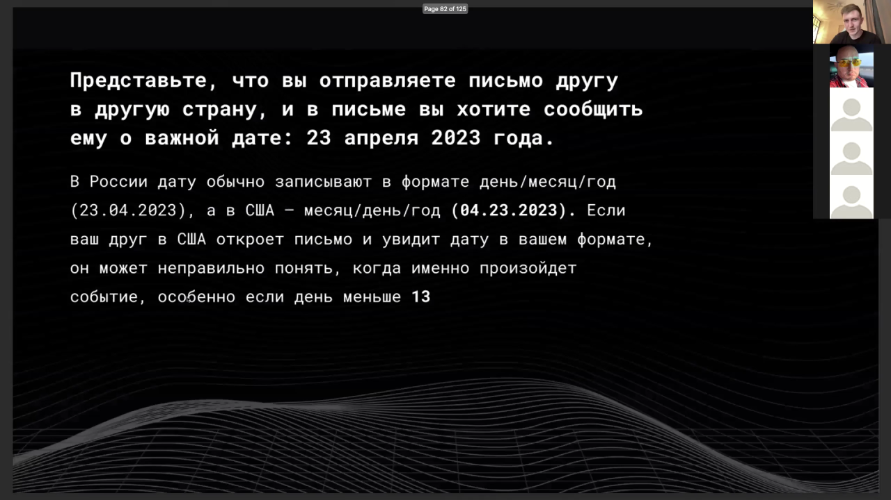

## 11. defer фиксирует аргумент status

В функции `process` объявлен отложенный вызов анонимной функции с аргументом `s`: `defer func(s string) { notify(s) }(status)`. Значение `status` передаётся в момент вызова `defer`. В одном примере переменной `status` присваивается `StatusErr`, в другом — `StatusError` (уже после объявления `defer`), но отложенный вызов всё равно получит старое значение.

```go
func process() {
	var status string
	defer func(s string) {
		notify(s)
	}(status)

	// processing...
	status = StatusError
}

func process() {
	var status string
	defer func(s string) {
		notify(s)
	}(status)

	// processing...
	status = StatusErr
}
```

*Источник: [01:53:49], [01:53:51], [01:53:54]*

## Схема

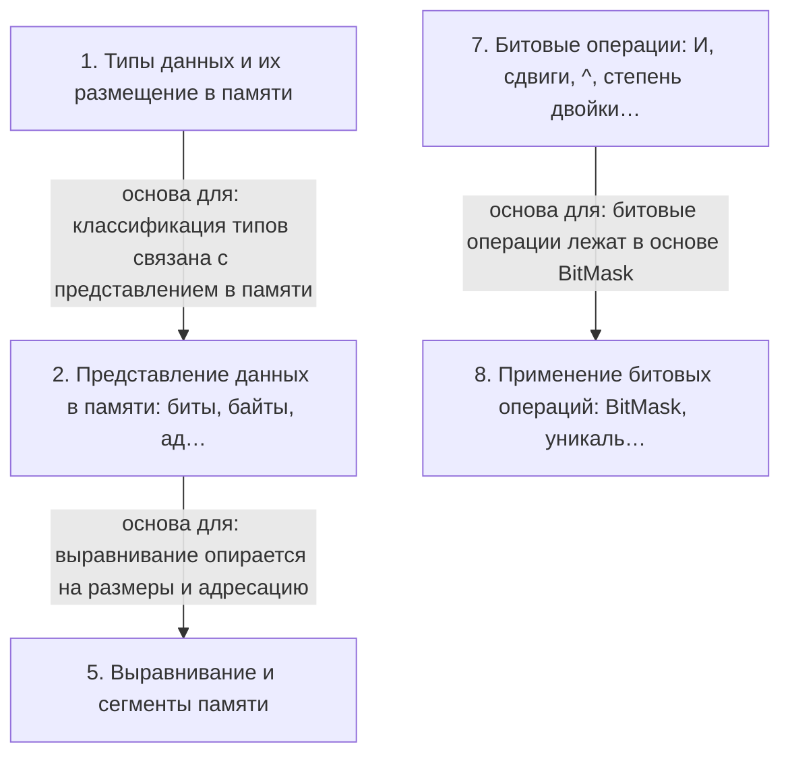

## Итог

> [!success] Что в итоге
> Тип данных определяется множеством значений, операций и выделенной памятью; в Go типы делятся на примитивные и составные, у каждого типа есть нулевое значение. Данные в памяти — это набор битов, который интерпретирует программа: знаковые числа кодируются дополнительным кодом, а размер `int`/`uint` и машинного слова зависит от архитектуры; выравнивание нужно для более быстрой работы процессора. Указатели дают уровень косвенности: адрес берётся через `&`, разыменовывается через `*`, при передаче копируется, а чтобы изменить сам указатель, нужен указатель на указатель; `unsafe` и битовые операции требуют осторожности. Переполнение проявляется «зацикливанием» в runtime и ошибкой компиляции для констант, а битовые операции позволяют компактно кодировать дискретные параметры и решать задачи поиска уникального числа и дубликатов.
