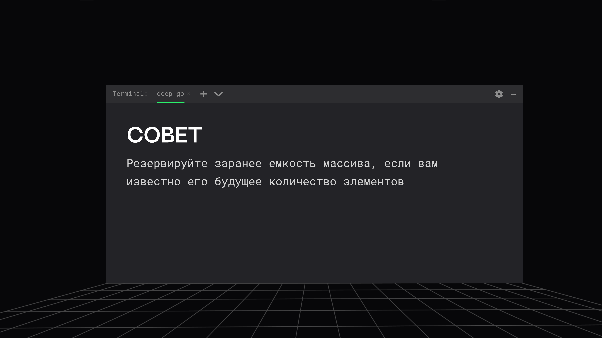

# Массивы и срезы в Go

> [!abstract] Обзор
> Лекция по массивам и срезам в Go. Объясняется, как работают массивы и срезы, их отличия, особенности и рекомендации по использованию. Также рассматриваются вопросы оптимизации, безопасного доступа к памяти, работы с пустыми и нулевыми срезами, а также методы копирования и управления памятью.

> [!info] Курс
> [[index|Оглавление курса]]

## Оглавление
1. [[#1. Индексация массива]]
2. [[#2. Срезы массива]]
3. [[#3. Срез с указанием емкости]]
4. [[#4. Полуинтервал [x; y)]]
5. [[#5. Паника при выходе за пределы среза]]
6. [[#6. Механизм сбора мусора в Go]]
7. [[#7. Коэффициент роста массива]]
8. [[#8. Резервирование емкости]]
9. [[#9. Проверка длины среза]]
10. [[#10. Функция copy в Go]]

## 1. Индексация массива

Для вычисления адреса элемента нужно умножить индекс на размер элемента. У массива есть начало, и это является адресом начала массива. Элементы массива могут быть разного размера, от 1 до 10 байтов.

> [!info] Зачем это нужно
> Позволяет понять, как работает доступ к памяти в Go.

## 2. Срезы массива

Срезы извлекают элементы из массива. temp = data[1:3] извлекает элементы с индексами 1 и 2. temp = data[:] создаёт копию массива data.

```go
temp = data[1:3]
temp = data[:]
```

> [!info] Зачем это нужно
> Срезы позволяют работать с подмножествами массива.

## 3. Срез с указанием емкости

Срез с указанием емкости позволяет управлять ростом среза. temp = data[1:3:4] задаёт емкость среза, что влияет на эффективность роста.

```go
temp = data[1:3:4]
```

> [!info] Зачем это нужно
> Позволяет оптимизировать работу с динамическими массивами.

## 4. Полуинтервал [x; y)

Полуинтервал включает x, но не включает y. Это стандартное поведение для срезов и индексации в Go.

> [!info] Зачем это нужно
> Помогает избежать ошибок при работе с диапазонами.

## 5. Паника при выходе за пределы среза

В Go обращение за пределы среза вызывает панику в рантайме. Длина среза не известна на этапе компиляции, поэтому компилятор не проверяет границы.

> [!info] Зачем это нужно
> Позволяет обнаруживать ошибки в runtime.

## 6. Механизм сбора мусора в Go

В Go сборка мусора автоматизирована. Объекты, на которые никто не ссылается, удаляются автоматически. Это упрощает управление памятью.

> [!info] Зачем это нужно
> Упрощает разработку и снижает вероятность утечек памяти.

## 7. Коэффициент роста массива

Коэффициент роста массива может варьироваться: от 2x для малых массивов до 1.25x для больших. Это оптимизирует использование памяти.

```go
1 Transition from growing 2x for small slices
2 to growing 1.25x for large slices.
```

> [!info] Зачем это нужно
> Позволяет оптимизировать производительность при динамическом росте.

## 8. Резервирование емкости

Резервируйте заранее емкость массива, если вам известно его будущее количество элементов. Релокации и перекопировка элементов работают не быстро. Это особенно важно при работе с динамическими массивами, где требуется расширение размера.

```go
data := make([]int, 0, 10)
data = append(data, 1, 2, 3)
```

> [!info] Зачем это нужно
> Резервирование емкости уменьшает частоту перераспределения памяти.

> [!quote]- Слайд
> 

## 9. Проверка длины среза

Длина среза используется для определения, является ли он пустым или нулевым. При изменении длины/емкости одного среза, изменения никак не отражаются на другом срезе! Проверяйте дюйм среза — это лучший способ для проверки пустых и нулевых срезов.

```go
data := make([]int, 0, 5)
fmt.Println(len(data), cap(data))
```

> [!info] Зачем это нужно
> Проверка длины среза помогает избежать ошибок при работе с нулевыми и пустыми срезами.

## 10. Функция copy в Go

Функция copy копирует элементы из source в destination. Копирование происходит по индексам, и количество скопированных элементов определяется минимальной длиной.

> [!info] Зачем это нужно
> Позволяет копировать данные между срезами.

