# Урок 2. Массивы и срезы

> [!abstract] Обзор
> Материал объединяет тему массивов и срезов в Go. Разбираются свойства массивов фиксированного размера — статическая длина, равная ёмкости, невозможность nil, размещение размера в типе, — а также создание, сравнение, присваивание, проверки границ (bound-чеки) и доступ по индексу через арифметику указателей. Отдельно рассматриваются цикл for range и его формы, оптимизации горячих циклов, передача массивов и размещение в памяти через анализ убегания (escape analysis). Срезы описаны как динамические массивы с нулевым значением (zero value) nil, созданием через литералы и make, нарезкой, функцией append и стратегиями роста. Затронуты риски unsafe, поведение при выходе за длину и capacity, slices.Grow, удаление элементов, удержание памяти подсрезами, порог аллокации 64 КБ, а также clear, различие пустого и нулевого среза и сравнение срезов.

> [!info] Курс
> [[index|Оглавление курса]]

## Оглавление
1. [[#1. Массивы: свойства, создание и инициализация]]
2. [[#2. Сравнение, bound-чеки и компиляция массивов и срезов]]
3. [[#3. Размещение массивов и срезов в памяти, escape-анализ]]
4. [[#4. Срезы: создание, nil, пустой срез и JSON]]
5. [[#5. Границы срезов, нарезка и slices.Grow]]
6. [[#6. append, рост срезов и общий буфер]]
7. [[#7. Удаление, подрезка, clear и управление памятью]]
8. [[#8. Цикл for range и оптимизации горячих циклов]]
9. [[#9. unsafe: выход за границы, совместимость и риски]]
10. [[#10. Сигнатура Read и переиспользование буфера]]

**Схема** — [[#Схема]]
**Итог** — [[#Итог]]

## 1. Массивы: свойства, создание и инициализация

Массив — структура данных фиксированного размера, хранящая последовательные элементы одного типа; количество элементов статическое и вшито в тип. Массив всегда инициализирован значениями по умолчанию, не бывает nil; его длина и ёмкость равны. Создаётся с указанием размерности, можно использовать [...] для автоматического вычисления размера; при частичной инициализации оставшиеся элементы заполняются нулями. Длину массива нельзя задать переменной, но len для массива вычисляется на этапе компиляции. Массивы [0]int и [10]struct{} имеют размер 0 байт.

```go
func zeroArray() {
	var data [0]int
	fmt.Println(unsafe.Sizeof(data)) // 0
}

var data1 [5]int                  // [0 0 0 0 0]
var data2 [2][5]int               // [[0 0 0 0 0] [0 0 0 0 0]]
data3 := [...]int{1, 2, 3}        // [1 2 3]
data4 := [5]int{1, 2, 3}          // [1 2 3 0 0]

data5 := [5]int{3: 4}             // [0 0 0 4 0]
data6 := [5]int{2: 5, 6, 1: 7}   // [0 7 5 6 0]

func arrayCreation() {
	length1 := 100
	var data1 [length1]int // compilation error
	_ = length1
	_ = data1
}

array[0] = *(array + 0 * 2) // *(0xA02 + 0 * 2) = 0xA2
array[1] = *(array + 1 * 2) // *(0xA02 + 1 * 2) = 0xA4
array[2] = *(array + 2 * 2) // *(0xA02 + 2 * 2) = 0xA6
array[3] = *(array + 3 * 2) // *(0xA02 + 3 * 2) = 0xA8

type account struct {
    balance int
}

func BenchmarkWithPointers(b *testing.B) {
    accounts := [...]*account{
        {balance: 100},
        {balance: 200},
        {balance: 300},
    }

    b.ResetTimer()
    for i := 0; i < b.N; i++ {
        for _, a := range accounts {
            a.balance += 1
        }
    }
}

func main() {
	data1 := [3]int{1, 2, 3}
	data2 := [2]int{1, 2}
	data1 = data2 // compilation error
}

data := [5]int{ 1, 2, 3, 4, 5 }
length := len(data) // => 5

func accessToElement1() {
	data := [3]int{1, 2, 3}

	idx := 4
	fmt.Println(data[idx]) // panic

	fmt.Println(data[4]) // compilation error
}

//go:noinline
func allocation() *[10]int {
	var data [10]int
	return &data
}

./main.go:5:6: can inline main
./main.go:9:6: moved to heap: arr

var x = []string{"1"}

for i, s := range x {
	print(i, s, ",")
	x[i+1] = "M"
	x = append(x, "Z")
	x[i+1] = "Z"
}

a := []int{0, 1, 2, 3}
x := a[1:]
y := a[2:]

x = append(x, y...)
x = append(x, y...)

fmt.Println("a:", a)
fmt.Println("x:", x)

var array *[4]int // = nil

for idx := range array { // ok
	fmt.Println(idx)
}

for idx, value := range array { // panic
	fmt.Println(idx, value)
}

func cp(dst, src []int) {
	minLength := min(len(dst), len(src))
	for idx := 0; idx < minLength; idx++ {
		dst[idx] = src[idx]
	}
}

func main() {
	src := []int{1, 2, 3, 4, 5}
	dst := make([]int, 3)
	copy(dst, src)

	fmt.Println("src", src)
	fmt.Println("dst", dst)
}

src := []int{ 0, 1, 2 }
dst := append([]int(nil), src...)

src := []int{ 0, 1, 2 }
dst := slices.Clone(src)

src := []int{1, 2, 3}
var dst []int
copy(dst, src)
fmt.Println("copied:", dst)

func main() {
	data := [...]int{1, 2, 3}
	for value := range data { // copy of array
		fmt.Println(value)
	}

	for value := range &data { // not a copy of array
		fmt.Println(value)
	}

	for value := range data[:] { // not a copy of array
		fmt.Println(value)
	}
}

third := []int{1, 2, 3, 4, 5}
clear(third)
fmt.Println("third:", third, " : ", len(third), " : ", cap(third))

fourth := []int{1, 2, 3, 4, 5}
clear(fourth[1:3])
fmt.Println("fourth:", fourth, " : ", len(fourth), " : ", cap(fourth))

second := []int{1, 2, 3, 4, 5}
second = second[:0]
fmt.Println("second:", second, " : ", len(second), " : ", cap(second))

func FindData(filename string) []byte {
	data := make([]byte, 1<<30) // for example read from file

	for i := 0; i < len(data)-1; i++ {
		if data[i] == 0xFF && data[i+1] == 0x00 {
			partData := make([]byte, 20)
			copy(partData, data[i:])
			return partData
		}
	}

	return nil
}

func main() {
	data := FindData("data.bin")
	_ = data
}

var numbers = make([]int, 1<<30)
pointer := FindElement(numbers, 0)
_ = pointer

runtime.KeepAlive(pointer)

printAllocs()
runtime.GC()
printAllocs()

func main() {
	data := make([]byte, 1<<31)

	printAllocs()
	runtime.GC()
	printAllocs()
	fmt.Println(len(data))
}

func FindElement(numbers []int, target int) *int {
	for idx := range numbers {
		if numbers[idx] == target {
			return &numbers[idx]
		}
	}

	return nil
}

func main() {
	var numbers = make([]int, 1, 30)
	pointer := FindElement(numbers, 0)
	_ = pointer

	runtime.KeepAlive(pointer)

	printAllocs()
	runtime.GC()
	printAllocs()
}

func FindElement(numbers []int, target int) *int {
	for idx := range numbers {
		if numbers[idx] == target {
			return &numbers[idx]
		}
	}

	return nil
}

func main() {
	var numbers = make([]int, 1, 30)
	pointer := FindElement(numbers, 0)
	_ = pointer
}

func main() {
	var numbers = make([]int, 1<<30)
	pointer := FindElement(numbers, 0)
	_ = pointer

	runtime.KeepAlive(pointer)

	printAllocs()
	runtime.GC()
	printAllocs()
}

package main

// go:build -d=ssa/check_bce

func fn1(data []int, check func(int) bool) []int {
	var idx = 0
	for _, value := range data {
		if check(value) {
			data[idx] = value // Found IsInBounds
			idx++
		}
	}

	return data[:idx] // Found IsSliceInBounds
}

func fn2(lhs, rhs []byte) {
	for idx := range min(len(lhs), len(rhs)) {
		_ = lhs[idx] // Found IsInBounds
		_ = rhs[idx] // Found IsInBounds
	}
}

// go run -gcflags="-d=ssa/check_bce" main.go

func fn1(s []int) {
	for i := range s {
		_ = s[i]
		_ = s[i:]
		_ = s[i+1:]
	}
}

func fn2(s []int) {
	for i := 0; i < len(s); i++ {
		_ = s[i]
		_ = s[i:]
		_ = s[i+1:]
	}
}

func fn1(s []int) {
	for i := range s {
		_ = s[i]
		_ = s[i:]
		_ = s[i+1:]
	}
}

func fn2(s []int) {
	for i := 0; i < len(s); i++ {
		_ = s[i]
		_ = s[i:]
		_ = s[i+1:]
	}
}

func cat2(s string) string {
	return string(str[3]) + // Found IsInBounds
		string(str[2]) +
		string(str[1]) +
		string(str[0])
}

// go test -gcflags="-d=ssa/check_bce" -bench=. bench_test.go

func cat1(str string) string {
	return string(str[0]) // Found IsInBounds
}

func cat2(s string) string {
	return string(str[3]) + // Found IsInBounds
		string(str[2]) +
		string(str[1]) +
		string(str[0])
}

func findSequence(data []byte) []byte {
	for i := 0; i < len(data)-1; i++ {
		if data[i] == 0xFF && data[i+1] == 0xEE {
			return data[i : i+20]
		}
	}

	return nil
}

func sum2(values []int, size int) int {
	sum := 0
	elemSize := unsafe.Sizeof(sum)
	start := unsafe.Pointer(unsafe.SliceData(values))
	for i := 0; i < size-1; i++ {
		sum += *(*int)(unsafe.Add(start, uintptr(i)*elemSize))
	}

	return sum
}

func makeDirty(size int) []byte {
	var sb strings.Builder
	sb.Grow(size)

	pointer := unsafe.StringData(sb.String())
	return unsafe.Slice(pointer, size)
}

type slice struct {
	data unsafe.Pointer
	len  int
	cap  int
}

func Transform(data []byte) []int {
	sliceData := unsafe.Pointer(&data[0])
	sizeType := int(unsafe.Sizeof(0))
	length := len(data) / sizeType

	var result []int
	resultPtr := (*slice)(unsafe.Pointer(&result))
	resultPtr.data = sliceData
	resultPtr.len = length
	resultPtr.cap = length

	return result
}

func BenchmarkWithEqualFunction(b *testing.B) {
	lhs := []int{1, 2, 3, 4, 5, 6, 7, 8, 9, 10}
	rhs := []int{1, 2, 3, 4, 5, 6, 7, 8, 9, 10}
	for i := 0; i < b.N; i++ {
		_ = equal(lhs, rhs) // slices.Equal(...)
	}
}

func BenchmarkWithReflect(b *testing.B) {
	lhs := []int{1, 2, 3, 4, 5, 6, 7, 8, 9, 10}
	rhs := []int{1, 2, 3, 4, 5, 6, 7, 8, 9, 10}
	for i := 0; i < b.N; i++ {
		_ = reflect.DeepEqual(lhs, rhs)
	}
}

func BenchmarkWithSprint(b *testing.B) {
	lhs := []int{1, 2, 3, 4, 5, 6, 7, 8, 9, 10}
	rhs := []int{1, 2, 3, 4, 5, 6, 7, 8, 9, 10}

	for i := 0; i < b.N; i++ {
		_ = fmt.Sprint(lhs) == fmt.Sprint(rhs)
	}
}

func BenchmarkWithPointers(b *testing.B) {
	accounts := [...]*account{
		{balance: 100},
		{balance: 200},
		{balance: 300},
	}

	b.ResetTimer()
	for i := 0; i < b.N; i++ {
		for _, a := range accounts {
			a.balance += 1
		}
	}
}

func BenchmarkClearWithFive(b *testing.B) {
	data := make([]int, 10*1024)
	for i := 0; i < b.N; i++ {
		for idx := range data {
			data[idx] = 5
		}
	}
}

type CircularQueue struct { ... }

func NewCircularQueue(size int) *CircularQueue // создать очередь с определённым размером буфера
func (q *CircularQueue) Push(value int) bool   // добавить значение в конец очереди (false, если очередь заполнена)
func (q *CircularQueue) Pop() bool            // удалить значение из начала очереди (false, если очередь пустая)
func (q *CircularQueue) Front() int           // получить значение из начала очереди (-1, если очередь пустая)
func (q *CircularQueue) Back() int            // получить значение из конца очереди (-1, если очередь пустая)
func (q *CircularQueue) Empty() bool          // проверить пуста ли очередь
func (q *CircularQueue) Full() bool           // проверить заполнена ли очередь
```

*Источник: [00:01:15], [00:02:03], [00:03:03], [00:03:08], [00:03:37], [00:03:42], …*

> [!quote]- Кадр [00:01:15]
> 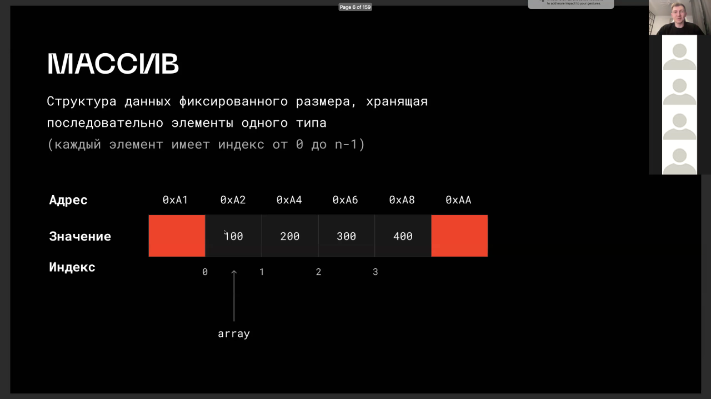

> [!quote]- Кадр [00:03:08]
> 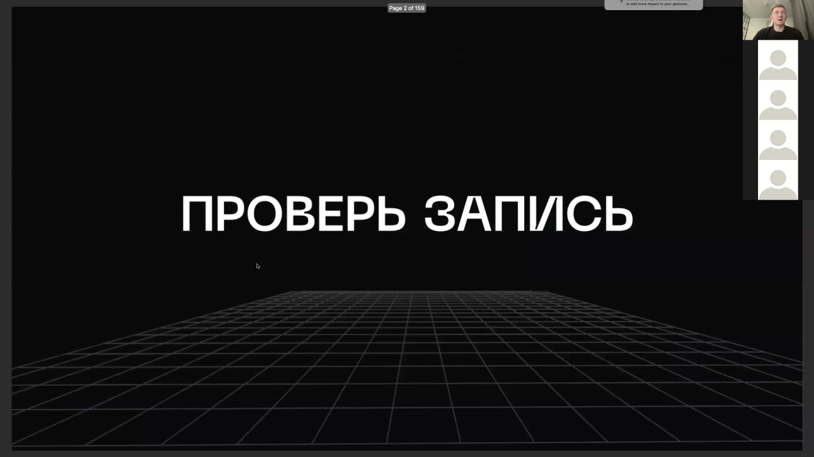

## 2. Сравнение, bound-чеки и компиляция массивов и срезов

В Go длина массива вшита в тип данных: [3]int и [2]int — разные типы, поэтому присваивание массивов разной длины — ошибка компиляции; размерность должна быть известна на этапе компиляции, и len(data) для массива вычисляется компилятором. Массивы можно сравнивать операторами == и !=, если типы элементов сравнимы; срезы напрямую сравнивать нельзя, для этого используют reflect.DeepEqual, slices.Equal или поэлементное сравнение. Bound-чеки (проверки границ) проверяют выход за границы; при константном индексе компилятор выдаёт ошибку, при переменном — паника в рантайме. Устранение проверок границ (bound check elimination, BCE) позволяет убрать проверки, когда компилятор доказывает безопасность; BCE применяется для range и циклов с i < len(s), а для полного отсутствия проверок используют unsafe. Использование unsafe не защищено правилами совместимости (compatibility guideline), и изменения в рантайме Go могут привести к багам.

```go
func arraysComparison() {
	second := [...]int{1, 2, 3}

	// except arrays whose element types are incomparable types
	fmt.Println(first == second)
	fmt.Println(first != second)

	// [<, <=, >, >=] => compilation error
}

func accessToElement1() {
	data := [3]int{1, 2, 3}

	idx := 4
	fmt.Println(data[idx]) // panic

	fmt.Println(data[4]) // compilation error
}

package main

func main() {
	data1 := [3]int{1, 2, 3}
	data2 := [2]int{1, 2}
	data1 = data2 // compilation error
}

type client struct {
	identifier string
	operations []int
}

func main() {
	data1 := make([]client, 10)
	data2 := make([]client, 10)

	data1[1].operations = append(data1[1].operations, 10)
	fmt.Println("equal:", reflect.DeepEqual(data1, data2))
}

func BenchmarkWithSprint(b *testing.B) {
	lhs := []int{1, 2, 3, 4, 5, 6, 7, 8, 9, 10}
	rhs := []int{1, 2, 3, 4, 5, 6, 7, 8, 9, 10}

	for i := 0; i < b.N; i++ {
		_ = fmt.Sprintf(lhs) == fmt.Sprintf(rhs)
	}
}

func equal(lhs, rhs []int) bool {
	if len(lhs) != len(rhs) {
		return false
	}

	for i := 0; i < len(lhs); i++ {
		if lhs[i] != rhs[i] {
			return false
		}
	}

	return true
}

// go test -bench=. -benchmem comparison_test.go
```

*Источник: [00:03:37], [00:03:42], [00:05:42], [00:08:42], [00:09:42], [00:10:44], …*

> [!quote]- Кадр [00:08:42]
> 

> [!quote]- Кадр [00:12:25]
> 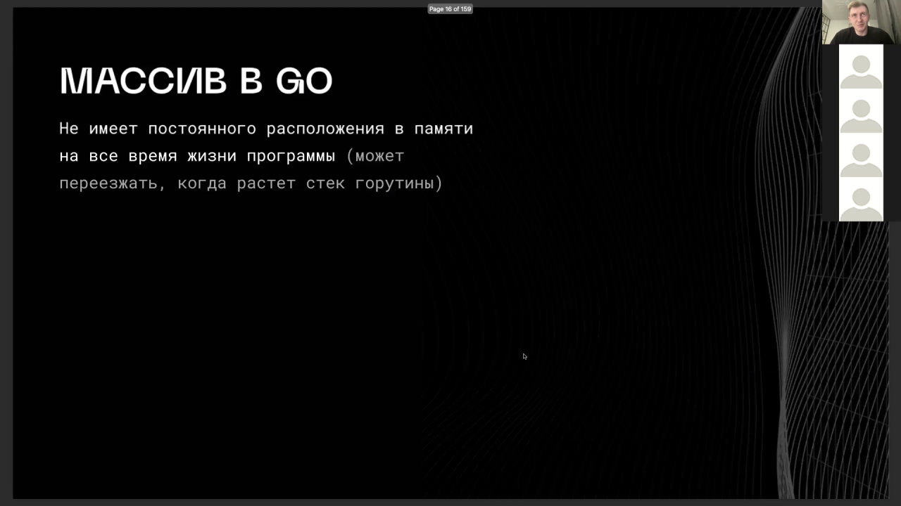

> [!quote]- Кадр [00:35:00]
> 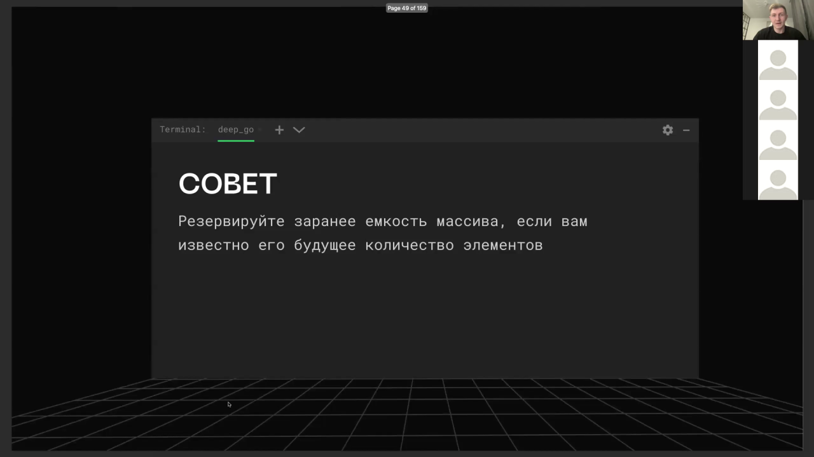

> [!quote]- Кадр [02:01:36]
> 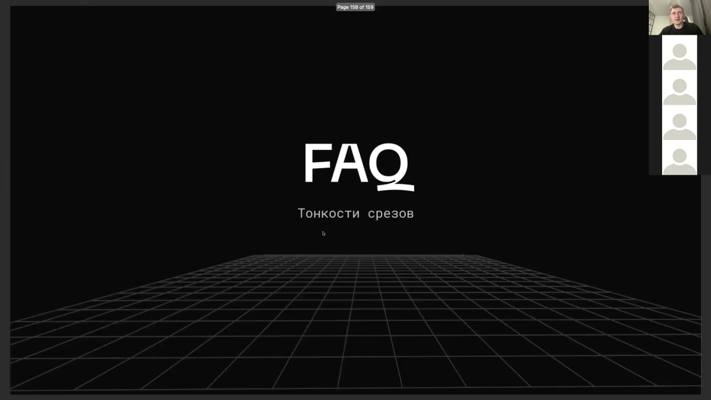

> [!quote]- Кадр [01:51:48]
> 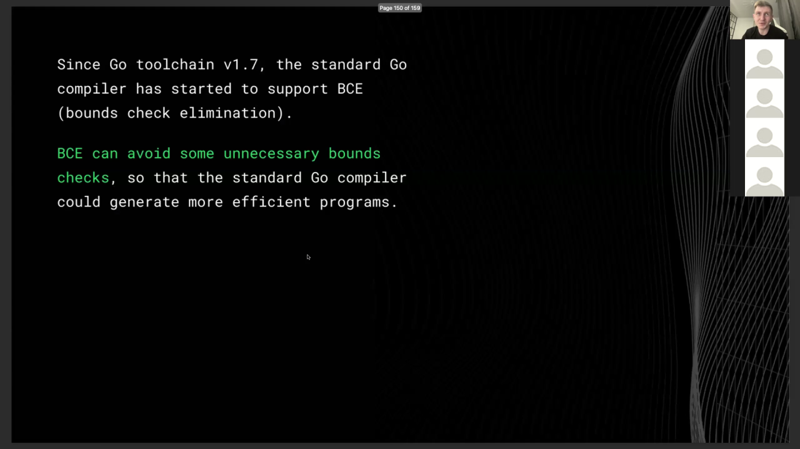

## 3. Размещение массивов и срезов в памяти, escape-анализ

При передаче массива в функцию массив копируется целиком, а срез передаёт дескриптор. Анализ убегания (escape analysis) на этапе компиляции решает, где размещать объект: массив больше 10 МБ уезжает в кучу (heap), а на стеке можно создать массив до 10 МБ. Go размещает массив среза на стеке, если его размер меньше или равен 64 КБ; срез 64 КБ не уезжает в heap, а 64 КБ + 1 байт уезжает. Через unsafe можно создать нижележащий массив (backing array) больше 64 КБ, который останется на стеке, если общий размер меньше 10 МБ. Стек горутины может переезжать, и возврат адреса локального массива приводит к его размещению в heap.

```go
package main

// go build -gcflags='-m' . | grep escape

func main() {
    var arrayWithStack [10 << 20]int8
    _ = arrayWithStack

    var arrayWithHeap [10<<20 + 1]int8
    _ = arrayWithHeap
}

a := [...]int{0, 1, 2, 3}

x := a[1:]
y := a[2:]

x = append(x, y...)
x = append(x, y...)

fmt.Println("a:", a)
fmt.Println("x:", x)

slice := make([]int, 0, 3)
println("slice:", slice, "- slice header address:", &slice)

slice = append(slice, 1, 2, 3)
println("slice full capacity:", slice)

slice = append(slice, 4)
println("slice after exceed capacity:", slice)

// go build -gcflags='-m' . |& grep escape
// ./main.go:6:24: make([]byte, 65536) does not escape
// ./main.go:9:23: make([]byte, 65537) escapes to heap

go build -gcflags='-m' . |& grep escape
./main.go:6:24: make([]byte, 65536) does not escape
./main.go:9:23: make([]byte, 65537) escapes to heap
```

*Источник: [00:13:41], [00:21:21], [00:22:08], [00:22:43], [00:24:24], [00:25:21], …*

> [!quote]- Кадр [00:22:43]
> 

> [!quote]- Кадр [00:24:24]
> 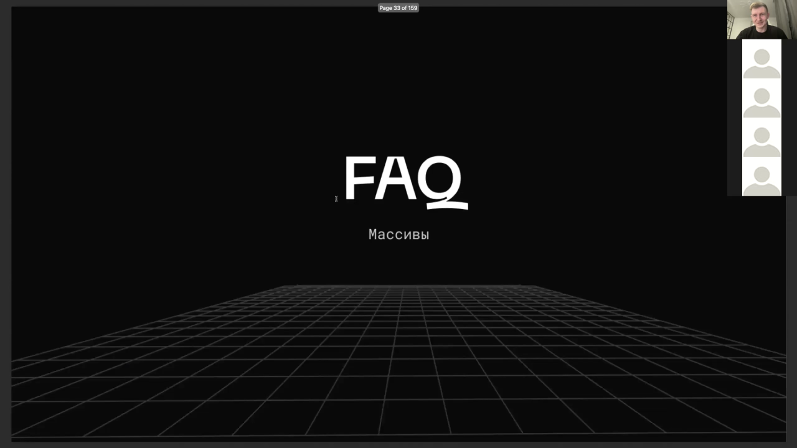

> [!quote]- Кадр [01:21:30]
> 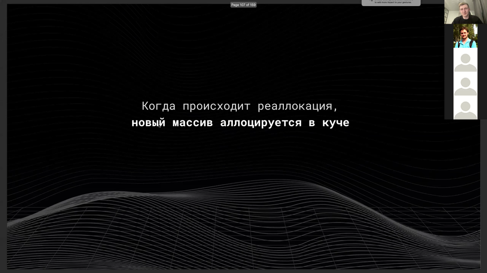

## 4. Срезы: создание, nil, пустой срез и JSON

Срезы — динамические массивы; нулевое значение (zero value) для среза — nil, хотя срез является дескриптором. В nil-срезе нельзя читать или записывать элементы (паника), но append и range работают; make([]int, 3, 6) задаёт длину 3 и ёмкость 6. Срез считается пустым, если его длина равна 0, и нулевым, если значение nil; проверка slice == nil различает их. Нулевой срез при сериализации в JSON даёт null, а пустой срез — пустой массив, что может нарушить контракты.

```go
data = []int{}                 // []                 len=0 cap=0
data = []int{1, 2}              // [1 2]             len=2 cap=2
data = []int{5: 10}             // [0 0 0 0 0 10]    len=6 cap=6
data = make([]int, 6)           // [0 0 0 0 0 0]    len=6 cap=6
data = make([]int, 3, 6)        // [0 0 0 0 0 0]    len=3 cap=6

var data []string
fmt.Printf("\tempty=%t nil=%t size=%d data=%p\n", len(data) == 0, data == nil, unsafe.Sizeof(data), data)

{"ID":100,"Operations":null}
{"ID":200,"Operations":[]}

var data []string
fmt.Println("var data []string:")
fmt.Printf("\tempty=%t nil=%t size=%d data=%p\n", len(data) == 0, data == nil, unsafe.Sizeof(data), data)

data = []string(nil)
fmt.Println("data = []string(nil):")
fmt.Printf("\tempty=%t nil=%t size=%d data=%p\n", len(data) == 0, data == nil, unsafe.Sizeof(data), data)

data = []string{}
fmt.Println("data = []string{}:")
fmt.Printf("\tempty=%t nil=%t size=%d data=%p\n", len(data) == 0, data == nil, unsafe.Sizeof(data), data)

data = make([]string, 0)
fmt.Println("data = make([]string, 0):")
```

| | Пустой срез | Нулевой срез |
|---|---|---|
| Условие | len == 0 | значение nil |

*Источник: [00:26:07], [00:26:51], [00:27:29], [00:28:49], [00:29:54], [00:30:54], …*

> [!quote]- Кадр [00:26:07]
> 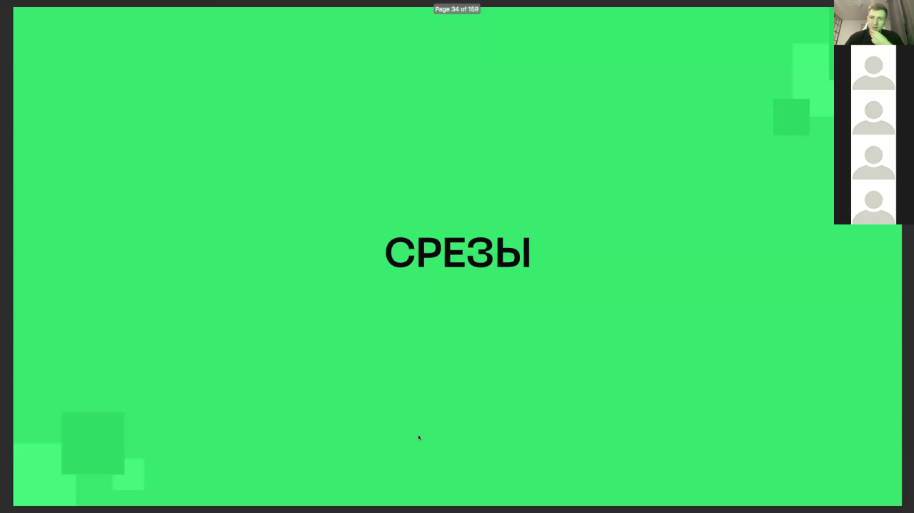

> [!quote]- Кадр [01:28:57]
> 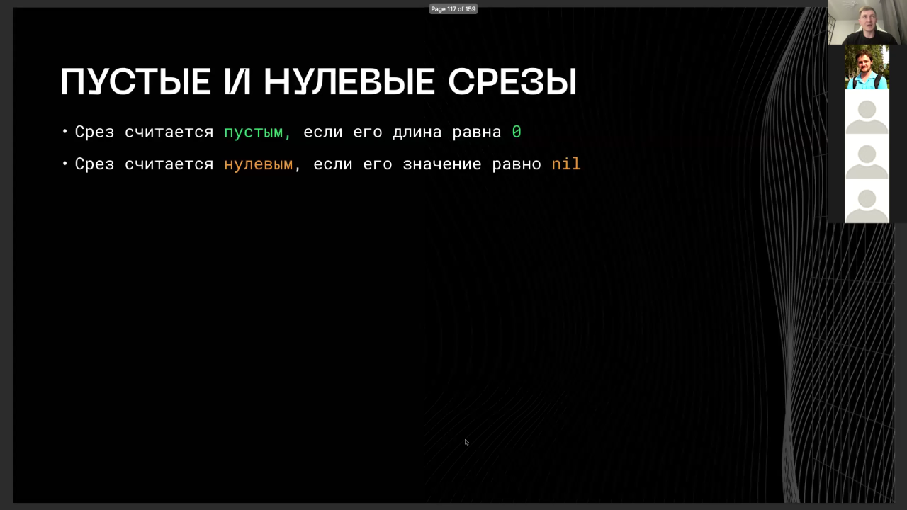

## 5. Границы срезов, нарезка и slices.Grow

Границы срезов: обращение к элементу с индексом >= длины вызывает панику, хотя память может быть выделена; выход за capacity также паникует. Нельзя создать срез отрицательной длины или с длиной больше capacity; третий аргумент в срезе обрезает capacity. Нарезка data[1:3] создаёт новый срез с длиной и capacity 2; data[2:] — до конца, data[:3] — с начала. Срез из массива делает массив underlying; даже маленький срез удерживает весь массив в памяти. Для nil-среза data[0:0] и data[:] валидны, а data[0:1] паникует. slices.Grow увеличивает capacity.

```go
func accessToElement1() {
	data := make([]int, 3)
	fmt.Println(data[4]) // panic
}

func accessToElement2() {
	data := make([]int, 3, 6)
	fmt.Println(data[4]) // panic
}

func accessToElement3() {
	data := make([]int, 3, 6)
	_ = data[-1] // compilation error
}

data := make([]int, 3, 6) // len = 3, cap = 6

// fmt.Println(data[4]) // panic

data = data[:6] // len = 6, cap = 6

fmt.Println(data[4])

func increaseCapacity() {
	data := make([]int, 0, 10)
	data = data[:10:100] // panic
	slices.Grow(data, 100)
}

func sliceWithNilSlice() {
	var data []int

	slice := data[:]
	slice = data[0:0]
	slice = data[0:1] // panic
	_ = slice
}

data := []int { 1, 2, 3 }
temp := data[1:3]

func sliceWithIncorrectIndeces() {
	_ = slice
	left := 2
	right := 1
	slice4 := data[left:right] // panic
	_ = slice4
}
```

*Источник: [00:29:54], [00:36:15], [00:49:25], [00:53:39], [00:53:49], [00:54:39], …*

> [!quote]- Кадр [00:53:39]
> 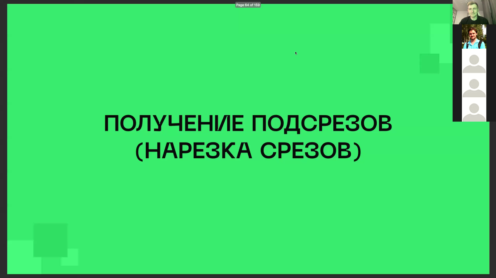

> [!quote]- Кадр [01:01:40]
> 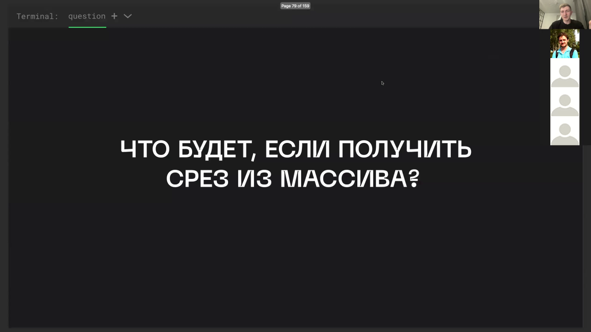

## 6. append, рост срезов и общий буфер

append добавляет элемент в конец и является variadic-функцией; результат нужно присваивать. Когда длина равна ёмкости, append выделяет в два раза больше памяти, копирует старые элементы и добавляет новый. Раньше слайсы росли ×2 для маленьких и ×1.25 для больших (от 1024), сейчас коэффициент уменьшается после 256 элементов (256→2.0, 512→1.63, 1024→1.44). Срезы шарят общий буфер: изменение элемента видно в обоих, append меняет длину только своего среза. Если у среза есть свободная capacity, append записывает дальше длины, используя свободное место, и может перезаписать данные, видимые через другой срез.

```go
func makeDirty(size int) []byte {
	var sb strings.Builder
	sb.Grow(size)

	pointer := unsafe.StringData(sb.String())
	return unsafe.Slice(pointer, size)
}

func BenchmarkWithReservation(b *testing.B) {
	sourceData := []int{1, 2, 3, 4, 5, 6, 7, 8, 9, 10, 11, 12, 13, 14, 15, 16, 17}
	for i := 0; i < b.N; i++ {
		targetData := make([]int, 0, len(sourceData))
		for j := 0; j < len(sourceData); j++ {
			targetData = append(targetData, sourceData[j])
		}
	}
}
go test -bench=. -benchmem reservation_test.go

data1 := make([]int, 3, 6)
data2 := data1[1:3]

data1 := make([]int, 4, 6)
data2 := data1[2:6]
data2 = append(data2, 1)

a := []int{0, 1, 2, 3}
x := a[1:]
y := a[2:]

x = append(x, y...)
x = append(x, y...)

fmt.Println("a:", a)
fmt.Println("x:", x)

slice := make([]int, 0, 3)
println("slice:", slice, "- slice header address:", &slice)

slice = append(slice, 1, 2, 3)
println("slice full capacity:", slice)

slice = append(slice, 4)
println("slice after exceed capacity:", slice)
```

| Слайсы | Раньше | Сейчас |
|---|---|---|
| Маленькие | ×2 | коэффициент уменьшается после 256 элементов |
| Большие (от 1024) | ×1.25 | 256 → 2.0, 512 → 1.63, 1024 → 1.44 |

*Источник: [00:28:49], [00:29:14], [00:32:15], [00:32:42], [00:33:35], [00:58:23], …*

> [!quote]- Кадр [00:33:35]
> 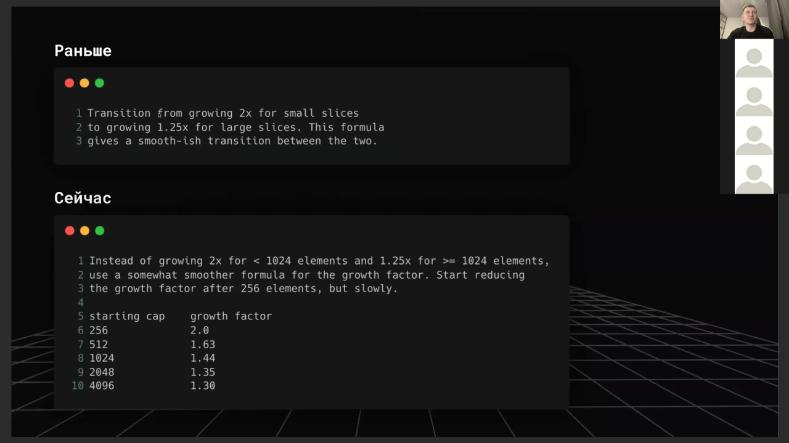

## 7. Удаление, подрезка, clear и управление памятью

Последний элемент среза удаляется нарезкой data = data[:len(data)-1]; удаление из середины — через append, объединяя части до и после удаляемого элемента. slices.Delete удаляет элементы, уменьшает длину, но capacity остаётся; удалённые элементы хранятся в памяти. Удаление из середины в худшем случае работает за линию, поэтому лучше избегать удалений из начала или середины. Подрезка начала data = data[1:] срезает ёмкость и неэффективна; front-операции работают за линию. slices.Clip не освобождает память; чтобы уменьшить ёмкость или освободить память, нужно создать новый срез и скопировать данные. clear обнуляет все элементы среза (или подсреза), не меняя длину и capacity. Подсрез удерживает весь исходный массив, и GC не освободит память, пока есть ссылка.

```go
data := []int{ 1, 2 }
data = data[:len(data) - 1]

data := []int{1, 2, 3, 4, 5}
data = append(data[:2], data[3:]...)

data := []int{0, 1, 2, 3, 4, 5}
fmt.Println(data, len(data), cap(data)) // [0 1 2 3 4 5] 6 6
data = slices.Delete(data, 1, 3)
fmt.Println(data, len(data), cap(data)) // [0 3 4 5] 4 6

data := []int{ 1, 2 }
data = data[1:]

// Pop front
data, front = data[1:], data[0]
// Pop back
data, back = data[:len(data)-1], data[len(data)-1]
// Push front
data = append([]int{ value }, data...)
// Push back
data = append(data, value)

func printAllocs() {
	var m runtime.MemStats
	runtime.ReadMemStats(&m)
	fmt.Printf("%d MB\n", m.Alloc/1024/1024)
}

temp2 := slices.Clip(data) // data[:10:10]
fmt.Println("temp2:", unsafe.SliceData(temp2), len(temp2), cap(temp2))

data := []int{1, 2, 3, 4, 5}
data = append([]int(nil), data[:2]...)

third := []int{1, 2, 3, 4, 5}
clear(third)
fmt.Println("third:", third, " : ", len(third), " : ", cap(third))

fourth := []int{1, 2, 3, 4, 5}
clear(fourth[1:3])
fmt.Println("fourth:", fourth, " : ", len(fourth), " : ", cap(fourth))

func BenchmarkClearWithFive(b *testing.B) {
	data := make([]int, 10*1024)
	for i := 0; i < b.N; i++ {
		for idx := range data {
			data[idx] = 5
		}
	}
}
```

*Источник: [00:32:42], [00:34:15], [00:36:53], [00:38:15], [00:39:15], [01:05:45], …*

> [!quote]- Кадр [01:07:57]
> 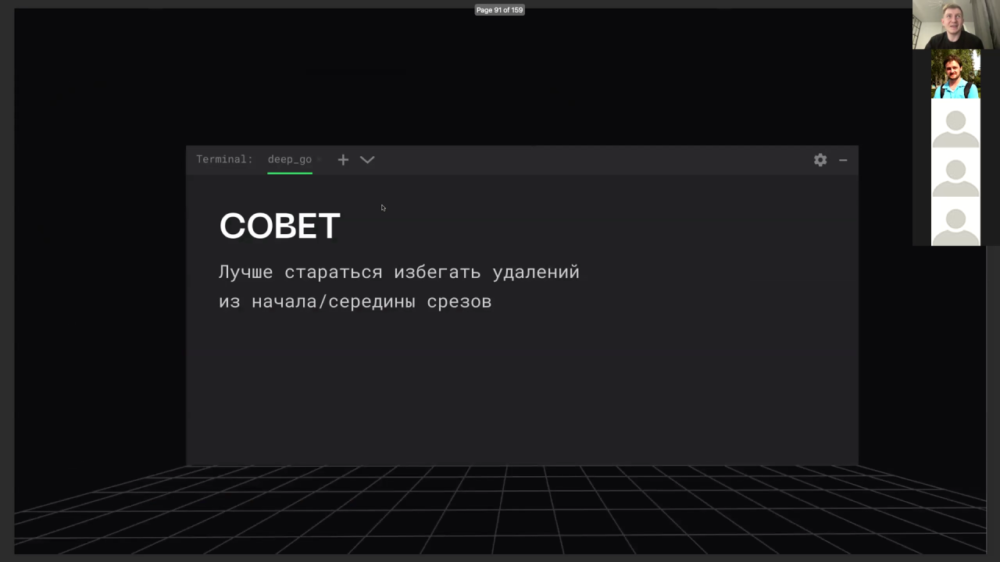

> [!quote]- Кадр [01:40:44]
> 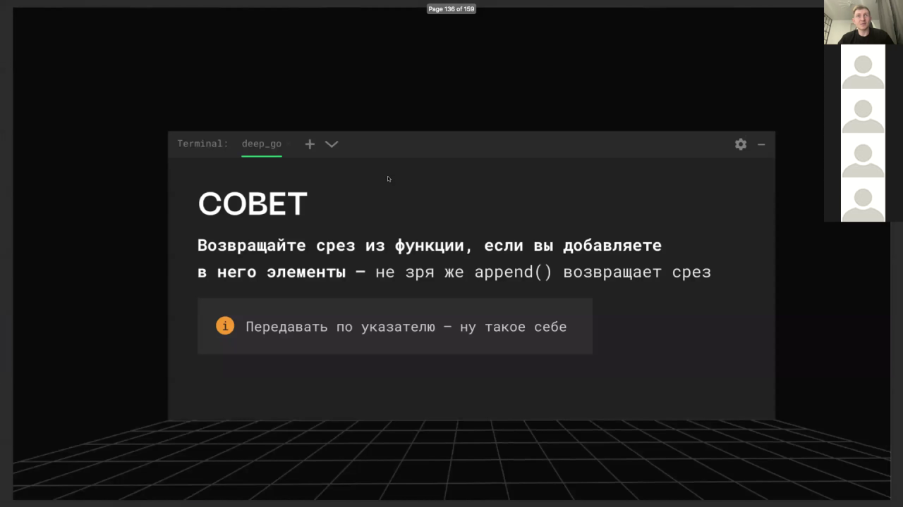

## 8. Цикл for range и оптимизации горячих циклов

Ошибка на единицу (off-by-one) — логическая ошибка в циклах; range предотвращает её, проходя от начала до конца. range имеет формы с пропуском индекса/значения и вычисляет выражение один раз перед циклом. range копирует значение каждого элемента: по массиву копируется массив, по срезу — дескриптор; по указателю на массив или срезу копия не создаётся. Начиная с Go 1.22, каждая итерационная переменная уникальна. Для горячих циклов можно вынести len(data) за цикл и применить раскрутку цикла (loop unrolling) — обработку 4 или 8 элементов за итерацию, что уменьшает число проверок и инкрементов.

```go
package main

import "fmt"

func main() {
	data := [...]int{1, 2, 3}
	for value := range data { // copy of array
		fmt.Println(value)
	}

	for value := range &data { // not a copy of array
		fmt.Println(value)
	}

	for value := range data[:] { // not a copy of array
		fmt.Println(value)
	}
}

for _, value := range data {
}

for idx, _ := range data {
}

for idx := range data {
}

for _, _ = range data {
}

for range data {
}

values := [...]int{100, 200, 300}

// also actual for slices
for idx, value := range values {
    value += 50
    fmt.Println("#1:", unsafe.Pointer(&value), "#2:", unsafe.Pointer(&values[idx]))
}

fmt.Println("values:", values)

for i := 0; i < len(data); i++ {
}

func BenchmarkWithCalculatedLength(b *testing.B) {
	data := make([]int, size)
	for i := 0; i < b.N; i++ {
		length := len(data)
		for j := 0; j < length; j++ {
			data[j] = i
		}
	}
}

func BenchmarkWithLoopUnwinding(b *testing.B) {
	data := make([]int, size)
	for i := 0; i < b.N; i++ {
		for j := 0; j < len(data)/4; j += 4 {
			data[j] = i
			data[j+1] = i
			data[j+2] = i
			data[j+3] = i
		}
	}
}
```

> [!info] Зачем это нужно
> Цель — ускорить выполнение горячих циклов: вынесение len(data) даёт прирост производительности, а раскрутка уменьшает количество проверок условий и инкрементов.

*Источник: [00:14:00], [00:14:50], [00:15:38], [00:16:42], [00:44:44], [00:45:48], …*

> [!quote]- Кадр [00:16:42]
> 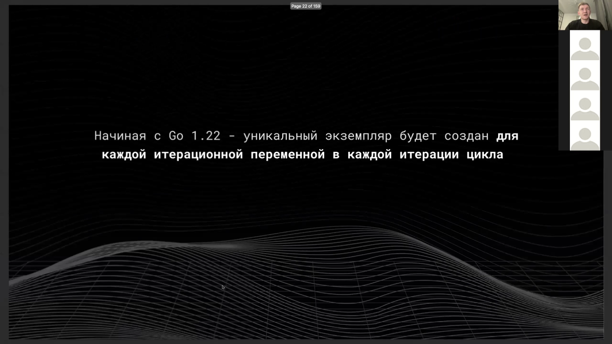

## 9. unsafe: выход за границы, совместимость и риски

С помощью unsafe.Add к указателю на массив прибавляется смещение; смещения -4 и 12 в коде помечены как dangerous и приводят к доступу за границами массива. Использование unsafe не защищено compatibility guideline: нет обратной совместимости, unsafe не гарантирует совместимость. При использовании unsafe нужно очень пристально следить за изменениями версии Go: если закладываться на реализацию структуры из рантайма, порядок полей может измениться, и вы словите термоядерный баг.

```go
func main() {
	const elemSize = unsafe.Sizeof(int32(0)) // 4 bytes
	array := [...]int32{1, 2, 3}
	pointer := unsafe.Pointer(&array)

	first := *(*int32)(unsafe.Add(pointer, 0*elemSize))   // => data2[0]
	second := *(*int32)(unsafe.Add(pointer, 1*elemSize))  // => data2[1]
	third := *(*int32)(unsafe.Add(pointer, 2*elemSize))   // => data2[2]

	dangerous1 := *(*int32)(unsafe.Add(pointer, -4))      // => data2[-1]
	dangerous2 := *(*int32)(unsafe.Add(pointer, 12))      // => data2[3]
}

type slice struct {
	data unsafe.Pointer
	len  int
	cap  int
}

func Transform(data []byte) []int {
	sliceData := unsafe.Pointer(&data[0])
	sizeType := int(unsafe.Sizeof(0))
	length := len(data) / sizeType

	var result []int
	resultPtr := (*slice)(unsafe.Pointer(&result))
	resultPtr.data = sliceData
	resultPtr.len = length
	resultPtr.cap = length

	return result
}
```

> [!info] Зачем это нужно
> При использовании unsafe нужно следить за изменениями версии Go.

*Источник: [00:10:40], [00:40:22], [00:42:22]*

## 10. Сигнатура Read и переиспользование буфера

В io.Reader метод Read имеет сигнатуру func (T) Read(b []byte) (n int, err error), а не возвращает срез и error. Такой вариант позволяет переиспользовать один и тот же буфер и не вызывать новый буфер на каждый Read; это связано с аллокациями. В BenchmarkSliceWithArgument буфер создаётся в цикле и передаётся в Read, а в BenchmarkSliceWithReturn буфер создаётся внутри Read; в обоих случаях буфер создаётся на каждой итерации. BenchmarkSliceWithArgument показывает 4.776 ns/op и 0 B/op, 0 allocs/op, а BenchmarkSliceWithReturn — 20.31 ns/op и 16 B/op, 1 allocs/op: передача слайса аргументом приводит к аллокации буфера на стеке, а возврат слайса — к аллокации через heap.

```go
func (T) Read(b []byte) (n int, err error)
func (T) Read(n int) (b []byte, err error)

func BenchmarkSliceWithArgument(b *testing.B) {
	for i := 0; i < b.N; i++ {
		p := make([]byte, bufferSize)
		reader := ReaderWithSliceArgument{}
		_, _ = reader.Read(p)
	}
}

func BenchmarkSliceWithReturn(b *testing.B) {
	for i := 0; i < b.N; i++ {
		reader := ReaderWithSliceReturn{}
		_, _ = reader.Read(bufferSize)
	}
}
```

*Источник: [01:23:50], [01:24:42], [01:24:57], [01:25:12]*

## Схема

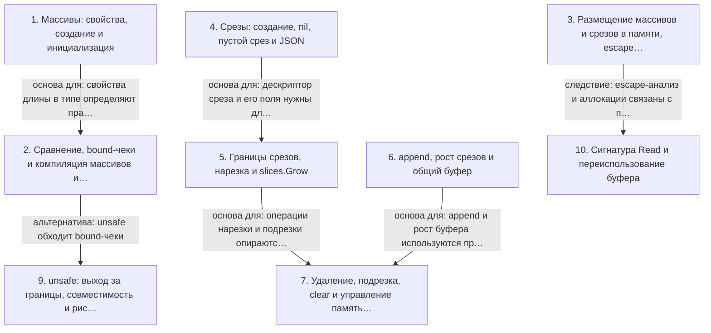

## Итог

> [!success] Что в итоге
> Материал объединяет тему массивов и срезов в Go: массивы имеют фиксированную длину, вшитую в тип, а срезы являются динамическими массивами-дескрипторами. Свойства массивов определяют сравнение и bound-чеки, а понимание дескриптора среза — границы, нарезку и операции с capacity. Append и рост буфера используются при удалении и clear, а escape-анализ связан с размещением и переиспользованием буфера. Unsafe позволяет обходить bound-чеки, что создаёт риски.

