# Строки: кодировки, устройство, операции и оптимизации в Go

> [!abstract] Обзор
> Материал объединяет два конспекта об устройстве символов и строк в Go, начиная с представления символа как числа и стандартов кодирования: ASCII с 128 значениями и кодовыми страницами, двухбайтовый Unicode/UCS-2 с проблемами памяти и порядка байт (BOM), UTF-8 с переменной длиной и UTF-16. Далее — варианты реализации строк: массив символов, нуль-терминированные и Pascal-строки, связный список, copy-on-write, SSO и анализ убегания (escape analysis). В части про Go строка рассматривается как неизменяемая последовательность байт: `len` и срезы работают по байтам, для подсчёта рун нужна `utf8.RuneCountInString`, кодовые точки представлены как `rune` (`int32`), а преобразования выполняются между `string`, `[]byte` и `[]rune`. Показаны конкатенация и её оптимизации через slice byte и `strings.Builder`, бенчмарки, а также небезопасные приёмы с `unsafe`, SliceHeader/StringHeader и Bus error. Завершают материал передача строки по дескриптору, интернирование пакетом `unique`, copy-on-write буфер и рекомендации по системному программированию.

> [!info] Курс
> [[index|Оглавление курса]]

## Оглавление
1. [[#1. Кодировки: символы, ASCII, Unicode, UTF]]
2. [[#2. Реализации строк: нуль-терминированные, Pascal, SSO]]
3. [[#3. Строки в Go: байты, неизменяемость, .text]]
4. [[#4. Индексация, срезы, подстроки, сравнение и Trim]]
5. [[#5. Преобразования string, rune и byte, raw-строки]]
6. [[#6. Конкатенация строк, append/copy и бенчмарки]]
7. [[#7. unsafe: SliceHeader/StringHeader и Bus error]]
8. [[#8. Передача строки и интернирование unique]]
9. [[#9. Copy-on-write буфер]]
10. [[#10. Материалы для системного программирования]]

**Схема** — [[#Схема]]
**Итог** — [[#Итог]]

## 1. Кодировки: символы, ASCII, Unicode, UTF

Любой символ представлен числом, и над символами можно выполнять арифметические операции (например, вычитая `'A'` из `'W'`, определить позицию буквы в алфавите), а для подсчёта частот букв статический массив из 26 целых эффективнее `map`, где индекс получается вычитанием `A`. Процессор не знает про символы: в памяти хранится число, а для одинакового отображения на разных компьютерах нужен стандарт кодирования, реализуемый библиотекой поверх байтов и таблиц соответствия; можно написать и свою кодировку. **ASCII** использует 128 значений (0–127): с 0 по 31 — управляющие нечитаемые символы, старший бит не используется, а расширение за счёт старшего бита даёт **кодовую страницу** из 256 символов, где первые 128 совпадают с ASCII, остальные предназначены для конкретного языка. 256 символов не хватало, поэтому **Unicode** предложил кодировать двумя байтами (65 536 значений), но строка занимает вдвое больше памяти; при многобайтовом кодировании важен порядок байт (Big Endian — `0068`, Little Endian — `6800`). В **UCS-2** каждый символ кодируется двумя байтами, и в начале строки добавляется **BOM**, по которому определяется порядок байт. **UTF-8** использует кодировку символов переменной длины от 1 до 4 байт, первые 128 символов Unicode совпадают с ASCII, а вместо BOM применяются маски кодов (Big Endian — 0, `110`, `1110`, `11110`; Little Endian — `10`), по маске можно понять, из скольких байт состоит символ. **UTF-16** кодирует символы 16-битными словами (два либо четыре байта), что ускоряет парсинг, а в Go руны всегда занимают 4 байта. Не существует кодировки, оптимальной по всем параметрам: выбор между кодировками UTF — компромисс, где больший размер символа даёт более быструю обработку, но требует больше памяти, а меньший размер экономит память, но замедляет обработку.

```go
var table = map[uint8]rune{
	'0': 0, '1': 1,
	5: 'f', 6: 'g',
	10: 'k', 11: 'l',
	15: 'p', 16: 'q',
	20: 'u', 21: 'v',
	25: 'z',
}

func printText(text []uint8) {
	for _, codeNumber := range text {
		symbol, found := table[codeNumber]
		if !found {
			fmt.Printf("#incorrect symbol: %d\n", codeNumber)
			return
		}

		fmt.Printf("%q", symbol)
	}
}

var table = map[uint8]byte{
	0: 'a', 1: 'b', 2: 'c', 3: 'd', 4: 'e',
	5: 'f', 6: 'g', 7: 'h', 8: 'i', 9: 'j',
	10: 'k', 11: 'l', 12: 'm', 13: 'n', 14: 'o',
	15: 'p', 16: 'q', 17: 'r', 18: 's', 19: 't',
	20: 'u', 21: 'v', 22: 'w', 23: 'x', 24: 'y',
	25: 'z',
}

package main

import "unsafe"

func main() {
	const str1 string = "example"
	const str2 string = "example"
	const str3 string = "another example"

	println(unsafe.StringData(str1))
	println(unsafe.StringData(str2))
	println(unsafe.StringData(str3))
}

type Handle
	func Make[T comparable](value T) Handle[T]
	func (h Handle[T]) Value() T

func BenchmarkConversionWithStr(b *testing.B) {
	handle1 := unique.Make(str1 + "!!!!")
	handle2 := unique.Make(str2 + "!!!!")

	b.ResetTimer()
	for i := 0; i < b.N; i++ {
		Result = handle1 == handle2
	}
}

func BenchmarkConversionWithStr(b *testing.B) {
	sstr1 := str1 + "!!!!"
	sstr2 := str2 + "!!!!"
	b.ResetTimer()
	for i := 0; i < b.N; i++ {
		Result = sstr1 == sstr2
	}
}
```

| Big Endian | Little Endian |
|---|---|
| 0068 | 6800 |

*Источник: [00:01:49], [00:02:47], [00:02:49], [00:03:19], [00:03:48], [00:04:31], …*

> [!quote]- Кадр [00:18:05]
> 

> [!quote]- Кадр [00:02:49]
> 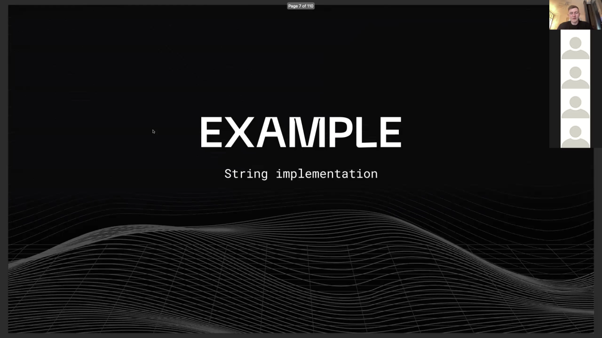

> [!quote]- Кадр [00:19:05]
> 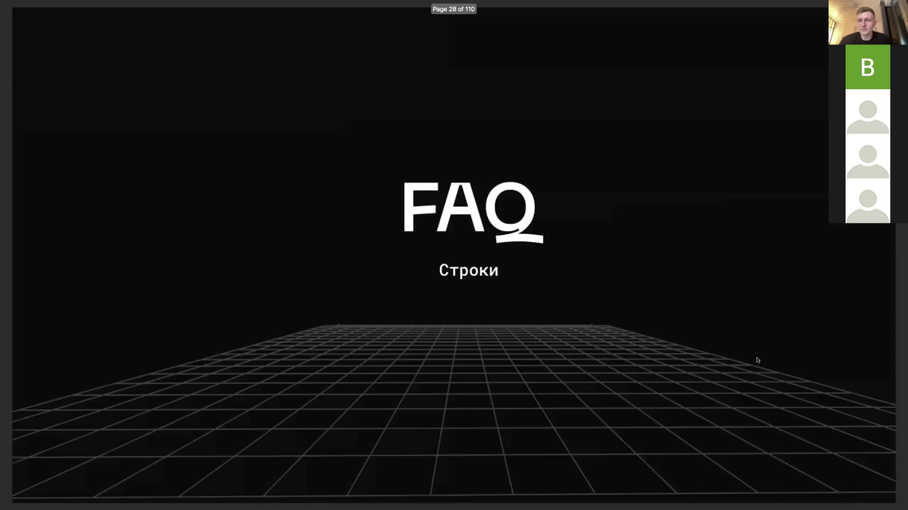

> [!quote]- Кадр [00:03:19]
> 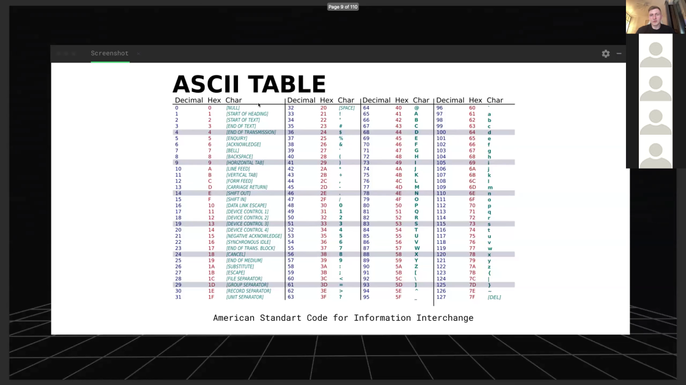

> [!quote]- Кадр [00:03:48]
> 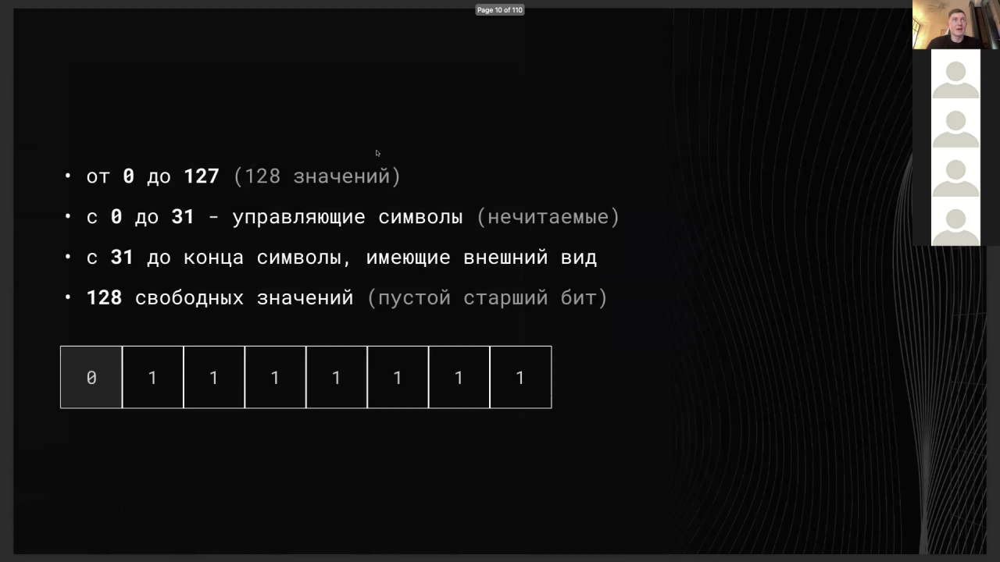

> [!quote]- Кадр [00:07:25]
> 

> [!quote]- Кадр [00:08:36]
> 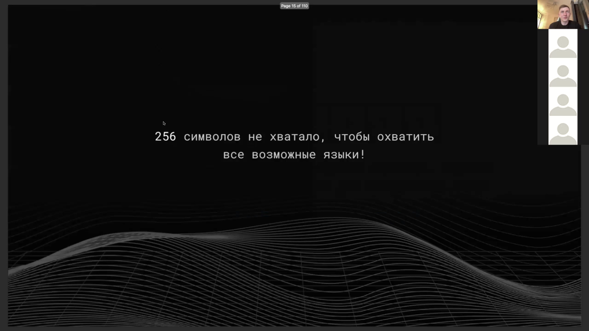

> [!quote]- Кадр [00:08:53]
> 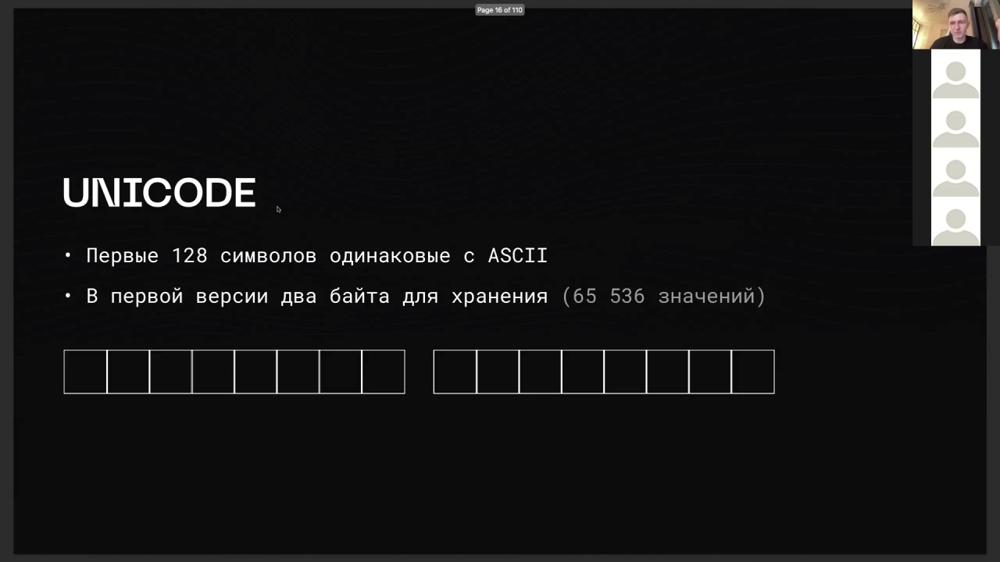

> [!quote]- Кадр [00:09:25]
> 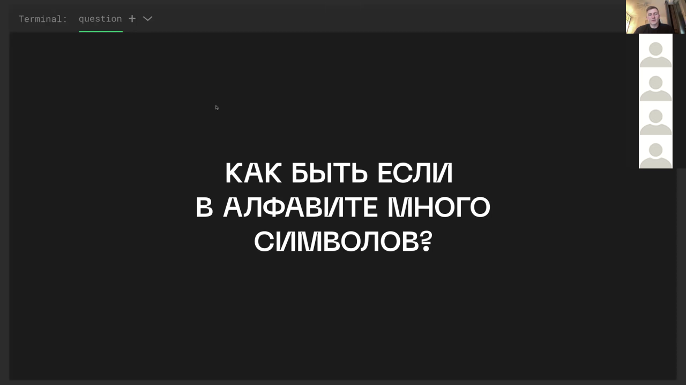

> [!quote]- Кадр [00:11:14]
> 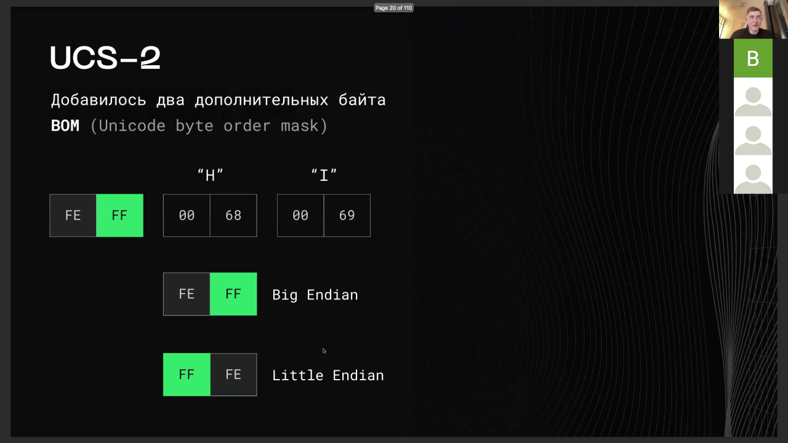

> [!quote]- Кадр [00:12:06]
> 

> [!quote]- Кадр [00:17:11]
> 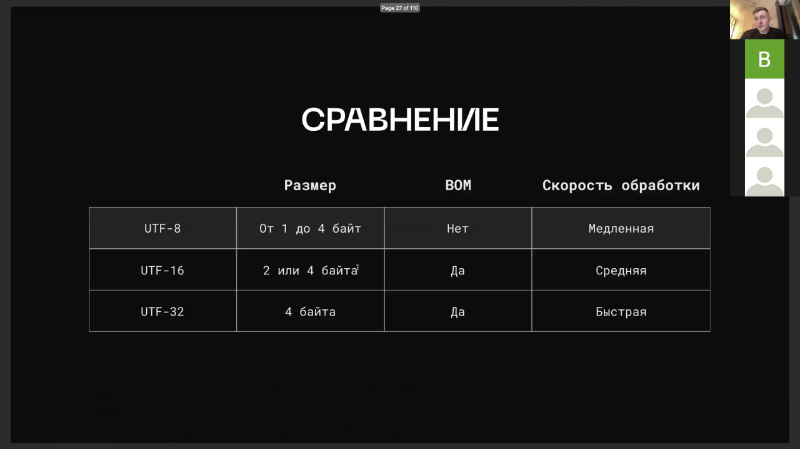

> [!quote]- Кадр [00:10:15]
> 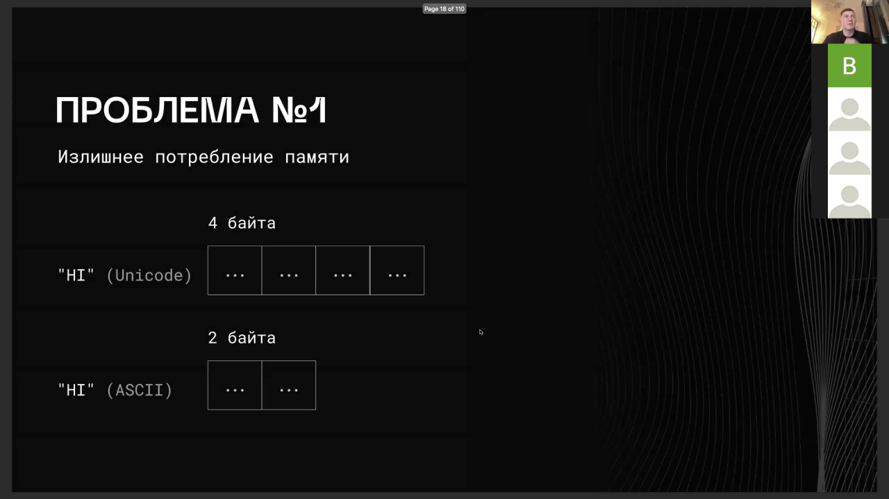

> [!quote]- Кадр [00:12:59]
> 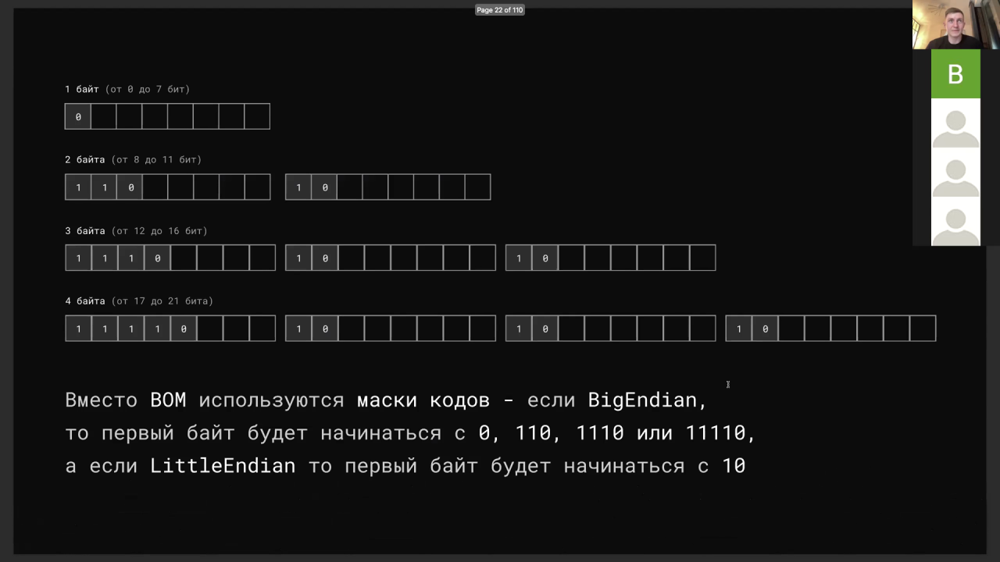

## 2. Реализации строк: нуль-терминированные, Pascal, SSO

Строку можно реализовать абсолютно по-разному: например, массив символов, терминированные строки (при такой реализации хранится capacity и длина) или связный список символов, как в Erlang и Haskell, где добавление и удаление работают за константное время, но итерация и хранение менее эффективны, чем у непрерывной последовательности байтов. Байт с кодом 0 обозначает конец строки: чтобы узнать длину, нужно пройти по строке до завершающего нулевого байта, поэтому проверка длины работает за линию, но не тратит дополнительную память. **Pascal-строки** хранят размер в отдельном поле (структура `str` содержит указатель `elements` и поле `size` (4)), что позволяет получать размер за константу, но требует дополнительной памяти. При копировании строки два объекта могут ссылаться на один и тот же массив байт, при изменении создаётся копия. **SSO (short string optimization)** позволяет для короткой строки хранить символы прямо в полях pointer и capacity, а по `size` определять её длину: если `size` меньше 8, pointer и capacity побайтово интерпретируются как строка, если больше — строка находится в heap; максимальный размер строки, помещаемой на стек, зависит от размера указателя (при 8-байтовом указателе это 16 байт), а escape-анализ в Go определяет, будет ли переменная размещена в куче или стеке.

| | Нуль-терминированные | Pascal-строки |
|---|---|---|
| Хранение длины | завершающий байт 0 | поле size (4) |
| Получение длины | за линию | за константу |
| Память | не тратит дополнительную | требует дополнительной |

> [!info] Зачем это нужно
> Цель SSO — уплотнить данные и не аллоцировать маленькие строки в хипе; уплотнять данные при нехватке места на дисках, чтобы экономить место в базе.

*Источник: [00:20:36], [00:20:45], [00:21:27], [00:22:27], [00:22:35], [00:23:35], …*

> [!quote]- Кадр [00:20:36]
> 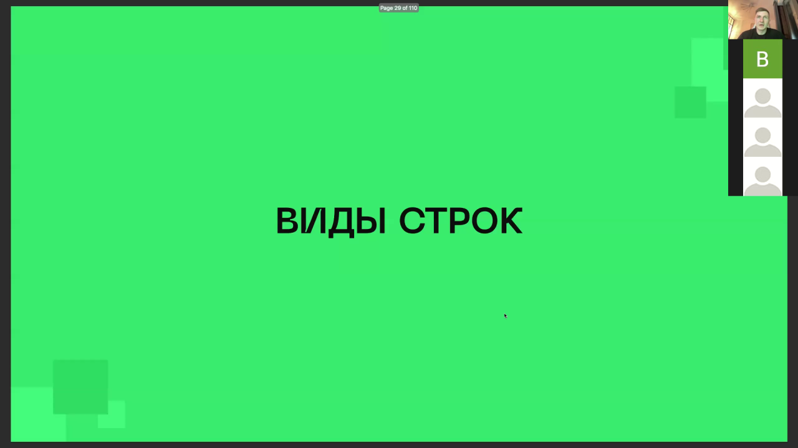

> [!quote]- Кадр [00:21:27]
> 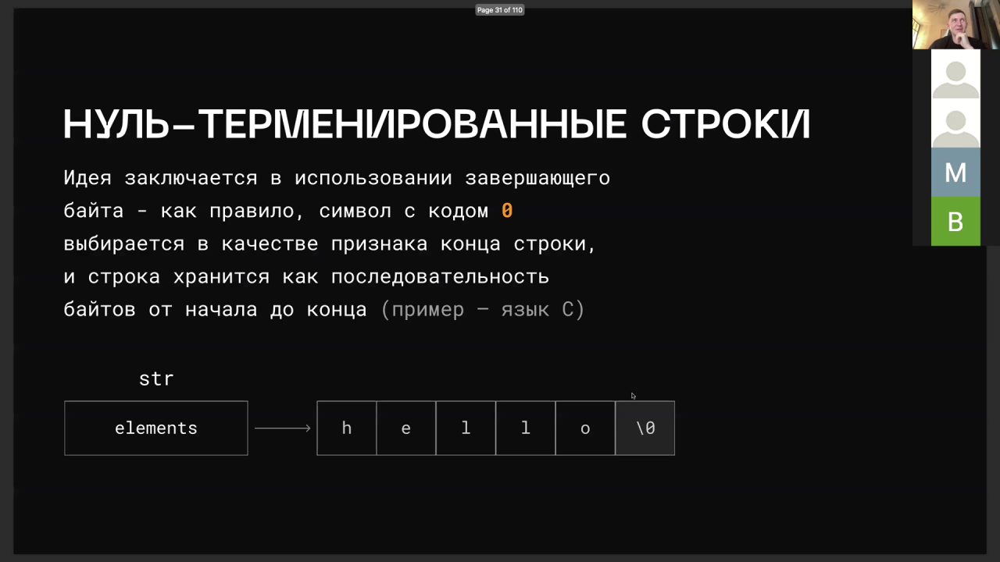

> [!quote]- Кадр [00:22:35]
> 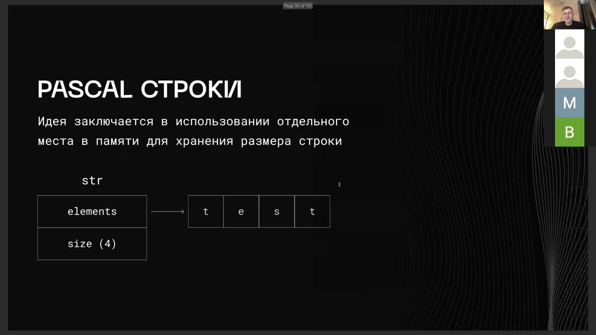

> [!quote]- Кадр [00:26:56]
> 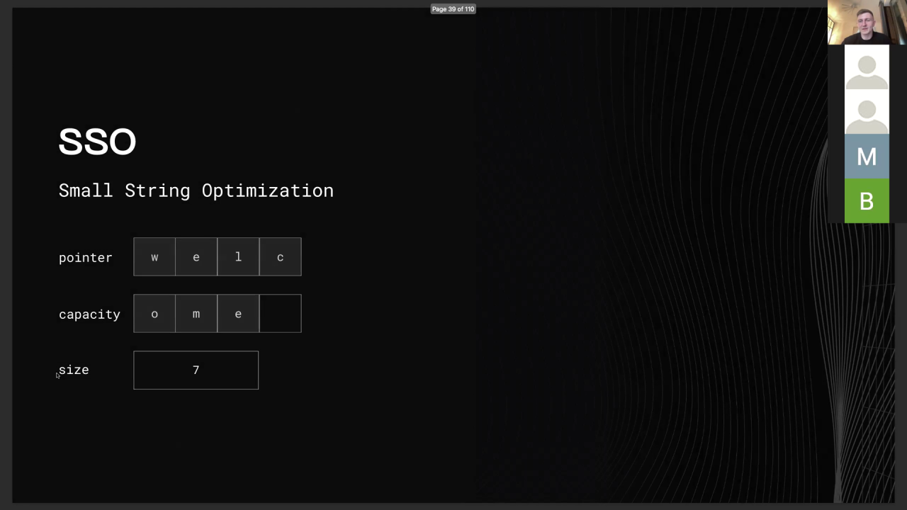

> [!quote]- Кадр [00:27:38]
> 

## 3. Строки в Go: байты, неизменяемость, .text

В Go строка — неизменяемая последовательность **byte**, а не символов, и не обязана содержать корректную UTF-8; строковые литералы кодируются в UTF-8, `rune` — алиас `int32`, кодовые точки представлены как руны. `len` возвращает количество байт, а не символов, и для константной строки вычисляется на этапе компиляции; для подсчёта рун в UTF-8 строке используют `utf8.RuneCountInString`, работающую за линейное время. Значение байта строки можно прочитать, но нельзя изменить стандартными способами и нельзя взять указатель на байт строки; чтобы менять, строку конвертируют в срез байт, а конкатенация обычно возвращает новую строку с выделением памяти и перекопированием. Строки неизменяемы в Go, Java, C#, JavaScript; при взятии подстроки получается строка, а не срез, потому что срез позволил бы изменить исходную строку. Строки и литералы могут размещаться в read-only сегменте `.text` вместе с исполняемым кодом; адресное пространство процесса состоит из Stack, Heap, `.bss`, `.data` и `.text`, Go явно не говорит, где размещена строка.

```go
package main

import "fmt"

func main() {
	// incorrect code points
	data := []rune{0x0011FFFF, 0x0012FFFF}
	str := string(data)

	fmt.Println(str)
}

package main

import "unsafe"

func main() {
	var str1 string = "example"
	const str2 string = "example"
	const str3 string = "another example"

	println(unsafe.StringData(str1))
	println(unsafe.StringData(str2))
	println(unsafe.StringData(str3))
}

package main

import "unsafe"

func action() {
}

func main() {
	var str = "go"
	newStr := str + "-go"

	strData := unsafe.StringData(str)
	newStrData := unsafe.StringData(newStr)

	println("action:", action)
	println("strData:", strData)
	println("newStrData:", newStrData)

	slice := unsafe.Slice(strData, len(str))
	newSlice := unsafe.Slice(newStrData, len(newStr))
}

var Result bool

func BenchmarkConversion(b *testing.B) {
	handle1 := unique.Make(str1 + "!!!!")
	handle2 := unique.Make(str2 + "!!!!")

	b.ResetTimer()
	for i := 0; i < b.N; i++ {
		Result = handle1 == handle2
	}
}

strData := unsafe.StringData(str)
newStrData := unsafe.StringData(newStr)

println("strData:", strData)
println("newStrData:", newStrData)

slice := unsafe.Slice(strData, len(str))
newSlice := unsafe.Slice(newStrData, len(newStr))

str := "Hello"
substr := str[1:6]
fmt.Println(substr)
```

| len | подсчёт рун |
| --- | --- |
| возвращает количество байт | возвращает количество рун |
| для константной строки вычисляется на этапе компиляции | работает за линейное время |

*Источник: [00:01:02], [00:12:06], [00:15:44], [00:16:14], [00:24:03], [00:25:03], …*

> [!quote]- Кадр [00:39:11]
> 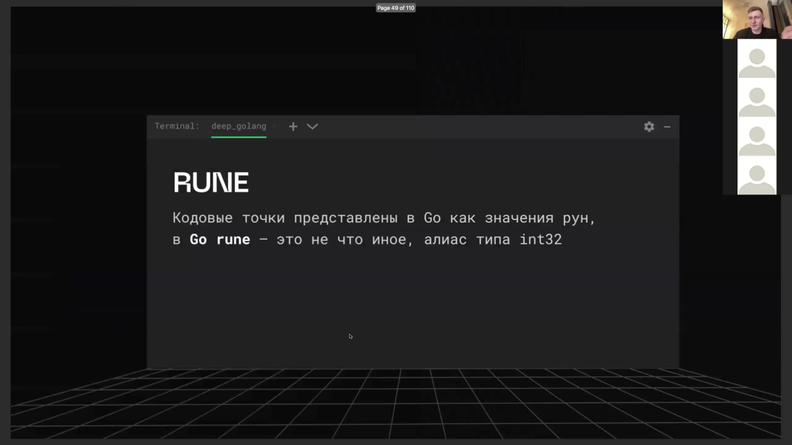

> [!quote]- Кадр [00:01:02]
> 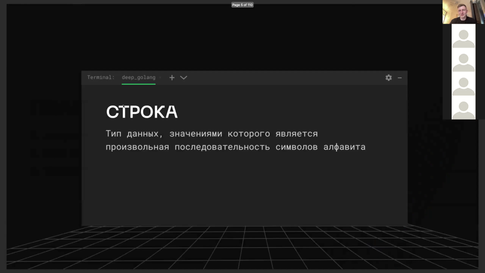

> [!quote]- Кадр [00:38:33]
> 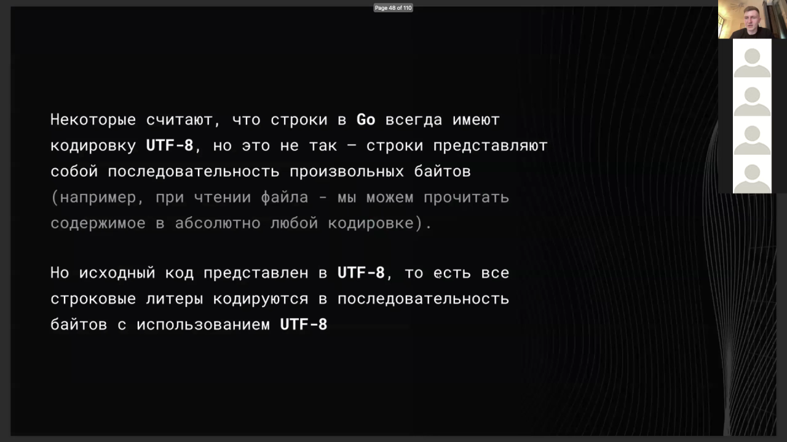

> [!quote]- Кадр [00:58:07]
> 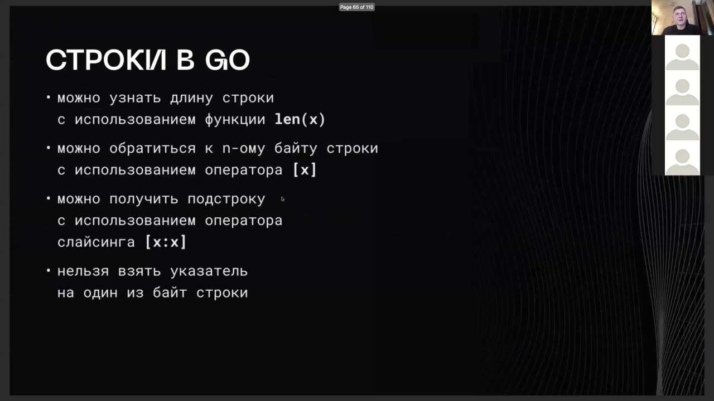

> [!quote]- Кадр [01:15:39]
> 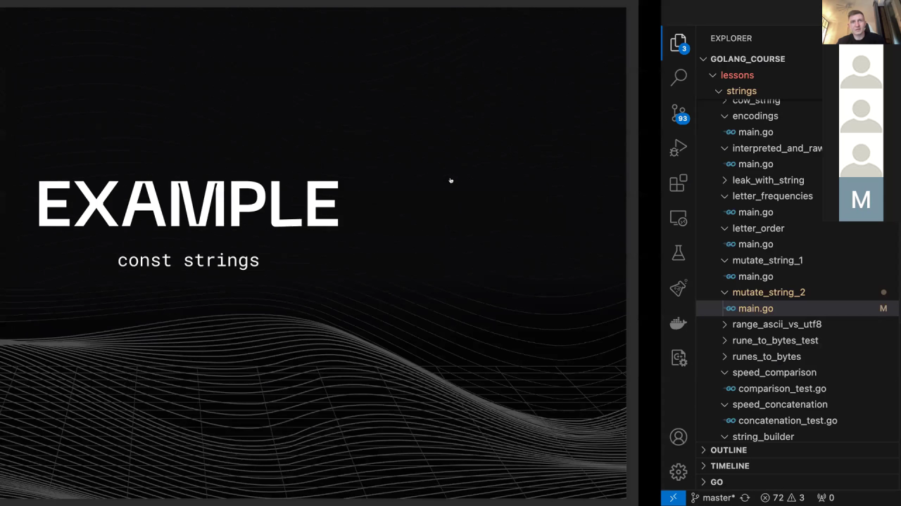

> [!quote]- Кадр [01:16:46]
> 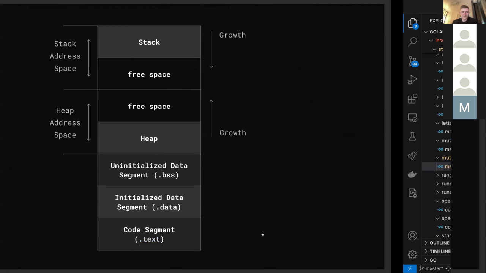

> [!quote]- Кадр [00:24:03]
> 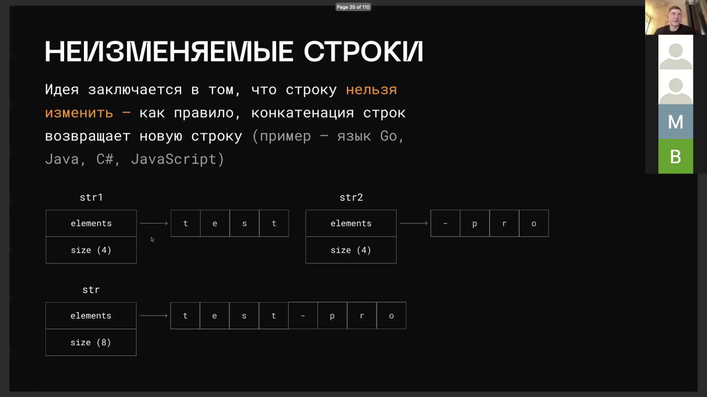

> [!quote]- Кадр [00:43:06]
> 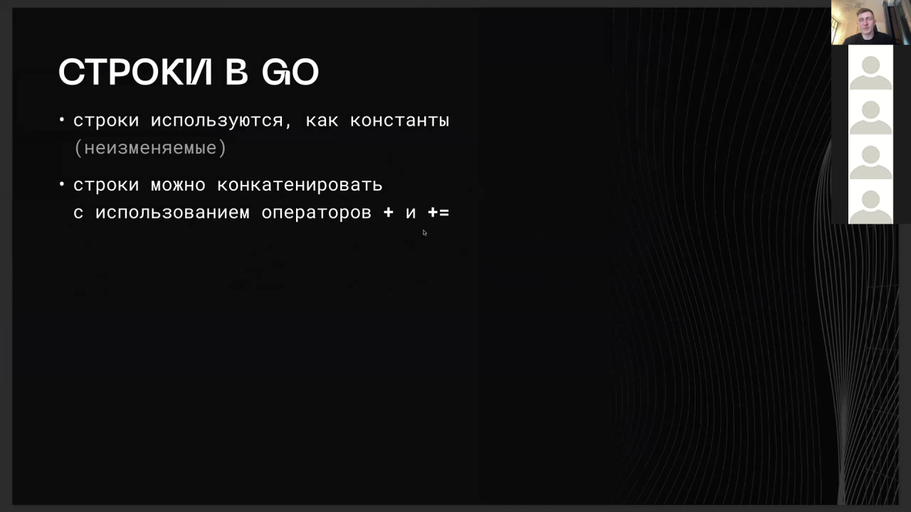

> [!quote]- Кадр [01:09:07]
> 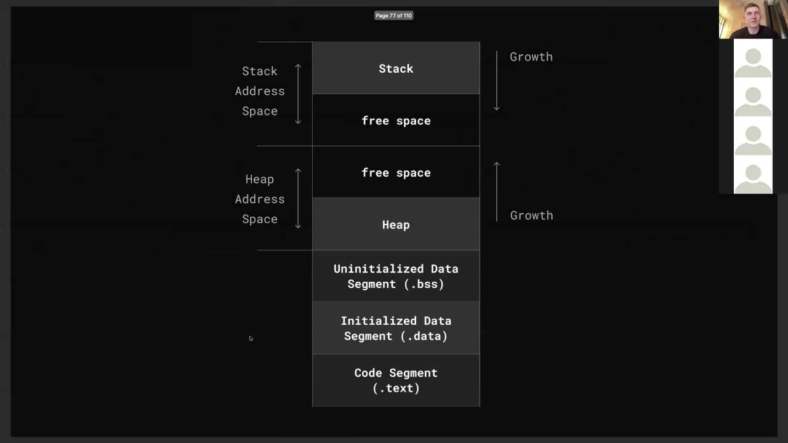

> [!quote]- Кадр [01:08:16]
> 

## 4. Индексация, срезы, подстроки, сравнение и Trim

Индексация строки и получение подстроки (срез) работают по количеству **байт**, а не символов: срез `str[1:6]` берёт подстроку, начиная с индекса 1, и срез указывает на байты исходной строки. `unsafe.StringData` возвращает указатель на данные строки, а `unsafe.Slice` по этому указателю и длине строки создаёт слайс, который указывает на тот же массив, что и исходная строка. При сравнении строк на равенство сначала проверяется размер строки, затем адреса указателей и только потом выполняется итерация по каждому байту; проверять только указатели недостаточно, так как подстрока может начинаться в том же месте памяти, но иметь другую длину. Подстрока на несколько байт может быть получена из большой строки, но она продолжает ссылаться на исходную строку, поэтому память всей исходной строки не освобождается сборщиком мусора — чтобы решить это, подстроку нужно копировать. `TrimSuffix` обрезает правую часть строки, если она точно совпадает с переданным суффиксом, а `TrimRight` режет строку справа до тех пор, пока находит символы, присутствующие в переданном множестве.

```go
package main

import "fmt"

func main() {
	str := "Hello"
	substr := str[1:6]
	fmt.Println(substr)
}

strData := unsafe.StringData(str)
newStrData := unsafe.StringData(newStr)

println("strData:", strData)
println("newStrData:", newStrData)

slice := unsafe.Slice(strData, len(str))
newSlice := unsafe.Slice(newStrData, len(newStr))
```

| Функция | Что удаляет | Пример |
|---|---|---|
| TrimSuffix | точный суффикс | xO |
| TrimRight | множество символов | 0x |

*Источник: [00:45:09], [00:55:42], [01:01:28], [01:02:29], [01:02:38], [01:03:10], …*

## 5. Преобразования string, rune и byte, raw-строки

В Go срез рун преобразуется в строку через `string(data)`, например `data` с невалидными UTF-8 символами `0x0011FFFF` и `0x0012FFFF`; чтобы конвертировать строку в срез рун, нужно знать кодировку, так как `rune` — `int32` (4 байта). Чтобы изменить символы строки, её преобразуют в `[]rune` и меняют элементы по индексу; если символы кодируются одним байтом, в срезе рун часть байтов пустует — допустимо, но неэффективно. `[]rune` и `[]byte` нельзя конвертировать напрямую; неэффективная конвертация `[]rune` в `[]byte` через `string(rs)` требует промежуточной строки и двух копирований (две аллокации), а эффективная своя функция `Runes2Bytes` сначала считает длину через `utf8.RuneLen`, затем кодирует каждую руну через `utf8.EncodeRune`. Для `[]byte → []rune` есть `bytes.Runes`, но в горячих циклах такая конвертация даёт дополнительный оверхед. Строка в обратных кавычках (**raw string literal**) не интерпретируется: управляющие символы сохраняются как текст, а в interpreted-строке в двойных кавычках `\n` означает перевод строки; `[]byte("\n")` даёт один байт, `[]byte(`\n`)` — два байта.

```go
package main

import "fmt"

func main() {
	// incorrect code points
	data := []rune{0x0011FFFF, 0x0012FFFF}
	str := string(data)

	fmt.Println(str)
}

rs := []rune(s)
for i := 0; i < len(rs); i++ {
	rs[i] = 'a'
}

func BenchmarkConversion(b *testing.B) {
	rs := []rune(str + "sdfsf€€€€€€€€€€€23423423")
	for i := 0; i < b.N; i++ {
		Result = RunesToBytes(rs)
	}
}

func BenchmarkConversionWithStr(b *testing.B) {
	rs := []rune(str + "sdfsf€€€€€€€€€€€23423423")
	for i := 0; i < b.N; i++ {
		Result = []byte(string(rs))
	}
}

package main

import "fmt"

func main() {
	interpreted := "\nHello\nworld!\n"
	raw := `\nHello\nworld!\n`

	fmt.Println(interpreted)
	fmt.Println(raw)

	interpretedData := []byte("\n")
	rawData := []byte(`\n`)

	fmt.Println("interpretedData:", interpretedData)
	fmt.Println("rawData:", rawData)
}
```

| Запись | Длина []byte |
|---|---|
| "\n" | один байт |
| `\n` | два байта |

*Источник: [00:39:45], [00:41:56], [00:42:00], [00:43:00], [00:43:39], [01:16:51], …*

> [!quote]- Кадр [01:16:51]
> 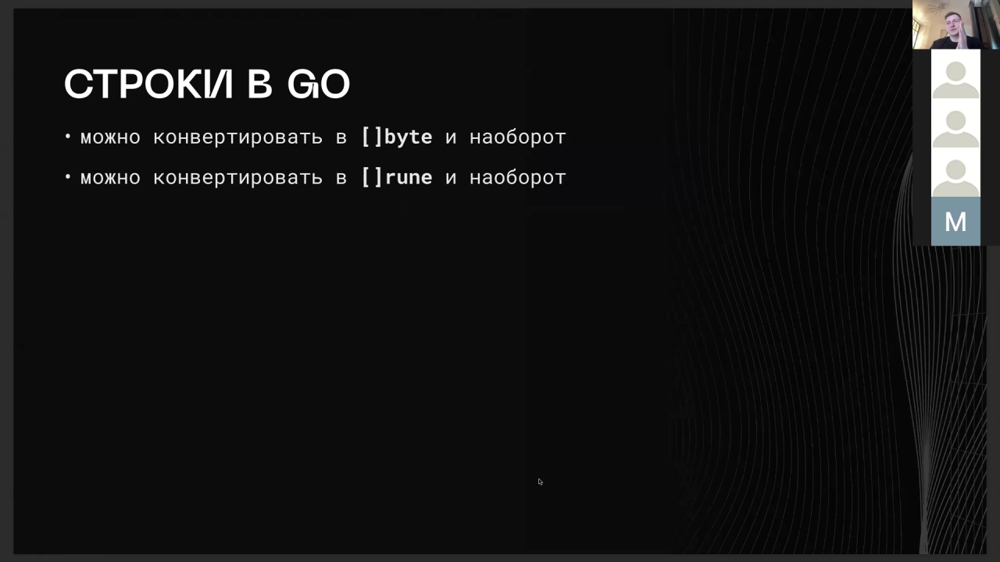

> [!quote]- Кадр [01:31:54]
> 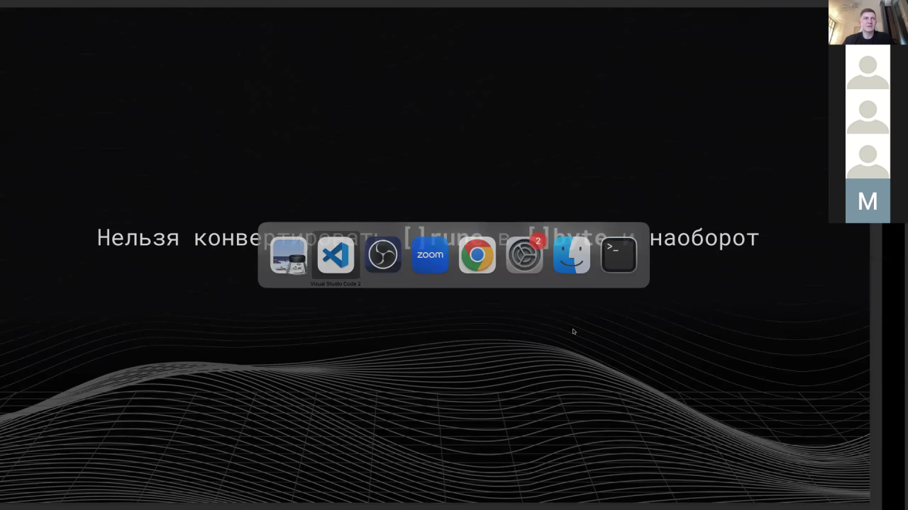

## 6. Конкатенация строк, append/copy и бенчмарки

Строки конкатенируют операторами `+` и `+=`; конкатенация копирует данные: вычисляется суммарный размер, выделяется один большой участок памяти, и в него копируются строки, причём оператор `+` оптимизирован — при каждом выражении выделяется одна область независимо от количества строк. Конкатенация строковых литералов не является литералом и может аллоцировать, но с константой или литералом аллокации нет; `Sprintf` медленнее из-за парсинга паттерна и рефлексии, `strings.Join` требует срез и сепаратор. `append` и `copy` работают со срезами, но могут принимать строку (синтаксический сахар); для быстрой конкатенации используют slice byte, например `strings.Builder`: память выделяется реже, при росте среза grow либо обрубает длину и выходит, либо создаёт буфер на capacity и копирует старый. **Бенчмарк** в Go — функция с префиксом `Benchmark`, принимающая `*testing.B`, выполняет цикл по `b.N` и сбрасывает таймер; запускается `go test` с флагом `-bench`, например `go test -bench=. -benchmem comparison_test.go`. В `concatenation_test.go` сравниваются `Sprintf` и оператор `+`, в `speed_test.go` — простая конкатенация и `strings.Builder`; `BenchmarkConversion` против `BenchmarkUnsafeConversion` даёт 15.64 ns/op, 16 B/op, 1 allocs/op против 1.226 ns/op, 0 B/op, 0 allocs/op, а в `perf_test.go` `RunesToBytes` даёт одну аллокацию против трёх у `[]byte(string(rs))`. Bound-чеки (проверки границ) работают не только с массивами и срезами, но и со строками.

```go
package main

import "fmt"

func main() {
	hello := []byte("Hello ")
	world := "world!"

	helloWorld1 := append(hello, world...) // sugar
	fmt.Println(string(helloWorld1))

	helloWorld2 := make([]byte, len(hello)+len(world))
	copy(helloWorld2, hello)

	copy(helloWorld2[len(hello):], world) // sugar
	fmt.Println(string(helloWorld2))
}

func BenchmarkConcatenationWithSprintf(b *testing.B) {
	s0 := "str1"
	s1 := "str2"
	s2 := "str3"
	s3 := "str4"

	b.ResetTimer()
	for i := 0; i < b.N; i++ {
		_ = fmt.Sprintf("%s%s%s%s", s0, s1, s2, s3)
	}
}

func BenchmarkConcatenationWithOperatorPlus(b *testing.B) {
	s0 := "str1"
	s1 := "str2"
	s2 := "str3"
}

var str = "go"
newStr := str + "-go"

strData := unsafe.StringData(str)
newStrData := unsafe.StringData(newStr)

slice := unsafe.Slice(strData, len(str))
newSlice := unsafe.Slice(newStrData, len(newStr))

newSlice[0] = 'G'
println("newStr:", newStr)

package main

import "unsafe"

func action() {}

func main() {
	var str = "go"
	newStr := str + "-go"

	strData := unsafe.StringData(str)
	newStrData := unsafe.StringData(newStr)

	println("action:", action)
	println("strData:", strData)
	println("newStrData:", newStrData)
}

// go test -bench=. concatenation_test.go

func BenchmarkConcatenationWithSprintf(b *testing.B) {
	s0 := "str1"
	s1 := "str2"
	s2 := "str3"
	s3 := "str4"

	b.ResetTimer()
	for i := 0; i < b.N; i++ {
		_ = fmt.Sprintf("%s%s%s%s", s0, s1, s2, s3)
	}
}

// go test -bench=. speed_test.go

func BenchmarkSimpleConcatenation(b *testing.B) {
	str := "test"
	for i := 0; i < b.N; i++ {
		str += "test"
	}
	_ = str
}

func BenchmarkConcatenationWithStringBuilder(b *testing.B) {
	builder := strings.Builder{}
	builder.WriteString("test")
	for i := 0; i < b.N; i++ {
		builder.WriteString("test")
	}
	_ = builder.String()
}

func BenchmarkConversion(b *testing.B) {
	slice := []byte("Hello world!!!!")
	for i := 0; i < b.N; i++ {
		Result = string(slice)
	}
}

func BenchmarkUnsafeConversion(b *testing.B) {
	slice := []byte("Hello world!!!!")
	for i := 0; i < b.N; i++ {
		Result = Convert(slice)
	}
}

// BenchmarkConversion-8        63974546        15.64 ns/op      16 B/op      1 allocs/op
// BenchmarkUnsafeConversion-8 1000000000         1.226 ns/op       0 B/op      0 allocs/op

func BenchmarkSimpleConcatenation(b *testing.B) {
	str := "test"
	for i := 0; i < b.N; i++ {
		str += "test"
	}
	_ = str
}

func BenchmarkByRangeStringUTF8(b *testing.B) {
	text := "aaaabbbbcccccddddeeeeffff"

	b.ResetTimer()
	for i := 0; i < b.N; i++ {
		for _, _ = range text {
		}
	}
}
```

*Источник: [00:01:42], [00:43:06], [00:43:13], [00:43:42], [00:44:42], [00:45:09], …*

> [!quote]- Кадр [00:43:06]
> 

> [!quote]- Кадр [00:51:39]
> 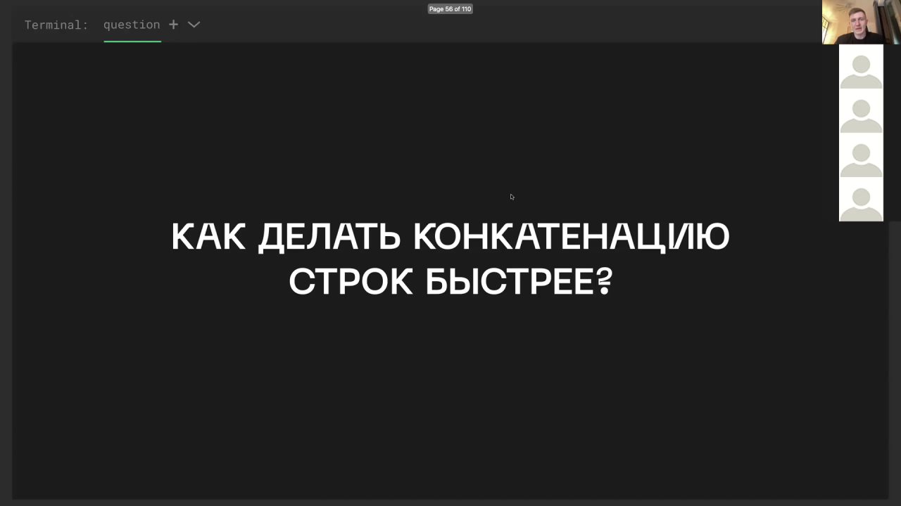

> [!quote]- Кадр [01:56:21]
> 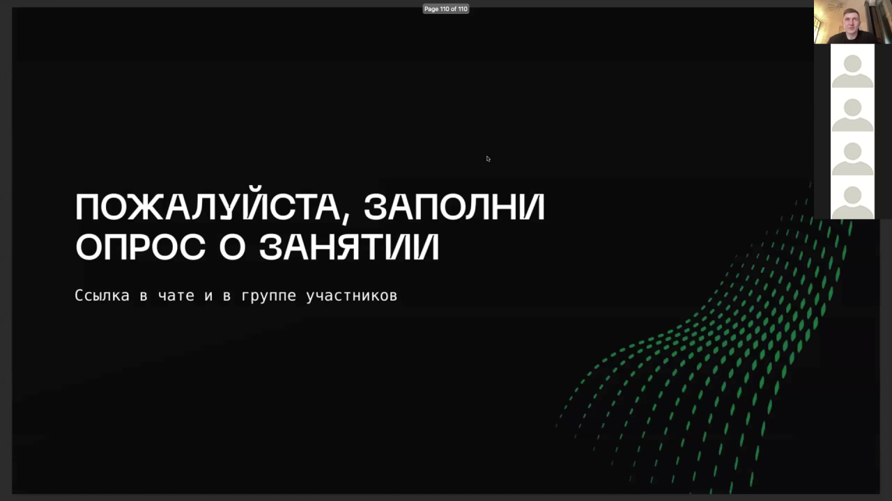

## 7. unsafe: SliceHeader/StringHeader и Bus error

Приведение `strings.Builder` к строке выполняется через пакет `unsafe`, поэтому копирование не происходит; при копировании `strings.Builder` копируется указатель на тот же массив, поэтому разные builders могут указывать на одну и ту же память. **SliceHeader** и **StringHeader** в памяти устроены похоже: первое поле у обоих — указатель, после указателя идёт длина; поля `Data` и `Len` идентичны, у SliceHeader есть дополнительное поле `Cap`, а теперь SliceHeader и StringHeader деприкейтятся (объявлены устаревшими). `unsafe` позволяет обходить гарантии безопасности типов в Go, но этот способ устарел, и его лучше не использовать; пакет `unsafe` не защищён гарантией совместимости Go 1, и его использование может сломать обратную совместимость с следующей версией Go. Попытка изменить данные строки, полученные через `unsafe.StringData` и `unsafe.Slice`, может привести к аварийному завершению программы с ошибкой **Bus error**. Небезопасное преобразование не работает за линию: оно использует указатели; аллокация переменной slice есть, но она может происходить просто на стеке, а escape-анализ определяет, где что аллоцировать.

```go
type SliceHeader struct {
	Data unsafe.Pointer
	Len  int
	Cap  int
}

type StringHeader struct {
	Data unsafe.Pointer
	Len  int
}

slice := unsafe.Slice(strData, len(str))
newSlice := unsafe.Slice(newStrData, len(newStr))

newSlice[0] = 'G'
println("newStr:", newStr)

slice[0] = 'G'
```

| | SliceHeader | StringHeader |
|---|---|---|
| Data | unsafe.Pointer | unsafe.Pointer |
| Len | int | int |
| Cap | int | — |

> [!info] Зачем это нужно
> Ключ должен храниться в map как строка.

*Источник: [00:50:21], [01:03:10], [01:05:30], [01:06:52], [01:19:10], [01:20:10], …*

## 8. Передача строки и интернирование unique

При передаче строки в функцию копируется только **дескриптор** этой строки — объект, внутри которого есть pointer и size; сама строка при этом не копируется, чтобы скопировать строку, нужно делать это явно. **Интернирование строк** — это хранение в памяти только одного экземпляра для идентичных строк; вместо самой строки объекты могут хранить указатель, числовое значение или хэш. В Go есть оптимизация компилятора — интернирование константных строк: одинаковые строковые литералы помещаются в одно место памяти и переиспользуются, и адреса одинаковых строковых литералов совпадают, поскольку строки в Go неизменяемы. Пакет `unique` позволяет делать интернирование: в программе хранится одна версия уникального значения, а остальные ссылаются на неё; внутри — глобальный пул, в котором для каждого типа есть отдельная мапа уникальных значений, пакет синхронизирован. `unique.Make` принимает comparable-значение и возвращает `Handle[T]`, а метод `Value` возвращает значение типа `T`; если строки идентичны, хэндлы совпадают, так как `Make` возвращает указатели; `unique.Make` возвращает generic-тип и позволяет интернировать свои структуры данных, но только если они comparable, причём в Go есть только констраинт `comparable`, констраинта `hashable` нет.

```go
func process(temp string) {
}

func main() {
	str := "test"
	process(str)
}

type Handle
	func Make[T comparable](value T) Handle[T]
	func (h Handle[T]) Value() T
```

> [!info] Зачем это нужно
> Используется для дедубликации и ускорения сравнения больших структур данных.

*Источник: [00:34:27], [01:09:16], [01:10:16], [01:13:31], [01:35:11], [01:35:22], …*

> [!quote]- Кадр [01:35:11]
> 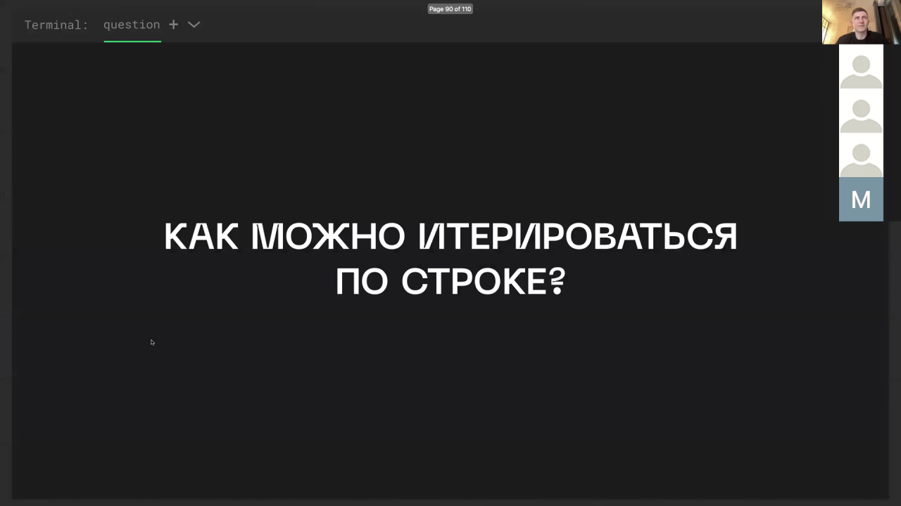

## 9. Copy-on-write буфер

**COWBuffer** — тип, создаваемый через `NewCOWBuffer(data []byte)`, и буфер копирования при записи (copy-on-write). `Update` модифицирует буфер, если на него никто не ссылается, кроме него; если же кто-то ссылается на буфер, то перед апдейтом буфер копируется, и только потом производится обновление. Для реализации COW-буфера нужно хранить **refcount** — количество ссылок на буфер. Для копирования буфера предполагается использовать только метод `Clone()`; изменение конкретного байта выполняется через `Update(index int, value byte) bool`, получение строки — через `String()`, а метод `Close()` означает, что объект больше не использует копию буфера.

```go
type COWBuffer struct { ... }

func NewCOWBuffer(data []byte) *COWBuffer            // создать буфер с заполнением данными
func (b *COWBuffer) Clone() COWBuffer              // создать копию буфера
func (b *COWBuffer) Close()                        // перестать использовать копию буфера
func (b *COWBuffer) Update(index int, value byte) bool // изменить определенный байт в буфере
func (b *COWBuffer) String() string                // конвертировать буфер в строку
```

*Источник: [01:54:45], [01:55:24], [01:55:54], [01:55:58]*

## 10. Материалы для системного программирования

Для изучения системного программирования стоит прочитать про **L-формат** и **PE**, в частности про ассемблерные секции, а также пописать на C, C++ и немного на ассемблере.

*Источник: [01:57:21]*

## Схема

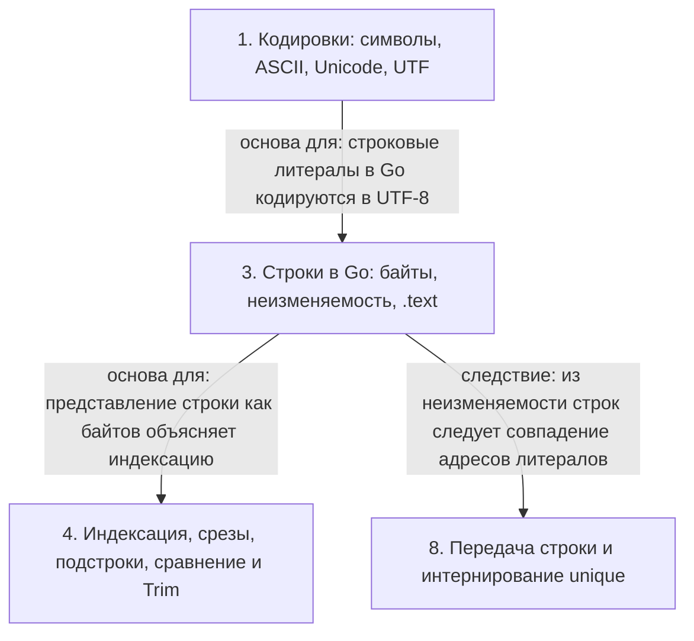

## Итог

> [!success] Что в итоге
> Символы хранятся как числа, а стандарты кодирования нужны, чтобы одинаковые числа отображались одинаково на разных компьютерах: от ASCII развитие шло к двухбайтовому Unicode с проблемами памяти и порядка байт, решаемыми через BOM, а UTF-8 и UTF-16 — компромисс между памятью и скоростью. Строку можно реализовать по-разному (нуль-терминированные, Pascal-строки, SSO, copy-on-write), а в Go строка — неизменяемая последовательность байт с `rune` (`int32`) для кодовых точек; константные строки и литералы размещаются в доступном только для чтения код-сегменте (`.text`). Конкатенация копирует данные, поэтому для ускорения используют slice byte и `strings.Builder`, что подтверждается бенчмарками, а небезопасные преобразования через `unsafe` ведут к undefined behavior и Bus error; для дедубликации строк применяют интернирование через `unique.Make`.
