# Словари в Go: хэш-таблицы, устройство map и практические тонкости

> [!abstract] Обзор
> Материал объединяет устройство хэш-таблиц и словарей map в Go. Показан путь от массива пар и прямого доступа (Direct Accessing) к хэш-таблице: ключи преобразуются в индексы через хэш-функцию с уникальной солью, элементы хранятся в бакетах (bucket) с TopHash. Разбираются коллизии, цепочки, открытая адресация, пробирование, коэффициент загруженности (load factor), переиндексация и инкрементальная эвакуация, а также hmap, поле B, buckets/oldbuckets, hint и Capacity. Отдельно собраны тонкости работы с map: сравнимые ключи и точность float, хранение денег, порядок итерации, неизменяемость значений, запрет адреса элемента, очистка без освобождения памяти и сравнение словарей. В завершение описаны альтернативы для упорядоченного хранения — бинарное дерево поиска, TreeMap и обобщённый ordered map. В Go 1.24 появилась SwissTable.

> [!info] Курс
> [[index|Оглавление курса]]

## Оглавление
1. [[#1. От пар id — баланс к хэш-таблице]]
2. [[#2. Коллизии и SwissTable в Go 1.24]]
3. [[#3. Bucket, bmap, TopHash и data-oriented design]]
4. [[#4. Поиск, удаление и пропуск удалённых ячеек]]
5. [[#5. Пробирование при коллизиях]]
6. [[#6. Load factor, переиндексация и рост map]]
7. [[#7. hmap, мапа как указатель, B, buckets/oldbuckets, hint и Capacity]]
8. [[#8. Порядок итерации и обновление значений map]]
9. [[#9. Сравнимый ключ, float-ключи и хранение денег]]
10. [[#10. Сравнение словарей: метод equal, рефлексия и бенчмарки]]
11. [[#11. Очистка map и поведение памяти]]
12. [[#12. Альтернативы: ordered map, бинарное дерево поиска, TreeMap]]
13. [[#13. Нулевое значение слайса и словарь как обобщённый тип]]

**Схема** — [[#Схема]]
**Итог** — [[#Итог]]

## 1. От пар id — баланс к хэш-таблице

Нужно хранить пару «идентификатор пользователя — баланс» и быстро находить баланс по идентификатору; для этого используется хэш-таблица с парами «идентификатор — баланс». Массив пар требует пробега по всему массиву, а прямой доступ (Direct Accessing) даёт константное время, но при неинкрементальных ID массив становится разреженным: при 5 пользователях и максимальном ID 1 000 000 остаётся миллион минус 5 пустых ячеек. Чтобы избавиться от пустых мест, ключи преобразуют в индексы: **Capacity** — количество мест, примитивная хэш-функция считает индекс как остаток от деления ключа на capacity, а `map` в Go под капотом — это массив, где ключи преобразуются в индексы через хеширование. У каждой map есть уникальная соль, а от хэша берутся младшие и старшие биты: minhash — младшие биты, top hash — старшие. minhash определяет нужный bucket, а количество бакетов хранится в логарифмической форме — для экономии места и ради битовых операций.

```go
HashTable table(4);
table.insert(5, 500); // 5%4=1
table.insert(3, 300); // 3%4=3
table.insert(9, 900); // 9%4=1

// func makemap64(t *maptype, hint int64, h *hmap) *hmap
data := make(map[string]int, 5)

// func mapaccess1(t *maptype, h *hmap, key unsafe.Pointer) unsafe.Pointer
value := data["key"]

// func mapaccess2(t *maptype, h *hmap, key unsafe.Pointer) (unsafe.Pointer, bool)
value, found := data["key"]

// func mapassign(t *maptype, h *hmap, key unsafe.Pointer) unsafe.Pointer
data["key"] = 100

// func mapdelete(t *maptype, h *hmap, key unsafe.Pointer)
delete(data, "key")

type maptype struct {
    typ    *_type
    key    *_type
    elem   *_type
    bucket *_type // internal type representing a hash bucket
    // function for hashing keys (ptr to key, seed) -> hash
    hasher     func(unsafe.Pointer, uintptr) uintptr
    keysize    uint8  // size of key slot
    elemsize   uint8  // size of elem slot
    bucketsize uint16 // size of bucket
    flags      uint32
}

type _type struct {
    size       uintptr
    ptrdata    uintptr // size of memory prefix holding all pointers
    hash       uint32  // hash of type; avoids computation in hash tables
    tflag      tflag   // extra type information flags
    align      uint8   // alignment of variable with this type
    fieldalign uint8   // alignment of struct field with this type
    kind       uint8   // enumeration for C
    // function for comparing objects of this type
    // (ptr to object A, ptr to object B) -> ==?
    equal func(unsafe.Pointer, unsafe.Pointer) bool
    // GCData stores the GC type data for the garbage collector.
    // If the KindGCProg bit is set in kind, GCData is a GC program.
    // Otherwise it is a ptrmask bitmap. See mbitmap.go for details.
    gcdata    *byte
    str       nameOff // string form
    ptrToThis typeOff // type for pointer to this type, may be zero
}
```

> [!info] Зачем это нужно
> Хэш-таблица нужна для быстрого поиска баланса по идентификатору; отсортированный порядок позволяет улучшить поиск в массиве пар. Преобразование нужно, чтобы не терять скорость поиска и избавиться от пустых мест в массиве.

*Источник: [00:00:28], [00:01:02], [00:01:24], [00:01:51], [00:02:51], [00:02:53], …*

> [!quote]- Кадр [00:01:02]
> 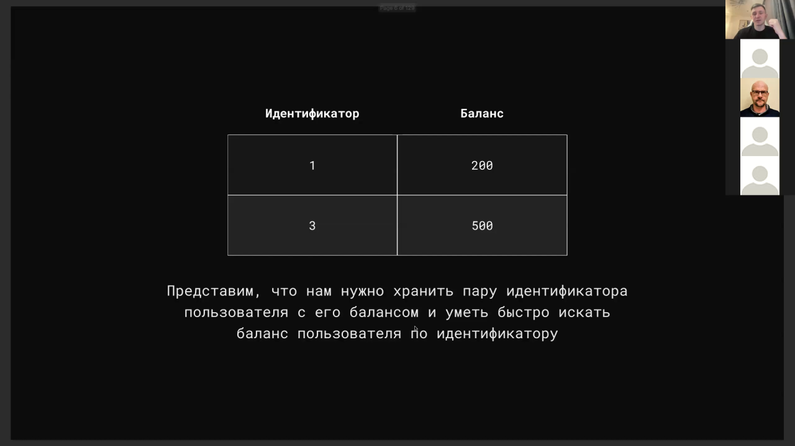

> [!quote]- Кадр [00:01:24]
> 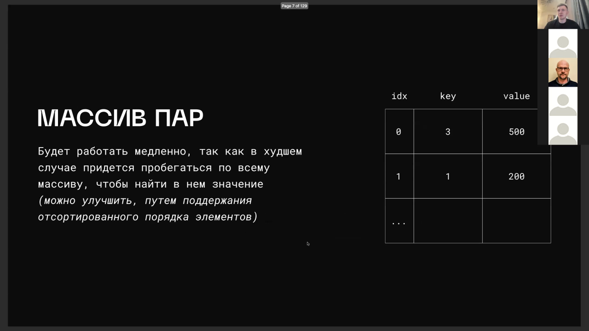

> [!quote]- Кадр [00:01:51]
> 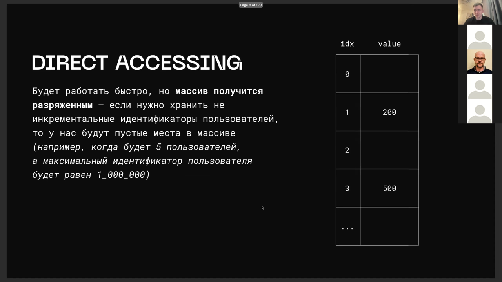

> [!quote]- Кадр [00:02:53]
> 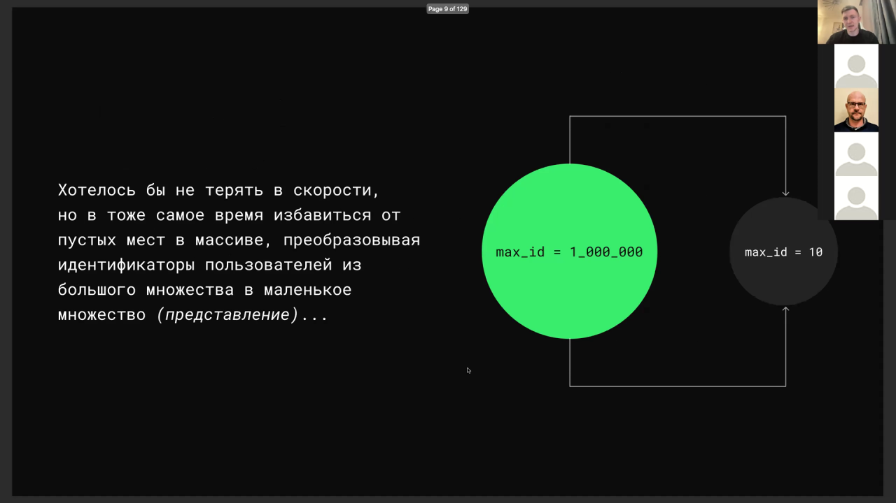

> [!quote]- Кадр [01:25:06]
> 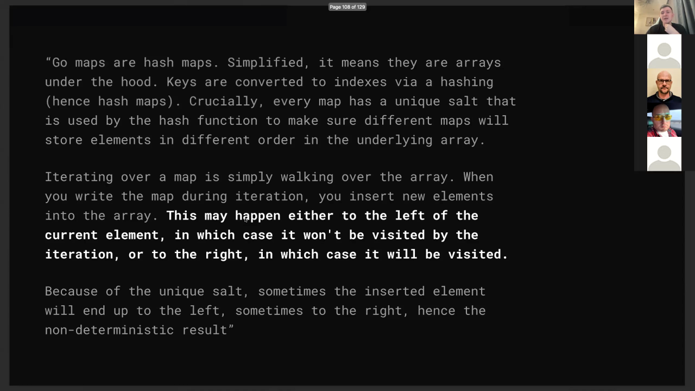

> [!quote]- Кадр [01:25:42]
> 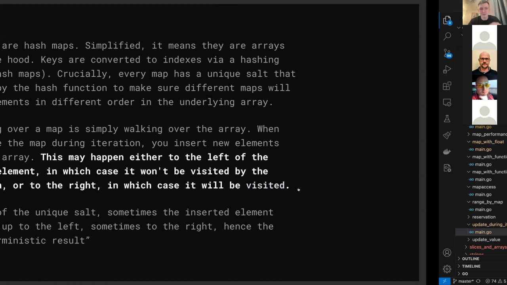

> [!quote]- Кадр [01:43:36]
> 

## 2. Коллизии и SwissTable в Go 1.24

**Коллизия** — ситуация, когда для разных ключей получается один и тот же результат хэш-функции; коллизии неизбежны, потому что большое множество данных преобразуется в маленькое. Пример: ключи 8 и 1 000 003 при взятии остатка от деления на 5 дают один и тот же результат — 3. Базово есть два основных способа работы с хеш-коллизиями: метод цепочек и метод открытой адресации, и внутри каждого много нюансов реализации. До версии Go 1.24 в Go использовался метод цепочек; в Go 1.24 появилась **SwissTable**, которую нельзя строго назвать открытой адресацией — по сути это открытая адресация с директориями и оптимизациями. На процессоре без векторизации и SIMD таблицы будут работать именно так, как рассказывается.

*Источник: [00:00:28], [00:06:17], [00:07:45], [00:28:56], [00:29:56]*

> [!quote]- Кадр [00:06:17]
> 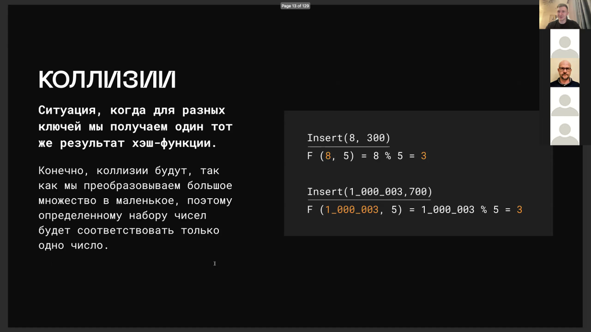

> [!quote]- Кадр [00:07:45]
> 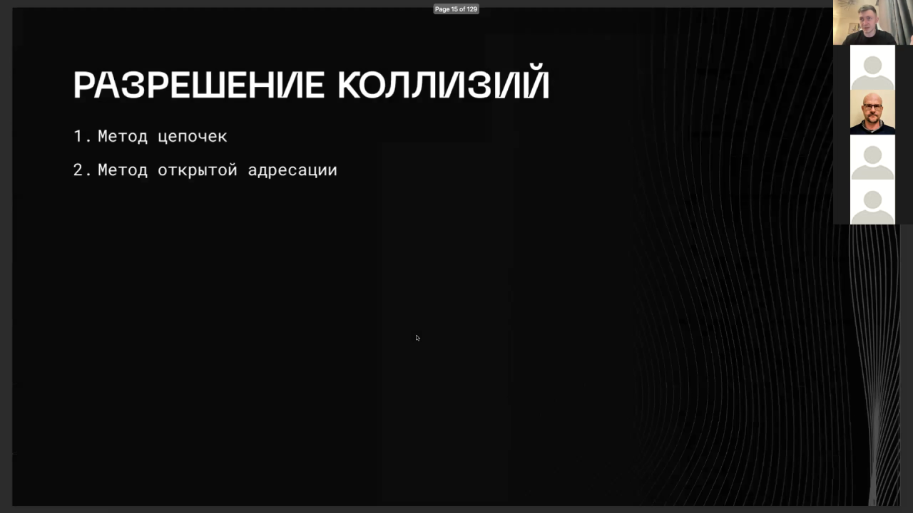

## 3. Bucket, bmap, TopHash и data-oriented design

**Bucket (бакет)** представляет связанный список; для цепочек можно использовать не только связанный список, но и массивы, деревья и прочее. Bucket в Go — массив фиксированной длины из восьми элементов: сначала 8 tophash, затем 8 ключей, затем 8 значений и указатель overflow. Если приходит больше 8 пар «ключ-значение», создаётся ещё один бакет, и бакеты образуют связанный список через `overflow`. **TopHash** — старшие 8 бит хэша; при поиске Go сначала сравнивает TopHash, а не сами ключи, и только при совпадении переходит к проверке идентичности ключей. Структура `bmap` содержит `tophash [8]uint8`, `keys [8]int`, `values [8]int` и `overflow *bmap`. Data-oriented design (DOT, «проектирование, ориентированное на данные») создаёт в рамках объекта массив значений, а не массив объектов, и применяется при упаковке бакетов. В `tophash` значения 0–5 зарезервированы: `emptyRest=0`, `emptyOne=1`, `evacuatedX=2`, `evacuatedY=3`, `evacuatedEmpty=4`, `minTopHash=5`.

```
// My implementation
type bmap struct {
    tophash  [8]uint8
    keys     [8]int
    values   [8]int
    overflow *bmap
}

// Possible tophash values. We reserve a few possibilities for special marks.
// Each bucket (including its overflow buckets, if any) will have either all or none of its
// entries in the evacuated* states (except during the evacuate() method, which only happens
// during map writes and thus no one else can observe the map during that time).
emptyRest      = 0 // this cell is empty, and there are no more non-empty cells at higher indexes or overflows.
emptyOne       = 1 // this cell is empty
evacuatedX     = 2 // key/elem is valid. Entry has been evacuated to first half of larger table.
evacuatedY     = 3 // same as above, but evacuated to second half of larger table.
evacuatedEmpty = 4 // cell is empty, bucket is evacuated.
minTopHash     = 5 // minimum tophash for a normal filled cell.
```

> [!info] Зачем это нужно
> Сравнение TopHash — оптимизация для более быстрого поиска.

*Источник: [00:09:21], [00:42:13], [00:42:57], [00:43:04], [00:43:22], [00:44:01], …*

> [!quote]- Кадр [00:42:13]
> 

> [!quote]- Кадр [00:43:04]
> 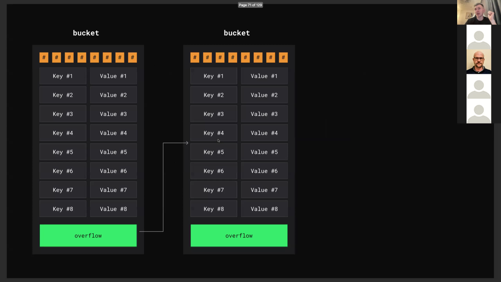

> [!quote]- Кадр [00:51:11]
> 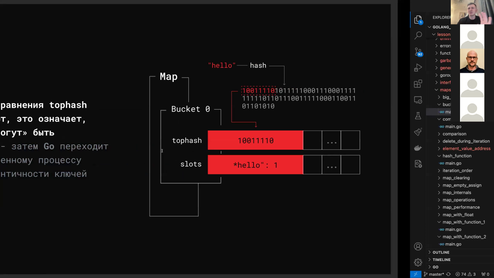

> [!quote]- Кадр [00:43:22]
> 

## 4. Поиск, удаление и пропуск удалённых ячеек

Ключ в бакете хранят, чтобы понимать, к чему относится значение, перезаписывать или получать значение, для итерации и из-за коллизий. При поиске вычисляется хеш ключа, происходит переход в соответствующий бакет и последовательный перебор элементов связного списка со сравнением ключей; как только поиск дошёл до пустой ячейки, он прекращается. Удаление выполняется так же, как поиск: вычисляется хеш, переход в бакет, перебор связного списка и удаление при совпадении ключа. Удаление элемента ломает инвариант «поиск до пустого значения»: нужно либо помечать ячейку как удалённую, чтобы поиск проходил дальше, либо сдвигать элементы с коллизиями влево. Помеченный элемент при обходе перепрыгивается, а добавление слева от текущей позиции не будет обработано, справа — будет. Бинарный поиск здесь не поможет: в бакетах нет отсортированного порядка «меньше или больше», тогда как в сбалансированном дереве поиск работает за логарифм.

```
HashTable table(4);
table.insert(5, 200); // 5%4=1
table.insert(3, 300); // 3%4=3
table.insert(9, 900); // 9%4=1
table.find(9);        // 9%4=1
```

*Источник: [00:09:59], [00:10:52], [00:11:10], [00:16:57], [00:25:06], [00:26:06], …*

> [!quote]- Кадр [00:10:52]
> 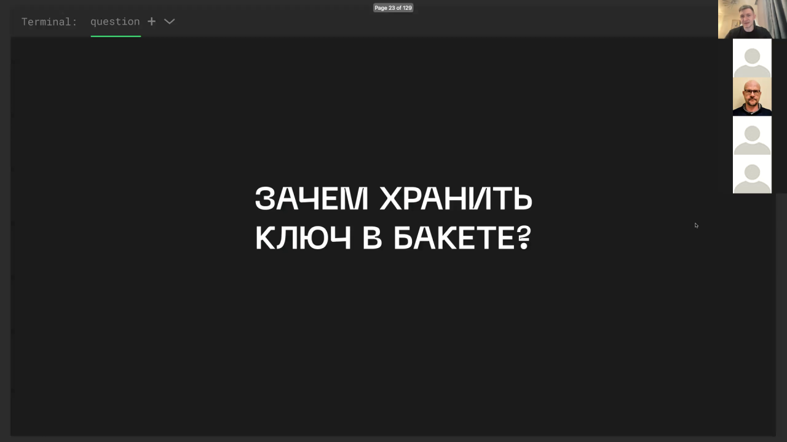

## 5. Пробирование при коллизиях

При вставке ключа 9 со значением 900 хэш-функция даёт индекс 1, но эта ячейка уже занята; в такой ситуации нужно **пробировать** — просматривать соседние места и искать свободное для вставки. При коллизии выполняется пробирование: если ячейка занята, ключ и значение добавляются в следующую свободную ячейку; если свободна — элемент добавляется туда. Разные способы пробирования различаются только тем, как ищется следующая пустая ячейка; самый простой — идти по массиву, пока не найдёшь свободное место. Различают линейное (`i + 1`), квадратичное (`(i + i * i) / 2`) и двойное хэширование (`hash_fn2(i)`); существует также куку-хеширование. При большом количестве коллизий можно ограничивать число пробирований: если после 2–3 шагов свободная ячейка не найдена, таблицу можно расширить и переиндексировать.

```
ВИДЫ ПРОБИРОВАНИЯ
1. Линейное = i + 1, i + 1, i + 1
2. Квадратичное = (i + i * i) / 2, (i + i * i) / 2, (i + i * i) / 2
3. Двойное хэширование = hash_fn2(i), hash_fn2(i), hash_fn2(i)
```

*Источник: [00:21:27], [00:22:27], [00:24:35], [00:26:44], [00:27:06], [00:27:56]*

> [!quote]- Кадр [00:26:44]
> 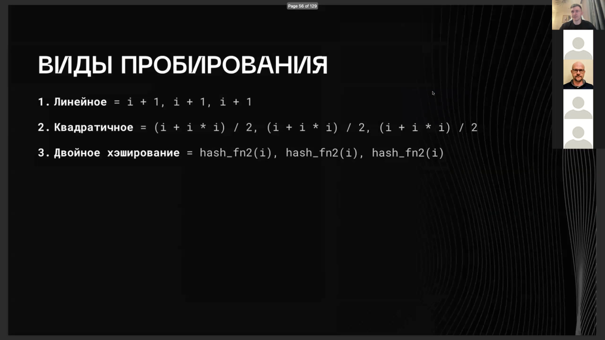

## 6. Load factor, переиндексация и рост map

**Load factor** — коэффициент загруженности хэш-таблицы: количество элементов, делённое на количество бакетов. Когда коэффициент превышает 0,6–0,7, происходит переиндексация; её важно не путать с релокацией в срезах. При коэффициенте загруженности больше 70% пора расширять и переиндексировать таблицу; увеличение массива бакетов происходит при коэффициенте заполненности 80%, что примерно соответствует 6,5 элементам в каждом бакете. **Переиндексация** — это проход по каждому элементу хеш-таблицы, пересчёт хэш-функции и перемещение элемента в новый бакет; при ней нельзя бездумно копировать элементы, потому что новый индекс вычисляется хэш-функцией, а capacity меняется. При переиндексации никто сразу ничего не переносит: перенос происходит только при записи и удалении ключей, а для чтения никто не эвакуируется. При увеличении массива бакетов в 2 раза происходит инкрементальная эвакуация элементов: выделяется вдвое больше памяти, данные из одного бакета могут остаться в нём или переехать только в один другой бакет, а память, выделенная под бакеты map, не очищается при удалении элементов.

```
HashTable table(4);
table.find(5); // 5%8=5  == 5
table.find(3); // 3%8=3  == 3
table.find(9); // 9%8=1  == 1
```

> [!info] Зачем это нужно
> Порог load factor запускает переиндексацию; переиндексация нужна, иначе некуда будет добавлять элементы.

*Источник: [00:00:28], [00:04:57], [00:12:30], [00:16:29], [00:22:49], [00:22:52], …*

## 7. hmap, мапа как указатель, B, buckets/oldbuckets, hint и Capacity

В Go внутреннее устройство словаря описывается структурой **hmap**, которую комментарий в коде называет «заголовком для Go map». Создают map, приводят её к пустому интерфейсу, получают указатель на интерфейс, приводят его к `*eface`, затем к `*hmap` — после чего анализируют поля, например `count` и количество бакетов (`1<<B`). Словарь (мапа) — это **указатель на структуру hmap**, а не сам объект структуры: при создании копии копируется тот же самый указатель. Строка или срез, наоборот, — это объект структуры. В hmap количество бакетов хранится в поле `B` как log₂; логарифмическая форма занимает меньше памяти. Есть два указателя на массив бакетов: `buckets` и `oldbuckets` (предыдущие бакеты); при росте `oldbuckets` начинает указывать на старый массив, а в `buckets` создаётся массив в два раза больше, при этом элементы остаются в старом массиве. При поиске сначала проверяются old buckets: если хэш-бакет уже переехал, значение ищется в `buckets`. Передаваемый `hint` попадает в диапазон из таблицы, который определяет количество бакетов и максимальную Capacity: например, hint 20 даёт 4 бакета и Capacity 32, а hint 28 — 8 бакетов и Capacity 64. Указание Capacity (например, 64) означает, что будет зарезервировано место как минимум для N элементов, а не ровно N; словарь всегда начинается с одного бакета, даже если размер не указан.

```go
// A header for a Go map.
type hmap struct {
	count     int // # live cells == size of map.  Must be first (used by len() builtin)
	flags     uint8
	B         uint8  // log_2 of # of buckets (can hold up to loadFactor * 2^B items)
	noverflow uint16 // approximate number of overflow buckets; see incrnoverflow for details
	hash0     uint32 // hash seed

	buckets    unsafe.Pointer // array of 2^B Buckets. may be nil if count==0.
	oldbuckets unsafe.Pointer // previous bucket array of half the size, non-nil only when growing
	nevacuate  uintptr        // progress counter for evacuation (buckets less than this have been evacuated)

	extra *mapextra // optional fields
}

data := make(map[int]int, 20)

package main

import "fmt"

func set(data map[int]int, key, value int) {
	data[key] = value
}

func main() {
	data := make(map[int]int)
	fmt.Println(data)
	set(data, 100, 500)
	fmt.Println(data)
}

data := make(map[int]int, 20)
```

| Тип | Представление |
|---|---|
| Мапа | указатель на структуру hmap |
| Строка или срез | объект структуры |

> [!info] Зачем это нужно
> Логарифмическая форма позволяет занимать меньше памяти.

*Источник: [00:31:19], [00:31:21], [00:31:49], [00:32:29], [00:33:12], [00:34:56], …*

> [!quote]- Кадр [00:39:59]
> 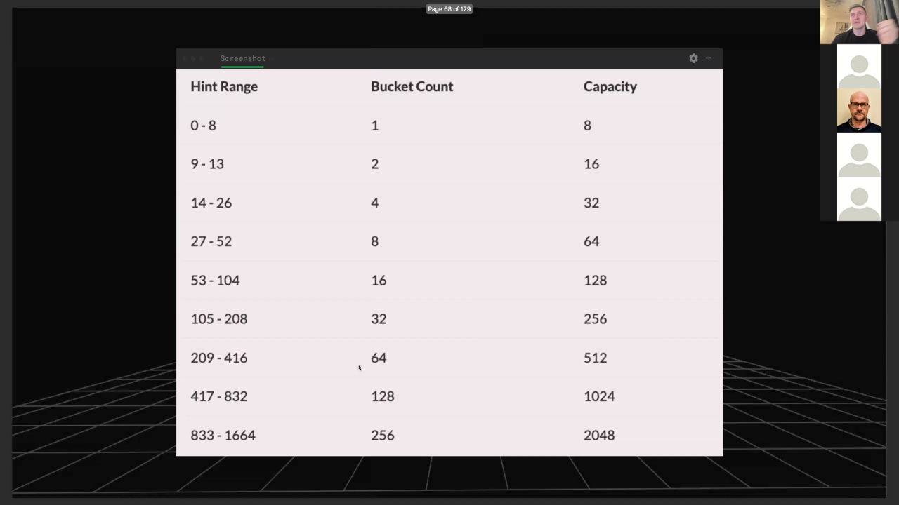

## 8. Порядок итерации и обновление значений map

Порядок итераций по map при обходе циклом не определён и может отличаться даже в рамках исполнения одной программы для одного и того же объекта map: итерация по map — это просто обход массива. Если вставлять новые элементы во время итерации, они могут оказаться слева (не будут посещены) или справа (будут посещены); из-за уникальной соли результат недетерминирован, а при удалении элементов во время цикла результат зависит от порядка итерации — в Go для этого специально добавили рандом. При передаче map в функцию копируется указатель на внутреннюю структуру, поэтому присваивание значения по ключу внутри функции изменит исходную мапу, хотя присваивание параметру новой map внутри функции исходную не меняет. Если использовать интерфейс как ключ map и передать несравниваемый и нехешируемый тип (срез или функцию), возникнет паника. Словари не хранят данные, отсортированные по ключу, и не сохраняют порядок добавления; `println` сортирует список ключей, при переборе map в `range` значения копируются, поэтому изменение принятого значения не меняет исходную map; `m["Go"] = m["Go"]` создаёт ключ `"Go"`, так как чтение по отсутствующему ключу возвращает нулевое значение. Если ключ или значение превышает 128 байт, Go хранит указатель, а не сами данные. Значение элементов словаря не может быть изменено на месте (inplace) и перезаписывается только целиком: нельзя получить значение по ключу, изменить поле и записать обратно, потому что неизвестно, находится значение в old buckets или new buckets. Переписывание работает при уровне косвенности указателей или через срез, а взять адрес значения элемента map нельзя — это ошибка.

```go
package main

import "fmt"

func set(data map[int]int, key, value int) {
	data[key] = value
}

func main() {
	data := make(map[int]int)
	fmt.Println(data)
	set(data, 100, 500)
	fmt.Println(data)
}

func main() {
	m := make(map[string]int, 3)
	x := len(m)

	m["Go"] = m["Go"]

	y := len(m)
	println(x, y)
}
```

*Источник: [00:33:12], [00:51:55], [01:14:15], [01:16:08], [01:17:47], [01:24:34], …*

> [!quote]- Кадр [01:14:15]
> 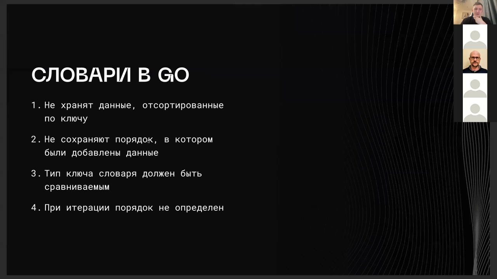

## 9. Сравнимый ключ, float-ключи и хранение денег

При коллизии необходимо не только считать хэш, но и сравнивать ключи, чтобы найти ровно тот ключ. Тип данных для ключа словаря в Go должен быть сравниваемым (constraint `comparable`). `0.3 + 0.6` в `float32` не даёт точно `0.9`, поэтому поиск ключа `0.9` в `map[float32]struct{}` не находит запись — это пример потери точности при работе с вещественными типами; вещественные числа нельзя сравнивать напрямую (`==`), правильно сравнивать их, проверяя, что разница меньше epsilon. При инициализации мапы с ключом-функцией или срезом компилятор не ругается, потому что ключ имеет тип пустого интерфейса: за ним может скрываться любой тип данных — это паника вместо ошибки компиляции. Чтобы хранить цену в хэш-таблице, можно хранить её в копейках: при записи умножать рубли на 100, а при чтении делить на 100; для представления денег можно использовать структуру, например `PriceStruct`, у которой есть целочисленное поле (`integer`) и второе поле.

```go
package main

import "fmt"

func main() {
	var value1 float32 = 0.3
	var value2 float32 = 0.6
	data := make(map[float32]struct{})
	data[value1+value2] = struct{}{}

	var result float32 = 0.9
	_, found := data[result]
	fmt.Println(found)
}
```

> [!info] Зачем это нужно
> Чтобы хранить цену в хэш-таблице без потери точности.

*Источник: [00:35:06], [00:48:43], [00:49:30], [00:51:04], [00:54:52], [00:55:53], …*

> [!quote]- Кадр [00:35:06]
> 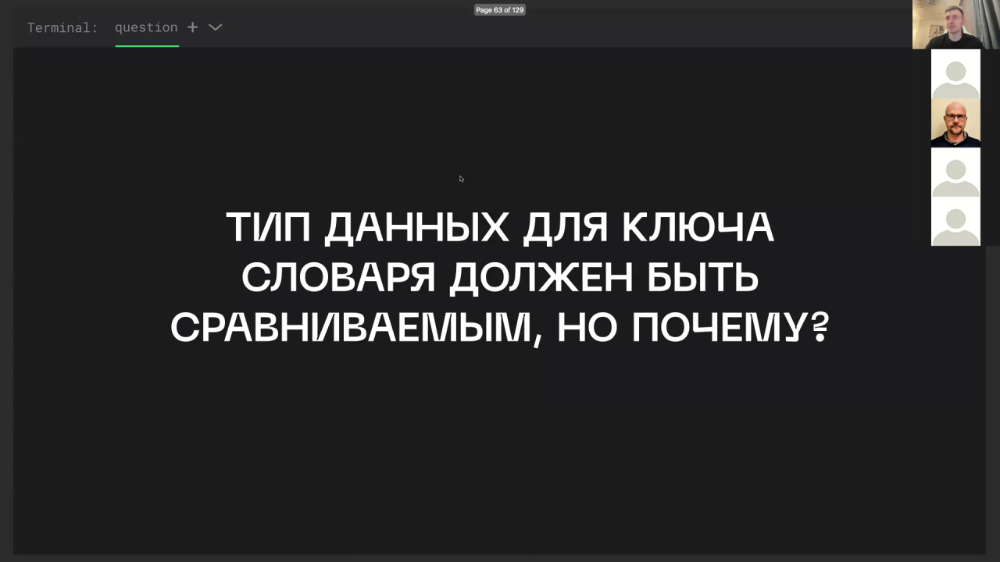

> [!quote]- Кадр [01:14:15]
> 

## 10. Сравнение словарей: метод equal, рефлексия и бенчмарки

Словари нельзя сравнивать между собой операторами `==` и `!=`. Ручная функция `equal` сначала проверяет указатели структур (`c == other`): если указатели равны, возвращается `true`; затем сравниваются длины map, и если они не равны — `false`; далее идёт проход по одной map, при котором ищется ключ в другой map и проверяется равенство значений. Метод `equal` сравнивает два указателя на `client`: при поэлементном сравнении `equal` проходит ключи map `operations` и значения — для каждого `key` берётся `otherValue, found` из `other.operations` и сравнивается `value != otherValue`. Рефлексия для сравнения работает медленнее, её стоит использовать в тестах и не более; в пакете `Maps` уже есть обобщённая функция.

```go
func (c *client) equal(other *client) bool {
	if c == other {
		return true
	}

	if len(c.operations) != len(other.operations) {
		return false
	}

	for key, value := range c.operations {
		otherValue, found := other.operations[key]
		if !found || value != otherValue {
			return false
		}
	}

	return true
}

func BenchmarkWithReflect(b *testing.B) {
	for i := 0; i < b.N; i++ {
		_ = reflect.DeepEqual(lhs, rhs)
	}
}

func BenchmarkWithStringFunction(b *testing.B) {
	lhs := client{
		operations: map[int]int{1: 2, 2: 5, 3: 7, 4: 9, 5: 10, 6: 3, 7: 4},
	}

	rhs := client{
		operations: map[int]int{1: 2, 2: 5, 3: 7, 4: 9, 5: 10, 6: 3, 7: 4},
	}

	for i := 0; i < b.N; i++ {
		_ = fmt.Sprint(lhs) == fmt.Sprint(rhs)
	}
}
```

*Источник: [01:29:24], [01:29:50], [01:30:50], [01:30:52], [01:30:59], [01:33:07], …*

## 11. Очистка map и поведение памяти

Очистить map можно через цикл с `delete`, функцию `clear` или присваивание `nil`. Присваивание map значения `nil` удаляет все элементы; комментарий в коде — `remove all elements`. Удаление всех элементов map в цикле `for key := range second { delete(second, key) }` сохраняет выделенную память; комментарий — `keep allocated memory`. Удаление всех ключей через `delete` очищает map (длина становится 0), но бакеты и выделенная память остаются занятыми; `clear` работает так же. Ёмкость массива мапы никогда не уменьшается, бакеты не очищаются, память не освобождается; в памяти может висеть сотни мегабайт — потенциальная утечка. Решение — периодически перезатирать словарь (присваивать `NIL`) или использовать указатели в качестве значений. Чтобы уменьшить потребление памяти, можно использовать указатели: бакеты остаются в памяти, но занимают меньше места, потому что хранят машинное слово, а не 128 байт; в горячих циклах map можно заменить на массив или слайс, что даёт существенный прирост производительности.

```go
// remove all elements
first := map[int]int{1: 1, 2: 2, 3: 3}
first = nil
fmt.Println(first, ":", len(first))

// keep allocated memory
second := map[int]int{1: 1, 2: 2, 3: 3}
for key := range second {
	delete(second, key)
}
fmt.Println(second, ":", len(second))

third := map[int]int{1: 1, 2: 2, 3: 3}
clear(third)
fmt.Println(third, ":", len(third))
```

> [!info] Зачем это нужно
> В горячих циклах — для существенного прироста производительности; и чтобы уменьшить потребление памяти.

*Источник: [01:31:17], [01:32:17], [01:32:39], [01:33:05], [01:34:07], [01:35:07], …*

> [!quote]- Кадр [01:35:54]
> 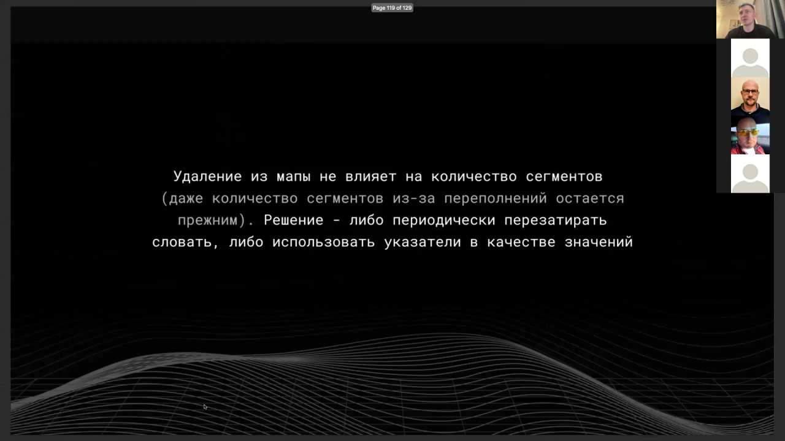

## 12. Альтернативы: ordered map, бинарное дерево поиска, TreeMap

С помощью обобщений (generics) можно реализовать обобщённый **ordered map**, который работает с любыми сравнимыми типами ключей и любыми типами значений; `ForEach` должен по очереди проходить элементы от минимального к максимальному. Inorder-обход в рекурсии идёт в нужном порядке: начинается с самого левого элемента и заканчивается самым правым, который является максимальным. Обход дерева можно выполнять через `for range` с горутинами, без рекурсии; с горутинами код похож на генератор: вы говорите `next, next, next`, а горутина печатает следующий элемент. Но использование горутины для обхода дерева — большой overhead, хотя такой обход выглядит красиво; при итеративном способе рекурсию реализуют вручную, используя стек. **OrderedMap** — упорядоченный ассоциативный массив (словарь); его интерфейс включает методы `NewOrderedMap`, `Insert`, `Erase`, `Contains`, `Size` и `ForEach`. Для реализации словаря базово можно использовать бинарное дерево поиска; в узле бинарного дерева поиска хранится ключ и значение. **TreeMap** — библиотека для Go, в которой нет бакетов: вместо бакетов используются узлы дерева, а сортировка выполняется по ключам, а не по парам «ключ-значение». Для упорядоченного хранения данных с поиском, вставкой и удалением за логарифм можно использовать подобные библиотеки вместо собственной реализации.

```go
type OrderedMap struct {
}

func NewOrderedMap() OrderedMap            // создать упорядоченный словарь
func (m *OrderedMap) Insert(key, value int) // добавить элемент в словарь
func (m *OrderedMap) Erase(key int)        // удалить элемент из словаря
func (m *OrderedMap) Contains(key int) bool // проверить, содержится ли элемент с ключом
func (m *OrderedMap) Size() int            // получить количество элементов в словаре
func (m *OrderedMap) ForEach(action func(int, int)) // применить функцию к каждому элементу

{20, "value_1"}
less
greater
{10, "value_2"}
{30, "value_3"}
less
greater
less
greater
min
{5, "value_4"}
{15, "value_5"}
{25, "value_6"}
{35, "value_7"}
max

package main

import (
	"fmt"

	"github.com/igrmk/treemap/v2"
)

func main() {
	tr := treemap.New[int, string]()
	tr.Set(1, "World")
	tr.Set(0, "Hello")
	for it := tr.Iterator(); it.Valid(); it.Next() {
		fmt.Println(it.Key(), it.Value())
	}
}
```

> [!info] Зачем это нужно
> Для упорядоченного хранения данных с поиском, вставкой и удалением за логарифм.

*Источник: [01:19:27], [01:19:51], [01:20:48], [01:21:32], [01:47:57], [01:48:40], …*

## 13. Нулевое значение слайса и словарь как обобщённый тип

Слайс не является ссылочным типом, но его нулевое значение равно `nil`. Предположительно, это сделано для семантического сходства со словарями, каналами и другими типами. Словарь — это обобщённый тип данных.

*Источник: [00:40:43], [01:03:30]*

> [!quote]- Кадр [00:40:43]
> 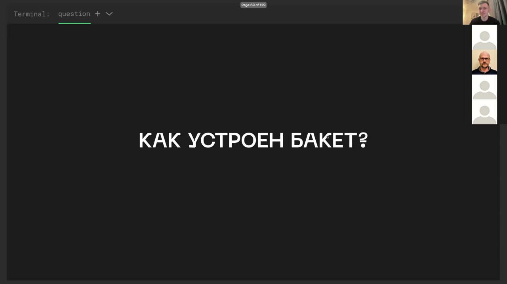

## Схема

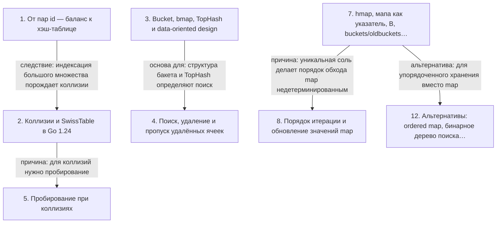

## Итог

> [!success] Что в итоге
> Хэш-таблица хранит пары «id — баланс» и быстро находит баланс по идентификатору, преобразуя ключ в индекс. Go-словарь — это указатель на hmap, работающий как хеш-таблица с уникальной солью, бакетами bmap и зарезервированными tophash. Из-за устройства хеш-таблицы коллизии разрешаются цепочками, открытой адресацией и пробированием, а load factor запускает переиндексацию с инкрементальной эвакуацией. Практические тонкости включают неопределённый порядок итерации, запрет inplace-обновления и взятия адреса элемента, осторожность с вещественными ключами и очистку без освобождения памяти; альтернативой для упорядоченного хранения служат дерево поиска, TreeMap и ordered map.
