# /Users/artemsolovev/Desktop/Курсы/Глубокий  GO/4 - словари/Урок 4. Словари.mp4

> [!abstract] Обзор
> Лекция по словарям в Go: хэш-таблицы, коллизии, хэш-функции, соль, инварианты, интерфейсы, х-сид, итерация, и другие ключевые концепции. Объясняется, как работают словари, как избежать коллизий, как хранить и искать данные, и как устроены внутренние структуры.

> [!info] Курс
> [[index|Оглавление курса]]

## Оглавление
1. [[#1. Компактное представление ID]]
2. [[#2. Хэш-функция для массива]]
3. [[#3. Ограничение пробирований]]
4. [[#4. Виды пробирований]]
5. [[#5. fmt.Println() сортирует ключи]]
6. [[#6. Обновление словаря во время итерации]]
7. [[#7. Сравнение не допускается]]
8. [[#8. Емкость массива]]
9. [[#9. Direct Accessing]]
10. [[#10. Равномерное распределение]]
11. [[#11. Load-фактор]]
12. [[#12. Хэштаблица с связным списком]]
13. [[#13. Коллизия и связный список]]
14. [[#14. Поиск в пустых значениях]]

## 1. Компактное представление ID

Идентификаторы преобразуются для уменьшения размера массива. Максимальный идентификатор уменьшается с 1_000_000 до 10. Это позволяет избежать пустых мест в массиве и оптимизировать память.

> [!info] Зачем это нужно
> Уменьшение диапазона идентификаторов позволяет сократить потребление памяти.

## 2. Хэш-функция для массива

Хэш-функция вычисляет индекс массива по значению и вместимости: F(x, capacity) = x % capacity. Это позволяет распределять данные равномерно. В Go maps — это хэш-карты. Каждый map имеет уникальную соль, что обеспечивает разные хэш-значения для одинаковых ключей в разных словарях. Для поиска и удаления элемента нужно сначала вычислить хэш-функцию, определить бакет, а затем сравнить ключ с ключами в этом бакете. Коллизии возникают, когда разные ключи дают одинаковое значение хэш-функции. Hasher — это функция, которая принимает ключ и seed, а затем возвращает хэш. Это позволяет настраивать поведение хэширования и улучшать распределение ключей.

> [!info] Зачем это нужно
> Хэш-функция позволяет быстро определить индекс для хранения или поиска данных.

> [!quote]- Кадр [00:03:30]
> 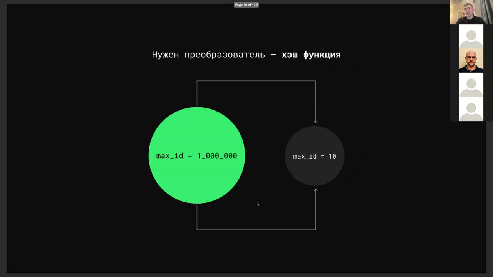

## 3. Ограничение пробирований

Количество пробирований можно ограничить, например, если прыгнули 2–3 шага и не нашли свободную ячейку. Это позволяет избежать бесконечных циклов.

> [!info] Зачем это нужно
> Ограничение пробирований предотвращает бесконечные циклы при поиске свободного места.

## 4. Виды пробирований

Линейное пробирование использует формулу i + 1. Квадратичное — (i + i * i) / 2. Двойное хэширование применяет hash_fn2(i) для вычисления.

> [!info] Зачем это нужно
> Разные виды пробирований позволяют справляться с коллизиями в хэш-таблицах.

## 5. fmt.Println() сортирует ключи

При выводе словаря с помощью fmt.Println() ключи сортируются, порядок вывода элементов становится определённым.

> [!info] Зачем это нужно
> Сортировка ключей позволяет предсказуемо отображать содержимое словаря.

## 6. Обновление словаря во время итерации

В Go разрешено добавлять или удалять элементы из словаря во время итерации. Это позволяет гибко управлять данными. Обновление объекта в мапе требует создания нового объекта, так как в Go нельзя изменять значение в мапе напрямую.

> [!info] Зачем это нужно
> Гибкость в управлении данными позволяет эффективно работать с динамическими структурами.

## 7. Сравнение не допускается

Нельзя использовать операторы == и != для сравнения между словарями. Это связано с их внутренней структурой. Сравнение чисел с плавающей точкой должно учитывать погрешность. Сравнение через == может привести к ошибкам. Правильный способ — сравнение разницы с эпсилоном. Функция maps.Equal в пакете maps сравнивает мапы, используя рефлексию. Рефлексия работает медленнее, чем другие способы, но позволяет сравнивать сложные структуры.

> [!info] Зачем это нужно
> Сравнение словарей не определено, так как они не хранят данные в упорядоченном виде.

## 8. Емкость массива

Емкость массива не уменьшается при изменении его содержимого. Это обеспечивает стабильность памяти.

> [!info] Зачем это нужно
> Стабильность емкости массива позволяет предсказуемо управлять памятью.

## 9. Direct Accessing

Direct Accessing позволяет быстро находить элементы массива за константное время, используя индекс как идентификатор. Однако это может привести к разреженному массиву и неэффективному использованию памяти.

> [!info] Зачем это нужно
> Direct Accessing обеспечивает быстрый доступ, но требует плотного использования памяти.

> [!quote]- Кадр [00:01:51]
> 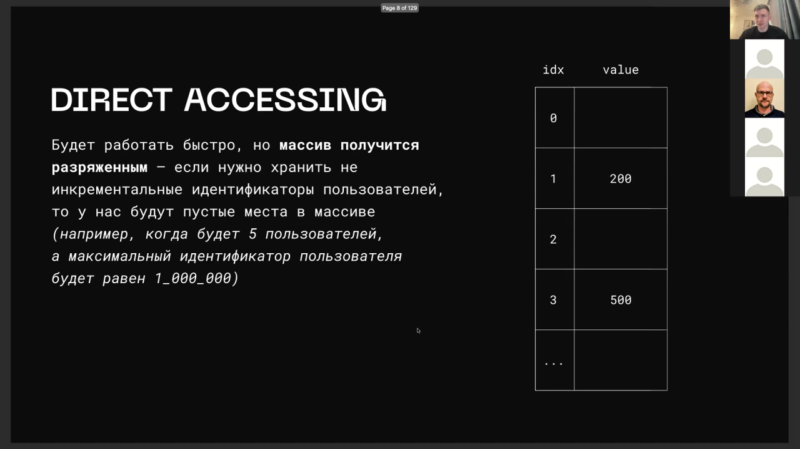

## 10. Равномерное распределение

Нужно распределять данные равномерно, а не инкрементально. Это позволяет избежать перегрузки определённых бакетов.

> [!info] Зачем это нужно
> Равномерное распределение данных улучшает производительность хэш-таблиц.

> [!quote]- Слайд
> 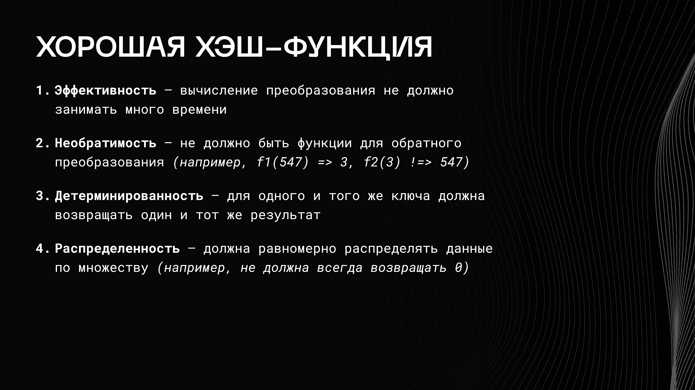

## 11. Load-фактор

Load-фактор считается как отношение количества элементов к количеству бакетов. Это показывает загруженность хэш-таблицы.

> [!info] Зачем это нужно
> Load-фактор помогает определить, когда нужно расширять хэш-таблицу.

## 12. Хэштаблица с связным списком

В хэштаблице используется связанный список для хранения данных. Это позволяет обрабатывать коллизии.

> [!info] Зачем это нужно
> Связанный список позволяет хранить несколько элементов в одном бакете.

## 13. Коллизия и связный список

Коллизия возникает, когда ключи совпадают. Элемент добавляется в связный список, и элементы связываются при помощи связанного списка.

> [!info] Зачем это нужно
> Связанный список позволяет хранить несколько элементов с одинаковым хэшем.

## 14. Поиск в пустых значениях

Результат зависит от порядка обхода, который случайный, что приводит к разным значениям при каждом запуске.
Удаление и инвариант: Удаление элемента может нарушить инвариант, связанный с пустыми значениями. Для сохранения инварианта можно пометить ячейку как удаленную или сдвинуть элементы влево. delete удаляет ключи и значения из бакетов. overflow-бакеты переполненные остаются жить в памяти. бакеты остаются жить в памяти после удаления элементов. в действительности я удаляю, условно зануляю вот эти ключи и значения в бакетах. память под бакеты не освобождается.
Double-хешинг: Double-хешинг — это способ пробирования. Он позволяет избежать конфликтов при поиске свободного места.
SwissTable в Go: SwissTable введена в Go 1.2.4. Она имеет свои особенности и нюансы, связанные с хранением и обработкой данных.
Количество бакетов в хэш-таблице: Зарезервированные значения топ-хэшей обозначают пустые колонки или отсутствие элементов в бакете. Количество бакетов в хэш-таблице записано в логарифмической форме.
Два указателя на бакеты: В реализации Go есть два указателя на массив бакетов. Это позволяет управлять процессом расширения и сжатия хэш-таблицы.
Интерфейс как ключ: паника: Использование несравниваемых типов в качестве ключей интерфейса вызывает панику при выполнении кода. Это связано с невозможностью хэширования таких типов.
Х-сид словаря: В Go у каждого словаря свой уникальный идентификатор х-сид. Это обеспечивает разные хэш-значения для одинаковых ключей в разных словарях.
Разные х-значения для одинаковых ключей: В разных словарях одинаковые ключи могут давать разные х-значения. Это связано с уникальным х-сид для каждого словаря.
Резервирование памяти: В Go при создании словаря зарезервируется минимум 20 элементов. Это оптимизация для уменьшения частой реаллокации памяти. Резервирование не влияет на производительность, но снижает накладные расходы на динамическое расширение. Резервирование емкости словаря улучшает производительность, если известно будущее количество элементов. Это избежание перераспределения памяти и ускорение инициализации.
Capacity и бакеты: Capacity определяет максимальное количество элементов в хэш-таблице. Оно влияет на количество бакетов, но не гарантирует точное количество. Бакеты — это блоки памяти, где хранятся ключи и значения.
Бакет и overflow: Бакет может содержать более 8 ключ-значений. При переполнении создается overflow-бакет через указатель. Бакеты и overflow-бакеты не очищаются, даже если данные устарели.
Переиндексация: При увеличении количества бакетов хэш-таблица удваивает их количество. Переиндексация происходит постепенно, а не сразу, чтобы избежать резкого бёрста операций. Коэффициент загруженности больше 60-70% По хорошему, в этой ситуации пора уже расширять и переиндексировать таблицу
Unsafe pointer: В Go до версии 1.18 использовались unsafe pointer для работы с типами. Это позволяло обходить систему типов, но снижало безопасность. Функции MapXS1 и MapXS2 работают с unsafe.Pointer.
Type — дескриптор типа: Type — это дескриптор типа, который позволяет определить допустимые операции. Он скрывает тип данных и обеспечивает безопасность.
Nilmap и операции: Чтение из nilmap работает корректно, но запись и удаление приводят к панике. Nilmap — это пустой словарь, который не содержит данных.
Порядок итераций: Порядок итераций по мапе не определён. Мапы могут быть медленными в горячих циклах. println сортирует ключи, поэтому порядок вывода определён.
Копирование в рейнжах: В рейнжах копируются значения, поэтому изменения внутри нее не влияют на исходную структуру. Это гарантирует безопасность данных.
UpClearing и очистка памяти: UpClearing вызывается для очистки памяти UpClearing не предлагает освобождение памяти
Указатели и память: Использование указателей позволяет хранить меньше данных в памяти Использование указателей уменьшает потребление памяти
Срез и ссылочный тип: Семантика среза отличается от работы с указателями Срез позволяет изменять значения через индекс Срез является ссылочным типом
Мапа и запись значения: Мапа в Go возвращает 0 value при отсутствии ключа Мапа представляет собой указатель, а не объект структуры. При присваивании новой мапы через указатель оригинальная мапа не изменяется.
Мин хэш и битовые операции: Мин хэш и топ хэш используются для определения бакета. Мин хэш используется для определения бакета через младшие биты хэша. Мин хэш — это младший N-bit. Остаток отделения можно выразить при помощи битовых операций. Топ хэш — это старший N-bit.
Логарифмическая формула для количества бакетов: Количество бакетов хранится в логарифмической формуле. Это делается для эффективного использования битовых операций.
Minhash и биты: Max hash использует старшие биты для определения bucket. Minhash использует младшие биты для определения bucket.
Low и high order биты хэша: Low order бит и high order бит берутся непосредственно из исходного хэша.
Упорядоченный ассоциативный массив: Задача требует реализации ассоциативного массива с упорядоченными элементами. Нужно также реализовать функцию for each, которая обходит элементы от минимального к максимальному.
Обобщенный ordered map: Обобщенный ordered map может работать с любыми comparable типами как ключами и любыми типами как значениями.
Особенность фарича: Фарич не просто обход дерева, а обход, начинающийся с самого левого элемента.
Inorder проход через рекурсию: Inorder проход использует рекурсию для обхода дерева в порядке от левого к правому
Хранение данных в виде пар: В худшем случае придется пробегаться по всему массиву, чтобы найти нужный идентификатор, чтобы посмотреть у него баланс. Идентификатор используется для поиска соответствующего значения, например, баланса. В Go ключи и значения, превышающие 128 байт, хранятся через указатель, а не напрямую. Это оптимизация памяти и производительности.
Разреженные массивы: Разреженные массивы могут использоваться для хранения неинкрементальных идентификаторов.
Методы разрешения коллизий: Разрешение коллизий в хэш-таблицах может осуществляться методом цепочек или методом открытой адресации.
Bucket как структура хранения данных: Bucket представляет, можно сказать, некоторый связанный список. Bucket — это структура, используемая в хэш-таблицах и словарях для хранения элементов. Bucket — это указатель на массив bucket. В Go-то используется метод цепочек до версии Go 1.2.4. В некоторых реализациях, таких как Go, Bucket представляет собой массив фиксированной длины из 8 элементов, включающий ключи, значения и указатель на оверфлов. Топ-хэш используется для различения элементов с одинаковым хэшем, чтобы избежать коллизий в одном bucket'е.
Проблемы работы с бакетами в хэш-таблицах: Некорректный поиск может возникнуть, если элемент находится в другом бакете. Поиск, запись и удаление требуют проверки двух бакетов при наличии бакетов переполнения. При удалении элемента из бакета все его элементы переносятся в новый бакет. Удаление элемента из бакета требует переноса всех его элементов в новый бакет.
Эвакуация бакетов: Процесс происходит при записи или удалении ключей, а не при чтении.
Хэширование с сидом: Даже при одинаковых ключах хэш-значения могут отличаться, если сид изменён. У каждого объекта словаря разное хэш-сид-значение. Это используется в поиске, где хэш-значения сравниваются для ускорения процесса.
Пробирование массива: Пробирование — это способ поиска свободного места в массиве при коллизии, когда ячейка уже занята. Процесс включает проверку каждой ячейки массива по порядку для добавления элемента. Пробирование — это метод поиска пустой ячейки в хэш-таблице при возникновении коллизий. Существуют различные способы пробирования, такие как линейное, квадратичное и дабл хэшинг.
Метод открытой адресации и переиндексация: Переиндексация происходит не только когда у вас метод цепочек, но еще когда метод открытой адресации.
Словарь и мапа как указатели на hmap: Мапа, когда создается, это указатель на объект структуры hmap. Словарь — это указатель на структуру HMAP.
Сравнимость типов ключей в хэш-таблицах: Тип данных ключа должен быть сравнимым, так как для разрешения коллизий требуется не только хэширование, но и сравнение ключей. Сравнение ключей происходит только при равных хэш-значениях, что обеспечивает корректную работу хэш-таблицы.
Топ-хэш: Топ-хэш — это отсечение старших 8 бит хэша, используемое для хранения в бакете, быстрого сравнения ключей и определения различий при совпадении остатка хэша.
Data Oriented Design: Data Oriented Design фокусируется на специальном упаковывании структур данных. Data Oriented Design — это подход, используемый в геймдеве. Вместо создания массива объектов, создаётся объект, содержащий массивы значений.
Бакеты в структурах данных: Бакеты — это массив, в котором хранятся элементы словаря.
Переиспользование maptype в Go: В рантайме для одного типа map создаётся один объект, который переиспользуется при создании нескольких словарей этого типа. Если вы создали три словаря map string int, то у вас только один объект maptype для этого типа в рантайме. Объекты maptype кэшируются. Объекты maptype переиспользуются.
Структура как альтернатива массиву: Структура позволяет хранить разнотипные данные, в отличие от массива, где тип фиксирован. Структура группирует значения в одно целое, что удобно для сложных объектов. Это альтернатива массиву для хранения разнотипных данных.
Неопределённость порядка итерации: Порядок итерации в словарях Go не определён, так как реализация может меняться. Это связано с введённой случайностью, чтобы избежать предположений о порядке. Удаление элементов может влиять на порядок итерации.
Адрес значения словаря: Получить адрес значения словаря невозможно, так как это не поддерживается. Это связано с особенностями внутренней реализации словаря.

```go
func BenchmarkWithReflect(b *testing.B) {
}

func BenchmarkWithStringFunction(b *testing.B) {
}
}

func BenchmarkWithEqualFunction(b *testing.B) {
}
}

func BenchmarkWithEqualFunction(b *testing.B) {
}
}

func BenchmarkWithEqualFunction(b *testing.B) {
}
}

func BenchmarkWithEqualFunction(b *testing.B) {
}
}

func BenchmarkWithEqualFunction(b *testing.B) {
}
}

func BenchmarkWithEqualFunction(b *testing.B) {
}
}

func BenchmarkWithEqualFunction(b *testing.B) {
}
}

func BenchmarkWithEqualFunction(b *testing.B) {
}
}

func BenchmarkWithEqualFunction(b *testing.B) {
}
}

func BenchmarkWithEqualFunction(b *testing.B) {
}
}

func BenchmarkWithEqualFunction(b *testing.B) {
}
}

func BenchmarkWithEqualFunction(b *testing.B) {
}
}

func BenchmarkWithEqualFunction(b *testing.B) {
}
}

func BenchmarkWithEqualFunction(b *testing.B) {
}
}

func BenchmarkWithEqualFunction(b *testing.B) {
}
}

func BenchmarkWithEqualFunction(b *testing.B) {
}
}

func BenchmarkWithEqualFunction(b *testing.B) {
}
}

func BenchmarkWithEqualFunction(b *testing.B) {
}
}

func BenchmarkWithEqualFunction(b *testing.B) {
}
}

func BenchmarkWithEqualFunction(b *testing.B) {
}
}

func BenchmarkWithEqualFunction(b *testing.B) {
}
}

func BenchmarkWithEqualFunction(b *testing.B) {
}
}

func BenchmarkWithEqualFunction(b *testing.B) {
}
}

func BenchmarkWithEqualFunction(b *testing.B) {
}
}

func BenchmarkWithEqualFunction(b *testing.B) {
}
}

func BenchmarkWithEqualFunction(b *testing.B) {
}
}

func BenchmarkWithEqualFunction(b *testing.B) {
}
}

func BenchmarkWithEqualFunction(b *testing.B) {
}
}

func BenchmarkWithEqualFunction(b *testing.B) {
}
}

func BenchmarkWithEqualFunction(b *testing.B) {
}
}

func BenchmarkWithEqualFunction(b *testing.B) {
}
}

func BenchmarkWithEqualFunction(b *testing.B) {
}
}

func BenchmarkWithEqualFunction(b *testing.B) {
}
}

func BenchmarkWithEqualFunction(b *testing.B) {
}
}

func BenchmarkWithEqualFunction(b *testing.B) {
}
}

func BenchmarkWithEqualFunction(b *testing.B) {
}
}

func BenchmarkWithEqualFunction(b *testing.B) {
}
}

func BenchmarkWithEqualFunction(b *testing.B) {
}
}

func BenchmarkWithEqualFunction(b *testing.B) {
}
}

func BenchmarkWithEqualFunction(b *testing.B) {
}
}

func BenchmarkWithEqualFunction(b *testing.B) {
}
}

func BenchmarkWithEqualFunction(b *testing.B) {
}
}

func BenchmarkWithEqualFunction(b *testing.B) {
}
}

func BenchmarkWithEqualFunction(b *testing.B) {
}
}

func BenchmarkWithEqualFunction(b *testing.B) {
}
}

func BenchmarkWithEqualFunction(b *testing.B) {
}
}

func BenchmarkWithEqualFunction(b *testing.B) {
}
}

func BenchmarkWithEqualFunction(b *testing.B) {
}
}

func BenchmarkWithEqualFunction(b *testing.B) {
}
}

func BenchmarkWithEqualFunction(b *testing.B) {
}
}

func BenchmarkWithEqualFunction(b *testing.B) {
}
}

func BenchmarkWithEqualFunction(b *testing.B) {
}
}

func BenchmarkWithEqualFunction(b *testing.B) {
}
}

func BenchmarkWithEqualFunction(b *testing.B) {
}
}

func BenchmarkWithEqualFunction(b *testing.B) {
}
}

func BenchmarkWithEqualFunction(b *testing.B) {
}
}

func BenchmarkWithEqualFunction(b *testing.B) {
}
}

func BenchmarkWithEqualFunction(b *testing.B) {
}
}

func BenchmarkWithEqualFunction(b *testing.B) {
}
}

func BenchmarkWithEqualFunction(b *testing.B) {
}
}

func BenchmarkWithEqualFunction(b *testing.B) {
}
}

func BenchmarkWithEqualFunction(b *testing.B) {
}
}

func BenchmarkWithEqualFunction(b *testing.B) {
}
}

func BenchmarkWithEqualFunction(b *testing.B) {
}
}

func BenchmarkWithEqualFunction(b *testing.B) {
}
}

func BenchmarkWithEqualFunction(b *testing.B) {
}
}

func BenchmarkWithEqualFunction(b *testing.B) {
}
}

func BenchmarkWithEqualFunction(b *testing.B) {
}
}

func BenchmarkWithEqualFunction(b *testing.B) {
}
}

func BenchmarkWithEqualFunction(b *testing.B) {
}
}

func BenchmarkWithEqualFunction(b *testing.B) {
}
}

func BenchmarkWithEqualFunction(b *testing.B) {
}
}

func BenchmarkWithEqualFunction(b *testing.B) {
}
}

func BenchmarkWithEqualFunction(b *testing.B) {
}
}

func BenchmarkWithEqualFunction(b *testing.B) {
}
}

func BenchmarkWithEqualFunction(b *testing.B) {
}
}

func BenchmarkWithEqualFunction(b *testing.B) {
}
}

func BenchmarkWithEqualFunction(b *testing.B) {
}
}

func BenchmarkWithEqualFunction(b *testing.B) {
}
}

func BenchmarkWithEqualFunction(b *testing.B) {
}
}

func BenchmarkWithEqualFunction(b *testing.B) {
}
}

func BenchmarkWithEqualFunction(b *testing.B) {
}
}

func BenchmarkWithEqualFunction(b *testing.B) {
}
}

func BenchmarkWithEqualFunction(b *testing.B) {
}
}

func BenchmarkWithEqualFunction(b *testing.B) {
}
}

func BenchmarkWithEqualFunction(b *testing.B) {
}
}

func BenchmarkWithEqualFunction(b *testing.B) {
}
}

func BenchmarkWithEqualFunction(b *testing.B) {
}
}

func BenchmarkWithEqualFunction(b *testing.B) {
}
}

func BenchmarkWithEqualFunction(b *testing.B) {
}
}

func BenchmarkWithEqualFunction(b *testing.B) {
}
}

func BenchmarkWithEqualFunction(b *testing.B) {
}
}

func BenchmarkWithEqualFunction(b *testing.B) {
}
}

func BenchmarkWithEqualFunction(b *testing.B) {
}
}

func BenchmarkWithEqualFunction(b *testing.B) {
}
}

func BenchmarkWithEqualFunction(b *testing.B) {
}
}

func BenchmarkWithEqualFunction(b *testing.B) {
}
}

func BenchmarkWithEqualFunction(b *testing.B) {
}
}

func BenchmarkWithEqualFunction(b *testing.B) {
}
}

func BenchmarkWithEqualFunction(b *testing.B) {
}
}

func BenchmarkWithEqualFunction(b *testing.B) {
}
}

func BenchmarkWithEqualFunction(b *testing.B) {
}
}

func BenchmarkWithEqualFunction(b *testing.B) {
}
}

func BenchmarkWithEqualFunction(b *testing.B) {
}
}

func BenchmarkWithEqualFunction(b *testing.B) {
}
}

func BenchmarkWithEqualFunction(b *testing.B) {
}
}

func BenchmarkWithEqualFunction(b *testing.B) {
}
}

func BenchmarkWithEqualFunction(b *testing.B) {
}
}

func BenchmarkWithEqualFunction(b *testing.B) {
}
}

func BenchmarkWithEqualFunction(b *testing.B) {
}
}

func BenchmarkWithEqualFunction(b *testing.B) {
}
}

func BenchmarkWithEqualFunction(b *testing.B) {
}
}

func BenchmarkWithEqualFunction(b *testing.B) {
}
}

func BenchmarkWithEqualFunction(b *testing.B) {
}
}

func BenchmarkWithEqualFunction(b *testing.B) {
}
}

func BenchmarkWithEqualFunction(b *testing.B) {
}
}

func BenchmarkWithEqualFunction(b *testing.B) {
}
}

func BenchmarkWithEqualFunction(b *testing.B) {
}
}

func BenchmarkWithEqualFunction(b *testing.B) {
}
}

func BenchmarkWithEqualFunction(b *testing.B) {
}
}

func BenchmarkWithEqualFunction(b *testing.B) {
}
}

func BenchmarkWithEqualFunction(b *testing.B) {
}
}

func BenchmarkWithEqualFunction(b *testing.B) {
}
}

func BenchmarkWithEqualFunction(b *testing.B) {
}
}

func BenchmarkWithEqualFunction(b *testing.B) {
}
}

func BenchmarkWithEqualFunction(b *testing.B) {
}
}

func BenchmarkWithEqualFunction(b *testing.B) {
}
}

func BenchmarkWithEqualFunction(b *testing.B) {
}
}

func BenchmarkWithEqualFunction(b *testing.B) {
}
}

func BenchmarkWithEqualFunction(b *testing.B) {
}
}

func BenchmarkWithEqualFunction(b *testing.B) {
}
}

func BenchmarkWithEqualFunction(b *testing.B) {
}
}

func BenchmarkWithEqualFunction(b *testing.B) {
}
}

func BenchmarkWithEqualFunction(b *testing.B) {
}
}

func BenchmarkWithEqualFunction(b *testing.B) {
}
}

func BenchmarkWithEqualFunction(b *testing.B) {
}
}

func BenchmarkWithEqualFunction(b *testing.B) {
}
}

func BenchmarkWithEqualFunction(b *testing.B) {
}
}

func BenchmarkWithEqualFunction(b *testing.B) {
}
}

func BenchmarkWithEqualFunction(b *testing.B) {
}
}

func BenchmarkWithEqualFunction(b *testing.B) {
}
}

func BenchmarkWithEqualFunction(b *testing.B) {
}
}

func BenchmarkWithEqualFunction(b *testing.B) {
}
}

func BenchmarkWithEqualFunction(b *testing.B) {
}
}

func BenchmarkWithEqualFunction(b *testing.B) {
}
}

func BenchmarkWithEqualFunction(b *testing.B) {
}
}

func BenchmarkWithEqualFunction(b *testing.B) {
}
}

func BenchmarkWithEqualFunction(b *testing.B) {
}
}

func BenchmarkWithEqualFunction(b *testing.B) {
}
}

func BenchmarkWithEqualFunction(b *testing.B) {
}
}

func BenchmarkWithEqualFunction(b *testing.B) {
}
}

func BenchmarkWithEqualFunction(b *testing.B) {
}
}

func BenchmarkWithEqualFunction(b *testing.B) {
}
}

func BenchmarkWithEqualFunction(b *testing.B) {
}
}

func BenchmarkWithEqualFunction(b *testing.B) {
}
}

func BenchmarkWithEqualFunction(b *testing.B) {
}
}

func BenchmarkWithEqualFunction(b *testing.B) {
}
}

func BenchmarkWithEqualFunction(b *testing.B) {
}
}

func BenchmarkWithEqualFunction(b *testing.B) {
}
}

func BenchmarkWithEqualFunction(b *testing.B) {
}
}

func BenchmarkWithEqualFunction(b *testing.B) {
}
}

func BenchmarkWithEqualFunction(b *testing.B) {
}
}

func BenchmarkWithEqualFunction(b *testing.B) {
}
}

func BenchmarkWithEqualFunction(b *testing.B) {
}
}

func BenchmarkWithEqualFunction(b *testing.B) {
}
}

func BenchmarkWithEqualFunction(b *testing.B) {
}
}

func BenchmarkWithEqualFunction(b *testing.B) {
}
}

func BenchmarkWithEqualFunction(b *testing.B) {
}
}

func BenchmarkWithEqualFunction(b *testing.B) {
}
}

func BenchmarkWithEqualFunction(b *testing.B) {
}
}

func BenchmarkWithEqualFunction(b *testing.B) {
}
}

func BenchmarkWithEqualFunction(b *testing.B) {
}
}

func BenchmarkWithEqualFunction(b *testing.B) {
}
}

func BenchmarkWithEqualFunction(b *testing.B) {
}
}

func BenchmarkWithEqualFunction(b *testing.B) {
}
}

func BenchmarkWithEqualFunction(b *testing.B) {
}
}

func BenchmarkWithEqualFunction(b *testing.B) {
}
}

func BenchmarkWithEqualFunction(b *testing.B) {
}
}

func BenchmarkWithEqualFunction(b *testing.B) {
}
}

func BenchmarkWithEqualFunction(b *testing.B) {
}
}

func BenchmarkWithEqualFunction(b *testing.B) {
}
}

func BenchmarkWithEqualFunction(b *testing.B) {
}
}

func BenchmarkWithEqualFunction(b *testing.B) {
}
}

func BenchmarkWithEqualFunction(b *testing.B) {
}
}

func BenchmarkWithEqualFunction(b *testing.B) {
}
}

func BenchmarkWithEqualFunction(b *testing.B) {
}
}

func BenchmarkWithEqualFunction(b *testing.B) {
}
}

func BenchmarkWithEqualFunction(b *testing.B) {
}
}

func BenchmarkWithEqualFunction(b *testing.B) {
}
}

func BenchmarkWithEqualFunction(b *testing.B) {
}
}

func BenchmarkWithEqualFunction(b *testing.B) {
}
}

func BenchmarkWithEqualFunction(b *testing.B) {
}
}

func BenchmarkWithEqualFunction(b *testing.B) {
}
}

func BenchmarkWithEqualFunction(b *testing.B) {
}
}

func BenchmarkWithEqualFunction(b *testing.B) {
}
}

func BenchmarkWithEqualFunction(b *testing.B) {
}
}

func BenchmarkWithEqualFunction(b *testing.B) {
}
}

func BenchmarkWithEqualFunction(b *testing.B) {
}
}

func BenchmarkWithEqualFunction(b *testing.B) {
}
}

func BenchmarkWithEqualFunction(b *testing.B) {
}
}

func BenchmarkWithEqualFunction(b *testing.B) {
}
}

func BenchmarkWithEqualFunction(b *testing.B) {
}
}

func BenchmarkWithEqualFunction(b *testing.B) {
}
}

func BenchmarkWithEqualFunction(b *testing.B) {
}
}

func BenchmarkWithEqualFunction(b *testing.B) {
}
}

func BenchmarkWithEqualFunction(b *testing.B) {
}
}

func BenchmarkWithEqualFunction(b *testing.B) {
}
}

func BenchmarkWithEqualFunction(b *testing.B) {
}
}

func BenchmarkWithEqualFunction(b *testing.B) {
}
}

func BenchmarkWithEqualFunction(b *testing.B) {
}
}

func BenchmarkWithEqualFunction(b *testing.B) {
}
}

func BenchmarkWithEqualFunction(b *testing.B) {
}
}

func BenchmarkWithEqualFunction(b *testing.B) {
}
}

func BenchmarkWithEqualFunction(b *testing.B) {
}
}

func BenchmarkWithEqualFunction(b *testing.B) {
}
}

func BenchmarkWithEqualFunction(b *testing.B) {
}
}

func BenchmarkWithEqualFunction(b *testing.B) {
}
}

func BenchmarkWithEqualFunction(b *testing.B) {
}
}

func BenchmarkWithEqualFunction(b *testing.B) {
}
}

func BenchmarkWithEqualFunction(b *testing.B) {
}
}

func BenchmarkWithEqualFunction(b *testing.B) {
}
}

func BenchmarkWithEqualFunction(b *testing.B) {
}
}

func BenchmarkWithEqualFunction(b *testing.B) {
}
}

func BenchmarkWithEqualFunction(b *testing.B) {
}
}

func BenchmarkWithEqualFunction(b *testing.B) {
}
}

func BenchmarkWithEqualFunction(b *testing.B) {
}
}

func BenchmarkWithEqualFunction(b *testing.B) {
}
}

func BenchmarkWithEqualFunction(b *testing.B) {
}
}

func BenchmarkWithEqualFunction(b *testing.B) {
}
}

func BenchmarkWithEqualFunction(b *testing.B) {
}
}

func BenchmarkWithEqualFunction(b *testing.B) {
}
}

func BenchmarkWithEqualFunction(b *testing.B) {
}
}

func BenchmarkWithEqualFunction(b *testing.B) {
}
}

func BenchmarkWithEqualFunction(b *testing.B) {
}
}

func BenchmarkWithEqualFunction(b *testing.B) {
}
}

func BenchmarkWithEqualFunction(b *testing.B) {
}
}

func BenchmarkWithEqualFunction(b *testing.B) {
}
}

func BenchmarkWithEqualFunction(b *testing.B) {
}
}

func BenchmarkWithEqual
```

> [!info] Зачем это нужно
> Случайный порядок обхода может привести к неоднозначности в результатах.

> [!quote]- Кадр [00:38:32]
> 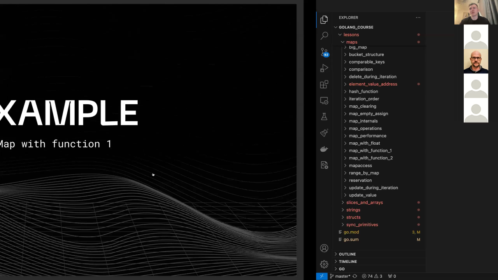

> [!quote]- Кадр [00:42:13]
> 

> [!quote]- Кадр [01:43:36]
> 

> [!quote]- Кадр [01:44:36]
> 

> [!quote]- Кадр [00:01:24]
> 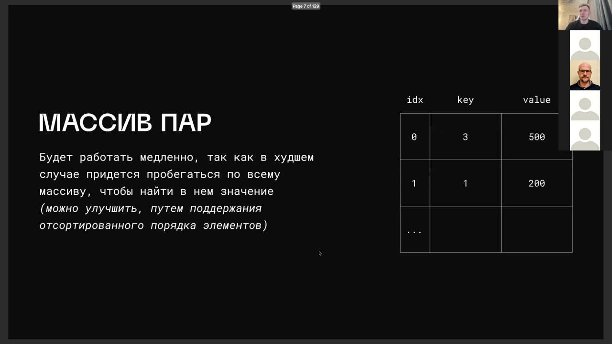

> [!quote]- Кадр [00:02:51]
> 

> [!quote]- Кадр [00:07:45]
> 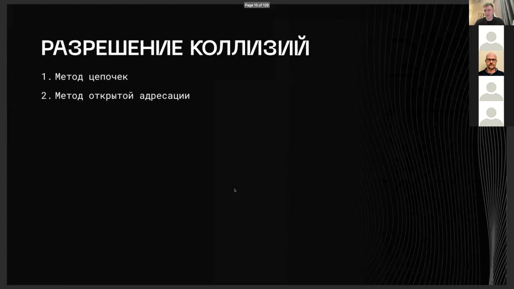

> [!quote]- Кадр [00:41:27]
> 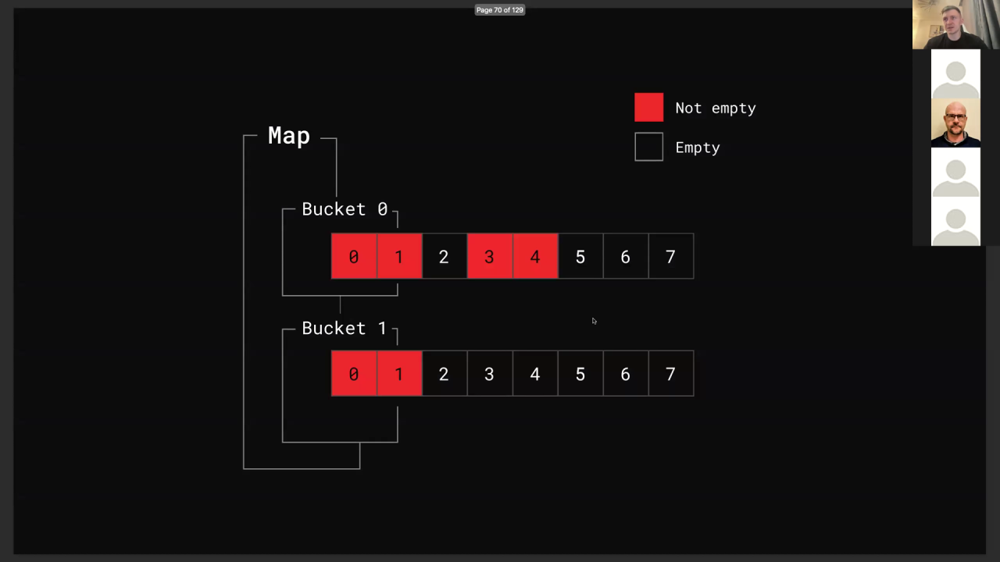

> [!quote]- Кадр [00:43:04]
> 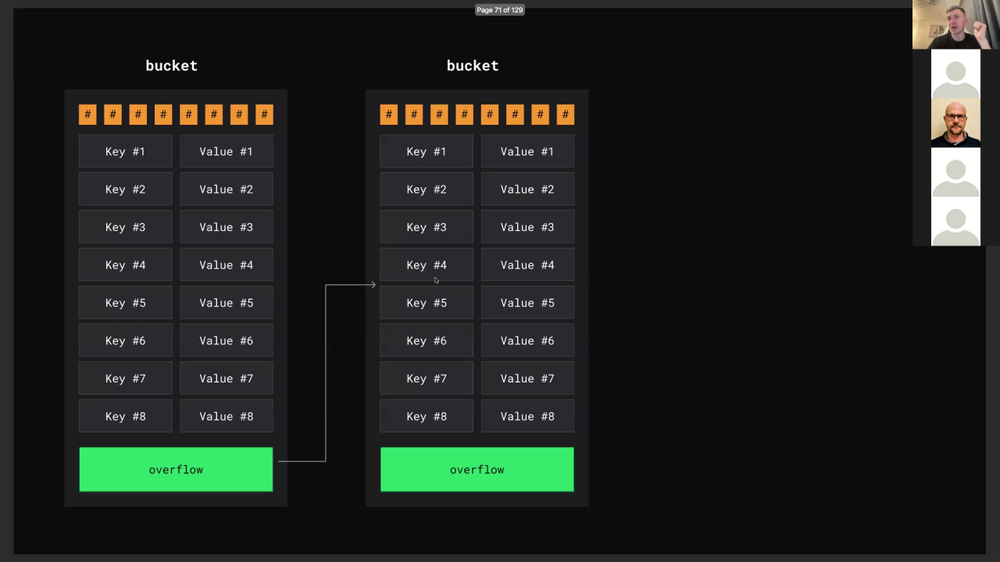

> [!quote]- Кадр [00:54:33]
> 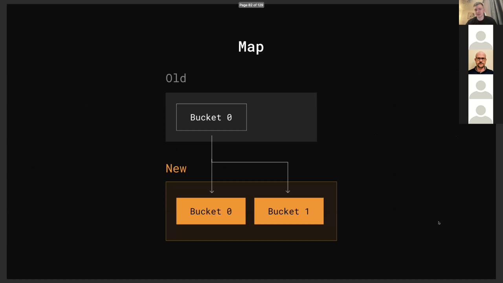

> [!quote]- Кадр [00:56:35]
> 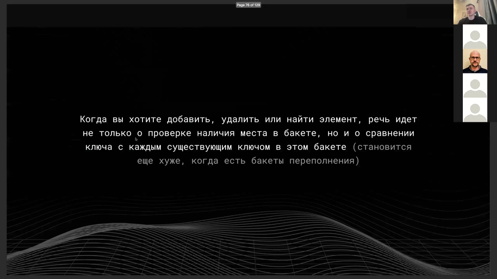

> [!quote]- Кадр [00:20:18]
> 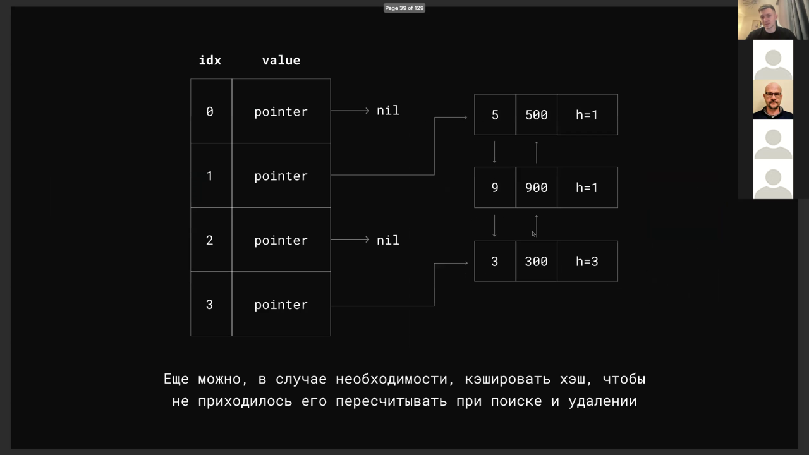

> [!quote]- Кадр [00:27:20]
> 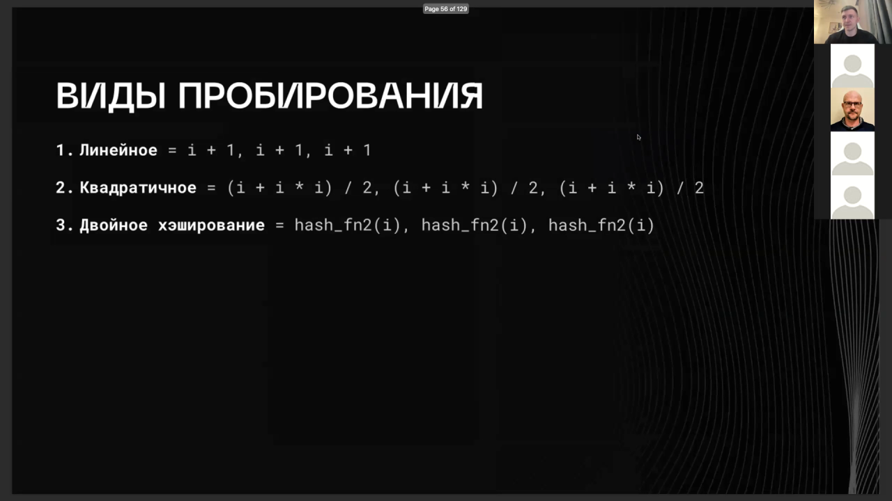

