# Функции в Go: определение, стек, регистры, ABI и особенности

> [!abstract] Обзор
> Материал охватывает функции в Go от определения и синтаксиса до низкоуровневого устройства вызова. Рассмотрены определение функций, сигнатура, прототипы, анонимные функции, функции высшего порядка, замыкания, каррирование, композиция, pipeline через декораторы, генераторы, ленивая инициализация map, callbacks и рекурсия. Отдельно разобраны параметры и аргументы, именованные возвраты, нулевое значение (zero value), порядок вычисления, копирование значений, copy elision, RVO и анализ убегания (escape analysis). Компиляторные темы включают встраивание функций (инлайнинг) с бюджетной моделью, запрет инлайнинга аннотацией, `defer` и его механику через `deferproc` и `runtime.deferreturn`. Замыкающая часть посвящена аппаратному стеку, регистрам SP и BP, указателю инструкций (instruction pointer), `CALL`, стековому кадру, ABI и соглашению о вызовах (calling convention).

> [!info] Курс
> [[index|Оглавление курса]]

## Оглавление
1. [[#1. Определение, сигнатура и прототипы функций]]
2. [[#2. Параметры, аргументы, стек, регистры, ABI и calling convention]]
3. [[#3. Функции высшего порядка, композиция и pipeline]]
4. [[#4. Анонимные функции, каррирование, встроенные функции и init]]
5. [[#5. Порядок вычисления, копирование, RVO и анализ убегания]]
6. [[#6. Единственная ответственность и компактность функций]]
7. [[#7. Инлайнинг функций: аннотация, бюджетная модель и бенчмарк]]
8. [[#8. defer: семантика, LIFO, механика и именованные возвраты]]
9. [[#9. Чистые функции и отказ от абсолютной чистоты]]
10. [[#10. Замыкания: генераторы и ленивая инициализация map]]
11. [[#11. Callbacks: обработка ошибок и асинхронность]]
12. [[#12. Рекурсия: прямая, косвенная, хвостовая и мемоизация]]
13. [[#13. Пример Mul и Calculate]]

**Схема** — [[#Схема]]
**Итог** — [[#Итог]]

## 1. Определение, сигнатура и прототипы функций

Функция — это фрагмент кода, к которому можно обратиться из другого места программы; часто функции называют подпрограммами. В Go нет перегрузки функций, и функция является первопорядковой: функции ведут себя как переменные. **Фрейм функции** — это локальное окружение функции в виде её переменных. Интерфейсам не нужны функции — интерфейсам нужны методы. **Сигнатура** в Go — это список входных параметров функции и результирующих значений; имя функции, тело, названия параметров и результатов в сигнатуру не входят. В Go можно написать прототип функции — функцию без тела; такой код компилируется, можно объявить прототип и вызывать её из Go-кода, а реализацию написать на ассемблере; при линковке подставляется ассемблерный код. Функции нельзя сравнивать (как срезы) и нельзя брать адрес функции: указателей на функции нет, но можно использовать функции, определённые ниже, без прототипов.

```go
func recursion() {
	recursion()
}

func ProcessData(reader io.Reader) (string, error) {
	if reader == nil {
		return "", errors.New("incorrect reader")
	}

	var data string
	scanner := bufio.NewScanner(reader)
	for scanner.Scan() {
		// processing...
	}

	return data, nil
}
```

*Источник: [00:01:24], [00:04:13], [00:12:43], [00:13:46]*

> [!quote]- Кадр [00:01:24]
> 

> [!quote]- Кадр [00:04:13]
> 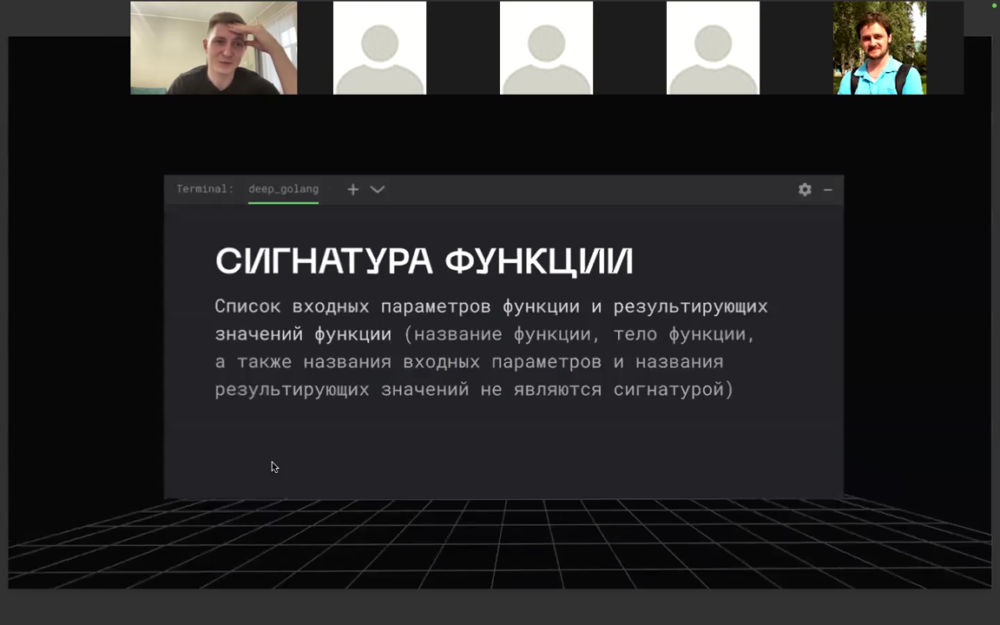

## 2. Параметры, аргументы, стек, регистры, ABI и calling convention

**Параметры** — переменные в объявлении функции, **аргументы** — значения при вызове; все аргументы копируются (включая интерфейс, канал, срез, массив, указатель). Аргументы можно передавать через стек или регистры (fastcall в C++), но число регистров ограничено. **ABI (Application Binary Interface, двоичный интерфейс приложений)** определяет передачу аргументов не только через стек, но и через регистры и глобальные переменные, а **соглашение о вызовах (calling convention)** задаёт порядок вызова (в stdcall аргументы передаются в обратном порядке перед `call`). В Go вариативный параметр только один и он последний; `variadic` — синтаксический сахар поверх среза. Параметры без явной инициализации получают нулевое значение (zero value); можно перечислять параметры одного типа через запятую и пропускать имена, но нельзя задавать значения по умолчанию. Есть именованные возвращаемые параметры: они объявляются как переменные и возвращаются через `return` без аргументов. **Аппаратный стек** — область памяти для временных данных функций; **SP** указывает на вершину и двигается при `push`/`pop`, **BP** — на начало фрейма и статичен внутри функции. Стековый кадр содержит локальные переменные, старый BP и адрес возврата; стек растёт к младшим адресам. С именем функции связан адрес первой инструкции, которой управляет указатель инструкций (instruction pointer, IP); при вызове `CALL` заносит в стек адрес возврата, а смещения идут от BP (адрес возврата `BP+2`, аргументы `BP+4` и `BP+6`, локальные — по отрицательным смещениям). В Go на 64-битной системе максимальный размер стека горутины — 1024 МБ, на 32-битных — 512 МБ; при превышении возникает ошибка `goroutine stack exceeds`. В Go свой ассемблер с SP и BP, но `move` работает в другую сторону и есть препроцессинг.

| Понятие | Что это |
|---|---|
| Параметры | переменные в объявлении функции |
| Аргументы | значения, которые передаются при вызове |

| Регистр | На что указывает | Поведение |
|---|---|---|
| SP (Stack Pointer) | вершина стека, адрес последнего добавленного элемента | растёт и уменьшается при push/pop |
| BP (Base Pointer) | начало фрейма функции | статичен в рамках функции |

*Источник: [00:01:02], [00:01:24], [00:02:24], [00:02:36], [00:04:49], [00:07:03], …*

> [!quote]- Кадр [02:08:13]
> 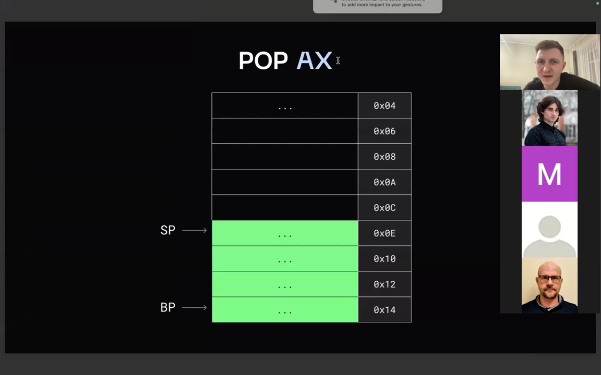

> [!quote]- Кадр [00:04:49]
> 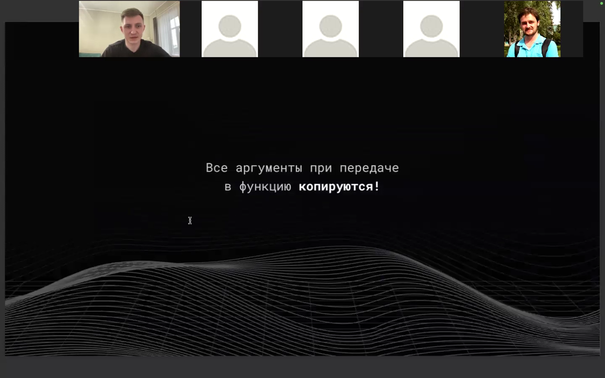

> [!quote]- Кадр [01:58:50]
> 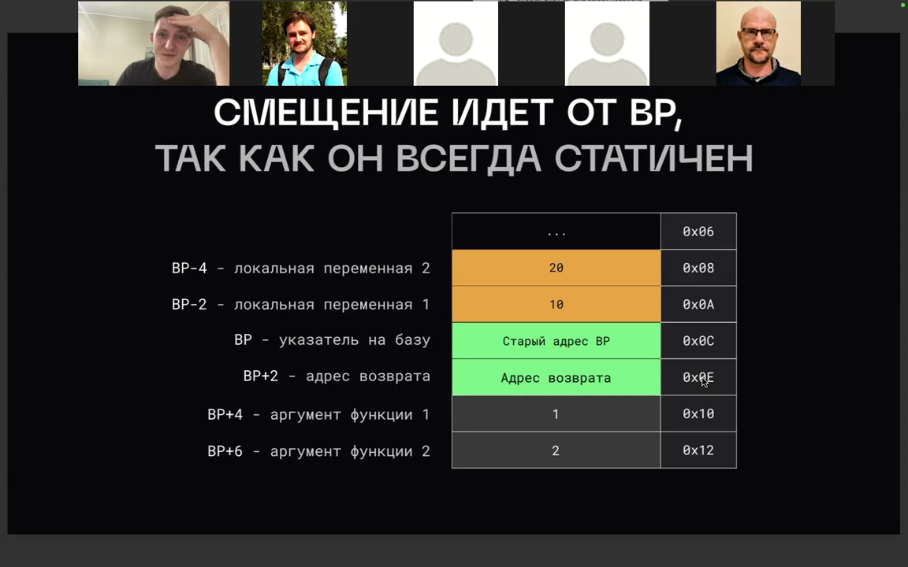

> [!quote]- Кадр [00:01:02]
> 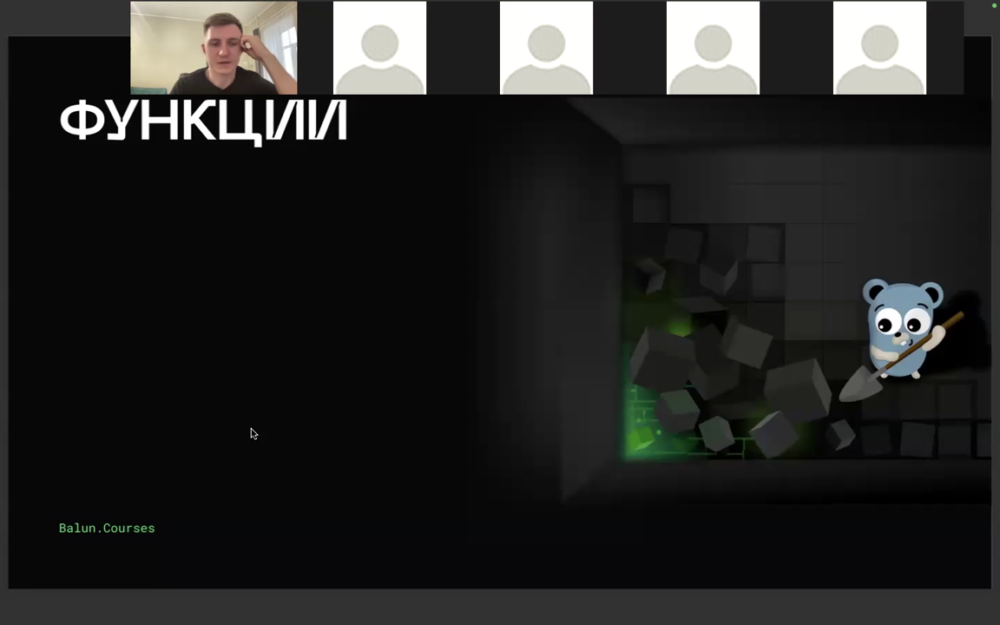

> [!quote]- Кадр [01:42:58]
> 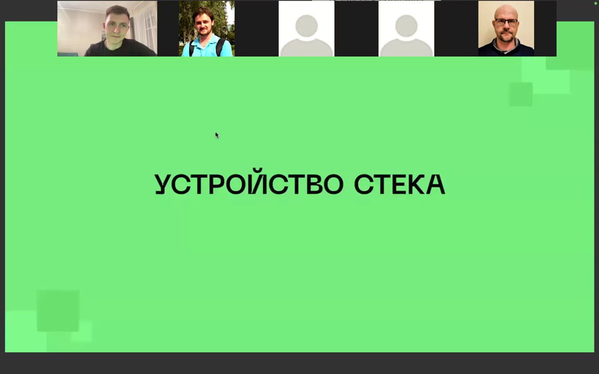

> [!quote]- Кадр [01:43:58]
> 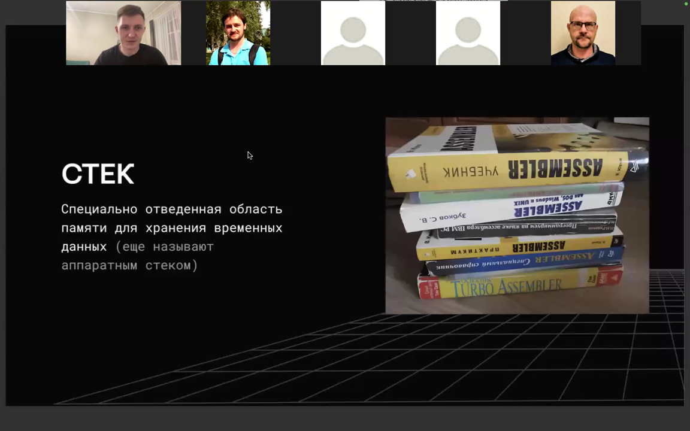

> [!quote]- Кадр [01:44:58]
> 

> [!quote]- Кадр [01:49:58]
> 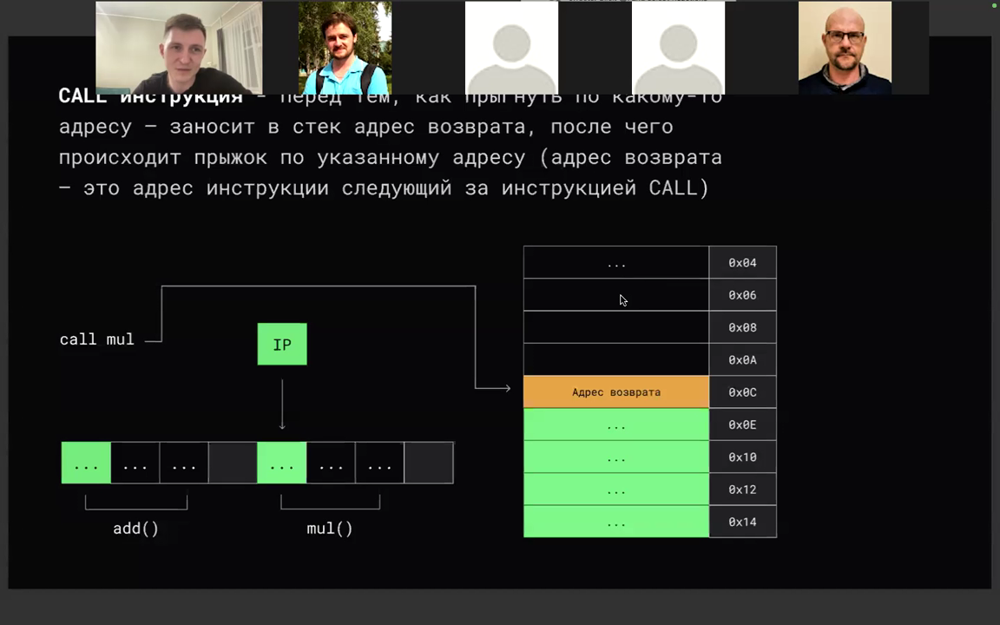

> [!quote]- Кадр [01:51:15]
> 

> [!quote]- Кадр [01:52:15]
> 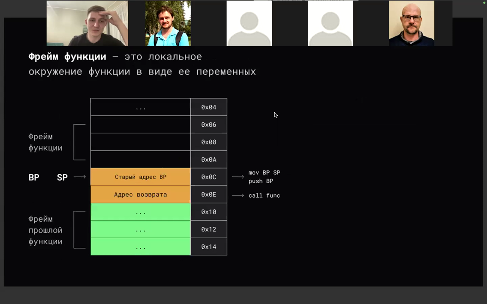

> [!quote]- Кадр [01:50:58]
> 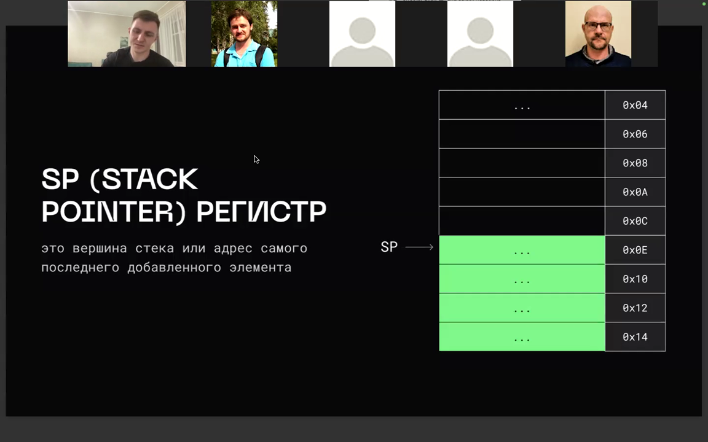

> [!quote]- Кадр [01:52:48]
> 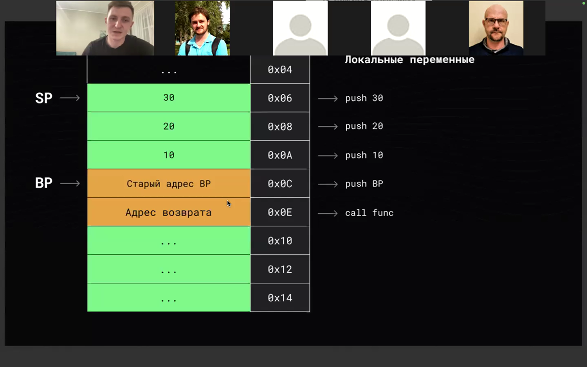

> [!quote]- Кадр [01:53:20]
> 

> [!quote]- Кадр [00:01:24]
> 

> [!quote]- Кадр [00:02:24]
> 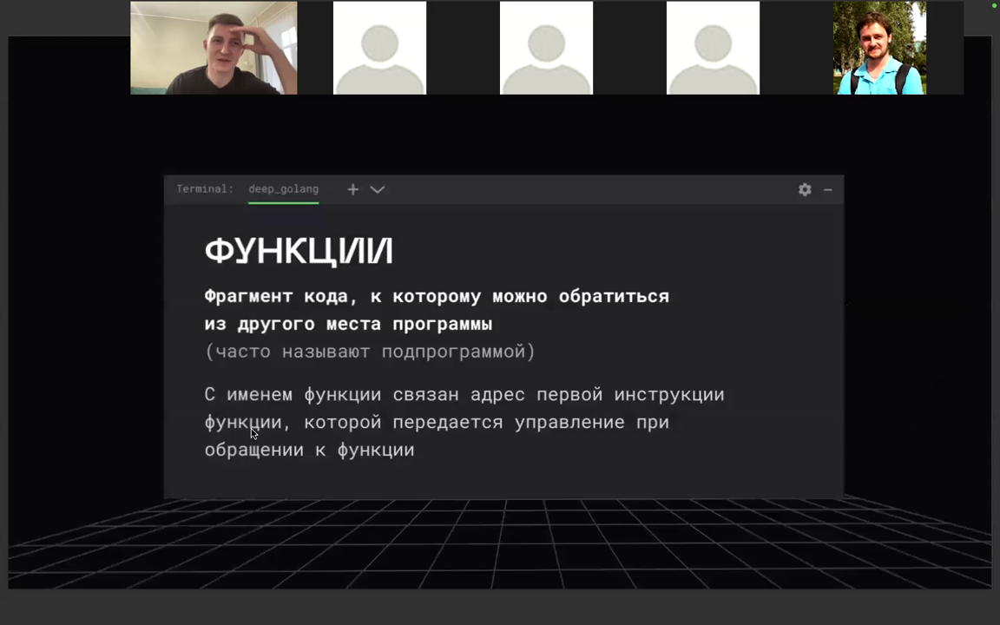

## 3. Функции высшего порядка, композиция и pipeline

Концептуально **функция** выполняет действия и возвращает значение, **процедура** ничего не возвращает и вызывается ради побочных действий, а **предикат** возвращает логическое значение. **Функция высшего порядка** принимает функцию в качестве аргумента и/или возвращает функцию; **замыкание** ссылается на свободные переменные. **Композиция функций** — последовательное применение функций, при котором результат одной передаётся в следующую, а декорирующая функция добавляет поведение перед вызовом переданной функции. **Pipeline** можно построить через декораторы: функции декорируют друг друга. Второй способ — передать первый аргумент, над которым затем выполняются функции; вспомогательная функция (helper) принимает множество функций и передаёт их в обратном порядке, распаковывая, что даёт декларативный способ. При **декларативном** подходе говорят, *что* сделать, но не описывают *как*; при **императивном** описывают алгоритм.

```go
func apply(f func(int) int, x int) int {
	return f(x)
}
```

| | Функция | Процедура |
|---|---|---|
| Возвращает значение | да | нет |
| Назначение | результат действий | побочные действия |

| Подход | Что описывают |
| --- | --- |
| Декларативный | что сделать, без описания как |
| Императивный | алгоритм, как именно всё будет работать |

*Источник: [00:01:24], [01:07:37], [01:08:09], [01:08:46], [01:09:15], [01:10:55], …*

> [!quote]- Кадр [00:01:24]
> 

## 4. Анонимные функции, каррирование, встроенные функции и init

**Анонимная функция** определяется в месте использования и не получает имени; её можно присвоить переменной или сразу вызвать, причём при немедленном вызове переменная получит результирующее значение вызова. В Go можно объявить много функций с нижним подчёркиванием; их нельзя вызвать. **Каррирование** — преобразование функции от многих аргументов в набор вложенных функций одного аргумента; при встраивании (инлайне) код функции дублируется в каждом месте вызова, из-за чего бинарник разрастается. **Частичное применение** позволяет закрепить некоторые параметры функции. В Go есть **встроенные функции** (`append`, `copy`, `len`, `cap`) — их нельзя использовать в качестве значений; функцию `init` тоже нельзя использовать в качестве значения, но можно создать достаточно много функций `init`.

*Источник: [00:04:13], [00:05:32], [00:08:35], [01:30:14], [01:31:24]*

## 5. Порядок вычисления, копирование, RVO и анализ убегания

В Go порядок вычисления аргументов и функций регламентирован: аргументы функции вычисляются слева направо (в C++ этот порядок был неопределён, что могло приводить к утечкам). При возврате из функции значения копируются: указатель, срез, мапа — всё копируется. При передаче не указателя объект создаётся на принимающей стороне и копируется; при передаче указателя объект создаётся один раз на вызывающей стороне, а передаётся указатель. **Copy elision** — оптимизация, избавляющая от лишнего копирования, а **RVO (return value optimization)** — оптимизация, при которой компилятор создаёт возвращаемый объект на стороне вызывающей функции и инициализирует его через указатель. **В Go нет RVO и NRVO.** Компилятор Go использует **анализ убегания (escape analysis)** — набор эвристик, определяющих, будет значение размещено на стеке или в куче (heap); принудительно заставить переменную остаться в стеке нельзя, но можно помогать escape-анализу.

*Источник: [00:02:36], [00:03:36], [00:04:49], [00:10:10], [00:11:10], [00:12:10], …*

> [!quote]- Кадр [00:04:49]
> 

> [!quote]- Кадр [00:39:33]
> 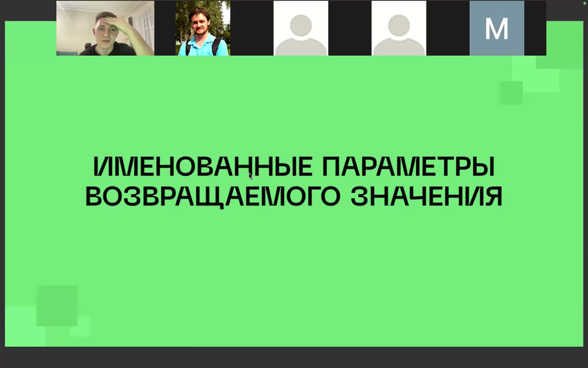

## 6. Единственная ответственность и компактность функций

Функция должна делать что-то одно. Функция не должна одновременно открывать файл и читать данные: лучше принимать ридер (reader) извне; функция только создаёт сканер и выполняет скан — иначе это уже не одно действие и не единственная зона ответственности. Функция принимает `io.Reader` и не зависит от файлов: можно передать ридер из файла, консоли или сети, что повышает гибкость кода. Перед использованием выполняется проверка `reader == nil`; при `nil` возвращается ошибка `errors.New("incorrect reader")` и пустая строка. Чтение строк выполняется через `bufio.NewScanner(reader)` построчно в цикле `scanner.Scan()`. Правило Роберта Мартина: функции должны быть компактными и ещё компактнее, желательно не длиннее 20 строк.

```go
func ProcessData(reader io.Reader) (string, error) {
	if reader == nil {
		return "", errors.New("incorrect reader")
	}

	var data string
	scanner := bufio.NewScanner(reader)
	for scanner.Scan() {
		// processing...
	}

	return data, nil
}
```

*Источник: [00:35:28], [00:35:49], [00:36:06], [00:38:18], [00:38:28], [00:39:16], …*

> [!quote]- Кадр [00:36:06]
> 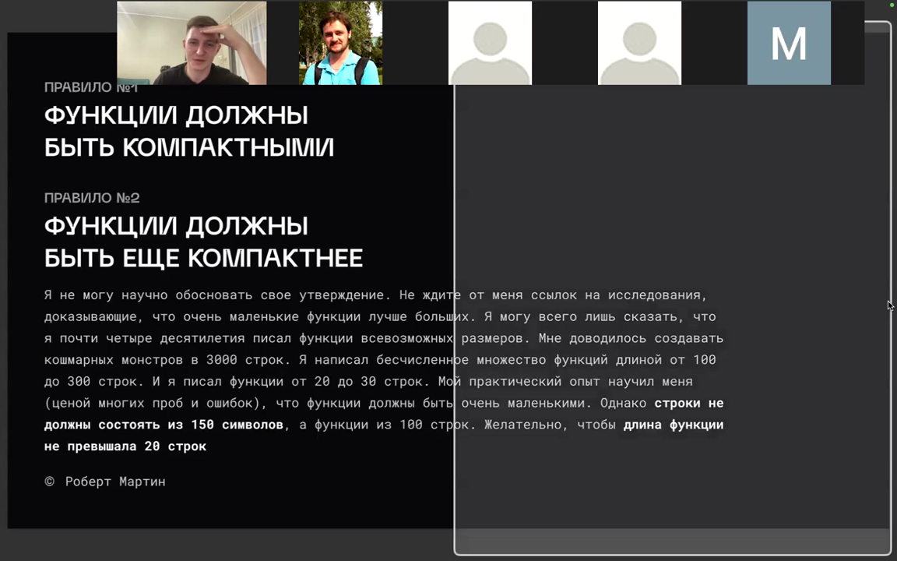

## 7. Инлайнинг функций: аннотация, бюджетная модель и бенчмарк

Когда функция небольшая, Go в некоторых ситуациях может встраивать её код (инлайнинг) ради более эффективной оптимизации. Встраивание не гарантировано, и ошибочно предполагать, что каждая функция будет встроена (inlined). Если за этим не следить, растёт размер бинарника — скомпилированного исполняемого файла. Можно явно попросить компилятор не инлайнить функцию при помощи аннотации. Инлайнинг в Go реализуется на этапе компиляции и основан на **бюджетной модели (budget model, cost-based)**: на встраивание одной функции задан бюджет, равный 80; стоимость функции — это сумма всех инструкций, помноженных на вес; если стоимость меньше или равна бюджету, функцию можно встроить. Бенчмарк показывает, что версия без инлайна выполняется за 2.186 ns/op, а версия с инлайном — за 0.3305 ns/op; инлайн ускоряет функцию, и обе версии проходят тест (PASS).

```bash
go test -bench=. comparison_test.go
BenchmarkMaxWithoutInline-8       519288595        2.186 ns/op
BenchmarkMaxWithInline-8          1000000000       0.3305 ns/op
```

> [!info] Зачем это нужно
> Позволяет избежать дополнительного overhead и инструкций, связанных с вызовом функции.

*Источник: [00:31:28], [00:32:20], [00:33:35], [00:33:54], [00:34:54], [00:36:19], …*

> [!quote]- Кадр [00:33:54]
> 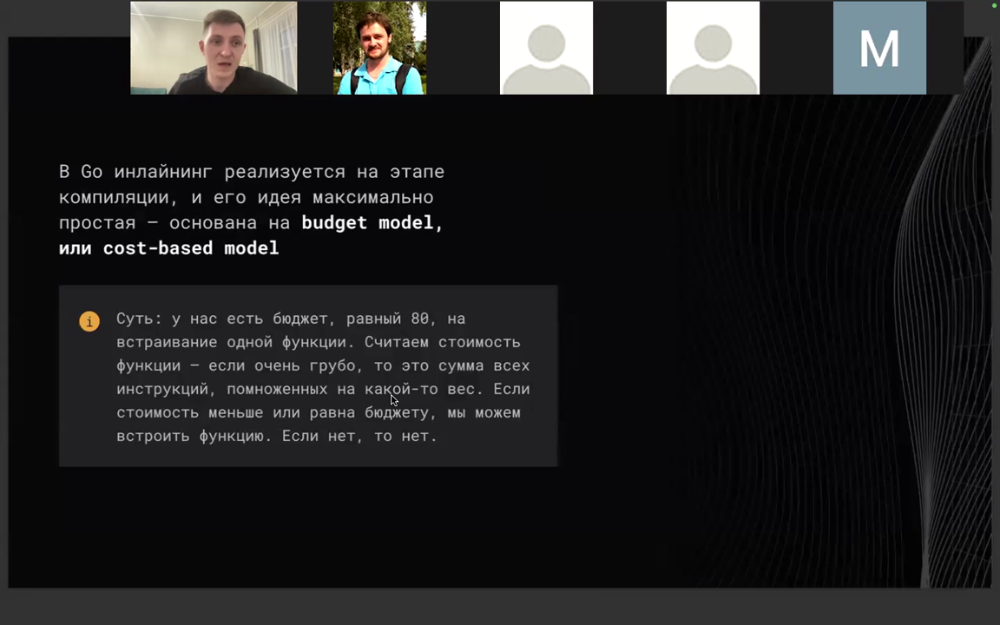

## 8. defer: семантика, LIFO, механика и именованные возвраты

Ключевое слово `defer` в Go позволяет запланировать запуск функции до её возврата; можно отложить несколько функций, и `defer` часто используется для очистки ресурсов или завершения задач. Отложенные вызовы `defer` выполняются в обратном порядке, как стек: last in, first out (LIFO). Сначала происходит возврат из функции, а потом уже выполняется `defer`: `defer` срабатывает только при выходе из функции, а не при выходе из области видимости, а аргументы отложенного вызова вычисляются сразу в момент `defer` и копируются. Для планирования отложенного выполнения функция передаётся в рантайм через `deferproc`, а при выходе из функции вызывается `runtime.deferreturn`. `defer` может изменять именованные возвращаемые параметры: в `defer` можно взять именованный возвращаемый параметр и модифицировать его, причём изменение происходит перед возвратом значения. Откладывание `nil`-функции — это разыменование nil-указателя: если отложенная функция разыменовывает nil-указатель, при её срабатывании происходит паника. Неправильное освобождение mutex через `defer` может привести к тому, что mutex удерживается дольше необходимого и влияет на производительность. С Go 1.14 появилась возможность встраивания `defer` (defer inlining): компилятор Go может инлайнить `defer` только в статических случаях — например, `defer` в начале функции или в условных блоках вне циклов.

```bash
go run main.go

vladimiris-MacBook-Pro defer_evaluation_moment % go run main.go
runtime: invalid memory address or nil pointer dereference
[signal SIGSEGV: segmentation violation code=0x2 addr=0x0 pc=0x1041400cc]

goroutine 1 [running]:
main.main()
	/Users/vladimirbalun/Desktop/Repositories/golang_course/lessons/functions/defer_evaluation_moment/main.go:12 +0x1041400cc

vladimirbalun@Vladimirs-MacBook-Pro functions % go test -bench=. comparison_test.go
goarch: arm64
BenchmarkMaxWithoutInline-8       519288595        2.186 ns/op
BenchmarkMaxWithInline-8          1000000000       0.3305 ns/op
```

*Источник: [00:40:57], [00:42:19], [00:42:49], [00:47:16], [00:48:58], [00:49:20], …*

> [!quote]- Кадр [00:40:57]
> 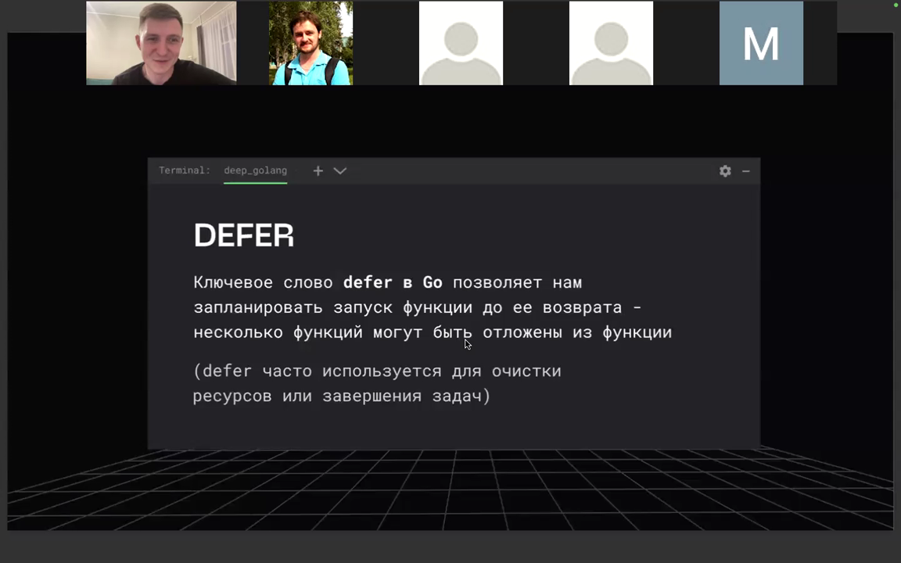

## 9. Чистые функции и отказ от абсолютной чистоты

**Чистая функция** — детерминированная функция без побочных эффектов: при одном и том же аргументе всегда возвращает один и тот же результат. **Нечистая функция** недетерминирована: может модифицировать внешние адреса и глобальные переменные, печатать на экран, читать переменные окружения и вызывать `random`. Чистая функция копирует параметры, а при использовании внешних данных, которые потенциально могут использовать другие потоки, нужна синхронизация. Когда большая часть функций чистая, код проще читать и тестировать: не нужно инжектировать и мокать. «Грязную» функцию можно сделать чистой, если принимать фактор рандома или другую внешнюю зависимость извне. Не стоит вдаваться в крайности и пытаться достичь абсолютной чистоты: глобальную константу (например, число π) не обязательно выносить отдельным параметром.

*Источник: [01:11:53], [01:15:28]*

## 10. Замыкания: генераторы и ленивая инициализация map

В Go нельзя написать так, как в C++: когда в условии возвращается значение и выполняется инкремент, используется дополнительная переменная; также нельзя явно указать, размещать значение на стеке или в куче. Если дочерняя функция ссылается на переменную `number`, объявленную в родительской функции, то после завершения родительской функции эта переменная не будет размещена на стеке, а будет размещена в куче (heap) — и генератор локальной функции ссылается на `number` в куче. С использованием замыканий получился генератор случайных чисел: функция `produce` принимает `source` и возвращает анонимную функцию, которая при вызове обновляет `source` через `permute` и возвращает его. Функция `Generator(number int)` возвращает анонимную функцию `func() int`, которая замыкает переменную `number`: при каждом вызове она возвращает текущее значение `number`, а затем увеличивает его на 1. Функция `Make` принимает конструктор map и не выделяет под неё память до первого использования: при первом вызове замкнутой функции вызывается переданный конструктор, создаётся map, флаг инициализации становится `true`, а сам конструктор обнуляется (становится `nil`). `Make` принимает функцию `ctr` и возвращает `LazyMap`; замыкание при первом вызове вызывает `ctr`, сохраняет результат в `data` и устанавливает `initialized=true`, затем `ctr = nil`, чтобы сборщик мусора мог его освободить. Иногда имеет смысл использовать ленивые вычисления.

```go
func Generator(number int) func() int {
	return func() int {
		r := number
		number++
		return r
	}
}

func produce(source int) func() int {
	return func() int {
		source = permute(source)
		return source
	}
}

func main() {
	generator := Generator(100)
	for i := 0; i <= 200; i++ {
		fmt.Println(generator())
	}
}

type LazyMap func() map[string]string

func Make(ctr func() map[string]string) LazyMap {
	var initialized bool
	var data map[string]string
	return func() map[string]string {
		if !initialized {
			data = ctr()
			initialized = true
			ctr = nil // for GC
		}

		return data
	}
}
```

*Источник: [01:26:01], [01:27:03], [01:27:12], [01:27:29], [01:27:34], [01:28:24], …*

## 11. Callbacks: обработка ошибок и асинхронность

Первый способ обработки деления на ноль — выбросить панику при делении на 0. Второй способ — принимать **success callback** и **error callback**: при нуле вызывается функция ошибки, иначе — функция успеха. В узких местах проекта можно передать callback, чтобы функция выполнилась асинхронно, и в зависимости от успеха или неуспеха вызвался нужный callback. Важно не злоупотреблять этим, чтобы не скатиться в callback hell.

*Источник: [01:34:18], [01:35:18]*

## 12. Рекурсия: прямая, косвенная, хвостовая и мемоизация

**Рекурсия** — это функция, которая вызывает саму себя. Она бывает **прямой** — когда функция вызывает себя, и **косвенной** — когда одна функция вызывает внутри себя другую, которая затем вызывает первую. **Хвостовая рекурсия** — особый вид рекурсии и некоторая оптимизация: функция заканчивается вызовом самой себя без дополнительных операндов. В Go нет хвостовой рекурсии, и компилятор Go не выполняет её оптимизацию, хотя в некоторых языках компилятор может развернуть хвостовую рекурсию в цикл с одним стекфреймом, при этом локальные переменные меняются от итерации к итерации. `fast factorial` вызывает `factorial` с двумя параметрами: исходным числом и аккумулятором, равным единице; в каждом рекурсивном вызове текущий результат умножается на аккумулятор. При рекурсивном вычислении чисел Фибоначчи одни и те же значения вычисляются многократно, и чем больше число, тем больше дублирований; при вычислении факториала некоторые вызовы тоже будут вычислены повторно. **Мемоизация** — это кэш, который позволяет не выполнять повторную работу при вычислении одних и тех же подзадач: если один раз вычислить N-е число и сохранить результат в кэш, повторно не нужно заходить в хвост рекурсии.

```go
func recursion() {
    recursion()
}
```

| Вид | Описание |
|---|---|
| Прямая рекурсия | Функция вызывает себя |
| Косвенная рекурсия | Функция вызывает другую, которая затем вызывает первую |

> [!info] Зачем это нужно
> Повторное вычисление уже найденного значения можно пропустить, обратившись к кэшу.

*Источник: [01:36:15], [01:36:58], [01:37:58], [01:38:19], [01:38:59], [01:39:19], …*

> [!quote]- Кадр [01:36:15]
> 

> [!quote]- Кадр [01:42:35]
> 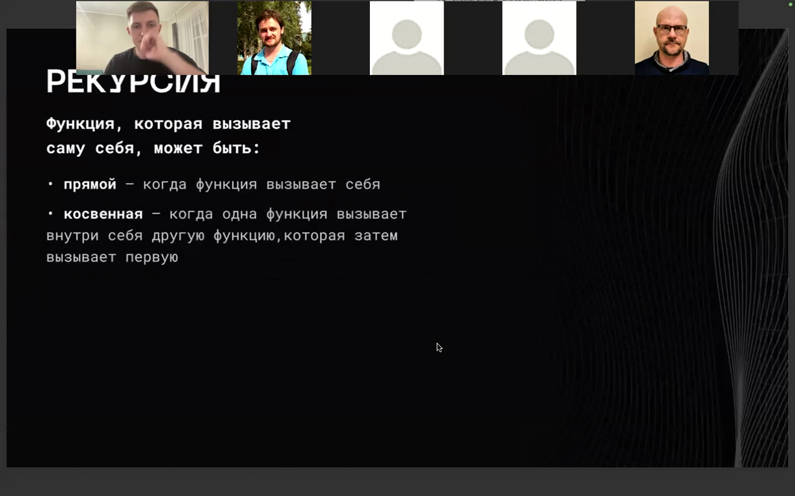

> [!quote]- Кадр [02:02:08]
> 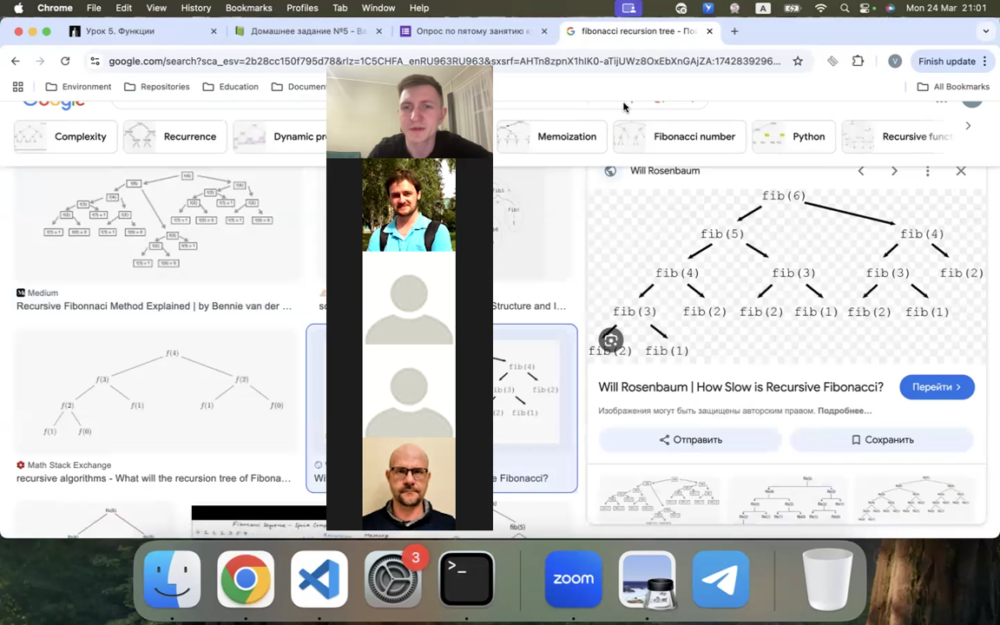

## 13. Пример Mul и Calculate

Функция `Mul` возвращает произведение `x` и `y`. `Calculate` печатает результат `Mul(x, y)` и возвращает значение `Mul(x, y)`. `CalculateAdd` печатает и возвращает `Add(x, y)`.

```go
func Mul(x, y int) int {
	return x * y
}

func Calculate(x, y int) int {
	fmt.Printf("%d*%d = %d\n", x, y, Mul(x, y))
	return Mul(x, y)
}

func CalculateAdd(x, y int) int {
	fmt.Printf("%d*%d = %d\n", x, y, Add(x, y))
	return Add(x, y)
}
```

*Источник: [01:24:20], [01:32:30]*

## Схема

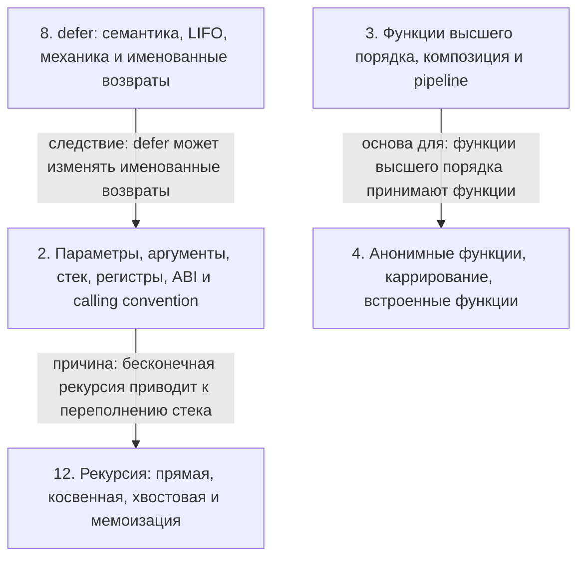

## Итог

> [!success] Что в итоге
> Функции в Go — первопорядковые значения без перегрузки и параметров по умолчанию: параметры и аргументы различаются, все аргументы копируются, порядок вычисления регламентирован слева направо, а переменные имеют нулевое значение. Компилятор Go использует анализ убегания, инлайнинг с бюджетной моделью (бюджет 80) и собственный ассемблер, что влияет на стоимость вызова и размер бинарника. На аппаратном уровне функция связана с адресом первой инструкции (IP), работает через стек (SP/BP, фрейм, `CALL`), а аргументы могут передаваться через стек или регистры согласно ABI. На практике функции рекомендуется делать компактными с единственной ответственностью; `defer` выполняется по LIFO и может менять именованные возвраты, а рекурсия бывает прямой и косвенной и не оптимизируется хвостовым образом.
