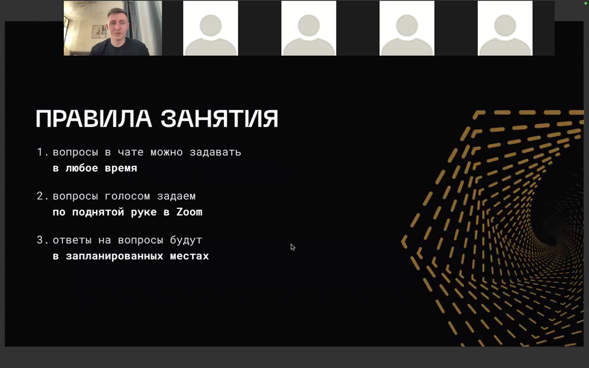
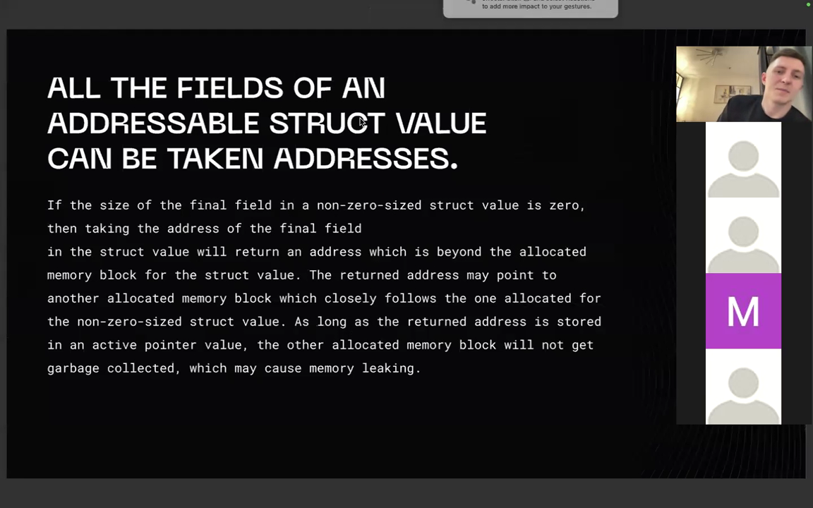
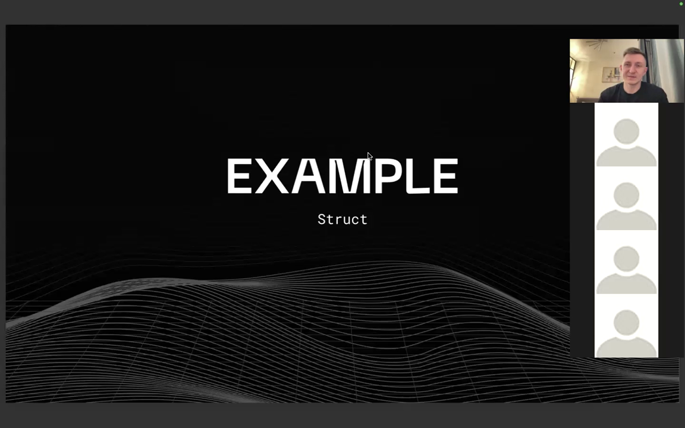
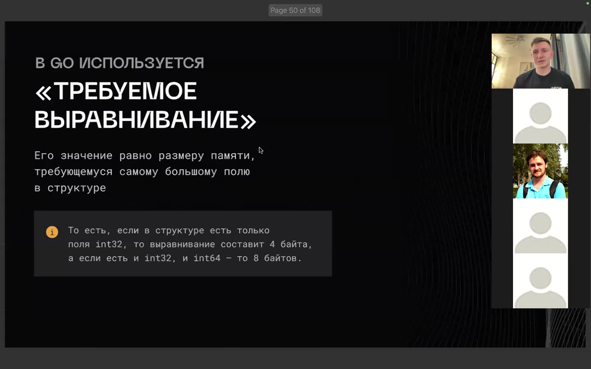
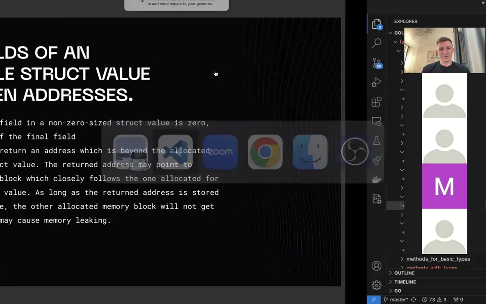
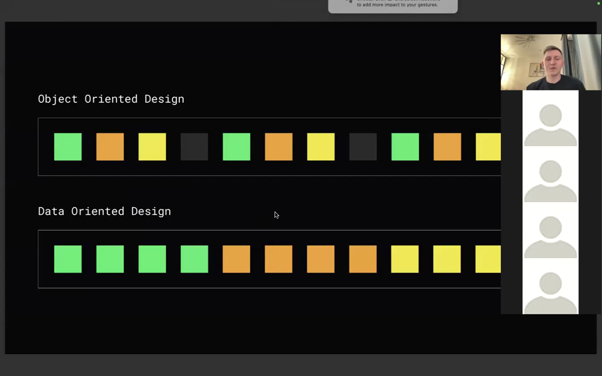
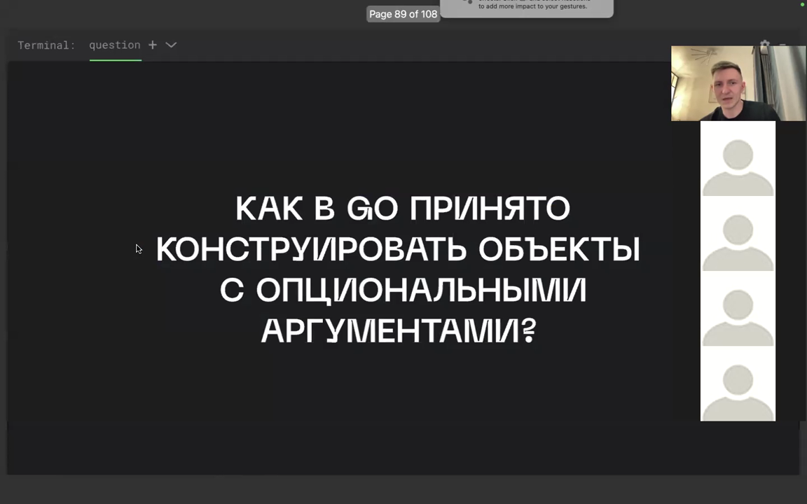
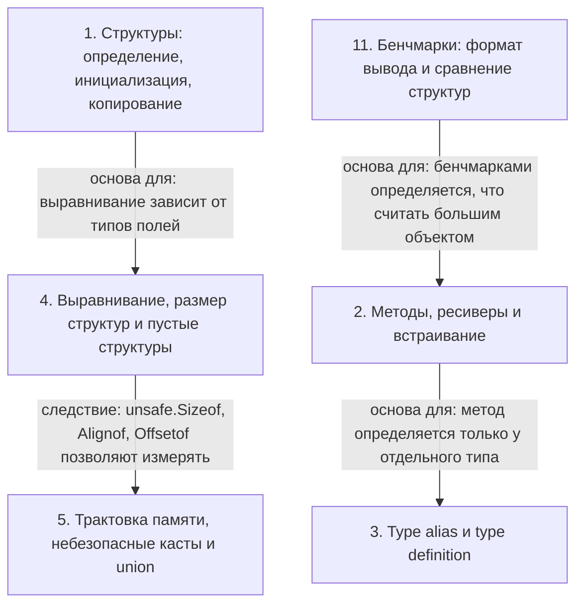

# Структуры данных в Go: методы, память, паттерны

> [!abstract] Обзор
> Материал посвящён структурам данных в Go: определению, инициализации (позиционной и именованной), копированию и способам создания указателей. Рассматриваются методы и ресиверы (по значению и указателю), методы только у type definition (нового типа), а также встраивание типов и полей. Отдельно разбираются выравнивание, порядок полей и размер структур, пустые структуры и значения нулевого размера (zero-size), небезопасные касты (unsafe cast) и union, проверки на этапе компиляции. Обсуждаются `defer`, data-oriented design, паттерн Closer и финализайзер, функциональные опции (functional options) с примерами User и Logger, а также формат вывода бенчмарков и type alias против type definition.

> [!info] Курс
> [[index|Оглавление курса]]

## Оглавление
1. [[#1. Структуры: определение, инициализация, копирование]]
2. [[#2. Методы, ресиверы и встраивание]]
3. [[#3. Type alias и type definition]]
4. [[#4. Выравнивание, размер структур и пустые структуры]]
5. [[#5. Трактовка памяти, небезопасные касты и union]]
6. [[#6. Проверки на этапе компиляции]]
7. [[#7. defer: аргументы и ресивер]]
8. [[#8. Data-oriented design]]
9. [[#9. Паттерн Closer и финализайзер]]
10. [[#10. Функциональные опции: опциональные параметры и конструкторы]]
11. [[#11. Бенчмарки: формат вывода и сравнение структур]]

**Схема** — [[#Схема]]
**Итог** — [[#Итог]]

## 1. Структуры: определение, инициализация, копирование

**Структура** — программная единица и агрегирующий тип данных: она объединяет другие типы и позволяет хранить и обрабатывать логически связанные данные. Инициализировать её можно **позиционно** (перечисляя значения по порядку) или **именованно** (с указанием имён полей). Именованный способ рекомендуется: при добавлении нового поля позиционный вариант ломается. Поля идентичны при совпадении имён, типов и тегов; структуры идентичны только при одинаковой последовательности полей, и у всех полей адресуемого struct value можно взять адрес. Структуру можно создать локально внутри функции — это локализует пространство имён, но за пределами функции к ней обратиться нельзя. При присваивании одной структуры другой происходит побитовое копирование всех её полей: поля обычно примитивные и копируются по битам.

```go
package main

type Data struct {
	x int
	y int
}

func main() {
	// 1 way
	data1 := Data{10, 20}
	_ = data1

	// 2 way
	data2 := Data{x: 10, y: 20}
	_ = data2
}

type Person struct {
	name string
	age  int
}

func main() {
	vladimir := Person{
		name: "Vladimir",
		age:  30,
	}
	fmt.Println(vladimir)
}

type Data struct {
	x int
	y int
}

func main() {
	// 1 way
	data1 := Data{x: 10, y: 10}
	temp1 := data1
	_ = temp1

	// 2 way
	data2 := Data{x: 10, y: 10}
	var temp2 Data
	temp2.x = data2.x
	temp2.y = data2.y
}
```

| Способ | Пример |
|---|---|
| Позиционный | Data{10, 20} |
| Именованный | Data{x: 10, y: 20} |

*Источник: [00:00:55], [00:01:28], [00:02:28], [00:02:30], [00:02:58], [00:03:28], …*

> [!quote]- Кадр [00:00:55]
> 

> [!quote]- Кадр [01:10:24]
> 

> [!quote]- Кадр [00:02:30]
> 

## 2. Методы, ресиверы и встраивание

**Метод** — это функция, принадлежащая объекту; вызов метода — это функция, первым аргументом которой неявно передаётся значение или указатель объекта (**ресивер**). Ресивер может быть значением или указателем: при передаче по значению объект копируется и исходный объект не меняется, при передаче указателя изменения применяются к самому объекту. Не следует смешивать типы ресиверов в рамках одной структуры. Если ресивер — большой объект, его стоит сделать указателем, чтобы не копировать; что считать большим объектом, определяется бенчмарками. Указатель на структуру `Data` можно создать через `&Data{}` либо через `new(Data)`, и через полученный указатель затем вызывается метод `Print()`. В Go вызов метода на `nil`-объекте отработает; метод может быть объявлен с пустым идентификатором (`_`) в качестве имени, а имя ресивера можно не указывать, если он не используется. Для переиспользования методов без проксирующих методов используется **встраивание типов**: анонимное поле (имя равно имени типа), можно встраивать указатель на структуру. При встраивании методы с одинаковой сигнатурой перекрываются, а при конфликте имён или методов возникает ошибка `ambiguous selector`; встраивание mutex раскрывает его методы. В Go нет наследования; методы можно определять только у типа в том же пакете, и нельзя добавлять методы к базовым типам, их алиасам, указателям и интерфейсам.

```go
package main

type Data struct {
}

func (d Data) Print() {}

func main() {
	var value1 = Data{}
	value1.Print()

	// 1 way
	var value2WithSugar = &Data{}
	value2WithSugar.Print()

	// 2 way
	var value2WithoutSugar = new(Data)
	value2WithoutSugar.Print()
}

type Data struct {
}

func (d Data) Print() {}

func main() {
	var value1 = Data{}
	value1.Print()

	// 1 way
	var value2WithSugar = &Data{}
	value2WithSugar.Print()
}

type account struct {
	balance
}

type client struct {
	account
}

func (c client) add(amount int) {
	c.account.balance += amount
}

type Data struct {
	value int
}

func (d Data) Value() int {
	return d.value
}

func (d *Data) SetValue(v int) int {
	d.value = v
	return d.value
}

type Data struct{}

func (d Data) _() {}

package main

import "fmt"

type account struct {
	balance
}

type client struct {
	account
}

func (c client) add(amount int) {
	c.account.balance += amount
}

func main() {
	c := client{}
	c.account.balance = 100
	c.add(1)
	fmt.Println(c.account.balance)
}
```

| Ресивер | Объект | Изменения |
|---|---|---|
| по значению | копируется в функцию | исходный объект не меняется |
| по указателю | указывает на объект | изменения применяются к самому объекту |

*Источник: [00:03:28], [00:03:53], [00:05:09], [00:05:55], [00:06:19], [00:06:27], …*

## 3. Type alias и type definition

Метод можно определять только у отдельного типа, когда делается не `type`-алиас, а **type definition** (определение нового типа). В Go можно создать новый тип на основе существующего через type definition и затем добавить методы к этому новому типу, в том числе для базовых типов, таких как `integer`, функция или `map`. У алиаса типа определить метод не получится, и для базовых типов при алиасе методы создавать нельзя. Новый определённый тип и исходный тип — разные типы, но имеют один и тот же базовый тип (underlying type). При создании отдельного типа через type definition создаётся полностью отдельный тип данных, и у него нельзя вызвать метод, определённый для исходного типа; алиас же по сути является тем же типом, и у него доступны методы исходного типа. Если в определении используется равно (`=`), создаётся алиас: `TypeAlias` не создаёт новый тип, а является псевдонимом (синонимом) типа. Псевдоним типа `int` позволяет без проблем присвоить переменной этого псевдонима значение `int`, а тип, базовым для которого является `int`, требует явного скаста.

| Признак | Type alias | Type definition |
|---|---|---|
| Создание типа | Не создаёт новый тип, псевдоним | Создаёт новый тип |
| Присваивание | Ничего делать не нужно | Нужно кастить |
| Базовый тип | Тот же тип | Тот же базовый тип |

*Источник: [00:23:45], [01:40:15], [01:41:15], [01:41:53], [01:42:36], [01:43:32], …*

## 4. Выравнивание, размер структур и пустые структуры

В Go используется требуемое выравнивание, равное размеру самого большого поля структуры: для `bool`/`uint8`/`int8` — 1 байт, для `uint16`/`int16` — 2, для `uint32`/`int32`/`float32`/`complex64` — 4. Для массивов выравнивание определяется типом элементов, для структур — типами полей, для остальных типов — размером машинного слова. Выравнивание берётся максимальное, а пустующие байты (включая байты выравнивания) заполняются нулями. Выравнивание уменьшает число обращений к памяти и даёт скорость, но тратит дополнительную память. Порядок полей влияет на размер структуры: если у двух структур одни и те же поля в разном порядке, размер может отличаться. Компилятор Go не меняет порядок полей, а при сравнении структур поля сравниваются по порядку. Для измерения размера, смещения и выравнивания используются `unsafe.Sizeof`, `unsafe.Alignof`, `unsafe.Offsetof`, значения которых известны на этапе компиляции; утилита `aligncheck` показывает неоптимальные структуры, но читаемый код почти всегда важнее оптимизаций. Размер пустой структуры и её объекта равен нулю, но у объекта можно взять адрес; пустые объекты имеют одинаковые адреса, указывающие на одно и то же место. Пустая структура получает выравнивание на 8 байт, и если она находится в конце структуры, она занимает дополнительную память. Если размер последнего поля в структуре ненулевого размера (non-zero-sized struct) равен нулю, взятие его адреса вернёт адрес за пределами выделенного блока памяти, что при хранении в «живом» указателе может вызвать утечку памяти. Стандартный компилятор Go гарантирует, что взятие адреса последнего поля в структуре ненулевого размера не вернёт адрес за пределами выделенного для неё блока памяти. В разных горутинах пустые объекты структуры могут указывать на разные адреса, поскольку у каждой горутины свой стек. Для «силы» можно использовать `uint8` вместо `int`: значения от 0 до 10 помещаются в 8 бит; в 4 байта можно упаковать силу, опыт, уровень и уважение. Если упаковывать данные по битикам или байтикам, нужно оставить понятный интерфейс, чтобы просто было управлять; для этого нужно реализовать геттеры.

```go
type data1 struct {
	aaa bool // 1
	bbb int32 // 4
	ccc bool // 1
}

type data2 struct {
	aaa bool // 1
	bbb bool // 1
	ccc bool // 1
}

func main() {
	fmt.Println(unsafe.Sizeof(data1{}))
	fmt.Println(unsafe.Sizeof(data2{}))

	d := data1{
		aaa: true,
		bbb: 5,
		ccc: true,
	}

	pointer := (*[12]byte)(unsafe.Pointer(&d))
	fmt.Println(pointer)
}

package main

import (
	"fmt"
	"unsafe"
)

type data1 struct {
	aaa bool
	bbb [1023]byte
	ccc bool
}

func main() {
	d := data1{}
	fmt.Println(unsafe.Sizeof(d))
	fmt.Println(unsafe.Alignof(d))
}

vladimirbalun@Vladimirs-MacBook-Pro struct_alignment_1 % go run main.go
Bytes are 8{12}uint8{0x1, 0x0, 0x0, 0x0, 0x0, 0x0, 0x0, 0x0}

type data struct {
	aaa int16
	bbb bool
}

type data1 struct {
    aaa bool
    bbb int32
    ccc bool
}

go get -u gitlab.com/opennota/check/cmd/aligncheck
go get -u gitlab.com/opennota/check/cmd/structcheck
go get -u gitlab.com/opennota/check/cmd/varcheck
$ aligncheck net/http
net/http: /usr/lib/go/src/net/http/server.go:123:6: struct conn could have size 160
net/http: /usr/lib/go/src/net/http/server.go:315:6: struct response could have size 152

func main() {
	type T1 struct {
		a struct{}
		x int64
	}

	var t1 T1
	fmt.Println(unsafe.Sizeof(t1.a))
	fmt.Println(unsafe.Sizeof(t1.x))

	type T2 struct {
		x int64
		a struct{}
	}

	var t2 T2
	fmt.Println(unsafe.Sizeof(t2.a))
	fmt.Println(unsafe.Sizeof(t2.x))
}

func main() {
	go func() {
		var gv1 int
		var ge1 struct{}
		var gv2 int
		var ge2 struct{}

		println()
		println("gv1:", &gv1)
		println("ge1:", &ge1)
		println("gv2:", &gv2)
		println("ge2:", &ge2)
	}()

	time.Sleep(time.Second)
}

import (
	"fmt"
	"unsafe"
)

type empty struct{}

func main() {
	a := struct{}{}
	b := struct{}{}
	c := empty()
	d := [0]byte{}

	fmt.Println(unsafe.Pointer(&a))
	fmt.Println(unsafe.Pointer(&b))
	fmt.Println(unsafe.Pointer(&c))
	fmt.Println(unsafe.Pointer(&d))
}
```

> [!info] Зачем это нужно
> Понятный интерфейс нужен, чтобы просто было управлять.

*Источник: [00:42:13], [00:43:32], [00:44:32], [00:45:11], [00:45:13], [00:46:13], …*

> [!quote]- Кадр [00:45:13]
> 

> [!quote]- Кадр [01:10:24]
> 

> [!quote]- Кадр [01:10:40]
> 

## 5. Трактовка памяти, небезопасные касты и union

Одну и ту же область памяти можно представить сначала как массив байт, а затем интерпретировать её по-разному: первые 8 байт — как поинтер, оставшиеся 8 байт — как capacity. Пакет `unsafe` позволяет обходить систему безопасности типов Go: один участок памяти можно в один момент представить как `int64`, затем перезаписать и использовать как `float64`. С его помощью делают **небезопасные касты (unsafe cast)**, например преобразование среза собственного целочисленного типа в срез `int`. unsafe cast — по сути синтаксический сахар, то есть бесплатная операция. Внутри стоит использовать наиболее подходящий по размеру тип, например `int8`; можно привести один указатель к другому указателю. Применять **union** стоит редко: это обход системы безопасности типов и потенциальные ошибки, оправдано лишь в отдельных случаях.

*Источник: [00:19:39], [00:20:43], [01:47:09], [01:54:37], [01:55:32]*

## 6. Проверки на этапе компиляции

В Go размер структуры, выравнивание и смещение полей можно проверять на этапе компиляции, а не только в рантайме; если размер структуры не равен исходному размеру, проверка на этапе компиляции выдаст ошибку. Go также позволяет проверять инварианты бинарного протокола на этапе компиляции; для этого используются функции, возвращающие значения, известные на этапе компиляции.

> [!info] Зачем это нужно
> Такая проверка нужна, например, чтобы структура не выходила за кэш-линию и имела размер 64 байта.

*Источник: [01:21:25], [01:23:25], [01:24:25]*

## 7. defer: аргументы и ресивер

`defer` откладывает выполнение функции. Аргументы нужно вычислить сразу же, до откладывания вызова. Для метода необходимо вычислить всё, что находится слева, чтобы получить итоговый ресивер, на котором отложится выполнение метода. В `main` переменной `value` присваивается 1, а `pointer` получает адрес `value`, после чего объявляется `defer MakeData(pointer).Print(pointer)` (в другом варианте — `defer MakeData(pointer).P`); затем `value` меняется на 2, переменной `pointer` присваивается `new(int)`, и вызывается `MakeData(pointer)`.

```go
func main() {
	var value = 1
	var pointer = &value
	defer MakeData(pointer).Print(pointer)

	value = 2
	pointer = new(int)
	MakeData(pointer)
}
```

*Источник: [01:17:06], [01:18:06], [01:19:24], [01:19:29]*

## 8. Data-oriented design

**Data-oriented design** — это способ оперировать данными в дружественной к кэшу (cache-friendly) манере, в отличие от объектно-ориентированного дизайна; это не чисто «гошный» паттерн, а скорее паттерн из GameDev, где его часто применяют. В data-oriented дизайне для каждого поля создаётся отдельный срез, а в объектно-ориентированном — срез объектов; общий объём выделяемой памяти одинаков, различается только способ описания. Когда данные лежат друг за другом последовательно, при обходе первого поля в кэш подгружаются и остальные, и лишнего в кэше не оказывается; при таком подходе последовательно проходим `field 1`, затем `field 2`, и всё подгружается в кэш. Такой способ описания данных даёт преимущество — заметную разницу в бенчмарке. У кэш-дружественного кода есть плата: такой код не совсем удобен — неплохо читается, но плохо поддерживается.

*Источник: [01:26:41], [01:27:47], [01:28:47], [01:29:30], [01:30:00]*

> [!quote]- Кадр [01:29:30]
> 

> [!quote]- Кадр [01:30:00]
> 

## 9. Паттерн Closer и финализайзер

**Паттерн Closer** предназначен для очистки ресурсов и применяется, когда сложно обеспечить закрытие всех ресурсов в одном месте. В паттерне Closer каждый компонент регистрирует обработчик, чтобы ему сообщили, когда необходимо очистить ресурсы и прекратить работу; вместо собственной реализации можно использовать готовую библиотеку Closer. У клоузера можно накапливать экшены — функции, добавляя их в срез; при вызове `close` он идёт по срезу и вызывает эти экшены друг за другом, что позволяет обеспечивать порядок завершения в нужной последовательности. **Финализайзер** вызывает обработчик, когда сборщик мусора перестанет ссылаться на объект.

> [!info] Зачем это нужно
> Паттерн Closer предназначен для очистки ресурсов.

*Источник: [01:30:00], [01:31:07], [01:32:23]*

> [!quote]- Кадр [01:30:00]
> 

> [!quote]- Кадр [01:32:23]
> 

## 10. Функциональные опции: опциональные параметры и конструкторы

В структуре `User` поля `name` и `surname` обязательны, а поля `email`, фон и адрес необязательны; для пометки их наличия или отсутствия используются указатели на `string`. Если добавить в структуру новое поле, конструктор, который заполняет поля, ломается; использование опциональных параметров ухудшает читаемость кода, а при добавлении новых параметров приходится вносить изменения во многих местах. **Функциональные опции (functional options)** — это паттерн: в Go для конструирования объектов с опциональными аргументами принято использовать functional options. Дополнительная функция-опция замыкает свои параметры и присваивает их полям структуры; в конструктор передаются обязательные параметры (`name`, `surname`) и набор option-функций, а при изменении не нужно рефакторить имеющиеся вызовы. `NewUser` создаёт структуру `User` из переданных имени и фамилии, затем в цикле по `options` применяет каждую опцию к пользователю и возвращает указатель на него. `Logger` — структура с полями `name` и `level`; конструктор `NewLogger` возвращает указатель на пустую структуру `Logger`, а `WithName` и `WithLevel` устанавливают соответствующие поля и возвращают указатель на тот же `Logger`.

```go
func NewUser(name string, surname string, options ...Option) *User {
    user := User{
        Name: name,
        Surname: surname,
    }

    for _, option := range options {
        option(&user)
    }

    return &user
}

package main

type Logger struct {
	name  string
	level string
}

func NewLogger() *Logger {
	return &Logger{}
}

func (l *Logger) WithName(name string) *Logger {
	l.name = name
	return l
}

func (l *Logger) WithLevel(level string) *Logger {
	l.level = level
	return l
}

func main() {
	logger1 := NewLogger()
	logger2 := NewLogger().WithLevel("debug")
	logger3 := NewLogger().WithName("app")
}
```

*Источник: [01:33:49], [01:34:49], [01:35:02], [01:35:04], [01:35:19], [01:36:50], …*

## 11. Бенчмарки: формат вывода и сравнение структур

Перед результатами бенчмарков Go выводит `goos`, `goarch` и `cpu` — например, `darwin`, `arm64` и `Apple M1`; затем идут строки `Benchmark`, `PASS` и итоговая строка `ok`. Код часто сравнивает структуры, и результат бенчмарка может удивить: сравниваемые структуры отличаются только размером. В файле `comparison_test.go` определён `BenchmarkComparisonData1`, где создаются `data1 := Data1{size: 100}` и `data2 := Data1{size: 101}`, затем в цикле `for i := 0; i < b.N; i++` выполняется сравнение `data1 == data2`; запуск указан командой `go test -bench=. comparison_benchmark`.

```go
type Data1 struct {
	size int32
	values [10 << 20]byte
}

type Data2 struct {
	values [10 << 20]byte
	size int32
}

func BenchmarkComparisonData1(b *testing.B) {
	data1 := Data1{size: 100}
	data2 := Data1{size: 101}
	for i := 0; i < b.N; i++ {
		_ = data1 == data2
	}
}

goos: darwin
goarch: arm64
cpu: Apple M1
Benchmark...
PASS
ok command-line-arguments 5.0...
```

*Источник: [01:19:36], [01:21:23], [01:39:24], [01:47:07]*

## Схема



## Итог

> [!success] Что в итоге
> Структуры в Go агрегируют данные и допускают позиционную или именованную инициализацию, а при присваивании копируются побитово; указатель на них создаётся через `&Data{}` или `new(Data)`. Методы — это функции с неявным ресивером, который может быть значением или указателем, что определяет изменение исходного объекта; методы определяются только у отдельного типа, а встраивание даёт доступ к методам без проксирования, но может приводить к конфликтам и раскрытию деталей реализации. Выравнивание и порядок полей влияют на размер структуры; пустые структуры имеют нулевой размер, но могут вызывать утечки при взятии адреса последнего zero-sized поля. На этапе компиляции можно проверять размер, выравнивание и смещения; для конструирования с опциональными аргументами применяется паттерн functional options; а различие type alias и type definition определяет присваивание и доступность методов.
