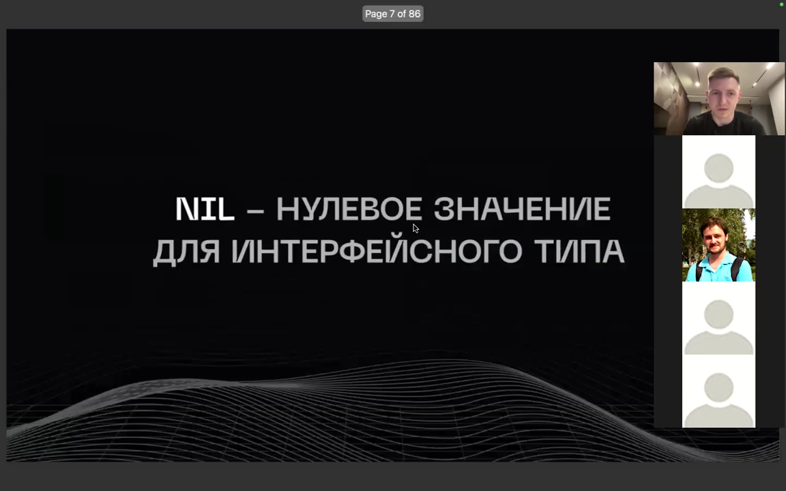
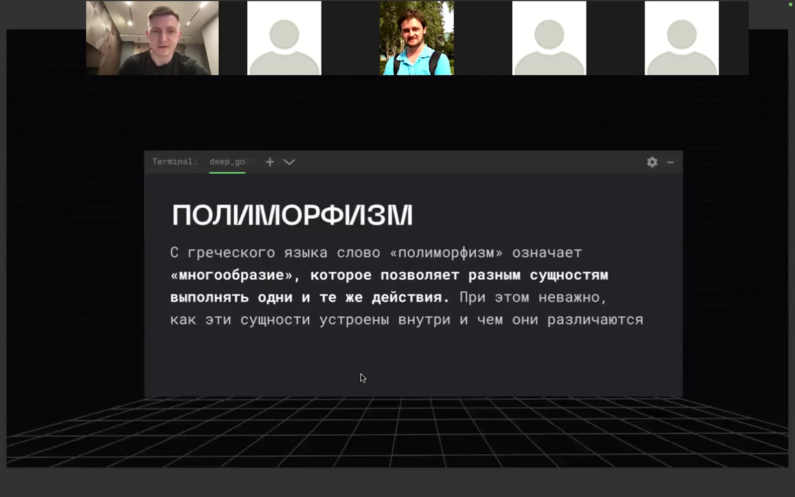
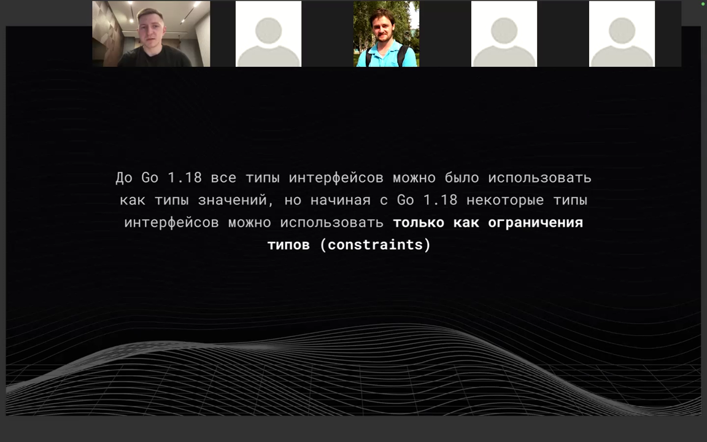
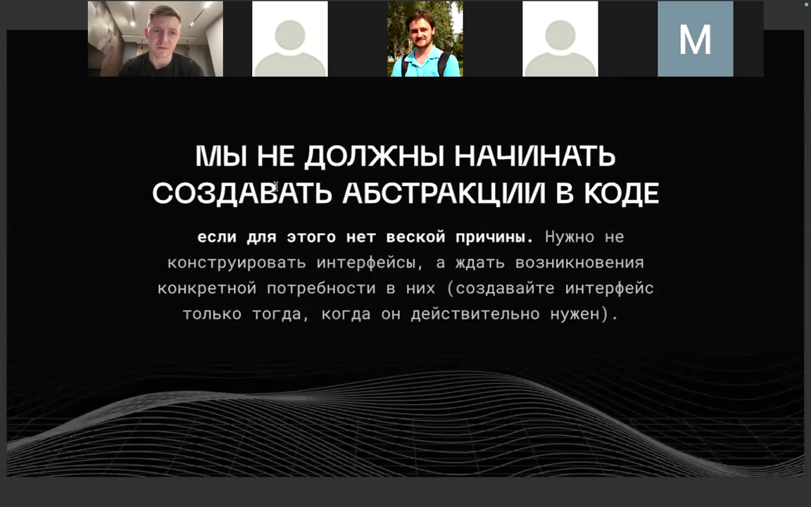
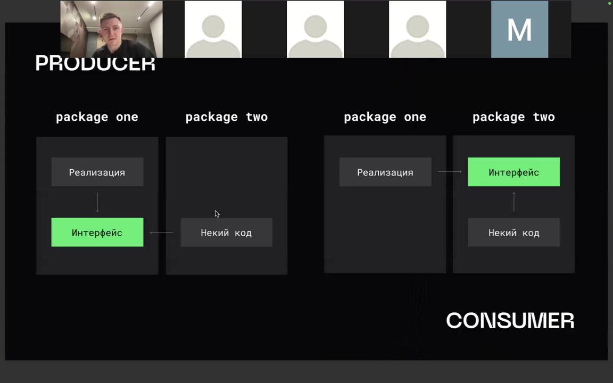
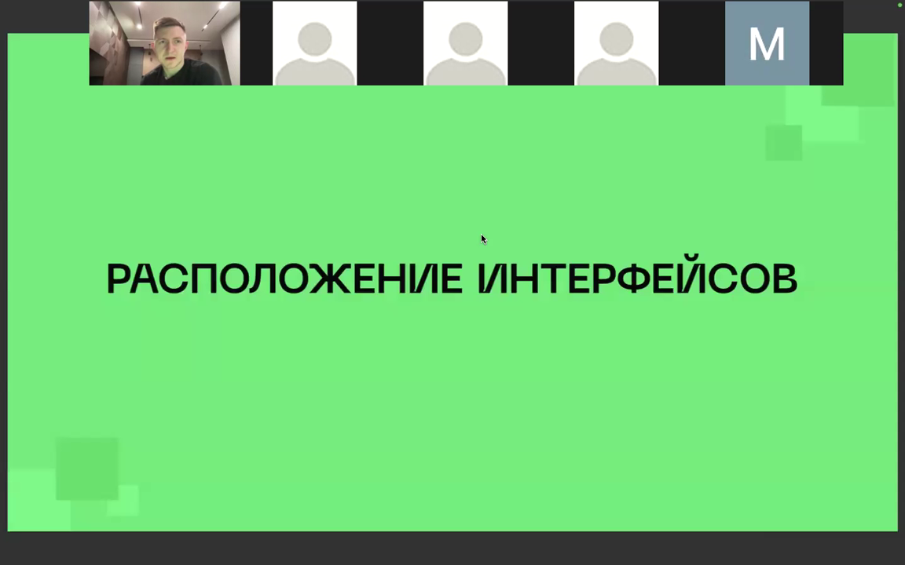
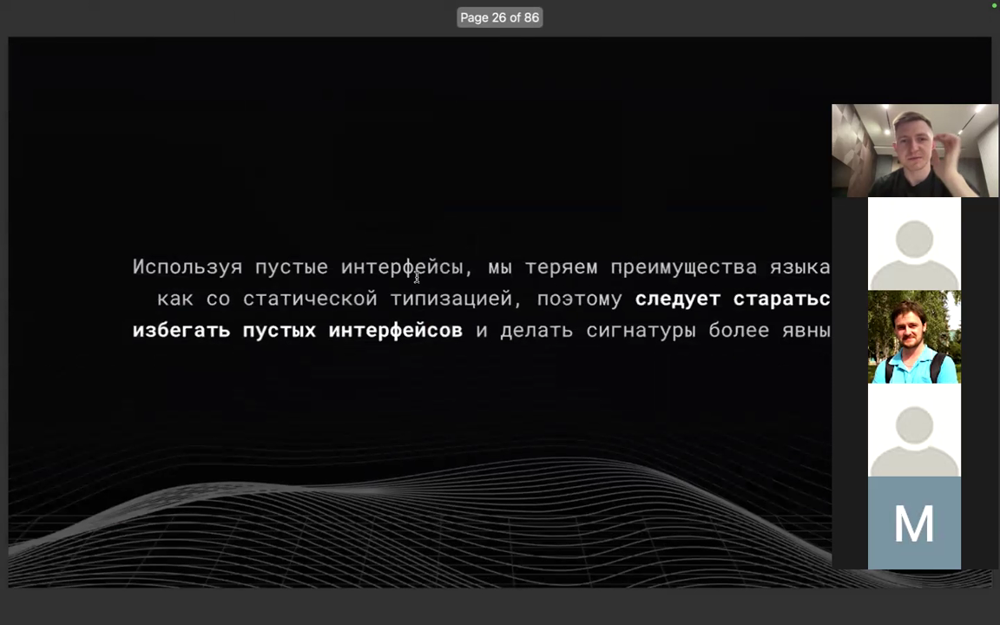
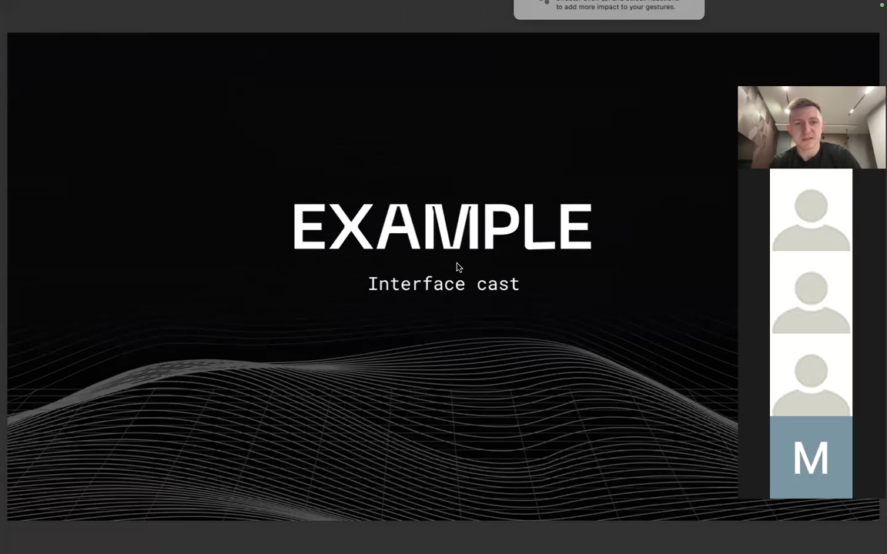
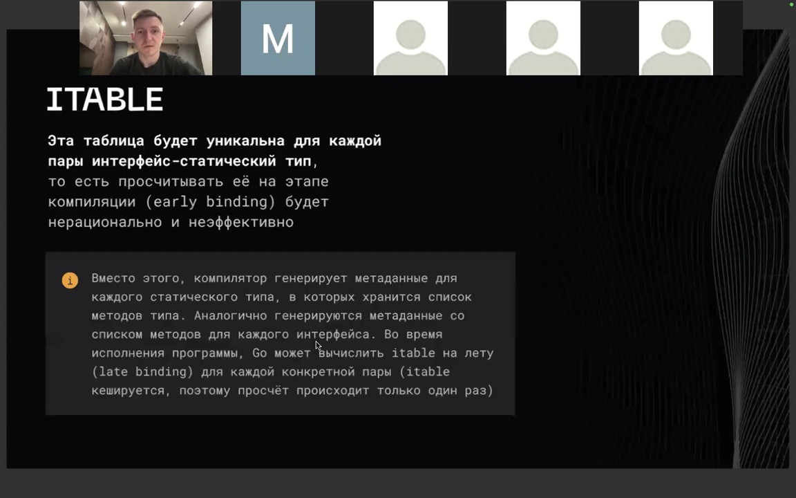
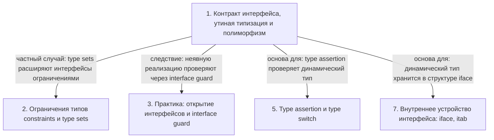

# Интерфейсы в Go: контракт, диспетчеризация и практика

> [!abstract] Обзор
> Материал об интерфейсах в Go: контракт поведения, неявная реализация, утиная типизация (duck typing) и полиморфизм. Разобраны статический и динамический типы, статическая и динамическая диспетчеризация, ограничения типов (constraints) с Go 1.18, пустой интерфейс и `any`. Рассмотрены сравнение и присваивание интерфейсов, type assertion и type switch, interface guard, а также внутреннее устройство — iface, itab, itable, late binding и девиртуализация (devirtualization). Отдельно затронуты типизированный nil в `error`, перехват паники в `fmt.Println`, открытие интерфейсов на стороне консюмера или производителя, DI-контейнер, ClientUpdater и пример обобщённого контейнера через `BSTItem`. Приведено сравнение с протоколами и extension в Swift, а также практические детали бенчмарков.

> [!info] Курс
> [[index|Оглавление курса]]

## Оглавление
1. [[#1. Контракт интерфейса, утиная типизация и полиморфизм]]
2. [[#2. Ограничения типов (constraints) и type sets]]
3. [[#3. Практика: открытие интерфейсов и interface guard]]
4. [[#4. Пустой интерфейс, сравнение и присваивание интерфейсов]]
5. [[#5. Type assertion и type switch]]
6. [[#6. Обобщённый контейнер через BSTItem]]
7. [[#7. Внутреннее устройство интерфейса: iface, itab, диспетчеризация]]
8. [[#8. Аллокация интерфейсов в куче и несравнимый ключ мапы]]
9. [[#9. ClientUpdater, DI-контейнер и регистрация singleton-типов]]
10. [[#10. Протоколы и extension в Swift]]
11. [[#11. Предотвращение инлайна в бенчмарке и глобальные переменные]]

**Схема** — [[#Схема]]
**Итог** — [[#Итог]]

## 1. Контракт интерфейса, утиная типизация и полиморфизм

**Интерфейс** — это контракт поведения, представленный в виде сигнатур методов; он должен быть минималистичным. Тип удовлетворяет интерфейсу неявно (**утиная типизация**: если у типа есть нужные методы, он реализует интерфейс), что обеспечивает неявную диспетчеризацию. **Полиморфизм** позволяет разным сущностям выполнять одни действия через интерфейс: например, `Dog` реализует `Duck`, а `Square` и `Rectangle` реализуют `Figure`. У интерфейса есть **статический тип** (тип интерфейса) и **динамический тип** (конкретная реализация, скрытая за интерфейсом); вызов метода на конкретном типе — статическая диспетчеризация, а через интерфейс — динамическая, разрешаемая в рантайме. Если интерфейсу присвоить указатель на тип со значением `nil`, интерфейс **не равен** `nil`, так как хранит динамический тип (пример с `error`).

```go
type Shape interface {
    Area() float64
    Perimeter() float64
}

type myErr struct{}

func (m *myErr) Error() string { return "oops" }

func main() {
	err := oops()
	if err != nil {
		fmt.Println("OMG! the error is not nil", err)
	}
}

func oops() error {
	var err *myErr

	if err == nil {
		fmt.Println("I am error and I am nil")
	}

	return err
}

type Duck interface {
    Talk() string
    Walk()
    Swim()
}

type Dog struct{}

func (d Dog) Talk() string {
    return "AAAGGGGRRR"
}

func CatchDuck(duck Duck) {
    fmt.Println("Catch")
}

func main() {
    dog := Dog{}
    CatchDuck(dog)
}

type Figure interface {
	Area() int
}

type Square struct {
	x int
}

func (s Square) Area() int {
	return s.x * s.x
}

type Rectangle struct {
	x int
	y int
}

func (r Rectangle) Area() int {
	return r.x * r.y
}

func main() {
	figures := []Figure{Square{10}, Rectangle{10, 20}}
	for _, figure := range figures {
		fmt.Println(figure.Area())
	}
}
```

*Источник: [00:01:08], [00:01:44], [00:03:25], [00:04:12], [00:05:02], [00:05:04], …*

> [!quote]- Кадр [00:01:44]
> 

> [!quote]- Кадр [00:03:25]
> 

## 2. Ограничения типов (constraints) и type sets

До Go 1.18 все типы интерфейсов можно было использовать как типы значений, но с Go 1.18 некоторые интерфейсы стали только **ограничениями типов (constraints)**. Не у всех интерфейсов можно создать переменную: для `Stringer` — да, для `AnyByteSlice` и `Unsigned` — нет. Интерфейс может содержать метод `String() string`, элемент `~[]byte` (все типы с базовым типом `[]byte`) и объединение типов через `|` (например, `uint | uintptr | uint8 | uint16 | uint32 | uint64`). Интерфейсы с объединением типов (type union) являются констрейнтами и не позволяют создать переменную своего типа. Запись `~[]byte` включает все типы, чей базовый тип (underlying type) — `[]byte`, а интерфейс `Unsigned` встраивает объединение типов.

```go
type Stringer interface {
	String() string
}

// Embeds all types whose underlying type is []byte
type AnyByteSlice interface {
	~[]byte
}

// Embeds type union
type Unsigned interface {
	uint | uintptr | uint8 | uint16 | uint32 | uint64
}

func main() {
	var stringer Stringer
	_ = stringer

	var any AnyByteSlice
	_ = any

	var unsigned Unsigned
	_ = unsigned
}
```

| Интерфейс | Переменная |
|---|---|
| Stringer | создаётся |
| AnyByteSlice | не создаётся |
| Unsigned | не создаётся |

*Источник: [00:02:07], [00:02:24], [00:04:12], [00:07:16], [00:10:46], [00:19:11], …*

> [!quote]- Кадр [00:02:07]
> 

## 3. Практика: открытие интерфейсов и interface guard

Интерфейс объявляется по потребности: Роб Пайк советовал не программировать интерфейсы, а открывать их. Интерфейс обычно объявляют локально в пакете-потребителе (на стороне **консюмера**) и делают приватным, вынося только нужные методы; из функций рекомендуется возвращать конкретные типы, а не интерфейсы. Интерфейс на стороне **производителя** встречается как исключение, например в стандартной библиотеке. Чтобы на этапе компиляции проверить, что тип удовлетворяет интерфейсу, используют **interface guard**: указатель на тип со значением `nil` присваивают переменной интерфейса (например, `var _ io.ReadWriter = (*T)(nil)`); если метод не реализован, код не скомпилируется. Такие объявления применяют редко и помечают комментарием «Interface guard».

```go
func Pipe() (*PipeReader, *PipeWriter)
func Copy(dst Writer, src Reader) (written int64, err error)

import "io"

type T struct {
}

// Interface guard
var _ io.ReadWriter = (*T)(nil)

func (t *T) Read(p []byte) (n int, err error) {
	return 0, nil
}

func (t *T) Write(p []byte) (n int, err error) {
	return 0, nil
}
```

> [!info] Зачем это нужно
> Интерфейс объявляют приватным, чтобы он не торчал из пакета; цель рекомендации возвращать конкретные типы — чтобы потребитель мог сам выбирать, использовать интерфейс или конкретный тип.

*Источник: [00:12:33], [00:13:37], [00:14:37], [00:15:37], [01:14:31], [01:16:32], …*

> [!quote]- Кадр [00:13:37]
> 

> [!quote]- Кадр [01:21:53]
> 

> [!quote]- Кадр [01:20:11]
> 

## 4. Пустой интерфейс, сравнение и присваивание интерфейсов

**Пустой интерфейс** не объявляет методов, поэтому ему удовлетворяет любой тип; `any` — это алиас пустого интерфейса. Такой контракт называют «самым резиновым», но он переносит проверки в рантайм и лишает преимуществ статической типизации. При сравнении интерфейсов сравниваются и значение, и тип, стоящие за интерфейсом; интерфейсы с одинаковым набором методов можно присваивать друг другу, только если они объявлены в одном пакете. Срезы интерфейсов и срезы конкретных типов (например, `[]int`) не приводятся напрямую — нужно создать новый срез `[]interface{}` и скопировать элементы поэлементно.

```go
package main

type Nothing interface{}

func main() {
	var nothing Nothing
	var empty interface{}
	var any any

	nothing = empty
	nothing = any

	empty = nothing
	empty = any

	any = nothing
	any = empty
}

package main

type A interface {
	Do()
}

type B interface {
	Do()
}

func main() {
	var a A
	var b B

	// Does not work with
	// different packages

	a = b
	b = a
}

var interfaces []interface{}
values := []int{100, 200, 300, 400, 500}

// interfaces = values -> compilation error

interfaces = make([]interface{}, len(values))
for idx := 0; idx < len(values); idx++ {
	interfaces[idx] = values[idx]
}
```

> [!info] Зачем это нужно
> Использование пустых интерфейсов приводит к потере преимуществ статической типизации.

*Источник: [00:16:08], [00:16:26], [00:16:33], [00:17:03], [00:17:33], [00:18:21], …*

> [!quote]- Кадр [00:19:11]
> 

> [!quote]- Кадр [01:08:55]
> 

## 5. Type assertion и type switch

При **type assertion** без boolean-флага несовпадение типа вызывает панику; boolean-флаг позволяет проверить тип безопасно. Type assertion требует, чтобы динамический тип удовлетворял интерфейсу; если имена методов совпадают, но сигнатуры различаются, возникает паника. Type assertion `x.(T)` проверяет `x != nil`: если `T` — не интерфейс, динамический тип `x` должен быть `T`; если `T` — интерфейс, динамический тип `x` должен реализовать `T`. **Type switch** выбирает первую подходящую ветку `case`, поэтому важен порядок; если ни один тип не подошёл, выполняется `default`. Type assertion и type switch работают с динамическим типом, позволяя узнать или выбрать конкретный тип за интерфейсом.

*Источник: [00:22:04], [00:22:31], [00:23:31], [00:24:13], [00:25:33], [00:26:39], …*

## 6. Обобщённый контейнер через BSTItem

Для обобщённого контейнера можно использовать интерфейсы; пример — обобщённое дерево. Тип **`BSTItem`** — интерфейс с методом `Less(BSTItem) bool`, задающий сравнение элементов, а узел `BSTNode` хранит `item` типа `BSTItem`. Чтобы дерево было обобщённым, хранимый элемент должен реализовывать интерфейс с методом `Less(BSTItem) bool`. Из оператора «меньше» можно вывести другие операторы: больше, равно, не равно. В Go нет перегрузки функций — вместо этого явно определяют несколько типов, соответствующих одному интерфейсу.

```
type BSTItem interface {
    Less(BSTItem) bool
}

type BSTNode struct {
    item BSTItem
    left *BSTNode
    right *BSTNode
}
```

*Источник: [00:31:45], [00:32:11], [00:32:13], [00:32:43], [00:33:17], [00:41:44]*

## 7. Внутреннее устройство интерфейса: iface, itab, диспетчеризация

В Go интерфейс представляется структурой **iface** с двумя указателями: `tab` на `itab` (дескриптор динамического типа) и `data` на значение; пустой интерфейс вместо `itab` хранит указатель на описание динамического типа. **itab** содержит указатель на таблицу виртуальных функций (набор методов) и конкретный тип; **itable** уникальна для каждой пары «интерфейс — статический тип». **Динамическая диспетчеризация** происходит через интерфейс: itable вычисляется в рантайме (late binding) и кешируется, а **девиртуализация** позволяет компилятору заменить вызов на статический, если конкретный тип известен. Метод — это обычная функция с неявным первым аргументом-ресивером; при вызове через интерфейс добавляется косвенный вызов по указателю. Структура при присваивании копируется, но временные значения не адресуемы.

```go
type iface struct {
	tab  *itab
	data unsafe.Pointer
}

package main

type BSTItem interface {
	Less(BSTItem) bool
}

type BSTNode struct {
	item  BSTItem
	left  *BSTNode
	right *BSTNode
}

type itab struct {
	inter *interfacetype
	_type *_type
	hash  uint32
	_     [4]byte
	fun   [1]uintptr
}
```

*Источник: [00:34:01], [00:34:59], [00:36:04], [00:36:34], [00:37:07], [00:37:45], …*

> [!quote]- Кадр [00:36:04]
> 

## 8. Аллокация интерфейсов в куче и несравнимый ключ мапы

Не всегда то, что вы скрываете за пустым интерфейсом или за другим интерфейсом, будет размещено в куче: это миф, который не соответствует действительности. В примере `num1` и `str1` попадают в кучу из-за пустого интерфейса; для проверки использован флаг escape-анализа. Объекты `num1` и `str1` escapes to heap, но интерфейс **не всегда** перемещает значение в кучу. Срез является несравнимым (не hashable) типом, поэтому его нельзя использовать в качестве ключа мапы — при запуске программа упадёт в панике; если ключ имеет тип пустого интерфейса, на этапе компиляции это не проверяется, и ошибка проявляется только в рантайме.

*Источник: [01:09:57], [01:10:52], [01:11:34]*

## 9. ClientUpdater, DI-контейнер и регистрация singleton-типов

`ClientUpdater` создаётся конструктором `NewClientUpdater`. `ClientUpdater` хранит в поле `repository` тип `clientUpdater` и является обёрткой над репозиторием. Метод `UpdateClient` просто делегирует вызов `s.repository.UpdateClient(client)`. **DI-контейнер (dependency injection)** резолвит зависимости: тип регистрируется по имени, затем резолвится по этому имени, и создаётся объект; возвращается пустой интерфейс. Метод `registerSingleToneType` позволяет при регистрации типа всегда возвращать один и тот же объект (singleton).

```go
package service

type ClientUpdater struct {
	repository clientUpdater
}

func NewClientUpdater(repository clientUpdater) ClientUpdater {
	return ClientUpdater{
		repository: repository,
	}
}

func (s *ClientUpdater) UpdateClient(client entity.Client) error {
	return s.repository.UpdateClient(client)
}
```

*Источник: [01:29:36], [01:31:30], [01:31:54]*

## 10. Протоколы и extension в Swift

**Протокол-ориентированное программирование** — это примерно то же самое, что программирование через интерфейсы, но с нюансами. В Swift то, что в ООП называется интерфейсом, называется **протоколом**. В Go внутри интерфейса нельзя создать дефолтное поведение метода. В Swift через **extension** можно создать дефолтную реализацию методов — с использованием дженериков или без них. При использовании extension для протокола или класса диспетчеризация переводится на статическую.

*Источник: [01:51:01], [01:52:01], [01:53:01]*

## 11. Предотвращение инлайна в бенчмарке и глобальные переменные

В бенчмарке предотвращается инлайн: методы структур помечаются так, чтобы они не инлайнились. Можно сделать приведение типа с флагом, а можно без флага, если сразу понятно, что объект нужного типа. В бенчмарке используются глобальные переменные, чтобы «обдурить» компилятор.

*Источник: [00:47:07], [00:52:22]*

## Схема



## Итог

> [!success] Что в итоге
> Интерфейс в Go задаёт контракт поведения через сигнатуры методов и реализуется неявно; утиная типизация и полиморфизм позволяют скрывать за ним разные реализации. Внутренне интерфейс — это iface с указателями на itab и данные, а itable, late binding и девиртуализация обеспечивают динамическую диспетчеризацию. Пустые интерфейсы переносят проверки в рантайм, а типизированный nil в `error` показывает, что интерфейс с динамическим типом не равен nil. На практике интерфейсы открывают по потребности — на стороне консюмера или производителя, а с Go 1.18 часть интерфейсов стала ограничениями.
