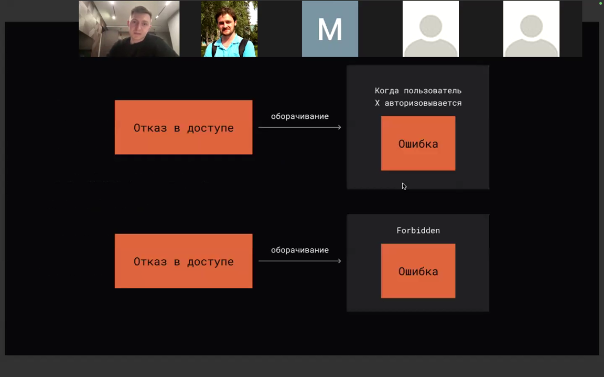
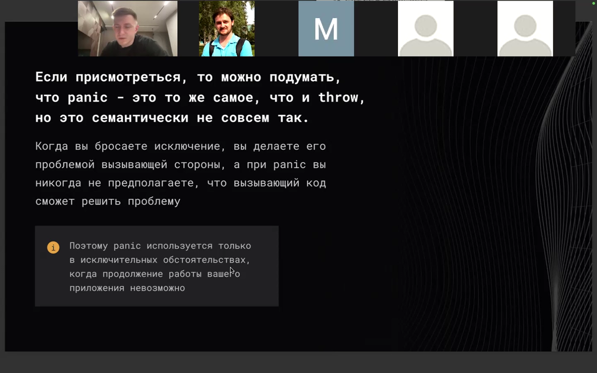
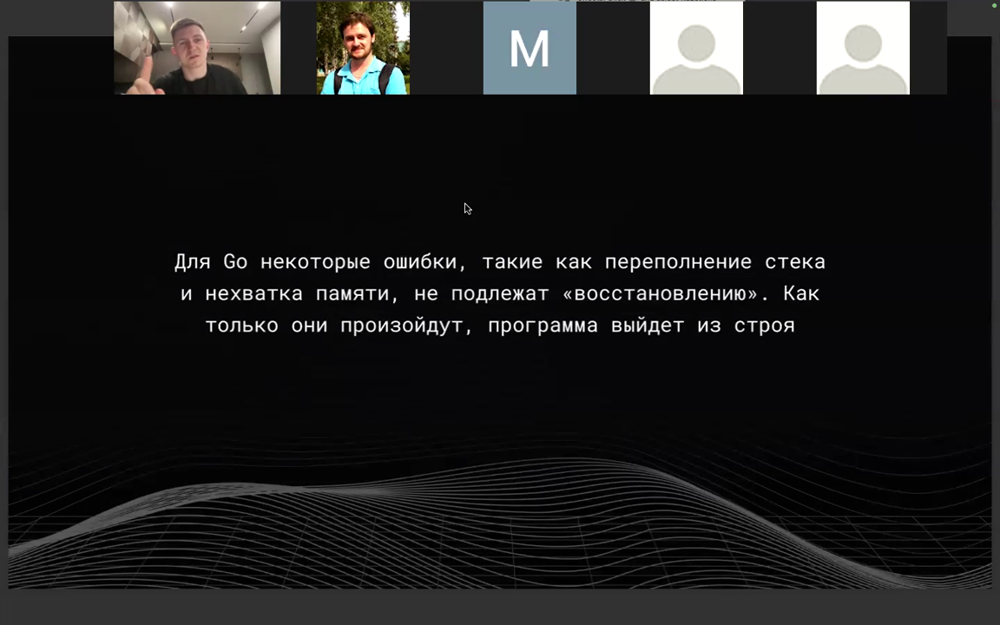
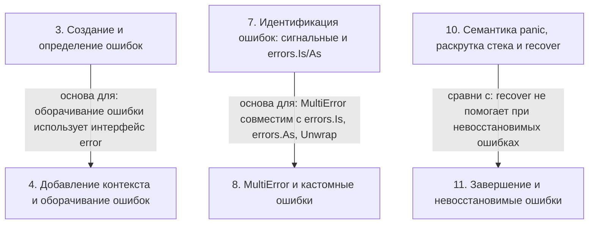

# Обработка ошибок и panic в Go

> [!abstract] Обзор
> Материал об обработке ошибок и panic в Go. Рассматриваются способы сообщать о результате операции — флаг true/false, статус по указателю, структура `Optional[T]`, а также глобальные переменные как способ обозначить ошибку без засорения сигнатуры. Разбираются интерфейс `error`, создание ошибок через `errors.New` и `fmt.Errorf`, именование и текст ошибок, добавление контекста и оборачивание, стектрейсы стандартными средствами и через пакет `github.com/pkg/errors`, сигнальные (дозорные) ошибки и определение типа через type switch. Отдельно — `errors.Is` и `errors.As`, рекурсивный разворот через `Unwrap`, стоимость оборачиваний, MultiError, `defer` и ошибки закрытия, декорирующие функции для логов и метрик. В части о panic: почему в Go нет исключений, чем panic отличается от throw, когда его применяют и как при панике происходит раскрутка стека (stack unwinding) с вызовом `defer`; описаны перехват через `recover`, завершение горутины через `runtime.Goexit()` и `os.Exit`, паники времени выполнения и невосстановимые ошибки, `panic(nil)`, одна паника на функцию и антипаттерн «паникджамп». Также затронуты кастомные ошибки, MultiError/AppendError, тип `Optional[T]`, принцип «ошибки — часть публичного API» и профилирование как поиск затыков.

> [!info] Курс
> [[index|Оглавление курса]]

## Оглавление
1. [[#1. Флаг и статус как индикатор ошибки]]
2. [[#2. Optional]]
3. [[#3. Создание и определение ошибок]]
4. [[#4. Добавление контекста и оборачивание ошибок]]
5. [[#5. Стектрейс и накладные расходы]]
6. [[#6. Профилирование и бенчмарки]]
7. [[#7. Идентификация ошибок: сигнальные и errors.Is/As]]
8. [[#8. MultiError и кастомные ошибки]]
9. [[#9. defer, ошибки закрытия, логирование и декорирующие функции]]
10. [[#10. Семантика panic, раскрутка стека и recover]]
11. [[#11. Завершение и невосстановимые ошибки]]
12. [[#12. Особые случаи panic: nil, одна паника на функцию и паникджамп]]
13. [[#13. Ошибки как публичный API]]

**Схема** — [[#Схема]]
**Итог** — [[#Итог]]

## 1. Флаг и статус как индикатор ошибки

Самый простой способ сообщить о результате операции — вернуть флаг со значениями `true`/`false`. `false` означает, что что-то пошло не так и произошла ошибочная ситуация, то есть флаг является индикатором ошибки. `true-false` хранит только два состояния, и лишь одно из них ошибочное, поэтому если ошибка может возникнуть по нескольким причинам, `true-false` не всегда работает. Концепция флагов расширяется до **статусов**: зарезервированные константы и значения говорят о том, что что-то пошло не так. Первый способ работы со статусом — возвращать статус, второй — принимать статус по указателю, а затем его менять. Пример `divideV2` принимает `lhs`, `rhs` и указатель `status`: при `rhs == 0` устанавливает `*status = ZeroNumberErr` и возвращает 0; если `lhs%2 == 0` или `rhs%2 == 0` — `*status = EvenNumberErr` и возвращает 0; иначе `*status = OkStatus` и возвращает `lhs / rhs`.

```go
func divideV2(lhs, rhs int, status *int) int {
	if rhs == 0 {
		*status = ZeroNumberErr
		return 0
	} else if lhs%2 == 0 || rhs%2 == 0 {
		*status = EvenNumberErr
		return 0
	}

	*status = OkStatus
	return lhs / rhs
}

func main() {
	x := 100
	y := 0

	value, status := divideV1(x, y)
	fmt.Println(value, status)

	value = divideV2(x, y, &status)
	fmt.Println(value, status)
}
```

*Источник: [00:01:48], [00:02:38], [00:03:23], [00:03:47]*

## 2. Optional

`Optional` — структура данных, которая позволяет проверить, есть ли значение, и получить его. Она использует обобщения (generics): тип `T` может быть любым другим типом. Тип `Optional[T any]` хранит `value` типа `T` и флаг `present`: `NewOptional` создаёт `Optional` с `present=true`, `HasValue` возвращает `present`, а `Value` возвращает `value`. Если в конструктор `Optional` передать значение, `present` выставляется в `true`, и `HasValue` вернёт `true`; если результат представлен нулём, возвращается «no optional», и `HasValue` вернёт `false`.

```go
type Optional[T any] struct {
	value   T
	present bool
}

func NewOptional[T any](value T) Optional[T] {
	return Optional[T]{
		value:   value,
		present: true,
	}
}

func (o *Optional[T]) HasValue() bool {
	return o.present
}

func (o *Optional[T]) Value() T {
	return o.value
}
```

*Источник: [00:03:49], [00:06:48]*

## 3. Создание и определение ошибок

В Go `error` — это интерфейс с единственным методом `Error() string`; чтобы структура подходила интерфейсу, у неё должен быть метод `Error`. Создавать отдельный тип ошибки имеет смысл, когда нужен дополнительный контекст; такой тип реализует интерфейс `error`. Стандартные способы создания ошибки — `errors.New` с текстом ошибки или `fmt.Errorf`. Переменные ошибок принято начинать с `err`/`Err`, а собственные типы — заканчивать на `Error`; текст ошибки пишут с маленькой буквы. При обработке ошибок функция либо возвращает что-то дополнительно, либо принимает параметр, что засоряет сигнатуру; чтобы не засорять сигнатуру, можно использовать глобальные переменные, при которых сигнатура не меняется. Глобальные ошибки изменяемы, а чтобы ошибка вела себя как константа, делают type definition для типа `string` и реализуют метод `Error` — такую ошибку нельзя изменить, но можно присваивать и сравнивать.

```go
func createErrV1() error {
	return errors.New("some error")
}

func createErrV2() error {
	return fmt.Errorf("some error")
}
```

> [!info] Зачем это нужно
> Чтобы ошибка вела себя как константа и её нельзя было изменить.

*Источник: [00:05:01], [00:05:51], [00:07:07], [00:07:47], [00:08:15], [00:11:56], …*

## 4. Добавление контекста и оборачивание ошибок

Ошибке может потребоваться дополнительный контекст, чтобы было понятно, что именно произошло; сообщение должно быть максимально подробным и однозначно характеризовать место возникновения. Ошибка обрабатывается один раз в одном месте: если есть возможности и ответственность — там, иначе пробрасывают; при пробрасывании можно проксировать или добавить контекст, но бессмысленный контекст не нужен. С Go 1.13 команда `%w` возвращает новую ошибку с методом `Unwrap`, создавая отдельный тип; такая упаковка делает ошибку доступной для `errors.Is` и `errors.As`, а обёрнутую ошибку можно обернуть снова. При оборачивании создаётся отдельный тип ошибки с методом `Unwrap`; вызов `Unwrap` разворачивает ошибку, при этом исходная ошибка не обязана иметь метод `Unwrap`. `Unwrap` — это интерфейс, его можно реализовать на чём угодно. При оборачивании через `%w` нужно передавать именно ошибку, а не строку: если передать строку, при разворачивании обёртки возвращается `nil`.

*Источник: [00:07:29], [00:13:57], [00:25:49], [00:26:24], [00:26:54], [00:27:26], …*

## 5. Стектрейс и накладные расходы

**Стектрейс** из ошибки нельзя получить стандартными средствами: стандартные ошибки такого не позволяют. Некоторые разработчики всегда добавляют стектрейс к тексту ошибки и считают, что стектрейс никогда не лишний. При создании ошибки в конструкторе собирается стек вызова на текущий момент, а при печати ошибки форматирование корректно распечатывает этот стек. Существует отдельный пакет `errors` в `github.com/pkg/errors`, в котором точно такие же ошибки: ошибка создаётся через `errors.New`, а для вывода ошибки используется `fmt.Printf` с форматом `%+v`. Снятие стектрейса при логировании не бесплатно и даёт дополнительный overhead; в горячих местах кода накладные расходы могут быть немалыми, поэтому это нужно иметь в виду, не отказываясь от стектрейсов полностью.

```
go get github.com/pkg/errors
```

*Источник: [00:15:12], [00:15:33], [00:17:21]*

## 6. Профилирование и бенчмарки

Профилировать не равно оптимизировать: **профилирование** — это поиск мест, где возникают затыки. В бенчмарке цикл выполняется `b.N` раз; на каждой итерации файл читается через `ioutil.ReadFile`, а при ошибке вызывается `b.Fatal(err)`.

```go
for i := 0; i < b.N; i++ {
	_, err = ioutil.ReadFile("performance_test.go")
	if err != nil {
		b.Fatal(err)
	}
}
```

*Источник: [00:17:46], [01:33:22]*

## 7. Идентификация ошибок: сигнальные и errors.Is/As

**Сигнальная (дозорная) ошибка (sentinel error)** — это глобальная переменная, которую резервируют, присваивают значение и сравнивают с возникшей ошибкой; проверка `error == sentinel` работает, пока ошибка действительно равна, но если добавить контекст и забыть поменять условие, проверка перестаёт работать. В Go ошибку принято возвращать последним значением; для сравнения используют сигнальные ошибки, отдельные типы или сравнение по поведению, при этом сигнальные ошибки и публичные типы создают зависимость между пакетами. Иногда сигнальные ошибки специально оборачивают без контекста, чтобы их не сравнивали через `==` или type assertion. Тип ошибки можно определять через `switch err := err.(type)` или type assertion к интерфейсу для сравнения по поведению. `errors.As` рекурсивно разворачивает ошибку и находит соответствие по типу, `errors.Is` — по значению; `errors.Is` применяется для обёрнутых ошибок и рекурсивно вызывает `Unwrap`, пока не найдёт нужный тип или не встретит `nil`. Рекомендуется по умолчанию всегда использовать `errors.Is` и `errors.As`, потому что код со временем меняется. Если ошибка обёрнута, прямое сравнение с сигнальной ошибкой даёт `false`; разворачивание линейно зависит от количества оборачиваний и не бесплатно. В примере тип `DatabaseError` с методом `Error() string` проверяется через `errors.As(err, &DatabaseError{})`: если проверка успешна, выводится `err.Error()`, иначе — `"unknown error"`.

```go
import (
    "fmt"
)

type DatabaseError struct{}

func (d DatabaseError) Error() string {
    return "database error"
}

func GetDataFromDB() error {
    return fmt.Errorf("failed to get data: %w", nil)
}

func main() {
    err := GetDataFromDB()
    if errors.As(err, &DatabaseError{}) {
        fmt.Println(err.Error())
    } else {
        fmt.Println("unknown error")
    }
}
```

| Функция | Что проверяет | Разворот |
|---|---|---|
| errors.Is | соответствие по значению | рекурсивно |
| errors.As | соответствие по типу | рекурсивно |

> [!info] Зачем это нужно
> Цель — чтобы на принимающей стороне никто не сравнил ошибку через `==` или type assertion. Рекомендуется всегда использовать `errors.Is` и `errors.As`, потому что код со временем меняется и можно посадить ненужный баг.

*Источник: [00:11:56], [00:18:45], [00:22:13], [00:23:10], [00:31:27], [00:31:52], …*

> [!quote]- Кадр [00:31:27]
> 

## 8. MultiError и кастомные ошибки

**Кастомные ошибки** создаются как enum и идентифицируются по кейсам; при возникновении ошибки выполняется `switch` по ней, чтобы обработать конкретный кейс. **MultiError** — отдельный пакет и тип (структура), представляющий механизм для создания списка ошибок при нескольких ошибочных ситуациях; у него есть метод `Error() string`. Пакет multi-error полностью совместим с `errors.Is`, `errors.As` и `Unwrap`: вы создаёте ошибку, с помощью `append` добавляете в список, затем оборачиваете. Даже когда функция возвращает multi-error, у него есть метод `Error`. Проверять ошибку на многих уровнях через повторяющиеся `if error` загромождает код. В разных источниках встречаются оба имени: `Append` и `AppendError`.

```go
type MultiError struct { ... }
func (e *MultiError) Error() string       // вернуть текст ошибки
func Append(err error, errs ...error) *MultiError // добавить ошибку к существующей

type MultiError struct { ... }

func (e *MultiError) Error() string // вернуть текст ошибки
func AppendError(err, errs ...error) *MultiError // добавить ошибку к существующей
```

> [!info] Зачем это нужно
> Когда нужно обработать весь срез, хотя на отдельных элементах могут быть сбои.

*Источник: [00:50:44], [00:51:07], [01:29:21], [01:29:36], [01:30:21], [01:30:55]*

## 9. defer, ошибки закрытия, логирование и декорирующие функции

В `defer` может возвращаться ошибка, например от `close`: в `getBalance` отложенная функция закрывает `rows` только при наличии ошибки, а присвоение `err = rows.Close()` перезаписывает значение `err`. Если открыть файл или захватить mutex без `defer`, то при панике в критической секции ресурс не освободится, даже если паника перехвачена. Ошибку в `defer` лучше проигнорировать явно, а не неявно, — чтобы у читателя кода не возникало вопросов, что ошибку просто забыли обработать. Логирование или метрики при `error != nil` в `defer` возможны, но это засоряет функцию; того же можно добиться декорирующими функциями или функциями-обёртками. Сообщение об ошибке не должно быть слишком большим: в больших системах логи стоят достаточно дорого, поэтому логированием лучше не злоупотреблять.

```go
package main

import "database/sql"

func getBalance(database *sql.DB, clientId int) (balance float32, err error) {
	query := "..."
	var rows *sql.Rows
	rows, err = database.Query(query, clientId)
	if err != nil {
		return 0, err
	}

	defer func() {
		if err != nil {
			err = rows.Close()
		}
	}()

	// reading...
	return balance, err
}
```

> [!info] Зачем это нужно
> Чтобы не засорять функцию.

*Источник: [00:09:39], [00:10:39], [00:54:21], [00:55:07], [00:56:18], [00:56:20], …*

## 10. Семантика panic, раскрутка стека и recover

В Go нет исключений; вместо этого предпочтительно использовать явную обработку ошибок. `panic` семантически отличается от `throw`: при `throw` исключение становится проблемой вызывающей стороны, а при `panic` вызывающий код не предполагается способным решить проблему, поэтому `panic` используется только в исключительных обстоятельствах, когда продолжение работы невозможно. `panic` принимает пустой интерфейс; при возникновении паники Go приостанавливает выполнение функции, начинается **раскрутка стека (stack unwinding)**, которая продолжается до завершения приложения, если паника не восстановлена, и во время неё вызываются `defer`-функции. `recover` перехватывает панику и возвращает её аргумент; его нужно вызывать внутри `defer`, иначе раскрутка стека не сработает и панику не перехватить, а после перехвата выполнение продолжается после выхода из функции, где сработал `defer`. Паники можно перепробрасывать: восстановить, выполнить операции (например, залогировать) и снова пробросить ту же панику. При возврате ошибки код может продолжаться, а раскрутка стека не бесплатна; использование паники считается неправильным и является антипаттерном.

```go
package main

import "fmt"

func main() {
	defer func() {
		if r := recover(); r != nil {
			fmt.Println("Recovered:", r)
		}
	}()
	panic("jump")
}
```

*Источник: [01:01:29], [01:02:29], [01:02:51], [01:04:18], [01:04:36], [01:05:14], …*

> [!quote]- Кадр [01:02:29]
> 

## 11. Завершение и невосстановимые ошибки

`runtime.Goexit()` завершает горутину, которая его вызвала, не затрагивая другие горутины; он выполняет все отложенные вызовы перед завершением, и так как это не паника, `recover` в отложенных функциях вернёт `nil`. Вызов `runtime.Goexit` в `main` приводит к `fatal error: no goroutines (main called runtime.Goexit) - deadlock!`; при завершении приложения через `os.Exit` никакие `defer` не вызываются. При разыменовании nil-указателя вылетает паника, которую можно зарекаверить; деление на ноль для вещественных типов не паникует, а даёт плюс бесконечность. Некоторые ошибки не подлежат восстановлению: переполнение стека и нехватка памяти — как только они произойдут, программа выйдет из строя.

```
runtime.Goexit() terminates the goroutine that calls it.
No other goroutine is affected. runtime.Goexit() runs
all deferred calls before terminating the goroutine.
Because runtime.Goexit() is not a panic, any recover
calls in those deferred functions will return nil.
```

*Источник: [01:13:05], [01:13:30], [01:15:31], [01:16:22], [01:16:59], [01:19:15], …*

> [!quote]- Кадр [01:19:15]
> 

## 12. Особые случаи panic: nil, одна паника на функцию и паникджамп

В `panic` можно передать любое значение, включая `nil`, и это отработает корректно; при `recover` после `panic(nil)` печатается сообщение, эквивалентное явно созданному объекту `runtime.panic.nil.error`: для `panic(nil)` зарезервирован некоторый тип. Функция в любой момент времени может быть ассоциирована не более чем с одной необработанной паникой: если в `defer` вылетает ещё одна паника, она подменяет текущую. Выход из большой последовательности вложенных циклов или функций может осуществляться с помощью panic и recovery — такой выход называется **«паникджамп»**; это антипаттерн, так лучше не делать.

```go
func panicNil() {
	defer func() {
		fmt.Println("recovered:", recover())
	}()

	panic(nil)
}
```

*Источник: [01:19:35], [01:22:34], [01:23:00]*

> [!quote]- Кадр [01:22:34]
> 

## 13. Ошибки как публичный API

**Ошибки — это часть публичного API вашего пакета.** Относиться к ним нужно так же бережно, как и к любой другой части публичного API.

*Источник: [00:49:26], [00:53:37], [01:01:29], [01:03:36], [01:06:52], [01:07:33], …*

> [!quote]- Кадр [00:49:26]
> 

> [!quote]- Кадр [00:53:37]
> 

## Схема



## Итог

> [!success] Что в итоге
> Сообщать о результате операции можно флагом `true`/`false`, статусом по указателю или через глобальные переменные, которые не засоряют сигнатуру функции. В Go ошибка описывается интерфейсом `error` с единственным методом `Error() string`, а собственный тип ошибки создают, когда нужен дополнительный контекст; ошибку принято возвращать последним значением и обрабатывать один раз в одном месте. Для стектрейса стандартных средств недостаточно, поэтому используется пакет `github.com/pkg/errors`, помня о накладных расходах снятия стектрейса; сигнальные ошибки позволяют распознавать конкретную ошибку, а упаковка через `%w` и метод `Unwrap` дают доступ к `errors.Is` и `errors.As`. `panic` применяется только в исключительных ситуациях, прерывает выполнение и запускает раскрутку стека с вызовом `defer`, где панику можно перехватить через `recover` и перепробросить; завершение горутины через `runtime.Goexit()` выполняет `defer`, а `os.Exit` — нет; часть паник времени выполнения можно зарекаверить, а переполнение стека и нехватка памяти восстановлению не подлежат.
