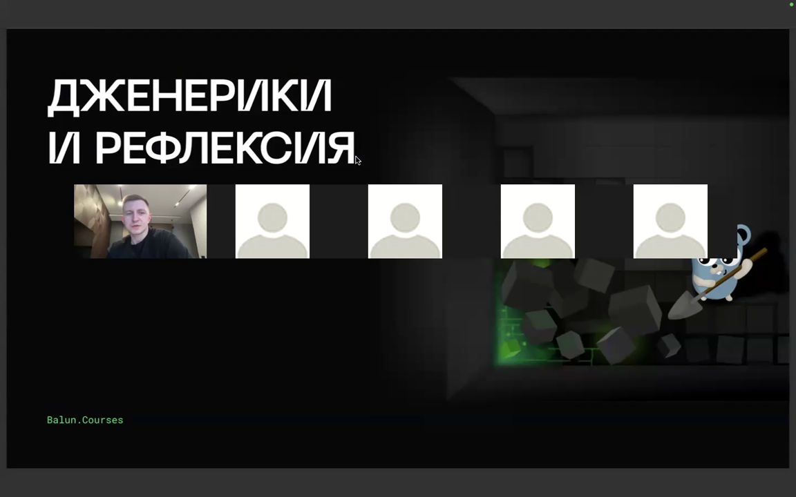
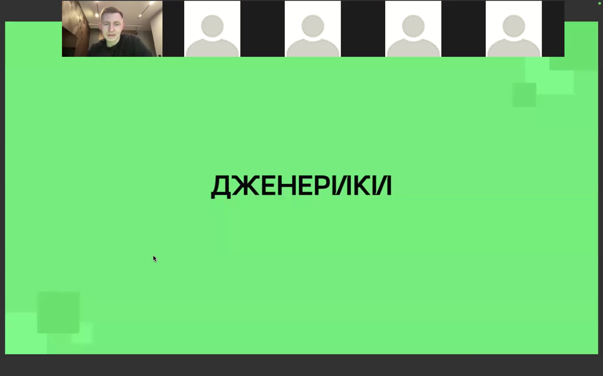
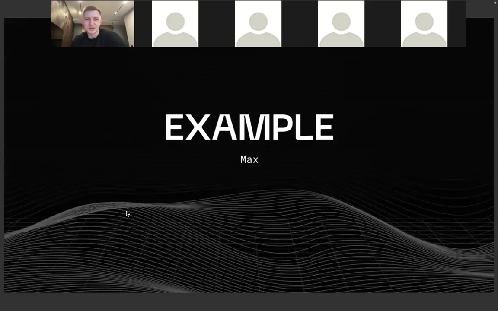
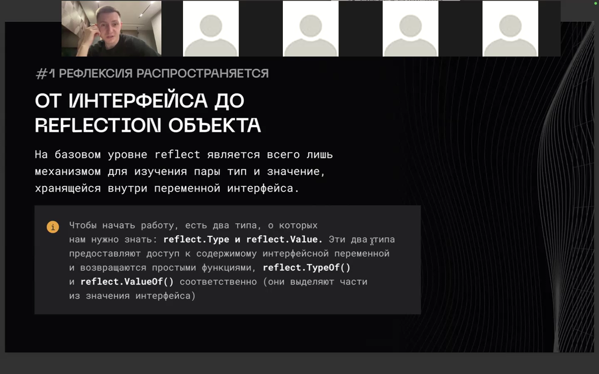
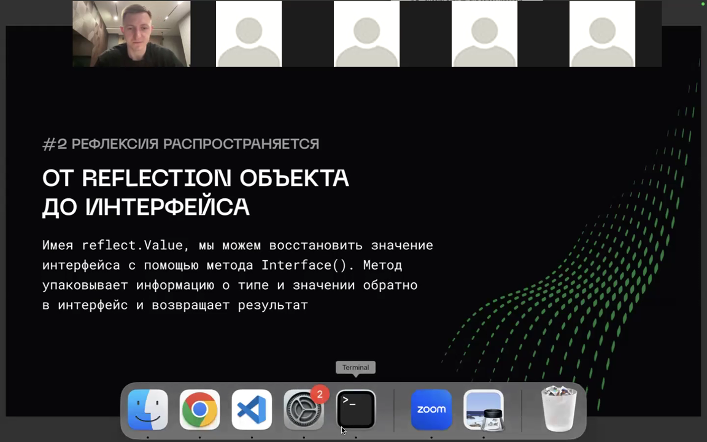
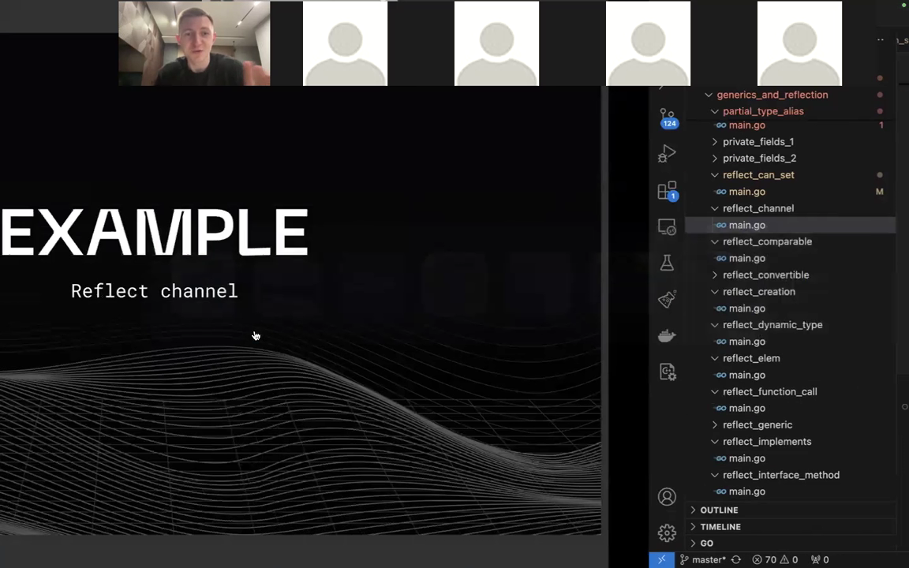
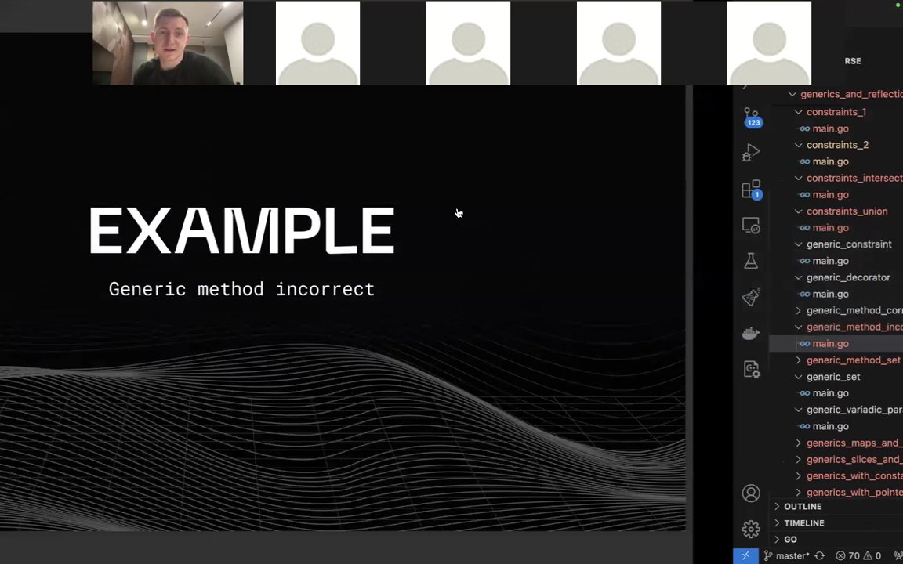
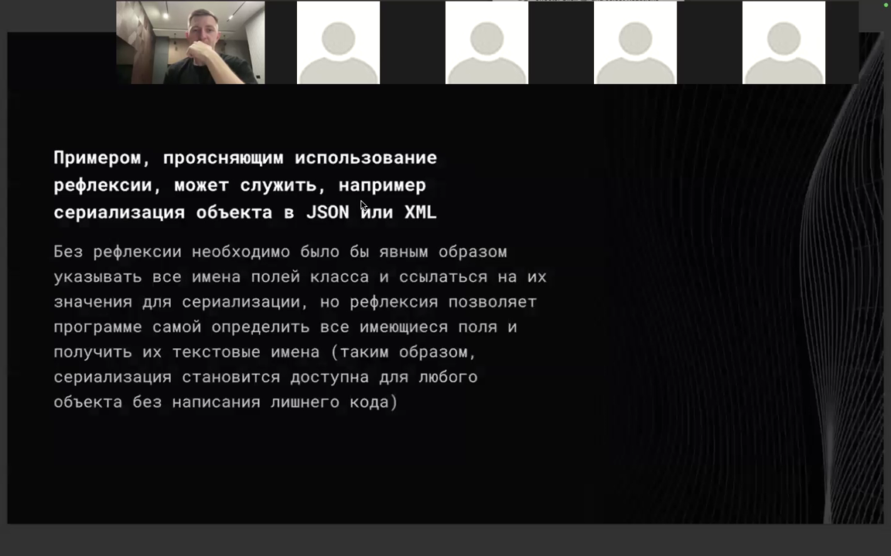
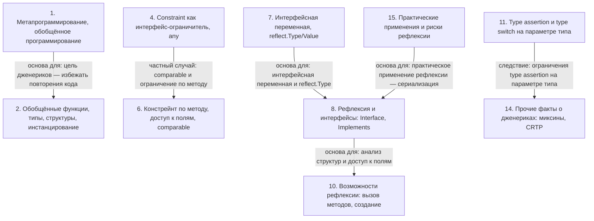

# Дженерики и рефлексия в Go

> [!abstract] Обзор
> Материал объединяет конспекты по дженерикам (generics) и рефлексии в Go. Дженерики — это метапрограммирование на этапе компиляции, а рефлексия — на этапе runtime. Рассмотрены цель дженериков, обобщённое программирование, обобщённые функции, типы и структуры, инстанцирование (instantiation) и его цена. Отдельно разобраны ограничения типов: constraint-интерфейсы, `any`, перечисление типов, зарезервированные констрейнты, Alias и TypeDefinition, тильда, правила AND/OR, констрейнты по методам, `comparable`, вывод типов (type inference). В части рефлексии — работа поверх интерфейса, восстановление интерфейса через `Interface()`, проверка реализации через `Implements`, анализ структур, теги и доступ к полям, копирование и устанавливаемость значений, метод `Elem`, вызов методов, создание структур, каналы и `select`, сериализация. Показаны совместное использование рефлексии и дженериков, практические применения и риски рефлексии, `uintptr`/`unsafe.Pointer` и доступ к приватным полям.

> [!info] Курс
> [[index|Оглавление курса]]

## Оглавление
1. [[#1. Метапрограммирование, обобщённое программирование и цель дженериков]]
2. [[#2. Обобщённые функции, типы, структуры, инстанцирование, цена и размер бинарника]]
3. [[#3. Вывод типов, явное и частичное инстанцирование, порядок типовых параметров]]
4. [[#4. Constraint как интерфейс-ограничитель, any, перечисление типов, зарезервированные констрейнты и примеры]]
5. [[#5. Alias, TypeDefinition, тильда, конфликты int/~int и правила AND/OR]]
6. [[#6. Констрейнт по методу, доступ к полям, comparable и GetKeysGeneric]]
7. [[#7. Интерфейсная переменная, reflect.Type/Value, Kind и цель рефлексии]]
8. [[#8. Рефлексия и интерфейсы: Interface(), Implements, анализ структур, теги и доступ к полям]]
9. [[#9. Копирование, устанавливаемость значений и метод Elem()]]
10. [[#10. Возможности рефлексии: вызов методов, создание, каналы, select и возврат нескольких значений]]
11. [[#11. Type assertion и type switch на параметре типа; совместное использование рефлексии и дженериков]]
12. [[#12. Декоратор на дженериках]]
13. [[#13. Отсутствие обобщённых методов и замещение]]
14. [[#14. Прочие факты о дженериках: миксины, CRTP, ссылки на типы, atomic, ограничения, C++ и предостережение]]
15. [[#15. Практические применения и риски рефлексии]]
16. [[#16. uintptr, unsafe.Pointer, GC и доступ к приватным полям]]

**Схема** — [[#Схема]]
**Итог** — [[#Итог]]

## 1. Метапрограммирование, обобщённое программирование и цель дженериков

**Дженерики (generics)** в Go — это метапрограммирование на этапе компиляции, а **рефлексия** — метапрограммирование на этапе runtime. Дженерики появились в Go начиная с версии 1.18; до этого обобщённый код писали через интерфейсы, рефлексию, `unsafe` и кодогенерацию. Метапрограммировать можно в compile-time и в run-time: обобщённый код с использованием рефлексии работает не в compile-time, а в run-time, а дженерики в подавляющем большинстве случаев — в compile-time. При этом определение, какой тип данных пришёл в дженерик, делается только в run-time. Основная цель дженериков — избежать повторения кода и повысить возможность повторного использования; они подходят для обобщённых структур данных (куча, двоичное дерево, граф, контейнеры) и функций, работающих с контейнерами, срезами, картами, каналами любых типов, и не влияют на скорость в рантайме.

| Подход | Этап |
|---|---|
| generics | compile-тайм |
| рефлексия | run-тайм |

> [!info] Зачем это нужно
> Основная цель — избежать повторения кода, то есть повысить возможность повторного использования.

*Источник: [00:00:04], [00:00:46], [00:01:13], [00:01:51], [00:03:51], [00:04:50], …*

> [!quote]- Кадр [00:00:04]
> 

> [!quote]- Кадр [00:00:46]
> 

> [!quote]- Кадр [00:01:51]
> 

## 2. Обобщённые функции, типы, структуры, инстанцирование, цена и размер бинарника

Обобщённая функция использует обобщённые типы данных и пишется один раз; она принимает generic-параметр (тип), а компилятор создаёт код для конкретных типов. Во время исполнения программы обобщённых типов не существует — это абстракция только для написания кода. В Go обобщёнными могут быть не только функции, но и структуры, и type definition; есть встроенные универсальные типы `map` и `chan`. **Инстанцирование** обобщённого параметра выполняется на этапе компиляции: это обеспечивает проверку типов, сохраняет статическую типизацию и избегает overhead пустых интерфейсов, но замедляет компиляцию. В редких ситуациях Go может использовать интерфейс-бейс-подход (одна функция с пустым интерфейсом). Компилятор Go создаёт реализацию обобщённой функции под конкретный тип данных, поэтому программист этот код не пишет; дженерики — не синтаксический сахар: ассемблерный код дублируется для каждого типа, что может влиять на размер бинарника и время компиляции. Пример: тип `Creator[T any]` — функция без аргументов, возвращающая `T`; `NewInstance[T any]` принимает `Creator[T]`, вызывает `creator()` и возвращает `*T`.

```go
type Creator[T any] func() T

func NewInstance[T any](creator Creator[T]) *T {
	return creator()
}

type (
	Book struct{}
	Game struct{}
)

book := NewInstance(bookCreator)
game := NewInstance(gameCreator)

main.main STEXT size=123 args=0x0 locals=0x18 funcid=0x0 align=0x0
       0x0000 00000 (./x.go:6)  TEXT    main.main(SB), ABIInternal, $24-0
       0x0000 00000 (./x.go:6)  FUNCDATA        $0, gclocals·33cdeccccebe80329f1fdbee7f5874cb(SB)
       0x0017 00023 (./x.go:7)  CALL    fmt.Println(SB)
```

*Источник: [00:02:51], [00:04:52], [00:06:33], [00:08:33], [00:09:33], [00:20:08], …*

> [!quote]- Кадр [00:21:41]
> 

> [!quote]- Кадр [00:38:19]
> 

> [!quote]- Кадр [00:40:21]
> 

## 3. Вывод типов, явное и частичное инстанцирование, порядок типовых параметров

Вариадические параметры красиво сочетаются с дженериками: Go позволяет писать функции с вариадик-параметрами относительно generic-типа, при этом от вызова к вызову может приходить разное количество аргументов и разные типы данных, но в одном вызове аргументы всё равно одного типа. **Type inference (вывод типов)** пытается угадать, какой тип вы имели в виду, исследуя типы аргументов. Если обобщённой функции передать аргументы, Go может определить тип по параметрам функции; но для обобщённой функции `create`, возвращающей указательный тип, компилятор не может вывести тип по контексту присваивания, и тип нужно параметризовать явно. Со структурами вывод типов не работает: компилятор не может догадаться о типе данных, поэтому тип всегда нужно инстанцировать явно. В Go можно пропускать только типы данных, которые идут первыми; если порядок `[t, k, any]`, `int` подставляется в `any`, но это не сработает, потому что `comparable` и `any` — разные типы. Можно делать частичное инстанцирование.

```go
func GetKeysGeneric[K comparable, V any](data map[K]V) []K {
	keys := make([]K, 0, len(data))
	for key := range data {
		keys = append(keys, key)
	}

	return keys
}

// any -> alias for interface{}
// comparable -> constraint

func main() {
	GetKeysGeneric[int, int](map[int]int{})
}
```

*Источник: [00:23:09], [00:23:24], [00:24:19], [00:24:49], [00:25:19], [00:26:19], …*

## 4. Constraint как интерфейс-ограничитель, any, перечисление типов, зарезервированные констрейнты и примеры

**Constraint** — это интерфейс-ограничитель для обобщённого типа; в нём можно требовать наличия метода и удовлетворения интерфейсу, а также прямо на месте создать анонимный интерфейс, опустить конструкцию `interface{}` и явно перечислить типы. `any` — это алиас для пустого интерфейса; `any` не является интерфейсным типом, в дженериках `any` является constraint, и в качестве constraint `any` может выступать абсолютно любой тип данных. В Go есть зарезервированные констрейнты, например для комплексных чисел, чисел с плавающей точкой и целых чисел. В type switch нельзя перечислить конкретный тип вместе с интерфейсом, у которого есть методы, — перечисление типов работает, только если интерфейс не имеет поведения. Ограничение типа можно записать как объединение типов `int | int16 | int32 | int64` без ключевого слова `interface`; пример — `Process1[Z int | int16 | int32 | int64]`. Примеры: `ToString[T Stringer]` добавляет `values[idx].String()` в `result`; `Unsigned` объединяет `uint, uint8, uint16, uint32, uint64`, а `Do[E Unsigned, T SliceConstraint[E]]` принимает `E` и `T`.

```go
type Stringer interface {
    String() string
}

func ToString[T Stringer](values []T) string {
    result := make([]string, 0)
    for idx := range values {
        result = append(result, values[idx].String())
    }
    return result
}

// constraint
type Unsigned interface {
	uint | uint8 | uint16 | uint32 | uint64
}

type Slice[T any] []T

type SliceConstraint[E Unsigned] interface {
	Slice[E]
}

func Do[E Unsigned, T SliceConstraint[E]]() {
}

func Process1[Z int | int16 | int32 | int64](value Z) { // interfaces can be omitted
}

func Process2[T2 Integer2](value T2) {
}

// constraint
type Unsigned interface {
	uint | uint8 | uint16 | uint32 | uint64
}

type Slice[T any] []T

type SliceConstraint[E Unsigned] interface {
	Slice[E]
}

func Do[E Unsigned, T SliceConstraint[E]]() {
}
```

> [!info] Зачем это нужно
> Они позволяют ограничить обобщённую функцию не всеми возможными типами, а только нужными.

*Источник: [00:04:52], [00:05:52], [00:09:59], [00:13:18], [00:14:48], [00:15:34], …*

## 5. Alias, TypeDefinition, тильда, конфликты int/~int и правила AND/OR

**Alias** — это всего лишь псевдоним, а **TypeDefinition** — отдельный тип. **Тильда** (`~`) говорит, что параметр типа принимает указанные типы данных или типы, где указанный тип является базовым; для `MyInt` и `MyInt2` базовым типом является `int`, поэтому при использовании тильды всё компилируется. Использование `int` ограничивает тип только этим типом, а `~int` ограничивает все типы, базовым типом которых является целочисленный; если в ограничении типа указать и конкретный тип, и его базовый тип, возникает ошибка компиляции: нужно выбрать что-то одно. Если новое ограничение записано на новой строке, связь между ограничениями — как оператор «и»; если ограничения записаны на одной строке, связь между ними — как «или». Type definition и type alias позволяют прятать сложные дженерики за понятной абстракцией; для constraint можно давать отдельные псевдонимы или типы данных. В рефлексии между type definition и type алиасами есть разница: при алиасе и тип, и kind равны `int`; при отдельном type definition kind также равен `int`, но тип равен определённому типу. В Go 1.24 обобщёнными могут быть и алиасы; в версиях Go 1.22/1.23 обобщённые алиасы не поддерживаются.

```go
func Process1[Z int | int16 | int32 | int64](value Z) { // interfaces can be omitted
}

func Process2[T2 Integer2](value T2) {
}

type MyInt1 int
type MyInt2 MyInt1

type MyIntAlias1 = int
type MyIntAlias2 = MyIntAlias1

func IsInt1[T any](x T) bool {
	_, ok := any(x).(int)
	return ok
}

func IsInt2[T any](x T) bool {
	_, ok := x.(int) // cannot use type assertion on type parameter
	return ok
}
```

| Понятие | Значение |
|---|---|
| Alias | псевдоним |
| TypeDefinition | отдельный тип |

*Источник: [00:11:39], [00:12:39], [00:13:18], [00:14:20], [00:15:11], [00:16:18], …*

## 6. Констрейнт по методу, доступ к полям, comparable и GetKeysGeneric

Чтобы обобщённая функция могла вызывать метод у значения, тип данных должен быть ограничен наличием этого метода, например методом `String`. Даже если в constraint явно перечислены типы, в Go всё равно нельзя обращаться к полям обобщённого типа; чтобы обращаться к полям, придётся оборачивать их методами (getter/setter) и с использованием constraint явно указывать методы. Тип-параметр может иметь ограничение **`comparable`**, то есть быть сравниваемым: для него можно выполнять операции `==` и `!=`. `comparable` — зарезервированный constraint, означающий, что над типом можно выполнять сравнение на равенство и неравенство. В качестве ключа в обобщённой функции можно передать только сравнимый тип. Функция `GetKeysGeneric[K comparable, V any]` принимает `map[K]V` и возвращает `[]K`: `K` ограничен `comparable`, `V` — `any` (алиас `interface{}`); функция собирает ключи map в срез.

```go
func GetKeys(data map[string]int) []string {
	keys := make([]string, 0)
	for key := range data {
		keys = append(keys, key)
	}

	return keys
}

// any -> alias for interface{}
// comparable -> constraint
func GetKeysGeneric[K comparable, V any](data map[K]V) []K {
	keys := make([]K, 0, len(data))
	for key := range data {
		keys = append(keys, key)
	}

	return keys
}

func main() {
	GetKeys(map[string]int{})
	GetKeysGeneric[int, int](map[int]int{})
}
```

> [!info] Зачем это нужно
> Чтобы обобщённая функция могла вызывать метод у значения, тип данных должен быть ограничен наличием этого метода.

*Источник: [00:09:59], [00:11:01], [00:17:25], [00:18:23], [00:19:12], [00:19:23], …*

## 7. Интерфейсная переменная, reflect.Type/Value, Kind и цель рефлексии

**Интерфейсная переменная** содержит два указателя: itab и data. `reflect` — механизм для изучения пары «тип и значение», хранящейся внутри переменной интерфейса. `reflect.Type` и `reflect.Value` дают доступ к содержимому интерфейсной переменной и возвращаются функциями `reflect.TypeOf()` и `reflect.ValueOf()`; в рефлексии базово всего два типа: `reflect.Value` и `reflect.Type`. При вызове type of или value of аргумент принимается как `any`, что неявно преобразуется в пустой интерфейс, поскольку рефлексия работает с интерфейсами. Метод **`Kind`** возвращает значение, похожее на enum, которое описывает базовый тип данных, скрытый за reflect-объектом; это позволяет проверить тип во время выполнения — с его помощью выводятся `Kind`, `PkgPath`, имена методов и имена полей. Метод `Value` возвращает именно значение и действует на самый большой тип, который может содержать значение — например, при передаче значения это будет `int64`; при получении значения через рефлексию оно преобразуется в самый большой тип, даже если фактический тип — `uint8`, но информация о типе сохраняется. Планировалось, что любую операцию, выражаемую в Go без рефлексии, можно будет сделать с использованием рефлексии: например вызвать функцию, создать структуру, канал, написать `select`.

> [!info] Зачем это нужно
> Это важно при использовании Type Definition.

*Источник: [01:06:13], [01:06:42], [01:07:36], [01:08:09], [01:08:54], [01:15:28]*

> [!quote]- Кадр [01:06:13]
> 

## 8. Рефлексия и интерфейсы: Interface(), Implements, анализ структур, теги и доступ к полям

Рефлексия работает поверх интерфейса: происходит неявное преобразование в интерфейс, адрес памяти преобразуется в пустой интерфейс, и над ним выполняются методы рефлексии. Имея `reflect.Value`, можно восстановить значение интерфейса с помощью метода **`Interface()`**: метод упаковывает информацию о типе и значении обратно в интерфейс и возвращает результат. Чтобы проверить, реализует ли тип `Data` интерфейс `Interface`, получают `reflect.Type` обоих типов и вызывают `dataType.Implements(interfaceType)`; для типа данных используется `reflect.TypeOf(data)`, а для типа интерфейса — `reflect.TypeOf((*Interface)(nil)).Elem()`. С помощью рефлексии можно получить тип структуры, её kind, путь пакета, количество полей и обратиться к нужному полю; также можно получить количество методов, имя метода и количество входных и выходных параметров. `reflect.Value.Field(i)` возвращает значение i-го поля структуры по индексу: `v.Field(0)` печатает `Field1`, `v.Field(1)` — `Field2`. **Теги структуры** представляют собой набор ключей и значений; примеры тегов — `json` и `xml`.

```go
import (
	"fmt"
	"reflect"
)

type Interface interface {
	Method()
}

type Data struct{}

func (c Data) Method() {}

func main() {
	dataType := reflect.TypeOf(Data{})
	interfaceType := reflect.TypeOf((*Interface)(nil)).Elem()
	fmt.Println("implements:", dataType.Implements(interfaceType))
}

type Data struct {
	Count int
	Title string
}

func (d Data) Do() {}

func main() {
	data := Data{}
	tData := reflect.TypeOf(data)
	fmt.Println("Kind:", tData.Kind())
	fmt.Println("PkgPath:", tData.PkgPath())

	fmt.Println("NumField:", tData.NumField())
	fmt.Println("Field(0):", tData.Field(0).Name)
	fmt.Println("Field(1):", tData.Field(1).Name)

	fmt.Println("NumMethod:", tData.NumMethod())
	fmt.Println("Method(0):", tData.Method(0).Name)
	fmt.Println("Method(0).NumIn:", tData.Method(0).Type.NumIn())
}


type MyStruct struct {
	Field1 int
	Field2 string
}

func main() {
	v := reflect.ValueOf(MyStruct{Field1: 10, Field2: "Hello"})
	fmt.Println(v.Field(0))
	fmt.Println(v.Field(1))
}
```

*Источник: [01:05:13], [01:10:03], [01:10:26], [01:10:28], [01:15:02], [01:16:32], …*

> [!quote]- Кадр [01:10:26]
> 

## 9. Копирование, устанавливаемость значений и метод Elem()

При работе с `reflect` везде происходит копирование: при получении value-of переменная неявно преобразуется в пустой интерфейс, а `reflect can set` возвращает `false`, потому что value копируется. **Устанавливаемость (settable)** — свойство, при котором reflection-объект может изменить хранимое значение, использованное при создании reflection-объекта; чтобы изменить объект, значение должно быть устанавливаемым, и нужно предоставить библиотеке указатель на значение. Передача самого объекта даёт копию, а над копией модифицирующие операции запрещены: попытка set выдаёт панику `Using unaddressable value`. Даже если передан указатель, его копия не позволяет модифицировать объект: `can set` и `can address` возвращают `false`. Метод **`Elem`** разыменовывает указатель, после чего `can set` и `can address` возвращают `true`, и изменение значения отражается на самом объекте. При работе с рефлексией используется интерфейс с неявным указателем, поэтому, чтобы добраться до значения, нужно использовать дополнительный `Elem` и разыменовывать несколько раз: `reflect.ValueOf(&x)` даёт Value указателя на интерфейс, а последовательные вызовы `Elem()` разыменовывают указатель на интерфейс, затем указатель внутри интерфейса, затем сам `int`, и на последнем значении вызывается `Set`. Вызов `ValueOf` у `nil` работает корректно и печатает, что значение невалидно; вызов `ValueOf` у nil-среза с обращением по индексу 0 также работает корректно, но при повторном разыменовании элемента возникает паника.

```go
import (
	"fmt"
	"reflect"
)

func main() {
	var z = 100
	var y = &z
	var x interface{} = y

	v := reflect.ValueOf(&x)
	vx := v.Elem()
	vy := vx.Elem()
	vz := vy.Elem()

	fmt.Println(vx, vy, vz)
	vz.Set(reflect.ValueOf(200))
	fmt.Println(vx, vy, vz)
}
```

*Источник: [01:10:03], [01:10:45], [01:11:51], [01:12:15], [01:12:51], [01:13:52], …*

## 10. Возможности рефлексии: вызов методов, создание, каналы, select и возврат нескольких значений

Создаётся объект, преобразуется в Reflection-объект, ищется метод по имени и вызывается при помощи метода `Call` с передачей аргументов; `reflect.Value.MethodByName` находит метод по имени, `Call([]reflect.Value{})` вызывает его без аргументов, результат берётся как `vResults[0].Int()`. Также можно вызывать функции, передавая нужные аргументы и получая возвращаемые значения. С помощью рефлексии можно создавать структуры, массивы и указатели; например, объявить поле структуры (название, поле, тип), создать массив из пяти элементов типа `int` и указатель на этот массив. API рефлексии может вернуть ключ и значение; если нужно вернуть несколько значений, например `value` и `present`, их упаковывают в одно значение и парсят самостоятельно. Можно создать канал с использованием рефлексии; отправку в канал и получение из канала можно выполнять неблокирующим способом, можно закрыть канал, отправить, получить, получить длину буфера и capacity буфера канала. Канал можно преобразовать в Reflection-объект и при отправке указать, как будто вы написали `select`; с рефлексией можно делать и `select`: указав `default`-ветку и отдельные ветки, например получение из канала; при вызове `select` возвращается индекс сработавшей ветки.

```go
vAdd := vVector.MethodByName("Add")
vResults := vAdd.Call([]reflect.Value{})

fmt.Println(vResults[0].Int())

negative := func(x int) int {
    return -x
}

vNegative := reflect.ValueOf(negative)
vResults = vNegative.Call([]reflect.Value{reflect.ValueOf(1)})
fmt.Println(vResults[0].Int())
```

*Источник: [01:18:16], [01:19:03], [01:19:37], [01:20:20], [01:25:23], [01:26:11], …*

> [!quote]- Кадр [01:26:11]
> 

## 11. Type assertion и type switch на параметре типа; совместное использование рефлексии и дженериков

**Type assertion** проверяет, чему соответствует тип данных; относительно интерфейса проверяют, что стоит за этим интерфейсом. Type assertion важен при работе с дженериками: в обобщённой функции нужно понять, какой конкретный тип данных был передан, чтобы использовать это в коде; с использованием дженериков проверить, какой там тип, можно только в рантайме — с использованием type assertion: тип приводится к интерфейсу, и там уже используется type assertion. Используется форма `any(x).(int)`, а также форма с двумя значениями: `_, ok := any(x).(int)`. К параметру типа нельзя напрямую применять type assertion (`x.(int)`); компилятор выдаёт ошибку `cannot use type assertion on type parameter`, и значение сначала преобразуют к `any` (пустому интерфейсу). В Go нельзя напрямую применять и type switch к параметру типа: выражение `switch x.(type)` даёт ошибку `cannot use type switch on type parameter`; обходной путь — сначала привести значение к `any`: `switch any(x).(type)`. В обобщённом примере показано, что можно использовать рефлексию; дженерики и рефлексию можно рассказывать независимо друг от друга, но при необходимости их можно использовать совместно.

```go
import "fmt"

func IsInt1[T any](x T) bool {
	_, ok := any(x).(int)
	return ok
}

func Is1[T int | string](x T) {
	switch any(x).(type) {
	case int:
		fmt.Println("int")
	case string:
		fmt.Println("string")
	}
}

func IsInt2[T any](x T) bool {
	_, ok := x.(int) // cannot use type assertion on type parameter
	return ok
}

func Is2[T int | string](x T) {
	switch x.(type) { // cannot use type switch on type parameter
	case int:
		fmt.Println("int")
	case string:
		fmt.Println("string")
	}
}
```

> [!info] Зачем это нужно
> Нужен, чтобы в обобщённой функции понять, какой конкретный тип данных был передан.

*Источник: [00:32:57], [00:33:21], [00:34:33], [00:34:42], [00:35:44], [00:36:14], …*

## 12. Декоратор на дженериках

Обобщённый декоратор принимает обобщённую функцию, которая принимает параметр и возвращает параметр `t`; на выходе декоратор возвращает функцию, принимающую параметр `t`, и замыкает эту функцию и декоратор. Функция `Decorator[T any]` принимает `fn func(T)` и `decorator func(T) T`; возвращаемая функция применяет `decorator` к входу и передаёт результат в `fn`. Декоратор перед вызовом `print` с аргументом 10 сначала вызывает `double`, затем вызывает `print`. Декоратор может работать с абсолютно разными типами данных.

```go
func Decorator[T any](fn func(T), decorator func(T) T) func(T) T {
	return func(input T) {
		fn(decorator(input))
	}
}
```

> [!info] Зачем это нужно
> Это демонстрирует мощь метапрограммирования.

*Источник: [00:43:37], [00:44:07], [00:44:50], [00:51:27], [01:07:34]*

## 13. Отсутствие обобщённых методов и замещение

Обобщённый метод некорректен; вместо него можно написать обобщённую функцию, при этом ресивер можно явно передать первым параметром. Когда делается обобщённая функция, неявный ресивер передаётся первым. Обобщённые методы можно заместить, явно развернув синтаксический сахар — по значению или по указателю. В Go нет обобщённых методов: нельзя объявить метод с собственными параметрами типа, даже если структура обобщённая; метод обобщённой структуры не становится обобщённым.

*Источник: [00:50:45], [00:51:04], [00:51:15], [00:55:38], [00:55:46], [00:56:08], …*

> [!quote]- Кадр [00:51:04]
> 

## 14. Прочие факты о дженериках: миксины, CRTP, ссылки на типы, atomic, ограничения, C++ и предостережение

В Go можно объявить тип `t1`, который является указателем на `t1`; также можно объявить тип `t2` как указатель на `t1`, хотя `t1` объявлен позже, и такой код будет работать. В пакете `Atomic` есть обобщённый поинтер, чтобы не пришлось работать с `unsafe`-поинтерами — это пример, когда дженерики упрощают код. В разных языках программирования **миксины (mixins)** означают разные вещи; миксины из мира C++ относятся к метапрограммированию. При встраивании типов можно передать себя самого, аналогично **CRTP** из C++; при вызове клона тип `T` инстанцируется как конкретный тип: `Data1` или `Data2`. Дженерики в Go «сыроватые», потому что в них много разных ограничений: даже когда явно указан только тип `integer`, создать константу нельзя; если явно указать, что приходит либо указатель на `int32`, либо указатель на `int64`, код не компилируется; нельзя написать обобщённый код, который принимает либо мапу, либо срез. В C++ в темплейты можно передавать не только типы, но и числа, которые подставляются на этапе компиляции; в Go можно передавать только типы, но не числа; темплейты в C++ являются полными по Тьюрингу. Дженерики могут очень сильно усложнять код, поэтому не стоит выдумывать места, чтобы их использовать; для строки или среза байт можно прочитать элемент по индексу, но записать нельзя, потому что срезы изменяемые, а строки неизменяемые.

*Источник: [00:28:26], [00:29:20], [00:36:19], [00:41:51], [00:44:40], [00:45:52], …*

## 15. Практические применения и риски рефлексии

Реальные кейсы использования рефлексии на практике: базы данных и ORM, генерация кода, DI. Рефлексия может привести к ошибкам во время выполнения, существенно снизить производительность программы и усложнить код для понимания и отладки. В пакете `encoding` есть способ сериализации и десериализации JSON; с использованием рефлексии и тегов в языке Go можно написать валидатор для структуры данных, проверяющий, что поля соответствуют определённым вариантам, а популярные библиотеки, например Validator и Go Swagger, используют рефлексию для своих целей. Рефлексия позволяет программе самой определить все имеющиеся поля объекта и получить их текстовые имена, благодаря чему сериализация объекта в JSON или XML становится доступной для любого объекта без явного указания полей и ссылок на их значения и без написания лишнего кода.

> [!info] Зачем это нужно
> Позволяет сериализовать объект в JSON или XML без явного указания полей и без написания лишнего кода.

*Источник: [01:27:47], [01:28:32], [01:29:25], [01:29:32], [01:30:19], [01:30:49]*

> [!quote]- Кадр [01:29:32]
> 

> [!quote]- Кадр [01:28:32]
> 

## 16. uintptr, unsafe.Pointer, GC и доступ к приватным полям

Если получить `uintptr` и попытаться преобразовать его обратно в `unsafe.Pointer`, сборщик мусора может освободить память, на которую указывает указатель; в reflection есть метод `UnsafePointer()`, возвращающий `unsafe.Pointer`, который нужен, чтобы избежать проблемы с сборщиком мусора. Приватные поля структур нельзя менять, если они находятся в другом пакете; в реальном мире могут возникнуть ограничения, из-за которых приходится делать костыль. Функция `assign private field` присваивает приватное поле через рефлексию: сначала получается значение и проверяется, что оно не pointer, затем берётся элемент и по переданному имени находится поле; после разыменования указателя на `data` находится нужное поле. Можно прочитать значение по смещению; с помощью `getFieldOffset` и указателя (`unsafe.Pointer`) можно менять значение по смещению, но так делать не нужно. Значение преобразуется в reflect-объект, в нём ищется поле по имени, затем это приводится к `unsafe.Pointer`, и на этот же pointer выполняется нужная операция.

> [!info] Зачем это нужно
> Чтобы избежать проблемы с сборщиком мусора.

*Источник: [01:31:39], [01:34:43], [01:35:06], [01:36:06], [01:36:49]*

## Схема



## Итог

> [!success] Что в итоге
> Рефлексия в Go работает поверх интерфейса, позволяет анализировать типы и значения, восстанавливать интерфейс через `Interface()` и проверять реализацию через `Implements`. Ключевые ограничения связаны с копированием: `reflect can set` возвращает `false`, а над копией модифицирующие операции приводят к панике; чтобы изменить значение, нужен указатель и метод `Elem`. Дженерики с Go 1.18 задаются через ограничения — `comparable` и объединения типов без `interface`, а конкретный тип параметра проверяется в рантайме через type assertion или type switch после приведения к `any`. Рефлексию и дженерики можно использовать совместно; на практике рефлексия применяется в ORM и сериализации, но снижает производительность и усложняет отладку.
