# Аллокатор памяти в Go

> [!abstract] Обзор
> Материал об аллокаторах памяти: определение аллокатора, его интерфейс (Create, Allocate, Delete, Free) и отсутствие настроек аллокатора в Go. Разбираются линейный и блочный аллокаторы, хедер, учёт свободных и занятых байт, освобождение памяти и фрагментация (fragmentation), а также пул-аллокатор на freeObjects, некорректные указатели и баланс между скоростью и безопасностью. Отдельно — недостатки malloc как аллокатора общего назначения (general purpose) и заимствование подхода TCMALLOC в Go: классы памяти, арены (arena) и спаны (span), конкуренция (contention) и кэш на поток, MaxWaste и округление аллокации до класса. Вторая часть посвящена размерным классам, потерям памяти и конкатенации строк, а также анализу убегания (escape analysis), стеку и куче как абстракциям ОС, стековой аллокации сдвигом Stack Pointer, команде `go build -gcflags '-l -m'` и жизненному циклу стека горутины.

> [!info] Курс
> [[index|Оглавление курса]]

## Оглавление
1. [[#1. Порядок приоритетов кода]]
2. [[#2. Аллокатор: определение, требования и интерфейс]]
3. [[#3. Линейный аллокатор, хедер, освобождение и фрагментация]]
4. [[#4. Блочный и пул-аллокаторы]]
5. [[#5. malloc и TCMALLOC]]
6. [[#6. Классы памяти и MaxWaste]]
7. [[#7. Конкатенация строк и аллокации]]
8. [[#8. Спаны, страницы и контеншн]]
9. [[#9. Стек и куча, стековая аллокация]]
10. [[#10. Анализ убегания и размещение объектов]]
11. [[#11. Команда escape-анализа и unsafe]]
12. [[#12. Требования к аллокатору, TCMALLOC, арены и диагностика]]

**Схема** — [[#Схема]]
**Итог** — [[#Итог]]

## 1. Порядок приоритетов кода

Приоритеты кода должны быть именно в таком порядке: сделать его правильным, сделать его чистым, сделать его кратким, сделать его быстрым.

*Источник: [00:01:06]*

> [!quote]- Кадр [00:01:06]
> 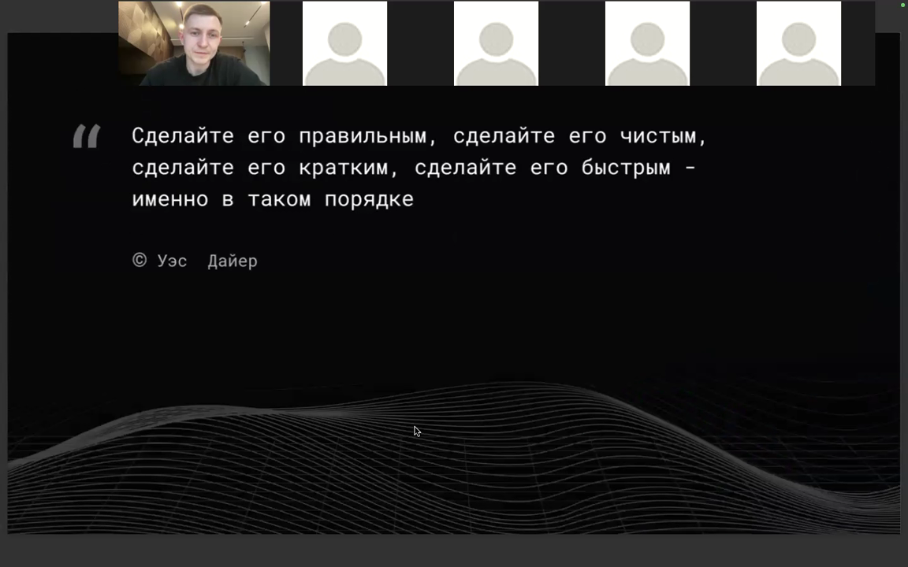

## 2. Аллокатор: определение, требования и интерфейс

**Аллокатор** — сущность, которая выдаёт необходимый объём памяти; нужно понимать, где аллоцируется объект — на стеке или в куче. К аллокатору предъявляются требования: скорость, масштабируемость, потребление памяти, безопасность; при этом аллокатор Go не настраивается. Интерфейс включает `Create`, `Allocate`, `Delete` и `Free`: `Create` создаёт аллокатор, `Allocate` выделяет блок определённого размера, `Delete` освобождает объект, `Free` освобождает все выделенные блоки. Эффективность приложения неявно зависит от эффективности аллокатора.

*Источник: [00:01:46], [00:02:46], [00:03:46], [00:28:43]*

> [!quote]- Кадр [00:01:46]
> 

> [!quote]- Кадр [00:02:46]
> 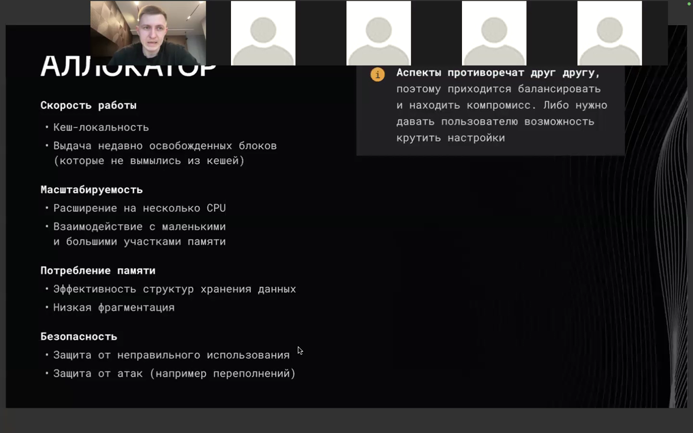

> [!quote]- Кадр [00:28:43]
> 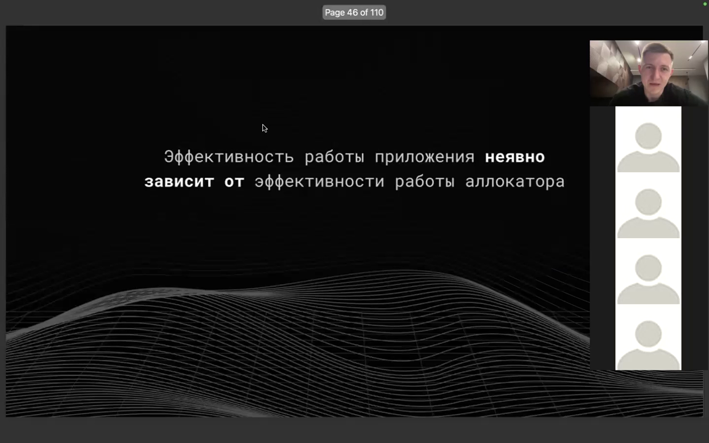

## 3. Линейный аллокатор, хедер, освобождение и фрагментация

**Линейный аллокатор** хранит указатель на начало блока и указатель использования, который сдвигается при каждом выделении; выборочное освобождение не поддерживается — можно освободить только всю занятую память. **Хедер (header)** хранит размер локации или количество свободных и занятых байт; по нему при освобождении определяют, сколько байт вернуть. `FreeBlocks` указывает на свободные хедеры, заголовок свободного блока имеет размер 12 байт. Освобождение идёт по указателю: отступают назад, читают Header, затем записывают освобождённое значение во FreeBlocks; в `main` освобождение отложено через `defer allocator.Free()` и `defer allocator.Deallocate(pointer)`. После освобождения могут остаться два свободных блока вместо одного — возникает **фрагментация**: суммарно памяти достаточно, но она разбита на несмежные участки.

```go
FreeBlocks = {}
FreeBlocks = {0xEEAA00}

ОСВОБОЖДЕНИЕ ПАМЯТИ
Start MaxBlock End
2 6
Header Header
0xFFAA00 0xFFAA04 0xFFAA06 0xFFAA0A 0xFFAA10
FreeBlocks = {0xFFAA00}
Start MaxBlock End
10 0
Header Header
0xEEAA00 0xEEAA04 0xEEAA0C 0xEEAA10
FreeBlocks = {0xEEAA0C}

defer allocator.Free()

pointer1, _ := allocator.Allocate(2)
defer allocator.Deallocate(pointer1)
pointer2, _ := allocator.Allocate(4)
defer allocator.Deallocate(pointer2)

FreeBlocks = {0xFFAA00, 0xFFAA06}
FreeBlocks = {0xEEAA0C}
```

*Источник: [00:04:19], [00:04:48], [00:13:55], [00:14:28], [00:15:11], [00:16:46], …*

> [!quote]- Кадр [00:04:19]
> 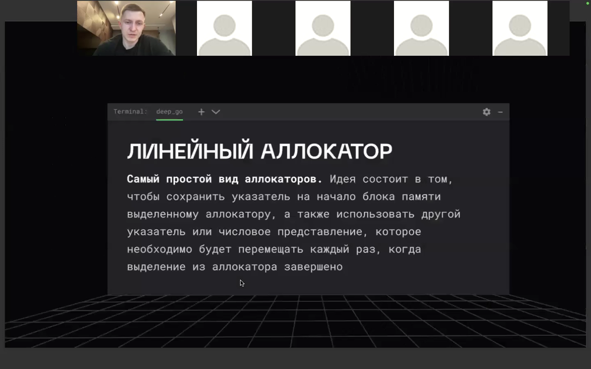

> [!quote]- Кадр [00:20:49]
> 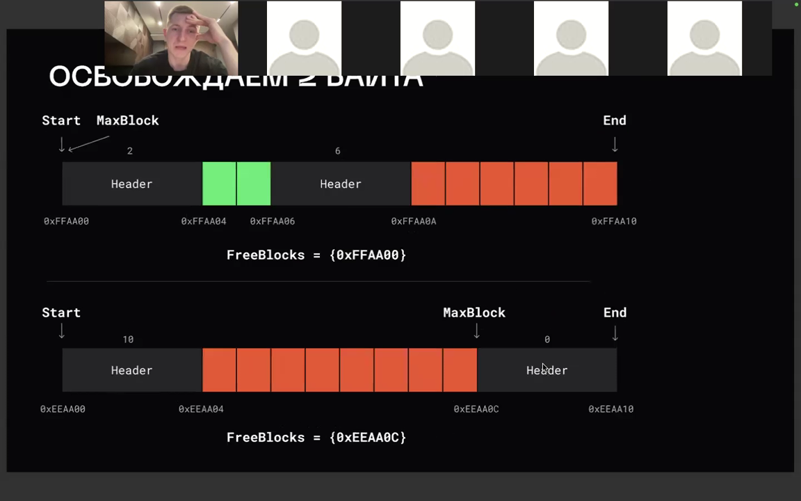

## 4. Блочный и пул-аллокаторы

**Блочный аллокатор** делит большой участок на блоки одинакового размера и подходит для множества однотипных объектов; при произвольном извлечении из множества кэш-локальность отсутствует — для неё элементы лучше выделять последовательно. Свободные блоки хранятся в списке `FreeBlocks`; если свободных блоков нет, память считается заполненной, нужно расширять память или выделять новый сегмент. **Пул-аллокатор** хранит `freeObjects`, `Allocate` берёт первый попавшийся элемент и удаляет его, при пустом множестве возвращает ошибку; аллокатор не проверяет корректность указателя при диаллокации — защита требует дополнительного кода и замедляет работу. **Пул объектов** — набор готовых объектов: `Get` забирает объект из пула, `Put` возвращает; `sync.Pool` синхронизирован, может использоваться из разных горутин, конструктор вызывается методом `Get` при отсутствии объектов, GC может освобождать объекты из пула, а при возврате объекта его не зануляют, поэтому объект нужно явно реинициализировать.

```go
func (a *PoolAllocator) Allocate() (unsafe.Pointer, error) {
	if len(a.freeObjects) == 0 {
		// can increase capacity
		return nil, errors.New("not enough memory")
	}
	var pointer unsafe.Pointer
	for freePointer := range a.freeObjects {
		pointer = freePointer
		break
	}
	delete(a.freeObjects, pointer)
	return pointer, nil
}
```

*Источник: [00:04:48], [00:05:18], [00:08:01], [00:08:31], [00:09:21], [00:09:23], …*

> [!quote]- Кадр [00:05:18]
> 

> [!quote]- Кадр [00:08:01]
> 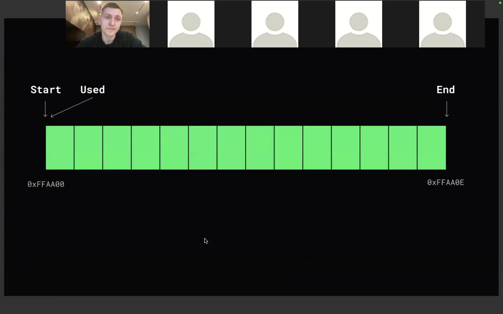

> [!quote]- Кадр [00:09:21]
> 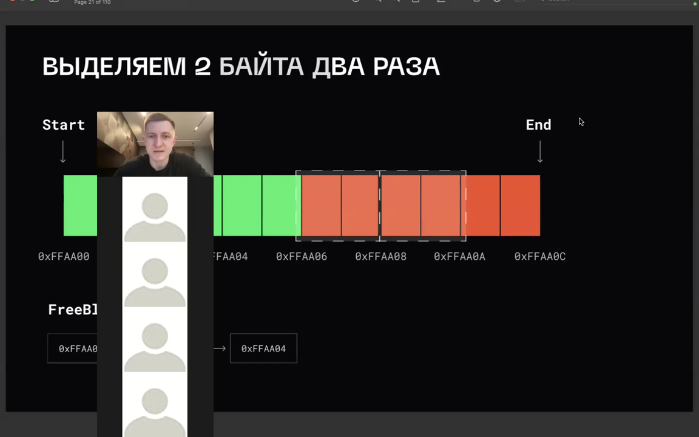

> [!quote]- Кадр [00:09:23]
> 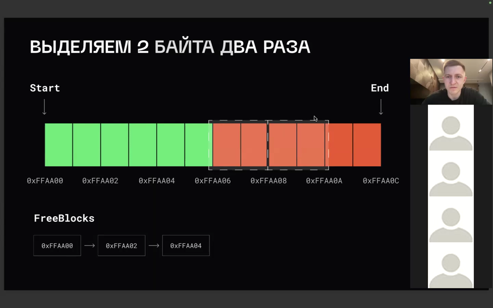

## 5. malloc и TCMALLOC

В C `malloc` называют аллокатором общего назначения (general purpose): он аллоцирует память для 4-байтного и 4-гигабайтного объекта с равным успехом. `malloc` считают плохим и медленным; среди недостатков — мусор при выделении, проблемы безопасности и фрагментация кучи. При многопоточном выделении потоки конкурируют, возникает большой **contention (конкуренция)**, из-за которого приложение работает менее эффективно; стековая аллокация быстрее `malloc`, кэш-дружелюбна и даёт меньше фрагментации. Go не стал использовать `malloc`, а выбрал собственный подход, заимствовав основу из **TCMALLOC**.

*Источник: [00:17:33], [00:22:36], [00:26:29]*

> [!quote]- Кадр [00:22:36]
> 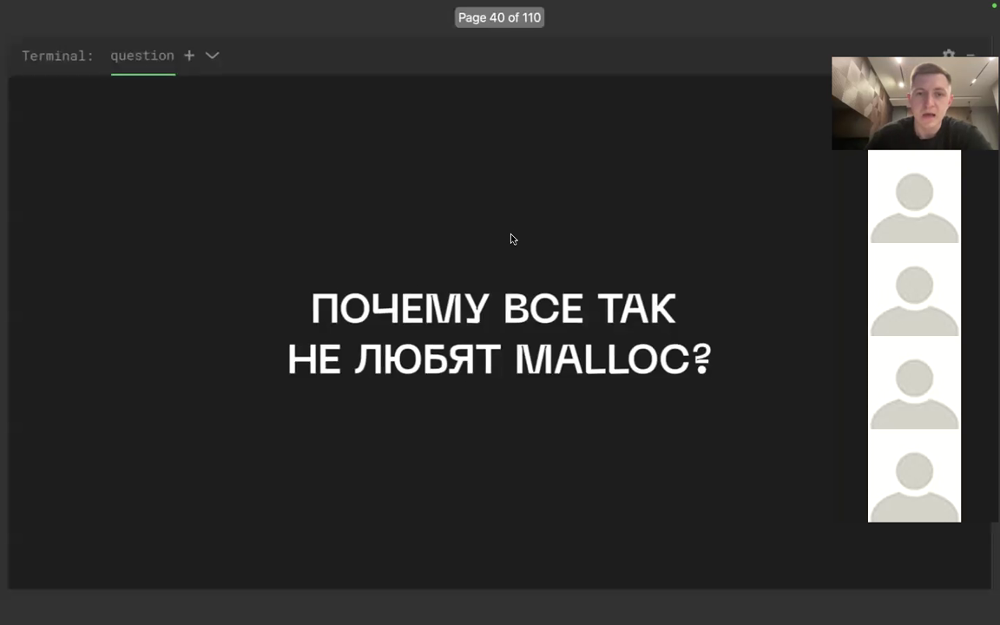

## 6. Классы памяти и MaxWaste

Блоки памяти разделяются на классы: первый класс — для 8-байтовых объектов, второй — для 16-байтовых, третий — для 32-байтовых; классы сопоставлены размерам блоков 8 КБ, 16 КБ, 32 КБ. Объекты до 8 байт аллоцируются в первом классе, второй класс имеет размер объекта от 8 до 16 байт; такое разделение снижает процент фрагментации. **MaxWaste** — максимальная потеря памяти; при аллокации 1-байтового объекта в классе до 8 байт до 87% памяти не используется, а 9-байтовый массив попадает во второй класс, где теряется 43% памяти этого класса. При выделении памяти для строки получается не 33 байта, а 48 — аллокация округляется до класса объектов; при большом количестве аллокаций в Go можно потерять около 25% памяти, поэтому при больших нагрузках правильная подгонка размеров структур может выигрывать в памяти.

```go
var data [16]byte
```

*Источник: [00:27:17], [00:28:00], [00:33:37], [00:33:42], [00:34:00], [00:35:02], …*

> [!quote]- Кадр [00:27:17]
> 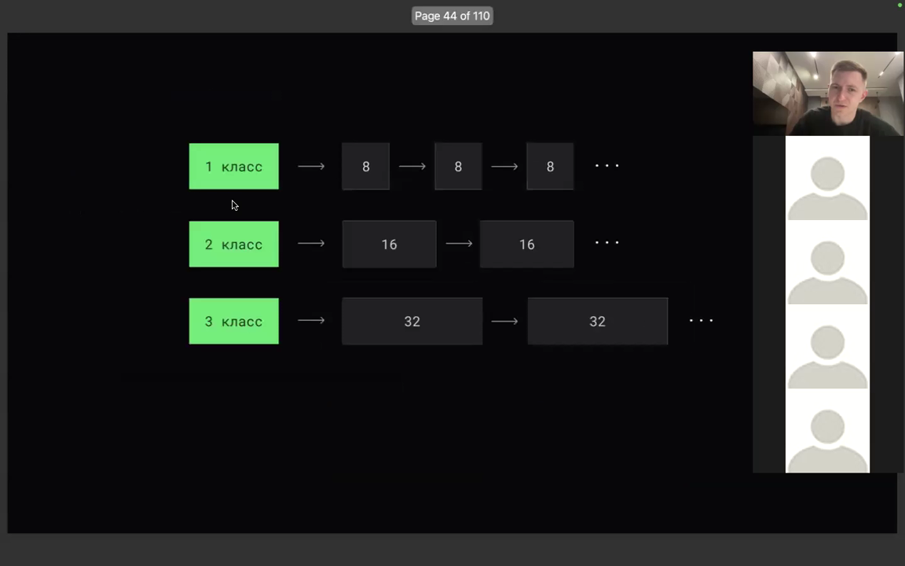

> [!quote]- Кадр [00:28:00]
> 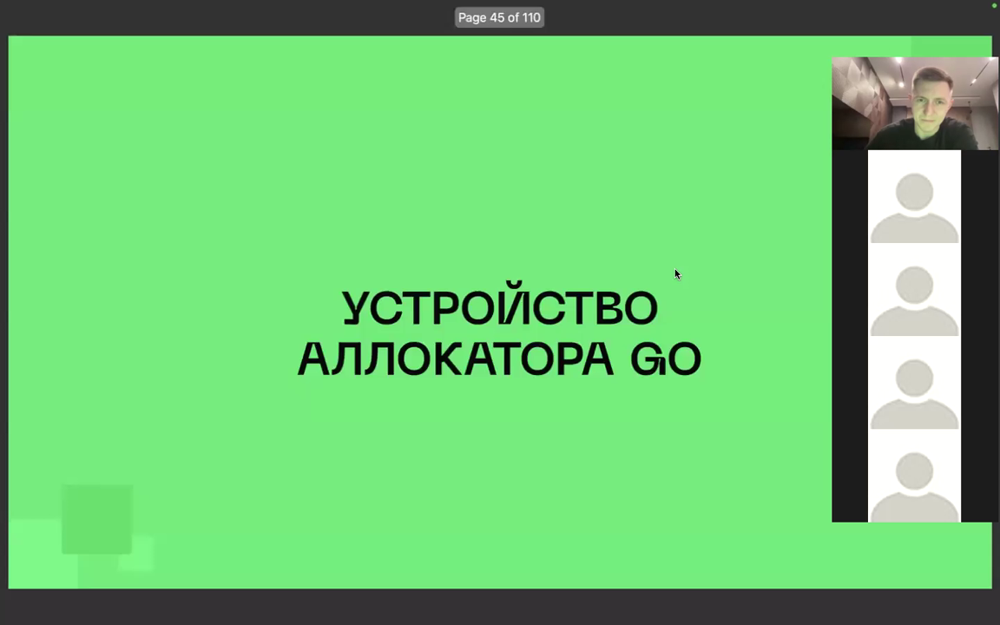

> [!quote]- Кадр [00:33:37]
> 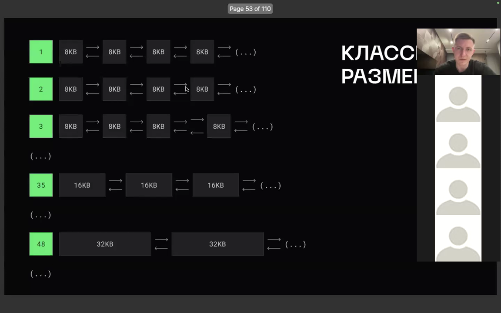

> [!quote]- Кадр [00:33:42]
> 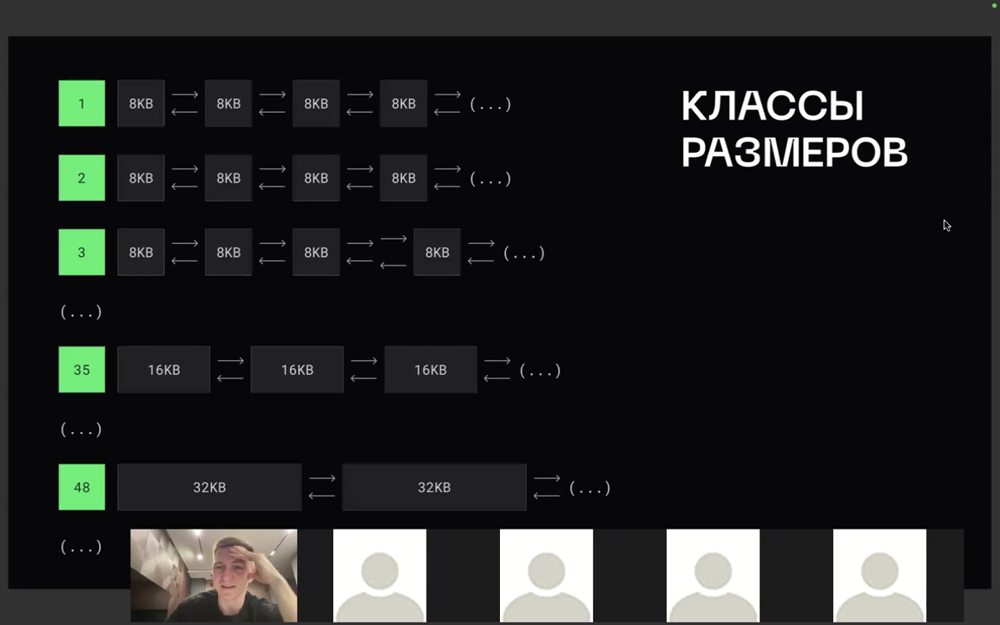

> [!quote]- Кадр [00:55:31]
> 

## 7. Конкатенация строк и аллокации

В `main` для бенчмарка `Concat` вызывается `b.AllocsPerOp()`, результат помечен комментарием `3` — три аллокации в `Concat`. При конкатенации строки из байтового слайса длиной 33 байта выделяется 176 байт, из которых 44 байта (25%) являются отходами. Выделение составляет 48 байт, а не 33; к этому добавляется ещё 48 байт. Потери равны 15 + 15 + 14 = 44 байтам и составляют 25%.

```go
var result string
var buffer []byte = make([]byte, 33)

func Concat(b *testing.B) {
	for i := 0; i < b.N; i++ {
		result = string(buffer) + string(buffer)
	}
}

func main() {
	b := testing.Benchmark(Concat)
	fmt.Println(b.AllocsPerOp())        // 3
	fmt.Println(b.AllocatedBytesPerOp()) // 17
}

// alocated 176 bytes = 48 (not 33) + 48
// waste = 15 + 15 + 14 = 44 bytes (25%)

func Concat(b *testing.B) {
    for i := 0; i < b.N; i++ {
        result = string(buffer) + string(buffer)
    }
}
```

*Источник: [00:41:38], [01:02:09], [01:05:50]*

## 8. Спаны, страницы и контеншн

Runtime Go не любит сисколы и расширяет хип сразу большим участком на 64 мегабайта. Страницы арены по 8 КБ объединяются в **спаны (span)** разного размера: 8, 16, 32 и 64 килобайта; в рантайме есть `mspan`, `mcentral`, `mcache`, а спан — абстракция поверх страниц. Мелкие объекты группируются с мелкими, крупные — с крупными; максимальный класс 32 килобайта занимает 4 странички, а массив `var data [16]byte` попадает в спан второго класса с блоками по 16 байт и даёт 0% waste. Страница всегда 8 килобайт, а класс может состоять из восьмибайтных объектов; размер страницы виртуальной памяти ОС и `mPage` не зависят друг от друга, арена выделяется только на куче. Если потокам нужно запросить память, возникает **contention**; у каждого потока есть кэш, и в подавляющем большинстве случаев запрос удовлетворяется из кэша без синхронизации, а при нехватке запрос идёт в общую память.

*Источник: [00:29:18], [00:30:18], [00:31:06], [00:32:06], [00:40:17], [00:43:46], …*

> [!quote]- Кадр [00:29:18]
> 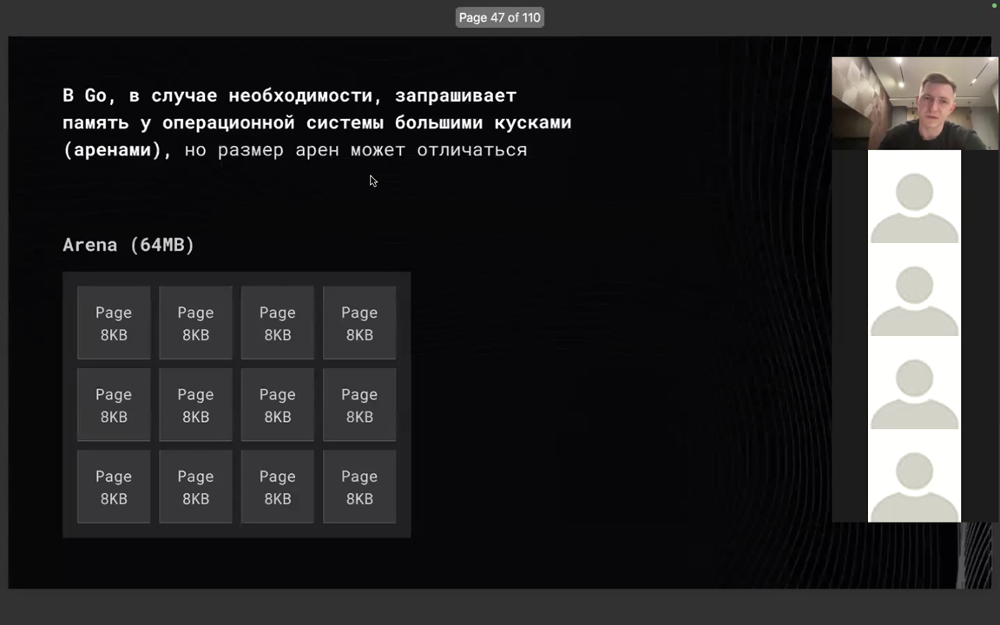

> [!quote]- Кадр [00:30:18]
> 

> [!quote]- Кадр [00:43:46]
> 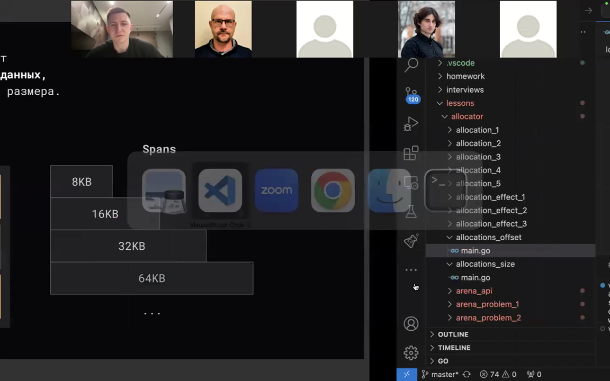

> [!quote]- Кадр [00:31:06]
> 

> [!quote]- Кадр [00:32:06]
> 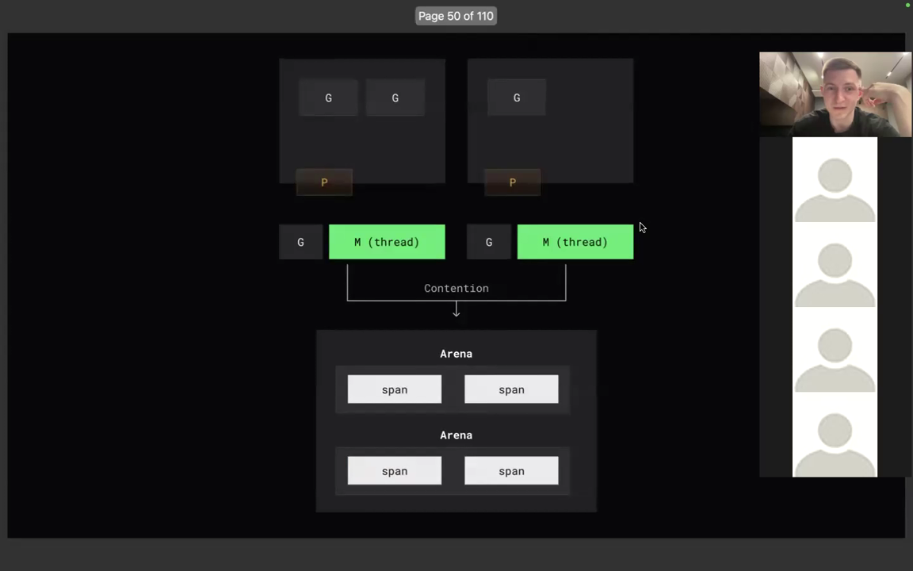

## 9. Стек и куча, стековая аллокация

В архитектуре компьютера нет понятий «стек» и «хип»; это абстракции, которые операционная система навешивает на участки виртуального адресного пространства. Физически это одна и та же оперативная память, разница только в софтверном времени доступа. Чтобы выделить память на стеке, нужно подвинуть Stack Pointer; чтобы освободить память на стеке, нужно подвинуть Stack Pointer обратно. В Go стек горутины начинается с 2 килобайт, может расти и уменьшаться; при нехватке памяти создаётся дополнительный сегмент, сегменты связываются в связанный список, а в последних версиях применяется contiguous stack: стек 8 КБ сужается при использовании меньше 2 КБ, при нехватке места выделяется участок в 2 раза больше, старая память копируется и переносится. Для 64-битных систем размер стека равен 1 гигабайту, для 32-битных — 250 мегабайтам; стек размещается в хипе, что позволяет динамически увеличивать его размер.

*Источник: [00:38:08], [01:07:56], [01:08:31], [01:09:32], [01:09:49], [01:09:58], …*

> [!quote]- Кадр [01:08:31]
> 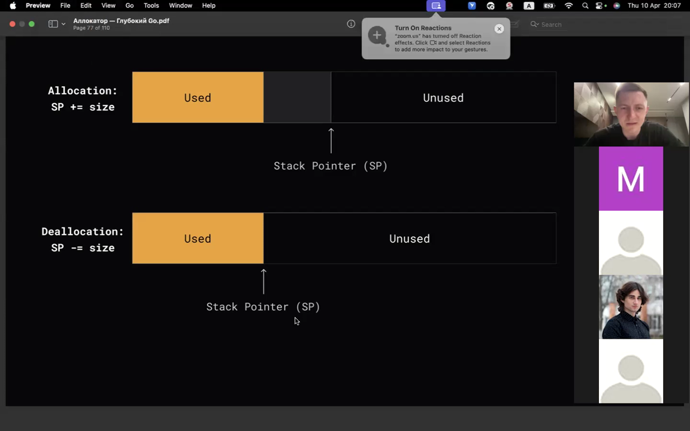

## 10. Анализ убегания и размещение объектов

**Анализ убегания (escape analysis)** — процесс во время компиляции, который определяет, где создаются объекты и как используются, и решает, выделять память в куче или в стеке. Объект уходит в heap, если escape-анализ не может доказать, что после выхода из функции на него не будет ссылок, или если его размер слишком велик; максимальный размер стековой переменной — 10 МБ, неявной — 64 КБ. Использование указателя или интерфейса не всегда приводит к аллокации в куче: если значение не используется за пределами функции, оно остаётся в стек-фрейме. Если одно из полей структуры перемещается в кучу, вся структура переместится в кучу; если один элемент массива или среза перемещается в кучу, все элементы перемещаются в кучу. При возврате указателя на локальную переменную компилятор перемещает её в кучу, иначе возникает висячий указатель (dangling pointer).

```go
func getResult() *int {
    result := 200
    return &result
}

// go build -gcflags '-l -m'
// ./main.go:8:2: moved to heap: result

func store[T any](pointer unsafe.Pointer, value T) {
	*(*T)(pointer) = value
}

func load[T any](pointer unsafe.Pointer) T {
	return *(*T)(pointer)
}
```

| Возврат объекта | Размещение |
|---|---|
| по значению | на стеке |
| по указателю | в heap |

| Объект | Если один элемент/поле в кучу |
|---|---|
| Структура | вся структура в кучу |
| Массив или срез | все элементы в кучу |

*Источник: [00:55:52], [00:56:41], [00:57:27], [00:58:29], [00:59:01], [01:00:08], …*

> [!quote]- Кадр [00:55:52]
> 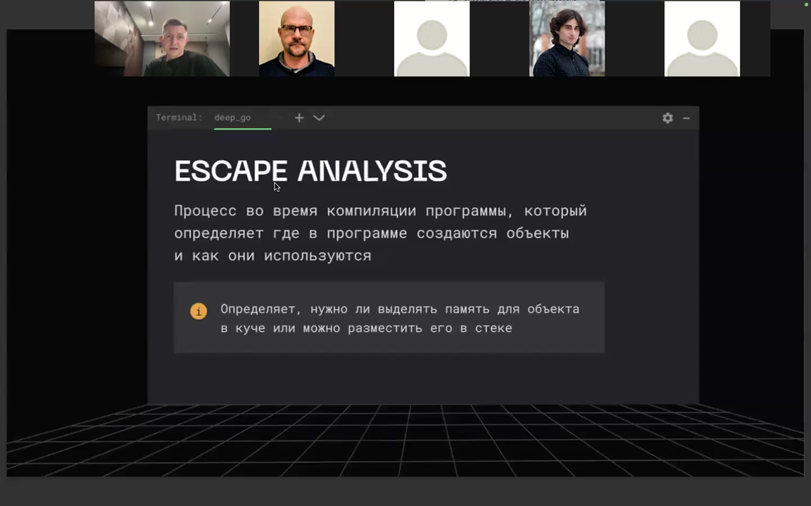

> [!quote]- Кадр [01:02:11]
> 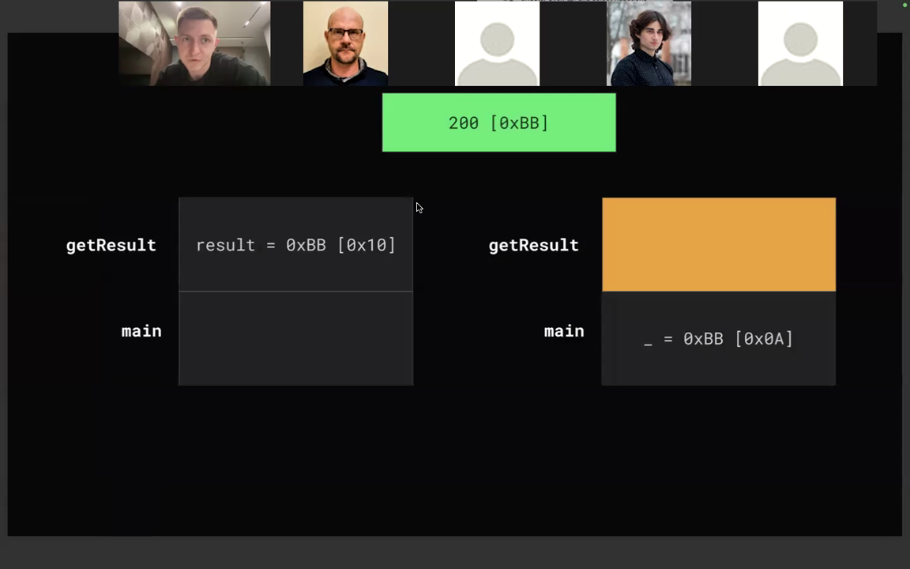

> [!quote]- Кадр [01:00:08]
> 

> [!quote]- Кадр [01:00:42]
> 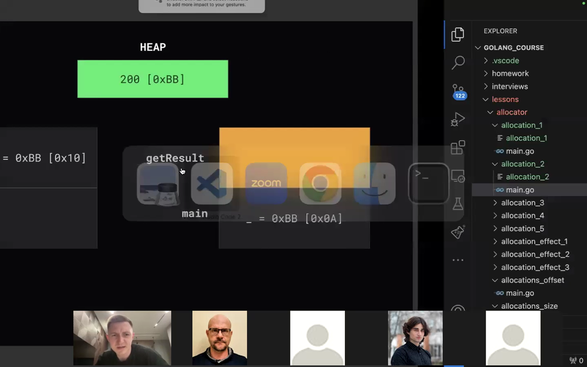

> [!quote]- Кадр [01:00:36]
> 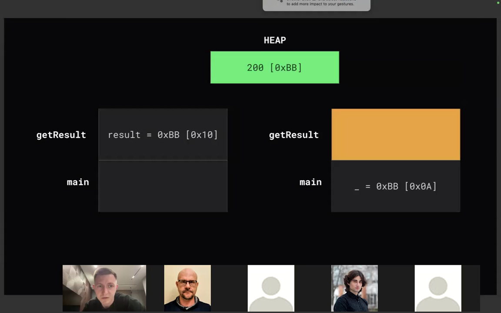

> [!quote]- Кадр [00:59:01]
> 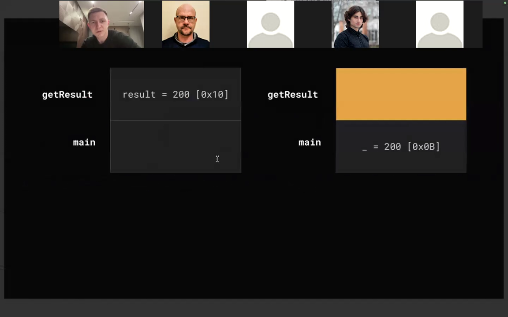

## 11. Команда escape-анализа и unsafe

Сборка с флагами `go build -gcflags '-l -m'` выводит отчёт escape-анализа; в выводе для переменных печатается, что они не escape: `v does not escape`, `num1 does not escape`, `str1 does not escape`, `num2 does not escape`, `str2 does not escape`. Флаг `-l` отключает инлайнинг, `-m` выводит оптимизации и решения об инлайнинге. В коде с `unsafe` объявляются два массива `data1` и `data2`, для них получаются указатели через `unsafe` и печатается адрес.

```go
func printValue(v interface{}) {
    println(v)
}

// go build -gcflags '-l -m'
// ./main.go:7:17: v does not escape
// ./main.go:16:13: num1 does not escape
// ./main.go:17:13: str1 does not escape
// ./main.go:23:6: num2 does not escape
// ./main.go:24:6: str2 does not escape

func main() {
	var data1 [32769]byte
	var data2 [32769]byte

	data1Pointer := unsafe.Pointer(&data1)
	data2Pointer := unsafe.Pointer(&data2)

	fmt.Println("address:", data1Pointer)
}
```

*Источник: [00:44:30], [01:04:48]*

## 12. Требования к аллокатору, TCMALLOC, арены и диагностика

К аллокатору предъявляются требования по скорости, масштабируемости, потреблению памяти и безопасности; они противоречат друг другу, поэтому приходится балансировать или давать пользователю настройки. **TCMALLOC** — thread-cached malloc: у каждого потока есть кэш, и большую часть запросов поток удовлетворяет из кэша без синхронизации, а при исчерпании идёт в общую память, что снижает contention; в Go для каждого потока есть кэш — та же концепция. В runtime Go есть таблица размерных классов с колонками `class`, `bytes/obj`, `bytes/span`, `objects`, `tail waste`, `max waste` и `min align`; если объект не помещается в текущий класс, он аллоцируется в следующий подходящий. **Арены (arena)** в Go — набор 8-мегабайтных чанков, которые могут объединяться в связанный список; арена равна 64 мегабайтам и состоит из страниц по 8 килобайт, из которых образуются спаны 8KB, 16KB, 32KB, 64KB. Арены применяют для батчевой обработки, освобождают разом через `defer Free`, нельзя освобождать по частям; словарь в арене создать нельзя, строку можно через `unsafe`, при `append` происходит реалокация в куче, а reference types нужно аллоцировать вручную. Для арен нужны тег `goexperiment.arenas` и `GOEXPERIMENT=arenas`; также используются флаги `-l` и `-m` для escape-анализа, `GOGC=off` для тестов без сборки мусора, санитайзеры Memory Sanitizer и Address Sanitizer для Linux, а бенчмарки помогают выбирать между передачей по значению и по указателю.

```go
// class  bytes/obj  bytes/span  objects  tall waste  max waste  min align
// 1      8          8192        1024     0           87.50%      8
// 2      16         8192        512      0           43.75%      16
// 3      24         8192        341      8           29.24%      8
// 4      32         8192        256      0           21.88%      32
// 5      48         8192        170      32          31.52%      16
// 6      64         8192        128      0           23.44%      64

var data [16]byte

type Data struct {
	iValue int
	sValue string
	bValue bool
}

//go:noinline
func NewDataByValue() Data {
	return Data{iValue: 100, sValue: "100", bValue: true}
}

//go:noinline
func NewDataByPointer() *Data {
	return &Data{iValue: 100, sValue: "100", bValue: true}
}

func BenchmarkNewByValue(b *testing.B) {
	for i := 0; i < b.N; i++ {
		_ = NewDataByValue()
	}
}

func BenchmarkNewByPointer(b *testing.B) {
	for i := 0; i < b.N; i++ {
		_ = NewDataByPointer()
	}
}

func BenchmarkWithoutLoopAllocation(b *testing.B) {
	var value int
	for i := 0; i < b.N; i++ {
		Initialize(&value)
	}
}

func BenchmarkWithLoopAllocation(b *testing.B) {
	for i := 0; i < b.N; i++ {
		var value int
		Initialize(&value)
	}
}

type ReaderWithSliceReturn struct{}

func (r ReaderWithSliceReturn) Read(n int) ([]byte, error) {
	p := make([]byte, n)
	for i := 0; i < n; i++ {
		p[i] = byte(i)
	}

	return p, nil
}

func main() {
	const KB = 1 << 10
	allocator, err := NewStackAllocator(KB)
	if err != nil {
		// handling...
	}

	defer allocator.Free()

	pointer1, _ := allocator.Allocate(2)
	defer allocator.Deallocate(pointer1)
}

// GOEXPERIMENT=arenas
// go run -tags goexperiment.arenas main.go

import (
	"arena"
)

func main() {
	mem := arena.NewArena()
	defer mem.Free()

	slice := arena.NewSlice[int](mem, 0, 4)
	slice = append(slice, 1, 2, 3)
}

func (a *StackAllocator) Free() {
	a.data = a.data[:0]
}

// go run main.go
// GOGC=off go run main.go

var data []byte

func main() {
	count := 0

	for {
		data = make([]byte, 1<<30)
		fmt.Println("allocated GB:", count)
		count++
	}
}

// -l = disable inlining
// -m = print inlining decisions
// go build -gcflags '-l -m'
// go run -gcflags '-l' main.go
```

| Понятие | Размер | Как образуется |
|---|---|---|
| Страница | 8 KB | базовая единица арены |
| Спан | 8KB, 16KB, 32KB, 64KB и т.д. | образуется из страниц |

> [!info] Зачем это нужно
> Кэши для потоков нужны, чтобы меньше конкурировать с другими потоками (снижать contention). Определение освобождённых указателей не делают из-за огромного оверхеда. `GOGC=off` — для тестирования программы без сборки мусора. Эти детали нужно знать только для написания эффективного кода.

*Источник: [00:01:46], [00:02:46], [00:03:46], [00:06:41], [00:07:31], [00:09:25], …*

> [!quote]- Кадр [00:01:46]
> 

> [!quote]- Кадр [00:24:59]
> 

> [!quote]- Кадр [00:25:59]
> 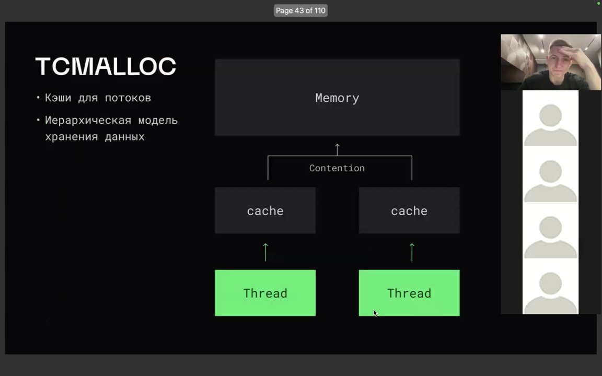

> [!quote]- Кадр [00:29:18]
> 

> [!quote]- Кадр [00:30:18]
> 

> [!quote]- Кадр [00:43:41]
> 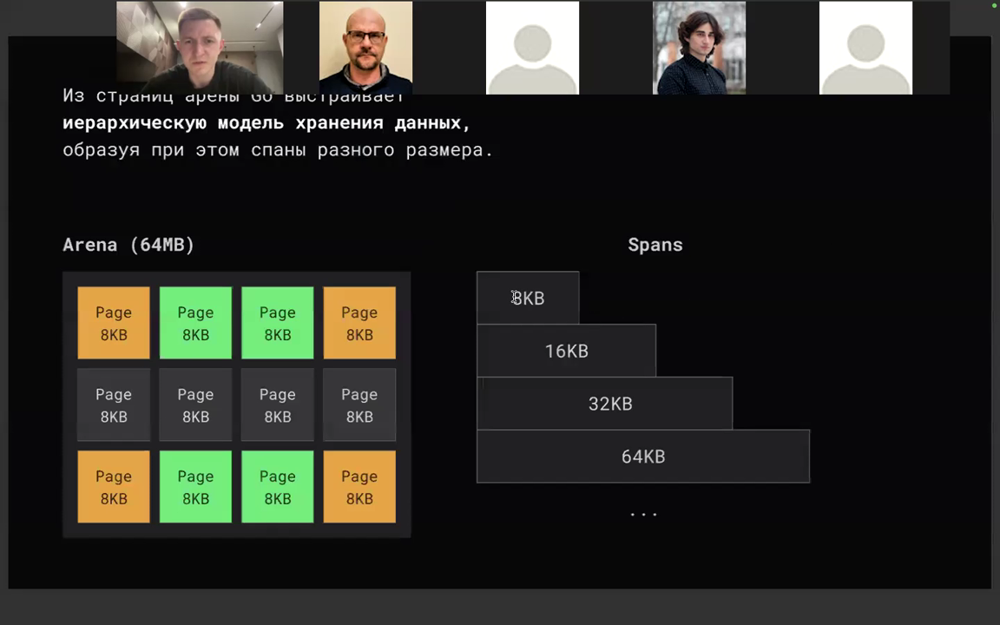

## Схема

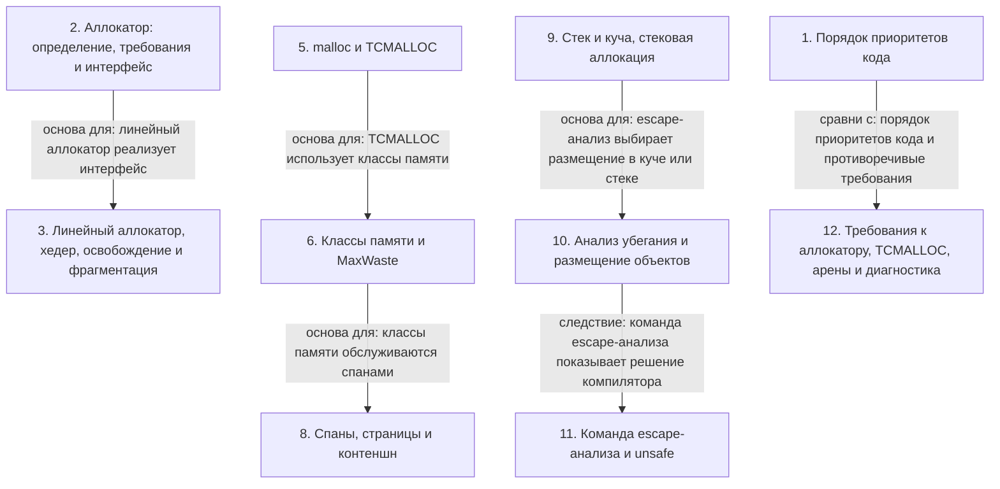

## Итог

> [!success] Что в итоге
> Материал связывает требования к аллокатору с конкретными реализациями: линейным, блочным, пул-аллокатором и подходом TCMALLOC с классами памяти, аренами, спанами и контеншном. Отдельная ветка объясняет различие стека и кучи и роль escape-анализа, включая команду `go build -gcflags '-l -m'` и `unsafe`. Практический пример с конкатенацией строк показывает, как аллокации проявляются в бенчмарке `b.AllocsPerOp()`. Диагностика и баланс скорости, безопасности и потребления памяти проходят через весь материал.
