# Сборка мусора: граф объектов, подсчёт ссылок, трассировка и GC в Go

> [!abstract] Обзор
> Материалы посвящены сборке мусора: определению мусора, ручному управлению памятью через `malloc`/`free` и автоматической сборке. Рассматриваются граф объектов и rootset, обход BFS и DFS, трёхцветная раскраска с tricolor invariant и поиск циклов, а также подсчёт ссылок, его издержки, strong/weak-счётчики и обнаружение циклов в Python. Отдельно — трассировка, mark and sweep и фазы алгоритма GC в Go, остановка потоков, Stop the World, Sweep и Copying, поколения и escape analysis. Описаны мутаторы (mutators), Concurrent и Parallel GC, барьер записи (write barrier), потерянный объект (lost object) и незавершающаяся разметка. Также приведены настройки GC (`GOGC`, `GOMEMLIMIT`, фракция CPU), метрики памяти процесса RSS и VSZ, ленивое выделение, OOM Killer и спираль смерти (Death Spiral), Scavenger, финализаторы и RAII.

> [!info] Курс
> [[index|Оглавление курса]]

## Оглавление
1. [[#1. Что такое мусор]]
2. [[#2. Ручное управление памятью и его ошибки]]
3. [[#3. Автоматический сборщик мусора, overhead и когда можно не собирать]]
4. [[#4. Граф объектов, rootset, обход и раскраска]]
5. [[#5. Подсчёт ссылок и циклы]]
6. [[#6. Фазы GC, Stop the World, Sweep и Copying]]
7. [[#7. Поколения, escape analysis и отказ Go от поколений]]
8. [[#8. Мутаторы, Concurrent/Parallel GC и барьер записи]]
9. [[#9. Настройки GC, целевой хип, OOM и спираль смерти]]
10. [[#10. RSS, VSZ и ленивое выделение]]
11. [[#11. Scavenger, latency и снижение нагрузки на GC]]
12. [[#12. Финализаторы и RAII]]

**Схема** — [[#Схема]]
**Итог** — [[#Итог]]

## 1. Что такое мусор

**Мусор** — это неиспользуемая память, которая раньше использовалась и была нужна, но потом стала никому не нужной. В итоговом графе объекты, до которых не дошли, помечаются белым. Мусор следует освободить, чтобы затем переиспользовать память. Память, выделенная внутри функции, после выхода из неё становится мусором, и её нужно освободить. При использовании барьера удаления мусор может доживать до следующей фазы сборки мусора; это особенность, а не критическая проблема.

*Источник: [00:01:34]*

> [!quote]- Кадр [00:01:34]
> 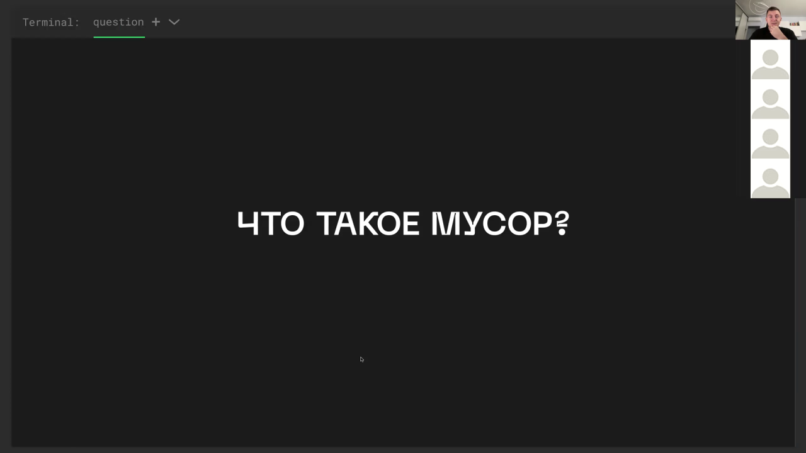

## 2. Ручное управление памятью и его ошибки

В ручном режиме программист сам выбирает, где аллоцировать память, и сам освобождает её. Память выделяется с помощью `malloc` и освобождается с помощью `free`. `free` не бесплатен, но ручной режим имеет меньше overhead, чем автоматический, и создаёт минимальный overhead. В ручном режиме программист может забыть освободить память, а также может повторно освободить память. Если почистить объект, который ещё используется, это undefined behavior: непонятно, что произойдёт, и допускать это нельзя.

```
void* data = malloc(1024);
// working with data...
free(data);
```

*Источник: [00:04:35], [00:05:35], [01:05:40]*

## 3. Автоматический сборщик мусора, overhead и когда можно не собирать

**Автоматический сборщик мусора** освобождает память без явного указания «освободи мне какой-то участок памяти»; как правило, он основан либо на подсчёте ссылок, либо на трассировке. Сборка мусора — это в любом случае overhead: и при ручной, и при автоматической сборке. Можно обходить не всю кучу, а часть (**поколения**), так как большинство объектов удаляются «молодыми»; долгоживущие объекты обходятся редко, а молодые — чаще, и если после нескольких проходов по молодым очищается мало, сборщик переходит к старым. Чтобы уменьшить паузу сборки мусора, можно чистить не все объекты, а меньшими кусочками. Если приложение или воркер работает несколько минут или час и ему хватает памяти, мусор можно не собирать; тогда мутатору не нужно оповещать поток сборщика мусора и красить объекты, но приложение будет потреблять чуть больше памяти.

*Источник: [00:03:19], [00:04:19], [00:06:42], [01:39:24]*

> [!quote]- Кадр [00:06:42]
> 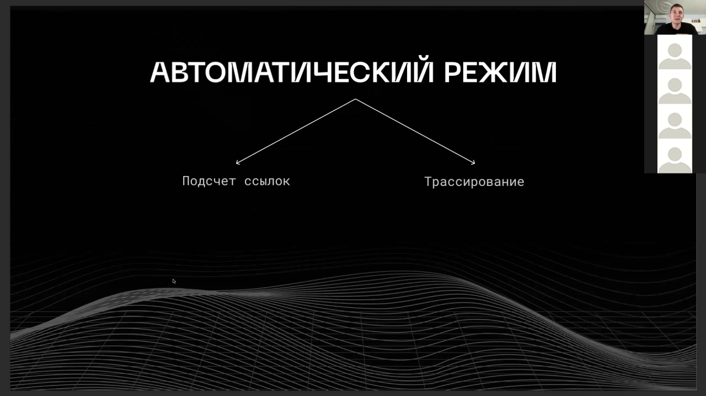

> [!quote]- Кадр [00:03:19]
> 

> [!quote]- Кадр [00:04:19]
> 

## 4. Граф объектов, rootset, обход и раскраска

**Mark and sweep** — второй способ автоматической сборки мусора: разметка выполняется трёхцветным алгоритмом, а в Go используется трассирующий mark and sweep, текущая стадия которого хранится в глобальной переменной `gcphase`. Трассировка ищет живые объекты, тогда как подсчёт ссылок ищет мёртвый объект, у которого счёт всех ссылок равен нулю; эти подходы противоположны. Объекты в куче ссылаются друг на друга, образуя граф с возможными циклами; обход начинается с **rootset** — множества корней, формируемого из стеков горутин и глобальных переменных, которое можно представить как очередь. Для обхода применяются BFS и DFS; BFS труднее синхронизировать и параллелить, при однопоточном обходе выбор не принципиален, а поток берёт элемент из начала очереди рутсетов и уходит в глубину. При обходе граф красится в три цвета: серый — ожидающий исследования, чёрный — исследованный; **tricolor invariant** нарушается, если чёрный объект начинает ссылаться на белый, а цикл обнаруживается при возврате в серую вершину (приход в чёрную циклом не является). Различать указатели и свободные участки нужно по значениям: непустое значение — указатель, подлежащий сканированию; `TraverseStack` — слайс `unsafe.Pointer` с методом `Push`.

```go
type TraverseStack []unsafe.Pointer

func (s *TraverseStack) Push(ptr unsafe.Pointer) {
	*s = append(*s, ptr)
}
```

| Цвет | Значение |
| --- | --- |
| Серый | ожидающий исследования объект: узнали про объект, но не все ссылки от него прошлись. |
| Чёрный | исследованный объект: посещён и все исходящие ссылки исследованы. |

*Источник: [00:03:19], [00:05:50], [00:07:16], [00:16:40], [00:18:04], [00:24:01], …*

> [!quote]- Кадр [00:05:50]
> 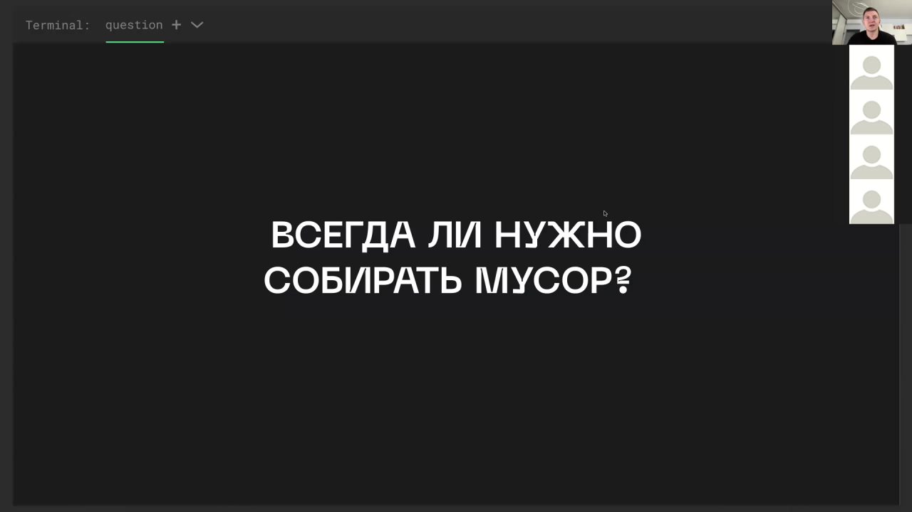

> [!quote]- Кадр [00:07:16]
> 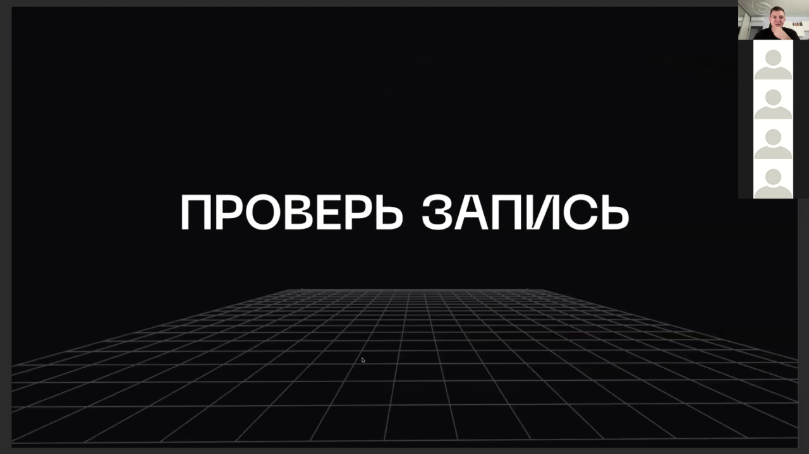

> [!quote]- Кадр [00:26:39]
> 

> [!quote]- Кадр [00:28:52]
> 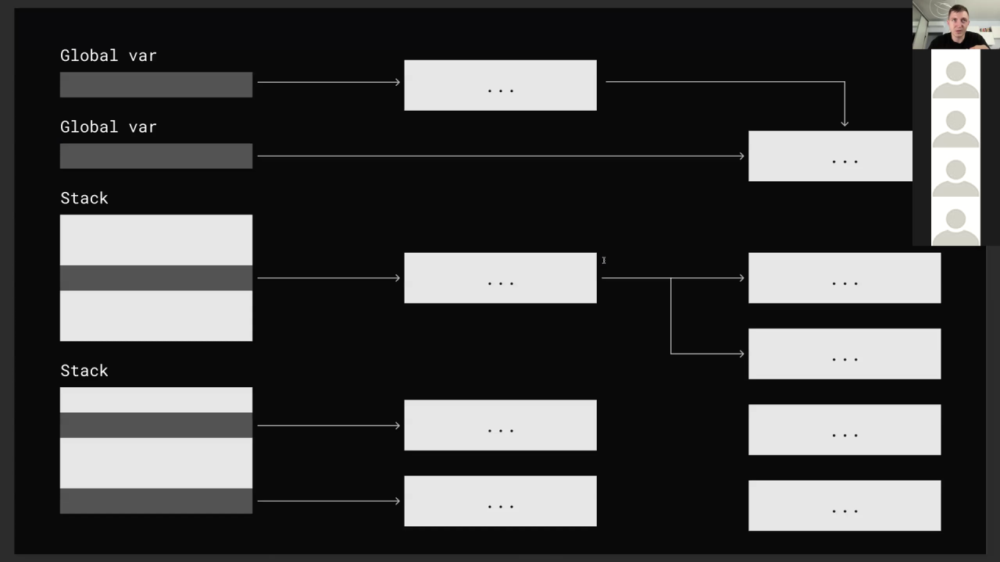

> [!quote]- Кадр [00:29:28]
> 

> [!quote]- Кадр [00:30:28]
> 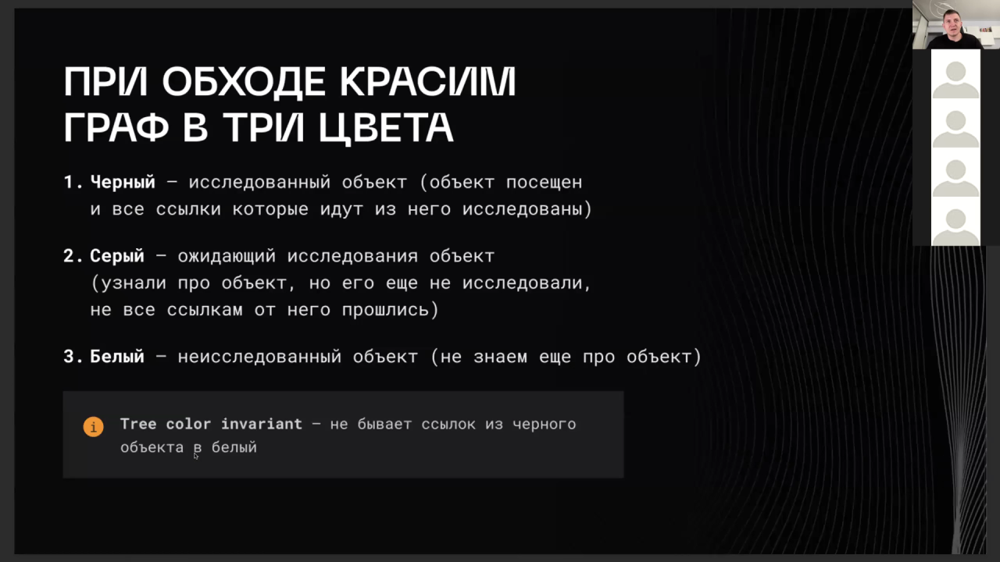

## 5. Подсчёт ссылок и циклы

**Подсчёт ссылок** — первый способ автоматической сборки мусора: каждый объект хранит счётчик ссылок на него, при нуле память освобождается; основной поток сам удаляет объект, не нужен фоновый поток, но есть лишняя работа по инкременту/декременту, синхронизация (мьютексы, атомики) и дополнительная память на объект. Объект в хипе хранит данные и счётчик рядом: `ptr_data` и `ptr_refs`; при копировании Object копируются указатели, и оба объекта ссылаются на общие блоки data и refs. Очистка происходит сразу при выходе из функции, это не трассировка. В двусвязном списке элементы ссылаются через `next` и `prev`, счётчики остаются равны единице и цикл никогда не прервётся; для решения вводят **strong/weak-счётчики**: `next` инкрементирует strong-refs, `prev` — слабые, объект удаляется при strong-refs = 0. Python использует фоновый алгоритм обнаружения циклов, периодически проверяя объекты на циклы.

| Ссылка | Инкрементируемый счётчик |
|---|---|
| next | strong-refs |
| prev | счётчик слабых ссылок |
| Удаление объекта | при strong-refs = 0 |

*Источник: [00:07:51], [00:08:33], [00:09:33], [00:10:55], [00:11:55], [00:12:08], …*

> [!quote]- Кадр [00:07:51]
> 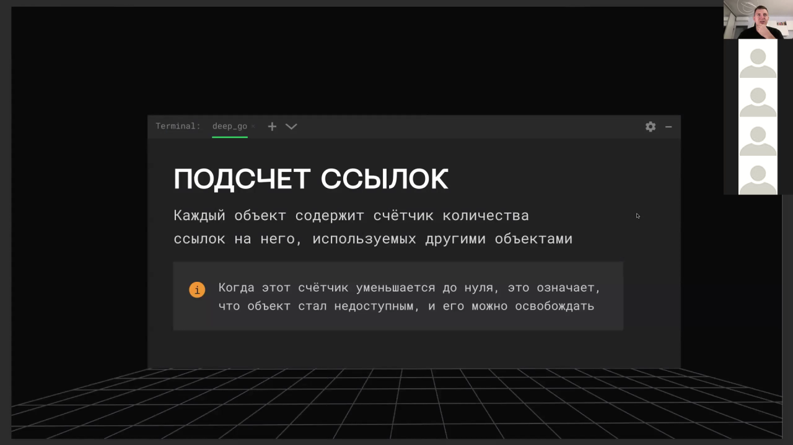

> [!quote]- Кадр [00:08:33]
> 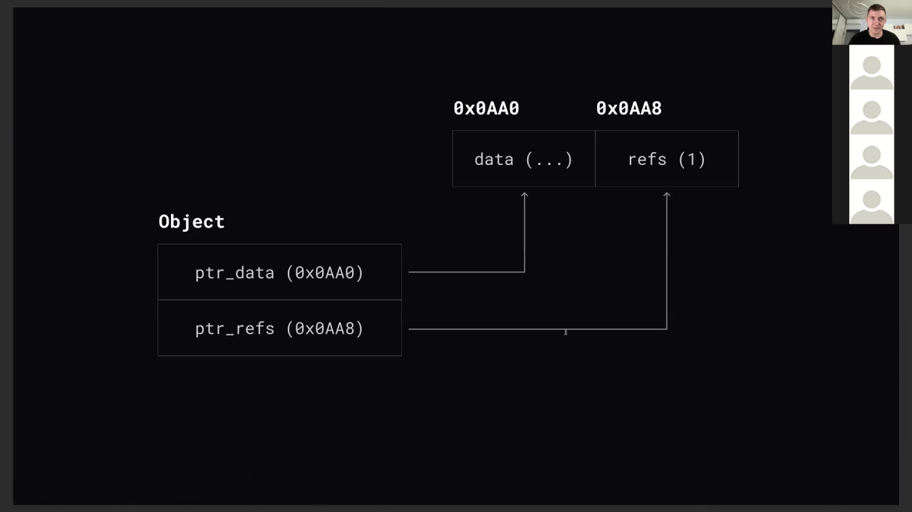

> [!quote]- Кадр [00:10:55]
> 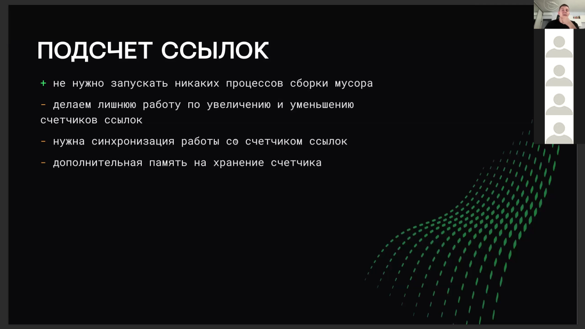

> [!quote]- Кадр [00:12:08]
> 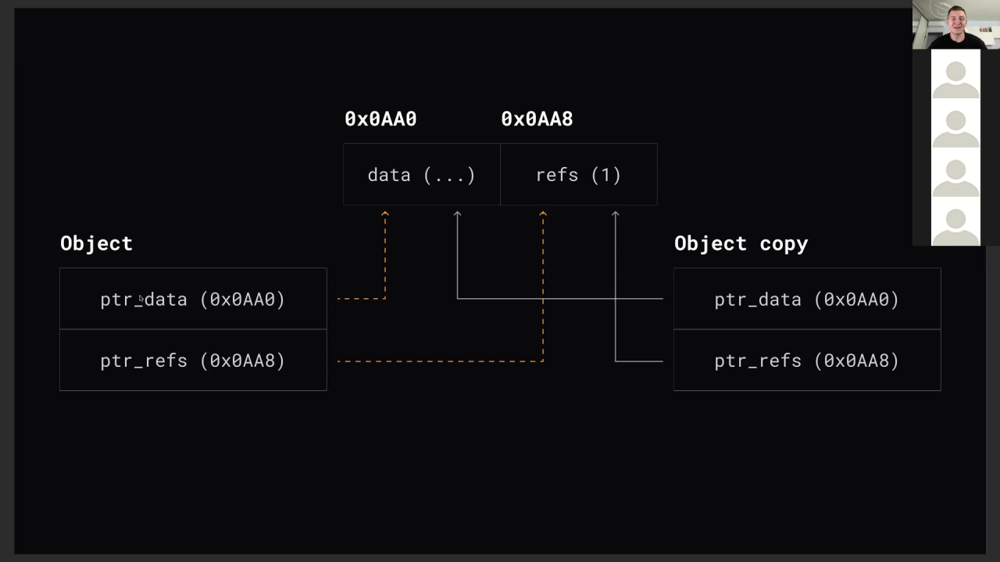

## 6. Фазы GC, Stop the World, Sweep и Copying

Алгоритм сборки мусора включает фазы **Off, Stack scan, Mark, Mark termination и Sweep**. Stack scan собирает указатели из глобальных переменных и стеков горутин; стеки сканируются в точках вытеснения, при этом горутина приостанавливается. На фазе Mark барьер записи (write barrier) отслеживает изменения указателей мутатором: идёт Start the world, сканирование глобальных переменных и стеков с формированием rootset и раскрашивание в три цвета; новые объекты при аллокации сразу красятся в серый цвет. **Mark Termination** — остановка мира (Stop the World) после раскрашивания, ожидание последних задач из очереди и завершение разметки. **Sweep** освобождает непомеченные объекты, write barrier отключается, мир запускается, а очистка идёт в фоне с мутаторами. Остановить все потоки означает остановить все мутаторы; в код потоков можно вставить точки останова, чтобы поток проверял необходимость остановки. `mProtect` может пометить страницу защищённой (при попытке записи происходит прерывание); для включения и отключения барьеров записи и удаления обычно нужен короткий Stop the World, а фазу очистки Stop the World нужно проводить как можно быстрее, поскольку при большой куче пауза больше. На третьей фазе есть две альтернативы: **Sweep** освобождает объекты белого цвета, а **Copying** переносит живые объекты в новое место и освобождает старое, чтобы не было фрагментации; перенос занимает больше времени, но уменьшает фрагментацию, а первая фаза — sweep termination с Stop the World, завершением sweep-фаз и удалением остатков мусора.

| Альтернатива | Действие | Цель |
| --- | --- | --- |
| Sweep | освобождает объекты белого цвета | — |
| Copying | переносит живые объекты в новое место, старое освобождает | чтобы не было фрагментации |

> [!info] Зачем это нужно
> Остановить потоки без примитивных синхронизаций и уменьшить паузу.

*Источник: [00:20:45], [00:21:27], [00:22:27], [00:23:01], [00:25:01], [00:26:13], …*

> [!quote]- Кадр [01:31:37]
> 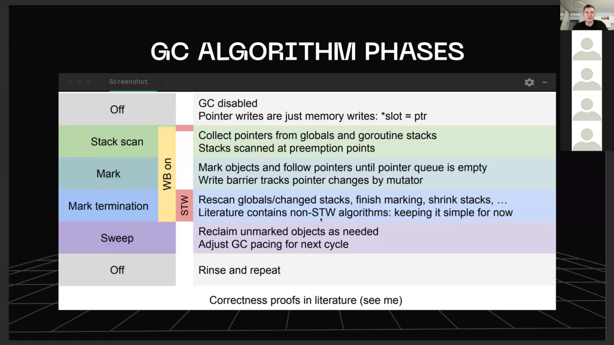

> [!quote]- Кадр [01:32:55]
> 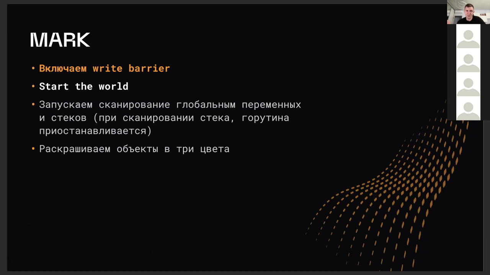

> [!quote]- Кадр [01:33:55]
> 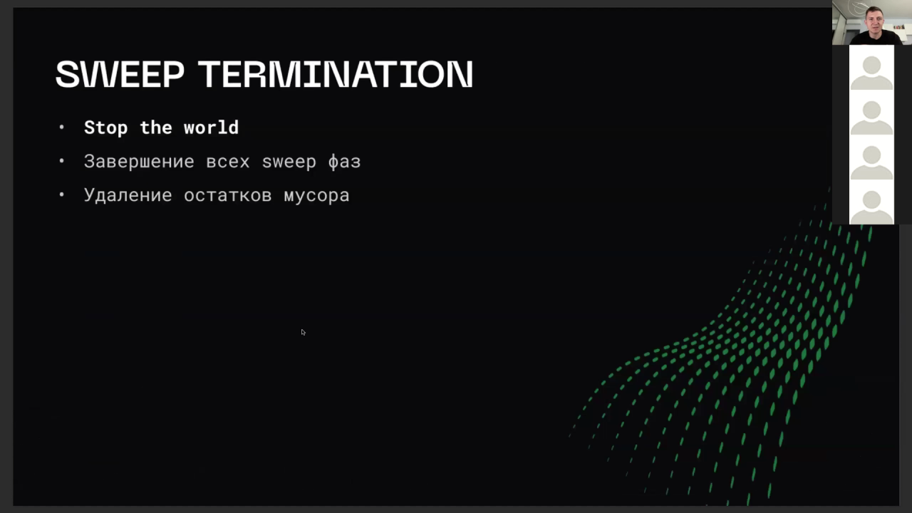

> [!quote]- Кадр [00:40:13]
> 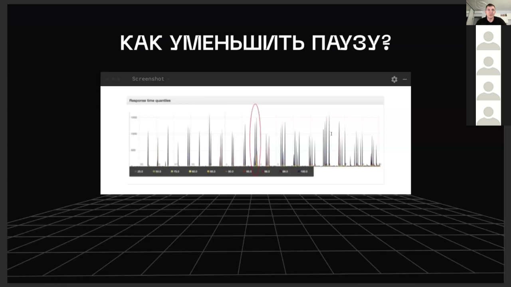

> [!quote]- Кадр [00:20:45]
> 

> [!quote]- Кадр [00:58:17]
> 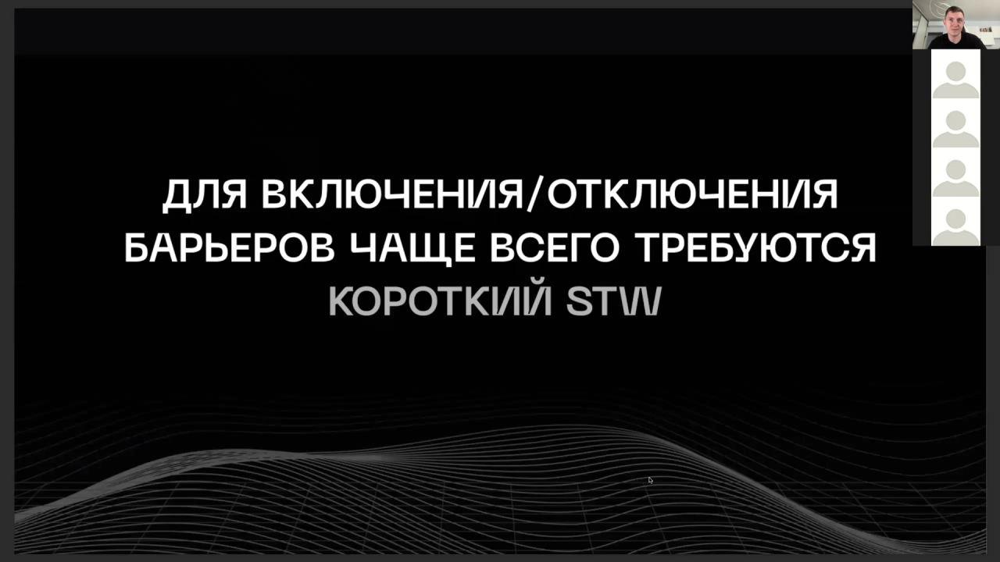

> [!quote]- Кадр [00:35:47]
> 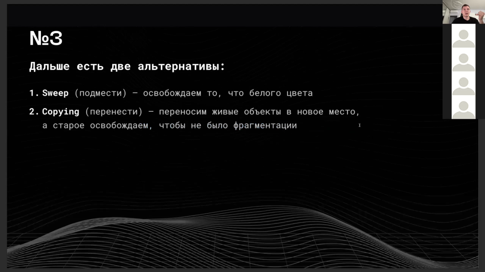

## 7. Поколения, escape analysis и отказ Go от поколений

После сборки мусора объекты, помеченные как живые, переносятся во второе поколение; в последующие поколения сборщик заглядывает реже — когда не хватает памяти, освобождённой в младших поколениях. Память сегментируется на разные участки, и каждый участок представляет собой то или иное поколение. Go старается размещать как можно больше объектов на стеке; если не может доказать, что за пределами функции никто не ссылается, только тогда отправит в heap; условно, стек — это первое начальное поколение. Escape analysis в Go является аналогом поколений (косвенно соблюдает концепцию поколений). В Go концепция поколений в сборщике мусора отсутствует: алгоритм сборки не разбивает память на поколения; Go не заимствовал у Java концепцию поколений объектов, потому что короткоживущие объекты размещаются на стеке, а не в хипе.

*Источник: [00:46:42], [00:47:42], [00:47:53], [00:48:12], [00:49:12], [00:49:16], …*

> [!quote]- Кадр [00:46:42]
> 

> [!quote]- Кадр [00:47:42]
> 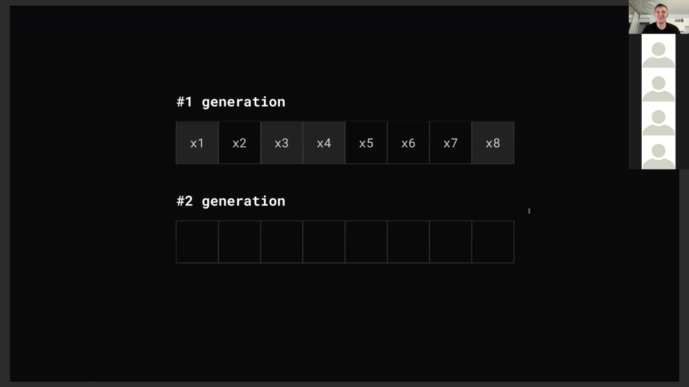

## 8. Мутаторы, Concurrent/Parallel GC и барьер записи

**Мутаторы (mutators)** — это потоки, выполняющие бизнес-логику (код приложения), а поток ОС `M` может выполнять как код мутатора, так и код сборки мусора; потоки сборщика (немутаторы) проходят граф и очищают мусор. Самый примитивный сценарий: останавливаются все мутаторы, без синхронизации обходится граф, помечаются используемые объекты, непомеченные удаляются. **Concurrent GC** запускает потоки сборщика одновременно с мутаторами; Go GC выполняется конкурентно и использует барьеры записи, а **Parallel GC** — это сборка со Stop the World, при которой потоки сборщика работают параллельно; их нельзя путать. **Барьер записи (write barrier)** нужен при конкурентном запуске сборщика с кодом приложения: когда чёрный объект начинает ссылаться на новый объект, указатель сразу красится в серый и попадает в очередь на обход. **Lost object (потерянный объект)** — аномалия, когда объект потеряли и поломали инвариант «чёрный не ссылается на белый». Corner case Concurrent GC — незавершающаяся разметка: мутаторы создают много объектов, барьер записи красит их в серый, очередь не заканчивается, и разметка может не завершиться (решение — рекурсивно раскрашивать). Барьер удаления может продлевать жизнь мусора до следующей фазы.

| Признак | Parallel GC | Concurrent GC |
|---|---|---|
| Stop the World | да | нет, сборка идёт конкурентно с программой |
| Потоки сборщика | работают параллельно | сборщик работает конкурентно |

> [!info] Зачем это нужно
> Барьер записи используется для решения проблем при конкурентном запуске сборщика мусора с кодом приложения.

*Источник: [00:03:19], [00:19:52], [00:21:20], [00:25:01], [00:51:13], [00:51:58], …*

> [!quote]- Кадр [00:19:52]
> 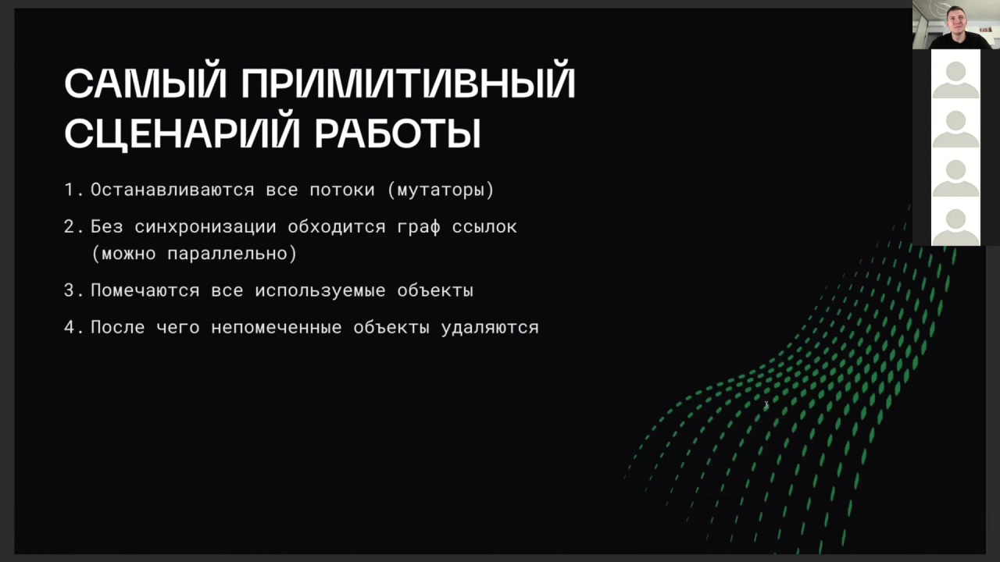

> [!quote]- Кадр [00:21:20]
> 

> [!quote]- Кадр [00:51:58]
> 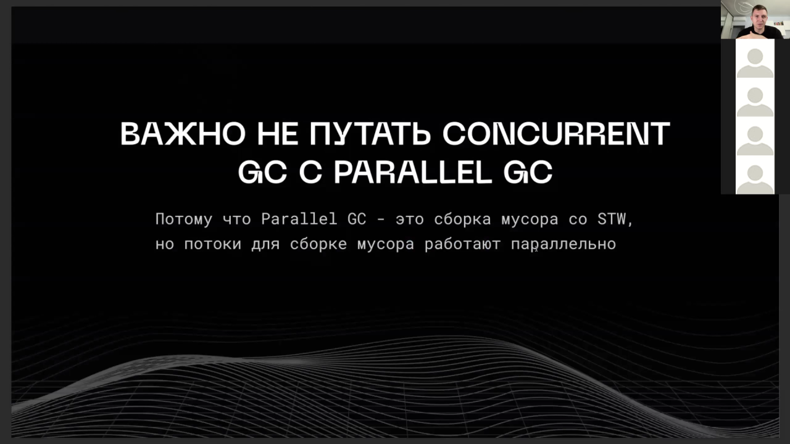

> [!quote]- Кадр [00:54:59]
> 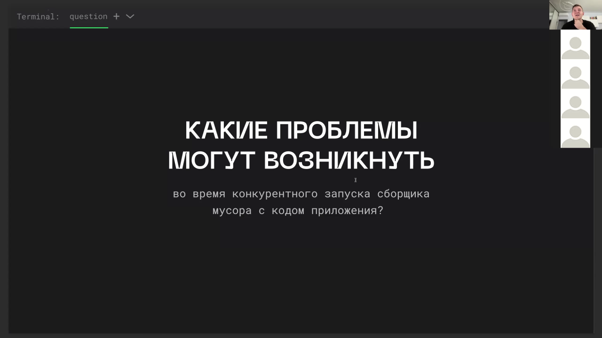

> [!quote]- Кадр [01:00:02]
> 

## 9. Настройки GC, целевой хип, OOM и спираль смерти

`GOGC` настраивает лимит срабатывания сборщика как процент от живой кучи: при 50% GC сработает при 50% от 1,5 ГБ, при 200% — при 200% от 1,5 ГБ; при `GOGC=100` новая куча занимает 100% от живой, и следующий GC срабатывает при достижении этого размера. `GOMEMLIMIT` задаёт верхнюю границу потребления памяти (софт-лимит, позволяет использовать память сверх лимита): при подходе к лимиту runtime чаще вызывает GC, агрессивнее возвращает память ОС и сам варьирует `GOGC`, причём `GOMEMLIMIT` учитывает всю память, а не только кучу. Фракция CPU воркеров GC жёстко зафиксирована на 25%, **Mark Assist** позволяет довести её до 30%, а при `GOMEMLIMIT` потребление CPU сборщиком не превысит 50%. В Go всего два параметра, тогда как в Java много «ручек» настройки, и сборщик можно запустить вручную вызовом `runtime.GC()` (если вызвать во время идущей сборки, по достижении фазы sweep он запустится заново). При `GOGC=100%` целевой размер хипа на следующую сборку — удвоенный размер живого хипа после последнего GC: если после GC хип составил 5,1 ГБ, целевое значение 10,2 ГБ; если лимит RSS равен 10 ГБ, процесс будет убит OOM Killer'ом до следующего прохода GC. ОС не посылает сигнал о достижении лимита памяти: при превышении лимита приходит OOM-killer и сносит приложение; нельзя просто ограничить Go-программу, например, 8 гигабайтами — при пробитии ограничения придёт OOM killer. **Спираль смерти (Death Spiral)** — проблема при перестарании с настройкой `GOGC`: нехватка памяти ведёт к более частому запуску GC, что увеличивает нагрузку на CPU и снижает throughput, из-за чего запросы копятся в очередях и требуется ещё больше памяти; такую проблему сложнее обнаружить, чем OOM, потому что приложение выглядит загруженным, но в основном занимается сборкой мусора.

```
runtime.GC()
```

> [!info] Зачем это нужно
> Чтобы освобождать больше памяти, нужно чаще запускать GC, для чего выбирают более консервативное значение GOGC.

*Источник: [01:07:55], [01:08:55], [01:09:55], [01:10:27], [01:11:29], [01:13:42], …*

> [!quote]- Кадр [01:07:55]
> 

> [!quote]- Кадр [01:27:58]
> 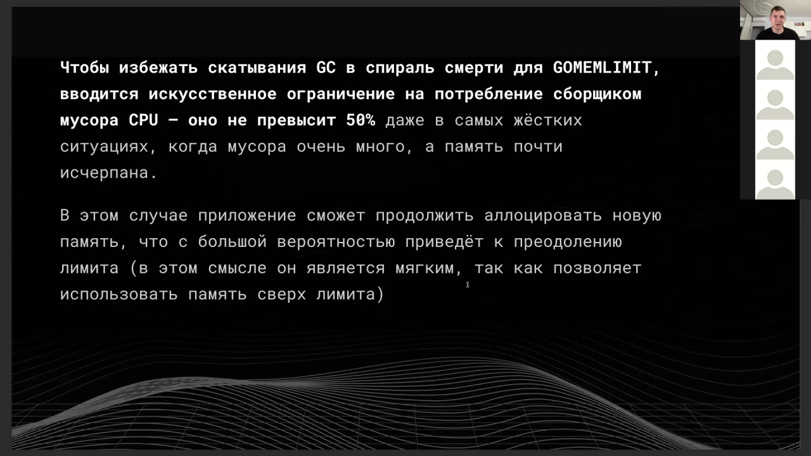

> [!quote]- Кадр [01:21:20]
> 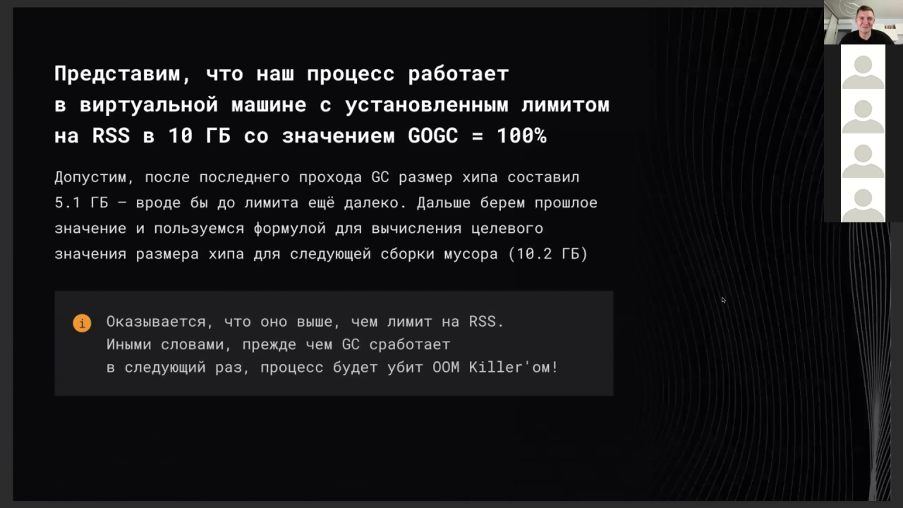

> [!quote]- Кадр [01:24:53]
> 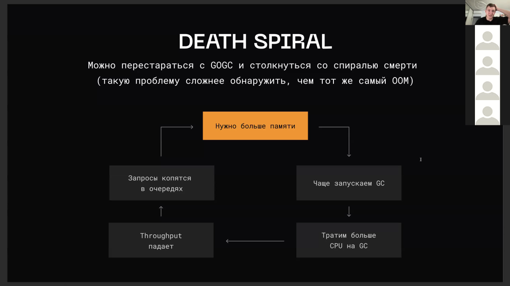

## 10. RSS, VSZ и ленивое выделение

**RSS** показывает, сколько памяти процесса находится в физической оперативной памяти (RAM); RSS не включает память, выгруженную в своп (swap), но включает память из разделяемых библиотек (shared libraries), если их страницы действительно находятся в памяти. **VSZ** включает всю память, к которой процесс может получить доступ: память, выгруженную в swap, выделенную, но не используемую, и память из разделяемых библиотек. Linux не назначает физические страницы памяти до первой записи в страницу; до первой записи чтение из страницы даёт пустое значение. После выделения адресное пространство расширяется сразу, но если объём превышает размер оперативной памяти, данные уходят в диск; при выделении большого объёма ОС использует **ленивое выделение (lazy allocation)**, что замедляет работу. При выделении огромного количества неиспользуемой памяти VSS увеличивается, а RSS не увеличивается; на 64-битных системах для адресации, как правило, используется 48 бит, а не все 64, из-за лимита целочисленной адресации.

```go
import "fmt"

var data []byte

func main() {
	count := 0

	for {
		data = make([]byte, 1<<30)

		fmt.Println("allocated GB:", count)
		count++
	}
}
```

| Метрика | RSS | VSZ |
|---|---|---|
| Что показывает | память в физической RAM | вся доступная память |
| Swap | не включает | включает |
| Выделенная, но не используемая | — | включает |
| Разделяемые библиотеки | включает, если страницы в памяти | включает |

*Источник: [01:15:32], [01:16:32], [01:17:32], [01:17:57], [01:18:21], [01:18:27], …*

> [!quote]- Кадр [01:15:32]
> 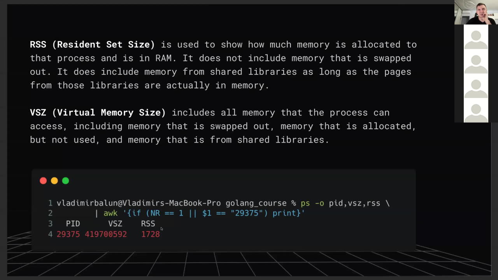

> [!quote]- Кадр [01:16:32]
> 

> [!quote]- Кадр [01:19:23]
> 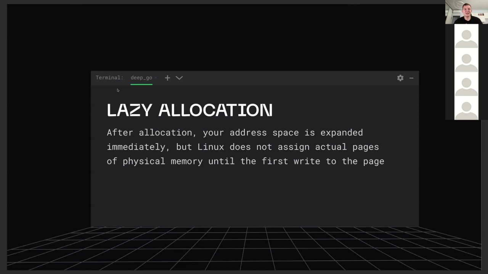

## 11. Scavenger, latency и снижение нагрузки на GC

**Scavenger** — сущность в Go runtime, которая занимается тем, что либо отдаёт освобождённую память операционной системе, либо отдаёт её обратно аллокатору. Выход из функции — хорошая точка для трассировки объектов, но синхронная очистка при выходе со стека влияет на выполняющиеся запросы; трассирующий сборщик мусора работает асинхронно и не влияет на запросы. При последовательном освобождении объёмной структуры данных возникает всплеск задержки (latency); при удалении большой структуры деструкторы вызываются синхронно, что даёт дополнительную задержку, а конкурентный сборщик мусора выполняет это асинхронно. Чтобы уменьшить нагрузку на сборщик мусора, нужно меньше аллоцировать и больше переиспользовать память: применять аллокаторы, `sync.Pool` и арены, а также стараться аллоцировать на стеке; объекты, которые живут на стеке, garbage collector не трогает.

*Источник: [00:13:29], [01:37:07], [01:37:47], [01:44:16], [01:45:16], [01:47:50]*

> [!quote]- Кадр [01:44:16]
> 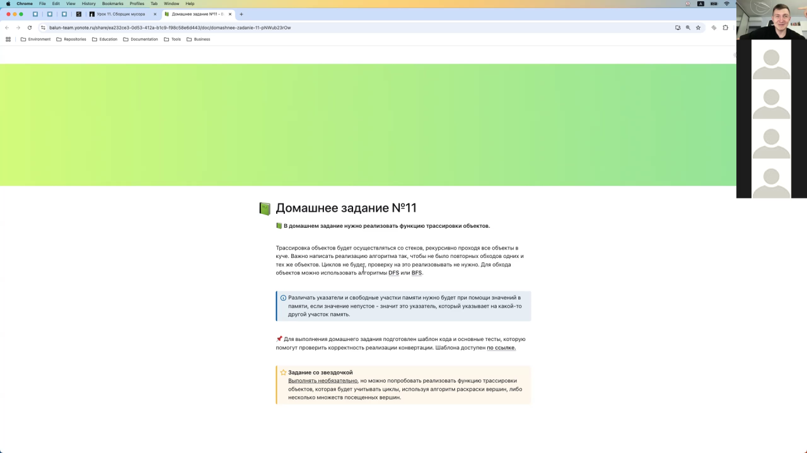

## 12. Финализаторы и RAII

**Финализатор (finalizer)** — это коллбэк, который выставляется на объект и вызывается перед тем, как объект будет очищен; один из кейсов — закрытие файла. Если память выделяется через C, хорошей практикой будет поставить финализатор, чтобы она освобождалась автоматически: иначе программист может забыть вызвать `free` и посадить утечку памяти. **RAII (Resource Acquisition Is Initialization)** — концепция и идиома C++: в конструкторе ресурс захватывается, в деструкторе освобождается; при выходе со стека деструкторы отрабатывают, и ресурсы чистятся автоматически, а умные указатели реализуют эту идиому.

```go
func NewData(name string) *Data {
	data := &Data{
		name: name,
	}

	runtime.SetFinalizer(data, func(d *Data) {
		log.Println("collected:", d)
	})

	return data
}

func CreateData() {
	data1 := NewData("one")
	data2 := NewData("two")

	log.Println("created:", data1)
	log.Println("created:", data2)
}

func main() {
	for i := 0; i < 3; i++ {
		CreateData()
		time.Sleep(time.Second)
		runtime.GC()
	}
}

type Cstr struct {
	cpointer *C.char
}

func AllocateAuto() *Cstr {
	answer := &Cstr{C.allocate()}
	runtime.SetFinalizer(answer, func(c *Cstr) {
		C.free_allocated(c.cpointer); runtime.KeepAlive(c)
	})

	return answer
}
```

*Источник: [01:38:24], [01:39:45], [01:40:42], [01:40:45], [01:42:30], [01:42:32], …*

> [!quote]- Кадр [01:40:45]
> 

## Схема

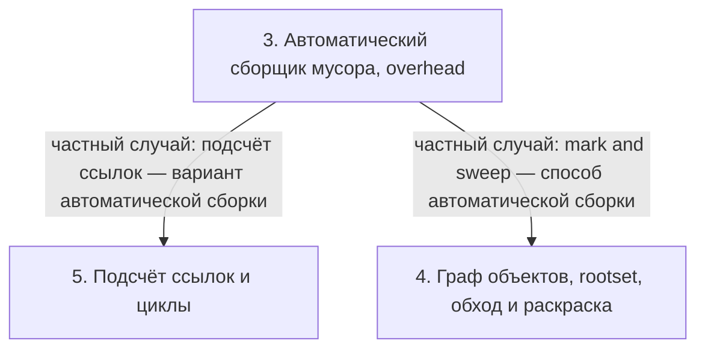

## Итог

> [!success] Что в итоге
> Мусор — это неиспользуемая память, которую следует освободить для переиспользования; управление памятью может быть ручным через `malloc`/`free` или автоматическим, основанным на подсчёте ссылок либо трассировке. Автоматическая сборка обходит граф объектов от rootset, применяя BFS и DFS, трёхцветную раскраску и обнаружение циклов, а подсчёт ссылок сталкивается с циклами, для которых применяют strong/weak-счётчики или обнаружение циклов в Python. В Go используется трассирующий mark and sweep сборщик с фазами Off, Stack scan, Mark, Mark termination и Sweep, работающий конкурентно с мутаторами через барьер записи и без поколений; настройки сводятся к `GOGC` и `GOMEMLIMIT`. Ошибки в настройках грозят OOM Killer и спиралью смерти, а снижают нагрузку переиспользованием памяти, аллокацией на стеке, финализаторами и RAII.
