# Планировщик Go и горутины

> [!abstract] Обзор
> Материал объединяет два конспекта о планировщике Go и горутинах: от понятия горутины как легковесного потока (green thread) с собственными регистрами и стеком до устройства планировщика как кода рантайма. Рассматриваются создание горутин и недетерминированность их выполнения, состояния горутин, замыкание переменной цикла и его изменение в Go 1.22, переключение контекста (context switch), вытесняющая/кооперативная многозадачность и асинхронное вытеснение. Описывается N:M/GMP-модель со структурами G, P и M, очереди GRQ и LRQ, кража горутин (work-stealing) и порядок поиска G, handoff перед syscall, пул потоков, cgo, NetPoller, sysmon и ввод-вывод. Отдельно — `GOMAXPROCS`, `runtime.Gosched`, завершение через `Goexit`, паника и `recover`, паттерн NeverExit, закрепление горутины за потоком, синхронизация вывода, арена памяти, прикладной API планировщика задач и бенчмарк.

> [!info] Курс
> [[index|Оглавление курса]]

## Оглавление
1. [[#1. Горутины и планировщик: базовые понятия]]
2. [[#2. N:M-модель и GMP: структуры G, P, M]]
3. [[#3. Очереди горутин, work-stealing и fairness]]
4. [[#4. Многозадачность, вытеснение и runtime.Gosched]]
5. [[#5. Handoff, syscall, пул потоков, cgo и закрепление за потоком]]
6. [[#6. NetPoller, sysmon и ввод-вывод]]
7. [[#7. GOMAXPROCS: значение по умолчанию и изменение]]
8. [[#8. main как первая горутина и завершение через Goexit]]
9. [[#9. Паника, recover, паттерн NeverExit и Stop the World]]
10. [[#10. Недетерминированность выполнения и замыкание переменной цикла (Go 1.22)]]
11. [[#11. Применение горутин и синхронизация вывода]]
12. [[#12. Арена памяти в Go]]
13. [[#13. Прикладной API планировщика задач, двоичные кучи и локальный бенчмарк]]

**Схема** — [[#Схема]]
**Итог** — [[#Итог]]

## 1. Горутины и планировщик: базовые понятия

**Горутина** — это легковесный поток (green thread) с собственными регистрами и стеком: стек начинается с 2 КБ и может расти до гигабайта на 64-битных системах и 512 МБ на 32-битных, а размер структуры горутины — примерно 100–200 байт, при этом память под неё можно аллоцировать где угодно, например в куче. При переключении регистры текущей горутины пушатся в её стек, затем загружаются регистры другой горутины, а при возобновлении регистры поднимаются со стека; стек не копируется — переключаются только stack pointer и base pointer. Выполнение инструкции `go` означает лишь, что горутина создана, но не обязательно запущена немедленно; рантайм Go может управлять тысячами или десятками тысяч горутин, если хватает памяти. Программисту не даётся в руки поток операционной системы — он оперирует только горутинами, а всю сложность распределения потоков ОС абстрагирует рантайм: планировщик Go — это не отдельный поток ОС и не процесс, а код рантайма, который выбирает горутину и выполняет переключение между ними. Горутина может находиться в трёх основных состояниях: **Running** (выполняется на ядре процессора), **Runnable** (готова к выполнению, но не исполняется) и **Waiting** (остановлена и ожидает syscall, Mutex или чего-то ещё).

> [!info] Зачем это нужно
> Распределение по ядрам не нужно реализовывать самим — рантайм уже реализован за нас.

*Источник: [00:00:48], [00:01:49], [00:04:09], [00:05:09], [00:06:09], [00:06:12], …*

> [!quote]- Кадр [00:00:48]
> 

> [!quote]- Кадр [00:01:49]
> 

> [!quote]- Кадр [00:25:39]
> 

> [!quote]- Кадр [00:05:09]
> 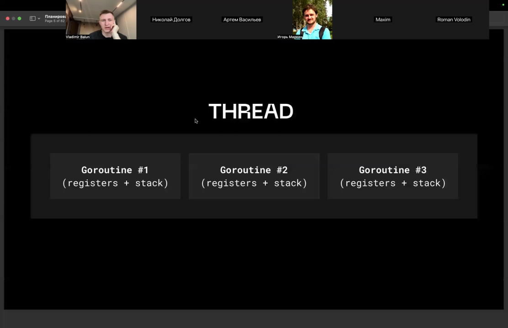

> [!quote]- Кадр [00:06:12]
> 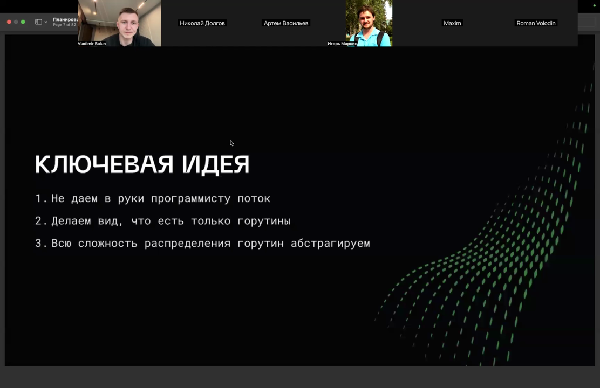

> [!quote]- Кадр [00:07:12]
> 

> [!quote]- Кадр [00:26:56]
> 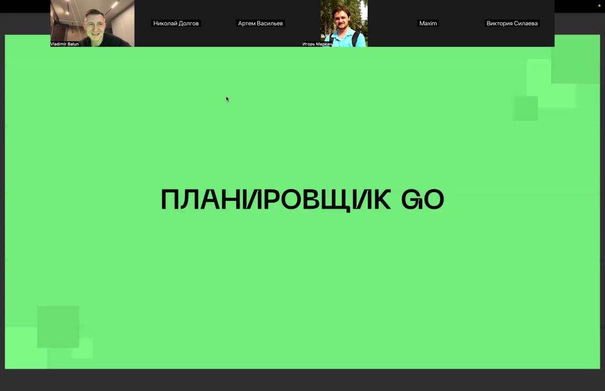

> [!quote]- Кадр [00:28:03]
> 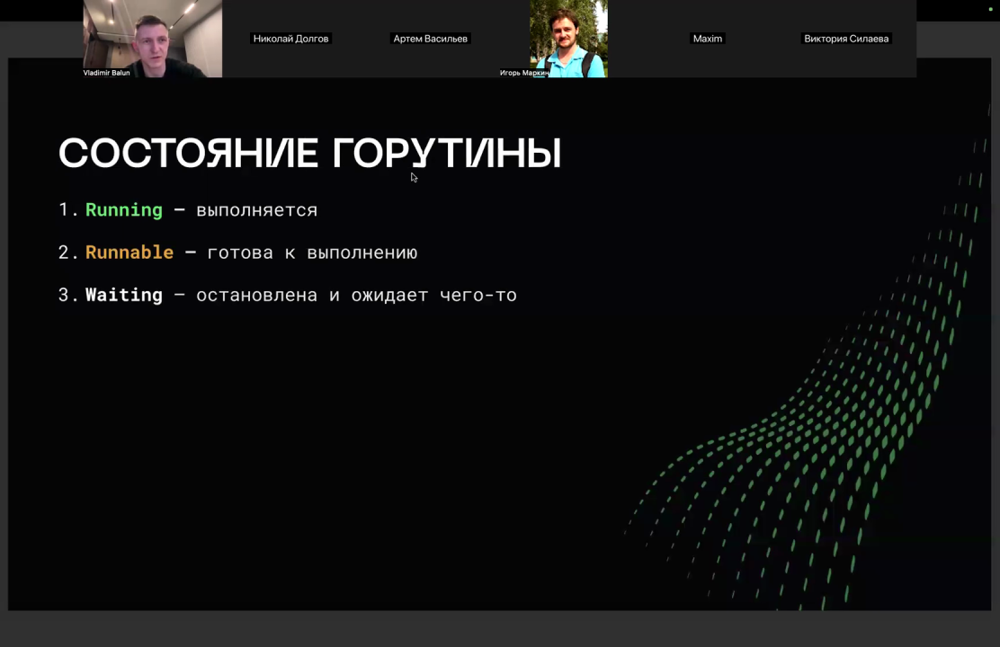

## 2. N:M-модель и GMP: структуры G, P, M

**N:M-модель** — это выполнение N горутин на M потоках операционной системы. **GMP-модель** включает **G** — Goroutine (что исполняем), **M** — Machine (где исполняем), **P** — Processor (права и ресурсы для исполнения): G, M и P — это структуры данных языка Go и абстракция. Поток операционной системы (M) всегда связан с P один к одному, а P — не аппаратный процессор, а логическая сущность, которая сопрягает локальную очередь с потоком и позволяет отсоединить поток от очереди и подключить другой; P даёт права и ресурсы для исполнения в виде горутины, кэша памяти из хипа и ресурсов, чтобы поток мог брать горутины из очереди и исполнять их.

*Источник: [00:33:22], [00:34:11], [00:35:11], [00:36:47], [00:37:27], [00:39:25], …*

> [!quote]- Кадр [00:33:22]
> 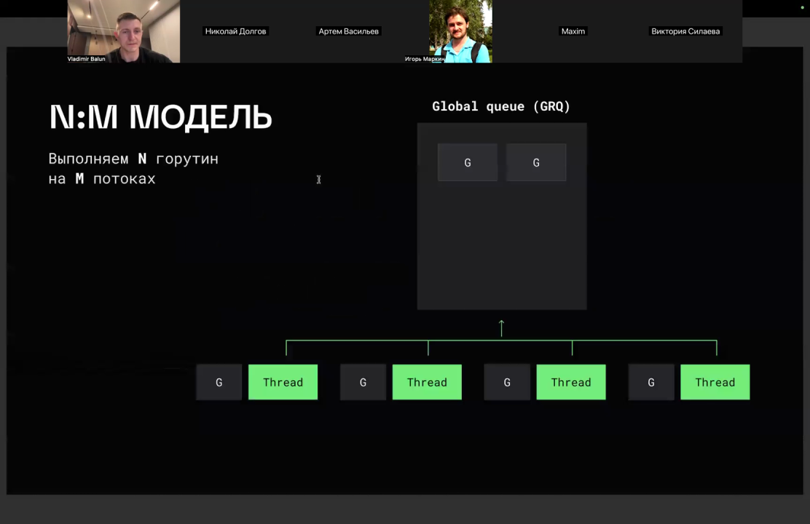

> [!quote]- Кадр [00:34:11]
> 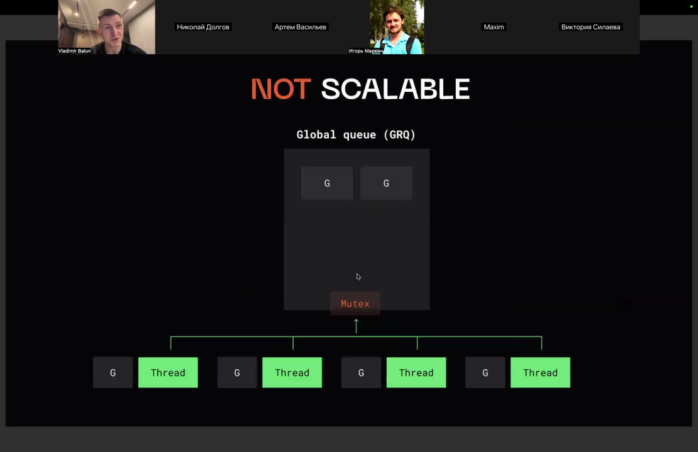

> [!quote]- Кадр [00:35:11]
> 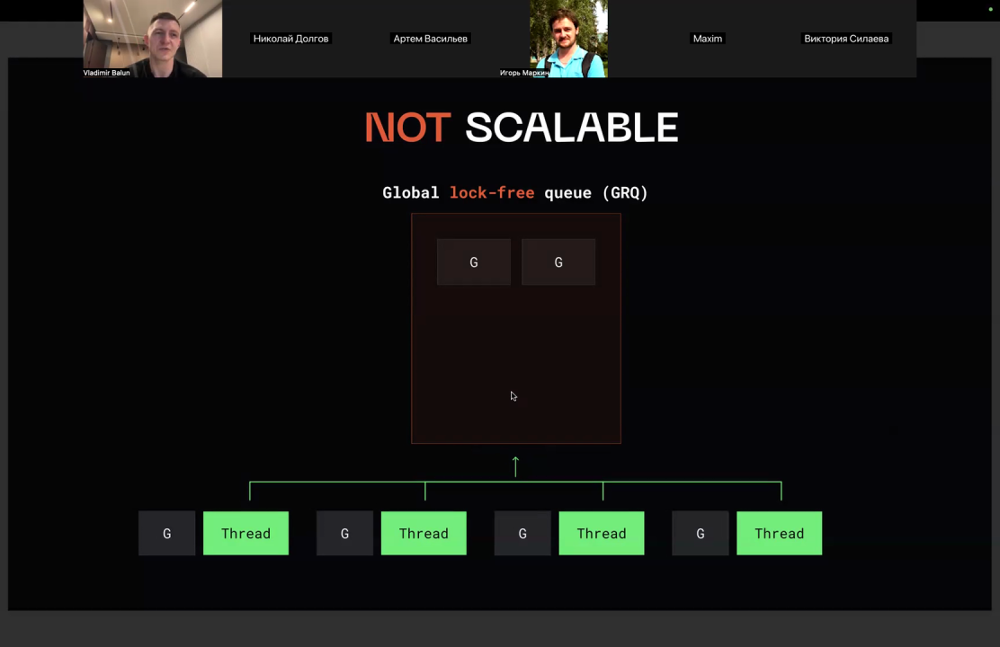

> [!quote]- Кадр [00:36:47]
> 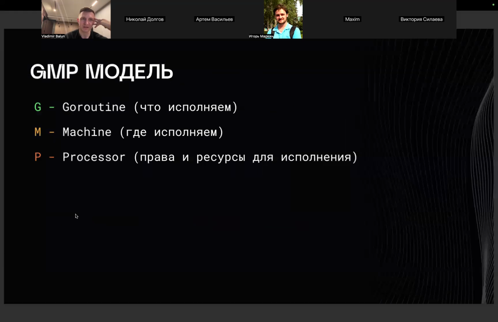

## 3. Очереди горутин, work-stealing и fairness

**GRQ (Global Runable Queue)** — глобальная очередь горутин, готовых к исполнению, содержит только Runnable и синхронизируется мьютексом. **LRQ** — пошардированная локальная очередь готовых горутин, ограниченная 256 элементами, сопрягается с P, и поток берёт горутины из своей локальной очереди, не мешая другим потокам, что устраняет контention. В runtime Go локальные очереди (LRQ) используют lock-free подход и не используют блокирующие примитивы синхронизации; подход с глобальной очередью и Mutex плохо масштабируется, и даже lock-free структуры данных масштабируются плохо. Горутина попадает в глобальную очередь, когда процессор недоступен — из-за заполненности локальной очереди или нахождения потока в syscall. Поток (M), у которого закончились горутины, **крадёт** горутины из чужой локальной очереди (LRQ, размер 256): какую именно очередь красть, выбирается случайно, делается до четырёх попыток украсть у случайных очередей, а планировщик только в 1/61 случаев проверяет глобальную очередь, затем локальную, затем 4 попытки кражи, затем глобальную и опрос сети. FIFO обеспечивает справедливость, но не прогретость кэшей; LIFO не справедлив, но улучшает прогретость кэшей; в `runtime` используются локальные очереди, однокомпонентное LIFO и справедливый FIFO, горутина берётся из LIFO и исполняется.

```
runtime.schedule() {
// only 1/61 of the time, check the global runnable queue for a G.
// if not found, check the local queue.
// if not found,
// try to steal from other Ps.
// if not, check the global runnable queue.
// if not found, poll network.
}
```

| Очередь | Синхронизация |
|---|---|
| LRQ | lock-free, блокирующие примитивы не используются |
| GRQ | мьютекс |

| Свойство | FIFO | LIFO |
| --- | --- | --- |
| Справедливость | обеспечивает | не справедлив |
| Прогретость кэшей | не обеспечивает | улучшает |

> [!info] Зачем это нужно
> Это устраняет контеншн.

*Источник: [00:29:05], [00:29:44], [00:30:14], [00:36:07], [00:36:58], [00:39:27], …*

> [!quote]- Кадр [00:36:58]
> 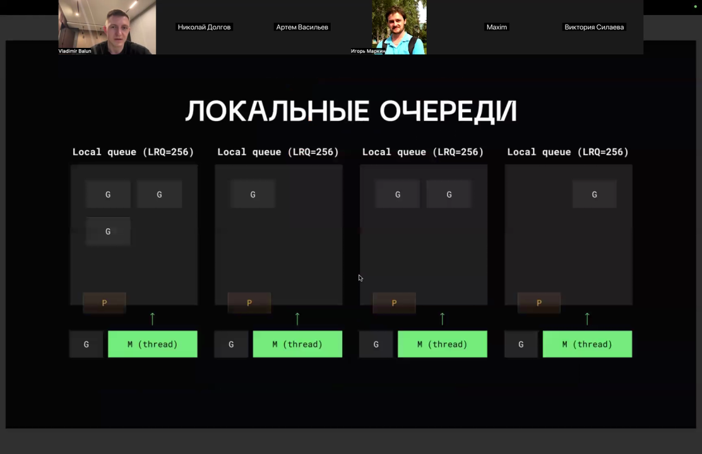

> [!quote]- Кадр [00:59:25]
> 

> [!quote]- Кадр [00:29:05]
> 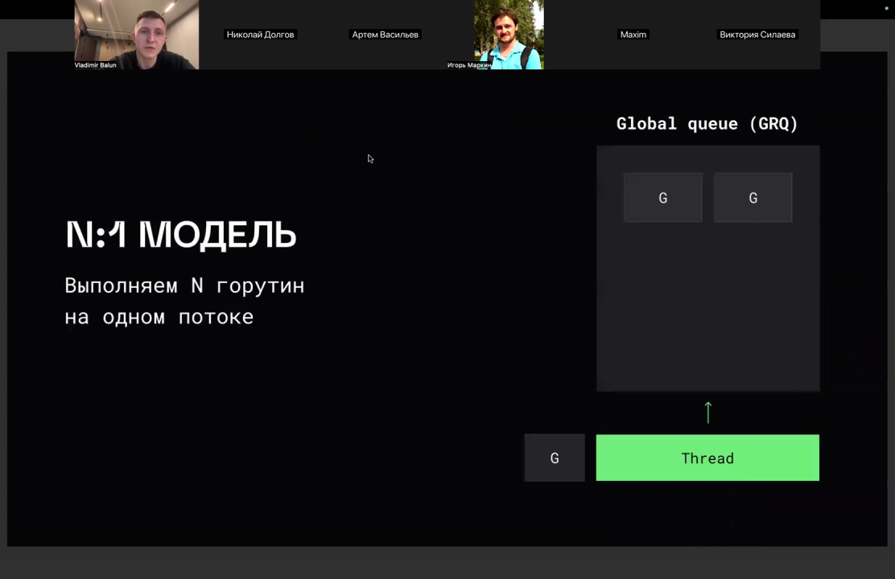

> [!quote]- Кадр [00:36:07]
> 

> [!quote]- Кадр [00:43:32]
> 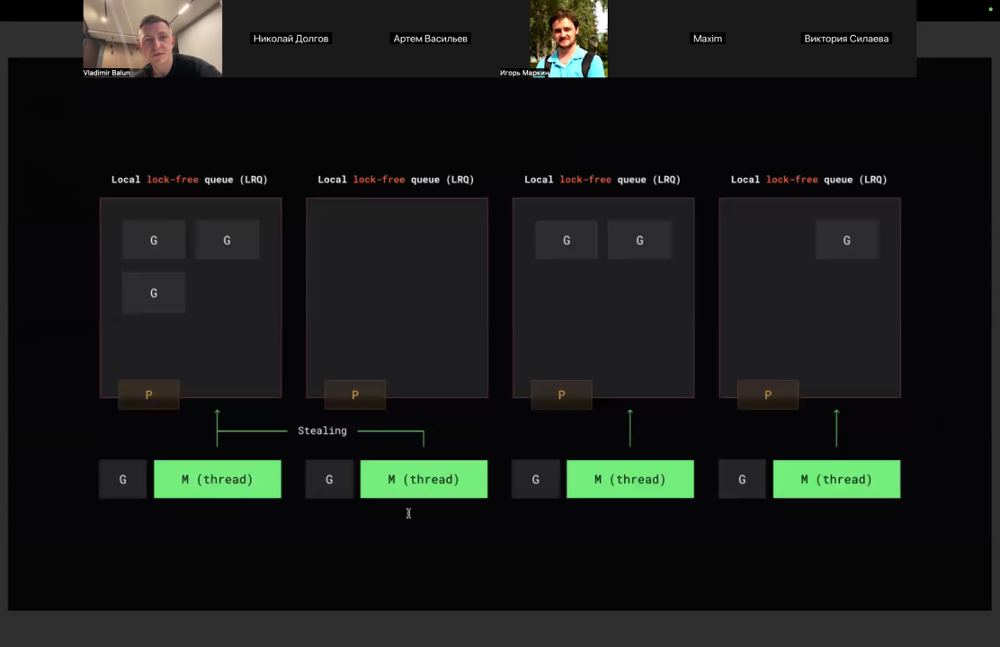

> [!quote]- Кадр [00:58:39]
> 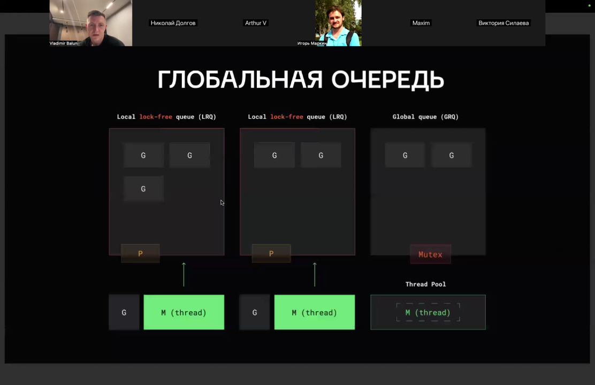

> [!quote]- Кадр [00:42:43]
> 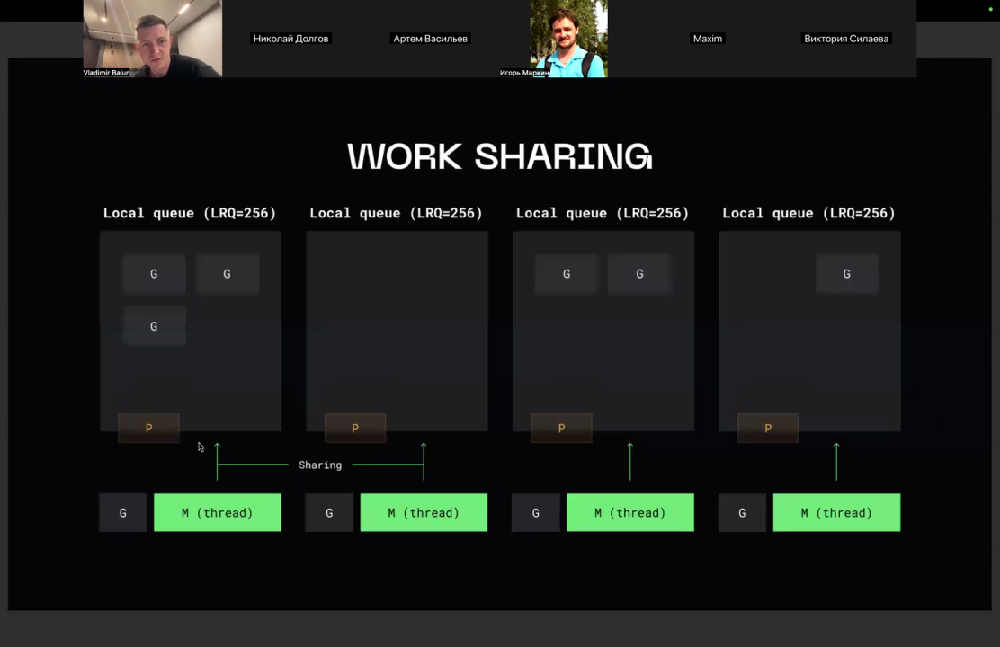

> [!quote]- Кадр [01:08:32]
> 

> [!quote]- Кадр [01:10:23]
> 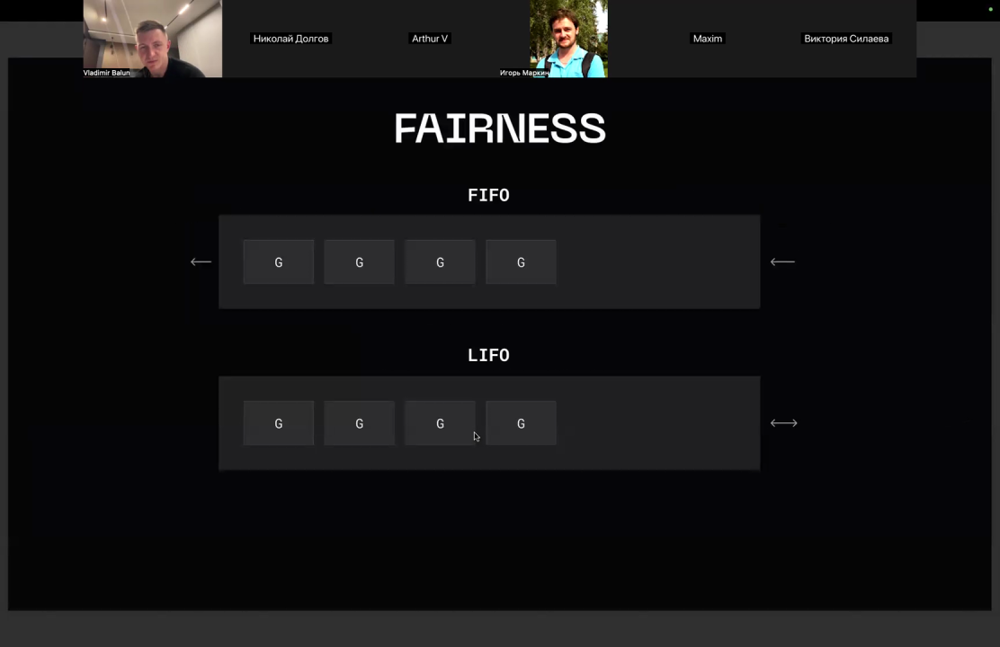

## 4. Многозадачность, вытеснение и runtime.Gosched

**Переключение контекста (context switch)** — это переключение потоков операционной системы, которым занимается ядро ОС: во время него вытесняется исполняемый поток, происходит обращение к ядру, а кэши вымываются. Чтобы этого избежать, берут поток ОС и представляют у него несколько контекстов: компилятор вставляет точку переключения в пользовательскую горутину, и переключение с одного легковесного потока на другой — это условно ассемблерный код сохранения и восстановления регистров. **Вытесняющая многозадачность** подразумевает отдельную сущность, например поток ОС, которая периодически мониторит и заставляет вытесниться; **кооперативная многозадачность** — когда сам поток отдаёт управление другому, и в Go компилятор сам вставляет в исходный код точки для переключения контекста. Если горутина работает более 10 мс, sysmon передаёт в поток сигнал SIGURG для её вытеснения, то есть вытеснение горутин является асинхронным; с версии Go 1.14 появилась асинхронно вытесняющая многозадачность, а вытеснение не происходит мгновенно, если горутина находится в unsafe point с точки зрения сборщика мусора — оно произойдёт только после выхода из этого состояния. `runtime.Gosched` просит планировщик переключиться на другую горутину; планировщик сам выбирает, какую горутину продолжить исполнять, что позволяет переключаться на бесконечную горутину при `GOMAXPROCS=1`. В примере `main` вызывает `runtime.GOMAXPROCS(1)`, запускает горутину `infiniteLoop` и вызывает `loop`; в функции `loop` на каждой итерации перед `log.Println(str)` вызывается `runtime.Gosched()`, а в функции `infiniteLoop` этого вызова нет.

```go
func infiniteLoop(str string) {
	for {
		log.Println(str)
	}
}

func loop(str string) {
	for i := 0; i < 5; i++ {
		runtime.Gosched()
		log.Println(str)
	}
}

func main() {
	runtime.GOMAXPROCS(1)
	go infiniteLoop("infinite_loop")
	loop("loop")
}
```

> [!info] Зачем это нужно
> Чтобы не делать переключение контекста в ядро, берут поток ОС с несколькими контекстами.

*Источник: [00:01:49], [00:02:27], [00:04:09], [00:24:32], [00:29:46], [00:31:04], …*

> [!quote]- Кадр [00:02:27]
> 

> [!quote]- Кадр [00:04:09]
> 

> [!quote]- Кадр [00:29:46]
> 

> [!quote]- Кадр [00:31:04]
> 

> [!quote]- Кадр [01:13:57]
> 

> [!quote]- Кадр [01:12:57]
> 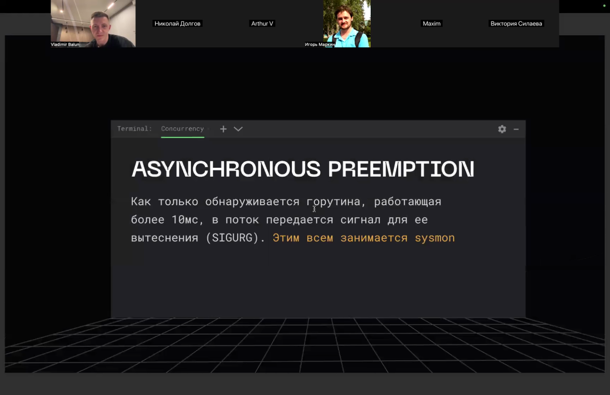

## 5. Handoff, syscall, пул потоков, cgo и закрепление за потоком

**Syscall** — это вызов к операционной системе, при котором поток ОС переходит в состояние waiting: если поток ждёт, очередь горутин никто не исполняет, и горутины начинают голодать, а связь потока M с P разрывается — это ещё одна причина, зачем нужна P. В Go есть механизм **handoff**, применяемый перед выполнением syscall: runtime разрывает указатель, связывающий M с P, создаёт отдельный поток и связывает новый поток с P — новый поток может разгребать горутины, пока исходный поток блокирован в syscall. В модели с handoff может создаваться потоков больше, чем GOMAXPROCS, а создание нового потока на каждый syscall дороже создания горутины; чтобы избежать создания новых потоков, используется **пул** (thread pool). В пуле потоков может быть больше потоков, чем ядер, и потоки переиспользуются; после системного вызова горутина пытается вернуться в тот же самый процессор P, где она была до этого, и в G сохраняется указатель на P. Когда выполняется cgo, всегда стартует отдельная горутина; рантайм Go не видит C-шный код, поэтому при вызове cgo handoff не произойдёт. Горутину можно закрепить за конкретным потоком операционной системы с использованием вызовов lock OS thread и unlock OS thread, но делать это нужно крайне редко: например, для cgo или библиотек вроде OpenGL, которые подразумевают работу из одного потока.

*Источник: [00:54:00], [00:54:39], [00:55:23], [00:55:31], [00:56:31], [00:57:31], …*

> [!quote]- Кадр [00:54:00]
> 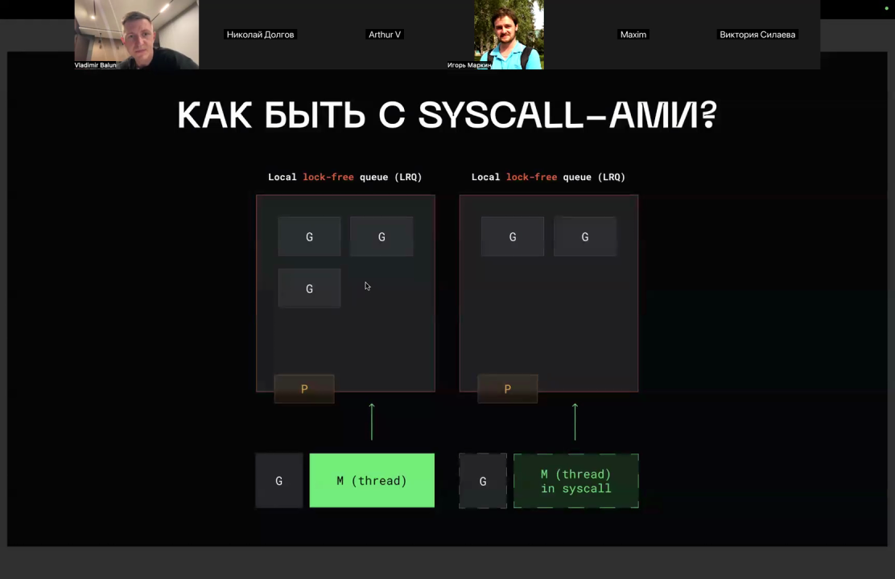

> [!quote]- Кадр [00:55:23]
> 

> [!quote]- Кадр [00:57:31]
> 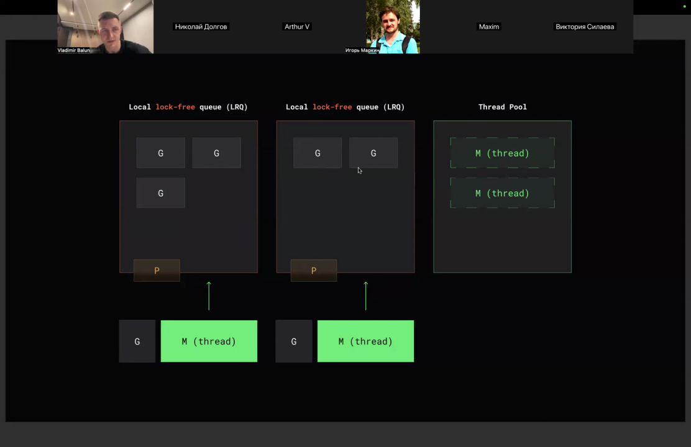

> [!quote]- Кадр [00:54:39]
> 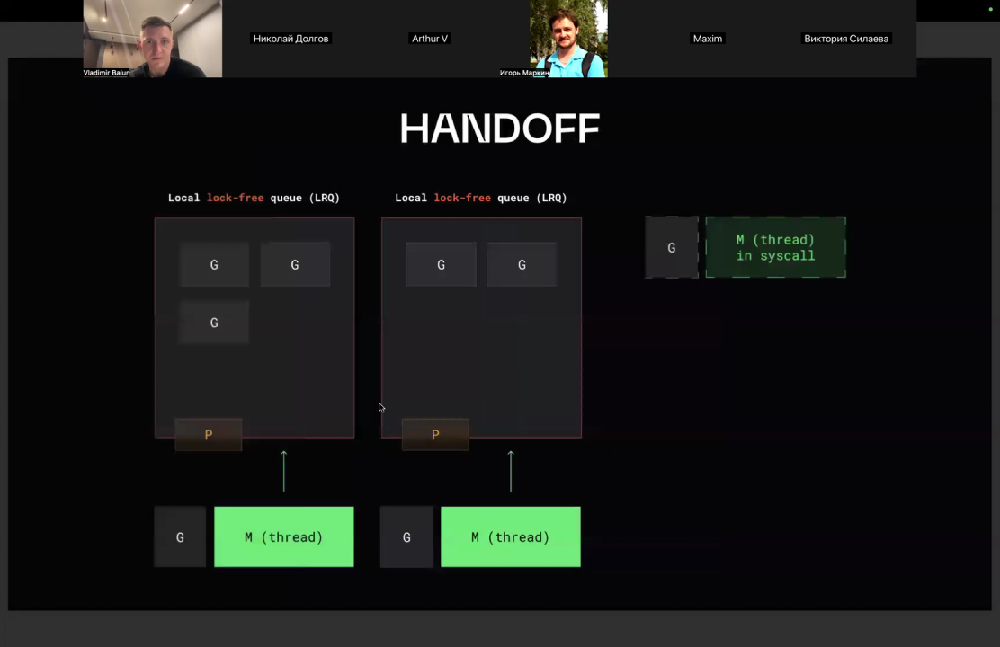

## 6. NetPoller, sysmon и ввод-вывод

Большинство серверов являются **I/O-bound**: они пишут и читают из сети, выполняя минимум действий на CPU, и горутины идеально подходят для таких нагрузок, так как при блокировке на I/O позволяют переключиться на другую задачу, обеспечивая конкурентную обработку многих запросов даже на одном ядре. **Блокирующий ввод-вывод** — режим, при котором если при чтении из сокета данных нет, поток операционной системы блокируется и остаётся заблокированным до момента появления данных. **Неблокирующий ввод-вывод** — режим, при котором выполняется системный вызов с флагом неблокирующего ввода-вывода, и если данных нет в сокете, поток ОС не блокируется, а получает статус, что данных нет, и такой сокет можно периодически опрашивать. В большинстве операционных систем есть мультиплексоры, например epoll: им передают множество файловых дескрипторов, и они сообщают, на каком дескрипторе появились события для чтения или записи. Когда горутина хочет прочитать что-то из сокета, она добавляет этот файловый дескриптор в epoll; если читать нечего, горутина переходит в состояние waiting — блокируется не поток, а горутина, и поток начинает исполнять другую горутину. Отдельный поток операционной системы **sysmon** периодически проверяет epoll; в рамках этого потока выполняется код **NetPoller**, который помечает готовую горутину как runnable, а NetPoller один для всех локалов и аккумулирует ссылки на файловые дескрипторы из всех локальных очередей.

| Режим | Поведение при отсутствии данных |
|---|---|
| Блокирующий | поток ОС блокируется до появления данных |
| Неблокирующий | поток не блокируется, получает статус, что данных нет |

> [!info] Зачем это нужно
> Опрос epoll позволяет поллить сеть, когда там что-то сработает.

*Источник: [00:11:05], [01:02:35], [01:03:35], [01:04:35], [01:05:35], [01:06:35], …*

> [!quote]- Кадр [00:11:05]
> 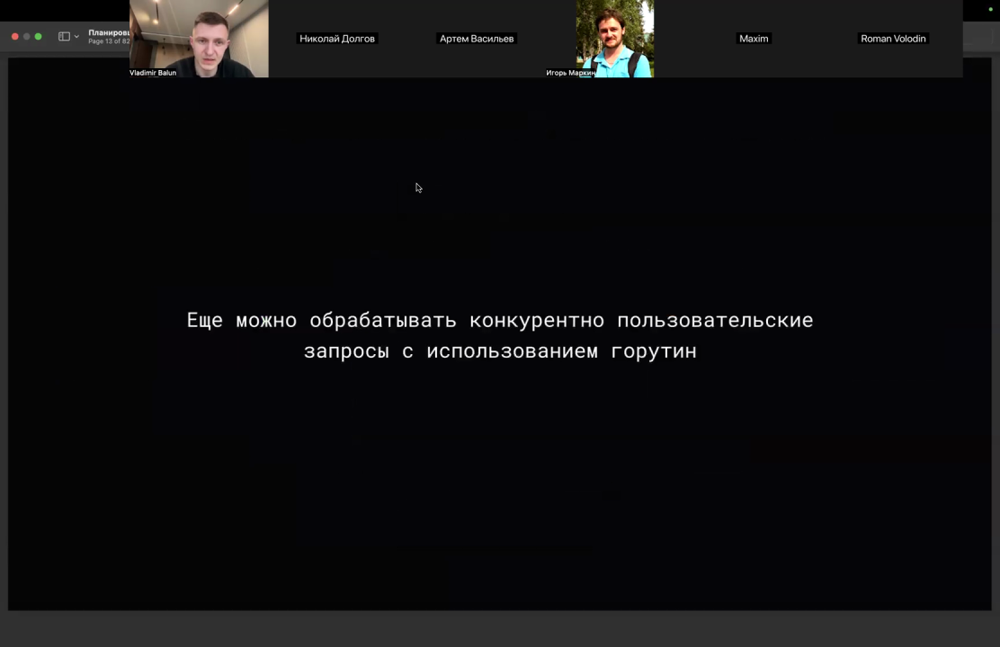

> [!quote]- Кадр [01:02:35]
> 

## 7. GOMAXPROCS: значение по умолчанию и изменение

При запуске приложения параметр `GOMAXPROCS` по умолчанию становится равным количеству логических ядер системы. `GOMAXPROCS` может выставляться из хостовой машины, а не из лимитов docker-контейнера: даже если контейнеру задан лимит на 5 или 6 ядер, `GOMAXPROCS` потянется из виртуалки с 24 или 32 логическими ядрами. При вызове с аргументом 0 `runtime.GOMAXPROCS` работает как getter и возвращает текущее значение, при передаче ненулевого значения — как setter; количество CPU, возвращаемое `runtime.NumCPU()`, при изменении `GOMAXPROCS` не изменяется. Если установить `GOMAXPROCS` больше, чем количество логических ядер, создаются дополнительные потоки операционной системы, на которых периодически происходит переключение контекста, а на серверах с многоядерными процессорами (32, 64 ядра) нужно масштабироваться, то есть использовать все аппаратные ресурсы. `GOMAXPROCS` можно менять через переменную окружения перед запуском или в рантайме; если менять его в рантайме, появляется Stop the World, поэтому в рантайме с этим, наверное, не стоит заниматься.

```go
package main

import (
	"fmt"
	"runtime"
)

func main() {
	runtime.GOMAXPROCS(1)

	var i int
	go func() {
		for {
			i++
		}
	}()

	fmt.Println(i)
}

package main

import (
	"fmt"
	"runtime"
)

func main() {
	fmt.Println("GOMAXPROCS:", runtime.GOMAXPROCS(0))
	fmt.Println("CPU:", runtime.NumCPU())
	runtime.GOMAXPROCS(16)
	fmt.Println("GOMAXPROCS:", runtime.GOMAXPROCS(0))
	fmt.Println("CPU:", runtime.NumCPU())
}
```

*Источник: [00:22:57], [00:33:15], [00:37:52], [00:37:55], [00:38:55]*

## 8. main как первая горутина и завершение через Goexit

При запуске функции `main` уже существует одна горутина, поэтому `runtime.NumGoroutine()` выводит 1, даже если ничего не запускалось; `main` — это первая горутина, из неё запускаются остальные, а программа на Go завершается, когда завершается функция `main`. Когда `main`-горутина завершается, остальные горутины останавливаются на том месте, где находились, при этом вызываются `defer`. Если горутина завершается через `runtime.Goexit`, у этой горутины будут вызваны `defer`, а `defer` в других горутинах не будут вызваны; вызов `Goexit` из main-горутины завершает горутину, но без выхода из функции `main`, и приложение может продолжить работать. Вызов `Goexit` из потока, не созданного Go runtime, приводит к краху программы; программа продолжает работу, пока остаются другие горутины, а если все остальные горутины завершатся, программа падает.

```go
package main

import (
	"fmt"
	"runtime"
)

func main() {
	fmt.Printf("Goroutines: %d\n", runtime.NumGoroutine())
}

func main() {
	go func() {
		defer fmt.Println("hello")
		for {
		}
	}()

	time.Sleep(1 * time.Second)
}
```

*Источник: [00:08:19], [00:09:00], [01:18:07], [01:20:16], [01:21:01], [01:22:01], …*

> [!quote]- Кадр [01:24:03]
> 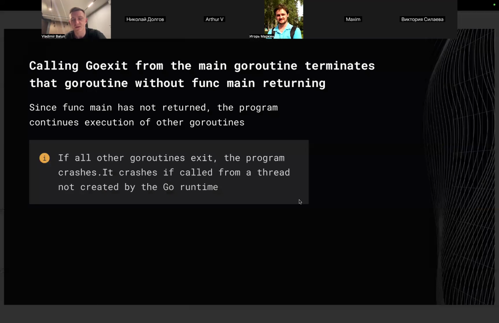

## 9. Паника, recover, паттерн NeverExit и Stop the World

Когда паника долетает до верхушки стека, неважно, в какой горутине она возникла, весь процесс крашится; поэтому паника в обработчике клиента приводит к падению всего сервера, что затронет все конкурентные запросы. Панику, возникшую в одной горутине, нельзя перехватить из другой: у каждой горутины свой стек, и раскрутка стека происходит только в ней. В веб-серверах, где на каждый запрос создаётся отдельная горутина, панику в хендлере следует перехватывать через `recover`. **NeverExit** оборачивает действие (action) и через `defer`/`recover` перехватывает панику, возникающую при его выполнении: при `v != nil` функция логирует сообщение и запускает новую горутину `go NeverExit(name, action)` с теми же `name` и `action`, так выполнение `action` перезапускается после паники; этот самовызов не является рекурсией, так как выполняется в другой горутине с отдельным стеком. При панике и раскрутке стека Stop the World не выполняется.

```go
func process() {
	defer func() {
		v := recover()
		fmt.Println("recovered:", v)
	}()

	go func() {
		panic("error")
	}()

	time.Sleep(time.Second)
}

func ClientHandler(c net.Conn) {
	panic(errors.New("internal error"))
}

func NeverExit(name string, action func()) {
	defer func() {
		if v := recover(); v != nil {
			log.Println(name, "is crashed - restarting...")
			go NeverExit(name, action)
		}
	}()

	if action != nil {
		action()
	}
}

func main() {
	go NeverExit("first_goroutine", task)
	go NeverExit("second_goroutine", task)

	time.Sleep(time.Second)
}
```

> [!info] Зачем это нужно
> Цель — перехватить панику из дочерней горутины в родительской.

*Источник: [00:13:13], [00:15:17], [00:16:17], [00:16:48], [00:16:53], [00:16:57], …*

## 10. Недетерминированность выполнения и замыкание переменной цикла (Go 1.22)

Горутины создают, чтобы распараллелить задачи, которые потенциально можно выполнить синхронно; порядок выполнения недетерминирован: запуск горутины может произойти спустя какое-то время, и горутина может не успеть отработать до завершения приложения. Планировщик операционной системы и планировщик Go недетерминированы, поэтому нельзя точно сказать, что будет выведено. При использовании `go` в цикле переменная `i` замыкается и становится общей для всех горутин: горутина-замыкание и `main` используют одну и ту же переменную `i`, у неё не своя копия; чтобы дождаться выполнения, можно поставить sleep или использовать примитивы синхронизации. В версиях Go до 1.22 переменная цикла создавалась один раз и менялась в последующих итерациях, поэтому горутины могли выводить одинаковые значения; начиная с Go 1.22 каждой итерации соответствует своя переменная: переменная в теле цикла создаётся заново на каждой итерации, а не один раз, и выводятся корректные значения.

```go
package main

import (
	"fmt"
	"time"
)

func main() {
	for i := 0; i < 5; i++ {
		go func() {
			fmt.Print(i)
		}()
	}

	time.Sleep(2 * time.Second)
}
```

> [!info] Зачем это нужно
> Горутины создают, чтобы распараллелить задачи, которые потенциально можно выполнить синхронно.

*Источник: [00:09:55], [00:19:02], [00:20:02], [00:20:43], [00:20:58], [00:21:58]*

## 11. Применение горутин и синхронизация вывода

Частый случай в Go — конкурентная обработка пользовательских запросов с использованием горутин; как правило, каждый клиент обрабатывается отдельной горутиной. `Listener` представляет собой серверный сокет; системный вызов `Accept` возвращает клиентский сокет, когда кто-то подключается на порт, и полученное соединение (connection) передают в отдельную горутину для обработки: в цикле после `Accept` для обработки каждого соединения запускается горутина `ClientHandler`. **Сортировка слиянием** разбивает массив на части и затем сливает их в отсортированном порядке; этот процесс может быть реализован последовательно, а для параллельной реализации можно разделить множество данных пополам и создать отдельные горутины для выполнения работы — это возможно, если позволяют ресурсы компьютера, например при наличии двухъядерного процессора. `log.Println` синхронизирует операции, поэтому сообщения, напечатанные двумя горутинами, не будут перепутаны или перемешаны в одной строке; при использовании `fmt.Println` из множества горутин можно столкнуться с перемешиванием сообщений.

```go
for {
		conn, err := listener.Accept()
		if err != nil {
			log.Println(err)
		}

		go ClientHandler(conn)
	}
```

| Реализация | Как устроена |
|---|---|
| Последовательная | разбиение и слияние выполняются последовательно |
| Параллельная | данные делятся пополам, создаются отдельные горутины |

*Источник: [00:10:18], [00:10:45], [00:11:05], [00:12:05], [00:12:16], [00:13:04], …*

> [!quote]- Кадр [00:10:18]
> 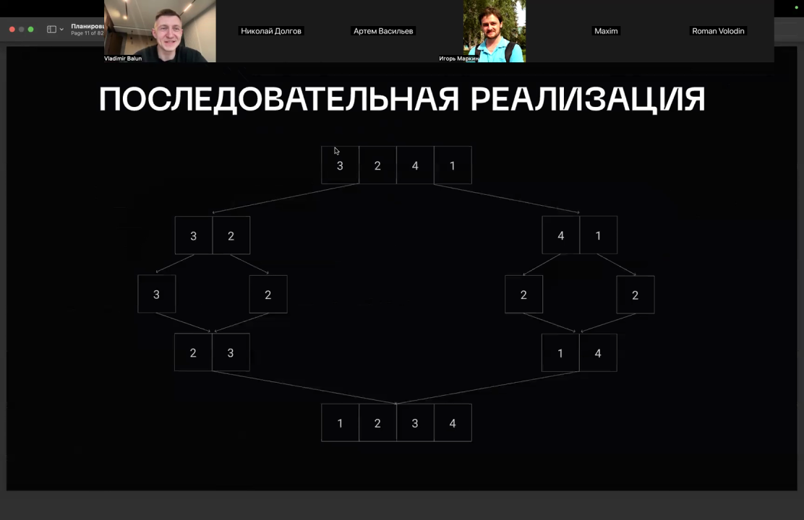

> [!quote]- Кадр [00:10:45]
> 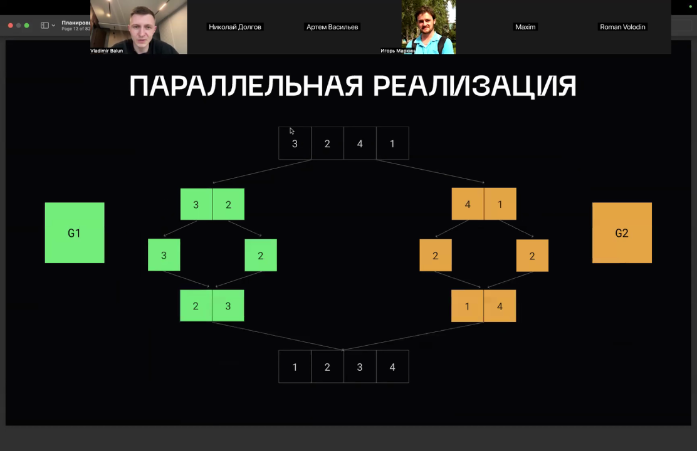

> [!quote]- Кадр [00:11:05]
> 

## 12. Арена памяти в Go

Go выделяет память большими участками сразу, потому что рантайм Go не любит сисколы. Размер арены на Linux — 64 мегабайта, но он не фиксирован и может быть разным в разных операционных системах.

> [!info] Зачем это нужно
> Рантайм Go не любит сисколы, поэтому память выделяется большими участками сразу.

*Источник: [00:53:30]*

> [!quote]- Кадр [00:53:30]
> 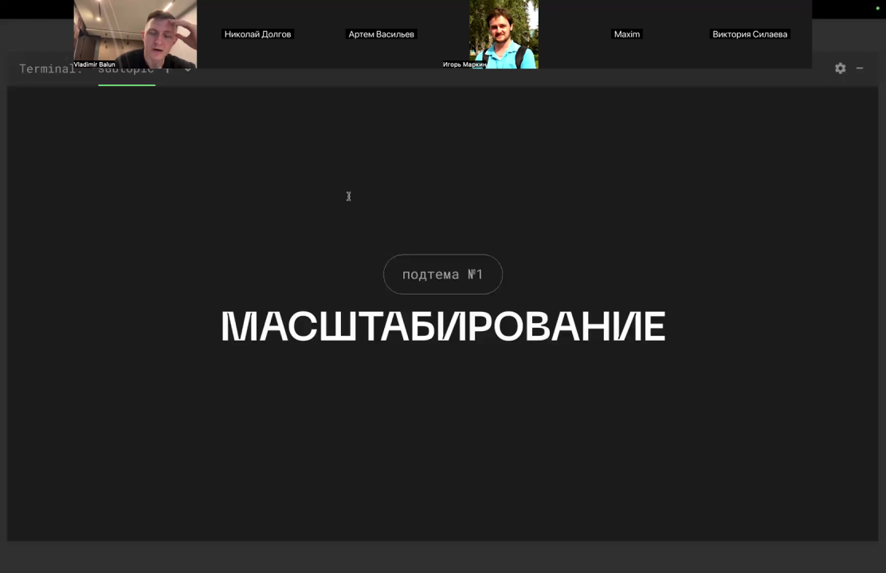

## 13. Прикладной API планировщика задач, двоичные кучи и локальный бенчмарк

Планировщик представлен структурой `Scheduler`, задача описывается структурой `Task` с полями `Identifier` и `Priority`. `Scheduler` имеет методы `AddTask`, `ChangeTaskPriority` и `GetTask`. Метод `ChangeTaskPriority` позволяет изменить приоритет задачи по её идентификатору, причём приоритет можно менять после того, как задача уже была запланирована в планировщике; для реализации приоритетного планирования задач могут помочь двоичные кучи. В локальном случае для сравнения двух решений достаточно конкретного бенчмарка; такой бенчмарк проводится на числах, не связанных с загрузкой CPU, и если одно из решений выполняется меньше по времени, оно будет меньше потреблять процессора.

```go
type Task struct {
    Identifier int
    Priority   int
}

type Scheduler struct { ... }

func NewScheduler() Scheduler        // создать планировщик
func (s *Scheduler) AddTask(task Task) // запланировать задачу
func (s *Scheduler) ChangeTaskPriority(taskID int, newPriority int) // изменить приоритет задачи
func (s *Scheduler) GetTask() Task   // получить задачу с наибольшим приоритетом
```

*Источник: [01:30:38], [01:30:40], [01:31:08], [01:33:32]*

## Схема

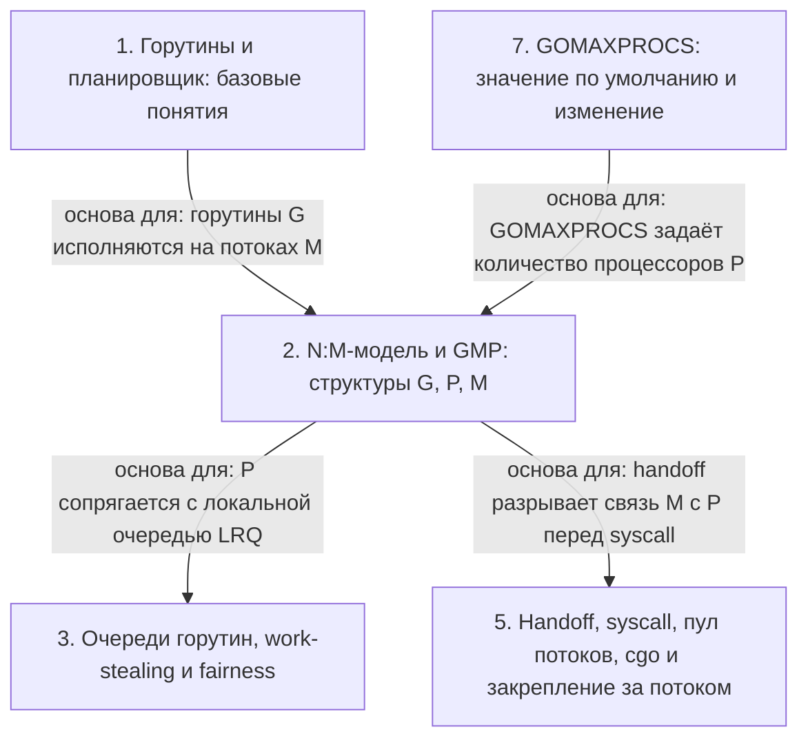

## Итог

> [!success] Что в итоге
> Планировщик Go — это код рантайма, который абстрагирует потоки ОС и выбирает горутины через N:M/GMP-модель, локальные lock-free очереди LRQ=256 и глобальную GRQ с мьютексом. Горутина — легковесный поток с собственными регистрами и стеком, переключением которых занимается планировщик, что позволяет обходиться без прыжка в ядро. При нехватке работы применяются work-stealing, handoff перед syscall и опрос epoll через NetPoller, а долгие горутины вытесняются асинхронно сигналом SIGURG от sysmon. Панику в отдельной горутине нельзя перехватить из другой, что требует `recover` в хендлерах.
