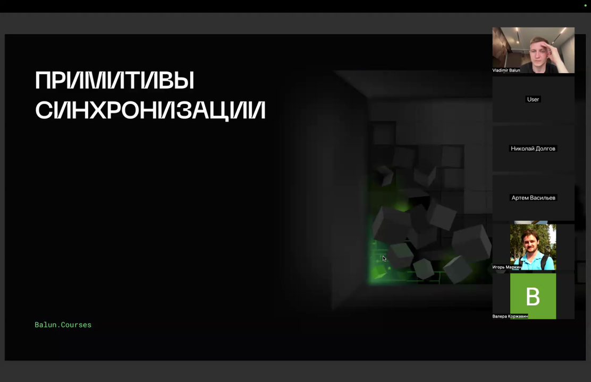
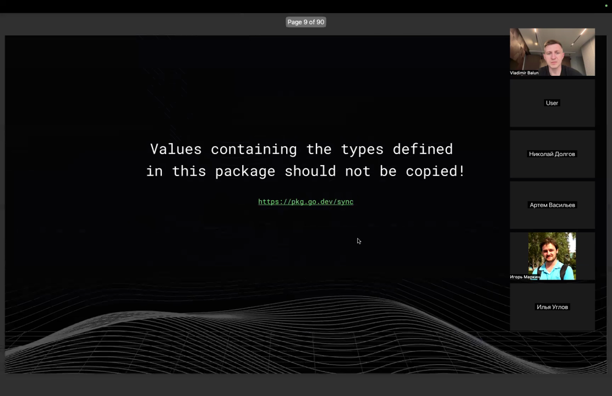
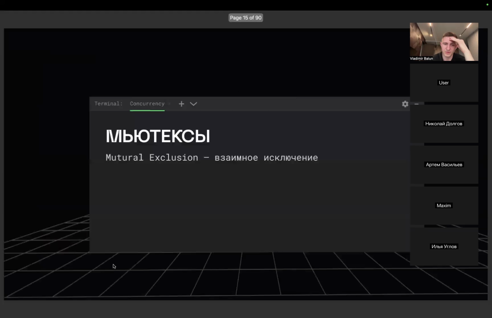
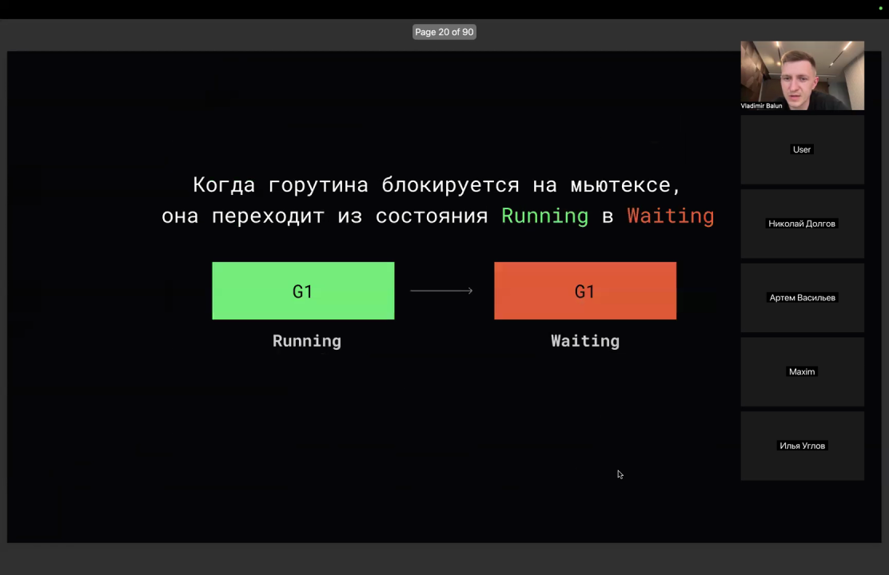
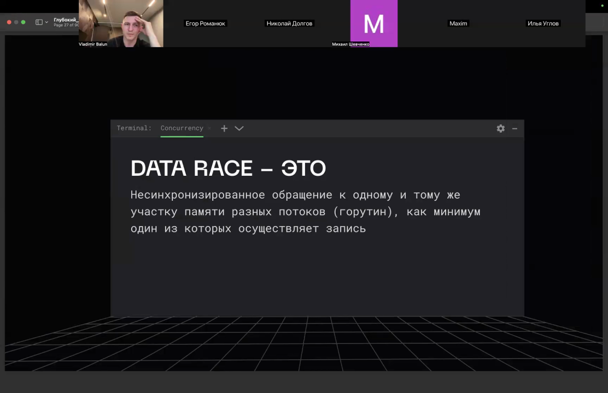
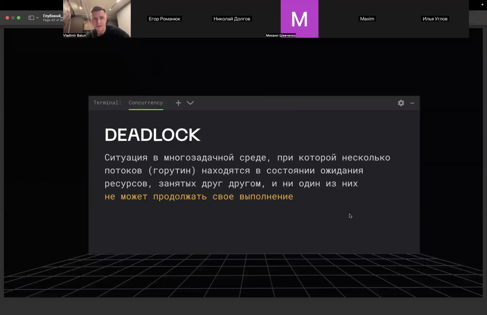
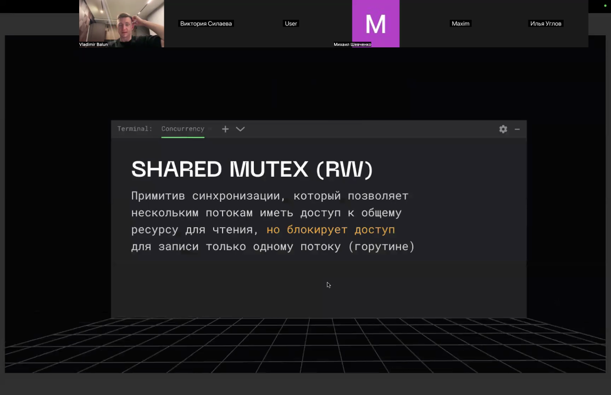
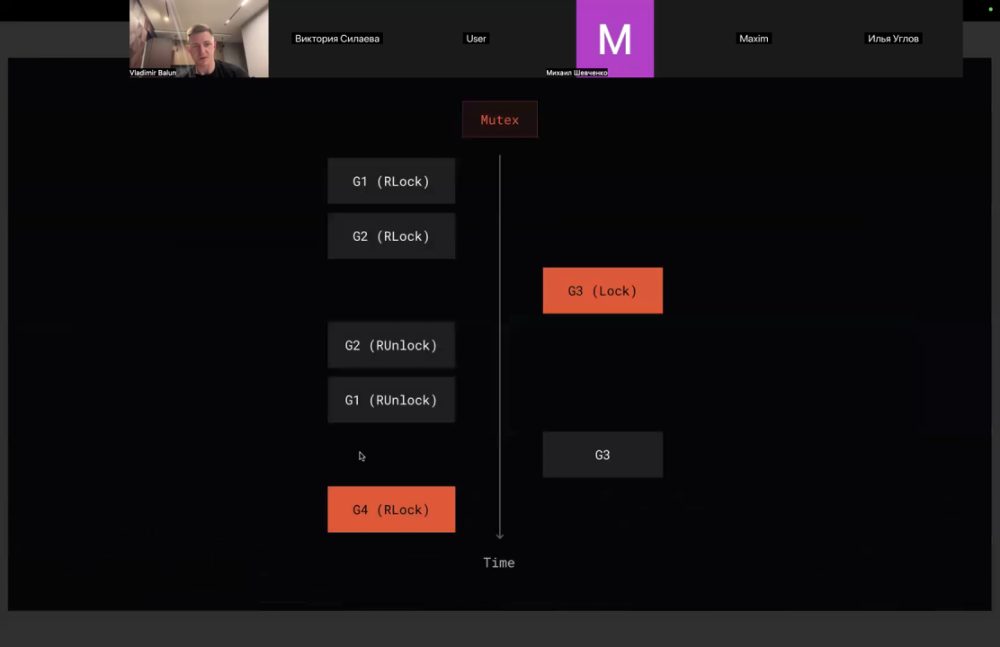
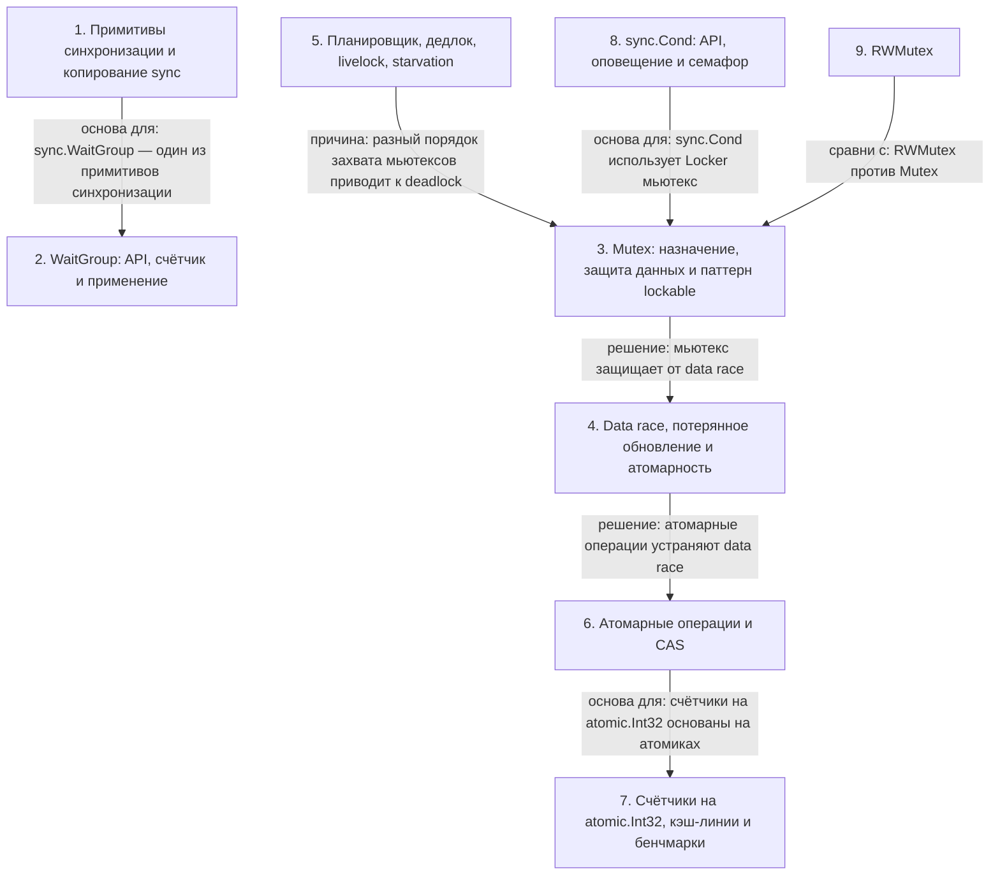

# Примитивы синхронизации в Go

> [!abstract] Обзор
> Материал посвящён примитивам синхронизации в Go и проблемам конкуренции. Разбираются `sync.WaitGroup`, мьютексы (`sync.Mutex`, `RWMutex`), атомарные операции из `sync/atomic`, `sync.Cond` и паттерн lockable, а также data race, дедлок (deadlock), livelock, голодание (starvation) и отличие data race от race condition. Показаны API и поведение этих примитивов, защита счётчика и общей памяти мьютексом, гранулярность блокировки и инкапсуляция синхронизации. Обсуждаются CAS и lock-free структуры, инициализация через `atomic.Bool`, а также конкуренция за кэш-линии: true sharing, ложное разделение (false sharing) и шардирование счётчика. Отдельно — высоконагруженные системы: нагрузка не определяет сложность, описаны очереди для потока трейсов и write-intensive приложение.

> [!info] Курс
> [[index|Оглавление курса]]

## Оглавление
1. [[#1. Примитивы синхронизации и копирование sync]]
2. [[#2. WaitGroup: API, счётчик и применение]]
3. [[#3. Mutex: назначение, защита данных и паттерн lockable]]
4. [[#4. Data race, потерянное обновление и атомарность]]
5. [[#5. Планировщик, дедлок, livelock, starvation]]
6. [[#6. Атомарные операции и CAS]]
7. [[#7. Счётчики на atomic.Int32, кэш-линии и бенчмарки]]
8. [[#8. sync.Cond: API, оповещение и семафор]]
9. [[#9. RWMutex]]
10. [[#10. Высоконагруженные системы: нагрузка, очередь, write-intensive]]

**Схема** — [[#Схема]]
**Итог** — [[#Итог]]

## 1. Примитивы синхронизации и копирование sync

**Примитивы синхронизации** обеспечивают блокирование одного или нескольких потоков (горутин) до момента поступления сигнала от других потоков о выполнении некоторого условия. В языке Go при взаимодействии с конкурентностью нужно знать основные примитивы синхронизации. Значения, содержащие типы из пакета `sync`, **не должны копироваться**: копирование может приводить к непонятным последствиям и плавающим багам, особенно при конкуренции, а без указателя mutex копируется всё время; правило распространяется на все объекты из пакета `sync`.

*Источник: [00:00:02], [00:05:22], [00:58:16]*

> [!quote]- Кадр [00:00:02]
> 

> [!quote]- Кадр [00:05:22]
> 

## 2. WaitGroup: API, счётчик и применение

`sync.WaitGroup` позволяет дождаться завершения множества горутин: API состоит из `Add`, `Done` и `Wait`. `Add` увеличивает счётчик, `Done` уменьшает на единицу, `Wait` блокируется, пока счётчик не обнулится; уход счётчика в минус вызывает панику, а при нулевом счётчике `Wait` не блокируется. WaitGroup можно передавать **только по указателю**: при передаче по значению копируется счётчик, декремент идёт по копии, и `main` может остаться заблокированной. Вместо `wg.Add(1)` для каждой горутины можно один раз вызвать `wg.Add(n)`, что заменяет n атомарных инкрементов на один. **Worker Pool** обычно реализуют через WaitGroup, чтобы дождаться воркеров, но она не обязательна, если воркер разгребает оставшиеся задачи по сигналу.

```go
type WaitGroup struct { ... }

func (wg *WaitGroup) Add(delta int) // увеличивает счетчик
func (wg *WaitGroup) Done()        // уменьшает счетчик на единицу
func (wg *WaitGroup) Wait()        // блокируется, пока счетчик не об

package main

import "sync"

func makeNegativeCounter() {
wg := sync.WaitGroup{}
wg.Add(-10)
}

func waitZeroCounter() {
wg := sync.WaitGroup{}
wg.Wait()
}

func main() {
waitZeroCounter()
}

package main

import (
	"fmt"
	"sync"
)

func main() {
	var wg sync.WaitGroup
	for i := 1; i <= 5; i++ {
		wg.Add(1)
		go func(i int) {
			defer wg.Done()
			fmt.Println(i)
		}(i)
	}
	wg.Wait()
}

package main

import "sync"

func done(wg *sync.WaitGroup) {
	wg.Done()
}

func main() {
	wg := sync.WaitGroup{}
	wg.Add(1)
	done(&wg)
	wg.Wait()
}

func main() {
	var wg sync.WaitGroup
	wg.Add(5)

	for i := 0; i < 5; i++ {
		go func() {
			defer wg.Done()
			log.Println("test")
		}()
	}

	wg.Wait()
}

func main() {
	mutex := sync.Mutex{}
	wg := sync.WaitGroup{}
	wg.Add(1000)

	value := 0
	for i := 0; i < 1000; i++ {
		go func() {
			defer wg.Done()
			mutex.Lock()
			value++
			mutex.Unlock()
		}()
	}
	wg.Wait()
	fmt.Println(value)
}

func IncrementAndGet(pointer *int32) int32 {
	for {
		currentValue := atomic.LoadInt32(pointer)
		nextValue := currentValue + 1
		if atomic.CompareAndSwapInt32(pointer, currentValue, nextValue) {
			return nextValue
		}
	}
}

import (
	"fmt"
	"sync"
)

var value int
var mutex sync.Mutex

func inc() {
	mutex.Lock()
	value++
	mutex.Unlock()
}

func main() {
	wg := sync.WaitGroup{}
	wg.Add(1000)

	for i := 0; i < 1000; i++ {
		go func() {
			defer wg.Done()
			inc()
		}()
	}
}

var value int32
for i := 0; i < 1000; i++ {
	go func() {
		defer wg.Done()
		atomic.AddInt32(&value, 1)
	}()
}

wg.Wait()

fmt.Println(value)

func (c *MutexCounter) Increment(int) {
	c.mutex.Lock()
	defer c.mutex.Unlock()
	c.value++
}

func (c *MutexCounter) Get() int32 {
	c.mutex.Lock()
	defer c.mutex.Unlock()
	return c.value
}

if *addr == old {
    *addr = new
    return true
}

return false

func (rw *RWMutex) Lock()        // блокировать на запись
func (rw *RWMutex) RLock()       // блокировать на чтение
func (rw *RWMutex) RLocker() Locker // возвращает интерфейс Locker, реализуя методы RLock и RUnlock
func (rw *RWMutex) RUnlock()     // разблокировать запись
func (rw *RWMutex) Unlock()      // разблокировать чтение

type RMutex struct { ... }

func (m *RMutex) Lock()   // захватить мьютекс на запись
func (m *RMutex) Unlock() // освободить мьютекс на запись
func (m *RMutex) RLock()  // захватить мьютекс на чтение
func (m *RMutex) RUnlock() // освободить мьютекс на чтение
```

> [!info] Зачем это нужно
> Вместо сна неизвестной длительности используется `wg.Wait()`.

*Источник: [00:00:47], [00:01:47], [00:02:45], [00:02:47], [00:03:07], [00:04:15], …*

> [!quote]- Кадр [00:05:22]
> 

> [!quote]- Кадр [00:06:22]
> 

## 3. Mutex: назначение, защита данных и паттерн lockable

**Mutex** обеспечивает взаимное исключение: только одна горутина может войти в критическую секцию, пока не покинет её; Mutex должен быть общим для всех горутин. Методы `Lock`, `Unlock` и `TryLock` позволяют захватить, освободить или попытаться захватить мьютекс; при занятом мьютексе `Lock` блокирует горутину, а `TryLock` возвращает `false`. Чтобы решить data race, доступ к общей памяти оборачивают в `Mutex.Lock` и `Mutex.Unlock`, а после чтения значения в локальную переменную вывод можно делать без синхронизации; лишние действия под блокировкой нежелательны, и мьютекс следует инкапсулировать внутри типа, используя `defer` для `Unlock`. В API структуры может быть неочевидная проблема, например рекурсивная блокировка, приводящая к дедлоку; методы с суффиксом `locked` подразумевают, что мьютекс уже захвачен. **Паттерн lockable** — это встраивание `sync.Mutex` в структуру, например `Lockable[T]` с полем `Data` типа `T`, для синхронизации доступа к данным любого типа.

```go
type Mutex struct { ... }

func (m *Mutex) Lock()        // захватить мьютекс
func (m *Mutex) Unlock()      // освободить мьютекс
func (m *Mutex) TryLock() bool // попробовать захватить мьютекс

mutex.Lock()
value++
mutex.Unlock()

package main

import (
	"fmt"
	"sync"
)

var mutex sync.Mutex
var cache map[string]string

func doSomething() {
	mutex.Lock()
	item := cache["key"]
	fmt.Println(item)
	mutex.Unlock()
}

type Buffer struct {
	mtx  sync.Mutex
	data []int
}

func NewBuffer() *Buffer {
	return &Buffer{}
}

func (b *Buffer) Add(value int) {
	b.mtx.Lock()
	defer b.mtx.Unlock()
	b.data = append(b.data, value)
}

func (b *Buffer) Data() []int {
	b.mtx.Lock()
	defer b.mtx.Unlock()
	return b.data
}

mutex := sync.Mutex{}
wg := sync.WaitGroup{}
wg.Add(1000)

value := 0
for i := 0; i < 1000; i++ {
	go func() {
		defer wg.Done()
		mutex.Lock()
		value++
		mutex.Unlock()
	}()
}
wg.Wait()
fmt.Println(value)

var value int
var mutex sync.Mutex

func inc() {
	mutex.Lock()
	value++
	mutex.Unlock()
}

func main() {
	var wg sync.WaitGroup
	var mutex sync.Mutex
	text := ""

	wg.Add(1)
	go func() {
		defer wg.Done()
		mutex.Lock()
		text = "hello world"
		mutex.Unlock()
	}()

	wg.Wait()
	wg.Add(1)

	go func() {
		defer wg.Done()
		mutex.Lock()
		fmt.Println(text)
		mutex.Unlock()
	}()

	wg.Wait()
}

var mutex sync.Mutex
var cache map[string]string

func doSomething() {
	mutex.Lock()
	item := cache["key"]
	fmt.Println(item)
	mutex.Unlock()
}

func (b *Stack) Pop() {
	if len(b.data) < 0 {
		panic("pop: stack is empty")
	}

	b.mutex.Lock()
	defer b.mutex.Unlock()

	b.data = b.data[:len(b.data)-1]
}

func (b *Stack) Push(value string) {
	b.mutex.Lock()
	defer b.mutex.Unlock()

	b.data = append(b.data, value)
}

func (b *Stack) Push(value string) {
	b.mutex.Lock()
	defer b.mutex.Unlock()

	b.data = append(b.data, value)
}

func (b *Stack) Pop() {
	b.mutex.Lock()
	defer b.mutex.Unlock()

	if len(b.data) == 0 {
		panic("pop: stack is empty")
	}

	b.data = b.data[:len(b.data)-1]
}

data = ["1", "2"]

stack.Top() // "2"

stack.Top() // "2"
stack.Pop() // data = ["1"]

stack.Pop() // data = []

func (c *Cache) Get(key string) string {
	c.mutex.Lock()
	defer c.mutex.Unlock()

	if c.Size() > 0 {
		return c.data[key]
	}

	return ""
}

func (c *Cache) Size() int {
	c.mutex.Lock()
	defer c.mutex.Unlock()

	return len(c.data)
}

type Lockable[T any] struct {
	sync.Mutex
	Data T
}

func main() {
	var l1 Lockable[int32]
	l1.Lock()
	l1.Data = 100
	l1.Unlock()

	var l2 Lockable[string]
	l2.Lock()
	l2.Data = "test"
	l2.Unlock()
}
```

*Источник: [00:10:11], [00:10:46], [00:11:17], [00:12:17], [00:12:23], [00:12:47], …*

> [!quote]- Кадр [00:10:11]
> 

> [!quote]- Кадр [00:22:20]
> 

> [!quote]- Кадр [00:13:20]
> 

## 4. Data race, потерянное обновление и атомарность

**Data race** — это несинхронизированное обращение к одному и тому же участку памяти разных горутин, как минимум одна из которых осуществляет запись; если несколько горутин только читают общее значение, это не data race. Data race и race condition — разные проблемы: **race condition** — ошибка проектирования, при которой работа зависит от порядка выполнения частей кода, и решение data race не решает race condition. Инкремент раскладывается на загрузку, добавление единицы и запись обратно, поэтому при параллельном выполнении горутин одно из обновлений теряется (**аномалия потерянного обновления**). Компилятор и процессор вправе переупорядочивать код, если порядок в рамках одного потока не нарушен; атомарность на уровне архитектуры зависит от разрядности шины: на 64-битном процессоре запись 64-битного значения атомарна, а на 32-битной архитектуре распадается на две операции. Обращение разных горутин к разным элементам массива или разным полям одного объекта не является data race, но возвращённый срез указывает на тот же буфер, поэтому изменение или `append` без блокировки приводит к data race.

```go
var flag bool

func goroutine1() {
	flag = true
}

func goroutine2() {
	flag = false
}

func main() {
	var counter int64
	wg := &sync.WaitGroup{}
	wg.Add(2)
	for i := 0; i < 2; i++ {
		go func() {
			defer wg.Done()
			for j := 0; j < 1000; j++ {
				counter++
			}
		}()
	}
	wg.Wait()
	fmt.Println(counter)
}

// инкремент неатомарен: load -> add -> store
value = 100
oldValue := value       // oldValue = 100
newValue := oldValue + 1 // newValue = 101
value = newValue        // value = 101
```

| Понятие | Определение |
|---|---|
| Data race | несинхронизированное обращение к памяти, когда одна из горутин выполняет операцию записи |
| Race condition | ошибка проектирования, при которой работа зависит от порядка выполнения частей кода |

*Источник: [00:07:50], [00:08:41], [00:08:43], [00:09:43], [00:18:34], [00:19:34], …*

> [!quote]- Кадр [00:19:34]
> 

> [!quote]- Кадр [00:20:34]
> 

> [!quote]- Кадр [00:22:26]
> 

## 5. Планировщик, дедлок, livelock, starvation

Планировщик использует **Global и Local Runnable Queue** — очереди готовых горутин, а заблокированная горутина со статусом Waiting находится в **Wait Queue** и не попадает в очереди планировщика. **Дедлок (deadlock)** — ситуация, при которой несколько горутин ожидают ресурсы, занятые друг другом, образуя цикл; повторный `Lock` того же Mutex в одной горутине приводит к вечной блокировке, а runtime Go сообщает о дедлоке только когда все горутины перешли в Waiting. Если две горутины захватывают два мьютекса в разном порядке, может возникнуть deadlock; чтобы его избежать, нужно обеспечить единый порядок захвата блокировок. **Livelock** — горутины не заблокированы, выполняют задачи, но полезной работы не производят, и нет гарантии прогресса; это возможно при работе с lock-free структурами или атомиками. **Starvation (голодание)** — поток не может получить все необходимые ресурсы для работы и начинает голодать; нехватка может касаться не только памяти, но и процессора, файловых дескрипторов, соединений с БД.

```go
func subscribe(name string, data map[string]string, c *sync.Cond) {
	c.L.Lock()

	for len(data) == 0 {
		c.Wait()
	}

	log.Printf("%s: %s\n", name, data["key"])
	c.L.Unlock()
}

func main() {
	var mutex1 sync.Mutex
	var mutex2 sync.Mutex

	wg := sync.WaitGroup{}
	wg.Add(1000)

	for i := 0; i < 500; i++ {
		go func() {
			defer wg.Done()
			normalizeResources(&mutex1, &mutex2)
		}()
	}

	for i := 0; i < 500; i++ {
		go func() {
			defer wg.Done()
			normalizeResources(&mutex2, &mutex1)
		}()
	}

	wg.Wait()
}

func goroutine1() {
    mutex1.Lock()

    runtime.Gosched()
    for !mutex2.TryLock() {
        // active waiting
    }

    mutex2.Unlock()
    mutex1.Unlock()
}

func goroutine2() {
    mutex2.Lock()

    runtime.Gosched()
    for !mutex1.TryLock() {
        // active waiting
    }

    mutex1.Unlock()
    mutex2.Unlock()
}

func goroutine1() {
    mutex1.Lock()

    runtime.Gosched()
    for !mutex2.TryLock() {
        // active waiting
    }

    mutex2.Unlock()
    mutex1.Unlock()

    fmt.Println("goroutine1 finished")
}
```

| Ситуация | Состояние горутин |
|---|---|
| Дедлок | заблокированы, ждут ресурсы друг друга |
| Активность без дедлока | молотятся в цикле, но не выполняют работы |

| | Deadlock | Livelock |
|---|---|---|
|Состояние горутин|ожидание ресурсов, занятых друг другом|не заблокированы|
|Прогресс|ни один не может продолжать выполнение|нет гарантии прогресса|
|Изменения|—|состояние системы постоянно меняется|

> [!info] Зачем это нужно
> Чтобы избежать deadlock, нужно обеспечить единый порядок захвата блокировок.

*Источник: [00:12:23], [00:13:20], [00:17:38], [00:27:29], [00:42:00], [00:43:42], …*

> [!quote]- Кадр [00:13:20]
> 

> [!quote]- Кадр [00:42:00]
> 

> [!quote]- Кадр [00:49:35]
> 

## 6. Атомарные операции и CAS

**Атомарная операция** выполняется целиком или не выполняется вовсе; для синхронизации без мьютексов используется пакет `sync/atomic`, чьи функции (`AddInt32`, `LoadInt32`, `StoreInt32`, `SwapInt32`, `CompareAndSwapInt32`) относятся к процедурному стилю, а типы стандартной библиотеки дают объектно-ориентированный стиль. **Compare and swap (CAS)** — атомарная read-modify-write операция: проверяет, что значение равно `old`, и если да, присваивает новое; большинство lock-free структур основано на CAS-цикле. Инкремент `value` можно выполнить через `atomic.AddInt32(&value, 1)` либо через CAS: функция `IncrementAndGet` в цикле читает `currentValue` через `atomic.LoadInt32`, вычисляет `nextValue` и пытается заменить его через `atomic.CompareAndSwapInt32`, при неудаче цикл повторяется. `atomic.Load` и `atomic.Store` атомарны по отдельности, но последовательность «проверить флаг и установить его» не атомарна, поэтому `initialize` может выполниться несколько раз; для однократной инициализации map используется `atomic.Bool.CompareAndSwap(false, true)`.

```go
package main

import (
	"fmt"
	"sync"
	"sync/atomic"
)

func main() {
	wg := sync.WaitGroup{}
	wg.Add(1000)

	var value int32
	for i := 0; i < 1000; i++ {
		go func() {
			defer wg.Done()
			atomic.AddInt32(&value, 1)
		}()
	}

	wg.Wait()

	fmt.Println(value)
}

func unlockedIncrement(counter *int, wg *sync.WaitGroup) {
	defer wg.Done()
	for i := 0; i < 1000; i++ {
		*counter++
	}
}

func AddInt32(addr *int32, delta int32) (new int32)      // добавить значение
func LoadInt32(addr *int32) int32                       // получить значение
func StoreInt32(addr *int32, val int32)                 // установить значение
func SwapInt32(addr *int32, new int32) (old int32)      // заменить значение и вернуть старое
func CompareAndSwapInt32(addr *int32, old, new int32) bool // заменить значение на new, если оно равно old

func BenchmarkAtomicAdd(b *testing.B) {
	var number atomic.Int32
	for i := 0; i < b.N; i++ {
		number.Add(1)
	}
}

var data map[string]string
var initialized atomic.Bool

func initialize() {
    if !initialized.Load() {
        initialized.Store(true)
        data = make(map[string]string)
        fmt.Println("initialized")
    }
}

func IncrementAndGet(pointer *int32) int32 {
	for {
		currentValue := atomic.LoadInt32(pointer)
		nextValue := currentValue + 1
		if atomic.CompareAndSwapInt32(pointer, currentValue, nextValue) {
			return nextValue
		}
	}
}

var data map[string]int
var initialized atomic.Bool

func initialize() {
	if initialized.CompareAndSwap(false, true) {
		data = make(map[string]int)
		fmt.Println("initialized")
	}
}

type Data struct {
	count atomic.Int32
}

func (d *Data) Process() {
	d.count.Add(1)
	if d.count.CompareAndSwap(100, 0) {
		// do something...
	}
}

if *addr == old {
    *addr = new
    return true
}

return false
```

| Операция | Относительная скорость |
|---|---|
| Атомики на примитивной операции | примерно в 2 раза быстрее мьютексов |
| Атомарный инкремент | примерно в 15 раз медленнее обычного инкремента без синхронизации |

*Источник: [00:12:23], [00:14:41], [00:27:16], [00:32:33], [00:49:33], [01:05:58], …*

## 7. Счётчики на atomic.Int32, кэш-линии и бенчмарки

`AtomicCounter` хранит `atomic.Int32`: инкремент выполняется через `Add(1)`, чтение значения — через `Load()`; для уменьшения конкуренции между ядрами счётчик делят на шарды, например на 16 шардов или так, чтобы каждому ядру соответствовал свой счётчик. **True sharing** — ситуация, когда несколько ядер загружают атомик в свою кэш-линию и разделяют его; при инкременте кэш-линии других ядер инвалидируются, и им приходится заново перечитывать значение. Размер кэш-линии равен 64 или 128 байт, а множество шардов по 4 байта расположены рядом, из-за чего возникает **ложное разделение (false sharing)**: одно ядро меняет счётчик, а инвалидируются счётчики, которые это ядро не использует. `ShardedAtomicCounter` содержит массив из 16 `AtomicCounter`: `Inc(idx)` увеличивает счётчик в выбранном шарде, а `Get` суммирует значения всех шардов; чтобы решить проблему, добавляют дополнительную память, чтобы только один счётчик находился в кэш-линии. В библиотеках вроде Victoria Metrics или Prometheus метрики часто инкрементируются, и инкремент счётчика не является тривиальной операцией; бенчмарк запускает горутин ровно по числу логических ядер и демонстрирует false sharing, а хорошая практика — использовать бенчмарки, потому что данные, железо и характер обращения к данным могут различаться.

```go
type AtomicCounter struct {
	value atomic.Int32
}

func (c *AtomicCounter) Inc() {
	c.value.Add(1)
}

func (c *AtomicCounter) Get() int32 {
	return c.value.Load()
}

type ShardedAtomicCounter struct {
	shards [16]AtomicCounter
}

func (c *ShardedAtomicCounter) Inc(idx int) {
	c.shards[idx].Inc()
}

func (c *ShardedAtomicCounter) Get(idx int) int32 {
	var value int32
	for idx := 0; idx < 16; idx++ {
		value += c.shards[idx].Get()
	}
	return value
}

type Data struct {
	count atomic.Int32
}

func (d *Data) Process() {
	d.count.Add(1)
	if d.count.CompareAndSwap(100, 0) {
		// do something...
	}
}

func BenchmarkSharded(b *testing.B) {
	var counter ShardedAtomicCounter
	var wg sync.WaitGroup
	wg.Add(b.N)
	for i := 0; i < b.N; i++ {
		go func(idx int) {
			defer wg.Done()
			counter.Inc(idx)
		}(i)
	}
	wg.Wait()
}
```

| True sharing | Ложное разделение (false sharing) |
|---|---|
| ядра делят один atomic | ядра делят кэш-линию, но разные счётчики |
| инвалидируется общий счётчик | инвалидируются счётчики, которые ядро не использует |
| шардирование снижает конкуренцию | шардированные структуры всё равно делят кэш-линии |

*Источник: [01:18:48], [01:19:48], [01:20:48], [01:21:49], [01:22:49], [01:23:49], …*

## 8. sync.Cond: API, оповещение и семафор

`sync.Cond` (condition variable) — дополнительный примитив синхронизации: с его помощью можно оповещать горутины, а другие будут гарантированно ждать наступления события. `Cond` содержит интерфейс `Locker` с методами `Lock` и `Unlock`, а `NewCond` принимает мьютекс; `Broadcast` оповещает все горутины, `Signal` — только одну (первую в очереди), а `Wait` ожидает сигнала. Перед вызовом `Wait` нужно захватить mutex: `Wait` добавляет горутину в лист ожидания, разблокирует mutex и блокирует её до прихода сигнала, а при пробуждении мьютекс неявно захватывается заново. `Wait` работает только если сигнал пришёл после вызова `Wait`; если сигнал прилетел раньше, последующий `Wait` не разблокируется, поэтому Condition Variable нужна, когда нужно несколько раз бродкастить или когда важно, что сигналы до wait будут недоступны. Стандартный паттерн — ждать события в цикле и проверять условие; **семафор** ограничивает N потоков в критической секции, и `Acquire` блокируется в цикле на `s.condition.Wait()`, пока `s.count == s.max`.

```go
type Cond struct {
    L Locker
}

func NewCond(l Locker) *Cond // создает Cond с использованием мьютекса
func (c *Cond) Broadcast() // оповещает все горутины
func (c *Cond) Signal() // оповещает одну горутину
func (c *Cond) Wait() // ожидает наступления сигнала

package main

import "sync"

func waitWithoutLock() {
	cond := sync.NewCond(&sync.Mutex{})
	cond.Broadcast()
}

func waitAfterSignal() {
	cond := sync.NewCond(&sync.Mutex{})
	cond.Signal()
}

func main() {
	waitAfterSignal()
}

func publish(name string, data map[string]string, c *sync.Cond) {
	time.Sleep(time.Second)
	c.L.Lock()
	data["key"] = "value"
	c.L.Unlock()

	log.Printf("[%s] data publisher\n", name)
	c.Broadcast()
}

for len(data) == 0 {
	c.Wait()
}

c.checker.check()
t := runtime_notifyListAdd(&c.notify)
c.L.Unlock()
runtime_notifyListWait(&c.notify, t)
c.L.Lock()

func NewSemaphore(limit int) *Semaphore {
	return &Semaphore{
		max:       limit,
		condition: sync.NewCond(&sync.Mutex{}),
	}
}

func (s *Semaphore) Acquire() {
	s.condition.L.Lock()
	defer s.condition.L.Unlock()
	for s.count == s.max {
		s.condition.Wait()
	}
	s.count++
}

func subscribe(name string, data map[string]string, c *sync.Cond) {
	c.L.Lock()
	for len(data) == 0 {
		c.Wait()
	}

	log.Printf("[%s] %s\n", name, data["key"])
	c.L.Unlock()
}
```

| Механизм | Кратность оповещения |
|---|---|
| Signal | одну горутину — первую в очереди |
| Broadcast в Condition Variable | можно вызывать много раз |
| Broadcast в каналах | только один раз, при закрытии канала |

> [!info] Зачем это нужно
> Это нужно, потому что между `runtime_notifyListWait` и захватом мьютекса условие может стать ложным; например, семафор нужен, чтобы веб-сервер конкурентно обрабатывал не более N запросов.

*Источник: [00:58:09], [00:58:32], [00:59:07], [01:00:07], [01:00:38], [01:01:16], …*

> [!quote]- Кадр [00:58:09]
> 

## 9. RWMutex

**Shared mutex (RWMutex)** позволяет нескольким горутинам читать общий ресурс одновременно, но блокирует запись, позволяя только одному писателю войти в критическую секцию. RWMutex предоставляет `Lock`/`Unlock` для записи и `RLock`/`RUnlock` для чтения; читатели могут одновременно заходить в критическую секцию и не мешать друг другу, а писатель ждёт, пока все читатели покинут секцию. Если в критической секции находится писатель, читатели ждут его выхода. RWMutex даёт дополнительный overhead, поэтому применяется, когда чтения преобладают над записями, например в кэшировании.

```go
func (rw *RWMutex) Lock()        // блокировать на запись
func (rw *RWMutex) RLock()       // блокировать на чтение
func (rw *RWMutex) RLocker() Locker // возвращает интерфейс Locker, реализуя методы RLock и RUnlock
func (rw *RWMutex) RUnlock()     // разблокировать запись
func (rw *RWMutex) Unlock()      // разблокировать чтение

type RMutex struct { ... }

func (m *RMutex) Lock()   // захватить мьютекс на запись
func (m *RMutex) Unlock() // освободить мьютекс на запись
func (m *RMutex) RLock()  // захватить мьютекс на чтение
func (m *RMutex) RUnlock() // освободить мьютекс на чтение

type RWMutex struct { ... }

func (m *RWMutex) Lock()   // захватить мьютекс на запись
func (m *RWMutex) Unlock() // освободить мьютекс на запись
func (m *RWMutex) RLock()  // захватить мьютекс на чтение
func (m *RWMutex) RUnlock()// освободить мьютекс на чтение
```

*Источник: [01:28:39], [01:28:55], [01:29:24], [01:30:19], [01:31:24], [01:32:25], …*

> [!quote]- Кадр [01:28:39]
> 

> [!quote]- Кадр [01:29:24]
> 

## 10. Высоконагруженные системы: нагрузка, очередь, write-intensive

**Нагрузка не определяет сложность**: сервисы с небольшой нагрузкой могут иметь сложную бизнес-логику, а сервисы с огромным потоком данных — почти отсутствующую логику; при огромном потоке даже простая строчка кода может выполняться на сотнях или тысячах ядер. Система логов и трейсинга в Яндексе обрабатывала 10–11 гигов в секунду, морда поиска выдерживала 2 миллиона RPS, а поиск не использовал общую observability-систему. Чтобы не «просыпать» трейсы, нужно пропустить поток через очередь, например Kafka или Logbroker; для потока 10–11 ГБ/с оценили потребность в 2–3 тысячах ядер. В приложении был входящий поток 30–40 тысяч RPS при 10–11 гигабайтах трафика, что давало несоответствие нагрузки на чтение и запись; приложение было **write-intensive**, поэтому маскирование делают при чтении, а при записи — в будущем.

> [!info] Зачем это нужно
> Чтобы не просыпать трейсы, нужно пропустить поток через очередь.

*Источник: [01:37:01], [01:38:01], [01:39:31], [01:40:31], [01:40:56], [01:41:56]*

## Схема



## Итог

> [!success] Что в итоге
> Примитивы синхронизации в Go защищают общие данные: WaitGroup служит для ожидания завершения группы горутин, Mutex и RWMutex — для взаимного исключения, а `sync.Cond` — для оповещения о событиях. Data race возникает из-за несинхронизированного доступа, а разложение инкремента на загрузку, добавление и запись ведёт к потере обновлений; мьютекс, атомарные операции и `sync.Cond` решают разные задачи синхронизации. С конкуренцией связаны дедлок, livelock, starvation и плавающие баги; атомарные операции на основе CAS позволяют реализовать инкремент, однократную инициализацию и lock-free структуры, а счётчики на `atomic.Int32` шардируют для снижения конкуренции за кэш-линии. В высоконагруженных системах нагрузка не определяет сложность, а большие потоки требуют очередей и переноса маскирования на чтение.
