# Каналы в Go

> [!abstract] Обзор
> Материал объединяет два конспекта о каналах в Go. Разбираются назначение каналов как goroutine-safe примитивов синхронизации, запуск горутин и принцип «не общайтесь с разделением памяти, а разделяйте память через общение». Рассмотрены синхронные и буферизованные каналы, устройство буфера как кольцевой очереди (circular queue), функции `len` и `cap`. Отдельно — внутреннее устройство канала в runtime Go: структура **hchan** с полями `buf`, `sendx`, `recvx` и очередями `recvq`/`sendq`, а также передача данных по указателю `elem` в стек читателя. Рассмотрены закрытие и направление каналов, чтение с флагом `ok`, `range` и паттерн продюсер–консьюмер, поведение nil- и closed-каналов. Также разобраны `select` с приоритизацией, `default` и неблокирующими операциями, канал как указатель, утечки горутин и подвисшие горутины, шаблон worker pool, порядок вычисления аргументов и ограничение Atomic.

> [!info] Курс
> [[index|Оглавление курса]]

## Оглавление
1. [[#1. Запуск горутин и их API]]
2. [[#2. Каналы: назначение, безопасность и разделение памяти]]
3. [[#3. Синхронные каналы и порядок аргументов]]
4. [[#4. Внутреннее устройство hchan и очереди]]
5. [[#5. Буферизованный канал, кольцевой буфер, len и cap]]
6. [[#6. Блокировка записи при полном буфере и передача в стек читателя]]
7. [[#7. Мьютекс для общей переменной и внутри каналов]]
8. [[#8. Закрытие каналов: правила, сигнал, направление]]
9. [[#9. Чтение из канала: флаг ok, range, продюсер–консьюмер]]
10. [[#10. Поведение nil- и closed-каналов]]
11. [[#11. Select: приоритизация, default, неблокирующие операции, break/continue]]
12. [[#12. Канал как указатель: копирование, сборка мусора, data race]]
13. [[#13. Утечки goroutine и подвисшие горутины]]
14. [[#14. Worker pool и API WorkerPool]]
15. [[#15. Atomic и 8-битные значения]]

**Схема** — [[#Схема]]
**Итог** — [[#Итог]]

## 1. Запуск горутин и их API

Горутина запускается с помощью ключевого слова `go` перед вызовом функции, анонимной функции или метода. Горутины имеют простой API: их можно только создать. Встроенных средств для получения данных или результата выполнения из горутины нет.

```
go func() {
} ()

go fn()
go obj.fn()
```

*Источник: [00:00:24]*

## 2. Каналы: назначение, безопасность и разделение памяти

**Каналы** — примитивы синхронизации, которые позволяют одной горутине записать данные, а другой прочитать их; они предназначены для связи между горутинами. Каналы безопасны для использования горутинами (**goroutine-safe**): дополнительная синхронизация не требуется, всё уже синхронизировано и абстрагировано. С помощью `make` создаётся канал; в канал можно писать, из канала читать, канал можно закрыть, а при грамотном проектировании не нужно проверять, закрыт канал или нет. Принцип **«не общайтесь с разделением памяти, а разделяйте память через общение»** означает, что нет разделяемой памяти — горутины общаются через канал, передавая копии значений, и не нужно явно синхронизировать доступ; значение из канала будет прочитано только один раз и только одной горутиной. Каналы используют для передачи значений, передачи владения данными, распределения вычислений и передачи асинхронных результатов.

```go
func main() {
	ch := make(chan int)

	go func() {
		ch <- 1
	}()

	value := <-ch

	fmt.Println(value)
}
```

| Понятие | Очередь заблокированных |
|---|---|
| Канал | локальная |
| Мьютекс | глобальная, связывается через указатель |

*Источник: [00:00:49], [00:01:49], [00:03:42], [00:04:55], [00:05:45]*

> [!quote]- Кадр [00:00:49]
> 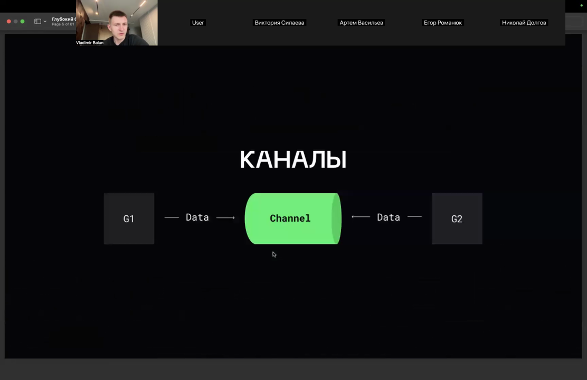

> [!quote]- Кадр [00:01:49]
> 

> [!quote]- Кадр [00:03:42]
> 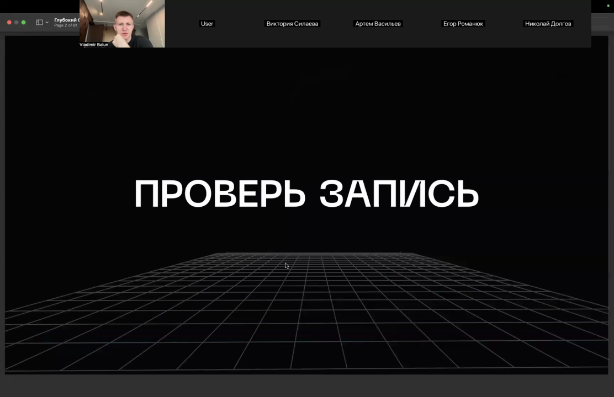

## 3. Синхронные каналы и порядок аргументов

**Синхронные каналы** — это каналы, в которых запись блокирует горутину до тех пор, пока кто-то не прочитает значение, а чтение блокирует до тех пор, пока кто-то не запишет; такое поведение моделирует синхронный способ взаимодействия. Чтение из канала (`result := <-ch`) блокирует выполнение до тех пор, пока в канал не будет отправлено значение, а получение значения из канала блокирует исполнение: если событие происходит в другом канале, заблокированный код не получит результат этого события. Для передачи событий часто используют канал пустых структур. Буферизированный канал с буфером 2 позволяет выполнить две записи без блокировки, а чтобы предотвратить случай, когда ни одна горутина не успела записать в канал, канал делают буферизированным на единицу. Аргументы функции вычисляются слева направо: если каждый вызов возвращает канал и блокируется до записи в него, вызовы выполняются последовательно, и общее время суммируется.

```go
package main

import (
	"fmt"
	"time"
)

func async(ch chan string) {
	time.Sleep(2 * time.Second)
	ch <- "async result"
}

func main() {
	ch := make(chan string)
	go async(ch)
	result := <-ch
	fmt.Println(result)
}

func main() {
	ch := make(chan int)

	go func() {
		ch <- 1
	}()
	go func() {
		ch <- 1
	}()

	value := 0
	value += <-ch
	value += <-ch

	fmt.Println(value)
}

func main() {
	ch := make(chan int)

	func() {
		ch <- 1
	}()

	func() {
		ch <- 1
	}()

	value := 0
	value += <-ch
	value += <-ch

	fmt.Println(value)
}
```

*Источник: [00:02:19], [00:03:19], [00:04:31], [00:05:01], [00:06:05], [00:06:07], …*

## 4. Внутреннее устройство hchan и очереди

В runtime Go канал представлен структурой **hchan** с полями `qcount`, `dataqsiz`, `buf`, `elemsize`, `closed`, `elemtype`, `sendx`, `recvx`, а также `mutex` для синхронизации. В hchan входят очереди ожидающих горутин **recvq** и **sendq** — списки получателей и отправителей; они описаны полями `waitq` внутри структуры. В структуре канала `elem` — указатель на данные; в схеме также присутствуют `buf`, `lock` и `sendq`. Небуферизированные каналы работают через очереди SendQ и ReceiveQ, за счёт этого достигается синхронный способ взаимодействия: писатель при отсутствии места попадает в SendQ, а читатель забирает писателя из SendQ; мьютексы работают по такому же сценарию, как каналы, но в реализации у них нет очереди — есть глобальная очередь, где с каждым указателем связана wait queue.

```
type hchan struct {
	qcount   uint           // total data in the queue
	dataqsiz uint           // size of the circular queue
	buf      unsafe.Pointer // points to an array of dataqsiz elements
	elemsize uint16
	closed   uint32
	elemtype *_type // element type
	sendx    uint   // send index
	recvx    uint   // receive index
	recvq    waitq  // list of recv waiters
	sendq    waitq  // list of send waiters

	lock mutex
}
```

*Источник: [01:05:35], [01:06:05], [01:08:49], [01:10:38], [01:10:43], [01:13:46]*

> [!quote]- Кадр [01:08:49]
> 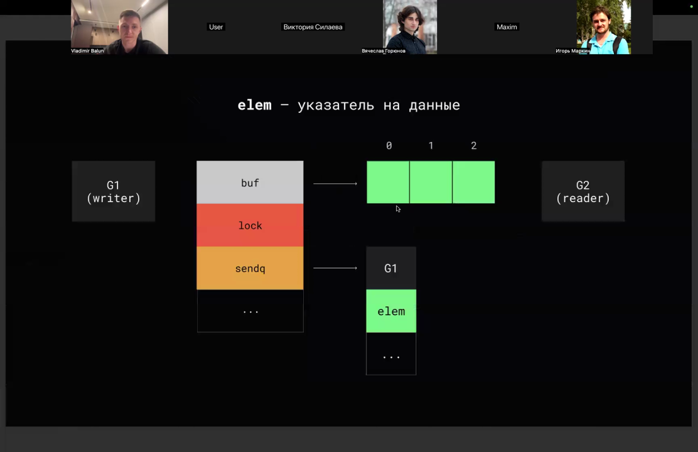

> [!quote]- Кадр [01:13:46]
> 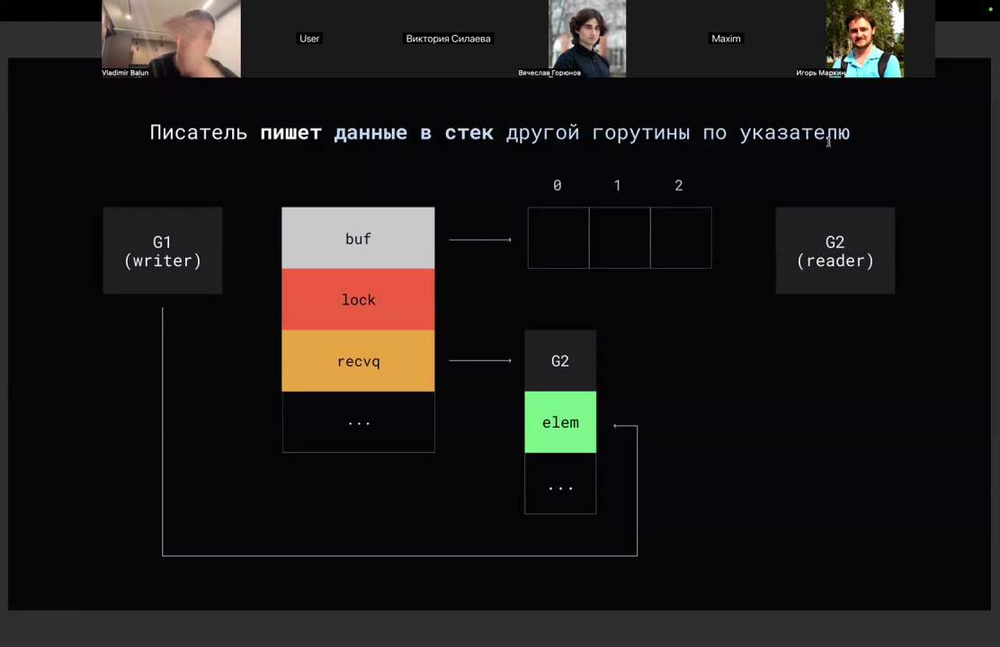

## 5. Буферизованный канал, кольцевой буфер, len и cap

`make(chan int, 4)` создаёт канал с буфером на 4 элемента: при записи, если в буфере есть место, отправка не блокируется, и после неблокирующей отправки можно продолжать работу. Буфер канала устроен как **circular queue** (кольцевой, или цикличный, буфер): есть пишущий и читающий индексы — запись идёт по send-индексу с последующим его увеличением, чтение — по receive-индексу; писатель захватывает мьютекс и производит запись под ним, читатель блокирует мьютекс и читает данные. При буфере, равном единице, первая запись проходит асинхронно, а вторая — синхронно, блокируя выполнение до чтения; синхронная запись происходит при заполненном буфере. У каналов можно проверить размер и ёмкость с помощью `len` и `cap`: `len(ch)` возвращает количество элементов в буфере, `cap(ch)` — размер буфера; буфер небуферизированного канала равен нулю. Нельзя делать неблокирующее чтение или запись, предварительно проверяя длину или ёмкость канала: между проверкой и операцией другая горутина может изменить состояние канала, и операция заблокируется; `len` и `cap` можно безопасно вызывать из разных горутин без синхронизации.

```go
ch := make(chan int, 3)

func main() {
	ch := make(chan int, 2)
	ch <- 100
	ch <- 100
}

ch := make(chan int, 4)
len(ch) // кол-во элементов в буфере
cap(ch) // размер буфера
```

*Источник: [00:15:34], [00:16:06], [00:16:42], [00:17:10], [00:17:31], [01:06:47], …*

> [!quote]- Кадр [01:07:54]
> 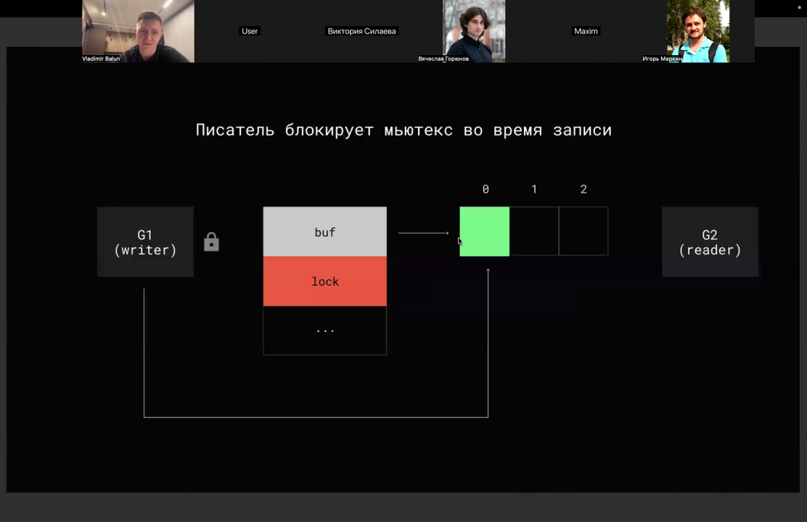

## 6. Блокировка записи при полном буфере и передача в стек читателя

Если буфер канала заполнен, пишущая горутина добавляет себя в очередь **sendQ** и переходит в статус waiting, планировщик больше не ставит её на исполнение; рядом с этой горутиной хранится `elem` — указатель на данные, которые она собирается писать. Читатель берёт значение по указателю `elem` и записывает в буфер, чтобы не копировать данные, затем заглядывает в очередь пишущих горутин и возобновляет работу горутины из SendQ, переводя её в статус ready; это относится только к каналам. Когда буфер пуст, читающая горутина переходит в статус waiting и добавляется в receive queue, а рядом сохраняется `elem` — указатель на то место, куда нужно читать. Если в receive queue есть ожидающая горутина, писатель перед записью в буфер проверяет это и записывает данные по указателю `elem` в стек другой горутины, так не нужно делать лишнее копирование через буфер. В примере создаётся буферизованный канал ёмкостью 4, пять горутин пишут в него, а из канала читается только одно значение, поэтому часть горутин блокируется (в комментарии указано, что 4 goroutines будут заблокированы).

```go
func request() int {
	ch := make(chan int, 4)
	for i := 0; i < 5; i++ {
		go func() {
			ch <- 1 // 4 goroutines will be blocked
		}()
	}

	return <-ch
}
```

*Источник: [00:28:26], [00:30:08], [01:08:49], [01:10:43], [01:12:10], [01:13:46], …*

> [!quote]- Кадр [01:08:49]
> 

> [!quote]- Кадр [01:12:10]
> 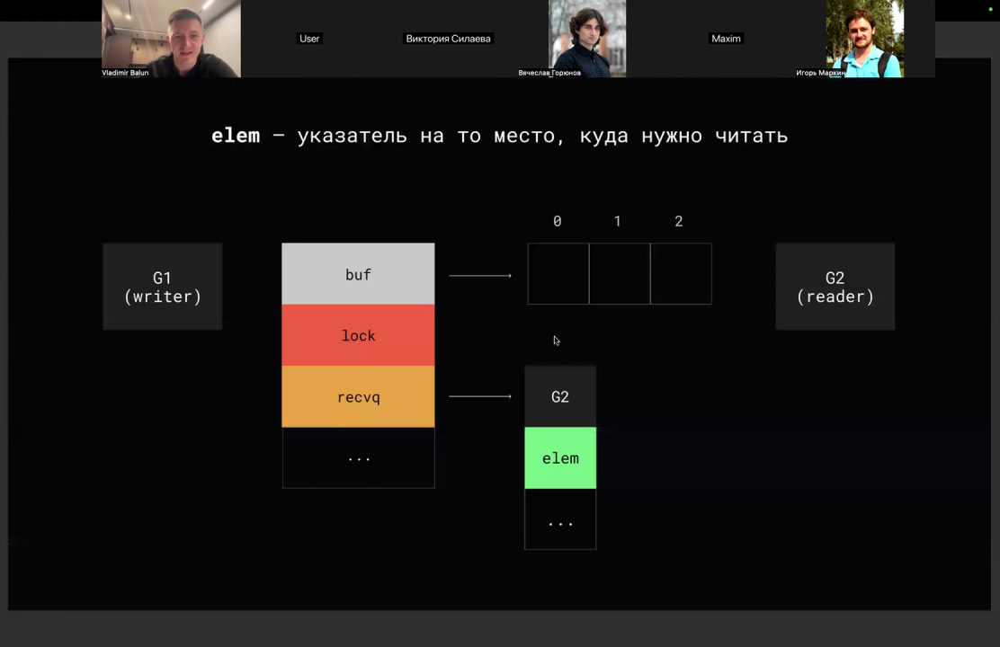

> [!quote]- Кадр [01:13:46]
> 

## 7. Мьютекс для общей переменной и внутри каналов

В программе запускаются две горутины, которые инкрементируют общую переменную `value`, объявленную вне горутин и используемую внутри них; инкремент защищён парой `mutex.Lock()`/`mutex.Unlock()`, а `wg.Add(2)` и `wg.Wait()` синхронизируют завершение обеих горутин. Внутри каналов есть mutex, поэтому при использовании каналов сложность синхронизации скрыта. Разный порядок захвата mutex может привести к deadlock: если не знать о наличии mutex и блокировать в разном порядке, можно получить проблему. Мьютексы используют для разделяемого состояния и кэшей.

```go
func main() {
	mutex := sync.Mutex{}
	wg := sync.WaitGroup{}
	wg.Add(2)

	value := 0
	for i := 0; i < 2; i++ {
		go func() {
			defer wg.Done()

			mutex.Lock()
			value++
			mutex.Unlock()
		}()
	}

	wg.Wait()

	fmt.Println(value)
}

var actions int
var mutex sync.Mutex
var buffer chan struct{}

func consumer() {
	for i := 0; i < 1000; i++ {
		mutex.Lock()
		actions++
		<-buffer
		mutex.Unlock()
	}
}

func producer() {
	for i := 0; i < 1000; i++ {
		buffer <- struct{}{}
		mutex.Lock()
		actions++
		mutex.Unlock()
	}
}

func IsClosed(ch chan int) bool {
	select {
	case _, opened := <-ch:
		return !opened
	default:
		return false
	}
}

func main() {
	ch := make(chan int, 1)
	ch <- 1
	fmt.Println(IsClosed(ch))
	close(ch)
	fmt.Println(IsClosed(ch))
}
```

*Источник: [00:04:53], [00:09:33], [00:43:30], [00:44:30], [00:56:42]*

> [!quote]- Кадр [00:56:42]
> 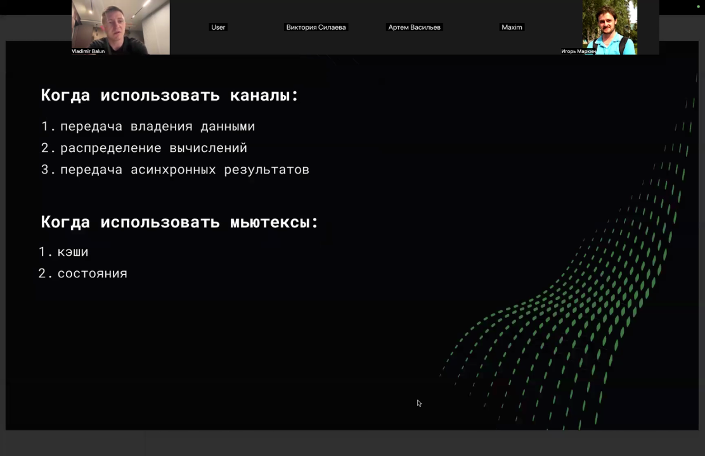

## 8. Закрытие каналов: правила, сигнал, направление

Закрывать канал должен тот, кто его создал, и обычно тот, кто в него пишет; запись в закрытый канал всегда приводит к панике, поэтому с читающей стороны закрывать канал нельзя, а повторное закрытие — тоже паника. Закрытие канала используется как сигнал: функция `notifier` закрывает канал `signals`, а `subscriber` читает из него и печатает «signaled». Закрывать канал не обязательно: когда на него никто не ссылается, сборщик мусора рано или поздно до него доберётся. **Направление канала** позволяет явно ограничить, что участок кода может делать с каналом — только читать или только писать, а проверку делает компилятор: стрелка справа от `chan` означает, что канал можно только писать и закрывать, стрелка слева — что из канала можно только читать. Параметры `chan<- int` и `<-chan int` задают канал только для отправки или только для приёма соответственно.

```go
func closeChannelAnyTimes() {
	ch := make(chan int)
	close(ch)
	close(ch)
}

func notifier(signals chan int) {
	close(signals)
}

func subscriber(signals chan int) {
	<-signals
	fmt.Println("signaled")
}

package main

import "fmt"

func in(in chan<- int) {
	in <- 100
	close(in)
}

func out(out <-chan int) {
	fmt.Println(<-out)
}

func main() {
	var ch = make(chan int, 1)

	in(ch)
	out(ch)
}
```

*Источник: [00:05:01], [00:13:31], [00:16:04], [00:22:22], [00:29:48], [00:31:03], …*

## 9. Чтение из канала: флаг ok, range, продюсер–консьюмер

Из канала можно прочитать два значения: второе — булевый флаг `ok`, который равен `true`, если канал открыт, и `false`, если закрыт; это аналогично проверке наличия ключа в мапе. Цикл `for value := range ch` помечен как синтаксический сахар: `range` идёт по каналу до его закрытия и соответствует варианту с `value, opened := <-ch` и проверкой `!opened`; если данных нет, выполнение блокируется. При сравнении каналов через `==` разные каналы дают `false`, а один и тот же канал — `true`. **Продюсер и консьюмер** находятся в разных горутинах и общаются через канал: продюсер пишет в канал 5 значений, консьюмер читает, а закрывает канал продюсер.

```go
for value := range ch { // syntax sugar
	fmt.Println(value)
}

func producer(ch chan int) {
	for i := 0; i < 5; i++ {
		ch <- i
	}
}

func consumer(ch chan int) {
	for value := range ch {
		fmt.Println(value)
	}
}

select {
case <-ch1:
	ch1Value++
case <-ch1:
	ch1Value++
case <-ch2:
	ch2Value++
}
```

*Источник: [00:07:36], [00:09:35], [00:10:35], [00:11:26], [00:11:31]*

## 10. Поведение nil- и closed-каналов

Запись в nil-канал не вызывает панику, а блокирует навсегда; чтение из nil-канала блокируется навсегда, а `range` по nil-каналу блокируется и приводит к дедлоку; закрывать nil-канал нельзя — это паника, а закрывать канал несколько раз тоже нельзя. nil-каналы позволяют заблокировать горутину навсегда, что может понадобиться в тестах или бенчмарках. Чтение из закрытого канала всегда возвращает нулевое значение (zero value) и флаг `false` и не блокирует выполнение; для буферизированного канала после закрытия можно сначала прочитать оставшиеся в буфере значения — они возвращаются вместе с флагом `true`, а когда буфер пуст, чтение даёт zero value и флаг `false`. При закрытии канала заблокированные на чтении горутины разблокируются и получают zero value и флаг `false`. Отправка значения в закрытый канал вызывает panic: `send on closed channel`.

```go
ch := make(chan int)
go func() {
	ch <- 1
}()

time.Sleep(500 * time.Millisecond)
close(ch)
<-ch

for i := 0; i < 100000; i++ {
		select {
		case <-ch1:
			ch1Value++
		case <-ch1:
			ch1Value++
		case <-ch2:
			ch2Value++
		}
	}
```

*Источник: [00:13:31], [00:18:08], [00:19:08], [00:21:57], [00:33:51], [01:16:27], …*

> [!quote]- Кадр [00:21:57]
> 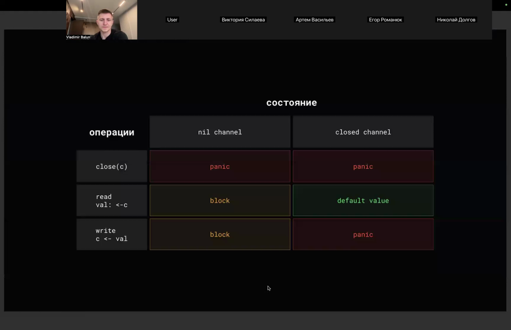

## 11. Select: приоритизация, default, неблокирующие операции, break/continue

В `select` с `case` для `ch1` и `ch2` выполнение сразу разблокируется, когда в одной из веток происходит событие, а если одновременно готовы несколько каналов, Go выбирает `case` случайно. `default` в `select` — это ветка по умолчанию, которая выполняется, если ни одна другая операция с каналом не готова; её положение в `select` не меняет роли. Неблокирующее чтение делается попыткой прочитать канал с уходом в `default`, неблокирующая запись — попыткой записать с уходом в `default`; подход с `select` и `default` не совсем правильный, так как при проверке вычитываются значения из канала и игнорируются, а для стопроцентной гарантии можно использовать вложенный `select`. В `select` можно несколько раз указать кейс чтения из одного и того же канала, чтобы увеличить вероятность наступления события на чтение во столько раз, сколько кейсов добавлено; закрытый канал остаётся готовым, из него всегда можно прочитать zero value и `ok=false`, после чего переменной канала присваивают `nil`. С помощью `select` можно навсегда заблокировать main-горутину (такой код используют в тестах или бенчмарках); функция `IsClosed` проверяет закрытие канала через `select` с неблокирующим получением, но при этом вычитывает значение из канала; планировщик Go недетерминирован, и горутины могут уйти в `default` раньше основного кода; если внутри `select` использовать `continue`, он сработает на внешний цикл `for`, а если `break` — на сам `select`.

```go
func main() {
	ch1 := async1()
	ch2 := async2()

	select {
	case result := <-ch1:
		fmt.Println(result)
	case result := <-ch2:
		fmt.Println(result)
	}
}

func WaitToClose(lhs, rhs chan struct{}) {
	lhsClosed, rhsClosed := false, false
	for !lhsClosed || !rhsClosed {
		select {
		case _, ok := <-lhs:
			fmt.Println("lhs", ok)
			if !ok {
				lhsClosed = true
				lhs = nil
			}
		case _, ok := <-rhs:
			fmt.Println("rhs", ok)
			if !ok {
				rhsClosed = true
				rhs = nil
			}
		}
	}
}

func IsClosed(ch chan int) bool {
	select {
	case <-ch:
		return true
	default:
		return false
	}
}

func main() {
	ch := make(chan int, 1)
	ch <- 1
	fmt.Println(IsClosed(ch))
	close(ch)
	fmt.Println(IsClosed(ch))
}

func main() {
	ch := make(chan int, 1)
	for done := false; !done; {
		select {
			default:
				fmt.Println(3)
				done = true
			case <-ch:
			case ch <- 1:
		}
	}
}

func request() int {
	ch := make(chan int)
	for i := 0; i < 5; i++ {
		go func() {
			select {
			case ch <- i:
			default:
			}
		}()
	}

	return <-ch
}

func tryToWriteToChannel(ch chan string, value string) bool {
    if len(ch) < cap(ch) {
        ch <- value
        return true
    } else {
        return false
    }
}

// go run -race main.go

for {
	value := 0
	opened := true

	select {
	case value, opened = <-data:
		if value == 2 {
			continue
		} else if value == 3 {
			break
		}
		if !opened {
			return
		}
	}
}
```

| Оператор | На что действует |
|---|---|
| break | на сам select |
| continue | на внешний цикл for |

*Источник: [00:07:07], [00:07:32], [00:08:36], [00:09:31], [00:31:36], [00:33:51], …*

> [!quote]- Кадр [00:38:44]
> 

## 12. Канал как указатель: копирование, сборка мусора, data race

**Канал — это указатель на структуру**, а не сам объект структуры, поэтому при копировании канала копируется указатель: если записать значение в исходный канал, его можно прочитать из копии; в функцию передаётся копия указателя, поэтому присвоение `nil` в функции затрагивает только эту копию и не влияет на исходный канал. Каналы в Go являются объектами первого класса: их можно использовать как значение элемента структуры, аргумент функции, возвращаемое значение или как тип для другого канала; можно объявить канал каналов строк. Канал — это указатель на объект структуры, поэтому к нему применяются те же правила сборки мусора: если на канал никто не ссылается, он будет собран сборщиком мусора. Если из множества горутин создавать канал и записывать результат в одну и ту же переменную без синхронизации, возникнет **data race**, даже если сам канал обычно не требует синхронизации. Один и тот же участок памяти нужно явно синхронизировать, например с помощью mutex.

```go
func main() {
	source := make(chan int)
	clone := source

	go func() {
		source <- 1
	}()

	fmt.Println(<-clone)
}

var buffer chan int

func main() {
	wg := sync.WaitGroup{}
	wg.Add(100)

	for i := 0; i < 100; i++ {
		go func() {
			defer wg.Done()
			buffer = make(chan int)
		}()
	}

	wg.Wait()
}
```

> [!info] Зачем это нужно
> Для запуска с race detector используется команда `go run -race main.go`.

*Источник: [00:22:20], [00:22:22], [00:23:53], [00:24:40], [00:45:39], [00:46:39], …*

> [!quote]- Кадр [00:23:53]
> 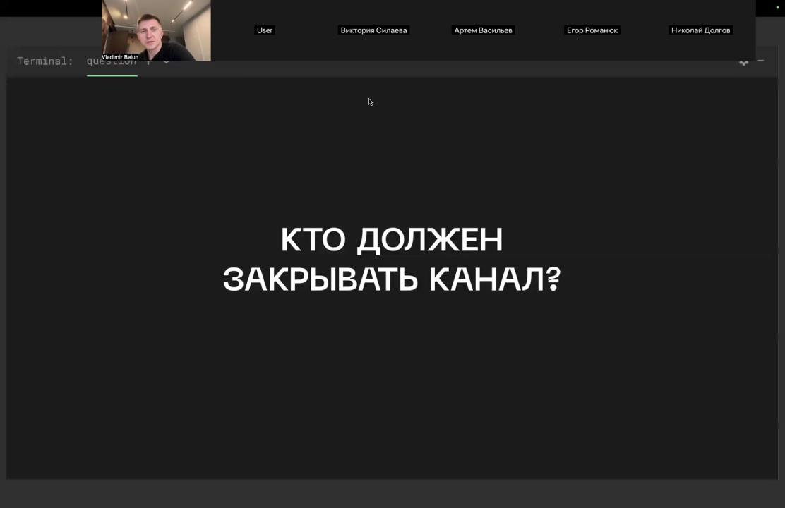

## 13. Утечки goroutine и подвисшие горутины

Горутина, выполняющая `range` по каналу, не завершится, пока канал не закрыт; если канал никогда не закрывают, возникает **утечка горутин**, а также утечка памяти (стек) и утечка на канал, так как на него ссылается заблокированная горутина. В примере создаётся буферизированный канал ёмкостью 4 и запускается 5 горутин, каждая отправляет 1 в канал; функция читает только одно значение, поэтому 4 горутины остаются заблокированными — это утечка горутин из-за блокировки; чтобы остальные горутины успешно завершились, можно сделать канал размерностью len−1. **Подвисшие горутины (hanging goroutines)** — это горутины, которые навсегда остаются в заблокированном состоянии: например, когда горутина пытается получить значение из канала, которому больше никто не отправит значение или не закроет, либо пытается отправить значение в нулевой канал или в канал, из которого никто больше не будет читать. Также причинами являются самоблокировка горутины при помощи мьютекса и взаимная блокировка группы горутин несколькими мьютексами.

```go
func main() {
	doWork := func(strings <-chan string) {
		go func() {
			for str := range strings {
				fmt.Println(str)
			}
			log.Println("doWork exited")
		}()
	}

	strings := make(chan string)
	doWork(strings)
	strings <- "Test"

	time.Sleep(time.Second)
	fmt.Println("Done")
}

func request() int {
	ch := make(chan int, 4)
	for i := 0; i < 5; i++ {
		go func() {
			ch <- 1 // 4 goroutines will be blocked
		}()
	}

	return <-ch
}
```

*Источник: [00:24:40], [00:25:40], [00:26:18], [00:26:23], [00:27:23], [00:28:24], …*

> [!quote]- Кадр [00:28:24]
> 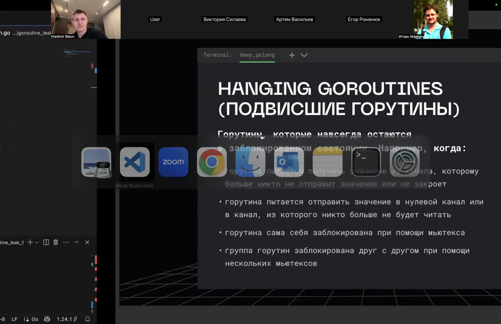

## 14. Worker pool и API WorkerPool

**Worker pool** — шаблон проектирования для управления группой горутин, которые одновременно обрабатывают входящие задачи. Горутины не убиваются: если задач нет, они спят и ждут. `NewWorkerPool` создаёт пул с заданным количеством горутин. `AddTask` добавляет задачу в пул. `Shutdown` завершает выполнение и приём задач.

```go
type WorkerPool struct { ... }

func NewWorkerPool(workersNumber int) *WorkerPool // создать пул с заданным кол-вом горутин
func (wp *WorkerPool) AddTask(task func()) error // добавить задачу в пул
func (wp *WorkerPool) Shutdown() // завершить выполнение и прием задач в пул
```

*Источник: [01:17:54], [01:19:20]*

## 15. Atomic и 8-битные значения

`Atomic` не работает с 8 битами. Внутри `Atomic` под капотом используется N32, и в API Go нет способа работать с 8-битными значениями.

*Источник: [01:05:57]*

## Схема

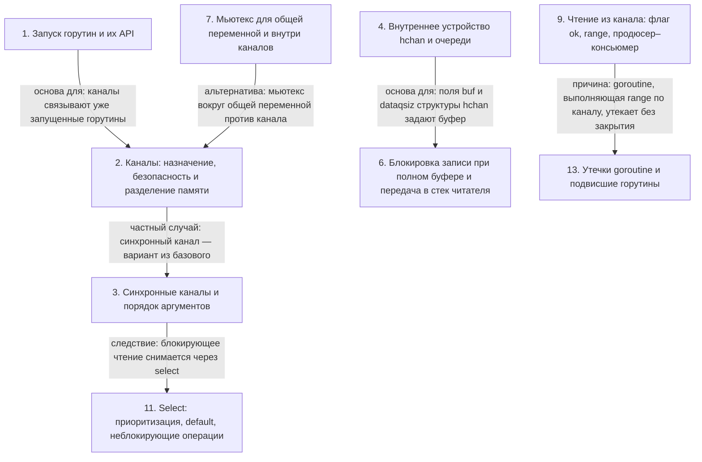

## Итог

> [!success] Что в итоге
> Каналы — goroutine-safe примитивы синхронизации: вместо разделяемой памяти горутины передают через канал копии значений, что избавляет от явной синхронизации. В runtime Go канал представлен структурой hchan с буфером, индексами `sendx`/`recvx` и очередями `recvq`/`sendq`; при передаче писатель пишет по указателю `elem` прямо в стек читателя, а внутри канала есть mutex, поэтому сложность синхронизации скрыта. Чтение из закрытого канала не блокируется и возвращает zero value и `ok=false`, а отправка в закрытый канал вызывает panic; незакрытые каналы и работа без читателя или отправителя приводят к утечкам горутин и подвисшим горутинам. Через `select` реализуются ветка `default`, приоритизация чтения дублированием кейсов, неблокирующие операции и проверка закрытия; для управления группой горутин применяется шаблон worker pool.
