# Контексты в Go

> [!abstract] Обзор
> Материал о контекстах (`context`) в Go: интерфейс `Context` с четырьмя методами и возможность написать свой контекст. Разбирается отмена через `context.WithCancel` и передача контекста в 10 горутин, правила вызова `cancel` и закрытие канала внутри контекста. Показано сравнение `context.WithTimeout` и `context.WithDeadline` и таймаут через `WithTimeout`. Отдельно — проверка отмены через `select` и перед действием, возможная утечка горутины и запрет присваивания контексту `nil`.

> [!info] Курс
> [[index|Оглавление курса]]

## Оглавление
1. [[#1. Интерфейс Context: 4 метода]]
2. [[#2. Свой контекст]]
3. [[#3. Контекст с отменой и горутины]]
4. [[#4. Правила вызова cancel]]
5. [[#5. Закрытие канала при отмене]]
6. [[#6. WithTimeout и WithDeadline]]
7. [[#7. Таймаут через WithTimeout]]
8. [[#8. Проверка отмены через select]]
9. [[#9. Утечка горутины при отмене]]
10. [[#10. Не присваивайте контексту nil]]
11. [[#11. Атомарная отмена контекста]]
12. [[#12. Отмена родительского контекста]]
13. [[#13. Природа контекста — матрёшка]]
14. [[#14. context.WithValue]]
15. [[#15. Type assertion при context.Value]]
16. [[#16. Наследование значений контекста]]
17. [[#17. Функция WithTimeout и итераторы]]
18. [[#18. Злоупотребление context для логгеров]]
19. [[#19. Overhead логгера в context]]
20. [[#20. Приведение типа без паники и ключи контекста]]

**Итог** — [[#Итог ➕]]

## 1. Интерфейс Context: 4 метода

Любой контекст удовлетворяет некоторому интерфейсу, у которого должно быть 4 метода. Первый метод `Deadline` возвращает время дедлайна и был ли он установлен; второй метод `Done` возвращает канал, сигнализирующий об отмене; третий метод `Err` возвращает ошибку отмены; четвёртый метод `Value` возвращает установленное значение по ключу.

```go
func Background() Context
func TODO() Context
func WithValue(parent Context, key, val any) Context
func WithoutCancel(parent Context) Context
func WithCancel(parent Context) (ctx Context, cancel CancelFunc)
func WithCancelCause(parent Context) (ctx Context, cancel CancelCauseFunc)
func WithDeadline(parent Context, d time.Time) (Context, CancelFunc)
func WithDeadlineCause(parent Context, d time.Time, cause error) (Context, CancelFunc)
func WithTimeout(parent Context, timeout time.Duration) (Context, CancelFunc)
func WithTimeoutCause(parent Context, timeout time.Duration, cause error) (Context, CancelFunc)
```

*Источник: [00:00:31]*

## 2. Свой контекст

Вы сами можете написать свой контекст в случае необходимости.

*Источник: [00:00:31]*

## 3. Контекст с отменой и горутины

В `main` создаётся контекст с отменой через `context.WithCancel`, запускаются 10 горутин, получающих погоду из разных источников, и после получения первого результата из канала вызывается `cancel()`; ожидание остальных отменяется. В коде `receiveWeather` через `select` обрабатывается либо `timer.C`, либо `ctx.Done`. При `context.WithCancel` отмена контекста завершает остальные горутины: одна горутина может выполниться, а все остальные становятся canceled. Контекст имеет природу **матрёшки**: контексты вкладываются друг в друга, как показано на схеме с повторяющимся `ctx`. В middleware контекст нужно получать у самого запроса, а не создавать `context.Background`: создание нового контекста разрывает связь родитель–ребёнок. Полученный контекст с заинжекченным Trace ID дальше передаётся в обработку запроса. Не нужно хранить контекст внутри структуры в качестве состояния — это антипаттерн. Контексты спроектированы как одноразовые неизменяемые объекты. **Контекст** — это набор метаданных, ассоциированных с каким-либо запросом или процессом, исполняющимся в приложении. По приложению бежит процесс или запрос, и контекст — это набор метаданных, который с этим процессом или запросом ассоциирован. В контекст можно передавать некоторые значения. Передавайте контекст всегда **первым аргументом** — это общепринятое соглашение.

```go
func receiveWeather(ctx context.Context, result chan struct{}, idx int) {
	defer timer.Stop()

	select {
	case <-timer.C:
		fmt.Printf("finished: %d\n", idx)
		result <- struct{}{}
	case <-ctx.Done():
		fmt.Printf("canceled: %d\n", idx)
	}
}

package main

import (
	"context"
	"errors"
	"fmt"
	"time"
)

func main() {
	ctx, cancel := context.WithTimeout(context.Background(), 5*time.Second)
	cancel() // show difference

	//<-ctx.Done()

	fmt.Println(ctx.Err())
	fmt.Println(context.Cause(ctx))
}

vladimirbalun@Vladimirs-MacBook-Pro context_with_timeout_cause % go run main.go
context deadline exceeded
timeout
vladimirbalun@Vladimirs-MacBook-Pro context_with_timeout_cause % go run main.go
context canceled
context canceled
vladimirbalun@Vladimirs-MacBook-Pro context_with_timeout_cause %
```

*Источник: [00:00:09], [00:01:55], [00:02:03], [00:03:03], [00:11:54], [00:12:34], …*

> [!quote]- Кадр [00:01:55]
> 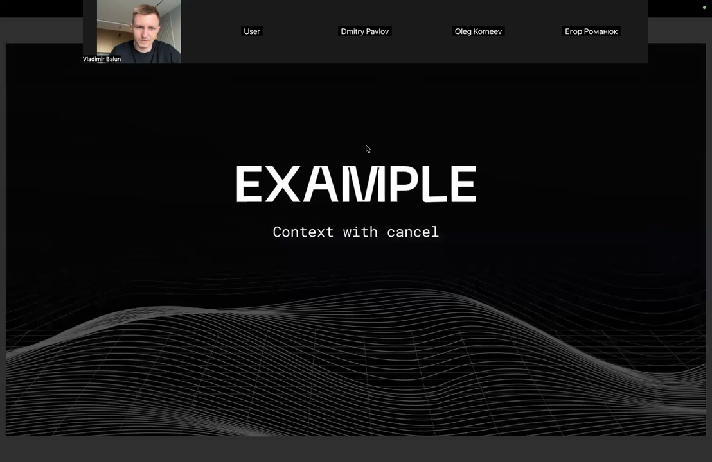

> [!quote]- Кадр [00:11:54]
> 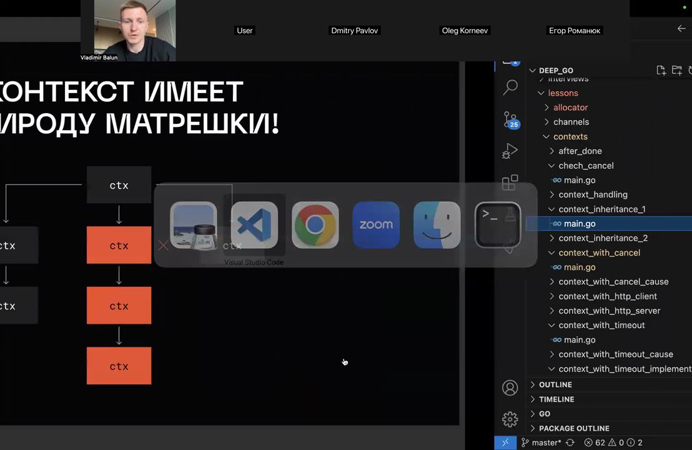

> [!quote]- Кадр [00:32:20]
> 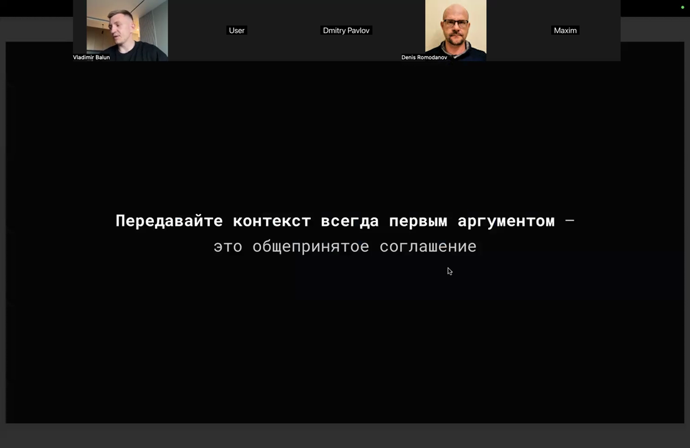

> [!quote]- Кадр [00:00:09]
> 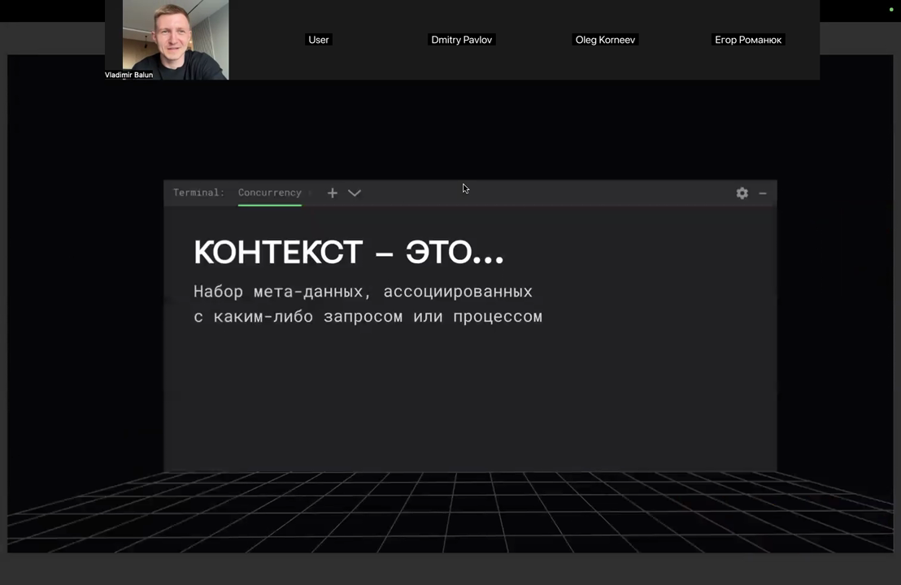

> [!quote]- Кадр [00:33:20]
> 

## 4. Правила вызова cancel

В `main.go` после чтения из канала `result` вызывается `cancel()`. Контекст с отменой нужно отменять там, где он был создан; вызывать функцию отмены в другом месте в Go считается антипаттерном, а если передавать или сохранять `cancel`, код становится спагетти-кодом. Функцию `cancel` можно вызывать несколько раз. Чтобы понять, из какого именно места отменили контекст, используется `context.Cause`; `cancel` позволяет передать причину отмены, и из разных мест можно передавать разные ошибки.

```go
func main() {
	wg := sync.WaitGroup{}
	wg.Add(10)

	ctx, cancel := context.WithCancel(context.Background())

	result := make(chan struct{}, 10)
	for i := 0; i < 10; i++ {
		go func(idx int) {
			defer wg.Done()
			receiveWeather(ctx, result, idx)
		}(i)
	}

	<-result
	cancel()

	wg.Wait()
}
```

*Источник: [00:01:55], [00:03:25]*

> [!quote]- Кадр [00:01:55]
> 

## 5. Закрытие канала при отмене

Функция `cancel` закрывает канал внутри контекста, и при чтении из закрытого канала получается нулевое значение (zero value). Чтобы проверить, закрыт ли канал, можно неблокирующим способом прочитать из него; перед закрытием канала стоит условие, гарантирующее, что канал будет закрыт только один раз.

```go
func main() {
	ctx, cancel := context.WithCancel(context.Background())

	result := make(chan struct{}, 10)
	for i := 0; i < 10; i++ {
		go func(idx int) {
			defer wg.Done()
			receiveWeather(ctx, result, idx)
		}(i)
	}

	<-result
	cancel()

	wg.Wait()
}
```

*Источник: [00:02:03], [00:03:28]*

## 6. WithTimeout и WithDeadline

`Context.WithTimeout` и `Context.WithDeadline` практически ничем не отличаются: `WithTimeout` — это обёртка над `WithDeadline`, использующая `time.Duration` вместо `time.Time`. В подавляющем большинстве случаев проще использовать `WithTimeout`, чем `WithDeadline`. В `select` ожидание отмены контекста позволяет прервать выполнение запроса. `WithTimeout` создаёт дочерний контекст и запускает отдельную горутину с таймером на duration. Эта горутина ждёт либо сигнал Done об отмене родительского контекста, либо срабатывания таймера. После этого вызывается `cancel`.

```go
go func() {
	timer := time.NewTimer(duration)
	defer timer.Stop()

	select {
	case <-parent.Done():
	case <-timer.C:
	}

	cancel()
}()
```

| | WithTimeout | WithDeadline |
|---|---|---|
| Аргумент | time.Duration | time.Time |
| Отношение | обёртка над WithDeadline | базовая функция |

*Источник: [00:01:12], [00:09:35], [00:10:11], [00:11:11]*

> [!quote]- Кадр [00:01:12]
> 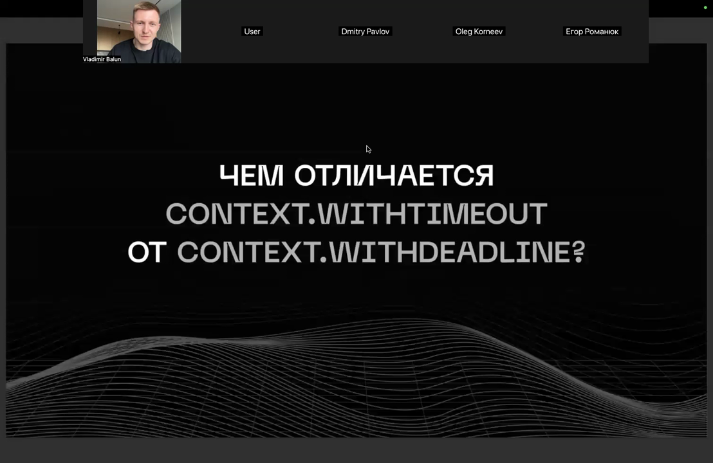

## 7. Таймаут через WithTimeout

`context.WithTimeout(context.Background(), 2*time.Second)` создаёт контекст; функция `WithTimeout` принимает parent `Context` и timeout. В `main` контекст создаётся через `context.WithTimeout(context.Background(), time.Second)`, `cancel` откладывается через `defer cancel()`. `context.WithTimeout` по тайм-ауту закрывает внутренний канал; при чтении из `ctx.Done` возвращается zero value и выполняется ветка canceled. `cancel` через `atomic.CompareAndSwapInt32` закрывает `ctx.done`. Функция `DoQuery` создаёт контекст с таймаутом 3 секунды, запускает `Query` в отдельной горутине с буферизованным каналом `resultCh` и через `select` возвращает результат или ошибку контекста.

```go
ctx, cancel := context.WithTimeout(context.Background(), 2*time.Second)
defer cancel()

go func() {
	<-ctx.Done()
}()
time.Sleep(3 * time.Second)

func DoQuery(qveryStr string) (string, error) {
	ctx, cancel := context.WithTimeout(context.Background(), time.Second*3)
	defer cancel()

	resultCh := make(chan string, 1)
	go func() {
		result := Query(qveryStr)
		resultCh <- result
	}()

	select {
	case <-ctx.Done():
		return "", ctx.Err()
	case result := <-resultCh:
		return result, nil
	}
}
```

*Источник: [00:04:25], [00:06:42], [00:30:24]*

## 8. Проверка отмены через select

В `incorrectCheck` сначала выполняется чтение `data := <-stream`, и только затем ожидание `<-ctx.Done()`; если сначала слушать поток с данными, а потом контекст отмены, при отмене код может быть заблокирован на чтении из канала данных. В `correctCheck` используется `select` с `case <-ctx.Done()`, и отмена контекста обрабатывается при чтении из `stream`: внутри `select` либо придут данные, либо произойдёт сигнал об отмене. Перед выполнением чего-то имеет смысл проверять, что контекст не отменён. Функция `WithContexCheck` не выполняет `action`, если `action == nil` или `ctx.Err() != nil`. Проверка контекста нужна не в каждой функции, а перед значимыми событиями — например, перед походом в базу данных или в другой сервис; нет смысла делать сетевой запрос, если контекст уже отменён. Код получает `innerCtx` через `context.WithoutCancel(ctx)` и проверяет `innerCtx.Err() != nil`. При истинном условии печатается "canceled". Результат `yield` нужно проверять явно; если его не проверять, возможен corner case, например `break` внутри `range`. `makeRequest` использует `select` для ожидания либо срабатывания `timer.C` (по таймеру через 5 секунд печатается "finished"), либо `ctx.Done()`. При срабатывании `ctx.Done()` выводится "canceled", и функция возвращается.

```go
func incorrectCheck(ctx context.Context, stream <-chan string) {
	data := <-stream
	_ = data
	<-ctx.Done()
}

func correctCheck(ctx context.Context, stream <-chan string) {
	select {
	case data := <-stream:
		_ = data
	case <-ctx.Done():
		return
	}
}

func WithContexCheck(ctx context.Context, action func()) {
	if action == nil || ctx.Err() != nil {
		return
	}

	action()
}

innerCtx := context.WithoutCancel(ctx)

if innerCtx.Err() != nil {
    fmt.Println("canceled")
}

func makeRequest(ctx context.Context) {
	timer := time.NewTimer(5 * time.Second)
	defer timer.Stop()

	select {
	case <-timer.C:
		fmt.Println("finished")
	case <-ctx.Done():
		fmt.Println("canceled")
		return
	}
}
```

*Источник: [00:04:27], [00:05:17], [00:06:17], [00:07:47], [00:08:12], [00:24:27], …*

## 9. Утечка горутины при отмене

Использование `WithCancel` или `WithTimeout` может привести к утечке горутины.

*Источник: [00:08:03]*

> [!quote]- Кадр [00:08:03]
> 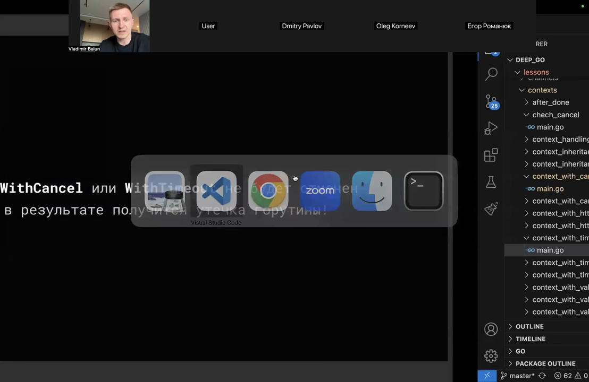

## 10. Не присваивайте контексту nil

При использовании контекста **никогда не присваивайте контексту значение `nil`**. Пустой интерфейс можно получить и проверить, равен ли он `nil` или нет. Нельзя разрывать связь родителя и ребёнка в контекстах, даже если какая-то часть не должна отменяться. Воркер, не связанный с контекстом, не потушится и продолжит исполнение. При создании новых контекстов (например, with background или with deadline) нужно передавать родительский контекст: разрыв связи родитель–ребёнок приводит к багам — что-то не отменится, не получите нужный ключ, потеряются метаданные, и отмена не дойдёт до дочернего контекста. Отдельный контекст без отмены создавали именно для того, чтобы не разрывать эту связь.

*Источник: [00:08:35], [00:23:33], [00:24:31], [00:27:53], [00:34:20]*

> [!quote]- Кадр [00:34:20]
> 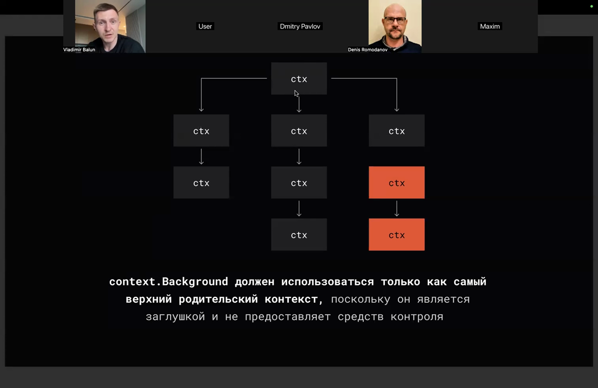

## 11. Атомарная отмена контекста

Функция `cancel` использует `atomic.CompareAndSwapInt32`, чтобы `close(ctx.done)` был вызван ровно один раз.

```go
func WithTimeout(parent Context, duration time.Duration) (*Context, func()) {
	if atomic.LoadInt32(&parent.closed) == 1 {
		return nil, nil // don't use nil
	}

	ctx := &Context{
		done: make(chan struct{}),
	}

	cancel := func() {
		if atomic.CompareAndSwapInt32(&ctx.closed, 0, 1) {
			close(ctx.done)
		}
	}

	return ctx, cancel
}
```

*Источник: [00:09:35]*

## 12. Отмена родительского контекста

Если родительский контекст отменяется, это по цепочке ведёт за собой отмену всех дочерних контекстов. Отмена контекста влияет только на конкретный отменяемый контекст и все дочерние контексты. Родительский и соседние контексты это никак не затрагивает; неважно, отменяется контекст через `cancel` или по timeout. В горутине, запущенной через `group.Go`, `select` ожидает либо срабатывания таймера на 2 секунды, либо отмены `groupctx.Done()`. При таймере возвращается ошибка, при отмене — `nil`.

```go
group.Go(func() error {
	timeout := time.Second * 2
	timer := time.NewTimer(timeout)
	defer timer.Stop()

	select {
	case <-timer.C:
		fmt.Println("timeout")
		return errors.New("error")
	case <-groupctx.Done():
		fmt.Println("canceled")
		return nil
	}
})
```

*Источник: [00:10:11], [00:11:27], [00:39:48]*

> [!quote]- Кадр [00:11:27]
> 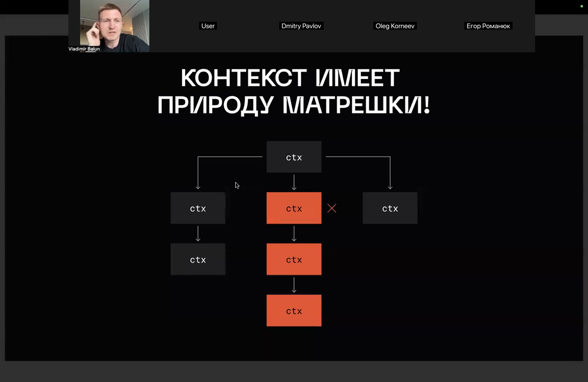

## 13. Природа контекста — матрёшка

Контекст имеет природу матрёшки: контексты вкладываются друг в друга.

```go
func main() {
	ctx, cancel := context.WithTimeout(context.Background(), time.Second)
	defer cancel()

	makeRequest(ctx)
}
```

*Источник: [00:11:25]*

## 14. context.WithValue

`context.WithValue` создаёт контекст с ключом и значением; ключ и значение являются пустыми интерфейсами. `context.WithoutCancel` создаёт дочерний контекст, который не отменяется при отмене родительского контекста. Если отменить родителя, отмена никак не влияет на дочерний контекст. Context Values следует использовать только для **request-scoped данных**, которые передаются между процессами и API, а не для передачи опциональных или необязательных параметров в функции. Контекст — это набор метаданных, сопряжённых с исполнением запроса: User ID, Trace ID, идентификатор транзакции. При отмене контекста с причиной `ctx.Err()` возвращает `context canceled`, а `context.Cause(ctx)` — переданную ошибку error. При таймауте `ctx.Err()` возвращает `context deadline exceeded`, а `context.Cause(ctx)` — timeout; при явной отмене `cancel()` оба возвращают `context canceled`. `context.WithTimeoutCause` создаёт контекст с таймаутом 5 секунд и ошибкой-причиной `errors.New("timeout")`, которую выводит `context.Cause(ctx)`. `context.Background` должен использоваться только как самый верхний родительский контекст, поскольку он является заглушкой и не предоставляет средств контроля. При graceful shutdown вы тушите только один контекст, и тушатся все остальные по цепочке.

```go
func main() {
	ctx, cancel := context.WithTimeoutCause(context.Background(), 5*time.Second, errors.New("timeout"))
	defer cancel()

	fmt.Println(ctx.Err())
	fmt.Println(context.Cause(ctx))
}

func main() {
	ctx, cancel := context.WithCancel(context.Background())
	cancel(errors.New("error"))

	fmt.Println(ctx.Err())
	fmt.Println(context.Cause(ctx))
}
```

*Источник: [00:12:43], [00:15:11], [00:15:30], [00:15:41], [00:16:39], [00:21:33], …*

> [!quote]- Кадр [00:15:11]
> 

> [!quote]- Кадр [00:16:39]
> 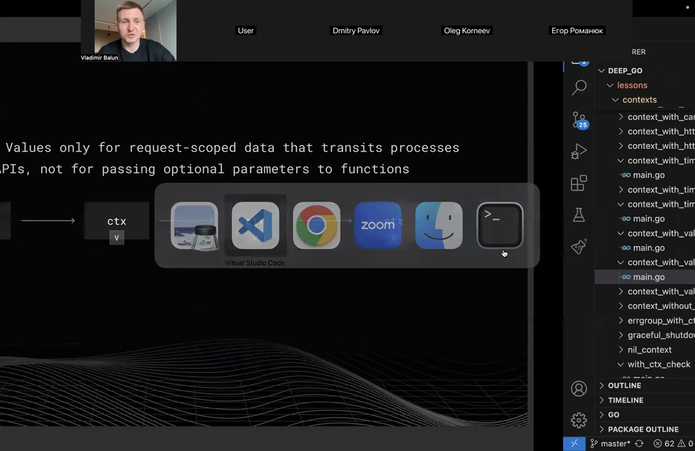

> [!quote]- Кадр [00:15:30]
> 

> [!quote]- Кадр [00:15:41]
> 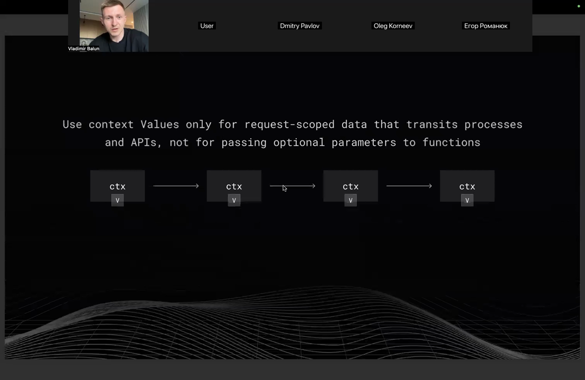

> [!quote]- Кадр [00:33:20]
> 

> [!quote]- Кадр [00:34:20]
> 

## 15. Type assertion при context.Value

`context.Value` по ключу возвращает пустой интерфейс, поэтому результат приводится к нужному типу через type assertion.

```go
func makeRequest(ctx context.Context) {
	oldValue, ok := ctx.Value("trace_id").(string)
	if ok {
		fmt.Println("oldValue", oldValue)
	}
}
```

*Источник: [00:12:43]*

## 16. Наследование значений контекста

При создании нового контекста с родителем поиск по ключу находит значение родителя, даже если у нового контекста нет своего значения по этому ключу. Это называется **context with value inheritance (наследование значений контекста)**.

```go
package main

import (
	"context"
	"fmt"
)

func main() {
	traceCtx := context.WithValue(context.Background(), "trace_id", "12-21-33")
	makeRequest(traceCtx)

	oldValue, ok := traceCtx.Value("trace_id").(string)
	if ok {
		fmt.Println("mainValue", oldValue)
	}
}

func makeRequest(ctx context.Context) {
	oldValue, ok := ctx.Value("trace_id").(string)
	if ok {
		fmt.Println("oldValue", oldValue)
	}
}
```

*Источник: [00:14:34]*

## 17. Функция WithTimeout и итераторы

В отдельной горутине запускается таймер. При срабатывании таймера вызывается отмена. `WithTimeout` возвращает контекст с каналом `done` и функцию отмены.

Отдельно разбираются **итераторы** (появились в Go 1.23). `Backward` принимает срез и возвращает `iter.Seq[T]` — замыкание с `yield func(T) bool`, которое перебирает элементы в обратном порядке. Чтобы `rows.Close` срабатывал даже при панике, `DoQuery` может возвращать итератор, отдельную функцию очистки и ошибку; очистку вызывают через `defer`. Функция `Mul` принимает `iter.Seq[int]` и множитель, возвращая `iter.Seq[int]`, который умножает каждое значение на множитель. `yield` подставляет `range`, явно его не передают. Внутри `Range` идёт цикл, который вызывает `yield(i)` для i от 0 до size−1; результат `yield` нужно проверять: если `yield(i)` возвращает `false`, функция делает `return` (иначе Go может вызвать панику при `break`).

```go
func Backward[T any](s []T) iter.Seq[T] {
	return func(yield func(T) bool) {
		for i := len(s) - 1; i >= 0; i-- {
			if !yield(s[i]) {
				return
			}
		}
	}
}

func Range(size int) func(func(int) bool) {
	return func(yield func(int) bool) {
		for i := 0; i < size; i++ {
			if !yield(i) {
				return
			}
		}
	}
}

func main() {
	for value := range Range(5) {
		fmt.Println(value)
	}
}
```

*Источник: [00:15:33], [00:43:11], [00:44:11], [00:44:18], [00:45:06], [00:45:08], …*

## 18. Злоупотребление context для логгеров

Многие злоупотребляют контекстом, передавая через него логгеры.

```go
func main() {
	traceCtx := context.WithValue(context.Background(), "trace_id", "12-21-33")
	makeRequest(traceCtx)
}

func makeRequest(ctx context.Context) {
	oldValue, ok := ctx.Value("trace_id").(string)
	if ok {
		fmt.Println(oldValue)
	}

	newCtx, cancel := context.WithCancel(context.Background())
	defer cancel()

	newValue, ok := newCtx.Value("trace_id").(string)
	if ok {
		fmt.Println(newValue)
	}
}
```

*Источник: [00:15:37]*

## 19. Overhead логгера в context

Передача логгера через контекст создаёт дополнительный overhead: нужно пробежаться по связанному списку контекстов, чтобы найти значение, и выполнить каст от пустого интерфейса. Вместо этого предпочтительнее явные сигнатуры, где логгер или подобные структуры передаются явно.

*Источник: [00:15:41]*

> [!quote]- Кадр [00:15:41]
> 

## 20. Приведение типа без паники и ключи контекста

Приведение типа с двумя аргументами не вызывает панику: `oldValue, ok := ctx.Value("trace_id").(string)`. Если дочерний контекст создан с тем же ключом, что и родительский, то при получении значения по этому ключу возвращается значение дочернего контекста, перекрывая родительское. Такое может произойти случайно, например при использовании библиотеки, которая перекрывает ключ. Через контекст желательно не передавать ничего бизнесового, только мета-информацию (это не строгий запрет). Чтобы ключи не перекрывались, создают отдельный **type definition** для ключей: `type key1 string`, `type key2 string`. Тогда ключи `k1` и `k2` различаются, и оба значения доступны, несмотря на одинаковое строковое значение `'key'`. Это рекомендуемый способ, чтобы избежать перекрытия ключей. Чтобы понять, был ли контекст отменён по тайм-ауту или явно, можно посмотреть причину отмены: при тайм-ауте причина — ошибка тайм-аута, при явной отмене — `context.Canceled`. Если библиотека умеет работать с контекстами, вы передаёте контекст и полагаетесь на то, что при его отмене библиотека корректно обработает отмену. Через `context.WithTimeout(context.Background(), 10*time.Millisecond)` создаётся контекст с таймаутом 10 миллисекунд, который затем передаётся в `http.NewRequestWithContext` для HTTP-запроса. У HTTP-сервера есть два метода: `Close` немедленно закрывает все коннекшены, а `Shutdown` использует gracefully-политику — дожидается отмены коннекшенов и затем тушится. Если функция не умеет работать с контекстом, типичный паттерн — создать контекст с таймаутом, буферизированный на 1 канал результата и горутину, которая синхронно выполняет запрос и пишет результат в канал. Затем ждут либо отмены контекста, либо результата из канала. Многие пишут код, который ждёт отмены контекста в отдельной горутине, и думают, что у них Graceful Shutdown, но это не так. Не используйте `nil` в качестве значения контекста — это может привести к страшному багу. Вместо этого используйте `context.TODO` или `context.Background`. Если передать `nil` в `context.Context`, то при обращении к методу `Err` произойдёт паника из-за nil pointer dereference. `context.AfterFunc` принимает функцию и контекст, в отдельной горутине ждёт завершения контекста и выполняет действие. `group.Go` принимает функцию, возвращающую error: если все горутины возвращают `nil`, выполнение корректно; если одна возвращает ошибку, большая часть горутин отменяется. `group.Wait` возвращает первую возникшую ошибку (ошибка может возникнуть у нескольких горутин, но возвращается только первая).

```go
package main

import (
	"context"
	"fmt"
)

type key1 string // type definition, not type alias
type key2 string // type definition, not type alias

func main() {
	const k1 key1 = "key"
	const k2 key2 = "key"

	ctx := context.WithValue(context.Background(), k1, "value1")
	ctx = context.WithValue(ctx, k2, "value2")

	fmt.Println("key1 =", ctx.Value(k1))
	fmt.Println("key2 =", ctx.Value(k2))
}

func injectTraceID(next http.Handler) http.Handler {
	return http.HandlerFunc(func(w http.ResponseWriter, r *http.Request) {
		ctx := context.WithValue(r.Context(), "trace_id", "12-21-33")
		next.ServeHTTP(w, r.WithContext(ctx))
	})
}
```

*Источник: [00:06:42], [00:07:49], [00:08:12], [00:14:30], [00:14:34], [00:15:11], …*

> [!quote]- Кадр [00:20:10]
> 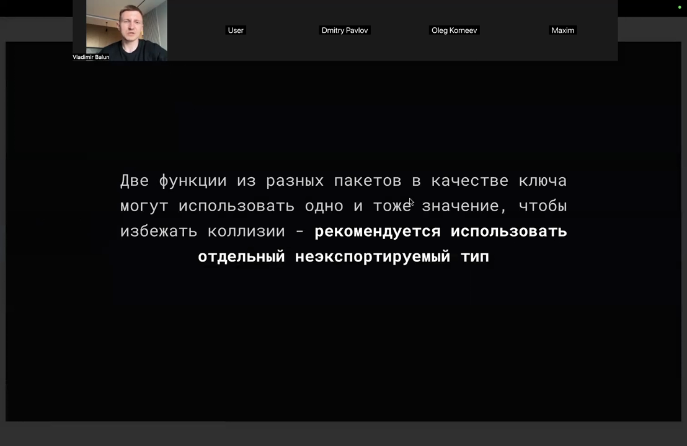

> [!quote]- Кадр [00:52:59]
> 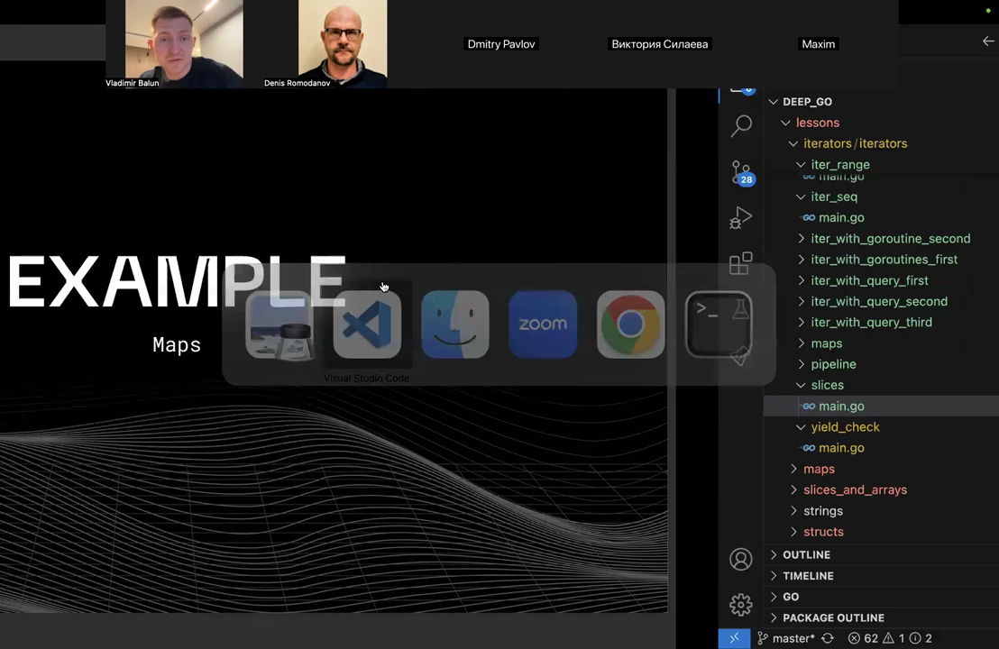

> [!quote]- Кадр [00:15:11]
> 

## Итог ➕

> [!note] ➕ Дополнено агентом (не из курса)
> Итог составлен мной; в исходном конспекте урока 15 отдельного раздела «Итог» не было.

> [!success] Что в итоге
> Контекст в Go — это набор метаданных, ассоциированный с запросом или процессом: интерфейс `Context` имеет четыре метода (`Deadline`, `Done`, `Err`, `Value`), контексты вкладываются как матрёшка, передаются первым аргументом и неизменяемы. Отмена (`WithCancel`), дедлайн (`WithDeadline`) и таймаут (`WithTimeout`, обёртка над `WithDeadline`) связаны по цепочке: отмена родителя отменяет детей, а `cancel` должен вызываться там, где контекст создан. Отмену проверяют через `select` и перед значимыми действиями, контексту нельзя присваивать `nil` и нельзя разрывать связь родитель–ребёнок. Значения (`WithValue`) годятся только для request-scoped метаданных (User ID, Trace ID), а не для бизнес-данных и логгеров; чтобы ключи не перекрывались, используют собственные неэкспортируемые типы-ключи.
