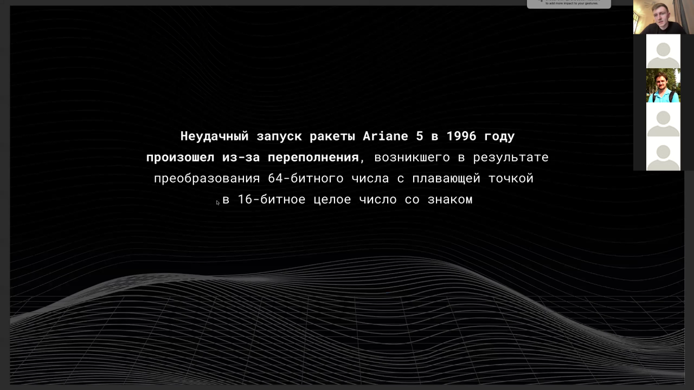
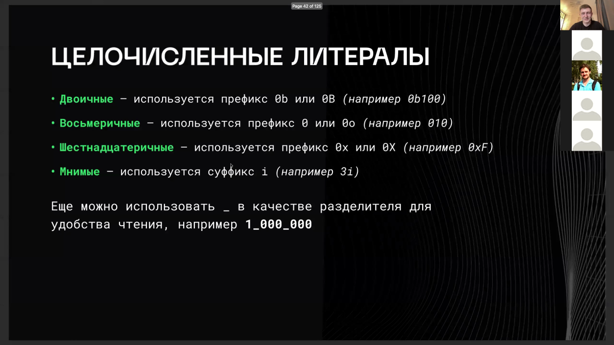

# Переполнение и числа в Go

> [!abstract] Суть
> Обзор переполнения, чисел и типов в Go, включая проверку на этапе компиляции и рантайма, а также работу с различными системами счисления.

## Оглавление
1. [[#1. Переполнение в Go]]
2. [[#2. Компилятор и переполнение]]
3. [[#3. Переполнение при преобразовании типов]]
4. [[#4. Обнаружение переполнения]]
5. [[#5. Сравнение с максом или мином]]
6. [[#6. Суффиксы чисел]]
7. [[#7. Системы счисления и арифметика]]
8. [[#8. Двоичное число]]
9. [[#9. println и десятичные числа]]
10. [[#10. Проверка переполнения]]

## 1. Переполнение в Go

В Go переполнение как знаковых, так и беззнаковых чисел — это определённое поведение. Переполнение может происходить как в рантайме, так и на этапе компиляции. Использование литералов, таких как двоичные числа с префиксом 0b, позволяет управлять числами в разных форматах.

> [!info] Зачем это нужно
> Понимание переполнения помогает избежать ошибок в вычислениях.

## 2. Компилятор и переполнение

Компилятор может обнаруживать переполнение на этапе компиляции и выдавать ошибку. Однако если значение уже инициализировано как максимальное для типа, а затем изменяется в рантайме, компилятор этого не проверит.

> [!info] Зачем это нужно
> Компилятор помогает выявлять ошибки на этапе написания кода.

## 3. Переполнение при преобразовании типов

Переполнение может возникнуть при преобразовании 64-битного числа с плавающей точкой в 16-битное целое число со знаком. Это связано с тем, что диапазон значений не совпадает.

> [!info] Зачем это нужно
> Важно учитывать диапазоны типов при преобразованиях.

> [!quote]- Кадр [00:02:03]
> 

## 4. Обнаружение переполнения

Для беззнаковых чисел переполнение определяется до операции. Смена знака числа указывает на переполнение. Это позволяет обнаруживать ошибки в рантайме.

> [!info] Зачем это нужно
> Обнаружение переполнения помогает избежать непредсказуемых результатов.

## 5. Сравнение с максом или мином

Если RHS больше нуля, то мы сравниваемся с максимумом. Если RHS меньше нуля, то сравниваемся с минимумом. Метод add проверяет, больше ли RHS нуля, чтобы определить, с каким значением сравнивать.

> [!info] Зачем это нужно
> Это позволяет избежать переполнения при сложении.

## 6. Суффиксы чисел

Суффикс i используется для обозначения мнимых чисел в шестнадцатеричной системе. Это позволяет работать с комплексными числами в различных форматах.

> [!info] Зачем это нужно
> Суффиксы помогают улучшить читаемость кода при работе с числами.

> [!quote]- Кадр [00:06:22]
> 

## 7. Системы счисления и арифметика

Числа из разных систем счисления можно складывать и умножать. Это позволяет работать с числами в различных форматах без потери точности.

```go
package main

import "fmt"

func main() {
    sum := 100 + 010
    fmt.Println(sum)
}
```

> [!info] Зачем это нужно
> Работа с числами в разных системах счисления упрощает обработку данных.

## 8. Двоичное число

Двоичное число обозначается префиксом 0b. Это позволяет работать с числами в двоичной системе счисления напрямую в коде.

> [!info] Зачем это нужно
> Двоичные числа часто используются в программировании для работы с битами.

## 9. println и десятичные числа

println выводит числа в десятичном формате, даже если они представлены в шестнадцатеричной форме. Это позволяет выводить числа в удобном виде, независимо от их исходной формы.

> [!info] Зачем это нужно
> println обеспечивает согласованность вывода чисел в десятичном виде.

## 10. Проверка переполнения

Переполнение происходит, когда каунтер достигает максимального числа. Проверка переполнения может выполняться перед выполнением операции деления или других операций, чтобы избежать ошибок.

```go
package main

import (
    "errors"
    "math"
)

var ErrIntOverflow = errors.New("integer overflow")

func Inc(counter int) (int, error) {
    if counter == math.MaxInt {
        return 0, ErrIntOverflow
    }

    return counter + 1, nil
}

func Add(lhs, rhs int) (int, error) {
    if rhs > 0 {
        if lhs > math.MaxInt-rhs {
            return 0, ErrIntOverflow
        }

        return lhs + rhs, nil
    }
    return lhs, nil
}

func main() {
    var a, b int
    a, _ = Inc(10)
    b, _ = Inc(a)
    _, err := Add(a, 10)
    if err != nil {
        panic(err)
    }
    fmt.Println(a, b)
}
```

> [!info] Зачем это нужно
> Проверка переполнения помогает избежать ошибок в вычислениях.

