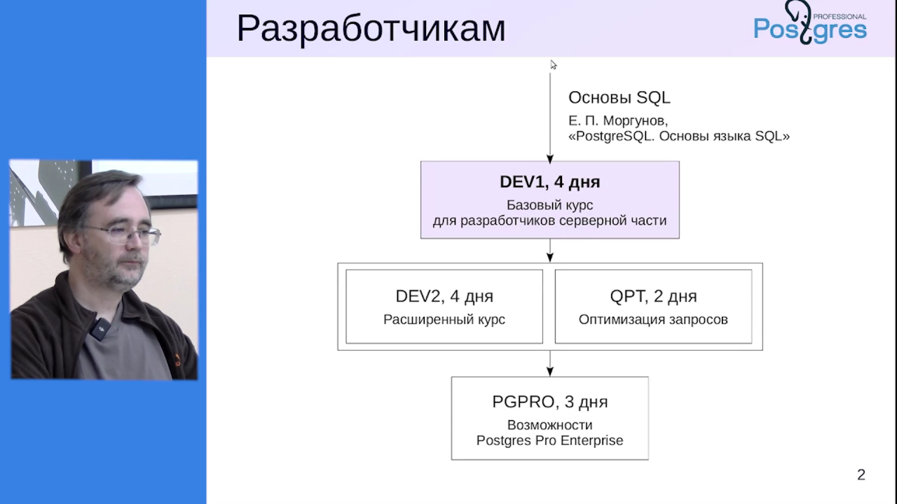
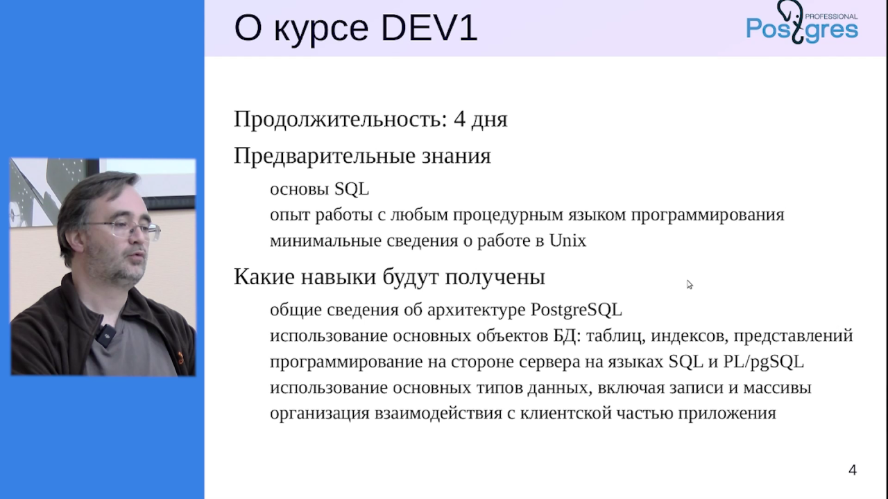
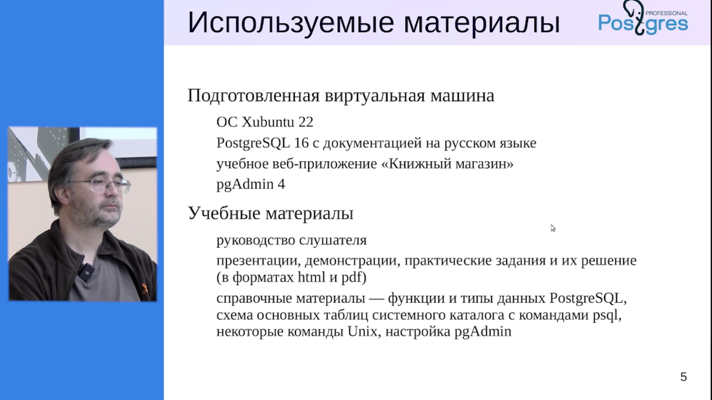
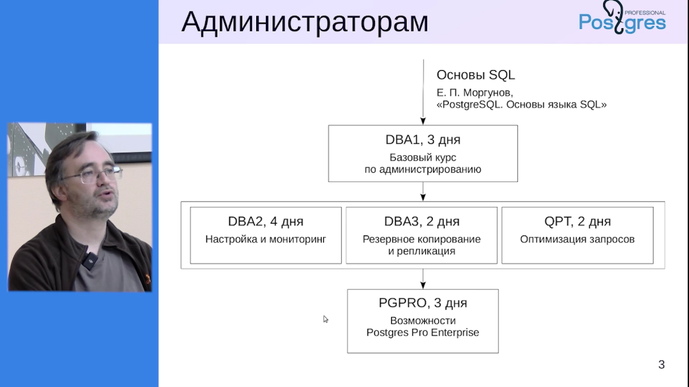
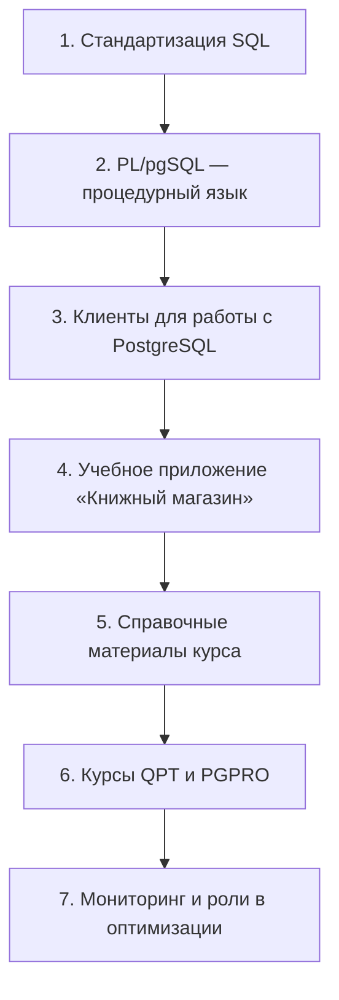

# Введение в курсы по Postgres и оптимизации запросов

> [!abstract] Обзор
> Материал описывает опору на стандарт SQL и достаточность знания SQL по другим СУБД, а также последовательность курсов от Postgres Professional: QPT по оптимизации запросов и PGPRO по возможностям форка Postgres Pro Enterprise. Отдельно разбираются мониторинг и роли разработчиков и администраторов в оптимизации запросов. Также перечислены учебное приложение «Книжный магазин», процедурный язык PL/pgSQL и справочные материалы курса: схема системного каталога с командами psql и шпаргалка по командам Unix.

> [!info] Курс
> [[index|Оглавление курса]]

## Оглавление
1. [[#1. Стандартизация SQL]]
2. [[#2. PL/pgSQL — процедурный язык]]
3. [[#3. Клиенты для работы с PostgreSQL]]
4. [[#4. Учебное приложение «Книжный магазин»]]
5. [[#5. Справочные материалы курса]]
6. [[#6. Курсы QPT и PGPRO]]
7. [[#7. Мониторинг и роли в оптимизации]]

**Схема** — [[#Схема]]
**Итог** — [[#Итог]]

## 1. Стандартизация SQL

Ядро языка SQL определяется стандартом, поэтому знание SQL по другим СУБД вполне достаточно. Для получения максимальной пользы от курса нужно знать основы языка SQL и не пугаться запросов, соединяющих несколько таблиц. На языке SQL можно писать не только запросы, но и хранимые функции и процедуры.

*Источник: [00:00:49]*

> [!quote]- Кадр [00:00:49]
> 

## 2. PL/pgSQL — процедурный язык

PL/pgSQL — это процедурный язык, который в большинстве случаев используется для работы с данными внутри Postgres.

*Источник: [00:06:30]*

> [!quote]- Кадр [00:06:30]
> 

## 3. Клиенты для работы с PostgreSQL

Для работы с PostgreSQL можно пользоваться клиентом psql в терминале; можно установить графическое средство pgAdmin 4, которое уже есть в виртуальной машине. Ничего не мешает установить и другой привычный клиент, например DBeaver.

*Источник: [00:06:30]*

## 4. Учебное приложение «Книжный магазин»

В курсе используется учебное веб-приложение «Книжный магазин», у которого клиентская часть уже реализована. В ходе курса слушатели пишут для него серверную часть, постепенно добавляя приложению новые возможности.

*Источник: [00:09:50]*

> [!quote]- Кадр [00:09:50]
> 

## 5. Справочные материалы курса

В справочных материалах есть схема основных таблиц системного каталога, где помечены команды psql для получения информации из этих таблиц. Также есть документ, перечисляющий основные команды Unix; команды из него используются в демонстрациях курса.

*Источник: [00:09:50]*

## 6. Курсы QPT и PGPRO

QPT расшифровывается как настройка производительности запросов (Query Performance Tuning) — это курс по оптимизации запросов; в нём разбирается, как выполняются запросы, как строятся планы запросов, как найти проблемный запрос и какие есть средства для его оптимизации. PGPRO — курс, который рассматривает только возможности Postgres Pro Enterprise, форка Postgres, включающего разработки, которых нет в обычном Postgres.

*Источник: [00:00:49]*

## 7. Мониторинг и роли в оптимизации

Мониторинг позволяет смотреть, что происходит в системе; информацию мониторинга нужно интерпретировать и на основе обратной связи донастраивать систему нужным образом. Оптимизацией запросов должны заниматься и разработчики, и администраторы, но с разных сторон: разработчик оптимально пишет свои запросы, а администратор смотрит на весь экземпляр и следит за общим его состоянием.

*Источник: [00:04:09]*

> [!quote]- Кадр [00:04:09]
> 

## Схема

## Итог

> [!success] Что в итоге
> Курсы опираются на знание основ SQL и стандартное ядро языка, поэтому знание SQL по другим СУБД достаточно. Дальше материал переходит к оптимизации запросов: курсу QPT, возможностям Postgres Pro Enterprise в курсе PGPRO, интерпретации данных мониторинга и разным ролям разработчиков и администраторов. Практическая часть опирается на учебное приложение «Книжный магазин» и справочные материалы курса.

