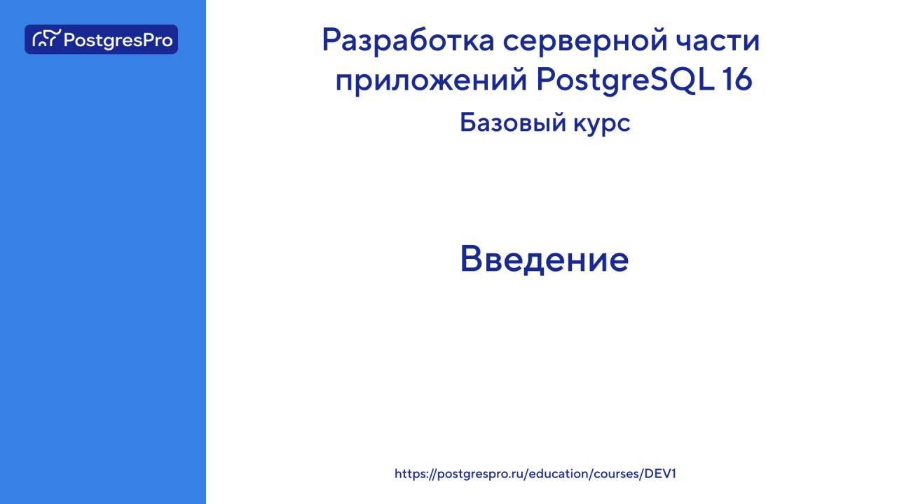
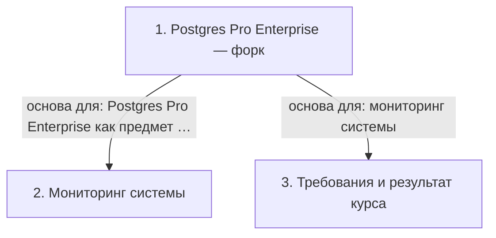

# Введение в курс по серверной части PostgreSQL 16

> [!abstract] Обзор
> Материал вводит в курс «Разработка серверной части приложений PostgreSQL 16». Он описывает Postgres Pro Enterprise как форк Postgres с разработками, которых нет в обычном Postgres. Отдельно раскрывается роль мониторинга системы и требования к слушателям — владение терминалом Unix и моделью прав. Также указано, что даёт курс: понимание устройства и верхнеуровневой архитектуры Postgres.

> [!info] Курс
> [[index|Оглавление курса]]

## Оглавление
1. [[#1. Postgres Pro Enterprise — форк]]
2. [[#2. Мониторинг системы]]
3. [[#3. Требования и результат курса]]

**Схема** — [[#Схема]]
**Итог** — [[#Итог]]

## 1. Postgres Pro Enterprise — форк

Postgres Pro Enterprise — это форк Postgres. Он содержит разработки, которых нет в обычном Postgres.

*Источник: [00:00:04]*

> [!quote]- Кадр [00:00:04]
> 

## 2. Мониторинг системы

Мониторинг позволяет смотреть, что происходит в системе. Он также позволяет интерпретировать информацию, которую выдаёт. На основе этой обратной связи систему можно донастраивать нужным образом.

> [!info] Зачем это нужно
> Обратная связь от мониторинга нужна, чтобы донастраивать систему.

*Источник: [00:00:04]*

## 3. Требования и результат курса

Для работы с курсом нужно уметь писать команды в терминале, а также представлять модель прав Unix: как выдаются права на файлы и как работают пользователи. В раздаточных материалах курса есть шпаргалка по основным командам Unix. На выходе мы узнаем, как устроен Postgres и какова его архитектура — на верхнем уровне, без деталей.

*Источник: [00:00:04]*

## Схема

## Итог

> [!success] Что в итоге
> Курс посвящён серверной части PostgreSQL 16. Он знакомит с Postgres Pro Enterprise как форком Postgres и с ролью мониторинга. Для работы требуются навыки Unix, а результатом должно стать понимание устройства и верхнеуровневой архитектуры Postgres.

