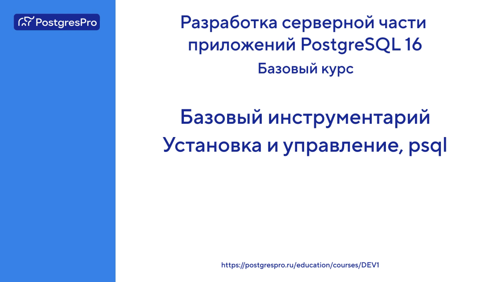
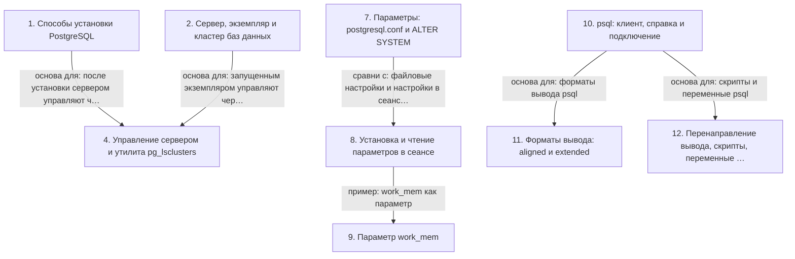

# PostgreSQL: установка, управление, параметры и клиент psql

> [!abstract] Обзор
> Материал охватывает базовое устройство и эксплуатацию PostgreSQL: способы установки (пакет, сборка из исходных кодов, облако), понятия сервера, экземпляра, роли и кластера баз данных, а также расширяемость системы. Описано управление сервером через pg_ctl и его обёртку pg_ctlcluster, утилита pg_lsclusters, каталоги установки и данных и файл postmaster.pid. Отдельно разобраны журнал для диагностики и его настройка, параметры конфигурации, файл postgresql.conf, команды ALTER SYSTEM, SET, RESET, SET LOCAL и чтение значений через pg_settings, SHOW и current_setting(). Вторая крупная тема — терминальный клиент psql: справка, соединение и \conninfo, форматы вывода (aligned и extended), перенаправление вывода, выполнение и генерация скриптов, собственные переменные и выход. Обе темы связаны тем, что psql — основной инструмент администратора для настройки и проверки параметров.

> [!info] Курс
> [[index|Оглавление курса]]

## Оглавление
1. [[#1. Способы установки PostgreSQL]]
2. [[#2. Сервер, экземпляр и кластер баз данных]]
3. [[#3. Расширяемость Postgres]]
4. [[#4. Управление сервером и утилита pg_lsclusters]]
5. [[#5. Каталоги установки и данных, файл postmaster.pid]]
6. [[#6. Журнал: диагностика, настройка и формат]]
7. [[#7. Параметры: postgresql.conf и ALTER SYSTEM]]
8. [[#8. Установка и чтение параметров в сеансе]]
9. [[#9. Параметр work_mem]]
10. [[#10. psql: клиент, справка и подключение]]
11. [[#11. Форматы вывода: aligned и extended]]
12. [[#12. Перенаправление вывода, скрипты, переменные и выход]]

**Схема** — [[#Схема]]
**Итог** — [[#Итог]]

## 1. Способы установки PostgreSQL

Предпочтительный способ — установка готового пакета, собранного под конкретную операционную систему: инструкции есть в разделе Download на postgresql.org, а установка сводится к команде пакетного менеджера, например apt install postgresql в Ubuntu; кластер баз данных при этом инициализируется автоматически, и работает автозапуск. Postgres — система с открытыми исходными кодами, поэтому можно склонировать репозиторий и сделать сборку; это нужно, если требуются ключи, которых нет в обычной сборке (например, для отладки), а также разработчикам Postgres или для экзотической платформы без готовых пакетов; при сборке из исходных кодов кластер автоматически не инициализируется, для этого есть утилита initdb. Практически все провайдеры дают возможность запускать Postgres у себя в облаке: ничего не надо устанавливать, можно накликать конфигурацию мышкой, но пользователь лишён части возможностей и ограничен инструментарием провайдера. Пакетный дистрибутив учитывает особенности конкретной операционной системы, поэтому нужно знать, как запускать и останавливать сервер, где расположены файлы конфигурации и где находится файл журнала сообщений; в случае Ubuntu это отдельная утилита.

> [!info] Зачем это нужно
> Установка из готовых пакетов даёт понятную установку: известно, как с ней работать и где находятся какие файлы; сборка из исходников может потребоваться разработчикам Postgres или для экзотической платформы, а в облаке ничего не надо устанавливать и администрированием занимается провайдер.

*Источник: [00:00:04]*

> [!quote]- Кадр [00:00:04]
> 

## 2. Сервер, экземпляр и кластер баз данных

PostgreSQL — это система управления базами данных. Запущенный PostgreSQL называется сервером или экземпляром сервера; на одном компьютере можно запустить несколько экземпляров. В PostgreSQL пользователь называется ролью; это одно и то же. Один экземпляр может управлять одновременно несколькими базами данных, и этот набор баз данных называется кластером баз данных. В Postgres исторически кластер — это кластер баз данных, а не набор взаимодействующих серверов. Подключиться можно только к одной конкретной базе данных из всего кластера, а не к кластеру в целом; при подключении любого клиента нужно указать имя базы данных. Если приложению нужно работать с несколькими базами данных, нужно создавать несколько подключений.

*Источник: [00:00:04]*

## 3. Расширяемость Postgres

Postgres расширяем: его функциональность можно увеличить с помощью расширений. В составе Postgres входит порядка полусотни разных модулей программ.

> [!info] Зачем это нужно
> Модули не устанавливаются сразу, потому что не всегда и не всем нужны.

*Источник: [00:00:04]*

## 4. Управление сервером и утилита pg_lsclusters

Для управления сервером Postgres используется утилита pg_ctl. pg_ctl start запустит экземпляр, pg_ctl stop остановит его; команду нужно выполнять через sudo, сервер запущен под пользователем postgres. В Ubuntu принято не обращаться к pg_ctl напрямую, а использовать обёртку pg_ctlcluster, которая в конечном итоге всё равно вызывает pg_ctl. Команда restart — это сокращение, которое сначала останавливает сервер, потом запускает его. Команда reload перечитывает конфигурационные файлы. pg_lsclusters — утилита, которая показывает, какие кластеры баз данных установлены, и выводит информацию о кластерах.

| Команда | Действие |
| restart | сначала останавливает сервер, потом запускает |
| reload | перечитывает конфигурационные файлы |

*Источник: [00:00:04]*

## 5. Каталоги установки и данных, файл postmaster.pid

Каталог, в который установлен Postgres в Ubuntu, — /usr/lib/postgresql/16, где 16 — номер версии; в нём хранятся двоичные файлы и библиотеки, а владельцем всех этих каталогов является root. Каталог кластера обычно называют PGDATA по имени переменной окружения, которая должна на этот каталог смотреть. Владельцем этого каталога является Postgres, то есть тот пользователь, под которым запущен сервер. Файл postmaster.pid содержит номер Unix-процесса, соответствующего экземпляру. Если сервер запущен, файл есть; при остановке сервера файл удаляется.

| Каталог | Содержимое | Владелец |
| /usr/lib/postgresql/16 | двоичные файлы и библиотеки | root |
| PGDATA | каталог кластера | postgres |

*Источник: [00:00:04]*

## 6. Журнал: диагностика, настройка и формат

В Ubuntu файл журнала по умолчанию называется postgresql16-main.log. Файл журнала уже содержит информацию; посмотреть последние строки можно с хвоста этого файла. Можно настроить расположение журнала и формат журнала. По умолчанию журнал пишется в обычном текстовом виде; можно отправлять журнал в syslog и сделать формат JSON. Можно записывать в журнал все входы пользователей и выходы. В начале сообщения журнала идёт префикс: текущая дата, номер процесса, записавшего журнал, и уровень сообщения. Уровни бывают, например, log, error, info.

> [!info] Зачем это нужно
> При возникновении проблем с Postgres нужно обращаться к журналу.

*Источник: [00:00:04], [00:00:10]*

> [!quote]- Кадр [00:00:10]
> 

## 7. Параметры: postgresql.conf и ALTER SYSTEM

Postgres состоит из многих подсистем, и каждая допускает настройки; параметры конфигурации — это «ручки» с именем и значением (числовым, логическим или текстовым). Основное место хранения — текстовый файл postgresql.conf в каталоге /etc/postgresql/16/main, где параметры перечислены как имя = значение. В каталоге conf.d можно складывать свои конфигурационные файлы; если в postgresql.conf стоит директива читать все файлы из каталога, они подчитываются. ALTER SYSTEM — SQL-команда для установки и сброса параметров без редактирования текстового файла: ALTER SYSTEM SET (например, work_mem TO 16 МБ; вместо to можно писать =) записывает параметры в postgresql.auto.conf, а для применения нужно перечитать конфигурацию через pg_ctlcluster reload или pg_reload_conf(). ALTER SYSTEM RESET work_mem удаляет строку параметра из postgresql.auto.conf; файл можно редактировать вручную, но рекомендуется SQL-интерфейс.

> [!info] Зачем это нужно
> Создание конфигурационного файла удобно для экспериментов, а для отката достаточно просто удалить файл; ALTER SYSTEM позволяет работать с параметрами без редактирования текстового файла.

*Источник: [00:00:04]*

## 8. Установка и чтение параметров в сеансе

Для изменения параметров в текущем сеансе используются SET и RESET: SET устанавливает или сбрасывает значение, в отличие от ALTER SYSTEM SET не трогает файлы и сразу меняет значение в сеансе. Функция setConfig делает то же, что и SET. SET LOCAL меняет значение только в рамках текущей транзакции; после фиксации или отмены значение возвращается к прежнему. Проверить значение можно через представление pg_settings, где значение и единицы измерения хранятся отдельно (например, 64 МБ отображаются как 65536 КБ), командой SHOW (show work_mem) или функцией current_setting(). Установка параметра — это баланс: слишком маленькое значение приводит к лишним дисковым операциям, а слишком большое может съесть оперативную память и уронить экземпляр.

*Источник: [00:00:04]*

## 9. Параметр work_mem

work_mem задает объем памяти для внутренних операций во время выполнения запросов, например для сортировки или построения хэш-таблицы. Если процесс не укладывается в этот объем, он начинает работать с диском, что медленнее.

*Источник: [00:00:04]*

## 10. psql: клиент, справка и подключение

psql — терминальный клиент для работы с Postgres, единственный клиент в составе самого сервера и единственная штатная клиентская утилита для выполнения запросов; для администраторов это обязательный инструмент (must-have), позволяющий выполнять скрипты и автоматизировать работу. Если узел не указан, psql использует локальное соединение; если пользователь не указан, он совпадает с пользователем операционной системы; если имя базы данных не указано, оно равно имени пользователя базы данных; порт по умолчанию — 5432; команда psql -c с select 1 проверяет, работает ли сервер. Команда \? выводит список команд psql, \? variables — справку по встроенным переменным, \h (или \help) — список SQL-команд и синтаксис конкретной команды (например, \h create table); справку можно получить в документации, с помощью psql --help или man. psql взаимодействует с операционной системой: чтобы выполнить команду shell, нужно написать \! и далее обычную команду Unix. Команда connect устанавливает новое соединение, не выходя из psql, и может переподключиться к другой базе или машине; \conninfo показывает, к какой базе и под каким пользователем выполнено подключение, а также сокет, компьютер и порт соединения.

*Источник: [00:00:04]*

## 11. Форматы вывода: aligned и extended

По умолчанию результаты команд, например SELECT, выводятся в виде выровненной таблицы — выровненный формат (aligned), который подразумевает выравнивание значений. Если результат нужно передать в утилиту и разобрать, табличные отступы мешают: \a включает и выключает режим выравнивания, \t выключает и включает верхнюю и нижнюю части таблицы, а с помощью \A и \T можно отключить выравнивание и лишнюю информацию, после чего вывод проще разобрать программно. Расширенный формат (extended) удобен, если нужно посмотреть одну или пару очень широких строк с большим числом столбцов: при обычном Select вывод заворачивается на несколько строк и сложно сопоставить столбцы. \gx выполняет запрос и выводит результат в расширенном формате: первый столбец — название столбцов, второй — значения; \x включает расширенный формат для всех последующих запросов, повторный \x возвращает обычный формат. На практике обычно удобнее написать \gx в конце запроса, чем включать переключатель.

*Источник: [00:00:04]*

## 12. Перенаправление вывода, скрипты, переменные и выход

Весь вывод можно помещать в файл вместо вывода на экран, например в файл div1.tools.sql; таблица pg_tables содержит список всех таблиц кластера, включая саму себя. Команда \i (include) выполняет скрипт; для действий с большим количеством таблиц, например добавления столбца ко всем таблицам, можно сгенерировать нужный скрипт и выполнить его, вместо написания отдельной команды ALTER TABLE для каждой таблицы. psql имеет собственные переменные, которые устанавливаются командой \set; если написать \set без параметров, будет выведен список всех переменных, включая встроенные. Часто нужные запросы можно записать в переменные psql, чтобы не запоминать и не писать их каждый раз; например, длинный запрос, выводящий 5 самых больших по размеру таблиц, можно сохранить в переменную. Вывести значение переменной можно командой echo: вместо имени переменной подставляется её значение; сбросить ненужную переменную можно командой unset, после чего текст выводится дословно, так как такой переменной нет; выйти из psql можно командой \q, позже были добавлены также quit и exit.

*Источник: [00:00:04]*

## Схема

## Итог

> [!success] Что в итоге
> PostgreSQL можно установить из готового пакета, собрать из исходных кодов или запустить у провайдера в облаке. Запущенный экземпляр управляет кластером баз данных, а для управления сервером используются pg_ctl и его обёртка pg_ctlcluster. Диагностика опирается на журнал, настройки которого задаются в postgresql.conf и могут меняться через ALTER SYSTEM, SET и SET LOCAL, а текущие значения читаются через pg_settings, SHOW и current_setting(). psql — единственный клиент в составе сервера и основной инструмент администратора.

