# PostgreSQL: установка, управление сервером, конфигурация и работа в psql

> [!abstract] Обзор
> Материал посвящён PostgreSQL — системе управления базами данных. Разбираются способы установки (пакеты, исходники, облако) и понятия экземпляра сервера и кластера баз данных, а также подключение клиента через драйвер и утилита psql. Рассматривается управление сервером через sudo и pg_ctlcluster, журнал сообщений с уровнями LOG, ERROR, INFO и способы проверки статуса. Отдельно разобраны параметры конфигурации: их типы, файлы postgresql.conf, conf.d и postgresql.auto.conf, изменение через ALTER SYSTEM, для сеанса (set/reset) и в транзакции (SET LOCAL), на примере work_mem. В psql показаны форматы вывода, собственные переменные, shell-команды, генерация SQL через pg_tables и format(), а также проверка доступности сервера. Темы связаны: изменение параметра затрагивает файлы конфигурации, требует перечитывания и проверяется через SQL или psql.

> [!info] Курс
> [[index|Оглавление курса]]

## Оглавление
1. [[#1. PostgreSQL как СУБД, способы установки и расширения]]
2. [[#2. Экземпляр, кластер баз данных, инициализация и запуск]]
3. [[#3. Управление сервером: sudo, pg_ctlcluster, pg_lsclusters]]
4. [[#4. Журнал сообщений сервера и уровни сообщений]]
5. [[#5. Параметры конфигурации, файлы и ALTER SYSTEM]]
6. [[#6. Изменение параметров для сеанса и в рамках транзакции]]
7. [[#7. Параметр work_mem, просмотр и перечитывание конфигурации]]
8. [[#8. Утилита psql и выход из неё]]
9. [[#9. Форматирование вывода в psql]]
10. [[#10. Переменные psql и shell-команды]]
11. [[#11. Генерация SQL через pg_tables и format(), скрипты и проверка доступности]]

**Схема** — [[#Схема]]
**Итог** — [[#Итог]]

## 1. PostgreSQL как СУБД, способы установки и расширения

PostgreSQL — это система управления базами данных. Устанавливать её можно из готовых пакетов (предпочтительный способ), из исходных кодов или использовать без установки через облачные сервисы. Установка из исходных кодов нужна, если требуется собрать Postgres с ключами, которых нет в обычной сборке, например для отладки; сборка из исходников требуется разработчикам или для экзотических платформ. В облаке управлением и администрированием занимается провайдер, а при использовании облака ничего устанавливать не надо. Расширения предоставляют дополнительный функционал, который устанавливается отдельно; в поставке с сервером идут модули и программы — около 50 штук, и большинство расширений после установки работает на лету, перезапускать сервер не требуется.

> [!info] Зачем это нужно
> Готовые пакеты учитывают особенности операционной системы, поэтому это предпочтительный способ установки.

*Источник: [00:00:15], [00:01:05], [00:02:55]*

> [!quote]- Кадр [00:00:15]
> 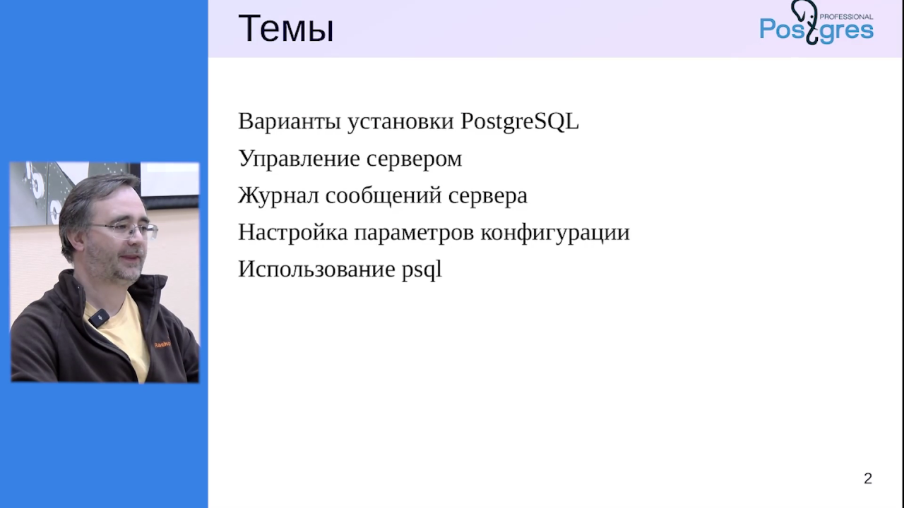

> [!quote]- Кадр [00:02:55]
> 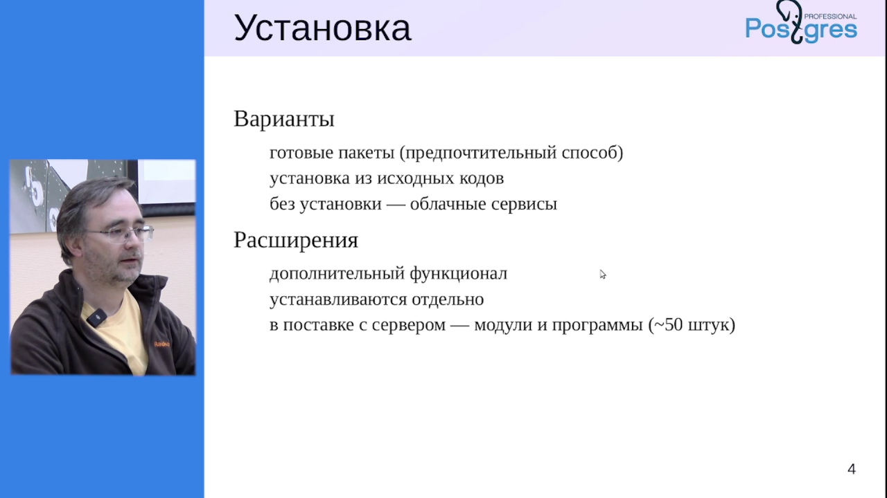

## 2. Экземпляр, кластер баз данных, инициализация и запуск

Клиент подключается к базе данных (кластеру баз данных) через драйвер. Набор баз данных, которыми управляет один экземпляр, называется кластером баз данных; в Postgres исторически кластер — это именно кластер баз данных, хотя обычно это слово ассоциируется с набором взаимодействующих серверов. Подключение возможно только к одной базе данных из всего кластера; подключиться к кластеру в целом нельзя, и при подключении любого клиента нужно указать имя базы данных. При установке из пакета кластер инициализируется автоматически (утилитой initDB), а при сборке из исходных кодов требуется ручная инициализация; кластер находится в каталоге /var/lib/postgresql/16/main, который называется PGDATA, владелец — пользователь postgres. При запуске говорят, что работает сервер или экземпляр сервера; на одном компьютере можно запустить несколько экземпляров, каталог установки в Ubuntu — /usr/lib/postgresql/16, владелец root, автозапуск работает автоматически, а файл postmaster.pid содержит номер процесса Unix соответствующего экземпляра; если сервер запущен, файл существует, при остановке удаляется.

*Источник: [00:00:15], [00:01:05], [00:08:00], [00:08:20], [00:09:36], [00:27:06] и др.*

> [!quote]- Кадр [00:01:05]
> 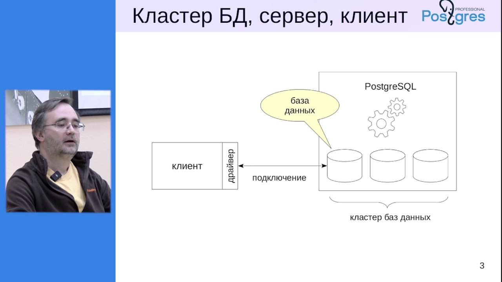

> [!quote]- Кадр [00:08:00]
> 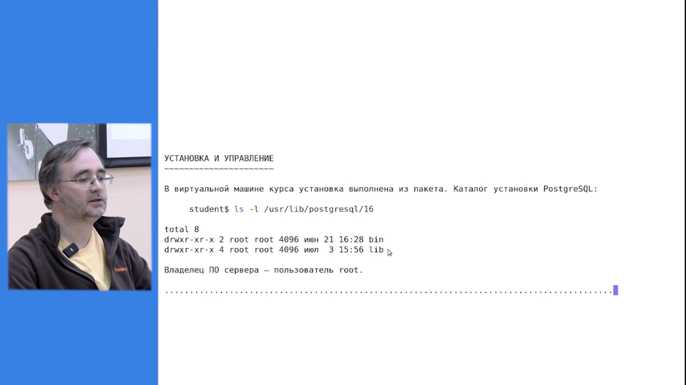

> [!quote]- Кадр [00:08:20]
> 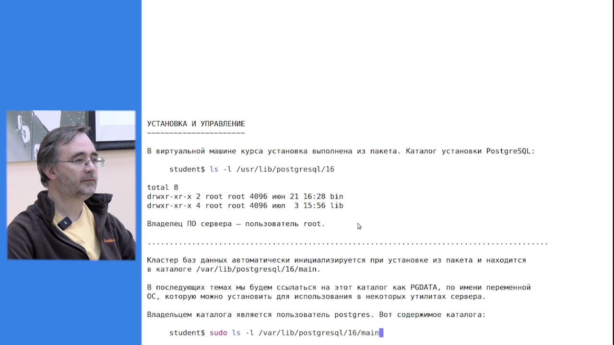

> [!quote]- Кадр [00:43:41]
> 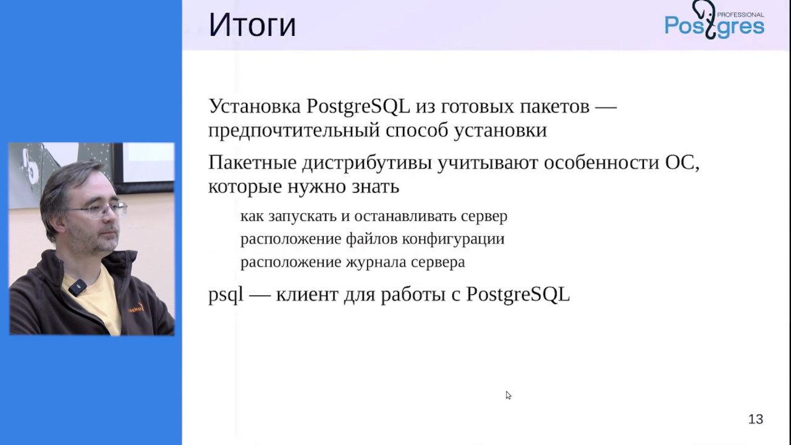

## 3. Управление сервером: sudo, pg_ctlcluster, pg_lsclusters

Сервер запущен под пользователем postgres, поэтому команды управления нужно выполнять от имени суперпользователя с помощью sudo (sudo означает, что следующую команду нужно выполнять под суперпользователем). Команда stop останавливает сервер, команда start запускает сервер, а restart сначала останавливает, потом запускает его; pg_ctl — утилита для управления сервером PostgreSQL, а pg_ctlcluster принимает команды stop, start, restart, reload и status, в команде указывается версия (16) и имя кластера (main). В Ubuntu не принято обращаться к pg_ctl напрямую — используется обёртка pg_ctlcluster, которая в конечном итоге вызывает pg_ctl; команда pg_ctlcluster status показывает, запущен ли сервер, номер процесса и команду, которой он был запущен. Утилита pg_lsclusters показывает, какие кластеры баз данных установлены в системе: версию, порт, статус, владельца, каталог данных и лог-файл.

*Источник: [00:06:49], [00:09:58], [00:11:18], [00:11:38], [00:11:58], [00:12:19] и др.*

> [!quote]- Кадр [00:06:49]
> 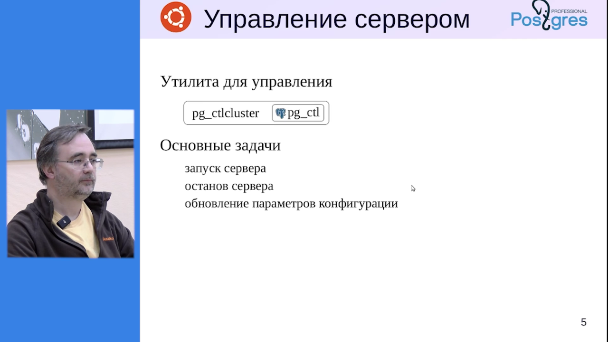

## 4. Журнал сообщений сервера и уровни сообщений

В журнал записываются служебные сообщения сервера, сообщения пользовательских сеансов и приложений; туда всегда попадают сообщения об ошибках и важных действиях, включая сообщения о том, что база данных установлена, запускается, готова принимать соединения. В начале сообщения журнала идёт префикс, в нём выводится текущая дата и номер процесса, который записал журнал. Можно настроить расположение журнала и формат записей и записывать все входы и выходы пользователей; по умолчанию журнал пишется в обычном текстовом виде, но можно отправлять его в syslog или использовать формат JSON для программного разбора. Уровень сообщения в журнале может быть LOG, ERROR, INFO и другие; журнал сообщений сервера PostgreSQL находится в /var/log/postgresql/postgresql-16-main.log, при сборке из исходных кодов файлы конфигурации и журнала находятся в каталоге кластера, а в Ubuntu могут быть разбросаны по разным каталогам, для просмотра последних 10 строк журнала используется команда tail -n 10.

> [!info] Зачем это нужно
> Если сервер PostgreSQL не запускается, первое, что нужно сделать — посмотреть журнал сообщений сервера.

*Источник: [00:12:39], [00:14:33], [00:15:02], [00:17:51], [00:43:41]*

> [!quote]- Кадр [00:12:39]
> 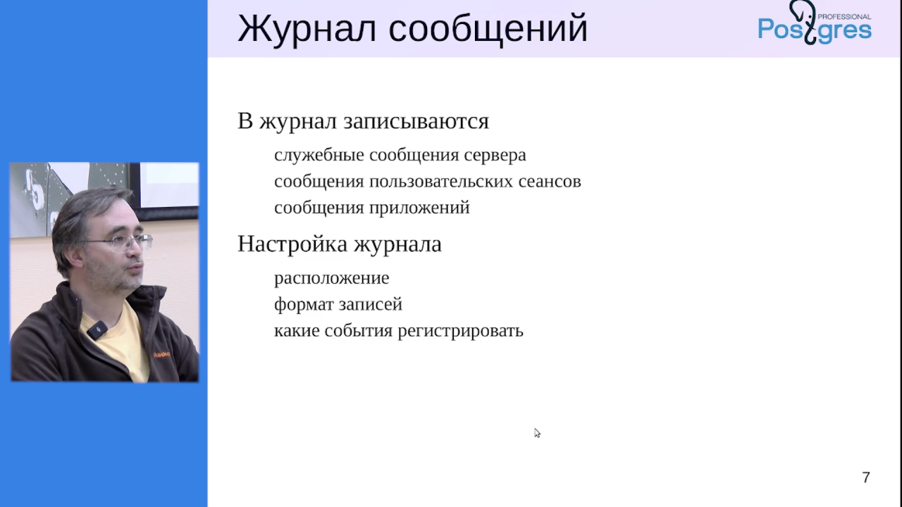


## 5. Параметры конфигурации, файлы и ALTER SYSTEM

Параметры конфигурации — это настройки подсистем Postgres, которые можно менять; у параметра есть имя и значение, значение может быть числовым, логическим или текстовым. Основное место, где живут параметры — файл postgresql.conf, который задаёт параметры для всего экземпляра; это текстовый файл с записями «имя = значение», в Ubuntu он находится в /etc/postgresql/16/main. В PostgreSQL есть каталог conf.d, куда можно складывать собственные конфигурационные файлы, и в postgresql.conf есть директива читать все файлы из этого каталога, что удобно для экспериментов. Команда ALTER SYSTEM SET параметр = значение записывает строки в конфигурационный файл postgresql.auto.conf в каталоге PGDATA, а не в postgresql.conf; файл можно редактировать вручную, но не рекомендуется, лучше использовать SQL-интерфейс. ALTER SYSTEM позволяет устанавливать и сбрасывать параметры: после ALTER SYSTEM SET сразу ничего не происходит — изменяется только конфигурационный файл, а ALTER SYSTEM RESET work_mem удаляет строку work_mem из postgresql.auto.conf; в команде вместо TO можно писать =.

```
ALTER SYSTEM SET work_mem TO '16MB';
```

*Источник: [00:15:02], [00:15:22], [00:21:13], [00:21:33], [00:22:34], [00:22:54]*

> [!quote]- Кадр [00:15:22]
> 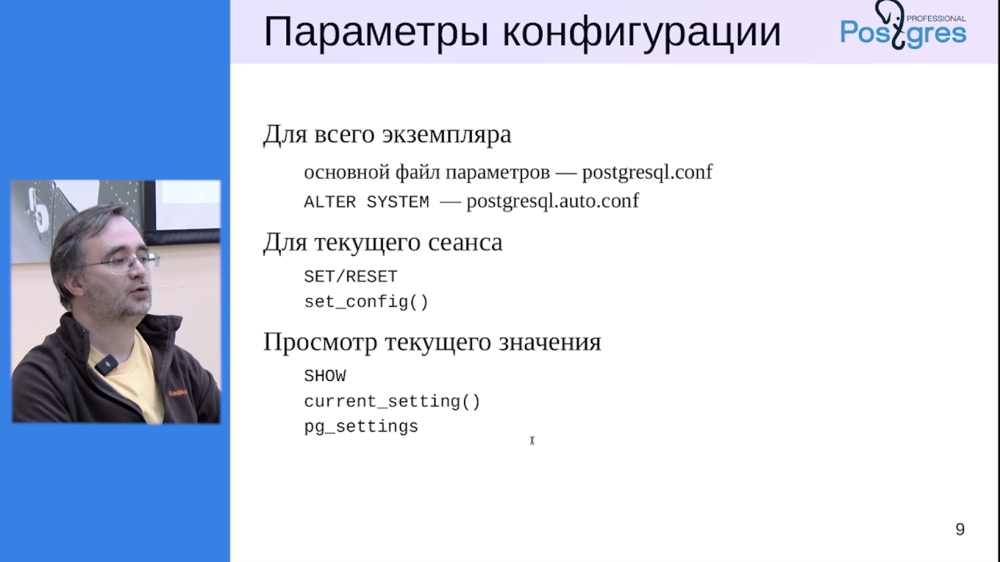

> [!quote]- Кадр [00:22:54]
> 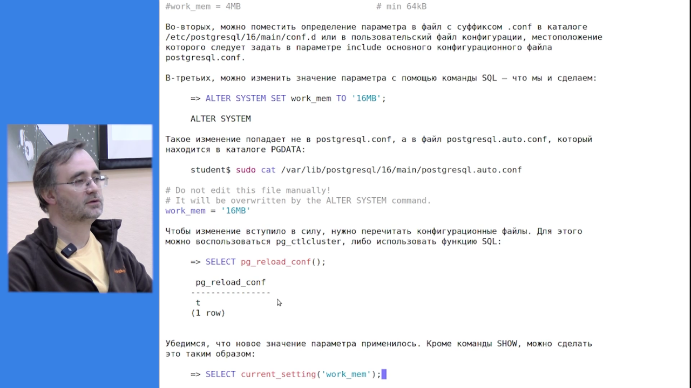

## 6. Изменение параметров для сеанса и в рамках транзакции

Значение параметров можно менять не для всего экземпляра, а для текущего сеанса с помощью команд set и reset; reset сбрасывает значение параметра, а функция setConfig делает то же самое, что и команда set. Команда SET work_mem = '64MB' тут же меняет значение параметра в сеансе и, в отличие от ALTER SYSTEM SET, не трогает никакие файлы. Чтобы восстановить значение по умолчанию, вместо SET используется команда RESET, после чего нужно перечитать конфигурационные файлы. Команда SET LOCAL меняет значение параметра только в рамках текущей транзакции; после фиксации или отмены транзакции значение возвращается к старому.

```
SET work_mem = '64MB';
```

*Источник: [00:11:18], [00:15:22], [00:23:37], [00:24:17]*


## 7. Параметр work_mem, просмотр и перечитывание конфигурации

work_mem задаёт объём памяти для внутренних операций сортировки и размещения хеш-таблиц, прежде чем будут задействованы временные файлы на диске; значение по умолчанию — 4MB, оно слишком мало для современных реалий, а слишком большое значение приводит к тому, что процессы съедят всю оперативную память и экземпляр упадёт. work_mem можно увеличить, отредактировав файл postgresql.conf (по умолчанию параметр закомментирован); чтобы изменение применилось, нужно перечитать конфигурацию через pg_reload_conf(). Текущее значение параметра можно посмотреть командой SHOW, функцией current_setting или через представление pg_settings; в pg_settings значение и единицы измерения хранятся отдельно, команда \dconfig показывает значение одного или нескольких параметров. После изменения параметра в файле конфигурации в системе ничего не меняется, параметр продолжает оставаться прежним; чтобы перечитать конфигурацию, можно воспользоваться командой reload или SELECT pg_reload_conf(), после чего current_setting('work_mem') показывает новое значение.

```sql
=> SHOW work_mem;

 work_mem
----------
 4MB
(1 row)

student$ grep '#work_mem' /etc/postgresql/16/main/postgresql.conf
#work_mem = 4MB                        # min 64kB

SELECT name, setting, unit FROM pg_settings WHERE name = 'work_mem';

\dconfig work_mem

=> \dconfig work_mem

SELECT pg_reload_conf();
```

*Источник: [00:15:22], [00:19:02], [00:19:22], [00:22:14], [00:22:34], [00:22:54] и др.*


> [!quote]- Кадр [00:22:14]
> 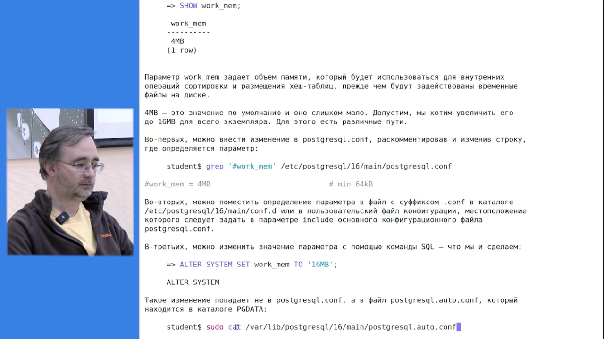

> [!quote]- Кадр [00:22:34]
> 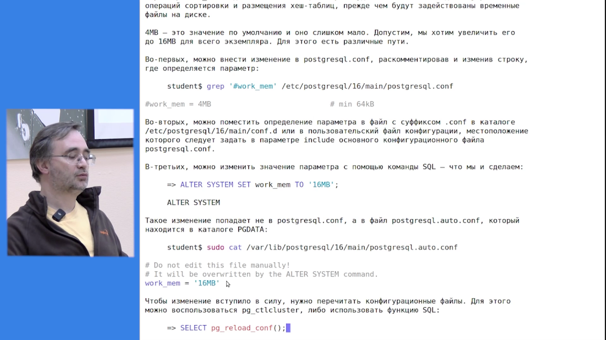


## 8. Утилита psql и выход из неё

psql — это терминальный клиент для работы с Postgres, единственная штатная клиентская утилита и единственный клиент, который идёт в составе самого сервера. psql используется администраторами и разработчиками для интерактивной работы и выполнения скриптов; команды psql начинаются с обратной косой черты (например \conninfo) и всегда однострочные, в отличие от команд SQL. Скрипт можно выполнить командами psql < имя_файла, psql -f имя_файла или psql -c 'команда' (работает только для одной команды); справку даёт man psql, а команда \h[elp] выдаёт синтаксис конкретной команды SQL (\h create table показывает синтаксис create table). Для выхода из psql используется команда \q, а также команды quit и exit, добавленные позже.

```
\q
```

*Источник: [00:25:31], [00:30:46], [00:42:51]*

> [!quote]- Кадр [00:30:46]
> 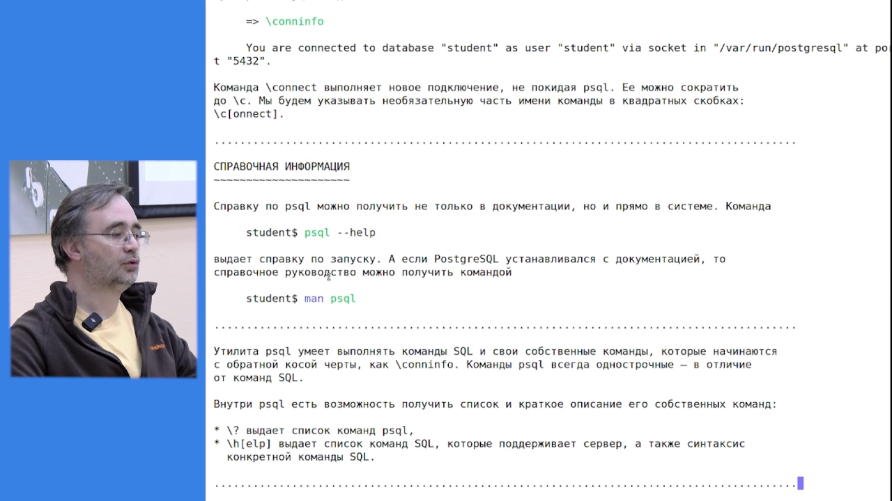

## 9. Форматирование вывода в psql

По умолчанию результаты, например команды select, выводятся в виде красиво отформатированной таблички — это формат с выравниванием значений, aligned формат; ширина столбцов выровнена по значениям, выводится строка заголовков и итоговая строка. Команда \a — переключатель режима с выравниванием/без выравнивания: первый запуск включает режим, повторный выключает; также \a включает невыровненный формат вывода. \gx удобен, если нужно посмотреть одну или пару строк, которые сами по себе очень широкие и содержат много столбцов: если вывести обычный SELECT, он заворачивается на несколько строк, и сложно сопоставить, где какой столбец; в этом случае можно использовать \gx вместо точки с запятой. Все возможности форматирования результатов запросов доступны через команду \pset; команда \t включает режим только кортежей, а команда \pset fieldsep задаёт разделитель полей: значение '|' устанавливает разделитель столбцов, пустая строка '' устанавливает пустой разделитель.

```javascript
=> SELECT name, setting, unit, category, context, vartype,
    min_val, max_val, boot_val, reset_val
    FROM pg_settings
    WHERE name = 'work_mem' \gx

\pset fieldsep ''
\a \t \pset fieldsep '|'
```

*Источник: [00:30:46], [00:32:56], [00:34:06], [00:34:56], [00:36:08], [00:38:02]*

> [!quote]- Кадр [00:34:56]
> 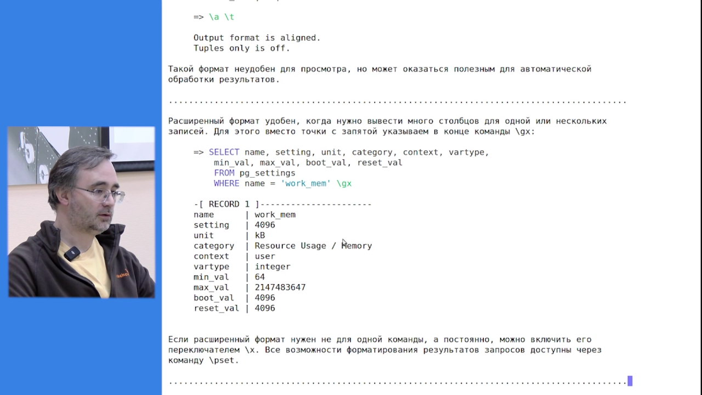

> [!quote]- Кадр [00:32:56]
> 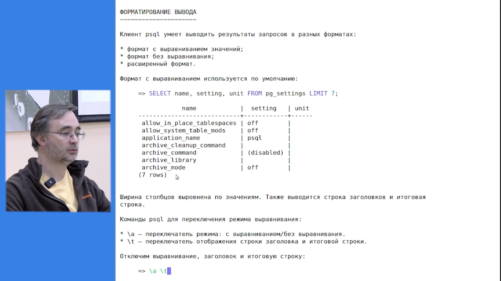

## 10. Переменные psql и shell-команды

psql умеет взаимодействовать с операционной системой и выполнять команды shell: для этого нужно написать бэкслэш с восклицательным знаком, а дальше — обычную команду unix. В psql есть собственные переменные, отличные от переменных окружения Shell. Переменные psql устанавливаются командой \set, значение подставляется, если предварить имя двоеточием, а сбросить переменную можно командой \unset. Переменную можно использовать для хранения SQL-запроса и выполнять его, указав :имя; чтобы вывести значение переменной, можно воспользоваться командой echo, по аналогии с командой Unix. Команда \? variables показывает справку по встроенным переменным.

```javascript
=> \set top5 'SELECT tablename, pg_total_relation_size(schemaname||''.''||tablename) AS bytes FROM
pg_tables ORDER BY bytes DESC LIMIT 5;'
=> :top5
\? variables

\! pwd
```

*Источник: [00:35:48], [00:40:25], [00:42:51]*

> [!quote]- Кадр [00:40:25]
> 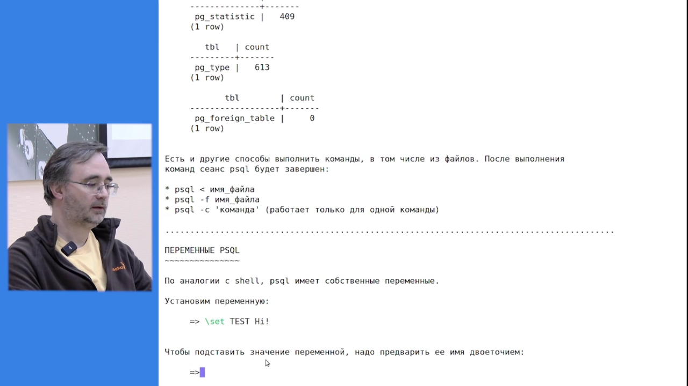

## 11. Генерация SQL через pg_tables и format(), скрипты и проверка доступности

Таблица pg_tables содержит список всех таблиц кластера, включая саму себя. Генерация SQL возможна через pg_tables; с помощью format() в SQL-запросе имена таблиц подставляются на место placeholders. format() подставляет имя таблицы двумя способами: как строковый литерал (%L) и как идентификатор (%I). Чтобы добавить столбец ко всем таблицам, можно сгенерировать скрипт и затем выполнить его, вместо написания отдельной команды alter table для каждой таблицы — это удобный способ для задач, близких к администрированию. Для проверки работы сервера можно выполнить psql -c с запросом SELECT 1: если команда отработает и выведет единицу, сервер доступен; если не отработает — значит что-то не так.

```javascript
* psql < имя_файла
* psql -f имя_файла
=> \i dev1_tools.sql

=> SELECT format('SELECT %L AS tbl, count(*) FROM %I;', tablename, tablename)
    FROM pg_tables LIMIT 3;

=> SELECT format('SELECT %L AS tbl, count(*) FROM %I;', tablename, tablename)
FROM pg_tables LIMIT 3;

* psql -c 'команда' (работает только для одной команды)
```

*Источник: [00:36:55], [00:37:22], [00:38:42]*

## Схема

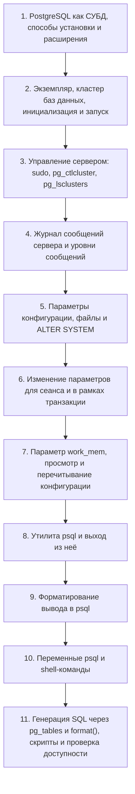

## Итог

> [!success] Что в итоге
> PostgreSQL — система управления базами данных, которую ставят из пакетов, из исходников или используют в облаке; экземпляр управляет кластером баз данных, а клиент подключается через драйвер только к одной базе. Пакетная установка автоматически инициализирует кластер в каталоге PGDATA и настраивает автозапуск, расширения работают без перезапуска сервера. Управление сервером идёт через sudo и pg_ctlcluster (stop, start, restart, reload, status), pg_lsclusters показывает установленные кластеры, а журнал сообщений с уровнями LOG, ERROR, INFO помогает разбираться в работе сервера. Параметры конфигурации задаются в postgresql.conf и conf.d, меняются через ALTER SYSTEM в postgresql.auto.conf, на уровне сеанса set/reset и в транзакции SET LOCAL, проверяются через SHOW, current_setting, pg_settings или \dconfig и требуют перечитывания конфигурации. В psql настраивается форматирование вывода (\gx, \a, \t, \pset), есть собственные переменные и shell-команды, а также генерация SQL через pg_tables и format() и проверка сервера через psql -c с SELECT 1.

