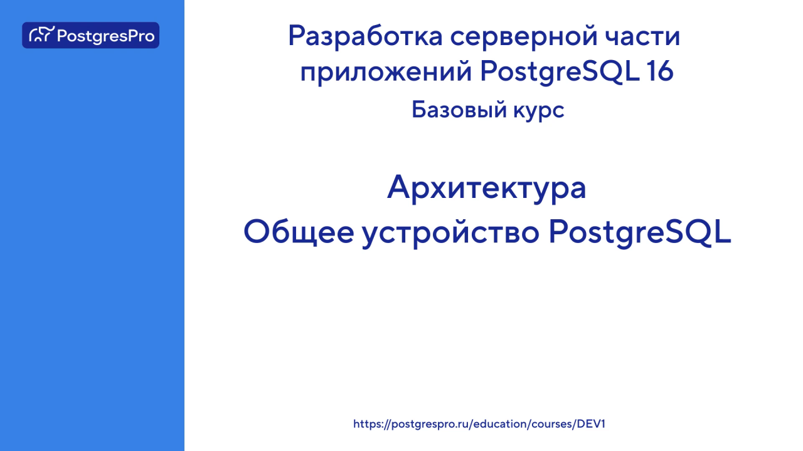
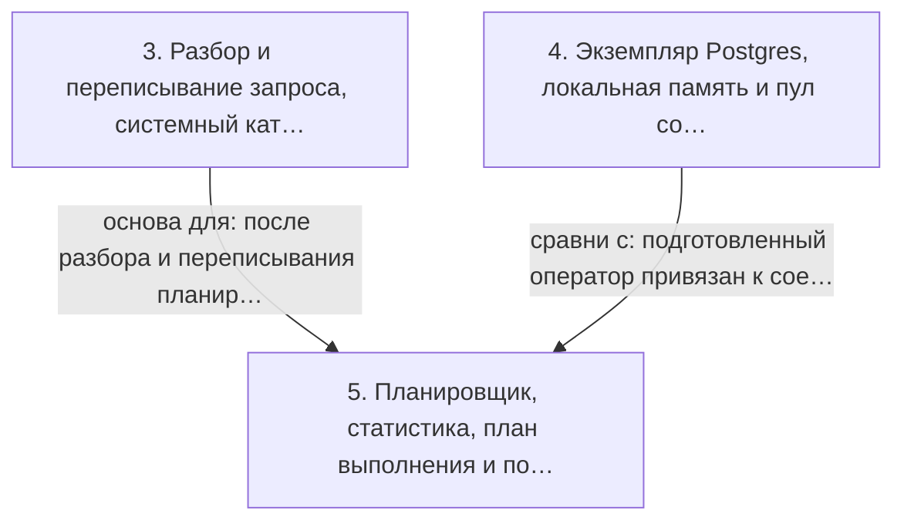

# PostgreSQL: клиент-серверный протокол, транзакции и архитектура обработки запроса

> [!abstract] Обзор
> Материал описывает, как устроена работа PostgreSQL с точки зрения взаимодействия клиента и сервера: язык общения задаёт клиент-серверный протокол, который реализуют драйверы, чаще всего через libpq, а транзакциями в основном управляет клиент, опираясь на серверную поддержку транзакционности и долговечности. Показаны разбор и переписывание запроса, планирование с опорой на статистику и выполнение плана исполнителем, а также подготовленные операторы, курсоры и простой протокол. Отдельно разобрана архитектура экземпляра: под каждого клиента Postmaster порождает обслуживающий процесс со своей локальной памятью, поэтому глобального кэша запросов нет, а пул соединений помогает не повторять работу. Рассмотрены короткоживущие блокировки, многоверсионность (MVCC) и видимость незафиксированных изменений, а также уровни памяти, буферный кэш, отложенная запись и журнал предзаписи.

> [!info] Курс
> [[index|Оглавление курса]]

## Оглавление
1. [[#1. Клиент-серверный протокол и SQL]]
2. [[#2. Транзакции, автофиксация и точки сохранения]]
3. [[#3. Разбор и переписывание запроса, системный каталог]]
4. [[#4. Экземпляр Postgres, локальная память и пул соединений]]
5. [[#5. Планировщик, статистика, план выполнения и подготовленные операторы]]
6. [[#6. Курсоры и простой протокол]]
7. [[#7. Блокировки, MVCC и видимость изменений]]
8. [[#8. Иерархия памяти и буферный кэш]]

**Схема** — [[#Схема]]
**Итог** — [[#Итог]]

## 1. Клиент-серверный протокол и SQL

Клиенты подключаются к серверу по клиент-серверному протоколу для выполнения запросов и управления транзакциями; протокол открытый и описан документацией, поэтому его можно реализовать самому, но обычно используют готовый драйвер. Сервер управляет кластером баз данных: протокол позволяет подключиться, пройти аутентификацию и передать SQL-команды в виде текстовой строки, после чего сервер выполняет их и возвращает результат. При подключении порождается новый процесс — используется процессная модель, каждый клиент обслуживается своим процессом. Большинство драйверов работает как обёртка над библиотекой libpq — стандартной штатной библиотекой Postgres, в которой протокол реализован во всей полноте, хотя некоторые драйверы, например JDBC для Java, реализуют протокол по-своему; возможности программы ограничены возможностями протокола, а не языком программирования. В курсе для показа взаимодействия выбран SQL: он используется на сервере, в базе данных, его должны знать все, а его возможностей в Postgres достаточно, чтобы всё показать; в запросе указывается, что нужно получить, но не говорится, как это получить.

> [!info] Зачем это нужно
> SQL выбран потому, что его должны знать все, а его возможностей в Postgres достаточно, чтобы показать взаимодействие.

*Источник: [00:00:04]*

> [!quote]- Кадр [00:00:04]
> 

## 2. Транзакции, автофиксация и точки сохранения

Транзакция — это последовательность операций, которая переводит базу данных из одного согласованного состояния в другое; она должна быть выполнена либо полностью, либо не выполнена совсем. В основном клиент управляет транзакциями, указывая, когда они начинаются и заканчиваются, а сервер поддерживает транзакционность; на транзакцию не влияют параллельные процессы, данные между транзакциями должны сохранять корректность, а ограничения целостности — выполняться. Свойство долговечности (durability) означает, что зафиксированные данные не пропадут даже при сбоях; это обеспечивает журнал предзаписи, который гарантированно попадает на диск при фиксации. По умолчанию PSQL работает в режиме автофиксации: без явного begin команда оборачивается в неявную транзакцию и сразу фиксируется; переменную autocommit можно выключить, тогда команды не фиксируются неявно, но транзакция начинается неявно, и самый надёжный вариант — всегда явно писать begin и commit. Точка сохранения (savepoint) устанавливается после begin и позволяет откатывать не всю транзакцию, а только её часть командой rollback to; злоупотребление этой возможностью усложняет логику, и стоит поискать более простые способы.

| Режим | Поведение команды |
| --- | --- |
| autocommit вкл. | выполняется и фиксируется сразу |
| autocommit off | не фиксируется неявно, транзакция начинается неявно |

*Источник: [00:00:04]*

## 3. Разбор и переписывание запроса, системный каталог

Переданную строку нужно разобрать: выполнить лексический анализ, разбив её на лексемы, затем синтаксический анализ, чтобы определить, что лексемы складываются в понятную серверу команду. После синтаксического анализа выполняется семантический анализ: нужно убедиться, что объект существует в базе данных, есть права доступа к нему и он имеет нужный тип; эту информацию предоставляет системный каталог — набор таблиц с метаинформацией о базе данных, о типах объектов и правах пользователей. На этапе разбора запрос представляется не в текстовой форме, а в виде внутреннего дерева разбора, после чего наступает этап переписывания. На этапе трансформации дерева запроса вместо имени представления подставляется определяющий его запрос, и дальше работа идёт с развёрнутым запросом.

*Источник: [00:00:04]*

## 4. Экземпляр Postgres, локальная память и пул соединений

Экземпляр Postgres представляет собой набор взаимодействующих процессов. Postmaster (в выводе ps — Postgres) — главный процесс: запускается первым, порождает остальные процессы, слушает входящие соединения и следит за их здоровьем; для каждого клиента он порождает обслуживающий процесс (бэкенд), который проходит аутентификацию, отправляет запросы и получает ответы, поэтому бэкендов ровно столько, сколько подключено клиентов, а данные, доступные всем процессам, — это общая память. В локальной памяти бэкенда хранятся разобранные запросы, состояние курсоров, кэш системного каталога и место для сортировок и соединений (параметр work_mem); после завершения запроса процесс умирает, и при следующем запросе эту работу приходится повторять, поэтому в PostgreSQL нет глобального кэша разобранных запросов — каждый клиент подготавливает свои запросы сам. Пул соединений притворяется СУБД: клиенты подключаются к пулу, который удерживает несколько долго живущих соединений с базой данных и предоставляет клиенту уже установленное соединение с наполненными кэшами, поэтому запрос выполняется быстро; это помогает, когда приложение подключается, выполняет короткий запрос и отключается. Важно учитывать, что подготовка оператора выполняется в памяти конкретного обслуживающего процесса, привязанного к соединению, поэтому если пул направит использование подготовленного оператора в другое соединение, там его не окажется.

*Источник: [00:00:04]*

## 5. Планировщик, статистика, план выполнения и подготовленные операторы

Планировщик решает, использовать ли индекс или читать всю таблицу, в какой последовательности соединять таблицы и каким методом; для качественного плана ему нужна статистика — данные о распределении значений в столбцах, которые собираются автоматически и хранятся в системном каталоге. План выполнения — это дерево, которое передаётся исполнителю; исполнитель читает нужные данные в соответствии с планом, соединяет, фильтрует, агрегирует, получает результат и возвращает его клиенту. В SQL подготовленные операторы создаются командой prepare с именем запроса и параметрами (у параметров нет имён, только типы, поэтому к ним обращаются по номерам — $1, $2 и так далее), а затем выполняются командой execute с передачей фактических параметров; посмотреть их можно через системное представление pg_prepared_statements. Если у оператора нет параметров, Postgres планирует запрос и запоминает план; если параметры есть, сервер несколько раз выполняет планирование с их учётом и может в какой-то момент переключиться на общий план, если решит, что план без учёта параметров не хуже. При большом числе клиентов возникает бутылочное горлышко: клиенты конкурируют за управляющие структуры в общей памяти, может закончиться память на сервере, и производительность ухудшается.

| Термин | Что учитывается |
| --- | --- |
| Custom plans | план строится с учётом параметров |
| Generic plans | план строится без учёта параметров |

> [!info] Зачем это нужно
> Чтобы не разбирать и не планировать повторно один и тот же запрос, можно выполнить подготовку оператора.

*Источник: [00:00:04]*

## 6. Курсоры и простой протокол

Курсоры позволяют получать результат не весь сразу, а построчно, и самим регулировать, сколько строк мы хотим получить; в простом протоколе может прилететь сразу миллион строк. В SQL курсор объявляется командой Declare внутри транзакции и автоматически открывается при объявлении; курсор можно представить как указатель, который показывает на текущую строку, а выполняя команду Fetch, мы получаем очередную строку и сдвигаем указатель всё ниже и ниже. При выборке из курсора можно указывать размер выборки; при выборке в миллионы строк построчное получение крайне неэффективно, так как требует обращения к серверу за каждой строкой, а получение строк пакетами сглаживает эффект. Открытый курсор принято закрывать командой close; в Postgres по окончании транзакции все открытые курсоры закрываются автоматически. Запрос select, выполненный через простой протокол, возвращает сразу все строки.

*Источник: [00:00:04]*

## 7. Блокировки, MVCC и видимость изменений

При одновременном обращении нескольких процессов к общей памяти Postgres использует короткоживущие блокировки, чтобы предотвратить затирание данных; они автоматически захватываются при доступе к внутренним структурам данных и освобождаются после работы с ними. При одновременной работе нескольких обслуживающих процессов с одними и теми же табличными строками тоже нужны блокировки, но такие блокировки придётся ставить до конца транзакции, а это потенциально очень длительное время. Postgres использует механизм многоверсионности (Multiversion Concurrency Control, MVCC), чтобы обходиться минимумом блокировок: для одной и той же физической строки одновременно может существовать несколько версий, и разные процессы видят разные версии. Незафиксированные изменения не видны: при явном начале транзакции командой begin вставленная строка не видна из другого сеанса и остаётся невидимой параллельному сеансу до завершения транзакции, а после выполнения команды commit изменения становятся видны.

*Источник: [00:00:04]*

## 8. Иерархия памяти и буферный кэш

Диски — относительно медленная, но дешёвая память, поэтому её обычно много; оперативная память работает значительно быстрее, но она дороже, поэтому её, как правило, меньше. Из-за разницы в скорости выгодно отвести в оперативной памяти достаточно большой кусок и хранить там наиболее частые данные с диска. Буферный кэш располагается в общей памяти сервера, и все обслуживающие процессы имеют доступ ко всем страничкам, которые в него прочитались, поэтому прочитанная страница может пригодиться другим процессам. Изменения данных можно не записывать сразу на диск: страница читается, меняется, но остаётся в буферном кэше, и другие процессы тоже могут изменить её в оперативной памяти. Postgres работает с файлами через вызовы операционной системы; хотя ведутся работы по прямому вводу-выводу в обход операционной системы, в текущей версии используются буферизованные вызовы.

*Источник: [00:00:04]*

## Схема

## Итог

> [!success] Что в итоге
> Язык взаимодействия с PostgreSQL задаёт клиент-серверный протокол, а не язык программирования, поэтому драйверы чаще всего оборачивают libpq, а возможности программы ограничены возможностями протокола. Транзакциями в основном управляет клиент, а сервер поддерживает транзакционность и долговечность; точкой сохранения можно откатывать часть транзакции, а режим автофиксации определяет, фиксируются ли команды сразу. Путь запроса включает разбор и переписывание, планирование на основе статистики и выполнение плана исполнителем, при этом подготовленные операторы экономят разбор и планирование, а курсоры отдают результат порциями в отличие от простого протокола. Экземпляр работает как набор процессов во главе с Postmaster, MVCC минимизирует блокировки, а буферный кэш и журнал предзаписи обеспечивают работу с памятью и диском.

