# PostgreSQL: протокол и клиенты, обработка запроса, транзакции и внутреннее устройство

> [!abstract] Обзор
> Материал объединяет две части про PostgreSQL: в первой разобрано взаимодействие клиентов с сервером через протокол, путь SQL-запроса, транзакции и управление ими в psql; во второй — внутреннее устройство экземпляра, память, хранение данных, масштабирование и расширяемость. Клиенты на разных языках общаются через протокол, чаще всего через обёртки над libpq, а SQL — язык сервера. Запрос проходит разбор, семантическую проверку по системному каталогу, построение дерева разбора, переписывание и планирование, причём этапы повторяются при каждой отправке; расширенный протокол и подготовленные операторы PREPARE/EXECUTE переиспользуют разбор, а простой протокол и курсоры служат для получения строк. Экземпляр Postgres — набор процессов: Postmaster порождает backend на каждого клиента, а общая и локальная память backend разделяют кэши и рабочие данные; короткоживущие блокировки и MVCC позволяют обслуживать много подключений и масштабироваться, а при избытке соединений помогает пул. Транзакции переводят базу из одного согласованного состояния в другое и опираются на долговечность и видимость после COMMIT, а WAL сохраняет незаписанные изменения при сбое; расширяемость обеспечивают собственные типы данных и FDW.

> [!info] Курс
> [[index|Оглавление курса]]

## Оглавление
1. [[#1. Клиенты, протокол и драйверы]]
2. [[#2. Устройство экземпляра и память]]
3. [[#3. SQL и этапы обработки запроса]]
4. [[#4. Транзакции и управление ими]]
5. [[#5. Расширенный протокол и подготовленные операторы]]
6. [[#6. Простой протокол и курсоры]]
7. [[#7. Масштабирование, соединения, блокировки и MVCC]]
8. [[#8. Хранение данных и страницы]]
9. [[#9. Расширяемость: типы данных и FDW]]

**Схема** — [[#Схема]]
**Итог** — [[#Итог]]

## 1. Клиенты, протокол и драйверы

Клиенты могут быть написаны на разных языках: Python (psycopg2), Java (JDBC), SQL (libpq), и общаются с сервером PostgreSQL через протокол, который обеспечивает подключение, формирование запросов, аутентификацию, управление транзакциями и их поддержку. libpq — стандартная штатная библиотека Postgres, в которой клиент-серверный протокол реализован во всей полноте; большинство драйверов работает как обёртка над этой библиотекой, а некоторые, например JDBC-драйвер для Java, реализуют протокол по-своему. Клиент-серверный протокол позволяет клиентам подключаться к серверу и передавать ему информацию; сервер выполняет аутентификацию, проверяя, нужно ли пускать клиента, а после подключения клиенты могут выполнять запросы и управлять транзакциями.

*Источник: [00:00:44], [00:53:31]*

> [!quote]- Кадр [00:00:44]
> 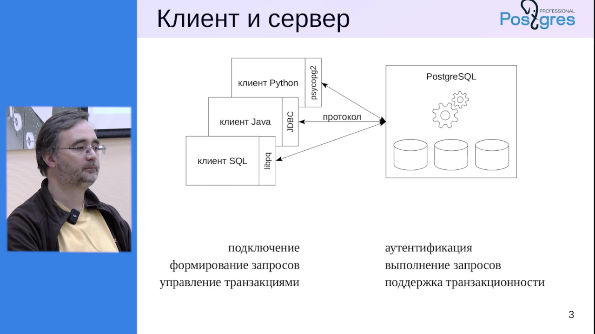

## 2. Устройство экземпляра и память

Экземпляр Postgres — это набор взаимодействующих процессов: Postmaster запускается первым, порождает все остальные процессы, является их родителем и следит за их здоровьем; если процесс падает, Postmaster решает, что делать, а если процесс повредит данные в общей памяти, Postmaster может перезапустить весь экземпляр (в выводе ps Postmaster отображается как Postgres). Postmaster слушает входящие соединения и для каждого клиента порождает обслуживающий процесс (backend): клиент работает со своим backend, проходит аутентификацию, отправляет запросы и получает ответы, а подключение к серверу порождает новый процесс, так что процессов ровно столько, сколько клиентов подключено к серверу. У каждого процесса есть локальная память, доступная только ему: в ней backend хранит разобранные запросы, состояние курсоров, кэш системного каталога и подготовленные операторы, а также место для сортировок и соединений — параметр work_mem. Буферный кэш располагается в общей памяти сервера, чтобы все обслуживающие процессы имели доступ ко всем прочитанным страницам; без пула backend на каждый запрос считывает системный каталог и наполняет локальный кэш, после завершения запроса процесс умирает и работу приходится повторять заново, причём в PostgreSQL нет глобального кэша разобранных запросов — каждый процесс и каждый клиент самостоятельно подготавливает нужные ему запросы. При использовании пула клиент подключается к пулу, у которого уже есть готовое соединение с базой данных, но пул может направить следующий запрос в другое соединение, где этого оператора нет; разработчики СУБД стараются использовать прямой ввод-вывод в обход операционной системы: данные читаются непосредственно с диска и записываются туда же.

*Источник: [00:31:31], [00:46:18], [00:53:31]*

> [!quote]- Кадр [00:31:31]
> 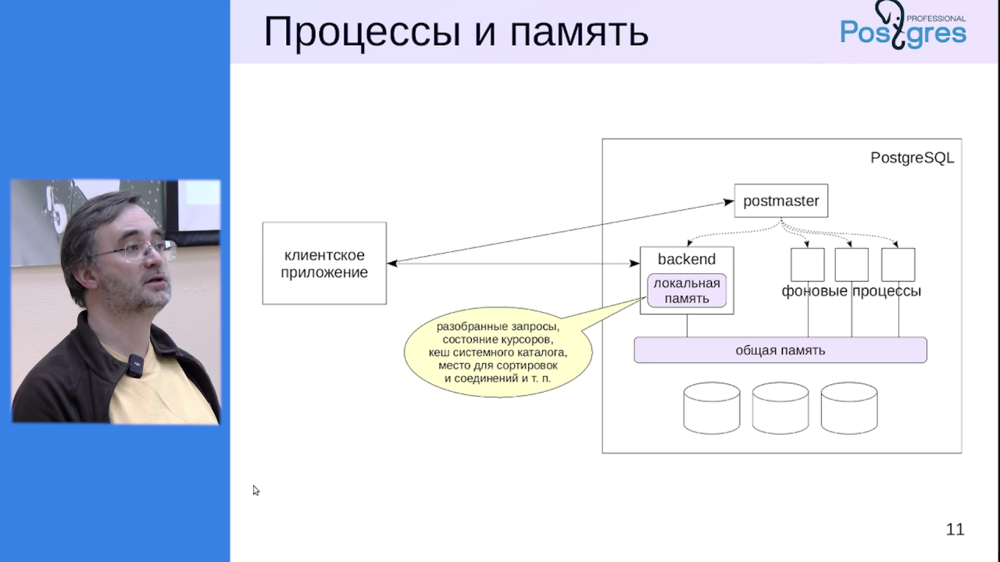

> [!quote]- Кадр [00:46:18]
> 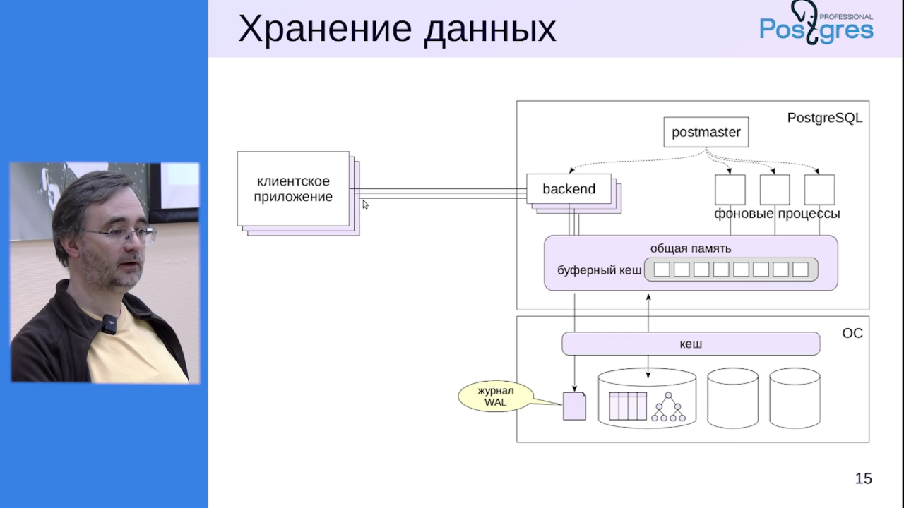

## 3. SQL и этапы обработки запроса

SQL — это язык сервера, базы данных; клиентскую часть приложения на SQL не пишут. После установки соединения клиент формирует SQL-команды в виде текстовой строки и посылает их на сервер, а сервер выполняет их и возвращает результат. Разбор запроса включает лексический анализ (разбиение строки на лексемы), синтаксический анализ (проверку, что лексемы складываются в понятную серверу команду) и семантический анализ; при семантическом разборе проверяется, что объект существует, есть права доступа и нужный тип, а системный каталог — это набор таблиц, хранящих метаинформацию о базе данных: какие в ней есть объекты, какого они типа и какие права у каких пользователей на какие объекты. После разбора запрос представляется в виде дерева разбора, которое на этапе переписывания можно видоизменять или трансформировать по определённым правилам. Планировщик решает, использовать ли индекс или читать всю таблицу, в какой последовательности соединять таблицы и каким методом соединения.

```javascript
ROLLBACK

=> SELECT * FROM t;
 id | s
----+-----
 1 | foo
 2 | bar
 3 | baz
(3 rows)
```

> [!info] Зачем это нужно
> Проверки семантического разбора опираются на метаинформацию каталога.

*Источник: [00:00:44], [00:15:36], [00:15:56]*


> [!quote]- Кадр [00:15:56]
> 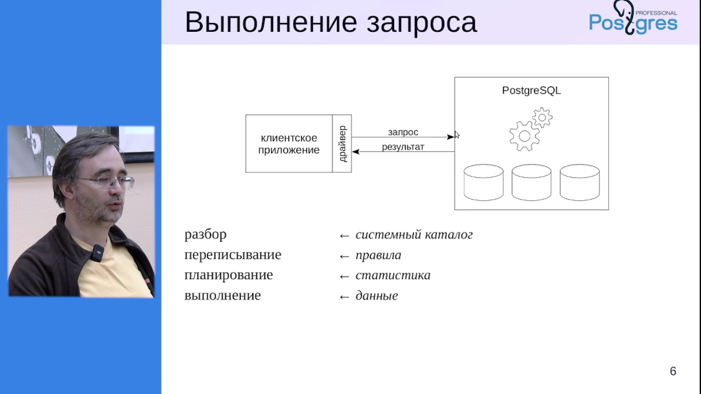

## 4. Транзакции и управление ими

Транзакция — последовательность операций, переводящая базу из одного согласованного состояния в другое, если выполнена полностью и без помех со стороны других транзакций; её свойства — атомарность (всё или ничего), согласованность (ограничения целостности), изоляция (незафиксированные изменения не видны другой транзакции, но видны своей) и долговечность (после COMMIT данные не пропадут даже при сбое). Управляют транзакцией команды BEGIN, COMMIT и ROLLBACK, а откатить часть можно через ROLLBACK TO с именем точки сохранения; в основном транзакциями управляет клиент, но это возможно и внутри процедур Postgres. По умолчанию psql работает в режиме автофиксации: без явного begin каждая команда оборачивается в неявную транзакцию и сразу фиксируется, переменная autocommit равна on (\echo :AUTOCOMMIT показывает значение), а надёжнее всегда явно писать begin и commit; при \set AUTOCOMMIT off команды не фиксируются неявно и изменения надо фиксировать самостоятельно. Точка сохранения (savepoint) ставится командой SAVEPOINT после BEGIN и позволяет откатить только изменения, сделанные после её установки, не прерывая транзакцию; откат к ней не работает как GOTO, и злоупотреблять им не стоит. Пока транзакция не зафиксирована, её изменения не видны в другом сеансе, а после COMMIT становятся видимыми; чтобы зафиксированные данные не пропали при сбое, Postgres ведёт журнал предзаписи WAL — записи о фиксации гарантированно попадают на диск, и при запуске после сбоя Postgres повторно выполняет потерянные операции по журналу.

```sql
BEGIN;
COMMIT / ROLLBACK;

=> \echo :AUTOCOMMIT
on

=> CREATE TABLE t(
    id integer,
    s text
);
CREATE TABLE

=> INSERT INTO t(id, s) VALUES (1, 'foo');
INSERT 0 1

\set AUTOCOMMIT off

>= BEGIN;

BEGIN

=> SAVEPOINT sp; -- точка сохранения

=> BEGIN; -- явно начинаем транзакцию
BEGIN

=> INSERT INTO t(id, s) VALUES (2, 'bar');
INSERT 0 1

| => SELECT * FROM t;
|  id | s
| ----+-----
|   1 | foo
| (1 row)
|
=> COMMIT;

BEGIN;
COMMIT / ROLLBACK;
```

> [!info] Зачем это нужно
> Чтобы изменения не пропадали при сбое.

*Источник: [00:00:44], [00:05:10], [00:08:14], [00:09:24], [00:10:14], [00:10:34] и др.*


> [!quote]- Кадр [00:14:05]
> 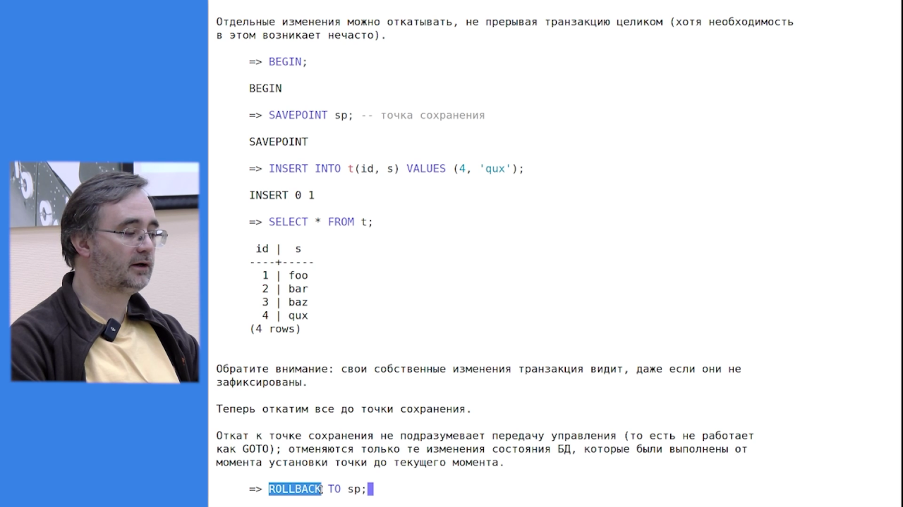

> [!quote]- Кадр [00:14:55]
> 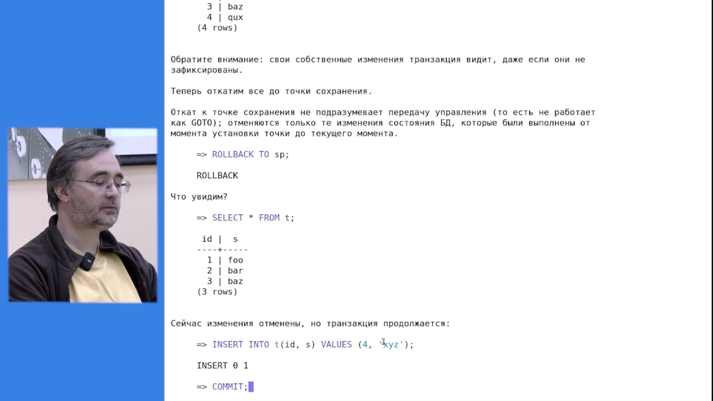


## 5. Расширенный протокол и подготовленные операторы

Все шаги обработки выполняются каждый раз при отправке запроса серверу, даже если это тот же запрос, что был послан только что; расширенный протокол позволяет детальнее управлять этапами выполнения и включает подготовленные операторы и курсоры. Подготовленный оператор, в отличие от обычного, может иметь параметры, к которым перед выполнением привязываются фактические значения; при подготовке разбор и переписывание выполняются один раз и затем переиспользуются, после чего оператор можно вызывать по имени с фактическими параметрами, и многие драйверы подготавливают операторы автоматически. Команда PREPARE создаёт подготовленный оператор с заданным именем и типами параметров, а EXECUTE выполняет его с конкретными значениями; параметры не имеют имён, только типы, поэтому к ним обращаются по номерам ($1, $2 и так далее), а список операторов виден через системное представление pg_prepared_statements. Если у запроса нет параметров, при подготовке запоминается построенный план выполнения; если параметры есть, их фактические значения учитываются при планировании, и сервер может несколько раз планировать запрос с учётом фактических значений — это custom plans. Если план без учёта параметров окажется не хуже, планировщик может переключиться на общий план, увеличивая значение generic plans, и тогда перестанет выполнять планирование повторно.

```sql
=> PREPARE q(integer) AS
  SELECT * FROM t WHERE id = $1;

=> EXECUTE q(1);

=> SELECT * FROM pg_prepared_statements \gx
```

*Источник: [00:15:56], [00:21:16], [00:23:34], [00:23:54], [00:24:58], [00:25:48] и др.*


> [!quote]- Кадр [00:21:16]
> 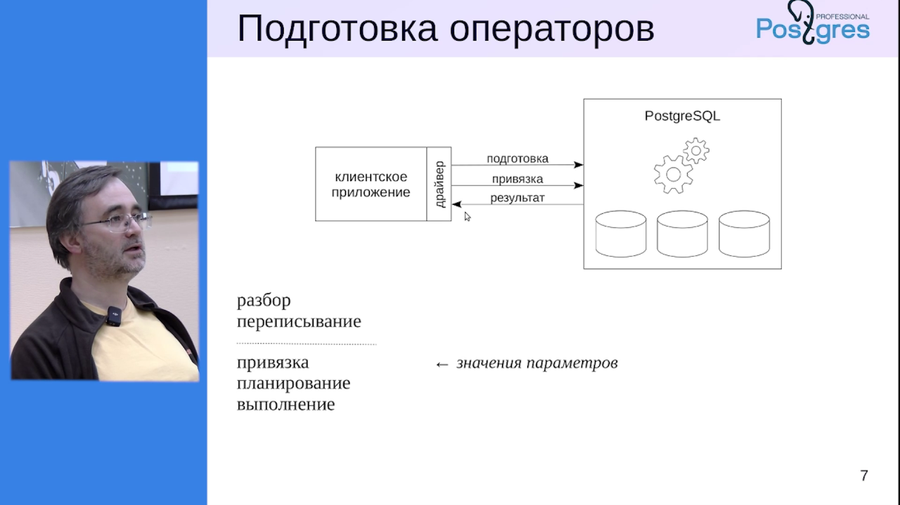

> [!quote]- Кадр [00:25:48]
> 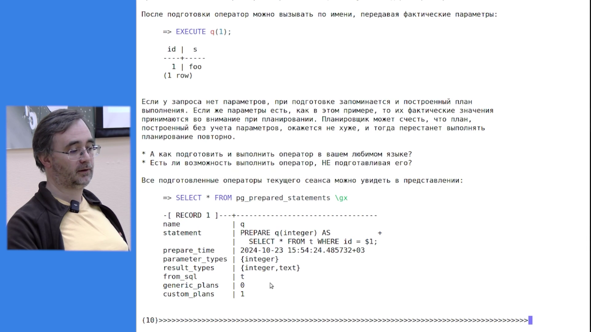

> [!quote]- Кадр [00:27:28]
> 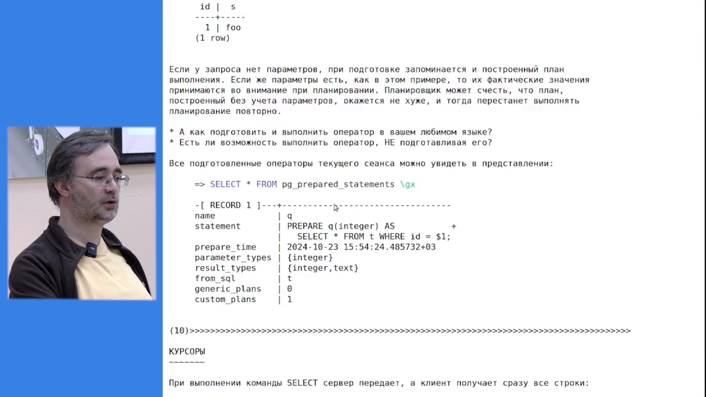

## 6. Простой протокол и курсоры

В простом протоколе передаётся запрос и получается ответ, независимо от количества строк; при выполнении команды SELECT через простой протокол сервер передаёт, а клиент получает сразу все строки. Курсоры позволяют получать результат не весь сразу, а построчно, и регулировать, сколько строк получить, запрашивая у сервера следующую порцию; в SQL команда DECLARE объявляет курсор (DECLARE CURSOR для запроса) и автоматически его открывает, а в языках программирования эти шаги обычно разделены — сначала объявление, затем открытие. Курсор можно представить как указатель на текущую строку: получая строку командой FETCH, мы сдвигаем указатель всё ниже, а FETCH n извлекает n строк из курсора; если осталась только одна строка, возвращается она одна, а когда строки заканчиваются — пустой результат. Строки можно получать пакетами по 100 или 1000 штук: чем больше размер выборки, тем сильнее сглаживается эффект — разница между получением по одной и по 100 драматическая, а между 100 и 1000 уже не такая заметная; возможность настроить размер выборки может отличаться в разных языках и драйверах. Открытый курсор принято закрывать командой CLOSE, однако в Postgres все открытые курсоры закрываются автоматически по окончании транзакции — при commit или rollback, поэтому их можно не закрывать явно.

```sql
>= DECLARE c CURSOR FOR
    SELECT * FROM t ORDER BY id;

DECLARE CURSOR

=> FETCH c;

  id | s
-----+-----
   1 | foo
(1 row)

=> FETCH 2 c;

  id | s
-----+-----
   2 | bar
   3 | baz
(2 rows)

=> FETCH 2 c;

 id | s
----+----
  4 | xyz
(1 row)

=> FETCH 2 c;

 id | s
----+----
(0 rows)

=> CLOSE c;

=> DECLARE c CURSOR FOR
   SELECT * FROM t ORDER BY id;
=> FETCH c;

=> FETCH 2 c;

  id | s
-----+-----
   2 | bar
   3 | baz
(2 rows)
```

*Источник: [00:26:12], [00:26:32], [00:27:28], [00:27:48], [00:28:08], [00:28:28] и др.*


## 7. Масштабирование, соединения, блокировки и MVCC

PostgreSQL нормально работает при 100–1000 подключений, если хватает памяти под каждый обслуживающий процесс; многие процессы при этом обращаются к общей памяти. При большом количестве соединений может закончиться память на сервере; соединения конкурируют за управляющие структуры в общей памяти, возникает бутылочное горлышко и производительность ухудшается. Может помочь пул соединений: он притворяется СУБД и удерживает несколько долгоживущих соединений с базой данных, которых меньше, чем клиентов; запрос от очередного клиента можно запустить в свободное соединение. Postgres использует блокировки, чтобы процессы при одновременном доступе к общей памяти не затирали данные друг друга; то же относится к табличным строкам. Это короткоживущие блокировки, которые автоматически захватываются при доступе к внутренним структурам данных и освобождаются, когда процесс с этой структурой поработал. Postgres достаточно хорошо масштабируется на много ядер и эффективно управляет блокировками; он старается использовать блокировки по минимуму и имеет механизм многоверсионности (MVCC): для одной и той же физической строки одновременно может существовать несколько версий, и процессы разводятся по разным версиям, что позволяет обходиться минимумом блокировок.

*Источник: [00:35:51], [00:39:11]*

> [!quote]- Кадр [00:35:51]
> 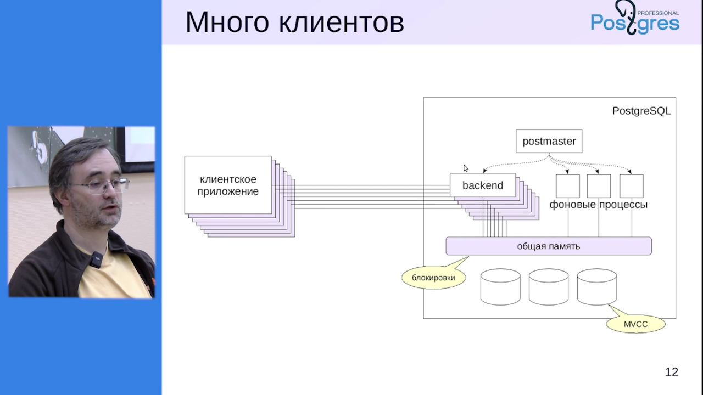

> [!quote]- Кадр [00:39:11]
> 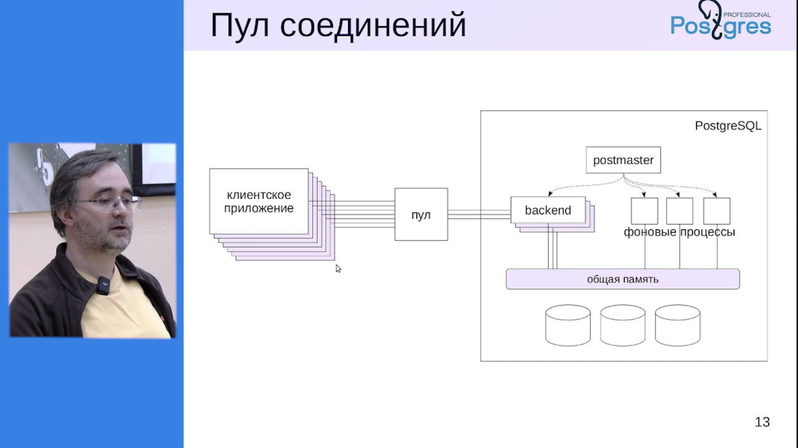

## 8. Хранение данных и страницы

Данные хранятся на дисках в файлах, обращение к ним происходит через операционную систему. Файлы логически разделены на страницы данных; обычно страница данных имеет размер 8 КБ и состоит из заголовка и данных.

*Источник: [00:42:55], [00:53:31]*

> [!quote]- Кадр [00:42:55]
> 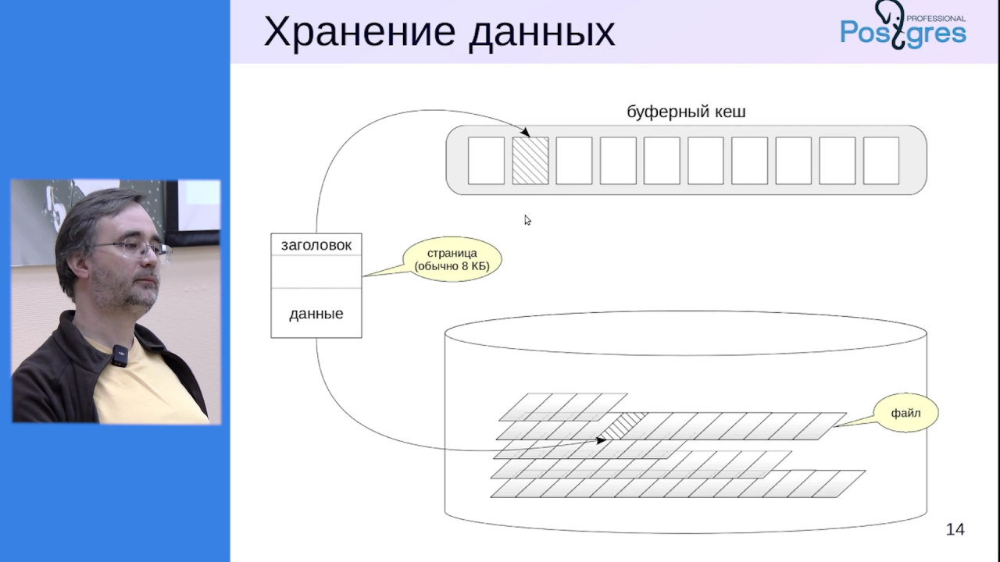

## 9. Расширяемость: типы данных и FDW

Можно написать полностью собственный тип данных, приспособленный под задачу. Для работы с ним можно написать функции и процедуры, а на их основе определить операторы, например переопределить плюс или минус. Новый тип данных можно сделать индексируемым, приспособив имеющиеся типы индексов под работу с этим типом. FDW позволяют подключить к PostgreSQL другой PostgreSQL, файл с данными или другую СУБД, а с их помощью можно читать данные, как если бы они находились в таблице.

*Источник: [00:49:38]*

> [!quote]- Кадр [00:49:38]
> 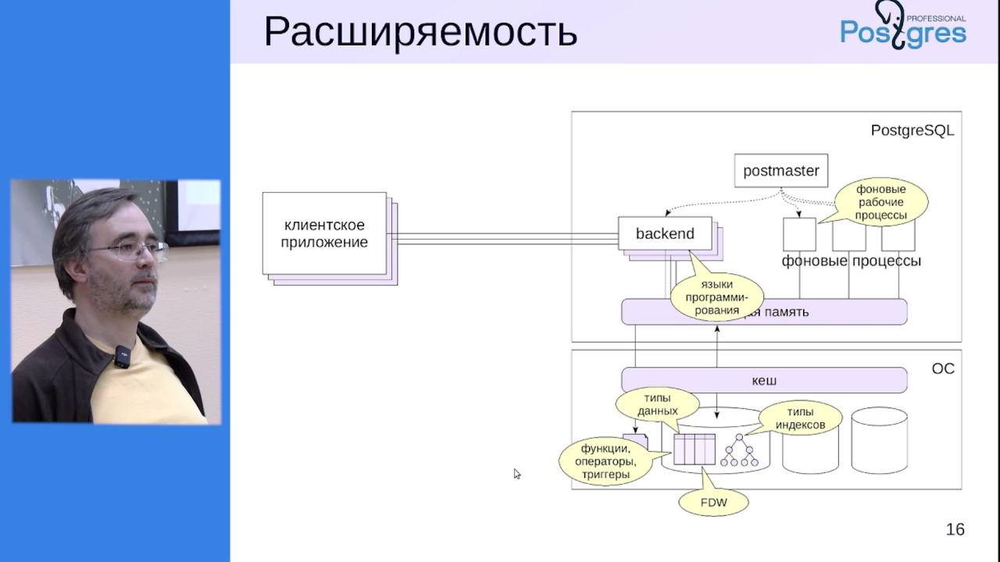

## Схема

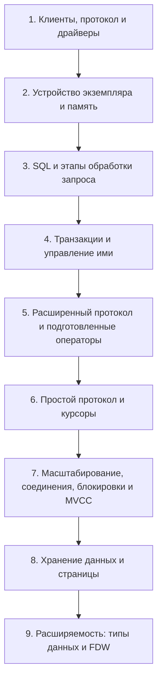

## Итог

> [!success] Что в итоге
> Клиенты на разных языках общаются с PostgreSQL через протокол, чаще всего через обёртки над libpq, а SQL — язык сервера; запрос проходит разбор, семантическую проверку по системному каталогу, построение дерева разбора, переписывание и планирование, и все эти шаги повторяются при каждой отправке. Экземпляр Postgres — набор процессов: Postmaster порождает backend для каждого клиента, общая и локальная память разделяют кэши, а короткоживущие блокировки и MVCC позволяют обслуживать множество подключений, для чего при их избытке помогает пул соединений. Транзакция переводит базу из одного согласованного состояния в другое и описывается атомарностью, согласованностью, изоляцией и долговечностью; управляют ею команды BEGIN/COMMIT/ROLLBACK, точки сохранения откатывают отдельные изменения, а долговечность и видимость после COMMIT опираются на WAL. Расширенный протокол и подготовленные операторы PREPARE/EXECUTE переиспользуют разбор, простой протокол и курсоры служат для получения строк, а расширяемость обеспечивают собственные типы данных и FDW.

