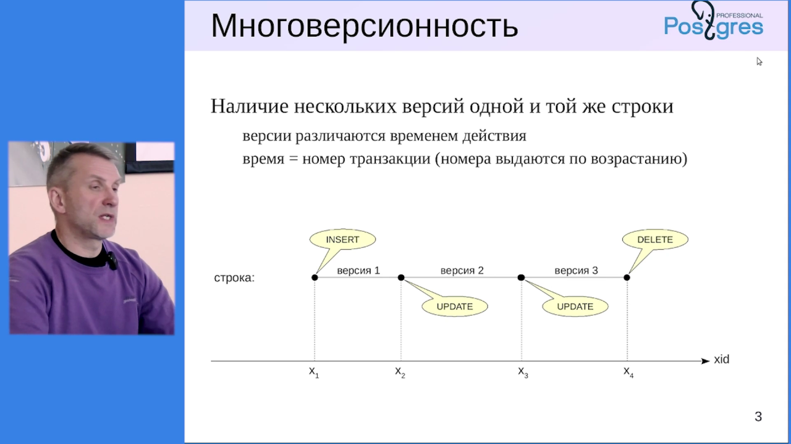
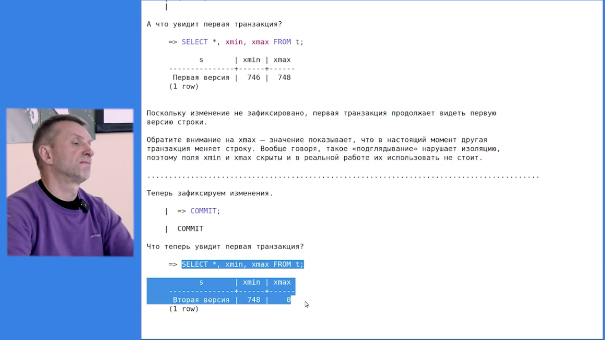
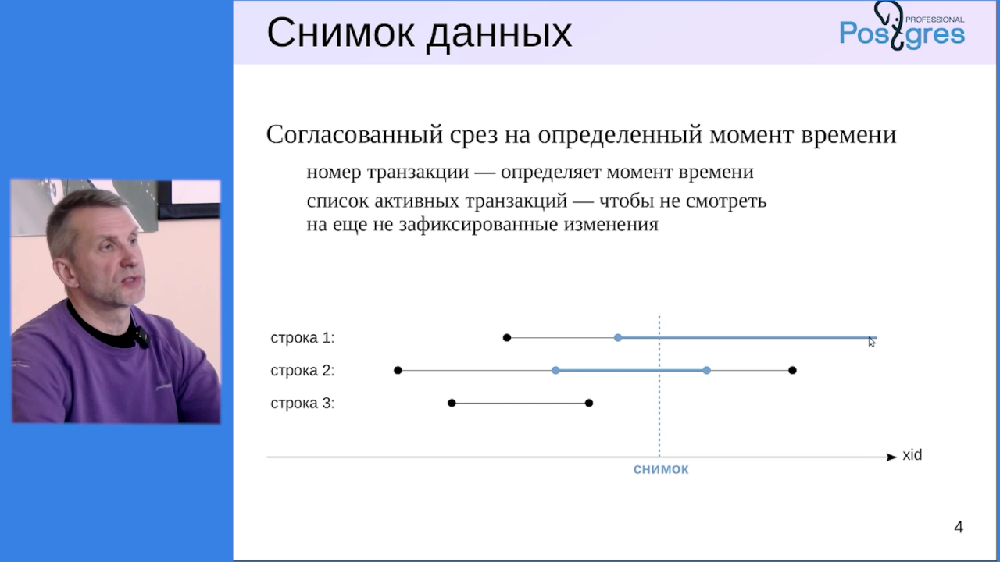
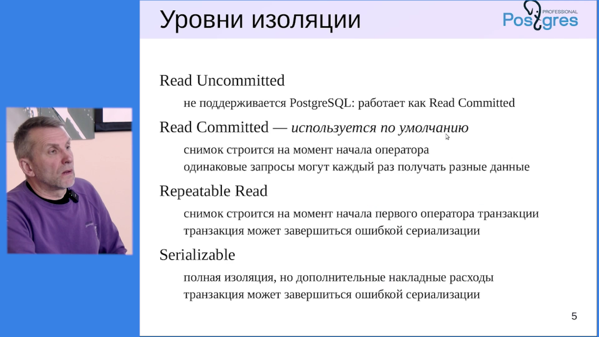
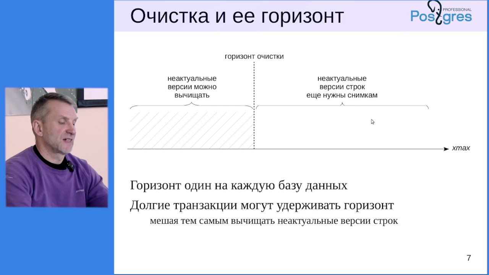
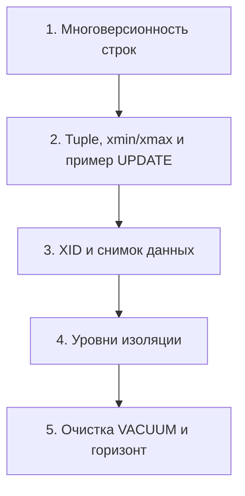

# Многоверсионность в PostgreSQL: версии строк, XID, снимки, уровни изоляции и VACUUM

> [!abstract] Обзор
> Материал о многоверсионности в Postgres: одна логическая строка представлена несколькими физическими версиями (tuple), а время в этой модели измеряется номерами транзакций XID. Разбирается структура снимка данных — согласованного среза на момент, задаваемый номером транзакции, включающий массив активных транзакций, — и служебные поля xmin и xmax версий строк. Обсуждаются уровни изоляции: Read Committed по умолчанию, Read Uncommitted работает как Read Committed, Repeatable Read и Serializable с возможными ошибками сериализации, а также поведение версий при UPDATE и очистка через VACUUM. Отдельно рассматривается горизонт очистки — граница, до которой можно вычищать неактуальные версии строк, который могут удерживать долгие транзакции.

> [!info] Курс
> [[index|Оглавление курса]]

## Оглавление
1. [[#1. Многоверсионность строк]]
2. [[#2. Tuple, xmin/xmax и пример UPDATE]]
3. [[#3. XID и снимок данных]]
4. [[#4. Уровни изоляции]]
5. [[#5. Очистка VACUUM и горизонт]]

**Схема** — [[#Схема]]
**Итог** — [[#Итог]]

## 1. Многоверсионность строк

Многоверсионность — наличие нескольких версий одной и той же строки и базовая технология Postgres. Логически одна строка таблицы может быть представлена на физическом уровне несколькими версиями, и различные транзакции видят разные версии этой строки. Версии различаются временем действия, где время — номер транзакции, выдаваемый по возрастанию. Изменяющая данные транзакция порождает новую версию строки, а читающая транзакция видит свою версию; если другая транзакция удалила версию строки, в снимке она фигурировать не будет. Многоверсионность используется для обеспечения согласованного доступа к данным.

> [!info] Зачем это нужно
> Многоверсионность используется для обеспечения согласованного доступа к данным.

*Источник: [00:00:25], [00:00:45]*

> [!quote]- Кадр [00:00:45]
> 

## 2. Tuple, xmin/xmax и пример UPDATE

Версии строк обозначаются термином tuple, тогда как просто строка — это логическая строка в таблице; Postgres пристраивает к блоку данных служебный заголовок с полями xmin и xmax: xmin — номер транзакции, создавшей версию строки, а xmax — номер транзакции, которая её изменяет (xmax = 0 означает, что версия актуальна). Посмотреть эти поля можно явно в SELECT, например SELECT *, xmin, xmax FROM t, а версий строк может быть несколько; «подглядывание» в xmin и xmax позволяет увидеть незафиксированные изменения другой транзакции и нарушает изоляцию, поэтому в реальной работе использовать эти поля не стоит. В примере создаётся таблица t с одним текстовым столбцом s; BEGIN стартует транзакцию, а если уровень изоляции не указан, используется read committed по умолчанию. INSERT создаёт первую версию строки, а последующие UPDATE порождают новые версии: UPDATE трактуется как пометка старой версии признаком удаления и появление новой версии строки; в частности, при UPDATE создаётся вторая версия строки, и SELECT после этого видит вторую версию. В поле xmin записан номер транзакции, которая создала версию строки; для новой версии это номер текущей транзакции.

```sql
>= CREATE TABLE t(s text);
CREATE TABLE
=> INSERT INTO t VALUES ('Первая версия');
INSERT 0 1
=> BEGIN;
=> UPDATE t SET s = 'Вторая версия';
UPDATE 1
=> SELECT *, xmin, xmax FROM t;

=> SELECT *, xmin, xmax FROM t;
         s          | xmin | xmax
--------------------+------+------
 Первая версия |  746 |    0
(1 row)
```

| Поле | Значение |
| xmin | номер транзакции, создавшей версию строки |
| xmax | номер транзакции, изменяющей версию; 0 — версия актуальна |

*Источник: [00:00:45], [00:13:42], [00:14:22], [00:14:43], [00:15:33], [00:15:54] и др.*


> [!quote]- Кадр [00:24:15]
> 

## 3. XID и снимок данных

Время в многоверсионности измеряется не в минутах и секундах, а в номерах транзакций XID, которые выдаются по возрастанию; счётчик транзакций один на весь экземпляр и на все базы, а номер — 32-битное целое, причём функция pg_current_xact_id() возвращает идентификатор текущей транзакции (в примере 747). Снимок данных — это согласованный срез данных на определённый момент времени, который транзакции используют для получения согласованной картины; момент времени определяется номером транзакции, снимок строится на текущий момент, ретроспективных снимков нет, и это не сохранение данных в некой области памяти. В Postgres снимок состоит из нескольких чисел: времени создания и массива номеров активных на момент построения снимка транзакций; список активных транзакций нужен, чтобы не учитывать ещё не зафиксированные изменения. Пока вторая версия строки, изменённая во второй транзакции, ещё не зафиксирована, первая транзакция продолжает видеть первую версию — незафиксированные изменения не видны, а показывать такие данные означало бы грязное чтение, и такой подход считается плохим. Когда параллельная транзакция изменила данные и зафиксировала изменения, тот же запрос в долгоиграющей транзакции вернёт уже изменённые данные.

```javascript
=> BEGIN;
BEGIN
=> SELECT pg_current_xact_id();
 pg_current_xact_id
--------------------
                747
(1 row)

>= SELECT pg_current_xact_id();
pg_current_xact_id
-------------------
             747
(1 row)
=> SELECT *, xmin, xmax FROM t;

| => SELECT *, xmin, xmax FROM t;
|
|        s        | xmin | xmax
| ----------------+------+-----
| Первая версия |  746 |    0
| (1 row)
|
Транзакция видит ту же единственную версию.
```

*Источник: [00:00:45], [00:05:56], [00:14:43], [00:16:44], [00:17:06], [00:17:46] и др.*


> [!quote]- Кадр [00:05:56]
> 

## 4. Уровни изоляции

Read Committed используется в PostgreSQL по умолчанию, а Read Uncommitted не поддерживается и работает как Read Committed, поэтому грязных данных в Postgres не увидеть. Снимок на Read Committed строится на момент начала оператора, из-за чего одинаковые запросы могут каждый раз получать разные данные: транзакция может видеть разные версии одной строки в разных запросах, а после фиксации изменения другой транзакцией начинает видеть вторую версию; после COMMIT первая версия строки больше не видна ни в одной транзакции. На уровне Repeatable Read снимок строится один раз в момент начала первого оператора транзакции, что обеспечивает согласованность данных для всех запросов. Serializable — самый строгий уровень, обеспечивающий полную изоляцию, но его использование влечёт дополнительные накладные расходы. На уровнях Repeatable Read и Serializable транзакция может завершиться ошибкой сериализации: при невозможности обеспечить полную изоляцию Postgres прерывает одну из транзакций; такие ошибки могут быть ложноположительными, и клиентское приложение должно уметь повторить запрос.

```javascript
| => UPDATE t SET s = 'Вторая версия';
| UPDATE 1
| => SELECT *, xmin, xmax FROM t;
| Вторая версия |  748 |   0
(1 row)
=> SELECT *, xmin, xmax FROM t;
Первая версия |  746 |  748
(1 row)
    |  => COMMIT;
    |  COMMIT
    => SELECT *, xmin, xmax FROM t;
 Вторая версия |  748 |   0
(1 row)
```

| Уровень | Поведение в PostgreSQL |
|---|---|
| Read Uncommitted | не поддерживается, работает как Read Committed |
| Read Committed | используется по умолчанию |

*Источник: [00:09:16], [00:19:30], [00:20:50]*

> [!quote]- Кадр [00:09:16]
> 

## 5. Очистка VACUUM и горизонт

VACUUM — это команда очистки, необходимая для удаления неактуальных версий строк; она находит версии, не видимые ни в одном снимке данных, и помечает занятое ими место как свободное. Цель очистки — чтобы файлы данных и индексы не разрастались; обычно она выполняется автоматически специальными процессами. Горизонт очистки — это граница, до которой неактуальные версии строк можно вычищать; он один на каждую базу данных. Версии, которые ещё нужны снимкам, чистить нельзя; версии, уже не нужные ни одному снимку, находятся за горизонтом очистки и будут вычищены вакуумом. Долгие транзакции могут удерживать горизонт очистки, мешая тем самым вычищать неактуальные версии строк.

> [!info] Зачем это нужно
> Чтобы файлы данных и индексы не разрастались.

*Источник: [00:00:45], [00:21:10]*

> [!quote]- Кадр [00:21:10]
> 

## Схема



## Итог

> [!success] Что в итоге
> В Postgres одна логическая строка представлена несколькими физическими версиями (tuple), а время измеряется номерами транзакций XID, по которым строится снимок со списком активных транзакций. Из этого следуют уровни изоляции: Read Committed по умолчанию, Read Uncommitted работает как Read Committed, Repeatable Read и Serializable дают более строгую согласованность с возможными ошибками сериализации, которые приложение должно уметь повторять. UPDATE порождает новые версии строк, а VACUUM очищает неактуальные, чтобы файлы данных и индексы не разрастались; версии, ещё нужные снимкам, чистить нельзя, и долгие транзакции удерживают горизонт очистки.

