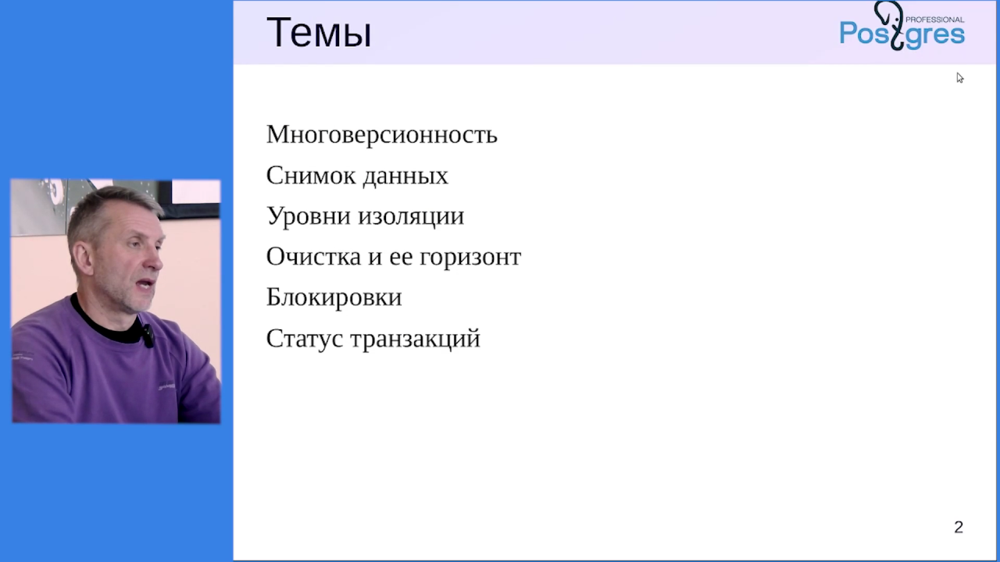
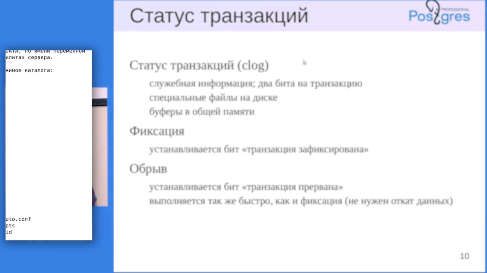
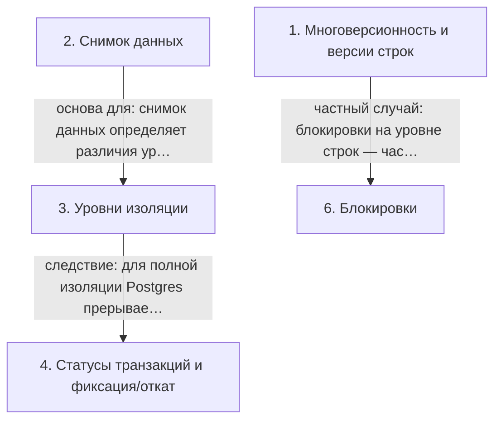

# Многоверсионность, снимки, уровни изоляции и блокировки в Postgres

> [!abstract] Обзор
> Материал о многоверсионности (MVCC) в Postgres и связанных с ней механизмах. Рассматриваются версии строк (tuples), ось времени в номерах транзакций XID, трактовка Update как Insert + Delete, служебный заголовок с полями xmin и xmax, а также снимки данных. Уровни изоляции (Read Uncommitted, Read Committed, Repeatable Read, Serializable) различаются временем построения снимка. Отдельно показаны статусы транзакций и clog, лёгкость фиксации и отката, очистка (vacuum) и горизонт очистки. Завершают материал блокировки: многоверсионность не устраняет их полностью, основные блокировки устанавливаются на уровне строк, а рекомендательные (advisory) снимаются только вручную.

> [!info] Курс
> [[index|Оглавление курса]]

## Оглавление
1. [[#1. Многоверсионность и версии строк]]
2. [[#2. Снимок данных]]
3. [[#3. Уровни изоляции]]
4. [[#4. Статусы транзакций и фиксация/откат]]
5. [[#5. Очистка (vacuum) и горизонт]]
6. [[#6. Блокировки]]

**Схема** — [[#Схема]]
**Итог** — [[#Итог]]

## 1. Многоверсионность и версии строк

Многоверсионность (MVCC) — базовая технология Postgres для согласованного доступа к данным при конкурентном доступе различных сессий и транзакций; её нельзя отключить. Логически одна строка таблицы может быть представлена на физическом уровне в виде нескольких версий строк (tuples), и различные транзакции видят разные версии. Время измеряется не в минутах и секундах, а в номерах транзакций XID: Update трактуется как пометка старой версии признаком удаления и появление новой версии, то есть Update — это Insert и Delete. Для различения версий к блоку данных пристраивается служебный заголовок с полями xmin (номер транзакции, породившей версию) и xmax: нулевой xmax означает, что версия актуальна, а значение xmax указывает, что версию изменяет другая транзакция. Номер транзакции выдаёт функция pg_current_xact_id, это 32-битное целое число; в системе без активности номер 748 присвоен сразу за 747, а при нагрузке некоторые номера могут быть пропущены; многоверсионность при этом позволяет сильно сэкономить на блокировках, но не устраняет их полностью: писатели не блокируют читателей, а читатели не блокируют никого.

> [!info] Зачем это нужно
> Назначение — обеспечение согласованного доступа к данным при конкурентном доступе различных сессий и транзакций.

*Источник: [00:00:25]*

> [!quote]- Кадр [00:00:25]
> 

## 2. Снимок данных

Снимок данных позволяет транзакции выбрать среди версий строк те, которые должны быть видны в этот момент времени; остальные версии строк не видны. В Postgres снимок данных — это не сохранение данных в области памяти, а несколько чисел: время создания снимка и массив номеров активных транзакций на момент построения снимка. Снимок строится единожды в момент начала первого оператора транзакции и только на текущий момент времени, ретроспективных снимков нет. Старые версии строк со временем становятся невидимы ни в одном снимке, продолжают лежать в файле данных, вызывая разрастание файлов данных и индексов, поэтому Postgres требует регулярного выполнения процедуры очистки.

*Источник: [00:00:25]*

## 3. Уровни изоляции

Стандарт SQL определяет несколько уровней изоляции; в Postgres они связаны с построением снимков данных и отличаются временем создания снимка. Read Committed используется по умолчанию и строит снимок на момент начала каждого оператора, поэтому одинаковые запросы в одной транзакции могут вернуть разные данные; Read Uncommitted формально существует, но работает так же, как Read Committed, и грязные данные не видны. Repeatable Read строит снимок один раз в момент начала выполнения первого оператора транзакции, и дальше работа идёт с этим снимком. Serializable — самый строгий уровень, обеспечивающий полную изоляцию; в Postgres он реализован, но используется нечасто из-за дополнительных накладных расходов, и одна из взаимодействующих транзакций может завершиться ошибкой сериализации.

| Уровень | Когда строится снимок | Поведение одинаковых запросов |
|---|---|---|
| Read Committed | На момент начала каждого оператора | Могут вернуть разные данные |
| Repeatable Read | Один раз в момент начала первого оператора транзакции | Работа идёт с этим снимком |

*Источник: [00:00:25]*

## 4. Статусы транзакций и фиксация/откат

Счётчик транзакций глобальный — один на весь экземпляр и на все базы. Postgres поддерживает структуру «статусы транзакций» (clog) — это длинный массив, пополняемый записями о новых транзакциях: каждый элемент содержит номер транзакции и два служебных бита, показывающих, была транзакция зафиксирована или откачена; clog хранится в специальных файлах на диске и в буферах в общей памяти. Для работы многоверсионности Postgres должен в любой момент знать, активна транзакция или завершена, и если завершена, то как — откатом или фиксацией. Для обеспечения полной изоляции Postgres прерывает одну из транзакций; в некоторых случаях прерывание происходит ошибочно (ложноположительное срабатывание), хотя можно было не прерывать, поэтому приложение должно учитывать возможность таких ошибок и иметь возможность просто повторить запрос. Фиксация или откат транзакции — лёгкие операции: Postgres при commit или rollback ничего не изменяет в данных, а просто устанавливает соответствующий бит в статусах транзакций.

*Источник: [00:00:25], [00:30:40]*

> [!quote]- Кадр [00:30:40]
> 

## 5. Очистка (vacuum) и горизонт

Postgres при штатной работе постоянно создаёт новые версии строк; до фиксации изменений первая версия нужна снимку первой транзакции, а после фиксации новой версии старая может стать ненужной, и после повторного select строится новый снимок, старый освобождается. Очистка (vacuum) находит мёртвые версии строк, которые не видны ни в одном снимке данных, и помечает занятое ими место как свободное; освобождённое место затем используется для вставки новых версий строк. Некоторые неактуальные версии строк чистить нельзя, потому что они нужны снимкам. Строки за горизонтом — это неактуальные версии, которые будут вычищены vacuum; при появлении новых версий горизонт очистки сдвигается.

> [!info] Зачем это нужно
> Задача вакуума — бороться с мёртвыми версиями.

*Источник: [00:00:25]*

## 6. Блокировки

Основные блокировки устанавливаются на уровне строк: обычное чтение никогда не блокирует строки, а изменение строк блокирует их только для других конкурирующих изменений, но не мешает чтениям. Перемещение таблицы в другое табличное пространство и перестройка таблицы требуют эксклюзивной блокировки; пока она установлена, читать данные из таблицы нельзя, и запросы будут ждать. Если выполнение транзакции не оформлено явным образом, неявно открывается транзакция: вставка данных выполняется и фиксируется; если одна транзакция изменила строку и ещё не зафиксировала изменения, вторая при попытке обновить эту же строку блокируется и ждёт завершения первой, а после фиксации первой вторая продолжает обновление. Время жизни блокировки обычно ограничено рамками транзакции; завершение сеанса освобождает все блокировки, взятые в этом сеансе. Рекомендательные (advisory) блокировки называют «пользовательскими»: они устанавливаются и снимаются вызовом специальных функций и не снимаются автоматически по завершении транзакции.

*Источник: [00:00:25]*

## Схема

## Итог

> [!success] Что в итоге
> Многоверсионность в Postgres хранит несколько версий каждой строки, отмечая их номерами транзакций XID и полями xmin/xmax, а снимок данных выбирает видимые версии и определяет различия уровней изоляции: Read Committed строит снимок на каждый оператор, Repeatable Read — один раз, Serializable даёт полную изоляцию ценой накладных расходов и ошибок сериализации. Статусы транзакций хранятся в виде битов и в clog, поэтому commit и rollback — лёгкие операции, а ненужные версии строк очищает vacuum, горизонт которого сдвигается по мере появления новых версий. Многоверсионность сводит блокирование читателей и писателей к минимуму, но не устраняет блокировки полностью: основные из них устанавливаются на уровне строк и обычно живут в рамках транзакции, а рекомендательные снимаются только вызовом специальных функций.

