# Внутреннее устройство PostgreSQL: буферный кеш и журнал предзаписи (WAL)

> [!abstract] Обзор
> Материал объясняет внутреннее устройство PostgreSQL: буферный кеш и журнал предзаписи (WAL). Буферный кеш — массив буферов со страницами по 8 Кбайт, его размер задаёт параметр shared_buffers; на примере EXPLAIN видно, как shared read переходит в shared hit. Грязные буферы сбрасываются асинхронно и вытесняются по LRU, а фоновая запись сбрасывает только их часть. Журнал предзаписи пишется раньше данных, нумеруется через LSN, физически лежит сегментами в PGDATA/pg_wal и обеспечивает восстановление после сбоя и репликацию. Отдельно разобраны режимы фиксации, уровни журнала, контрольная точка, а также имитация сбоя и автоматическое восстановление.

> [!info] Курс
> [[index|Оглавление курса]]

## Оглавление
1. [[#1. Буферный кеш и shared_buffers]]
2. [[#2. Журнал предзаписи (WAL): задача, LSN и хранение]]
3. [[#3. Уровни журнала и репликация]]
4. [[#4. Синхронная и асинхронная фиксация]]
5. [[#5. Что не защищает журнал предзаписи]]
6. [[#6. Контрольная точка]]
7. [[#7. Восстановление после сбоя и имитация сбоя]]
8. [[#8. Создание базы и тестовых данных]]

**Схема** — [[#Схема]]
**Итог** — [[#Итог]]

## 1. Буферный кеш и shared_buffers

Буферный кеш — одна из самых крупных структур в общей памяти, массив буферов со страницами по 8 Кбайт (размер страницы на диске) и заголовками с информацией о файле и блоке; доступ упорядочивается блокировками. Размер кеша задаёт shared_buffers (по умолчанию 128MB, изменение требует перезапуска экземпляра); прямой записи в Postgres пока нет, взаимодействие с диском идёт через ОС, из-за чего возможна двойная буферизация. Изменённые страницы становятся грязными и сбрасываются на диск асинхронно; при нехватке свободных буферов используется алгоритм LRU, а фоновая запись сбрасывает только часть грязных буферов, чтобы бэкенды реже делали это сами. EXPLAIN (analyze, buffers) показывает Buffers: shared read=443 при чтении с диска и shared hit=443, когда страницы нашлись в кеше; после прогрева кеша время выполнения и планирования уменьшается. Перезапуск экземпляра сервера освобождает буферный кеш, а после поломки сервера кеш был потерян.

```sql
>= SHOW shared_buffers;
  shared_buffers
----------------
        128MB
(1 row)

>= EXPLAIN (analyze, buffers, costs off, timing off)
SELECT * FROM t;

 Seq Scan on t (actual rows=100000 loops=1)
   Buffers: shared read=443
 Planning Time: 0.527 ms
 Execution Time: 25.658 ms

=> EXPLAIN (analyze, buffers, costs off, timing off)
SELECT * FROM t;

 Seq Scan on t (actual rows=100000 loops=1)
   Buffers: shared hit=443
 Planning Time: 0.038 ms
 Execution Time: 15.936 ms

>= EX
SELECT * FROM t;
```

| Слово в Buffers | Откуда читается |
| read | с диска |
| hit | страница нашлась в буферном кэше |

*Источник: [00:00:36], [00:04:26], [00:05:44], [00:06:04], [00:06:24], [00:07:44] и др.*

> [!quote]- Кадр [00:00:36]
> 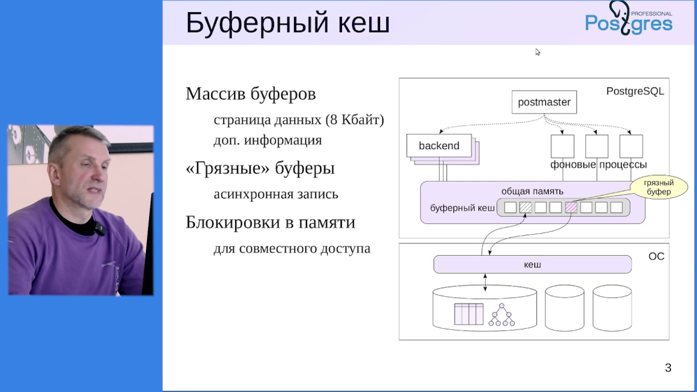

> [!quote]- Кадр [00:04:26]
> 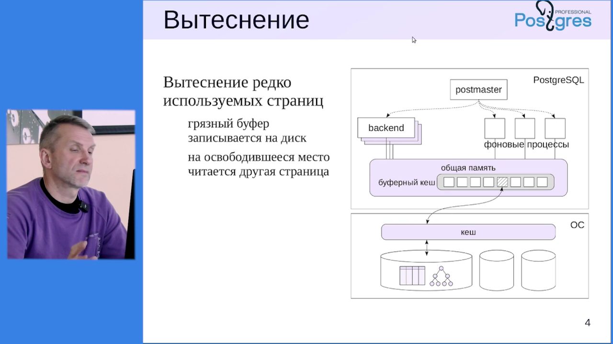

> [!quote]- Кадр [00:28:48]
> 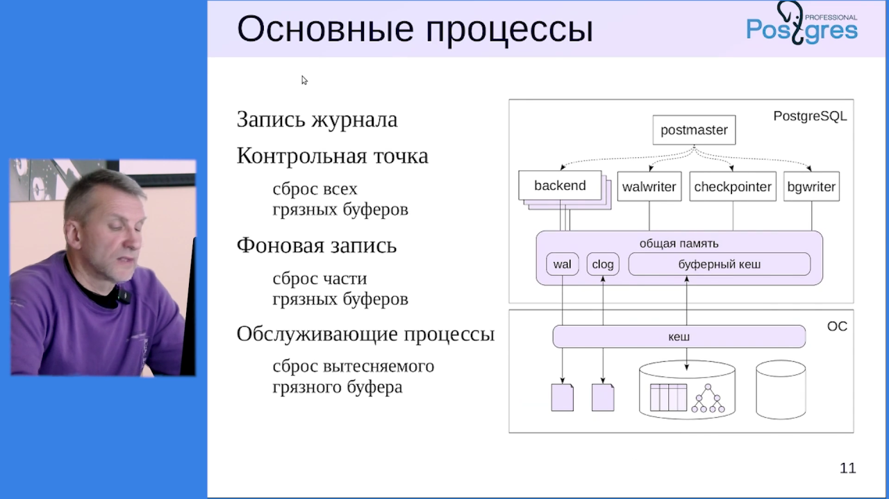

> [!quote]- Кадр [00:08:04]
> 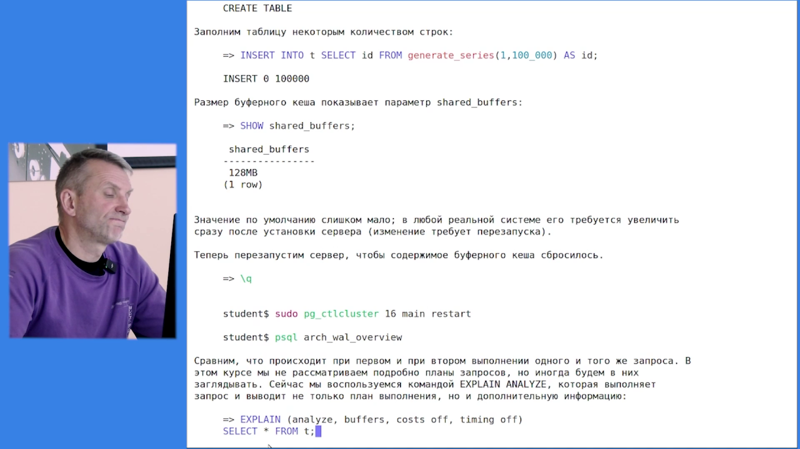

## 2. Журнал предзаписи (WAL): задача, LSN и хранение

Журнал предзаписи (WAL) — поток записей о выполняемых действиях, который пишется на диск строго раньше изменённых данных и обеспечивает восстановление после сбоя, а также защищает статус транзакций (clog), страницы таблиц и индексов. Логически WAL — непрерывный поток записей, каждая имеет номер LSN: 64-разрядное смещение в байтах от начала журнала; текущую позицию показывает pg_current_wal_lsn, а разница двух LSN в типе pg_lsn даёт размер сгенерированных записей в байтах. Физически WAL хранится сегментами фиксированного размера (по умолчанию 16 Мбайт) в каталоге PGDATA/pg_wal; функция pg_ls_waldir показывает файлы сегментов с именами, размером и временем модификации. Основной сервер создаёт журналы, а физическая репликация передаёт и проигрывает журнальные записи на реплике. Запись WAL создаёт дополнительную нагрузку на сервер.

```sql
>= UPDATE t SET n = 100_001 WHERE n = 1;
UPDATE 1
=> SELECT pg_current_wal_lsn();
 pg_current_wal_lsn
----------------------
 0/23AE380
(1 row)
=> SELECT '0/23AE380'::pg_lsn - '0/23AB318'::pg_lsn AS bytes;
 bytes
-------
 12392
(1 row)

SELECT pg_current_wal_lsn();
UPDATE t SET n = 100_001 WHERE n = 1;
SELECT pg_current_wal_lsn();

=> SELECT '0/23AE380'::pg_lsn - '0/23AB318'::pg_lsn AS bytes;
 bytes
-------
 12392
(1 row)

Физически журнал хранится в файлах в отдельном каталоге (PGDATA/pg_wal). По умолчанию
файлы имеют размер 16 Мбайт, задать другой размер можно при инициализации кластера
баз данных.

=> SELECT * FROM pg_ls_waldir() ORDER BY name LIMIT 10;

        name         |   size   |       modification
---------------------+----------+---------------------
000000010000000000000002 | 16777216 | 2024-10-21 15:14:20+03
000000010000000000000003 | 16777216 | 2024-10-21 15:02:05+03
(2 rows)
```

*Источник: [00:09:14], [00:10:34], [00:14:40], [00:15:30], [00:16:50], [00:17:10] и др.*

> [!quote]- Кадр [00:10:34]
> 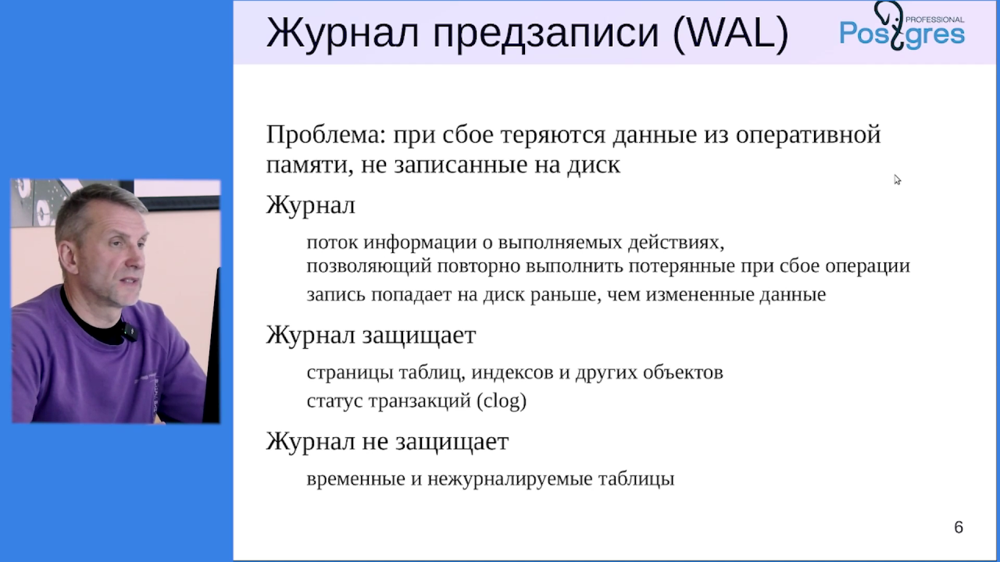


> [!quote]- Кадр [00:15:30]
> 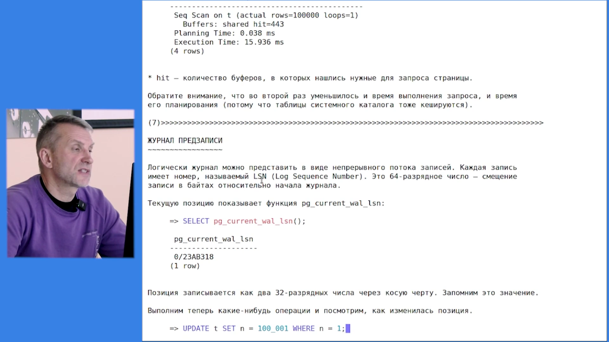

> [!quote]- Кадр [00:17:10]
> 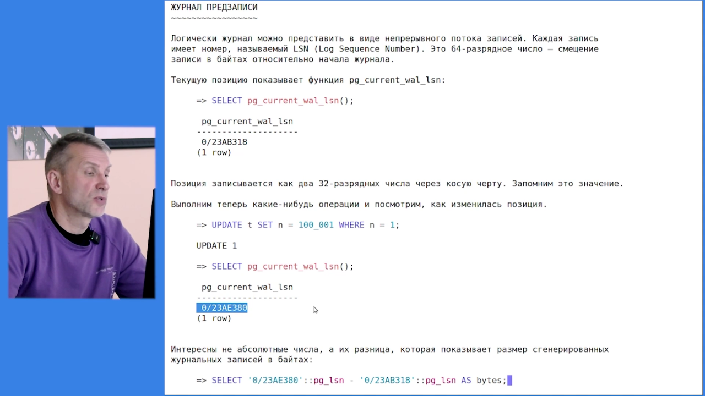

> [!quote]- Кадр [00:23:00]
> 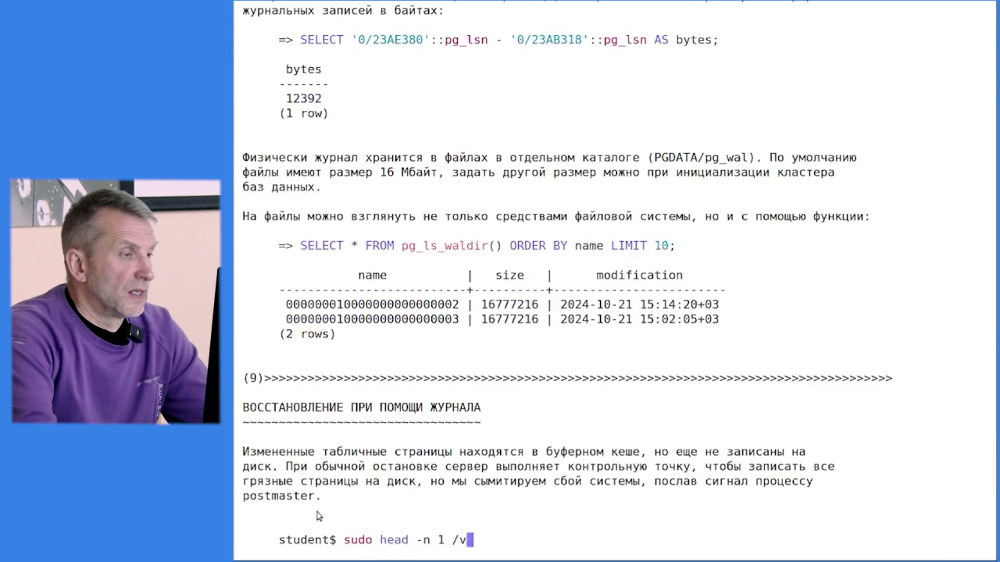

## 3. Уровни журнала и репликация

Minimal — гарантия восстановления после сбоя. Replica (по умолчанию) отвечает за резервное копирование и репликацию: передачу и проигрывание журнала на другом сервере; по умолчанию используется уровень Replica, так как физическая репликация является востребованной задачей, и для организации физической реплики не нужно изменять параметры. Logical — логическая репликация, построенная на трансляции журналов и передающая информацию о добавлении, изменении и удалении табличных строк. Если репликация не нужна и мало места для журналов, уровень можно изменить на Minimal, но для применения изменённого уровня требуется рестарт экземпляра Postgres. При более высоком уровне журнала появляется возможность решать дополнительные задачи, но чем выше уровень журнала, тем больше его объём.

*Источник: [00:17:30], [00:25:52], [00:30:48]*

> [!quote]- Кадр [00:25:52]
> 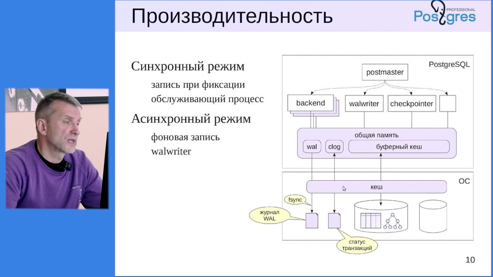

> [!quote]- Кадр [00:30:48]
> 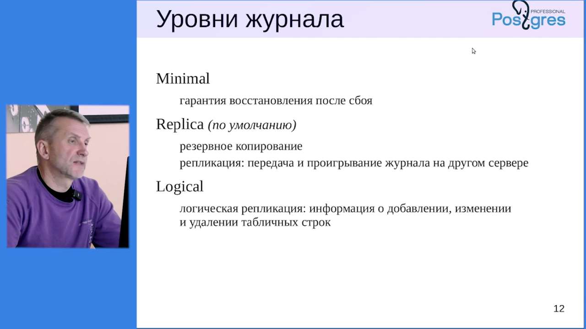

## 4. Синхронная и асинхронная фиксация

По умолчанию транзакции фиксируются в синхронном режиме — запись выполняется при фиксации; его надо использовать для важных приложений, таких как финансовые. Обслуживающий процесс, выполняющий фиксацию, формирует журнальную запись о фиксации транзакции и обеспечивает её попадание на диск, для чего операционной системе даётся системный вызов F-Sync. fsync — достаточно дорогая вещь, поэтому для экономии придумали асинхронный режим: он включается специальным параметром, и журнальные записи фиксации попадают на диск не сразу. Асинхронный режим записи WAL — это фоновая запись, выполняемая процессом walwriter: коммит подтверждается сервером, но журнальные записи накапливаются в буфере оперативной памяти, после чего walwriter сбрасывает их на диск, и производительность сразу вырастет. Асинхронный режим менее надёжен, чем синхронный: есть шанс потерять данные о коротких транзакциях, произошедших за доли секунды до сбоя, при этом согласованность сохраняется — транзакция теряется целиком, а не частично.

*Источник: [00:25:52]*


## 5. Что не защищает журнал предзаписи

Журнал не защищает временные и нежурналируемые таблицы. Временные таблицы живут в рамках одного сеанса. Для нежурналируемых таблиц отказываются от защиты журнала: работа с ними быстрее, так как экономится запись в журнал; при сбое сервера такие таблицы полностью зачищаются при следующем старте. Unlogged Tables почти такие же, как обычные таблицы, но изменения в них не журналируются; их используют в угоду эффективности, если хранятся воспроизводимые данные. При аварии такие таблицы могут быть потеряны.

*Источник: [00:10:34]*


## 6. Контрольная точка

Контрольная точка — это периодический сброс всех грязных буферов на диск. Она гарантирует попадание на диск всех изменений до контрольной точки и ограничивает размер журнала, необходимого для восстановления. Чтобы не создавать дикую дисковую активность, процесс контрольной точки растягивается во времени: сброс буферов происходит неспешно. Размер журнала ограничивается за счёт выполнения контрольных точек, которые подрезают журнал.

*Источник: [00:19:24], [00:19:50], [00:28:48], [00:28:57], [00:33:08]*

> [!quote]- Кадр [00:19:24]
> 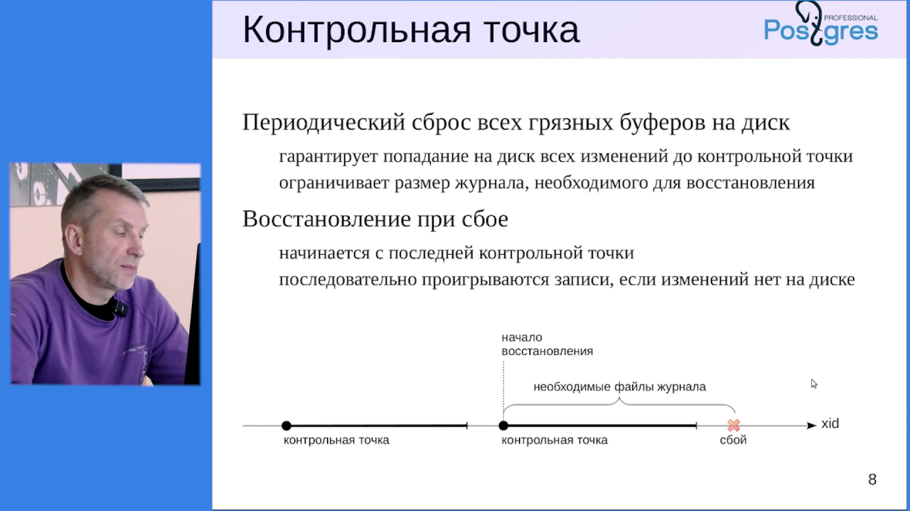

> [!quote]- Кадр [00:28:57]
> 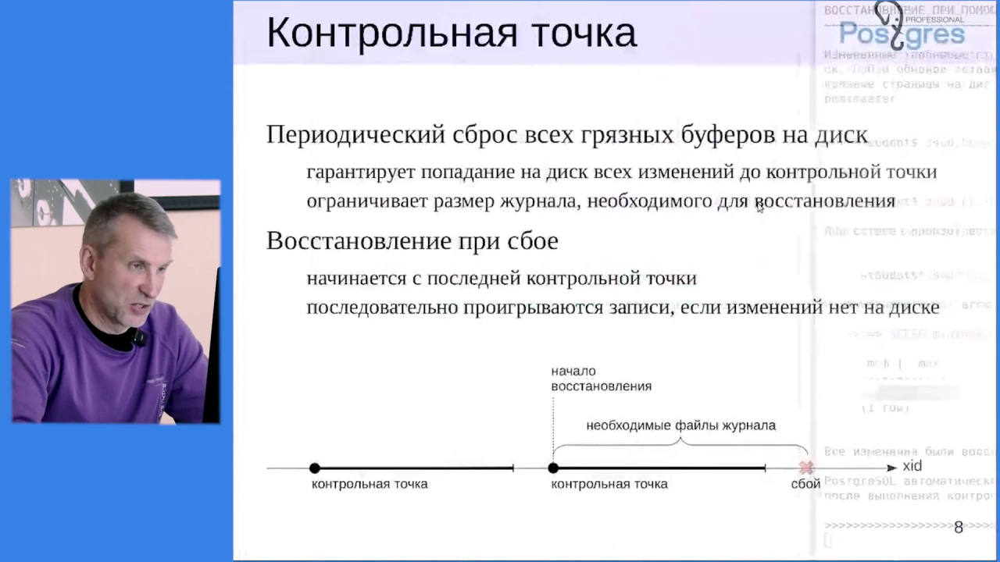

> [!quote]- Кадр [00:33:08]
> 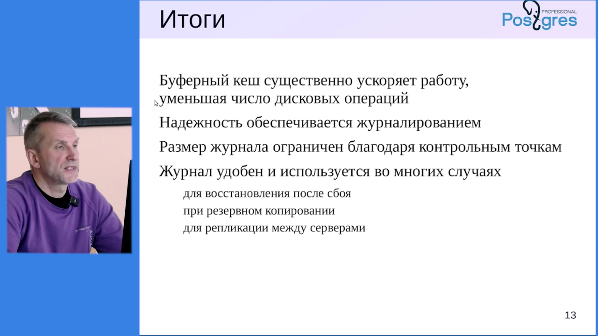

## 7. Восстановление после сбоя и имитация сбоя

При старте PostgreSQL восстанавливает согласованность данных с помощью журнала: изменённые страницы могли остаться в буферном кеше и не попасть на диск. Восстановление начинается с последней контрольной точки, затем последовательно проигрываются записи журнала; PostgreSQL выполняет аварийное восстановление автоматически при старте, без ручных указаний. После контрольной точки PostgreSQL автоматически удаляет ненужные для восстановления журнальные файлы, а факт восстановления фиксируется в текстовом журнале сообщений сервера. Чтобы имитировать сбой, перезапускают сервер командой pg_ctlcluster 16 main restart (кеш сбрасывается), затем из первой строки postmaster.pid извлекают PID головного процесса (Postmaster) и посылают ему сигнал quit командой kill. При обычной остановке сервер выполняет контрольную точку и записывает все грязные страницы, а после имитации сбоя при запуске понимает, что был остановлен некорректно, и восстанавливает данные по журналу, поэтому изменения не теряются.

```sql
student$ sudo pg_ctlcluster 16 main restart

student$ sudo head -n 1 /var/lib/postgresql/16/main/postmaster.pid

student$ sudo kill -QUIT 19915

student$ sudo pg_ctlcluster 16 main start

student$ psql arch_wal_overview

SELECT * FROM pg_ls_waldir() ORDER BY name LIMIT 10;

student$ sudo head -n 1 /var/lib/postgresql/16/main/postmaster.pid

student$ sudo kill -QUIT 19915

student$ sudo pg_ctlcluster 16 main start

student$ psql arch_wal_overview
```

*Источник: [00:07:44], [00:19:24], [00:19:50], [00:23:00], [00:23:20], [00:23:40] и др.*


> [!quote]- Кадр [00:23:40]
> 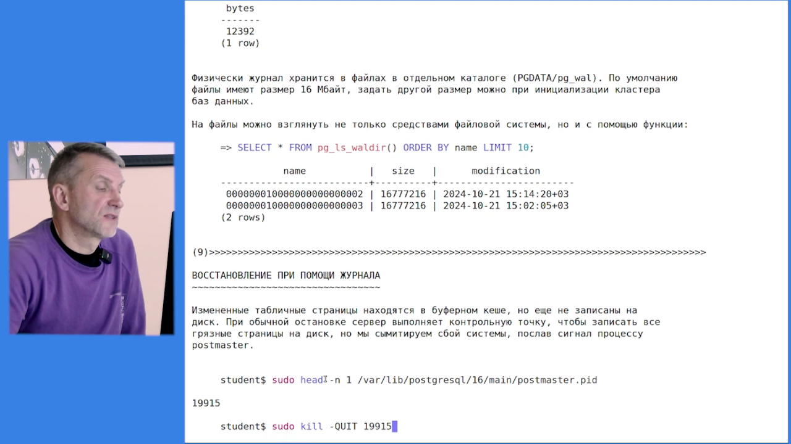

## 8. Создание базы и тестовых данных

Команда CREATE DATABASE создаёт новую базу данных arch_wal_overview. Для заполнения таблицы 100 000 строк используется INSERT INTO t SELECT id FROM generate_series(1,100_000). Размер буферного кеша показывает параметр shared_buffers, значение по умолчанию 128MB.

```javascript
>= CREATE DATABASE arch_wal_overview;
=> \c arch_wal_overview
=> CREATE TABLE t(n integer);
=> INSERT INTO t SELECT id FROM generate_series(1,100_000) AS id;
INSERT 0 100000
=> SHOW shared_buffers;
  shared_buffers
----------------
        128MB
```

*Источник: [00:05:44], [00:06:24]*

## Схема

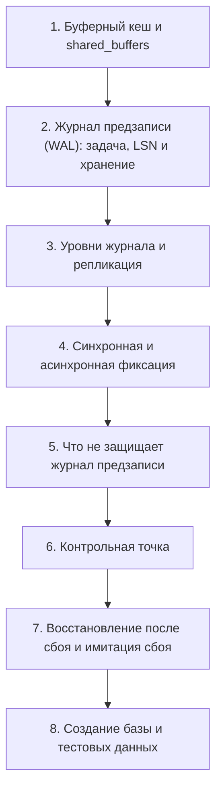

## Итог

> [!success] Что в итоге
> Буферный кеш сглаживает доступ к данным, но размещённые в памяти изменения создают риск потери при сбое. Этот риск закрывает журнал предзаписи: он пишется раньше данных, защищает страницы объектов и статус транзакций, но не временные и нежурналируемые таблицы. Записи журнала нумеруются через LSN и лежат сегментами в PGDATA/pg_wal, а восстановление опирается на контрольную точку и проигрывание записей WAL. Фиксация по умолчанию синхронная и опирается на дорогой fsync, при этом асинхронный режим через walwriter быстрее, но менее надёжен.

