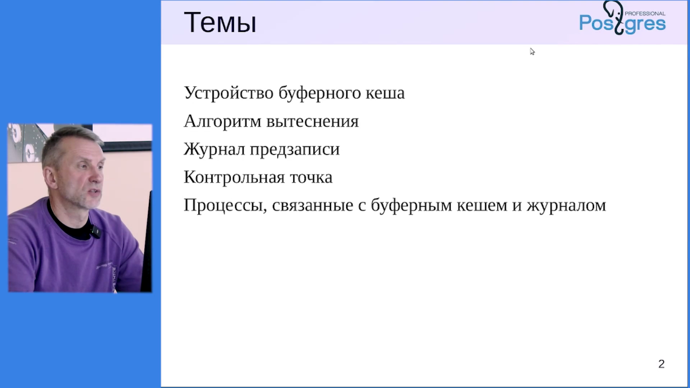
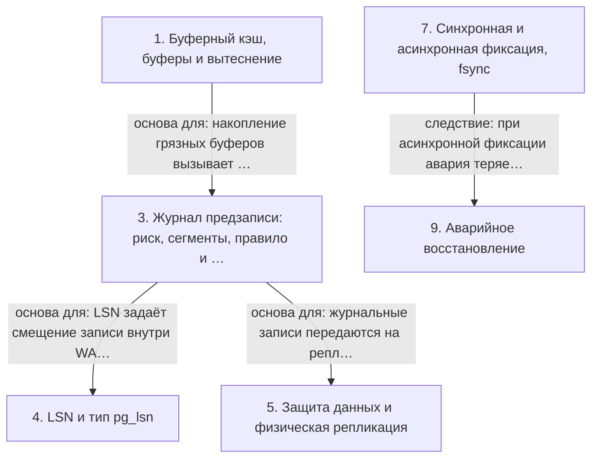

# Буферный кэш и журнал предзаписи (WAL) в PostgreSQL

> [!abstract] Обзор
> Материал о буферном кэше PostgreSQL и журнале предзаписи (WAL). Буферный кэш — набор 8-килобайтных буферов с заголовками, который кэширует прочитанные с диска страницы; при заполнении используется алгоритм LRU, а грязные буферы перед вытеснением сбрасываются на диск. Вывод explain-analyze со строкой Buffers показывает чтение с диска (Shared Read) и попадания в кэш (Shared Hit). Поскольку данные в оперативной памяти уязвимы при сбое, ведётся журнал предзаписи: действует правило предзаписи, используются контрольные точки, а журнал применяется для физической репликации и резервного копирования. Материал также разбирает физическое хранение WAL в каталоге pg_wal сегментами по 16 МБ, LSN и тип pg_lsn, синхронную и асинхронную фиксацию, фоновые процессы walwriter и bgwriter, аварийное восстановление, уровни wal_level и изменение shared_buffers.

> [!info] Курс
> [[index|Оглавление курса]]

## Оглавление
1. [[#1. Буферный кэш, буферы и вытеснение]]
2. [[#2. explain-analyze и строка Buffers]]
3. [[#3. Журнал предзаписи: риск, сегменты, правило и контрольная точка]]
4. [[#4. LSN и тип pg_lsn]]
5. [[#5. Защита данных и физическая репликация]]
6. [[#6. Нежурналируемые таблицы]]
7. [[#7. Синхронная и асинхронная фиксация, fsync]]
8. [[#8. Фоновые процессы walwriter и bgwriter]]
9. [[#9. Аварийное восстановление]]
10. [[#10. Уровни wal_level и рестарт]]

**Схема** — [[#Схема]]
**Итог** — [[#Итог]]

## 1. Буферный кэш, буферы и вытеснение

Буферный кэш — набор 8-килобайтных буферов с заголовками (файл и номер блока), который кэширует прочитанные с диска страницы, сглаживая скорость доступа. Когда кэш заполнен, применяется алгоритм LRU (Last Recently Used), а буферы с изменениями (грязные) перед вытеснением сбрасываются на диск. Размер по умолчанию — 128 МБ (параметр shared_buffers, изменение требует рестарта). Поскольку прямой записи в Postgres нет, данные могут оставаться в кэше ОС, а общая память требует блокировок. Надёжность данных в оперативной памяти обеспечивается журналом предзаписи.

> [!info] Зачем это нужно
> Назначение — буферизация и сглаживание скорости доступа к данным; ускорение работы и экономия на дисковых операциях.

*Источник: [00:00:16]*

> [!quote]- Кадр [00:00:16]
> 

## 2. explain-analyze и строка Buffers

Команда explain показывает план запроса, а explain-analyze позволяет посмотреть не сам план, а дополнительные параметры выполнения, которые использовал Postgres. В выводе explain-analyze присутствует строка Buffers, Shared Read, которая показывает, сколько блоков (страниц) понадобилось прочитать для выполнения запроса. Слово read в этой строке говорит о том, что имело место чтение с диска, слово Hit — о том, что страницы нашлись в буферном кэше, а не были прочитаны с диска. Первый запрос прочитал их с диска и разместил в оперативной памяти, второй запрос к диску не обращался, а прочитал их из буфера. Время выполнения и время планирования запроса уменьшились, потому что кроме данных таблицы были закэшированы и часть таблиц системного каталога.

| Строка Buffers | Что означает |
|---|---|
| Shared Read | страницы понадобилось прочитать с диска |
| Shared Hit | страницы нашлись в буферном кэше |

*Источник: [00:00:16]*

## 3. Журнал предзаписи: риск, сегменты, правило и контрольная точка

Данные в оперативной памяти уязвимы при сбое, поэтому ведётся журнал предзаписи (WAL): минимально необходимая информация об изменениях записывается на диск раньше, чем изменённые данные (правило предзаписи). Физически WAL хранится в каталоге pg_wal внутри PGDATA сегментами фиксированного размера по 16 МБ. Чтобы не копить журналы бесконечно и ограничить их размер, периодически выполняется контрольная точка — сброс грязных буферов на диск; она растянута во времени для снижения нагрузки на ввод-вывод и позволяет удалять старые сегменты. Запись в журнал последовательная и небольшая, поэтому нагрузка при записи невелика.

*Источник: [00:00:16]*

## 4. LSN и тип pg_lsn

LSN (Log Sequence Number) — номер журнальной записи, который является смещением начала этой записи от начала журнала. LSN — 64-разрядное число, представляющее смещение от начала журнала; начало журнала — момент инициализации кластера. Текущее значение LSN возвращает функция pg_current_wal_lsn. Выполнение апдейта приводит к порождению журнальных записей, которые попадают в журнал, и указатель текущей позиции сдвигается. В Postgres для LSN предусмотрен отдельный тип данных pg_lsn; вычитая одно значение LSN из другого, можно получить разницу в байтах.

*Источник: [00:00:16]*

## 5. Защита данных и физическая репликация

Журнал защищает страницы таблиц, индексов и других объектов, а также статусы транзакций. Временные таблицы живут в рамках одного сеанса, журнал их не защищает, и при сбое данные временных таблиц пропадают вместе с сеансом. Основная задача журнала — восстановление после сбоя; его также удобно использовать для физической репликации и резервного копирования. Физическая репликация синхронизирует данные с одного сервера на другой путём передачи журнальных записей: основной сервер изменяет данные и создаёт новые журналы, которые передаются на реплику и проигрываются там.

*Источник: [00:00:16]*

## 6. Нежурналируемые таблицы

Нежурналируемые таблицы почти такие же, как обычные, но изменения в них не журналируются. Скорость работы с ними выше за счёт экономии на записи журнала, но при сбое сервера они не защищены журналом. При следующем старте PostgreSQL полностью зачищает нежурналируемые таблицы, так как не может гарантировать целостность данных. Их можно использовать, если данные воспроизводимы.

*Источник: [00:00:16]*

## 7. Синхронная и асинхронная фиксация, fsync

По умолчанию транзакции фиксируются синхронно: обслуживающий процесс формирует запись о фиксации, а для записи на диск используется системный вызов fsync (дорогая операция). Асинхронный режим (включается параметром) записывает фиксацию на диск не сразу, менее надёжен и может потерять данные о коротких транзакциях. По умолчанию используется синхронный режим.

| Режим | Запись фиксации на диск | Надёжность |
| Синхронный | Сразу | Выше |
| Асинхронный | Не сразу | Ниже, можно потерять данные о коротких транзакциях |

> [!info] Зачем это нужно
> Для важных приложений, таких как финансовые, надо использовать синхронный режим.

*Источник: [00:00:16]*

## 8. Фоновые процессы walwriter и bgwriter

Специальный процесс walwriter асинхронно сбрасывает журнальные записи на диск. bgwriter — фоновый процесс, который разгружает клиентские бэкэнды от задач вытеснения грязных данных. Если нужно освободить буфер, а данные в нём грязные, их сначала записывают на диск. Процесс фоновой записи записывает на диск те грязные буферы, которые всё равно уже скоро были бы записаны обслуживающими процессами, и помогает бэкендам не заниматься работой, не являющейся их прямыми обязанностями.

*Источник: [00:00:16]*

## 9. Аварийное восстановление

Чтобы смоделировать аварию, из файла postmaster.pid вытаскивают идентификатор головного процесса Postmaster и командой kill посылают ему сигнал quit. После такой некорректной остановки сервер заново стартуют; при старте сервер понимает, что был остановлен неправильно, и производит автоматическое аварийное восстановление с использованием журнала. После аварийного сбоя сервер сам выполняет восстановление, и факт восстановления фиксируется в текстовом журнале сообщений сервера. Изменения, находившиеся в буферном кэше, не теряются: после подключения к базе запрос показывает, что изменения были восстановлены; согласованность сохраняется.

*Источник: [00:00:16]*

## 10. Уровни wal_level и рестарт

Уровни журнала отличаются количеством и составом информации, которая пишется в журнал. Уровни: minimal — самый низкий, replica — выше, logical — ещё выше. По умолчанию уровень журнала — replica, а не minimal; значение по умолчанию replica выбрано, потому что физическая репликация востребована, и для организации физической реплики не нужно изменять параметры. Для применения изменённого значения wal_level требуется рестарт экземпляра Postgres.

*Источник: [00:00:16]*

## Схема

## Итог

> [!success] Что в итоге
> Буферный кэш ускоряет повторные запросы за счёт кэширования страниц, но данные в оперативной памяти уязвимы при сбое. Журнал предзаписи решает эту проблему: запись журнала попадает на диск раньше изменённых данных, а контрольные точки ограничивают его размер; физически WAL хранится в pg_wal сегментами по 16 МБ, а позицию записи задаёт LSN. Надёжность фиксации зависит от синхронного или асинхронного режима и от fsync, а фоновые процессы walwriter и bgwriter разгружают запись. Журнал защищает страницы таблиц и индексов, но не временные и нежурналируемые таблицы; при некорректной остановке сервер автоматически восстанавливается по журналу, а wal_level и shared_buffers требуют рестарта при изменении.

