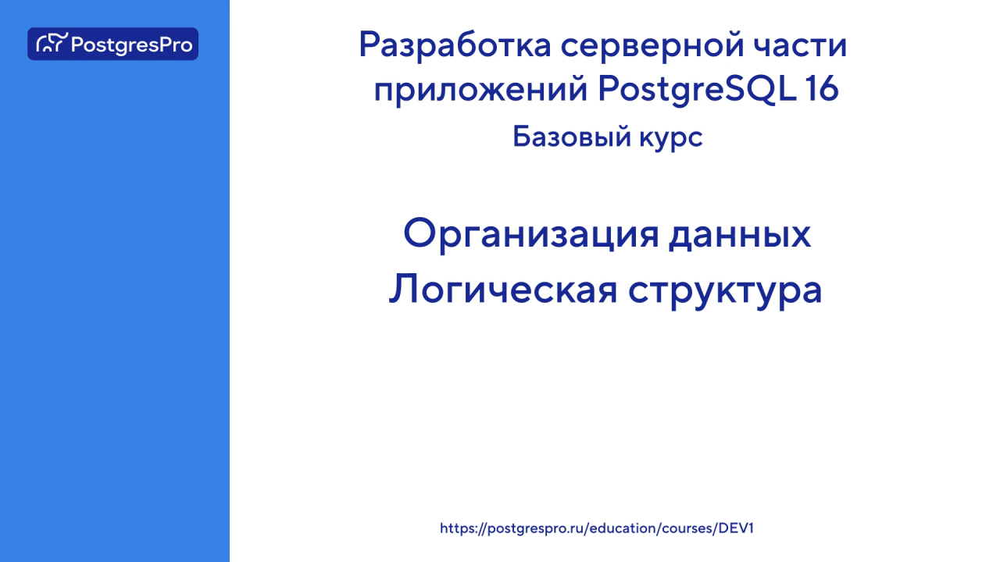
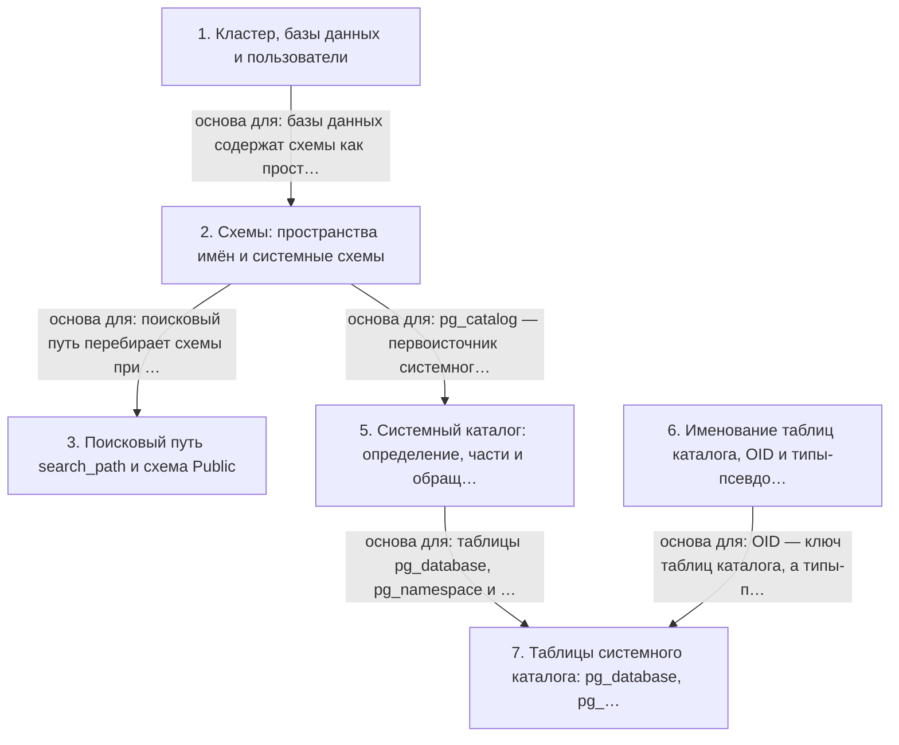

# Организация данных в PostgreSQL: базы, схемы, поисковый путь и системный каталог

> [!abstract] Обзор
> Материал описывает логическую организацию данных в PostgreSQL: кластер обслуживает несколько баз данных, внутри которых лежат схемы-пространства имён. После инициализации создаются базы template0, template1 и postgres, а CREATE DATABASE клонирует шаблон; пользователи и роли вынесены на уровень всего экземпляра. Видимость объектов и место попадания новых объектов определяются поисковым путём (search path), по умолчанию связанным со схемой Public. Отдельно разобран системный каталог: его локальная и глобальная части, именование таблиц с префиксом pg_, таблицы pg_database, pg_namespace, pg_class и представления pg_tables и pg_views, а также OID и типы-псевдонимы для связи OID с именами. Завершают материал команды psql для схем и таблиц, перемещение и полное квалифицированное имя объекта, удаление схем с cascade и баз данных с параметром force.

> [!info] Курс
> [[index|Оглавление курса]]

## Оглавление
1. [[#1. Кластер, базы данных и пользователи]]
2. [[#2. Схемы: пространства имён и системные схемы]]
3. [[#3. Поисковый путь search_path и схема Public]]
4. [[#4. Команды psql, перемещение таблицы и полное квалифицированное имя]]
5. [[#5. Системный каталог: определение, части и обращение через SQL]]
6. [[#6. Именование таблиц каталога, OID и типы-псевдонимы]]
7. [[#7. Таблицы системного каталога: pg_database, pg_namespace, pg_class, pg_tables, pg_views]]
8. [[#8. Удаление схемы с cascade и базы данных с параметром force]]

**Схема** — [[#Схема]]
**Итог** — [[#Итог]]

## 1. Кластер, базы данных и пользователи

Кластер — это экземпляр, обслуживающий несколько баз данных; внутри баз данных находятся схемы, а пользователи и роли не живут в отдельных базах, а выносятся на уровень всего экземпляра Postgres. После инициализации кластера сразу создаются три базы: template0, template1 и postgres; template0 — неизменяемый шаблон, применяемый при восстановлении из логической резервной копии и при создании БД с другими локалями или кодировками, а template1 можно изменять, и новые базы по умолчанию клонируются из него, наследуя, например, расширения. CREATE DATABASE фактически клонирует один из шаблонов. База postgres не системная, не нужна самому Postgres и служит для умолчательных подключений; её можно удалить без влияния на функционал. Список баз можно получить командой psql \l или \list.

| Шаблон | Изменяемость | Применение |
|---|---|---|
| template0 | неизменяемый | восстановление из логической копии, другие локали/кодировки |
| template1 | можно вносить изменения | клонирование новых баз по умолчанию |

> [!info] Зачем это нужно
> Шаблоны задают, какие базы и с какими свойствами создаются, а postgres нужна для быстрого умолчательного подключения.

*Источник: [00:00:04]*

> [!quote]- Кадр [00:00:04]
> 

## 2. Схемы: пространства имён и системные схемы

Схемы (пространства имён) — это контейнеры внутри базы данных, в которые помещаются объекты; они используются для разделения объектов на логические группы, и в разных схемах могут находиться объекты с одинаковыми именами. Названия объектов в PostgreSQL хранятся в нижнем регистре; одно из назначений разделения по схемам — предотвращение конфликта имён, а обращение часто квалифицируют названием схемы. В Postgres схемы и пользователи — совершенно разные сущности: схема, одноимённая с пользователем, не становится его собственностью, а владельцем созданной схемы становится текущий пользователь. Схема pg_catalog содержит объекты системного каталога — таблицы и представления, которые описывают данные базы и кластера, и является первоисточником системного каталога. Кроме неё, information schema — это набор представлений для стандартизованного доступа к данным системного каталога, а для временных объектов Postgres сам управляет схемами pg_temp_3, pg_temp_5 и т.п.; при обращении к временной таблице номер знать не нужно — достаточно написать pg_temp и имя объекта.

> [!info] Зачем это нужно
> Схемы нужны для удобства разделения объектов на логические группы и предотвращения конфликта имён; системные схемы дают доступ к описанию объектов, а pg_temp упрощает работу с временными таблицами.

*Источник: [00:00:04]*


## 3. Поисковый путь search_path и схема Public

Видимость объектов внутри схем связана с поисковым путём (search path): search_path — список схем, которые перебираются по очереди при поиске объекта, и Postgres обращается к объекту в первой схеме, где он найден. Путь поиска позволяет не указывать схему явным образом, порядок схем можно задать самостоятельно, а несуществующая схема или схема без доступа не вызывает ошибки; это аналогично переменной PATH в операционной системе. Параметр, установленный в сеансе, забывается при переподключении, а чтобы значение сохранялось, его можно добавить в файл postgresql.conf; команда ALTER DATABASE SET search_path устанавливает параметр для отдельной базы данных (и, при желании, определённого пользователя) и применяется при каждом подключении к этой базе. Если при создании нового объекта не указать схему, он попадёт в первую схему поискового пути; по умолчанию путь поиска состоит из схемы public и конструкции, обозначающей схему с тем же именем, что и имя текущего пользователя, а если одноимённой схемы нет, эта часть пути игнорируется. Функция current_schemas показывает реальный список схем для поиска, а параметр функции управляет отображением системных служебных схем; Public — схема по умолчанию, в неё попадают вновь создаваемые объекты, и её отсутствие в общем случае работе Postgres не повредит.

> [!info] Зачем это нужно
> search_path определяет, где искать объекты и куда попадёт новый объект без явной схемы.

*Источник: [00:00:04]*


## 4. Команды psql, перемещение таблицы и полное квалифицированное имя

Команда \dn (describe namespace) выводит список всех схем в текущей базе данных; буква N означает namespace. Команда \dt показывает список таблиц; без аргументов она показывает все таблицы, находящиеся в области видимости, а для просмотра таблиц конкретной схемы команду конкретизируют шаблоном вида public.*. Команда ALTER TABLE SET SCHEMA перемещает таблицу в указанную схему; после выполнения команды таблица переезжает в схему Special и исчезает из схемы Public. Чтобы видеть запрос, который реально отправляется на сервер, нужно включить в PSQL переменную echo_hidden — тогда при выполнении коротких команд, например \l, отображается и сам запрос. Чтобы явно обратиться к нужному объекту, указывают полное квалифицированное имя: схема, точка, имя таблицы или функции (пример — Special.t); после перемещения таблицы в другую схему обращаться к ней нужно с явным указанием имени схемы, иначе таблица не будет найдена.

> [!info] Зачем это нужно
> Назначение — явно обратиться к нужному объекту.

*Источник: [00:00:04]*


## 5. Системный каталог: определение, части и обращение через SQL

Системный каталог — это описание всех объектов кластера, содержащихся в самом кластере; это набор таблиц и вспомогательных представлений, которые описывают все объекты базы данных и глобальные объекты кластера. Системный каталог состоит из части, относящейся к конкретной базе, и объектов уровня кластера. Часть системного каталога конкретной базы располагается в этой базе, и из другой базы её не видно; объекты уровня кластера хранятся отдельно, но видны из всех баз одинаково, так что из любой базы данных видна своя часть системного каталога и глобальные объекты. Подключившись к одной базе, нельзя разглядеть системный каталог другой базы. К системному каталогу можно обращаться обычными запросами SQL: получать данные, делать вставки и апдейты, но изменить схему системного каталога — например, добавить столбцы — не получится.

*Источник: [00:00:04]*


## 6. Именование таблиц каталога, OID и типы-псевдонимы

Названия всех таблиц и представлений системного каталога начинаются с префикса pg_, а столбцы в них обычно имеют трёхбуквенный префикс, отсылающий к таблице: например, в таблице баз данных столбцы начинаются на dat, а в таблице пользователей — на rol. В большинстве таблиц системного каталога как ключ используется специальный столбец OID (Object Identifier), и тип у него тоже OID. OID — это целочисленный 4-байтовый тип с автоинкрементом, которым Postgres управляет сам; он живёт в системном каталоге и предназначен для уникальной идентификации объектов в рамках всего экземпляра. Именно по столбцу OID Postgres разбирается с таблицами, системный номер объекта остаётся неизменным при переименовании, а типы-псевдонимы позволяют получать из OID имя объекта и наоборот. Числовое значение oid можно привести к типу reg-namespace, чтобы вместо числа получить имя схемы, а обратное преобразование позволяет в условии where указать символьное название схемы без громоздкого подзапроса.

> [!info] Зачем это нужно
> Предназначен для уникальной идентификации объектов в рамках всего экземпляра.

*Источник: [00:00:04]*


## 7. Таблицы системного каталога: pg_database, pg_namespace, pg_class, pg_tables, pg_views

Команда \l обращается к таблице pg_database системного каталога, содержащей список всех баз данных; утилита PSQL формирует запрос к pg_catalog.pg_database, который выводит имя, владельца, кодировку, locale provider, collate, ctype, ICU locale, ICU rules и права доступа. Эта таблица относится к уровню всего экземпляра, а не конкретной базы. Для схем предусмотрена табличка pg_namespace: она лежит в каталоге конкретной базы и содержит список схем в этой базе. Таблицы, индексы, представления и последовательности хранятся в общей таблице pg_class; все эти объекты называются общим словом relations или отношения, а над таблицей pg_class построены для удобства представления pg_tables и pg_views, которые позволяют не задумываться о том, как выбрать из pg_class нужные объекты.

```sql
SELECT
  d.datname as "Name",
  pg_catalog.pg_get_userbyid(d.datdba) as "Owner",
  pg_catalog.pg_encoding_to_char(d.encoding) as "Encoding",
  CASE d.datlocprovider WHEN 'c' THEN 'libc' WHEN 'i' THEN 'icu' END AS "Locale Provider",
  d.datcollate as "Collate",
  d.datctype as "Ctype",
  d.daticulocale as "ICU Locale",
  d.daticurules as "ICU Rules",
  pg_catalog.array_to_string(d.datacl, E'\\n') AS "Access privileges"
FROM pg_catalog.pg_database d
ORDER BY 1;

SELECT
  d.datname as "Name",
  pg_catalog.pg_get_userbyid(d.datdba) as "Owner",
  pg_catalog.pg_encoding_to_char(d.encoding) as "Encoding",
  CASE d.datlocprovider WHEN 'c' THEN 'libc' WHEN 'i' THEN 'icu' END AS "Locale Provider",
  d.datcollate as "Collate",
  d.datctype as "Ctype",
  d.daticulocale as "ICU Locale",
  d.daticurules as "ICU Rules",
  pg_catalog.array_to_string(d.datacl, E'\n') AS "Access privileges"
FROM pg_catalog.pg_database d
ORDER BY 1;
```

*Источник: [00:00:04], [00:33:43]*


## 8. Удаление схемы с cascade и базы данных с параметром force

Postgres выдал ошибку при удалении схемы, потому что есть объекты, которые находятся в зависимости от удаляемого; команда DropSchemaSpecialCascade удалит схему сразу со всеми содержащимися в ней объектами. Параметром Cascade нужно пользоваться с осторожностью: вы можете убить много чего лишнего; по-хорошему нужно посмотреть, какие объекты лежат, возможно, перетащить их в другие схемы. Удалить базу данных, к которой есть активные подключения, не получится — в том числе если это ваше собственное текущее подключение; чтобы удалить базу DataLogical, нужно сначала переключиться на другую базу, например Postgres. Чтобы удалить базу данных, игнорируя активные сессии, нужно выполнить команду DropDatabase с параметром force: все клиентские сессии подключения будут закрыты, и база данных удалена.

*Источник: [00:00:04]*


## Схема



## Итог

> [!success] Что в итоге
> Логическая структура Postgres строится как кластер из нескольких баз, внутри которых лежат схемы; пользователи вынесены на уровень всего экземпляра, а после инициализации создаются базы template0, template1 и postgres. Видимость объектов и место попадания новых объектов задаёт поисковый путь search_path, а схема Public — место по умолчанию. Системный каталог описывает все объекты кластера и делится на локальную часть конкретной базы и глобальные объекты; его таблицы именуются с префиксом pg_, объекты идентифицируются через OID, а типы-псевдонимы связывают OID с именами. Удаление схемы требует cascade и осторожности, а базу данных с активными подключениями удаляют только с параметром force.

