# Логическая структура PostgreSQL: кластер, базы, схемы и системный каталог

> [!abstract] Обзор
> Материал описывает логическую структуру PostgreSQL: кластер обслуживает несколько баз, при инициализации создаются postgres, template0 и template1, а новые базы клонируются из шаблонов. Внутри баз данных лежат схемы как пространства имён для объектов, по умолчанию объекты попадают в public, а видимость определяется путём поиска search_path. Разбираются специальные схемы pg_catalog, information_schema и pg_temp, а также команды psql для работы со схемами и базами (\l, \dn, \dt). Описание объектов хранится в системном каталоге, схемы и relations — в pg_namespace и pg_class, ключом служит тип oid, а reg-типы упрощают преобразование oid в имена. Отдельно рассматриваются перемещение таблиц между схемами, удаление схемы через DROP SCHEMA CASCADE и ограничения на удаление базы данных.

> [!info] Курс
> [[index|Оглавление курса]]

## Оглавление
1. [[#1. Кластер, базы данных и шаблоны]]
2. [[#2. Схемы как пространства имён и специальные схемы]]
3. [[#3. Путь поиска search_path и конструкция $user]]
4. [[#4. Создание, просмотр и перемещение в схемах]]
5. [[#5. Системный каталог, pg_namespace, pg_class и OID]]
6. [[#6. Переменная ECHO_HIDDEN и мета-команда \l]]
7. [[#7. Удаление схемы и базы данных]]

**Схема** — [[#Схема]]
**Итог** — [[#Итог]]

## 1. Кластер, базы данных и шаблоны

Кластер — экземпляр, обслуживающий несколько баз; при инициализации создаются postgres, template0 и template1. template0 — эталонный шаблон, template1 — изменяемый, изменения тиражируются на новые базы; новая база клонируется из существующей, по умолчанию из template1, а template0 применяется для восстановления и смены локали/кодировки. База postgres предназначена для подключений по умолчанию; её можно удалить, но утилиты не будут знать, куда подключаться. При запуске psql без параметров под student он подключается к кластеру под student к базе student. Список баз выводит \l (\list), а большая S показывает служебные объекты и работает аналогично для многих команд psql.

```javascript
> CREATE DATABASE data_logical;
=> \l
=> CREATE DATABASE data_logical;
```

| Шаблон | Особенность |
|---|---|
| template0 | эталонный, не подлежит изменениям |
| template1 | изменяемый, изменения тиражируются на новые базы |

*Источник: [00:00:47], [00:04:02], [00:04:22], [00:04:46], [00:06:09], [00:11:34] и др.*

> [!quote]- Кадр [00:00:47]
> 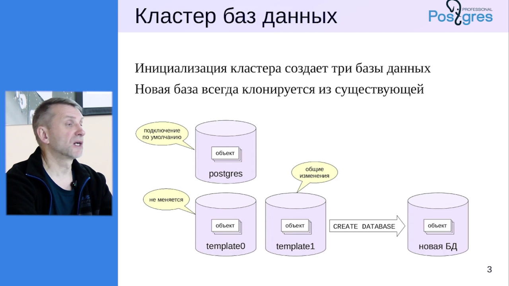

> [!quote]- Кадр [00:41:13]
> 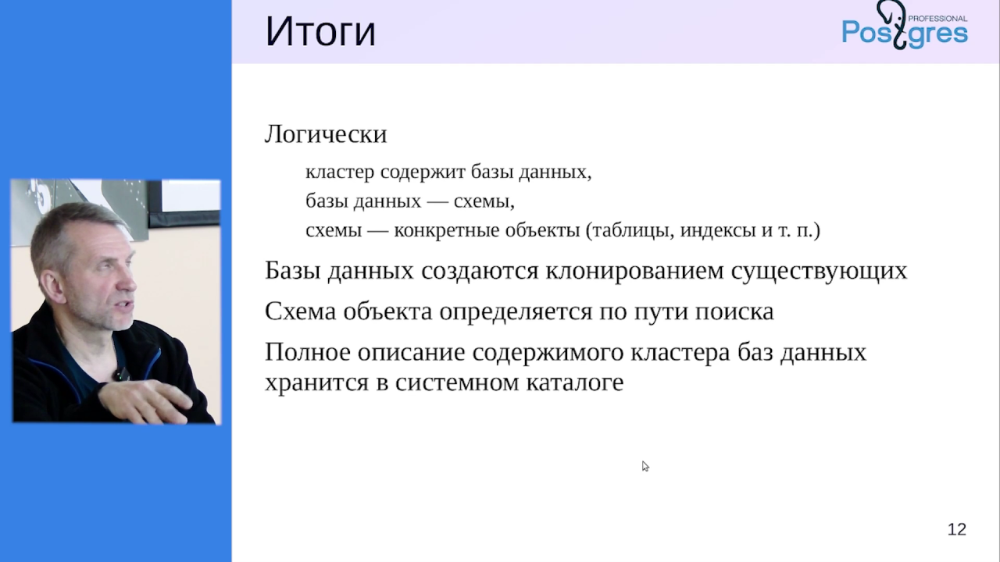

## 2. Схемы как пространства имён и специальные схемы

Экземпляр PostgreSQL организован как кластер, содержащий несколько баз данных. Внутри каждой базы данных находятся схемы (пространства имён) — контейнеры для объектов: таблиц, индексов и т. п. Схемы позволяют разделять объекты на логические группы и предотвращать конфликты имён; одноимённые таблицы в разных схемах считаются разными. В Postgres схема и пользователь — разные сущности. Есть специальные схемы: public — по умолчанию для новых объектов; pg_catalog — системный каталог; information_schema — вариант системного каталога; pg_temp — для временных таблиц (Postgres сам управляет схемами pg_temp_3, pg_temp_5 и т. д., но для обращения достаточно писать pg_temp).

> [!info] Зачем это нужно
> Назначение этой схемы такое же, как у базы postgres в кластере.

*Источник: [00:06:29], [00:06:49], [00:11:34], [00:40:53], [00:41:13]*

> [!quote]- Кадр [00:11:34]
> 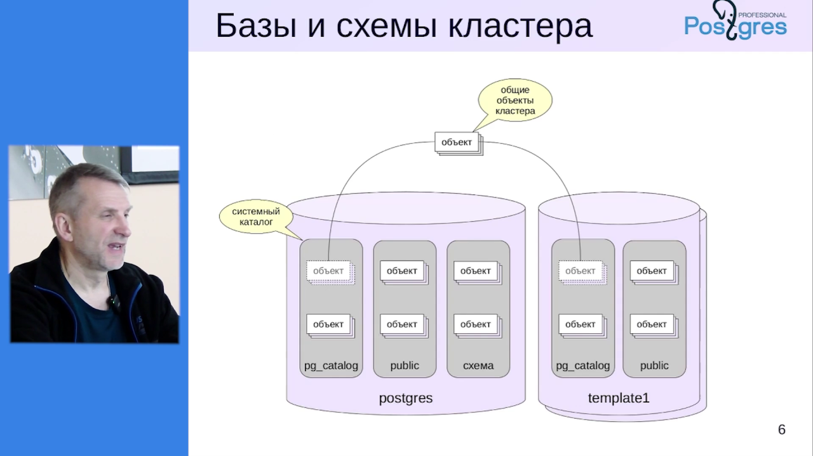

> [!quote]- Кадр [00:06:49]
> 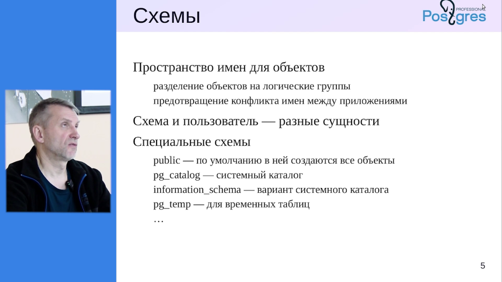

## 3. Путь поиска search_path и конструкция $user

Квалифицированное имя (схема.имя) явно определяет схему объекта; имя без квалификатора проверяется в схемах из пути поиска (search_path) по порядку, и используется первая, где найден объект. Реальное значение search_path возвращает функция current_schemas, исключая несуществующие схемы и схемы без доступа; current_schemas(true) показывает и служебные схемы, включая pg_catalog. Если схема не входит в путь поиска, обратиться к таблице можно только с явным указанием имени схемы; схемы pg_temp и pg_catalog неявно включаются первыми, поэтому временные таблицы видятся первыми. Конструкция «$user» обозначает схему с именем текущего пользователя; если её нет, она игнорируется. search_path можно задать в файле postgresql.conf, для отдельной базы через ALTER DATABASE или для пользователя, тогда он применяется для всех новых подключений к этой БД.

```javascript
=> SHOW search_path;
=> SELECT current_schemas(false);
=> SELECT current_schemas(true);

=> ALTER TABLE t SET SCHEMA special;
=> \dt special.*
 Schema | Name | Type  |  Owner
--------+------+-------+---------
 special | t    | table | student
=> SELECT * FROM special.t;
=> ALTER DATABASE data_logical SET search_path = public, special;

   ALTER DATABASE

=> \c data_logical

   You are now connected to database "data_logical" as user "student".

=> SHOW search_path;

   search_path
   -------------------
   public, special
   (1 row)
```

*Источник: [00:06:49], [00:18:21], [00:18:41], [00:19:01], [00:22:51], [00:23:34] и др.*


> [!quote]- Кадр [00:19:01]
> 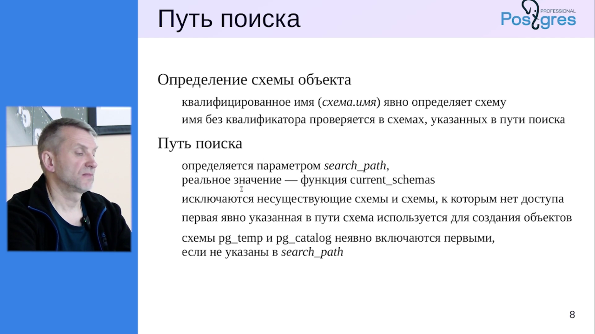

> [!quote]- Кадр [00:23:34]
> 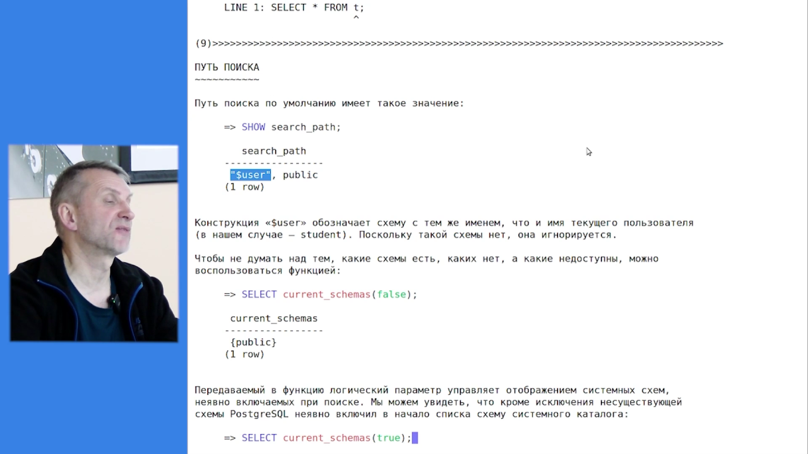

> [!quote]- Кадр [00:27:20]
> 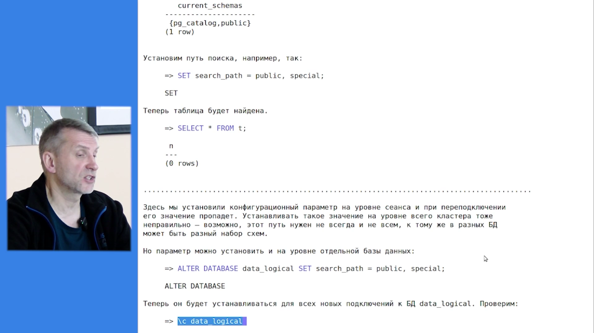

## 4. Создание, просмотр и перемещение в схемах

Собственная схема создаётся командой CREATE SCHEMA special; владельцем становится пользователь. При создании таблицы без указания схемы она попадает в public; выражение public.* покажет все таблицы в public, а \dt без аргументов показывает таблицы в области видимости. В psql команда \dn (describe namespace) выводит список схем текущей базы; по умолчанию служебные схемы не показываются, но с модификатором S (\dnS) видны и системные схемы (information_schema, pg_catalog, pg_toast), а \dn+ добавляет Access privileges и Description. Перемещение таблицы в другую схему выполняется командой ALTER TABLE ... SET SCHEMA: ALTER TABLE t SET SCHEMA special переносит t из public в special, при этом данные физически остаются на месте, а обращаться к таблице нужно как special.t. В командах psql поддерживаются шаблоны: можно указать подстроку и знак вопроса для одного символа.

```sql
=> CREATE SCHEMA special;

CREATE SCHEMA

=> \dn

   Name   |        Owner
-----------+----------------------
 public    | pg_database_owner
 special   | student
(2 rows)

CREATE TABLE t(n integer);

=> ALTER TABLE t SET SCHEMA special;
ALTER TABLE
=> \dt public.*
Did not find any relation named "public.*".
=> \dt special.*
        List of relations
 Schema | Name | Type  |  Owner
--------+------+-------+---------
 special | t    | table | student
(1 row)
```

*Источник: [00:13:56], [00:14:16], [00:14:41], [00:15:01], [00:15:51], [00:16:11] и др.*

> [!quote]- Кадр [00:15:01]
> 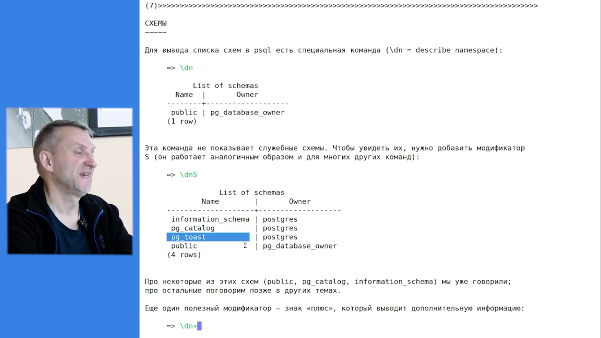

> [!quote]- Кадр [00:14:41]
> 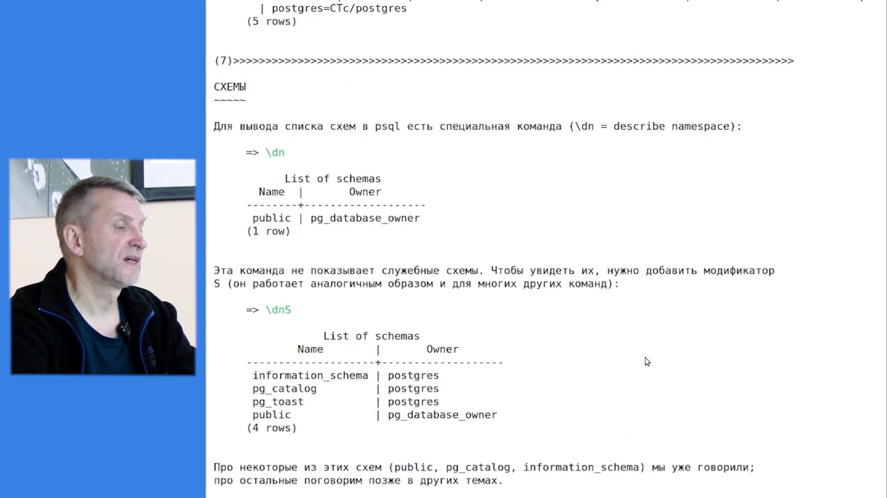

## 5. Системный каталог, pg_namespace, pg_class и OID

Системный каталог — это набор таблиц в каждой базе данных (схема pg_catalog), глобальные объекты кластера и представления; он описывает все объекты, и в таблицы каталога можно писать обычными SQL-запросами, но нельзя менять их схему. В каждой базе видна своя часть каталога и глобальные объекты кластера, но не каталог другой базы. Для схем есть таблица pg_namespace, для таблиц, индексов, представлений и последовательностей — pg_class; в pg_class столбцы начинаются на rel, relkind задаёт тип объекта (r — таблица, i — индекс), relnamespace — схему (тип oid). OID — целочисленный 4-байтовый тип с автоинкрементом для уникальной идентификации объектов; при переименовании объекта его OID не меняется. Для преобразования oid в имя и обратно служат reg-типы, например regnamespace; relnamespace::regnamespace::text даёт имя схемы.

```sql
>= \l
********** QUERY **********
SELECT
    d.datname as "Name",
    pg_catalog.pg_get_userbyid(d.datdba) as "Owner",
    pg_catalog.pg_encoding_to_char(d.encoding) as "Encoding",
    CASE d.datlocprovider WHEN 'c' THEN 'libc' WHEN 'i' THEN 'icu' END AS "Locale Provider",
    d.datcollate as "Collate",
    d.datctype as "Ctype",
    d.daticulocale as "ICU Locale",
    d.daticurules as "ICU Rules",
    pg_catalog.array_to_string(d.datacl, E'\\n') AS "Access privileges"
FROM pg_catalog.pg_database d
ORDER BY 1;

SELECT
    d.datname as "Name",
    pg_catalog.pg_get_userbyid(d.datdba) as "Owner",
    pg_catalog.pg_encoding_to_char(d.encoding) as "Encoding",
    CASE d.datlocprovider WHEN 'c' THEN 'libc' WHEN 'i' THEN 'icu' END AS "Locale Provider",
    d.datcollate as "Collate",
    d.datctype as "Ctype",
    d.daticulocale as "ICU Locale",
    d.daticulrules as "ICU Rules",
    pg_catalog.array_to_string(d.datacl, E'\\n') AS "Access privileges"
FROM pg_catalog.pg_database d
ORDER BY 1;

>= SELECT relname, relkind, relnamespace FROM pg_class WHERE relname = 't';

  relname | relkind | relnamespace
 ---------+---------+-------------
  t       | r       |        16391
 (1 row)

=> SELECT nspname FROM pg_namespace;
SELECT relname, relkind, relnamespace FROM pg_class WHERE relname = 't';

=> \l
********** QUERY **********
SELECT
    d.datname as "Name",
    pg_catalog.pg_get_userbyid(d.datdba) as "Owner",
    pg_catalog.pg_encoding_to_char(d.encoding) as "Encoding",
    CASE d.datlocprovider WHEN 'c' THEN 'libc' WHEN 'i' THEN 'icu' END AS "Locale Provider",
    d.datcollate as "Collate",
    d.datctype as "Ctype",
    d.daticulocale as "ICU Locale",
    d.daticurules as "ICU Rules",
    pg_catalog.array_to_string(d.datacl, E'\n') AS "Access privileges"
FROM pg_catalog.pg_database d
ORDER BY 1;

SELECT
    d.datname as "Name",
    pg_catalog.pg_get_userbyid(d.datdba) as "Owner",
    pg_catalog.pg_encoding_to_char(d.encoding) as "Encoding",
    CASE d.datlocprovider WHEN 'c' THEN 'libc' WHEN 'i' THEN 'icu' END AS "Locale Provider",
    d.datcollate as "Collate",
    d.datctype as "Ctype",
    d.daticulocale as "ICU Locale",
    d.daticulrules as "ICU Rules",
    pg_catalog.array_to_string(d.datacl, E'\n') AS "Access privileges"
FROM pg_catalog.pg_database d
ORDER BY 1;
```

*Источник: [00:06:49], [00:11:34], [00:28:20], [00:31:41], [00:32:50], [00:33:46] и др.*


> [!quote]- Кадр [00:28:20]
> 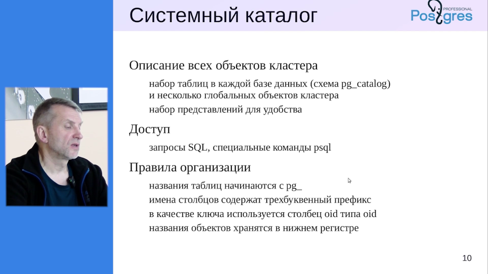

> [!quote]- Кадр [00:35:07]
> 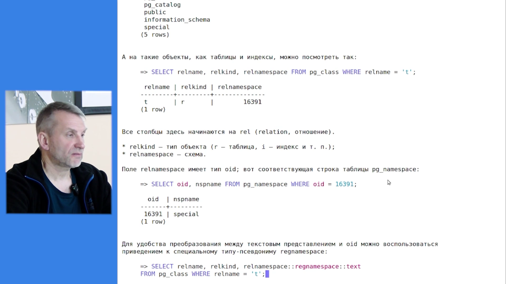

## 6. Переменная ECHO_HIDDEN и мета-команда \l

В psql есть переменная ECHO_HIDDEN. Если её включить, при выполнении коротких команд, например \l, кроме результатов будет виден сам запрос, который реально улетел на сервер и был выполнен. Переменную можно отключить командой \set ECHO_HIDDEN off. Мета-команда \l выполняет запрос к pg_catalog.pg_database и выводит Name, Owner, Encoding, Locale Provider, Collate, Ctype, ICU Locale, ICU Rules и Access privileges; значение datlocprovider переводится в 'libc' для 'c' и 'icu' для 'i'. Утилита PSQL формирует такие запросы, что позволяет исследовать системный каталог.

```
\set ECHO_HIDDEN off
```

> [!info] Зачем это нужно
> Позволяет исследовать системный каталог.

*Источник: [00:31:41], [00:32:01], [00:32:45], [00:32:47], [00:33:09], [00:33:29] и др.*

## 7. Удаление схемы и базы данных

Схему нельзя удалить, если от неё зависят другие объекты (например, таблица t, видимая в pg_class): DROP SCHEMA special; без CASCADE выдаёт ошибку и предлагает использовать DROP ... CASCADE. Для удаления схемы вместе со всеми зависимыми объектами применяется DROP SCHEMA ... CASCADE, который также удаляет эти объекты, включая таблицу t. CASCADE нужно использовать с осторожностью, так как можно удалить лишнее. Нельзя удалить базу данных, к которой в данный момент есть подключение; если к базе, которую вы собираетесь удалять, есть активные подключения, удалить её не дадут, поэтому нужно отключиться от неё. Команда DROP DATABASE с параметром FORCE закрывает все клиентские сессии и удаляет базу данных.

```javascript
>= DROP SCHEMA special;

ERROR:  cannot drop schema special because other objects depend on it
DETAIL:  table t depends on schema special
HINT:  Use DROP ... CASCADE to drop the dependent objects too.

=> DROP SCHEMA special CASCADE;

NOTICE:  drop cascades to table t
DROP SCHEMA

=> DROP DATABASE data_logical;
ERROR:  database "data_logical" is being accessed by other users
DETAIL: There is 1 other session using the database.
=> DROP DATABASE data_logical WITH (FORCE);
DROP DATABASE
```

*Источник: [00:38:04], [00:38:24], [00:38:51], [00:39:11], [00:39:31], [00:39:51] и др.*

## Схема

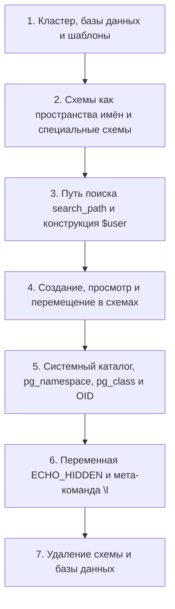

## Итог

> [!success] Что в итоге
> Кластер PostgreSQL логически содержит базы данных, которые клонируются из шаблонов template0 и template1, а база postgres служит для подключений по умолчанию; базы создаются командой CREATE DATABASE, а удаляются через DROP DATABASE (с FORCE при активных подключениях). Внутри баз лежат схемы как пространства имён для объектов, по умолчанию объекты попадают в public, а видимость определяется путём поиска search_path, настраиваемым на разных уровнях вплоть до отдельной БД. Описание объектов хранится в системном каталоге (pg_catalog, pg_namespace, pg_class, pg_database), ключом служит тип oid, а reg-типы упрощают преобразование oid в имена. Удаление схемы каскадом и удаление базы данных имеют ограничения, связанные с зависимостями и активными подключениями.

