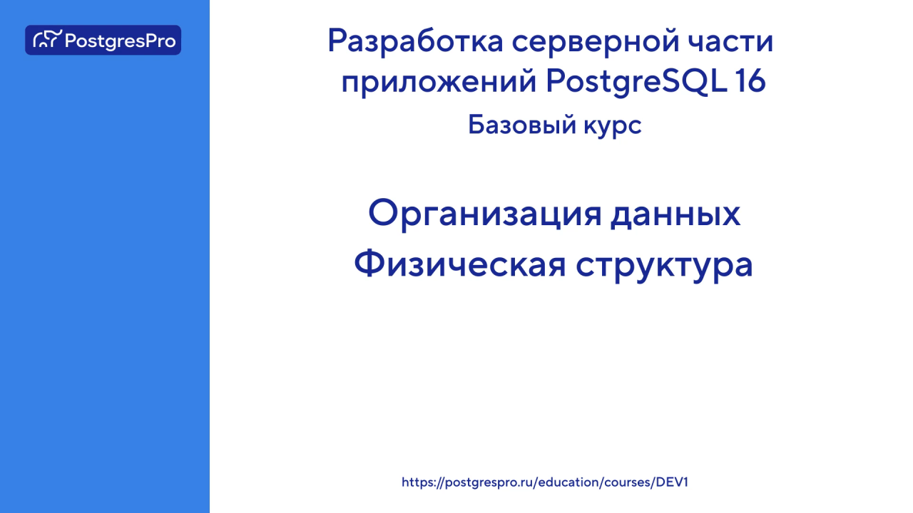
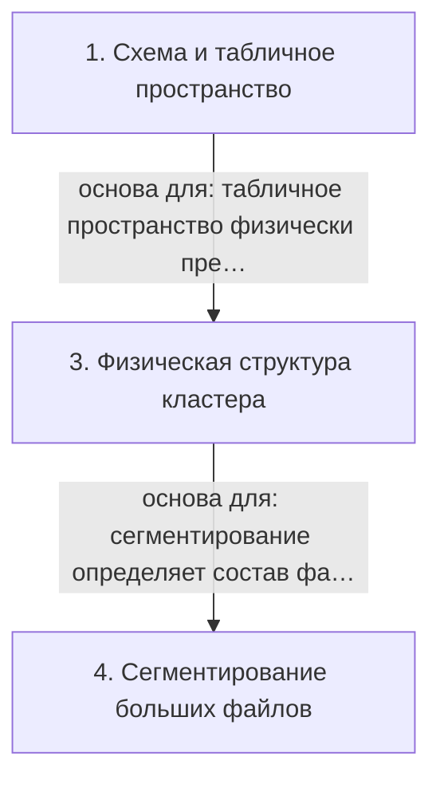

# Физическая структура и организация данных в PostgreSQL

> [!abstract] Обзор
> Материал об организации данных в PostgreSQL: как логические объекты соотносятся со схемой и табличным пространством и как это отражается в физической структуре каталога pg_data. Разбираются табличные пространства — их назначение, создание, просмотр, а также перемещение таблиц между схемами и между табличными пространствами. Показано сегментирование больших файлов, слои таблицы (fork), карта свободного пространства (FSM) и карта видимости (VM), а также связь карты видимости со сканированием только индекса. Отдельно рассматриваются функции измерения размера, механизм TOAST для длинных значений и практические замечания — не писать SELECT * и учитывать связь администратора БД с операционной системой.

> [!info] Курс
> [[index|Оглавление курса]]

## Оглавление
1. [[#1. Схема и табличное пространство]]
2. [[#2. Создание и назначение табличных пространств]]
3. [[#3. Физическая структура кластера]]
4. [[#4. Сегментирование больших файлов]]
5. [[#5. Слои таблицы: FSM и VM]]
6. [[#6. Размер объектов и слоёв]]
7. [[#7. Перемещение таблиц]]
8. [[#8. TOAST: назначение и доступ]]
9. [[#9. Не писать SELECT *]]
10. [[#10. Администратор БД и ОС]]

**Схема** — [[#Схема]]
**Итог** — [[#Итог]]

## 1. Схема и табличное пространство

Каждый объект в PostgreSQL существует на пересечении схемы и табличного пространства: логически объект находится в схеме, а физически — в табличном пространстве. Табличное пространство — это каталог в файловой системе, где хранятся файлы; идентификатор табличного пространства присутствует в пути и является символической ссылкой на каталог, указанный при создании. При создании кластера создаются два табличных пространства: PG Global и PG Default. В PG Global находятся объекты, общие для всего кластера, включая системный каталог; они видны из каждой базы данных и не могут быть помещены в конкретную базу. В каждой базе есть табличное пространство по умолчанию (обычно PG-Default), но в одной базе объекты могут находиться в разных табличных пространствах.

*Источник: [00:00:04]*

> [!quote]- Кадр [00:00:04]
> 

## 2. Создание и назначение табличных пространств

Собственное табличное пространство создают для управления размещением данных: активно используемые данные можно разместить на быстрых дисках, а архивные — на медленных и более дешёвых. Объект в Postgres представлен несколькими файлами, и при большом количестве объектов в каталоге работа может замедляться, поэтому может понадобиться новое табличное пространство. Список табличных пространств хранится в системном каталоге pg_tablespace; при инициализации кластера создаются два пространства без location, поэтому нужно знать их каталоги; в psql можно использовать команду \db. Для создания нужно создать пустой каталог, принадлежащий пользователю Postgres, запустившему сервер, затем выполнить CREATE TABLESPACE с именем и абсолютным путём к каталогу. При создании базы данных можно указать табличное пространство по умолчанию параметром tableSpace; если назначить другое табличное пространство, объекты системного каталога будут находиться в нём.

*Источник: [00:00:04]*

## 3. Физическая структура кластера

Кластер PostgreSQL в Ubuntu расположен в каталоге /var/lib/postgresql/16/main; общие объекты кластера находятся в каталоге global, а табличное пространство pg-default — в каталоге base, где далее идут подкаталоги с идентификаторами баз данных. Пространство pg_global всегда располагается в подкаталоге global каталога кластера (pg_data); при создании табличного пространства в PGDATA создаётся подкаталог PG-TBL-SPC, в котором создаётся символическая ссылка на указанный каталог и подкаталоги с версией Postgres и идентификатором базы данных. Функция pg_relation_filepath показывает относительный путь к файлам таблицы, его надо отсчитывать от каталога PGDATA; файлы таблицы лежат в PGDATA, внутри — подкаталог с номером версии (Pg16) и номером сборки, а затем подкаталог с идентификатором базы данных. Каждая таблица хранится в отдельном файле, все файлы одной таблицы начинаются с одного числового идентификатора; таблица представлена тремя файлами: основной файл без суффикса хранит вставленные данные, а FSM и VM — маленькие, но важные для работы файлы. Табличный файл расширяется не по одной странице, а сразу некоторым количеством, поэтому возможна фрагментация файла, он будет расти постепенно.

*Источник: [00:00:04]*

## 4. Сегментирование больших файлов

Большие файлы делятся на сегменты; размер сегмента по умолчанию 1 гигабайт, и при достижении лимита создаётся следующий файл с суффиксом .1, .2 и так далее, поэтому по числу файлов можно судить об объёме данных. Ограничение размера сегмента можно указать при сборке сервера или инициализации кластера; можно сделать его больше, но обычно этим не занимаются.

*Источник: [00:00:04]*

## 5. Слои таблицы: FSM и VM

Таблица содержит не только строки, вставляемые командой INSERT, но и служебную информацию, нужную PostgreSQL для правильной работы; разные типы такой информации называются слоями (fork), и каждый слой состоит из одного или нескольких файлов сегментов. Слой карты свободного пространства (free space map, FSM) имеет файлы с суффиксом _fsm; он говорит, сколько свободного места есть в страницах, и помогает быстро найти страницу с достаточным местом для вставки строки, не сканируя все страницы. Карта устроена в виде дерева и нужна для ускорения работы; если в странице нет неактуальных версий строк, процесс очистки может пропустить её. Карта видимости (visibility map, VM) — это битовая карта, в которой отмечены страницы, где все версии строк видны в любом снимке данных; файлы с картой видимости имеют суффикс _vm. Сканирование только индекса (index-only scan) ускоряет доступ: если в запросе нужны только поля, которые есть в индексе, можно прочитать индекс и вытянуть нужные поля из самого индекса, не ходя в таблицу; видимость строк отслеживается только в таблице с помощью полей xmin и xmax, а в индексе такой информации нет, поэтому если в карте видимости страница помечена как содержащая только актуальные версии, проверку видимости можно пропустить, и сканирование только индекса будет работать нормально.

*Источник: [00:00:04]*

## 6. Размер объектов и слоёв

pg_database_size возвращает размер базы данных в виде числа, а pg_tablespace_size показывает, сколько занимает табличное пространство. Функция pg_table_size показывает размер самой таблицы без индексов, а pg_total_relation_size — и таблицу, и все индексы, созданные на этой таблице. pg_size_pretty берёт число и преобразует его в понятные единицы измерения, например в мегабайты. Функции позволяют указать имя таблицы и имя слоя, чтобы посмотреть его размер; слой main занимает почти столько же, сколько вся таблица, но чуть-чуть меньше.

*Источник: [00:00:04]*

## 7. Перемещение таблиц

Перемещение таблицы между схемами является чисто логическим: в системном каталоге просто отмечается, что таблица теперь в другой схеме. При переносе данных между табличными пространствами происходит физическое копирование файлов из одного каталога в другой; для большой таблицы перенос долго выполняется, и это нужно учитывать. Переместить таблицу можно командой ALTER TABLE ... SET TABLESPACE. После переноса путь к файлам таблицы меняется на каталог base, в котором находится pg_default; идентификатор базы данных остаётся тем же, а номер файла меняется.

*Источник: [00:00:04]*

## 8. TOAST: назначение и доступ

В Postgres любая версия строки должна целиком помещаться на страницу; TOAST (The Oversized Attribute Storage Technique) позволяет порезать значение атрибута на фрагменты (тосты) и поместить их в отдельную служебную TOAST-таблицу, которая создаётся для типов данных, потенциально больших, например text или numeric. Если в таблице только поля типа integer, TOAST-таблица не создаётся, но для каждой таблицы, где потенциально может возникнуть длинная строка, сразу создаётся TOAST-таблица и индекс, даже если длинных строк ещё нет. TOAST-таблица — обычная таблица в схеме pg_toast, которая не входит в путь поиска, поэтому доступ к ней возможен только с явным указанием схемы; на таблице создан индекс, и доступ всегда происходит по индексу. Для поиска TOAST-таблицы обращаются к pg_class и вытаскивают поле reltoastrelid, приводя его к типу regclass; если запрос не обращается к длинному атрибуту, TOAST-таблица не читается и экономится дисковое чтение, а при обращении приходится вычитать все фрагменты, склеить их и вернуть как одно значение. Если при обновлении таблицы длинное значение не трогается, в TOAST-таблице ничего не меняется: новая версия строки ссылается на ту же цепочку тостов; chunk_id — это идентификатор строки, на который ссылается основная таблица, а строку из одинаковых символов можно создать через repeat, числа от 1 до 5000 соединяют через точку, чтобы строка плохо сжималась.

*Источник: [00:00:04]*

## 9. Не писать SELECT *

В коде реальной системы лучше явно перечислять нужные поля вместо SELECT *, потому что звёздочка утаскивает все поля, а нужны не все. Перечисление только нужных полей всегда работает несколько быстрее.

*Источник: [00:00:04]*

## 10. Администратор БД и ОС

Администратор базы данных без физического доступа к серверу не может полноценно администрировать. Ему нужен доступ для создания каталогов и назначения прав. Фактически администратор БД отчасти является и администратором операционной системы.

*Источник: [00:00:04]*

## Схема

## Итог

> [!success] Что в итоге
> Объект в PostgreSQL существует на пересечении схемы и табличного пространства: логически — в схеме, физически — в табличном пространстве, которое является каталогом в файловой системе. Перемещение таблицы между схемами логическое, а между табличными пространствами — физическое копирование файлов. Таблицы представлены отдельными файлами с сегментами по 1 ГБ и слоями, включая FSM и VM; карта видимости напрямую влияет на работу сканирования только индекса. Когда строка не помещается на страницу, значение режется на тосты и хранится в отдельной TOAST-таблице, доступ к которой идёт по индексу.

