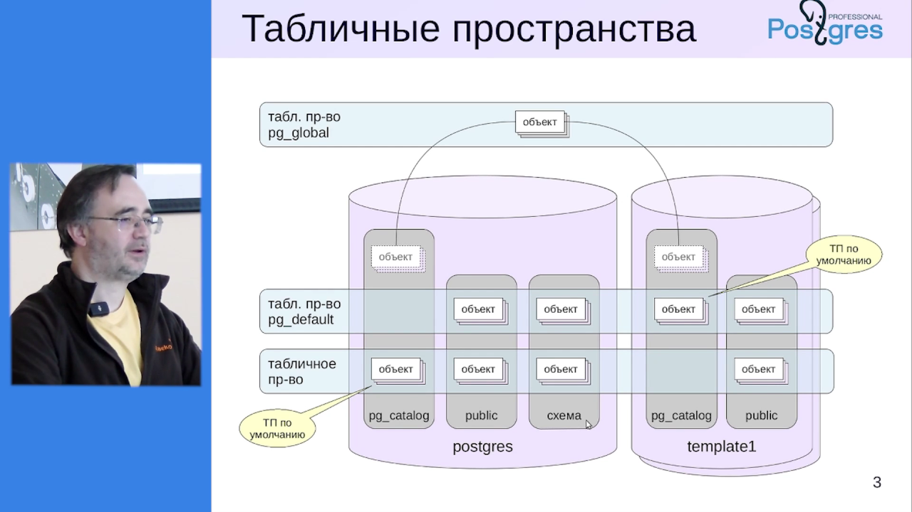
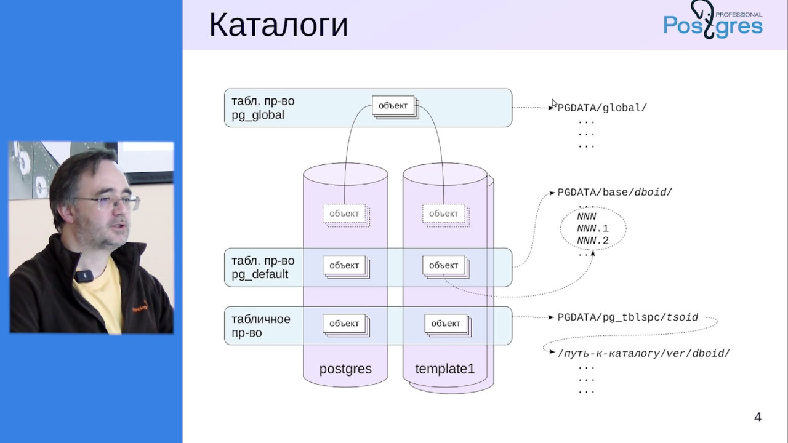
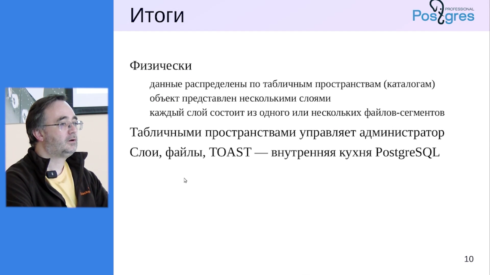
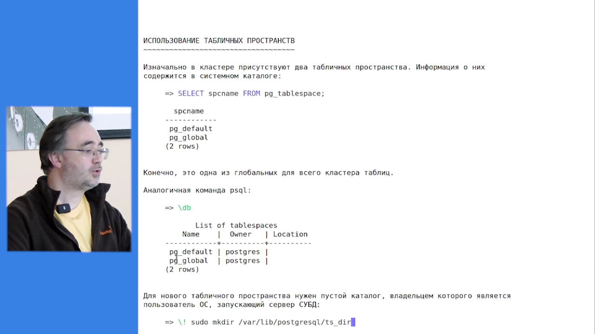
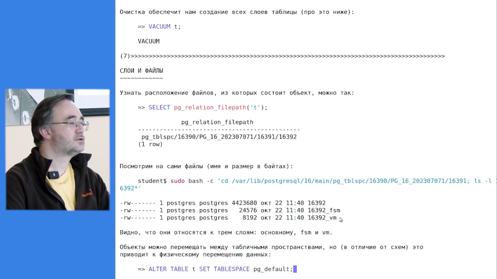
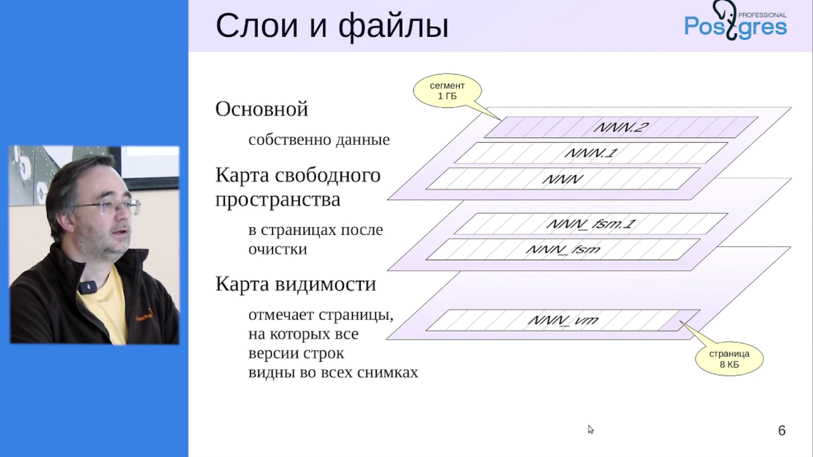
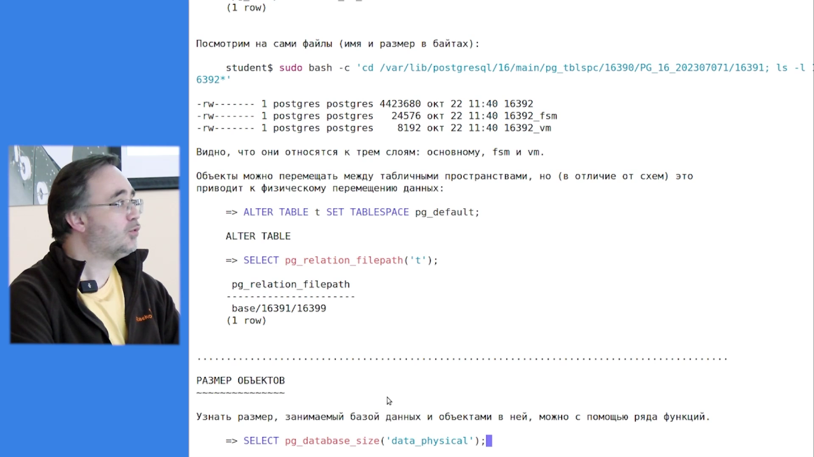
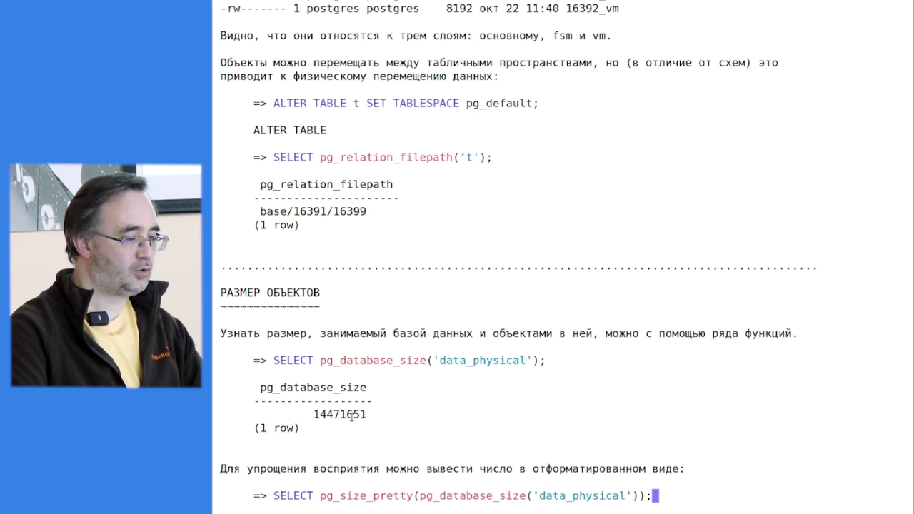
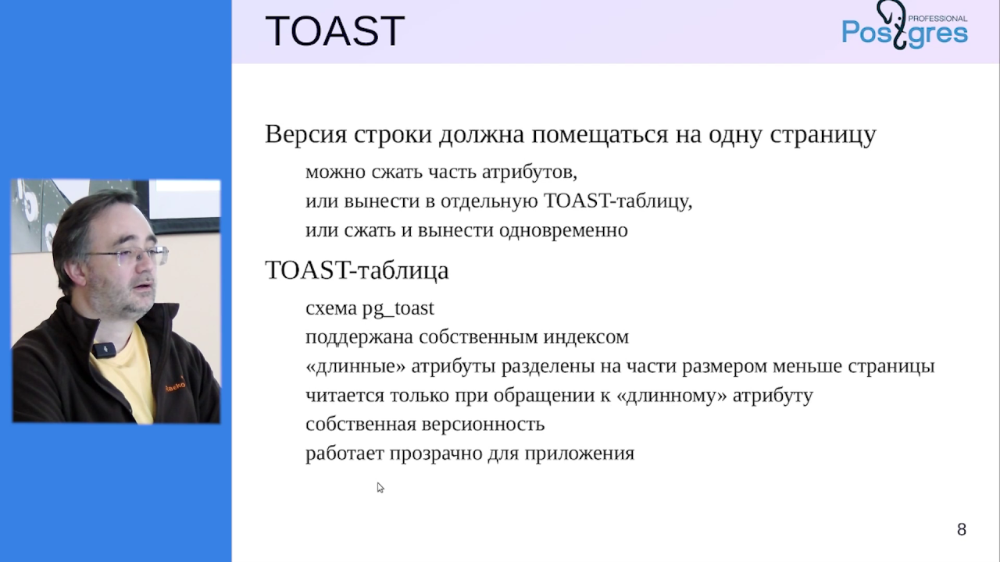
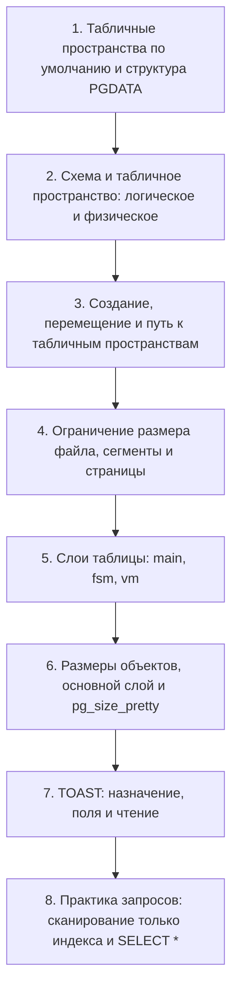

# Физическая организация данных PostgreSQL: табличные пространства, файлы, TOAST

> [!abstract] Обзор
> Материал описывает физическую организацию данных PostgreSQL: табличные пространства как каталоги файловой системы, их устройство по умолчанию и через PG_TBLSPC, а также логическое размещение объектов по схемам. Разбирается структура файлов: сегменты по 1 ГБ, страницы по 8 КБ, слои main, fsm и vm, карты свободного и видимого пространства. Показано, как смотреть и создавать табличные пространства, перемещать таблицы и использовать функции размеров, включая pg_relation_filepath и pg_size_pretty. Отдельное внимание уделено TOAST: почему длинные строки выносятся в отдельную таблицу, как её найти через reltoastrelid и как читать её поля chunk_id и chunk_seq. Также упоминаются VACUUM, сканирование только индекса и практика явного перечисления полей вместо SELECT *.

> [!info] Курс
> [[index|Оглавление курса]]

## Оглавление
1. [[#1. Табличные пространства по умолчанию и структура PGDATA]]
2. [[#2. Схема и табличное пространство: логическое и физическое]]
3. [[#3. Создание, перемещение и путь к табличным пространствам]]
4. [[#4. Ограничение размера файла, сегменты и страницы]]
5. [[#5. Слои таблицы: main, fsm, vm]]
6. [[#6. Размеры объектов, основной слой и pg_size_pretty]]
7. [[#7. TOAST: назначение, поля и чтение]]
8. [[#8. Практика запросов: сканирование только индекса и SELECT *]]

**Схема** — [[#Схема]]
**Итог** — [[#Итог]]

## 1. Табличные пространства по умолчанию и структура PGDATA

При создании кластера PostgreSQL создаются два табличных пространства: pg_global и pg_default. Специальное пространство pg_global содержит объекты, общие для всего кластера, и располагается в подкаталоге global, где нет разделения по базам данных. Табличное пространство pg_default находится в каталоге base и размещается в PGDATA/base/dboid/, где находятся каталоги баз данных (postgres, template1) и файлы NNN, NNN.1, NNN.2; после base идёт подкаталог с идентификатором базы данных, в нём — файлы конкретных таблиц или других объектов. Список табличных пространств можно получить запросом SELECT spcname FROM pg_tablespace, а в psql — командой \db; для изначальных табличных пространств location не указан, надо просто знать, в каком каталоге они находятся. Объём, который занимает на диске табличное пространство, показывает функция pg_tablespace_size.

```javascript
\db
        List of tablespaces
 Name    |  Owner   |       Location
---------+----------+------------------------
 pg_default | postgres |
 pg_global  | postgres |
 ts         | student  | /var/lib/postgresql/ts_dir
(3 rows)
=> CREATE DATABASE data_physical TABLESPACE ts;
CREATE DATABASE
=> SELECT spcname FROM pg_tablespace;
spcname
-----------
pg_default
pg_global
(2 rows)
=> \db
List of tablespaces
Name | Owner | Location
-----------+---------+-----------
pg_default | postgres |
pg_global  | postgres |
(2 rows)

=> SELECT spcname FROM pg_tablespace;
spcname
-----------
pg_default
pg_global
(2 rows)
=> \db
List of tablespaces
Name | Owner | Location
-----------+---------+-----------
pg_default | postgres |
pg_global | postgres |
(2 rows)
```

*Источник: [00:00:41], [00:05:31], [00:08:41]*

> [!quote]- Кадр [00:00:41]
> 

> [!quote]- Кадр [00:05:31]
> 

## 2. Схема и табличное пространство: логическое и физическое

Каждый объект в системе существует на пересечении схемы и табличного пространства: логически он находится в какой-то схеме, а физически — в каком-то табличном пространстве. Логическое представление и физическое представление в каком-то смысле ортогональны, и таблица должна быть и там, и там. Перемещение таблицы между схемами — чисто логическое: в системном каталоге отмечается, что таблица теперь не в одной схеме, а в другой. В одной базе данных объекты могут находиться в разных табличных пространствах, и в каких-то табличных пространствах могут находиться объекты из разных баз данных. Перемещение объектов между табличными пространствами, в отличие от схем, приводит к физическому перемещению данных: файлы копируются из одного каталога в другой, и для большой таблицы это будет долго. При создании базы данных можно указать табличное пространство по умолчанию, и тогда все объекты базы будут создаваться в нём.

| Действие | Схема | Табличное пространство |
|---|---|---|
| Перемещение | логическое, отметка в системном каталоге | физическое копирование файлов |
| Управляет | — | администратор |

*Источник: [00:00:41]*


## 3. Создание, перемещение и путь к табличным пространствам

Табличное пространство — это каталог в файловой системе, которым управляет администратор; Postgres отсчитывает пути от PGDATA, а в подкаталоге PG_TBLSPC создаётся символьная ссылка с идентификатором табличного пространства. Путь включает подкаталог с номером версии, который нужен при обновлении сервера. Для нового табличного пространства нужен пустой каталог, владельцем которого является пользователь ОС, запускающий сервер СУБД; создаётся командой CREATE TABLESPACE с именем и абсолютным путём, а при создании базы данных можно указать табличное пространство по умолчанию. Перемещение таблицы в другое табличное пространство командой ALTER TABLE ... SET TABLESPACE приводит к физическому копированию файлов, и путь к файлам меняется; функция pg_relation_filepath('t') возвращает относительный путь к файлу таблицы, включающий каталог tablespace, версию PostgreSQL, идентификатор базы данных и идентификатор файла, который является символической ссылкой на каталог, указанный при создании. Удаление табличного пространства выполняется командой DROP TABLESPACE.

```javascript
=> \! sudo mkdir /var/lib/postgresql/ts_dir
=> \! sudo chown postgres /var/lib/postgresql/ts_dir
=> CREATE TABLESPACE ts LOCATION '/var/lib/postgresql/ts_dir';
=> SELECT pg_relation_filepath('t');
   pg_relation_filepath
----------------------------------------
 pg_tblspc/16390/PG_16_202307071/16391/16392
(1 row)
student$ ls -l 6392*
-rw------- 1 postgres postgres 4423680 окт 22 11:40 16392
-rw------- 1 postgres postgres   24576 окт 22 11:40 16392_fsm
-rw------- 1 postgres postgres    8192 окт 22 11:40 16392_vm
=> ALTER TABLE t SET TABLESPACE pg_default;
ALTER TABLE
=> SELECT pg_relation_filepath('t');
   pg_relation_filepath
------------------------
 base/16391/16399
(1 row)

>= SELECT pg_relation_filepath('t');
   pg_relation_filepath
----------------------------------------
 pg_tblspc/16390/PG_16_202307071/16391/16392
(1 row)
student$ ls -l 6392*
-rw------- 1 postgres postgres 4423680 окт 22 11:40 16392
-rw------- 1 postgres postgres   24576 окт 22 11:40 16392_fsm
-rw------- 1 postgres postgres    8192 окт 22 11:40 16392_vm
```

> [!info] Зачем это нужно
> Собственное табличное пространство позволяет управлять тем, где будут лежать данные: активно используемые данные можно держать на быстрых дисках, а архивные — на медленных, но более дешёвых.

*Источник: [00:00:41], [00:05:31], [00:09:31], [00:10:21], [00:11:41], [00:17:38] и др.*


> [!quote]- Кадр [00:32:59]
> 

> [!quote]- Кадр [00:09:31]
> 

> [!quote]- Кадр [00:19:38]
> 

## 4. Ограничение размера файла, сегменты и страницы

Некоторые файловые системы плохо работают с большими файлами, поэтому в PostgreSQL ограничен максимум размера файла; это ограничение можно указать при сборке сервера или при инициализации кластера. Большие файлы делятся на сегменты; размер сегмента по умолчанию — 1 гигабайт. При достижении этого размера создаётся следующий файл, к имени которого приписывается .1, .2 и так далее; если файл занимает больше 1 гигабайта, из него отпочковывается следующий сегмент. Данные также организованы в страницы по 8 КБ; например, три файла означают, что в таблице два с чем-то гигабайта данных. Один файл-сегмент в PostgreSQL имеет размер 1 гигабайт, файл сегментируется по 1 ГБ, а страница имеет размер 8 КБ.

*Источник: [00:05:31], [00:12:01], [00:32:59]*


> [!quote]- Кадр [00:12:01]
> 

## 5. Слои таблицы: main, fsm, vm

Файл таблицы в PostgreSQL представлен несколькими слоями (fork), которые содержат информацию разного типа; каждый слой состоит из одного или нескольких файлов-сегментов. Основной слой хранит данные, карта свободного пространства (fsm, файлы с суффиксом _fsm) отмечает свободное место в страницах после очистки, а карта видимости (vm, файлы с суффиксом _vm) — страницы, где все версии строк видны во всех снимках. Карта свободного пространства устроена в виде дерева и помогает быстро найти страницу с достаточным местом для вставки строки без сканирования всех страниц. Карта видимости позволяет процессу очистки пропускать такие страницы, ускоряя его работу; если страница помечена, проверку можно пропустить, и сканирование только индекса будет работать нормально. VACUUM нужно запустить, чтобы создались слои таблицы.

```
VACUUM t;
VACUUM
```

> [!info] Зачем это нужно
> Запускается, чтобы создались слои таблицы.

*Источник: [00:11:41], [00:12:01], [00:17:38], [00:32:59]*


## 6. Размеры объектов, основной слой и pg_size_pretty

Для просмотра размеров базы данных, таблицы и индексов используются функции pg_database_size, pg_total_relation_size, pg_table_size и pg_indexes_size, обёрнутые в pg_size_pretty. pg_database_size возвращает размер базы данных; pg_table_size — размер самой таблицы без индексов; pg_total_relation_size — размер таблицы вместе со всеми индексами; pg_indexes_size — размер индексов таблицы. Объём табличного пространства на диске показывает pg_tablespace_size. Размер отдельного слоя таблицы возвращает pg_relation_size, например с 'main'. Если создать строку из 5000 одинаковых символов с помощью repeat, она отлично сожмётся; поэтому здесь конструируется строка, которая не сожмётся. При изменении размера таблицы размер основного слоя остаётся таким же, как и был, — 4,320, а размер таблицы изменился. Длинная строка, не помещающаяся в страницу, уходит в TOAST, и pg_relation_size('t','main') не учитывает эти данные. После вставки длинной строки pg_table_size('t') равен 4416 kB, а pg_relation_size('t','main') — 4320 kB.

```sql
SELECT pg_size_pretty(pg_table_size('t'));
 pg_size_pretty
----------------
 4416 kB
(1 row)

SELECT pg_size_pretty(pg_relation_size('t','main'));
 pg_size_pretty
----------------
 4320 kB
(1 row)

=> INSERT INTO t(id, s)
SELECT 0, string_agg(id::text, '.') FROM generate_series(1,5000) AS id;
INSERT 0 1
=> SELECT pg_size_pretty(pg_table_size('t'));
 4416 kB
(1 row)
=> SELECT pg_size_pretty(pg_relation_size('t','main'));
 4320 kB
(1 row)
```

> [!info] Зачем это нужно
> pg_size_pretty преобразует число в понятные единицы измерения.

*Источник: [00:21:48], [00:22:08], [00:29:19], [00:29:48], [00:30:08]*

> [!quote]- Кадр [00:21:48]
> 

> [!quote]- Кадр [00:22:08]
> 

## 7. TOAST: назначение, поля и чтение

В Postgres версия строки должна целиком помещаться на одну страницу, поэтому часть атрибутов можно сжать, вынести в отдельную TOAST-таблицу или сжать и вынести одновременно; TOAST (The Oversized Attribute Storage Technique) — автоматическое хранилище длинных строк, которые нарезаются на фрагменты и сохраняются в отдельную таблицу. TOAST-таблица — обычная таблица в схеме pg_toast, не входящей в путь поиска, поэтому обращаться к ней можно только с явным указанием схемы; она имеет собственный индекс и собственную версионность и создаётся вместе с индексом для таблиц/типов, где потенциально возможно длинное значение (например, text или numeric; для одних integer не создаётся). Поле reltoastrelid в pg_class — это идентификатор TOAST-таблицы; чтобы его получить, нужно обратиться к pg_class, извлечь reltoastrelid и привести его к типу regclass, а имя связанной TOAST-таблицы для таблицы t получают через reltoastrelid::regclass::text в pg_class. В TOAST-таблице chunk_id — идентификатор строки, на который ссылается основная таблица, chunk_seq — последовательный номер; запрос к pg_toast.pg_toast_16392 выводит chunk_id, chunk_seq и left(chunk_data::text,45). Длинные атрибуты режутся на фрагменты размером меньше страницы и читаются только при обращении к «длинному» атрибуту, прозрачно для приложения, но с обращением к другим страницам; если запрос обращается только к коротким полям, в TOAST-таблицу обращений не происходит, а при обновлении длинного значения записываются новые строчки и новая версия строки ссылается на новые фрагменты, если же длинное значение не трогается — цепочка TOAST не меняется и перерасхода места нет.

```javascript
=> SELECT oid, reltoastrelid::regclass::text FROM pg_class WHERE relname='t';

 oid | reltoastrelid
------+---------------------
 16392 | pg_toast.pg_toast_16392
(1 row)

=> SELECT chunk_id, chunk_seq, left(chunk_data::text,45) AS chuck_data
FROM pg_toast.pg_toast_16392;

 chunk_id | chunk_seq | chuck_data
----------+-----------+------------------------------------------------------------
 16402 | 0 | \x545d000000312e322e332e342e00352e362e372e382e
 16402 | 1 | \x392e353161ff31002e3531322e353133002e3531342
 16402 | 2 | \xe215e216e217e218abe219e11a30e11b30e11c30e11
 16402 | 3 | \x11f4aa3611f43611f43611f43611f4aa3611f43611f
 16402 | 4 | \xf43211f4325511f43211f43211f43211f4325511f43
 16402 | 5 | \xf43811f43811f43811f4385511f43811f43811f4381
 16402 | 6 | \x11f4aa3411f43411f43411f43411f4aa3411f43411f
 16402 | 7 | \x0132370132aa370132370132370132370132aa38013
 16402 | 8 | \xf43611f43611f43611f4365511f43611f43611f4361
(9 rows)

=> SELECT oid, reltoastrelid::regclass::text FROM pg_class WHERE relname='t';

 oid | reltoastrelid
------+---------------------
 16392 | pg_toast.pg_toast_16392
(1 row)

=> SELECT chunk_id, chunk_seq, left(chunk_data::text,45) AS chuck_data
FROM pg_toast.pg_toast_16392;

 chunk_id | chunk_seq | chuck_data
----------+-----------+------------------------------------------------------------
 16402 | 0 | \x545d000000312e322e332e342e00352e362e372e382
 16402 | 1 | \x392e353161ff31002e3531322e353133002e3531342
 16402 | 2 | \xe215e216e217e218abe219e11a30e11b30e11c30e11
 16402 | 3 | \x11f4aa3611f43611f43611f43611f4aa3611f43611f
 16402 | 4 | \xf43211f4325511f43211f43211f43211f4325511f43
 16402 | 5 | \xf43811f43811f43811f4385511f43811f43811f4381
 16402 | 6 | \x11f4aa3411f43411f43411f43411f4aa3411f43411f
 16402 | 7 | \x0132370132aa370132370132370132370132aa38013
 16402 | 8 | \xf43611f43611f43611f4365511f43611f43611f4361
(9 rows)
```

*Источник: [00:24:34], [00:30:08], [00:31:28], [00:31:49], [00:32:59]*

> [!quote]- Кадр [00:24:34]
> 

## 8. Практика запросов: сканирование только индекса и SELECT *

Сканирование только индекса (index-only scan) — метод доступа, при котором нужные поля читаются из самого индекса без обращения к таблице. Он применим, когда все требуемые запросом поля присутствуют в индексе. В коде, который работает в реальной системе, лучше перечислять поля явно, только те, которые нужны. SELECT * — нормально, когда вы просто в терминале что-то смотрите или пишете отладочные запросы.

*Источник: [00:12:01], [00:24:34]*


## Схема



## Итог

> [!success] Что в итоге
> В итоге табличные пространства — физическая структура, которой управляет администратор, тогда как схемы задают логическое размещение; объект существует на их пересечении. Файлы таблиц делятся на сегменты и страницы, а служебная информация хранится в слоях main, fsm и vm, что связано с VACUUM и картой видимости. Длинные значения уходят в TOAST-таблицу, читаются по фрагментам и не учитываются в размере основного слоя.

