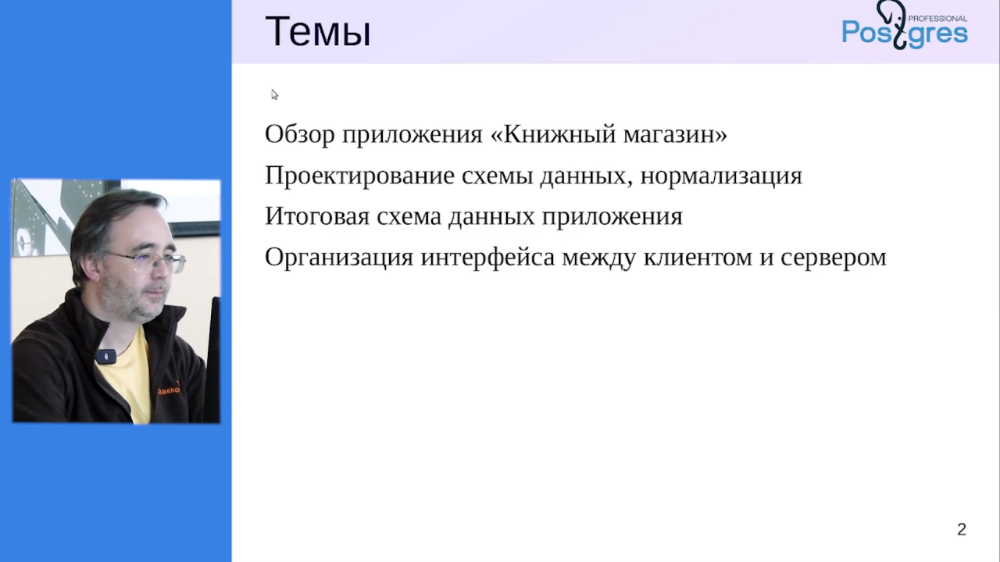
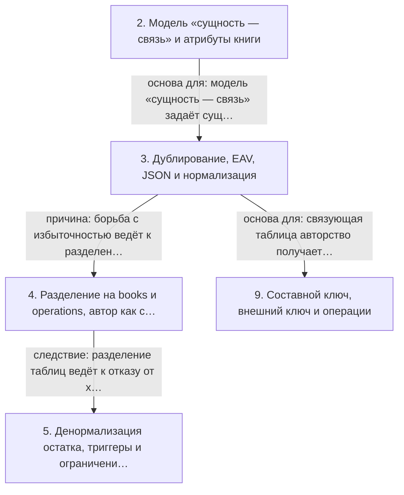

# Проектирование схемы книжного магазина и PostgreSQL: схема, ключи, типы, индексы и интерфейс доступа

> [!abstract] Обзор
> Материал посвящён проектированию схемы данных книжного магазина и её реализации в PostgreSQL. Сначала разбирается, как клиентское приложение ищет книги, показывает выполняемые запросы и выбирает роль подключения, а также как модель «сущность — связь» и атрибуты сущности «книга» переходят в таблицы. Показаны проблемы дублирования при представлении сущностей таблицами, схемы «сущность — атрибут — значение» и JSON, первая нормальная форма, нормализация и разделение на таблицы books и operations с контролируемой денормализацией остатка через триггер. Далее рассматривается конкретная база Bookstore в PostgreSQL: её таблицы и промежуточная таблица авторство, первичный ключ с identity, последовательности, выбор между integer и BigInt, типы date, timestamp и text, NULL и трёхзначная логика. Отдельно разобраны индексы btree, команды explain и \timing, seq scan и index scan, накладные расходы индексов и транзакционность DDL, а также составной первичный ключ и внешний ключ. В завершение обсуждаются два подхода к интерфейсу клиента — прямой доступ и доступ через функции, представления как именованные и обновляемые, а также триггеры и декларативные ограничения целостности.

> [!info] Курс
> [[index|Оглавление курса]]

## Оглавление
1. [[#1. Приложение книжного магазина: поиск и добавление]]
2. [[#2. Модель «сущность — связь» и атрибуты книги]]
3. [[#3. Дублирование, EAV, JSON и нормализация]]
4. [[#4. Разделение на books и operations, автор как сущность]]
5. [[#5. Денормализация остатка, триггеры и ограничения]]
6. [[#6. Первичный ключ с identity и последовательности]]
7. [[#7. Типы данных: integer, BigInt, date, timestamp, text и NULL]]
8. [[#8. Индексы btree: explain, seq scan и index scan]]
9. [[#9. Составной ключ, внешний ключ и операции]]
10. [[#10. Интерфейс клиента: прямой доступ, функции и представления]]

**Схема** — [[#Схема]]
**Итог** — [[#Итог]]

## 1. Приложение книжного магазина: поиск и добавление

На веб-сайте пользователь видит форму поиска, где можно ввести имя автора или название книги; поиск можно ограничить галочкой «есть на складе». Приложение показывает запросы, которые выполняются при нажатии кнопок, и параметры, которые передавались, — это позволяет понять, чего клиентская часть хочет от базы данных. В приложении можно выбрать роль, под которой оно будет ходить в базу данных; доступно несколько ролей. При вводе названия и выборе авторов из списка кнопка «Добавить» создаёт новую книгу в системе. Картолог — это рабочее место кладовщика, отвечающее за заказ книг из издательства; при нажатии кнопки «Заказать» выполняются запросы и появляется указанное количество экземпляров.

*Источник: [00:00:16]*

> [!quote]- Кадр [00:00:16]
> 

## 2. Модель «сущность — связь» и атрибуты книги

При проектировании схемы данных удобно думать в высокоуровневых терминах. Модель «сущность — связь» (Entity Relationship) работает с сущностями предметной области, связями между ними и атрибутами — свойствами сущностей и связей; её часто применяют для проектирования. В примере с книжным магазином выделяется одна сущность — «книга», её атрибутами становятся название книги, авторы, количество, операции.

*Источник: [00:00:16]*

## 3. Дублирование, EAV, JSON и нормализация

Если каждая сущность становится своей таблицей, возникает дублирование: при нескольких авторах название книги дублируется, что затрудняет поддержание согласованности и ответы на вопросы вроде «сколько всего авторов». Хранение данных без схемы перекладывает согласованность на приложение, и ограничения целостности не спасают при нескольких авторах. Альтернативы — схема «сущность — атрибут — значение» (entity-attribute-value) и JSON: EAV формально реляционная, но фактически без схемы, запросы сложны из-за множества соединений; JSON нарушает первую нормальную форму, хотя в Postgres есть язык запросов SQL/JSON. Нормализация — это борьба с избыточностью; нормальные формы формализуют её, а средство — разделение крупных сущностей на более мелкие, при необходимости с контролируемой денормализацией. База Bookstore содержит четыре таблицы: авторов, книг, авторство и операций; таблица авторство промежуточная, в схеме есть отдельное поле для порядка вывода авторов, представления конкатенируют ФИО и определяют тип операции, а фамилию, имя и отчество имеет смысл разделить на разные столбцы.

*Источник: [00:00:16]*

## 4. Разделение на books и operations, автор как сущность

В books остаются названия и авторы, а в operations переносятся изменение количества и дата операции; в результате получаются две таблицы: books и operations. В схеме для каждой книги может быть несколько операций, но каждая операция привязана только к одной книжке. После разделения таблиц остаются разные книги одного автора и книги, написанные несколькими авторами одновременно — в этом месте избыточность сохраняется. Книга и автор находятся в отношении многие ко многим: один автор может написать разные книги, одна книга может быть написана несколькими авторами. При преобразовании в таблицы появляется вспомогательная таблица, связывающая таблицу книг и таблицу авторов. Из таблицы книг нужно выделить авторов, потому что автор — это полноценная сущность.

*Источник: [00:00:16]*

## 5. Денормализация остатка, триггеры и ограничения

Текущее количество книг не хранится в таблицах, потому что это избыточность; его можно посчитать как сумму по всем операциям по данной книге. Можно создать отдельное поле с текущим остатком и синхронизировать его с таблицей операций с помощью триггера — такая избыточность остаётся под контролем, где источник правды, а где зависимое поле. Чтобы представление можно было обновлять, пишется триггер, который пробрасывает изменения в нужные таблицы; для представлений над несколькими таблицами Postgres сам не разберётся, и нужно создавать триггеры. Однако триггеры стоит использовать ограниченно: для ограничения целостности триггер — это зло, а декларативные ограничения (первичный ключ, внешний ключ, Not Null, Check и прочие) определяются один раз и работают без проблем. Если есть способ объявить ограничение декларативно, лучше делать так.

*Источник: [00:00:16]*

## 6. Первичный ключ с identity и последовательности

Поле book ID типа integer является первичным ключом; конструкция generated always as identity означает, что идентификатор генерируется автоматически и обеспечивает уникальность. При указании generated as identity значение поля при вставке не указывают — система генерирует значение автоматически. Генерируется оно с помощью объекта, который называется последовательность (сиквенс). Функция nextVal возвращает очередное значение последовательности и является самым эффективным способом генерации уникальных номеров. Последовательности не обеспечивают отсутствие пропусков, а в общем случае нельзя рассчитывать даже на монотонность: из-за кэширования значений в сеансах каждый сеанс получает диапазон и выдаёт числа по мере надобности, поэтому в таблице может получиться 1, потом 11, потом 2, потом 12. Функция pg_get_serial_sequence принимает название таблицы и столбца и возвращает имя последовательности. Если документы строгой отчётности должны нумероваться чётко по порядку, sequence тут не подходит; если нужна просто уникальность, последовательность её даёт.

*Источник: [00:00:16]*

## 7. Типы данных: integer, BigInt, date, timestamp, text и NULL

Тип integer — 32-битное целое (примерно 4 миллиарда значений), для книжного магазина его хватает; в серьёзных системах с риском переполнения сразу используют BigInt (64-битный), иначе потом придётся мигрировать. Для даты есть тип date (без времени) и timestamp (с временем, обычно с часовым поясом); для колонки с датой можно указать значение по умолчанию current date. Поле title имеет тип text: в Postgres обычно не используют varchar, а применяют text без ограничения длины, который работает так же эффективно. Поле отчества может отсутствовать, поэтому в базе оно может быть NULL или пустой строкой, и серверный код должен быть готов к обоим; NULLIF заменяет пустую строку на null. Базы данных работают с трёхзначной логикой: значение может быть не только true или false, и операции над логическими типами (or, and, not) учитывают неопределённое null, что может приводить к спецэффектам, если забыть о null.

| Параметр | integer | BigInt |
| --- | --- | --- |
| Разрядность | 32-битное целое | 64-битное |
| Объём значений | примерно 4 миллиарда | больше нескольких миллиардов |
| Когда использовать | для книжного магазина хватает | серьёзные промышленные системы, риск переполнения |

| Тип | Что хранит |
|---|---|
| date | дату без времени |
| timestamp | время, обычно с часовым поясом |

> [!info] Зачем это нужно
> BigInt нужен, чтобы не получилось переполнение.

*Источник: [00:00:16]*

## 8. Индексы btree: explain, seq scan и index scan

Индекс типа btree создаётся по столбцу и служит для ускорения поиска по значениям и поддержки ограничения уникальности: уникальный индекс не даёт вставить две строки с одинаковым номером автора. Команда explain показывает план запроса: планировщик может полностью просканировать таблицу (seq scan) и выбросить лишнее, что неэффективно, но при наличии индекса B-tree (дерево, спуск к листьям) появляется index scan, и производительность улучшается на несколько порядков. Каждый индекс замедляет вставку и изменение данных и занимает место на диске, поэтому создавать стоит только необходимые индексы; если нужно вытащить почти всю таблицу, индекс будет мешать, и Postgres использует seq scan благодаря статистике. Команда \timing включает секундомер в PSQL, а параметр X-HeaderWiz подрезает тире для более симпатичного вывода. В PostgreSQL команды DDL (например, CREATE INDEX) транзакционны: при откате изменений откатится и создание индекса.

*Источник: [00:00:16]*

## 9. Составной ключ, внешний ключ и операции

В связующей таблице первичный ключ составной: он состоит из двух столбцов book.id и author.id, которые одновременно являются внешними ключами, ссылающимися на таблицы книг и авторов. Внешний ключ контролирует, что нельзя добавить идентификатор, которого нет в ссылаемой таблице, — нельзя вставить авторство для несуществующей книги или автора. Таблица операции содержит идентификатор operation ID (первичный ключ) и ссылку на книгу (внешний ключ). Операции различаются знаком: поступления идут со знаком плюс, покупки — со знаком минус; если изменение со знаком плюс, это поступление, если со знаком минус, в поле Optype пишем покупку, а изменение выводим по модулю положительное.

*Источник: [00:00:16]*

## 10. Интерфейс клиента: прямой доступ, функции и представления

Можно выделить два полярных решения организации интерфейса: первый — прямой доступ клиента к таблицам или представлениям с возможностью менять данные, для сложных представлений могут понадобиться триггеры; второй — оградить приложение от прямого доступа и организовать интерфейс через функции, где реализуются проверки целостности, разрешая читать из таблиц напрямую, но обновлять только через функции (Postgres позволяет писать табличные функции). При прямом доступе клиентская часть должна точно понимать модель данных на сервере, и при изменении модели приложение придётся корректировать; согласованность сложно поддерживать, так как не все ограничения можно прописать в базе, а при интерфейсе через функции для каждой таблицы приходится писать функции-обёртки, что при массовых изменениях снижает производительность (функция Get Catalog возвращает список книг по полям формы поиска). Представление — это запрос, которому дали имя; при обращении выполняется сохранённый запрос, и на этапе переписывания имя представления заменяется на сам запрос, поэтому в плане его уже нет. Представление над одной таблицей без группировок и сортировок автоматически обновляемо: по нему можно делать селекты и UPDATE. Для админки создаются три представления: CatalogV (список книг), OperationsV (список операций) и представление списка авторов; заказ книги реализуется обновлением CatalogV.

*Источник: [00:00:16]*

## Схема

## Итог

> [!success] Что в итоге
> В итоге проектирование схемы книжного магазина идёт от высокоуровневой модели «сущность — связь» к таблицам, где нормализация уменьшает избыточность, а контролируемая денормализация остатка вводится через триггер. В PostgreSQL уникальность идентификаторов обеспечивают последовательности и identity, но они не гарантируют монотонность и отсутствие пропусков, а индексы btree ускоряют поиск и поддерживают уникальность, хотя замедляют вставку и не всегда применяются. Интерфейс доступа клиента можно строить либо напрямую к таблицам и представлениям, либо через функции, у которого есть проблемы обёрток и производительности. Ограничения целостности не всё покрывают, поэтому триггеры применяют ограниченно и предпочитают декларативные ограничения.

