# Bookstore в PostgreSQL: приложение, проектирование схемы, типы, индексы и интерфейс

> [!abstract] Обзор
> Материал объединяет два конспекта о демонстрационном приложении книжного магазина (Bookstore) и проектировании его базы данных в PostgreSQL. Разбирается интерфейс покупателя с функциями get_catalog и buy_book и покупкой без корзины, а также админка с функциями add_book и add_author и представлениями catalog_v, operations_v, authors_v. От высокоуровневой ER-модели и нормализации показан переход к схеме bookstore с таблицами authors, authorship, books и operations, включая связь многие ко многим и внешние ключи. Практическая часть охватывает типы text и date, GENERATED AS IDENTITY и последовательности, ограничение NOT NULL и трёхзначную логику, а также индексы btree, Seq Scan и Index Scan. Отдельно рассматриваются представления authors_no_middle_name и operations_v, прямой доступ к таблицам и интерфейс через функции, декларативные ограничения и триггеры.

> [!info] Курс
> [[index|Оглавление курса]]

## Оглавление
1. [[#1. ER-модель, сущности и нормализация]]
2. [[#2. Альтернативные схемы: EAV и JSON]]
3. [[#3. Схема bookstore: books, operations, authorship]]
4. [[#4. Типы данных и ограничение NOT NULL]]
5. [[#5. GENERATED AS IDENTITY и последовательности]]
6. [[#6. Первичный ключ и индекс btree]]
7. [[#7. Seq Scan, Index Scan и создание индекса]]
8. [[#8. Представления и функции админки]]
9. [[#9. Интерфейс покупателя: get_catalog и buy_book]]
10. [[#10. Прямой доступ, функции и триггеры]]
11. [[#11. Расширенный формат \gx и параметр xheader_width]]

**Схема** — [[#Схема]]
**Итог** — [[#Итог]]

## 1. ER-модель, сущности и нормализация

ER-модель применяется для высокоуровневого проектирования и работает с сущностями, связями и атрибутами: сущности — понятия предметной области, связи — отношения между ними, атрибуты — их свойства. Обычно каждая сущность становится своей таблицей; автор — полноценная сущность, поэтому авторов выделяют отдельно. Нормализация — процесс избавления от избыточности данных и разбиение крупных сущностей на более мелкие: чем выше нормальная форма, тем меньше избыточность. В примере с книгой в книге остаются название и авторы, а в операцию переносятся изменение количества и дата; между сущностями Книга и Операция устанавливается связь «один ко многим».

```
Схема данных (вариант)
book_id | description
1 | {"title": "Муму",
"authors": [ "Тургенев Иван Сергеевич" ],
"qty": 10,
"operations": [ +11, -1 ]}
Данные без схемы
поддержка согласованности на стороне приложения
сложно писать запросы (специальный язык)
индексная поддержка есть
```

*Источник: [00:06:22], [00:06:42], [00:08:11], [00:12:51], [00:14:41], [00:16:01] и др.*

> [!quote]- Кадр [00:06:22]
> 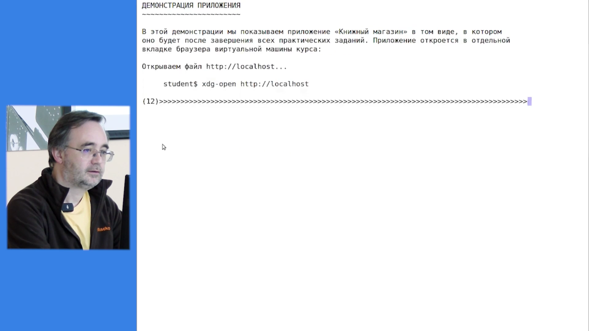

> [!quote]- Кадр [00:06:42]
> 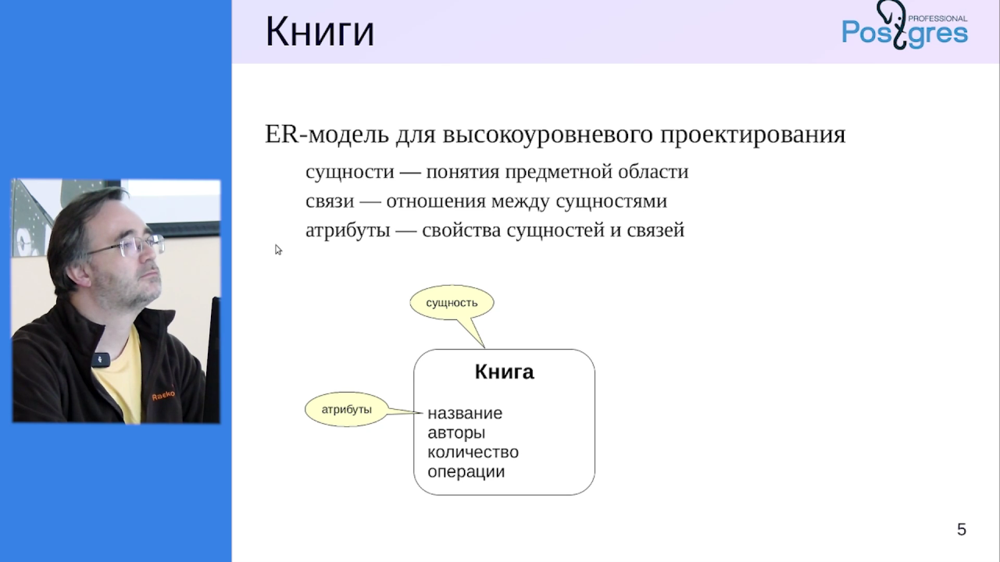

> [!quote]- Кадр [00:08:11]
> 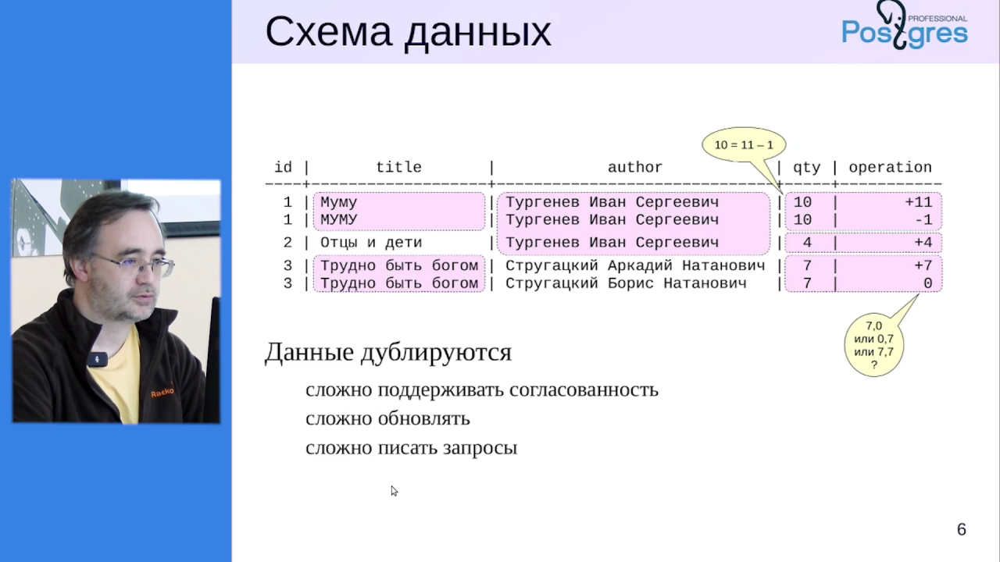

> [!quote]- Кадр [00:16:01]
> 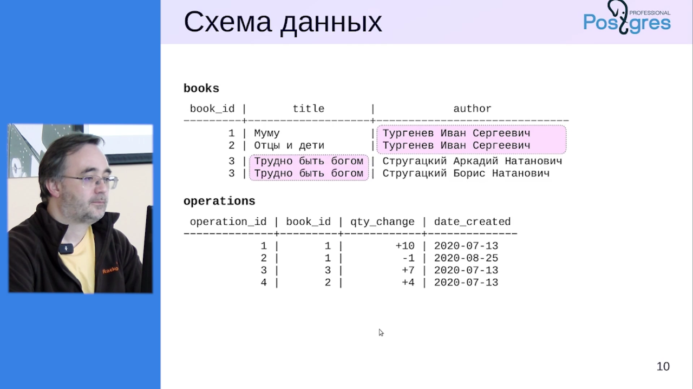

> [!quote]- Кадр [00:14:41]
> 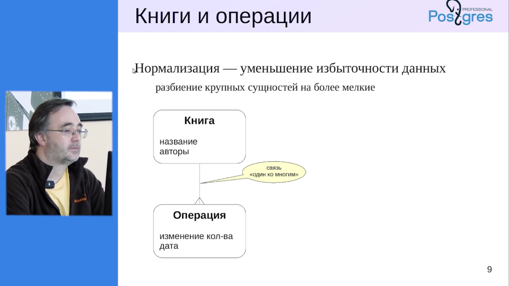

> [!quote]- Кадр [00:18:51]
> 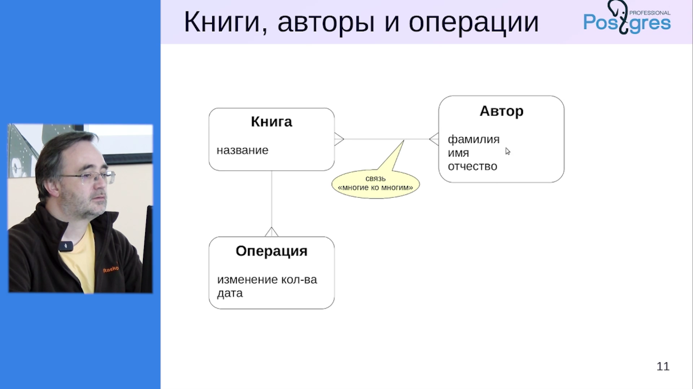

## 2. Альтернативные схемы: EAV и JSON

Схема EAV (entity-attribute-value) хранит все данные в одной таблице с колонками entity, attribute, value; каждый атрибут записывается отдельной строкой, схема легко расширяется — новый атрибут добавляется новой строкой. Запросы писать сложно: приходится многократно соединять таблицу с собой, производительность низкая, а согласованность данных поддерживается на стороне приложения. Хранение JSON в колонке создаёт сложносоставное значение, что является нарушением первой нормальной формы; на SQL с таким значением работать не получится, но в Postgres есть язык запросов к JSON, стандартизованный в SQL 2016, и индексная поддержка, и с JSON в Postgres это будет достаточно быстро работать. Вариант схемы данных: в колонке description хранится JSON-документ с полями title, authors, qty и operations.

```
Схема данных (вариант)
book_id | description
1 | {"title": "Муму",
"authors": [ "Тургенев Иван Сергеевич" ],
"qty": 10,
"operations": [ +11, -1 ]}
3 | {"title": "Трудно быть богом",
"authors": [ "Стругацкий Аркадий Натанович",
"Стругацкий Борис Натанович" ],
"qty": 7,
"operations": [ +7 ]}
```

*Источник: [00:08:11], [00:11:01], [00:12:51]*


> [!quote]- Кадр [00:11:01]
> 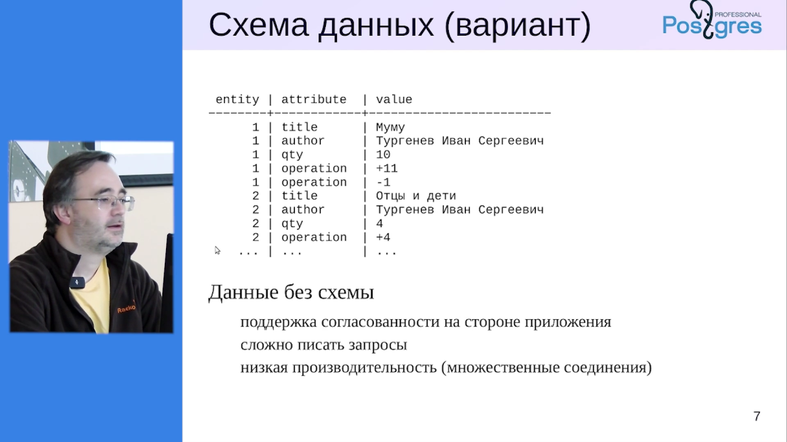

> [!quote]- Кадр [00:12:51]
> 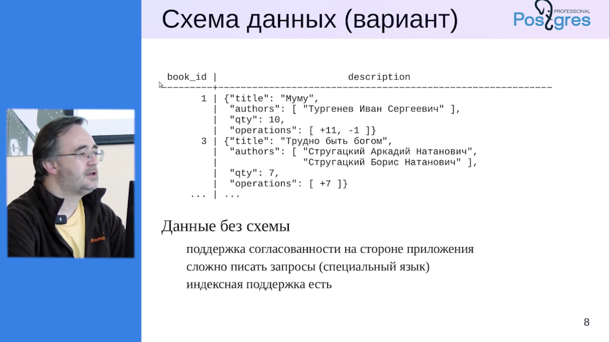

## 3. Схема bookstore: books, operations, authorship

Схема bookstore содержит таблицы authors, authorship, books и operations. В operations столбец book_id — внешний ключ, ссылающийся на books(book_id); таблица authorship реализует связь многие ко многим, её первичный ключ составной (book_id, author_id), а book_id и author_id — внешние ключи. Текущее количество книг не хранится в таблицах, потому что это избыточно; его можно получить, посчитав сумму по всем операциям, либо внести контролируемую избыточность с отдельным полем остатка и синхронизировать его триггером. sequence number (seq_num) задаёт порядок вывода авторов книги, который заранее не предугадаешь.

*Источник: [00:16:01], [00:18:51], [00:19:41], [00:20:01], [00:33:41], [00:34:01] и др.*


## 4. Типы данных и ограничение NOT NULL

В Postgres для текстовых строк обычно используют text, а не varchar: text — символьная строка произвольной длины, работает так же эффективно. date — тип даты без времени, тогда как timestamp хранит время с часовым поясом; в operations столбец date_created имеет тип date и DEFAULT CURRENT_DATE. Базы данных работают с трёхзначной логикой: значение может быть истинным, ложным или null — неопределённым, и логические операции учитывают null. NOT NULL — ограничение целостности, означающее обязательность; в authors поле отчества middle_name не содержит NOT NULL и может быть пустым (NULL или пустая строка), и серверный код должен быть готов к обоим вариантам.

> [!info] Зачем это нужно
> Удобно, чтобы меньше указывать в команде insert.

*Источник: [00:20:21], [00:25:57], [00:28:55], [00:35:47], [00:36:37], [00:36:57]*

## 5. GENERATED AS IDENTITY и последовательности

Столбец book_id (или author_id) использует GENERATED AS IDENTITY, что означает автоматическую генерацию уникальных значений из специальных объектов базы данных — последовательностей. В версиях PostgreSQL до 10 для этого использовался псевдотип serial. Последовательность — самый эффективный способ генерации уникальных номеров, и если нужна просто уникальность, она её даёт. Но она не гарантирует отсутствия пропусков в нумерации, так как изменение происходит не транзакционно, и не гарантирует монотонного возрастания при кэшировании значений в сеансах: значения могут идти в порядке 1, 11, 2, 12. Если ожидается рост числа строк до нескольких миллиардов, следует сразу использовать BigInt.

```
book_id | integer |           | not null | generated always as identity
```

> [!info] Зачем это нужно
> Служит для автоматической генерации уникальных значений.

*Источник: [00:20:01], [00:20:21], [00:21:13], [00:21:33], [00:22:23], [00:22:43] и др.*

> [!quote]- Кадр [00:22:43]
> 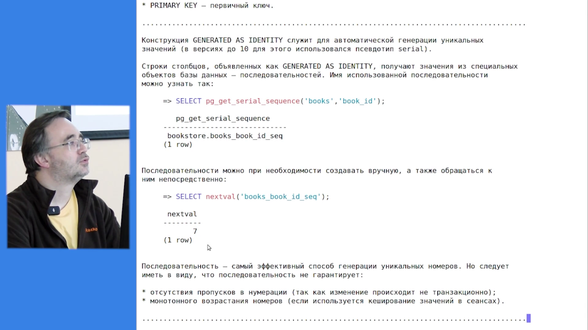

> [!quote]- Кадр [00:24:37]
> 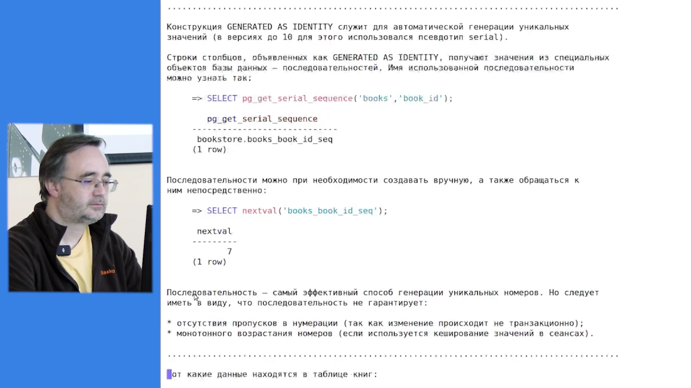

## 6. Первичный ключ и индекс btree

Btree (B-дерево) — основной тип индекса, используемый в базах данных для ускорения поиска и для поддержки ограничений целостности (первичного ключа и уникальности). Это дерево, по которому поиск спускается сверху вниз к листьям. В таблице authors идентификатор автора author_id является первичным ключом: первичный ключ называется authors_pkey и определён по столбцу author_id. Уникальный индекс ускоряет поиск по значениям, поддерживает ограничение целостности — уникальность — и не даёт вставить две строки с одинаковым номером автора, автоматически создаваясь при определении первичного ключа или ограничения unique.

*Источник: [00:25:37], [00:26:45], [00:27:05], [00:27:25], [00:28:35], [00:28:55] и др.*

## 7. Seq Scan, Index Scan и создание индекса

Команда \timing on включает секундомер в psql; SELECT по last_name = 'Пушкин' занял 156,907 ms, а поиск по индексированному author_id — 0,370 ms, то есть индекс ускоряет на порядки. Seq Scan — последовательное сканирование всей таблицы (Filter), Index Scan используется при поиске по индексированному полю. Индекс хорошо работает, если нужно вытащить небольшую долю строк; при чтении большого объёма оптимизатор выбирает Seq Scan, поэтому индекс — не серебряная пуля: он занимает место и требует обновления. Если нужно искать по фамилии, создают индекс CREATE INDEX ON authors(last_name) и выполняют ANALYZE authors для сбора статистики; DDL-команды в Postgres транзакционны, ROLLBACK откатывает создание индекса.

```sql
>= \timing on
> \timing on
Timing is on.
=> SELECT * FROM authors WHERE last_name = 'Пушкин';
author_id | last_name | first_name | middle_name
----------+-----------+------------+------------
        1 | Пушкин    | Александр  | Сергеевич
(1 row)
Time: 156,907 ms
=> \timing off
Timing is off.
> SELECT * FROM authors WHERE author_id = 1;
   author_id | last_name | first_name | middle_name
   ----------+-----------+------------+-------------
            1 | Пушкин    | Александр  | Сергеевич
   (1 row)
   Time: 0,370 ms
   => \timing off
   Timing is off.
EXPLAIN (costs off)
SELECT * FROM authors WHERE author_id = 1;
         QUERY PLAN
------------------------------
 Index Scan using authors_pkey on authors
   Index Cond: (author_id = 1)
(2 rows)
EXPLAIN (costs off)
SELECT * FROM authors WHERE last_name = 'Пушкин';
QUERY PLAN
------------------------------------
 Seq Scan on authors
   Filter: (last_name = 'Пушкин'::text)
(2 rows)

=> EXPLAIN (costs off)
SELECT * FROM authors WHERE last_name = 'Пушкин';

QUERY PLAN
-------------------------------------
 Seq Scan on authors
   Filter: (last_name = 'Пушкин'::text)
(2 rows)
ANALYZE authors;
CREATE INDEX ON authors(last_name);
EXPLAIN (costs off)
SELECT * FROM authors WHERE last_name = 'Пушкин';
QUERY PLAN
----------------------------------------
 Index Scan using authors_last_name_idx on authors
   Index Cond: (last_name = 'Пушкин'::text)
(2 rows)
BEGIN; -- начнем транзакцию, чтобы откатить потом изменения
=> INSERT INTO authors(first_name, last_name)
    SELECT 'Графоман', 'Графоманов' FROM generate_series(1, 1_000_000);
EXPLAIN (costs off)
SELECT * FROM authors WHERE last_name = 'Графоманов';
QUERY PLAN
---------------------------------
 Seq Scan on authors
   Filter: (last_name = 'Графоманов'::text)
(2 rows)
> ROLLBACK;

=> CREATE INDEX ON authors(last_name);

CREATE INDEX

=> EXPLAIN (costs off)
SELECT * FROM authors WHERE last_name = 'Пушкин';

            QUERY PLAN
---------------------------------
 Index Scan using authors_last_name_idx on authors
   Index Cond: (last_name = 'Пушкин'::text)
(2 rows)
```

*Источник: [00:27:25], [00:28:15], [00:28:35], [00:29:15], [00:29:36], [00:29:56] и др.*

## 8. Представления и функции админки

Создаётся представление authors_no_middle_name, которое выбирает author_id, first_name, last_name из authors, где nullif(middle_name,'') IS NULL; оно обновляется успешно. Представление operations_v показывает изменение количества (qty_change) и тип операции: плюс — Поступление, минус — Покупка (по модулю). Для админки магазина пишутся функции add_book и add_author, а также создаются представления catalog_v (список книг), operations_v (операции) и authors_v (авторы); простые представления автоматически обновляемы. Заказ книги реализуется через обновление catalog_v с триггером update_catalog_trigger.

```sql
=> CREATE VIEW authors_no_middle_name AS
   SELECT author_id, first_name, last_name
   FROM authors
   WHERE nullif(middle_name,'') IS NULL;

CREATE VIEW

=> SELECT * FROM authors_no_middle_name;

=> UPDATE authors_no_middle_name SET last_name = initcap(last_name);
 UPDATE 1

CREATE VIEW authors_no_middle_name AS
    SELECT author_id, first_name, last_name
    FROM authors
    WHERE nullif(middle_name,'') IS NULL;

>= CREATE VIEW authors_no_middle_name AS
   SELECT author_id, first_name, last_name
   FROM authors
   WHERE nullif(middle_name,'') IS NULL;

>= SELECT * FROM operations_v;

book_id | op_type | qty_change | date_created
---------+-----------+------------+------------
1 | Поступление | 10 | 22.10.2024
1 | Поступление | 10 | 22.10.2024
1 | Покупка | 1 | 22.10.2024
(3 rows)
select * from authors_v
select * from catalog_v
```

*Источник: [00:01:26], [00:04:33], [00:44:02], [00:45:35], [00:45:59], [00:46:19] и др.*

> [!quote]- Кадр [00:44:02]
> 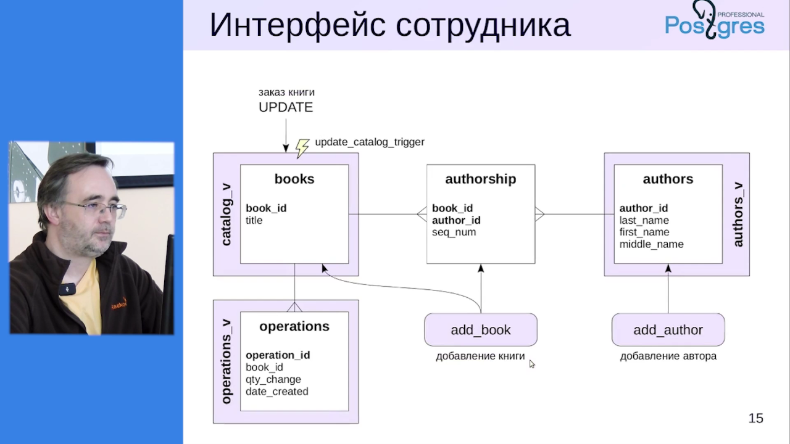

> [!quote]- Кадр [00:47:39]
> 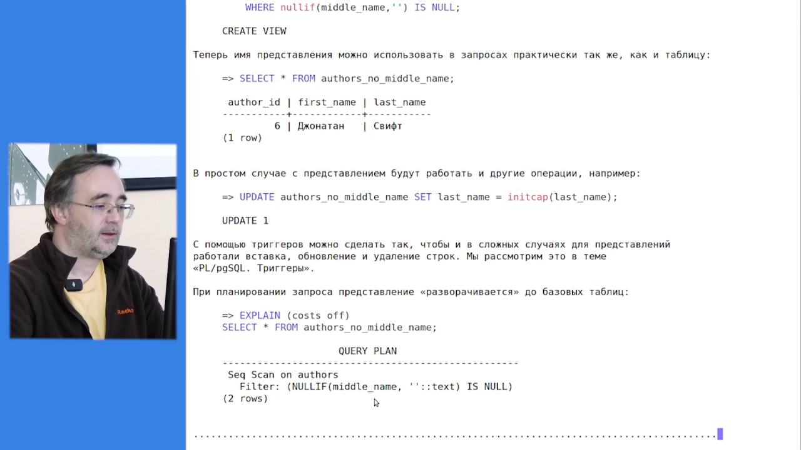

## 9. Интерфейс покупателя: get_catalog и buy_book

Вкладка «Магазин» — это то, что должен видеть покупатель, когда приходит на веб-сайт: в ней есть форма поиска, куда можно ввести имя автора или название книги, и галочка «есть на складе». Пользователь нажимает кнопку «Купить», получает сообщение о покупке, а количество книжки уменьшается; корзины в приложении нет. Приложение обращается к базе через вызовы функций buy_book и get_catalog с параметрами: buy_book выполняет покупку книги, get_catalog возвращает список книг, который надо показать, принимая поля с формы поиска. В интерфейсе покупателя используются две функции: get_catalog и buy_book. В магазине роль БД выполняет postgres, запрос к ней идёт с параметрами ["Толстой",null,false], а в приложении можно выбрать роль, под которой оно будет ходить в базу данных.

```sql
select buy_book (
    book_id=>$1
) result
select * from get_catalog ($1, $2, $3)
```

*Источник: [00:01:06], [00:01:26], [00:02:16], [00:43:11]*

> [!quote]- Кадр [00:43:11]
> 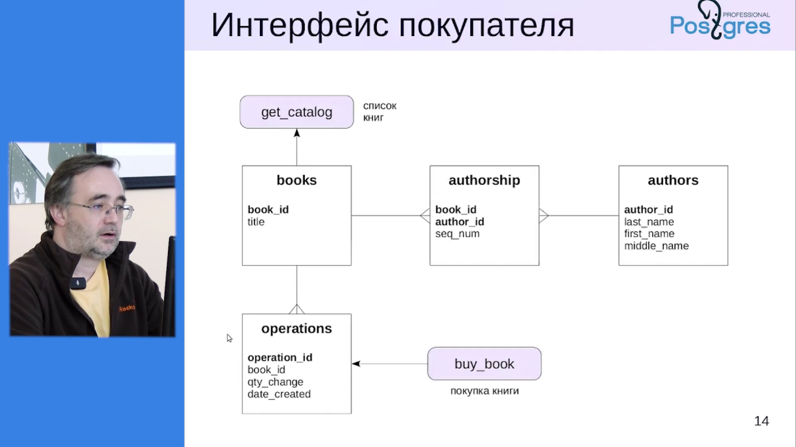

## 10. Прямой доступ, функции и триггеры

Чтение данных выполняется напрямую из таблицы или представления, запись — напрямую в таблицу или представление; для изменения связанных таблиц используются триггеры. Прямой доступ даёт максимальную гибкость, но усложняет поддержание согласованности; интерфейс через функции отделяет приложение от модели данных и ограничивает API, но требует изготовления функций-обёрток и может работать медленно при вызове в цикле. Для клиент-серверного интерфейса можно использовать таблицы, представления, функции и триггеры, настроив search_path на уровне подключения. Для ограничения целостности лучше объявлять ограничения декларативно (первичный ключ, внешний ключ, NOT NULL, CHECK); триггер — зло, использовать его стоит ограниченно.

| Прямой доступ | Интерфейс через функции |
|---|---|
| Приложение знает модель данных | Приложение отделено от модели данных |
| Максимальная гибкость | API приложения ограничен |
| Согласованность поддерживать сложнее | Нужно изготовить функции-обёртки |

*Источник: [00:39:17], [00:46:59], [00:50:11], [00:51:04]*

> [!quote]- Кадр [00:39:17]
> 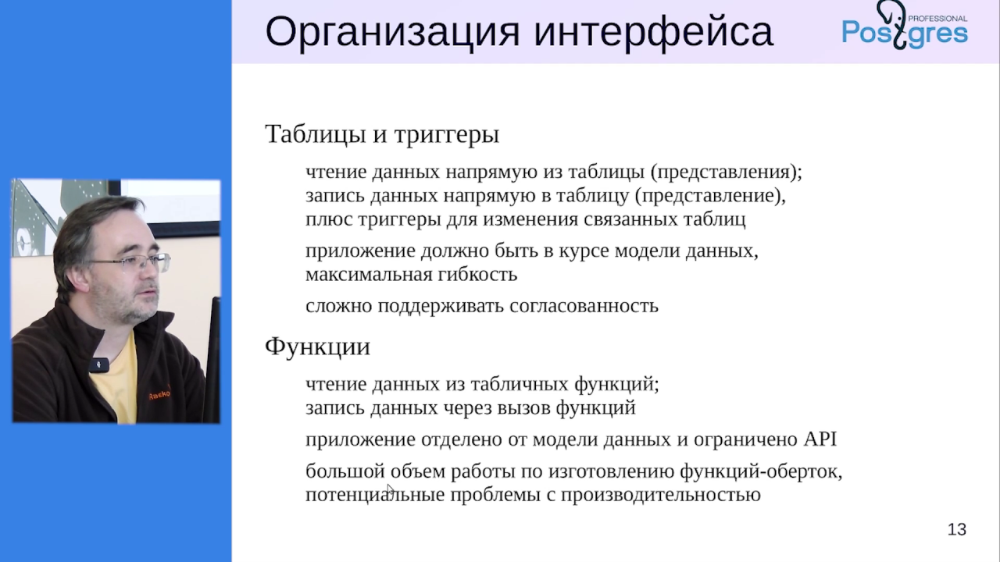

> [!quote]- Кадр [00:51:04]
> 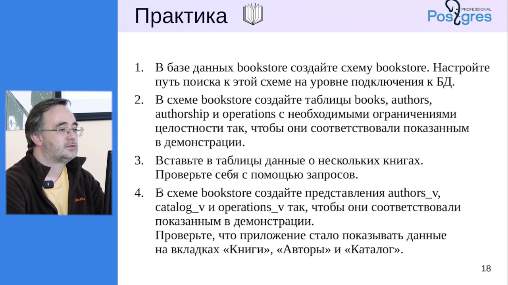

## 11. Расширенный формат \gx и параметр xheader_width

Команда \gx в psql выводит результат запроса в расширенном формате: каждая запись выводится в отдельном блоке, а каждая строка представлена как отдельная запись с именем поля и значением. В PostgreSQL 16 появился параметр xheader_width, который можно установить в psql командой \pset xheader_width; он нужен, чтобы обрезать строку заголовка «широкого» столбца.

```javascript
=> \pset xheader_width 40

=> SELECT * FROM books \gx
```

> [!info] Зачем это нужно
> Нужен, чтобы обрезать строку заголовка «широкого» столбца.

*Источник: [00:24:57], [00:25:17]*

## Схема

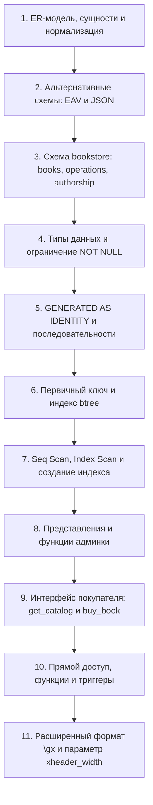

## Итог

> [!success] Что в итоге
> В итоге материал показывает путь от высокоуровневого проектирования (ER-модель, EAV, нормализация) к реализации базы Bookstore в PostgreSQL. Практическая часть опирается на типы text и date, GENERATED AS IDENTITY и последовательности, первичные ключи с B-tree индексами и выбор Seq Scan или Index Scan по доле выбираемых строк. Интерфейс приложения можно организовывать прямым доступом к таблицам или через функции-обёртки и представления, при этом представления автоматически обновляемы и разворачиваются до базовых таблиц. Для ограничения целостности предпочтительны декларативные ограничения, а триггеры стоит использовать ограниченно.

