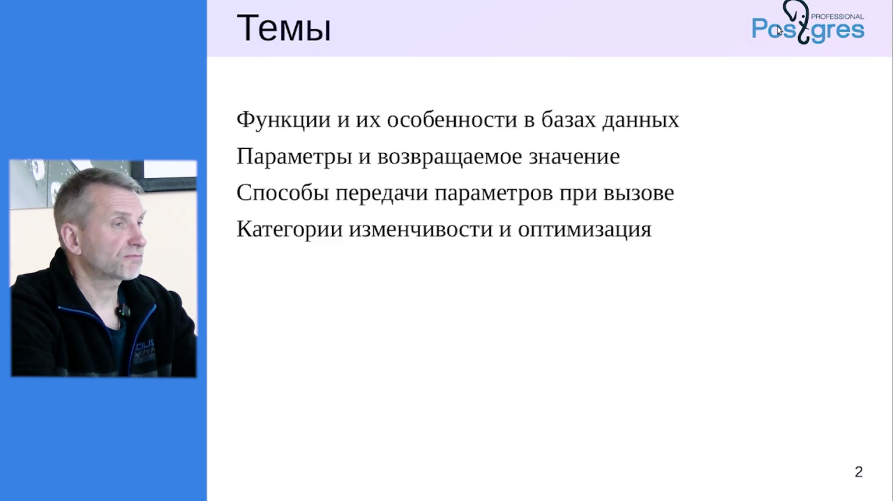
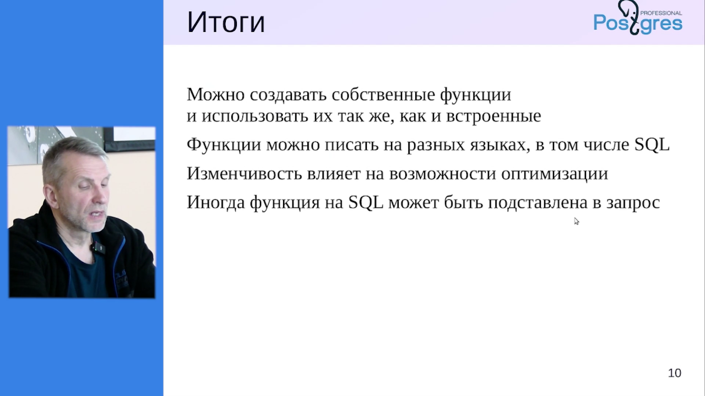
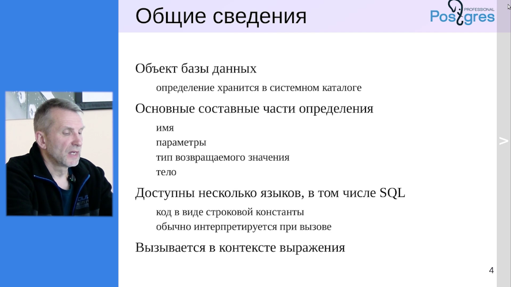
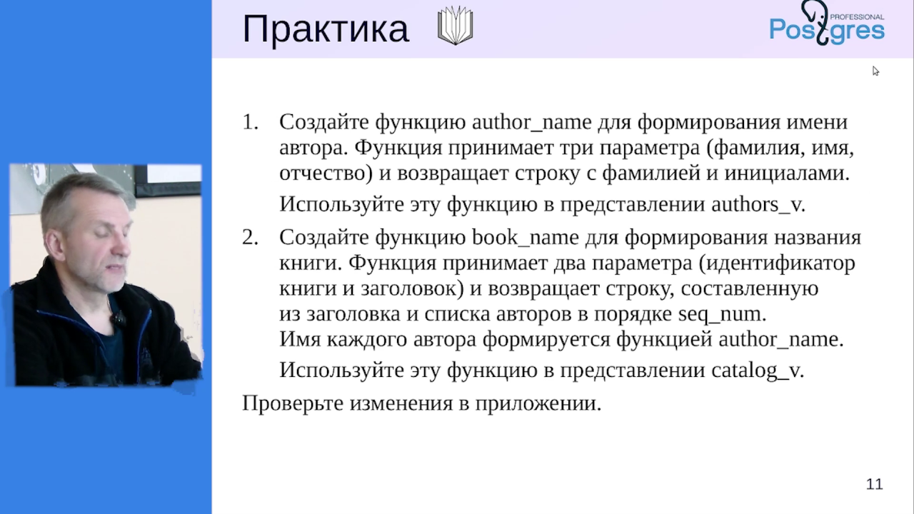
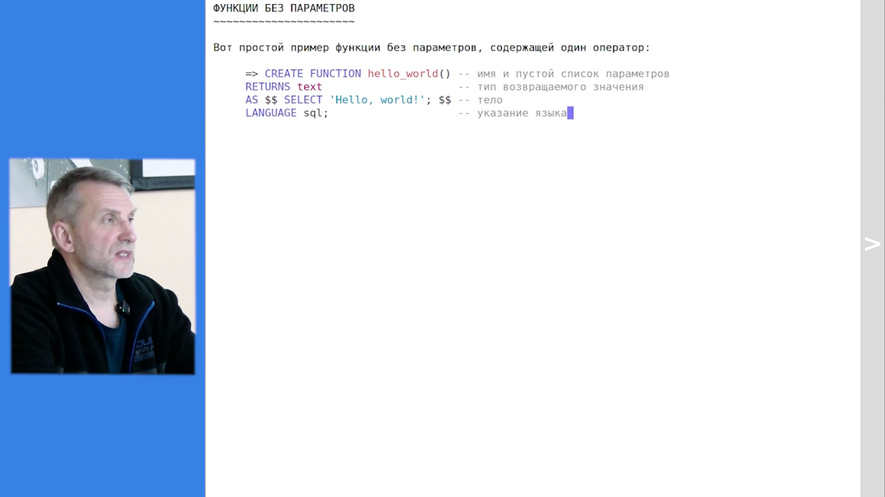
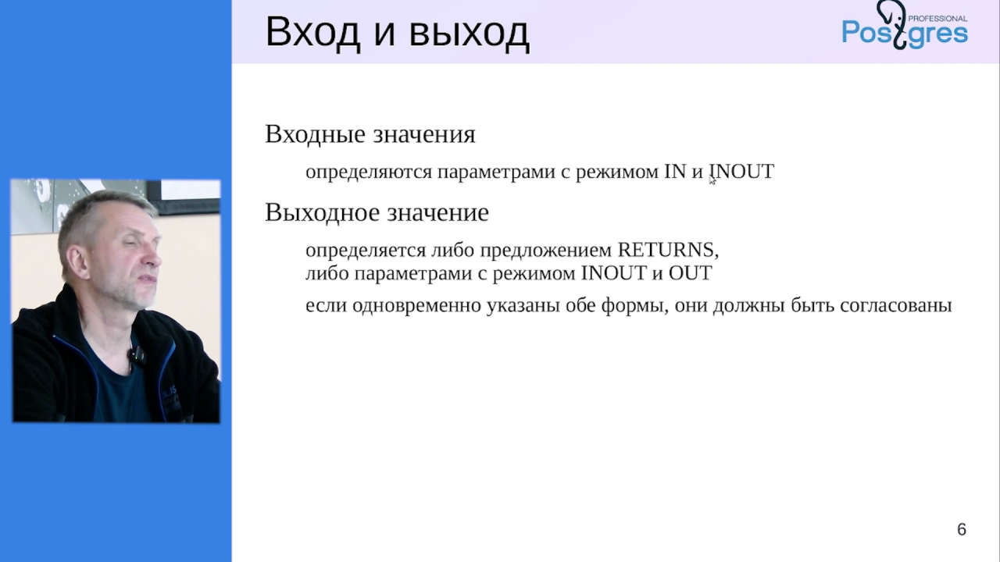
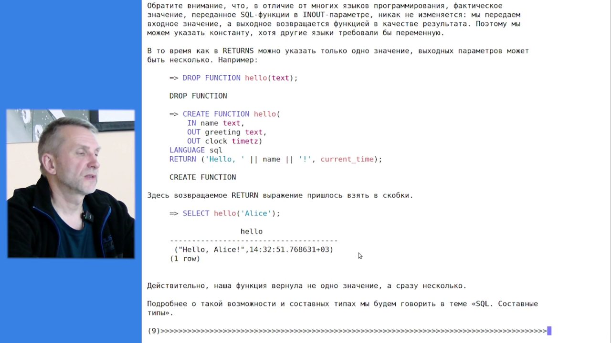
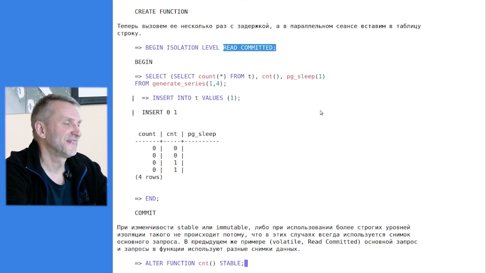
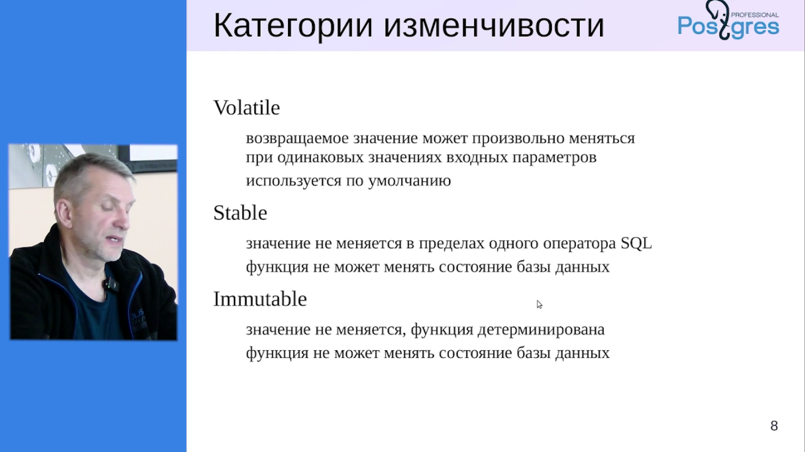
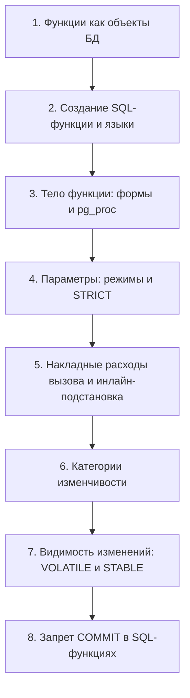

# Функции в PostgreSQL: объекты БД, параметры, изменчивость и планы

> [!abstract] Обзор
> Материал объединяет разбор функций в PostgreSQL как объектов базы данных и хранимого кода: их определение в системном каталоге, тело, параметры и возвращаемые значения. Показано, как создавать SQL-функции, задавать языки, формы тела, обрамление долларами, режимы параметров IN, OUT и INOUT, значения по умолчанию, STRICT и удаление через DROP FUNCTION. Отдельно разобраны накладные расходы вызова, инлайн-подстановка и то, что запросы внутри функции скрыты от планировщика. Значительная часть посвящена категориям изменчивости (volatile, stable, immutable) и их влиянию на видимость снимков данных и на планы запросов, что видно на экспериментах с cnt() при READ COMMITTED и с обёрткой rnd() над random. Также приведены практические функции author_name и book_name и ограничение на COMMIT в теле SQL-функции.

> [!info] Курс
> [[index|Оглавление курса]]

## Оглавление
1. [[#1. Функции как объекты БД]]
2. [[#2. Создание SQL-функции и языки]]
3. [[#3. Тело функции: формы и pg_proc]]
4. [[#4. Параметры: режимы и STRICT]]
5. [[#5. Накладные расходы вызова и инлайн-подстановка]]
6. [[#6. Категории изменчивости]]
7. [[#7. Видимость изменений: VOLATILE и STABLE]]
8. [[#8. Запрет COMMIT в SQL-функциях]]

**Схема** — [[#Схема]]
**Итог** — [[#Итог]]

## 1. Функции как объекты БД

Большая задача разбивается на мелкие подзадачи, и мелкую подзадачу можно оформить в виде отдельной функции, чтобы абстрагироваться от всей задачи и переиспользовать код. С точки зрения базы данных функция — это объект БД и хранимый код: её определение хранится в системном каталоге, а интерфейс задаёт имя, параметры, тип возвращаемого значения и тело; в Postgres пространство имён — это схемы. Примеры функций: author_name принимает фамилию, имя, отчество и возвращает строку с фамилией и инициалами (используется в представлении authors_v); book_name принимает идентификатор книги и заголовок и возвращает заголовок со списком авторов в порядке seq_num. При изменении кода нужно помнить о побочных эффектах, а вся база данных является глобальной переменной, поэтому значение функции может зависеть не только от параметров, но и от состояния БД; функция всегда вызывается в контексте выражения (select, from, where). Ключевое слово IN обозначает входной параметр и необязательно. Начиная с PostgreSQL 14, функции на чистом SQL можно хранить в предразобранном (скомпилированном) виде.

*Источник: [00:00:26], [00:00:46], [00:02:15], [00:05:54], [00:43:01], [00:43:52]*

> [!quote]- Кадр [00:00:26]
> 

> [!quote]- Кадр [00:43:01]
> 

> [!quote]- Кадр [00:05:54]
> 

> [!quote]- Кадр [00:43:52]
> 

## 2. Создание SQL-функции и языки

CREATE FUNCTION hello_world() объявляет функцию с пустым списком параметров, возвращающую text, на языке sql; тело записывается как AS $$ SELECT 'Hello, world!'; $$. Функция вызывается в контексте выражения, например SELECT hello_world(); пустые скобки обязательны даже без аргументов. Функция hello с формальным параметром name типа text использует его в теле через RETURN 'Hello, ' || name || '!'. Доступны разные языки (SQL, C и другие): в определении указывается language, и Postgres подключает нужный интерпретатор при вызове; для компилируемого языка нужно понимать соглашения.

```
CREATE FUNCTION hello_world() -- имя и пустой список параметров
   RETURNS text                -- тип возвращаемого значения
   AS $$ SELECT 'Hello, world!'; $$ -- тело
   LANGUAGE sql;               -- указание языка
```

*Источник: [00:05:54], [00:07:59], [00:09:43]*

> [!quote]- Кадр [00:07:59]
> 


## 3. Тело функции: формы и pg_proc

Если функция состоит из нескольких операторов SQL, их обрамляют фразами BEGIN ATOMIC, а END завершает определение; функция возвращает то, что возвращает последний оператор тела, а для возврата одного выражения может использоваться ключевое слово RETURN. В строчном формате нет долларов и конструкции S, которые вынуждены писать в традиционном формате. Тело функции обычно представлено как строковая константа и сохраняется в системном каталоге pg_proc: имя — в proname, тело — в prosrc; при вызове Postgres извлекает код, интерпретирует и выполняет его. Для просмотра исходного текста удобно использовать команду sf (source function). В теле удобно использовать долларовое цитирование: знаки доллара как большие апострофы, между ними может стоять тег (например, $func$), а одинарные кавычки внутри не нужно экранировать.

```sql
=> CREATE OR REPLACE FUNCTION hello_world() RETURNS text
LANGUAGE sql
BEGIN ATOMIC
    SELECT 'First Line';
    SELECT 'Second Line';
END;

SELECT $$ SELECT 'Hello, world!'; $$;

=> SELECT $$ SELECT 'Hello, world!'; $$;
        ?column?
-----------------------
 SELECT 'Hello, world!';
(1 row)
=> SELECT $func$ SELECT $$Hello, world!$$; $func$;
```

> [!info] Зачем это нужно
> Команда sf применяется, чтобы посмотреть исходный текст функции.

*Источник: [00:05:54], [00:07:59], [00:09:21], [00:09:43], [00:10:03], [00:10:23] и др.*


## 4. Параметры: режимы и STRICT

В функции hello(text) вместо имени параметра можно использовать номер $1; параметры можно указывать по именам, комбинировать позиционные и именованные способы. Параметру можно задать значение по умолчанию с помощью DEFAULT, но дефолтные параметры должны стоять в конце списка, иначе будет ошибка; при вызове с указанием всех значений умолчания не используются. SQL-функция может объявлять входные (IN) и выходные (OUT) параметры; INOUT-параметр передаётся по значению, входное значение передаётся, а выходное возвращается как результат. Значение возвращается через RETURN, а выходное значение определяется либо RETURNS, либо параметрами INOUT и OUT; если указаны обе формы, они должны быть согласованы. При удалении функции выходные параметры (OUT) не указываются в списке аргументов — достаточно указать тип параметра; функцию также можно определить как строгую (strict), тогда при передаче NULL она не выполняется и сразу возвращает null.

```sql
=> CREATE FUNCTION hello(text)
RETURNS text
LANGUAGE sql
RETURN 'Hello, ' || $1 || '!'; -- номер вместо имени

CREATE FUNCTION hello(IN name text, OUT text)
RETURNS text
LANGUAGE sql
RETURN 'Hello, ' || name || '!';

CREATE FUNCTION hello(INOUT name text)
LANGUAGE sql
RETURN 'Hello, ' || name || '!';

CREATE FUNCTION hello(IN name text, OUT text)
RETURNS text
LANGUAGE sql
RETURN 'Hello, ' || name || '!';

CREATE FUNCTION hello(
    IN name text,
    OUT greeting text,
    OUT clock timetz)
LANGUAGE sql
RETURN ('Hello, ' || name || '!', current_time);

CREATE FUNCTION hello(IN name text, IN greet text DEFAULT 'Dear', IN title text DEFAULT 'Mr')
RETURNS text
LANGUAGE sql
RETURN 'Hello, ' || greet || ' ' || title || ' ' || name || '!';

SELECT hello('Alice', title => 'Mrs');

DROP FUNCTION hello(text); -- OUT-параметры не указываем

CREATE FUNCTION hello(IN name text, IN title text DEFAULT 'Mr')
RETURNS text
LANGUAGE sql STRICT
RETURN 'Hello, ' || title || ' ' || name || '!';
SELECT hello('Alice', NULL);
```

*Источник: [00:17:32], [00:17:52], [00:18:12], [00:18:35], [00:19:15], [00:19:56] и др.*

> [!quote]- Кадр [00:22:46]
> 

> [!quote]- Кадр [00:27:24]
> 

## 5. Накладные расходы вызова и инлайн-подстановка

В традиционных языках программирования вызов функции связан с накладными расходами: параметры помещаются в стек, затем происходит вызов и извлечение из стека. Оптимизатор в некоторых случаях может сэкономить на вызовах функций, развернуть тело функции и подставить его в основной запрос, чтобы построить более эффективный план. Инлайн-подстановка — приём, когда транслятор разворачивает функцию непосредственно в вызывающем коде; при этом накладные расходы могут исчезнуть. Если в одном из входных параметров при вызове функции находится неопределённое значение, функция не вызывается, сразу возвращается значение 0. Если в функции выполняются запросы, они в большинстве случаев остаются скрытыми от планировщика: планировщик видит только вызывающий запрос и может не увидеть общую картину, поэтому план запроса может быть неоптимальным.

*Источник: [00:00:46]*

## 6. Категории изменчивости

Каждой функции присваивается категория изменчивости, описывающая её поведение при одинаковых входных параметрах; категории нужны, чтобы оптимизатор правильно понимал, где и как вызывать функции, и применял оптимизации. Volatile — умолчательная категория: такие функции могут влиять на состояние БД (insert, update, delete), и возвращаемое значение может произвольно меняться. Immutable-функция детерминирована: её значение зависит только от параметров и не меняется, и она не может менять состояние БД; автор должен присваивать правильную категорию, иначе результаты могут быть не теми, на которые рассчитывали, — например, IMMUTABLE-функция может быть вычислена на этапе планирования один раз. Пример: функция rnd() как обёртка над random() объявлена VOLATILE; в плане запроса виден random из тела, а не rnd. После ALTER FUNCTION rnd() STABLE условие в WHERE вычисляется один раз (One-Time Filter), и запрос возвращает либо 0, либо 10 строк; после IMMUTABLE планировщик вычисляет выражение, и план может быть Function Scan или Result с One-Time Filter: false — ответственность за ложные показания лежит на разработчике.

```sql
>= CREATE FUNCTION rnd() RETURNS float
LANGUAGE sql VOLATILE
RETURN random();
=> EXPLAIN (costs off)
SELECT * FROM generate_series(1,10) WHERE rnd() > 0.5;
=> SELECT * FROM generate_series(1,10) WHERE rnd() > 0.5;

ALTER FUNCTION rnd() STABLE;
ALTER FUNCTION
=> EXPLAIN (costs off)
SELECT * FROM generate_series(1,10) WHERE rnd() > 0.5;
QUERY PLAN
Result
    One-Time Filter: (rnd() > '0.5'::double precision)
    ->  Function Scan on generate_series
(3 rows)

=> ALTER FUNCTION rnd() IMMUTABLE;
ALTER FUNCTION
=> EXPLAIN (costs off)
SELECT * FROM generate_series(1,10) WHERE rnd() > 0.5;
            QUERY PLAN
--------------------------------
 Function Scan on generate_series
(1 row)
=> \g
            QUERY PLAN
-----------------------------
 Result
   One-Time Filter: false
(2 rows)
```

> [!info] Зачем это нужно
> Категории изменчивости позволяют оптимизатору правильно понимать, где и как вызывать функции, и применять оптимизации.

*Источник: [00:26:43], [00:27:44], [00:28:04], [00:31:48], [00:34:42], [00:37:26] и др.*

> [!quote]- Кадр [00:34:42]
> 


> [!quote]- Кадр [00:28:04]
> 

## 7. Видимость изменений: VOLATILE и STABLE

Функции с изменчивостью volatile видят все изменения, включая сделанные текущим, ещё не завершённым оператором SQL: при INSERT INTO t SELECT cnt() FROM generate_series(1,5) функция cnt() выдавала 0, 1, 2, 3, 4, видя ещё не завершённые вставленные строки. У stable-функций значение не меняется в пределах одного оператора SQL, и такая функция не может менять состояние БД; после ALTER FUNCTION cnt() STABLE та же вставка даёт 0, 0, 0, 0, 0. SQL-функция cnt() с атрибутом VOLATILE возвращает число строк в таблице t через RETURN (SELECT count(*) FROM t). В READ COMMITTED запрос, включая подзапрос count, видит состояние данных на момент начала выполнения запроса; если cnt объявлена как VOLATILE, она вызывается всякий раз и может увидеть строку, вставленную параллельным сеансом, тогда подзапрос count(*) остаётся 0, а cnt() становится 1 — возникает рассогласованность внутри одного запроса. При переводе cnt() в STABLE та же выборка с pg_sleep(1) даёт 0, так как функция не увидела вставку; на уровне READ COMMITTED (умолчательном) можно получить рассогласованные данные даже в рамках одного запроса.

```javascript
>= ALTER FUNCTION cnt() VOLATILE;
=> TRUNCATE t;
=> INSERT INTO t SELECT cnt() FROM generate_series(1,5);
=> SELECT * FROM t;
 n
---
 0
 1
 2
 3
 4

=> ALTER FUNCTION cnt() VOLATILE;
ALTER FUNCTION
=> TRUNCATE t;
TRUNCATE TABLE
=> INSERT INTO t SELECT cnt() FROM generate_series(1,5);
INSERT 0 5

>= CREATE TABLE t(n integer);
=> CREATE FUNCTION cnt() RETURNS bigint
LANGUAGE sql VOLATILE
RETURN (SELECT count(*) FROM t);
=> BEGIN ISOLATION LEVEL READ COMMITTED;
=> SELECT (SELECT count(*) FROM t), cnt(), pg_sleep(1)
FROM generate_series(1,4);
| => INSERT INTO t VALUES (1);
 count | cnt | pg_sleep
-------+-----+----------
     0 |   0 |
     0 |   0 |
     0 |   1 |
     0 |   1

=> TRUNCATE t;
TRUNCATE TABLE
=> BEGIN ISOLATION LEVEL READ COMMITTED;
BEGIN
=> SELECT (SELECT count(*) FROM t), cnt(), pg_sleep(1)
FROM generate_series(1,4);
| => INSERT INTO t VALUES (1);
| INSERT 0 1

 count | cnt | pg_sleep
-------+-----+----------
     0 |   0 |
     0 |   0 |
     0 |   0 |
     0 |   0
(4 rows)

>= ALTER FUNCTION cnt() VOLATILE;
=> TRUNCATE t;
=> INSERT INTO t SELECT cnt() FROM generate_series(1,5);
=> SELECT * FROM t;
 n
---
 0
 1
 2
 3
 4

=> ALTER FUNCTION cnt() VOLATILE;
ALTER FUNCTION
=> TRUNCATE t;
TRUNCATE TABLE
=> INSERT INTO t SELECT cnt() FROM generate_series(1,5);
INSERT 0 5

>= CREATE TABLE t(n integer);
=> CREATE FUNCTION cnt() RETURNS bigint
LANGUAGE sql VOLATILE
RETURN (SELECT count(*) FROM t);
=> BEGIN ISOLATION LEVEL READ COMMITTED;
=> SELECT (SELECT count(*) FROM t), cnt(), pg_sleep(1)
FROM generate_series(1,4);
| => INSERT INTO t VALUES (1);
 count | cnt | pg_sleep
-------+-----+----------
     0 |   0 |
     0 |   0 |
     0 |   1 |
     0 |   1 |

CREATE FUNCTION cnt() RETURNS bigint
LANGUAGE sql VOLATILE
RETURN (SELECT count(*) FROM t);

=> BEGIN ISOLATION LEVEL READ COMMITTED;
=> SELECT (SELECT count(*) FROM t), cnt(), pg_sleep(1)
FROM generate_series(1,4);
|    => INSERT INTO t VALUES (1);

   count | cnt | pg_sleep
---------+-----+---------
       0 |   0 |
       0 |   0 |
       0 |   1 |
       0 |   1
(4 rows)
=> END;

CREATE FUNCTION cnt() RETURNS bigint
LANGUAGE sql VOLATILE
RETURN (SELECT count(*) FROM t);

=> BEGIN ISOLATION LEVEL READ COMMITTED;
=> SELECT (SELECT count(*) FROM t), cnt(), pg_sleep(1)
FROM generate_series(1,4);
|    => INSERT INTO t VALUES (1);

   count | cnt | pg_sleep
---------+-----+---------
       0 |   0 |
       0 |   0 |
       0 |   1 |
       0 |   1 |
(4 rows)
=> END;

=> TRUNCATE t;
TRUNCATE TABLE
=> BEGIN ISOLATION LEVEL READ COMMITTED;
BEGIN
=> SELECT (SELECT count(*) FROM t), cnt(), pg_sleep(1)
FROM generate_series(1,4);
| => INSERT INTO t VALUES (1);
| INSERT 0 1

 count | cnt | pg_sleep
-------+-----+----------
     0 |   0 |
     0 |   0 |
     0 |   0 |
     0 |   0 |
(4 rows)

>= CREATE TABLE t(n integer);
=> CREATE FUNCTION cnt() RETURNS bigint
LANGUAGE sql VOLATILE
RETURN (SELECT count(*) FROM t);
=> BEGIN ISOLATION LEVEL READ COMMITTED;
=> SELECT (SELECT count(*) FROM t), cnt(), pg_sleep(1)
FROM generate_series(1,4);
| => INSERT INTO t VALUES (1);
 count | cnt | pg_sleep
-------+-----+----------
     0 |   0 |
     0 |   0 |
     0 |   1 |
     0 |   1
```

*Источник: [00:28:04], [00:30:48], [00:32:08], [00:33:00], [00:33:50], [00:35:02] и др.*


## 8. Запрет COMMIT в SQL-функциях

В SQL-функциях запрещены служебные команды (VACUUM, CREATE INDEX) и команды управления транзакциями (BEGIN, COMMIT, ROLLBACK); попытка вставить COMMIT приводит к ошибке уже на этапе определения функции. Нельзя использовать команду COMMIT в теле SQL-функции: при попытке возникает ошибка COMMIT is not yet supported in unquoted SQL function body, например при создании функции с телом BEGIN ATOMIC COMMIT; END;.

```javascript
=> CREATE FUNCTION do_commit() RETURNS void
LANGUAGE sql
BEGIN ATOMIC COMMIT; END;

ERROR: COMMIT is not yet supported in unquoted SQL function body
```

*Источник: [00:05:54], [00:16:34], [00:17:12]*


## Схема



## Итог

> [!success] Что в итоге
> Функции в PostgreSQL оформляют подзадачи с определённым интерфейсом и позволяют переиспользовать код, а их определение хранится в системном каталоге pg_proc, где тело обычно представлено строковой константой, которую удобно писать в кавычках-долларах. Параметры задаются режимами IN, OUT и INOUT со значениями по умолчанию, значения возвращаются через RETURN, RETURNS или OUT-параметры, а STRICT меняет поведение при NULL. На работу функций влияют накладные расходы вызова, инлайн-подстановка и скрытость запросов от планировщика. Категории изменчивости определяют, какой снимок видят запросы функции и как оптимизатор её обрабатывает, а умалчиваемые уровень READ COMMITTED и категория VOLATILE могут приводить к рассогласованным данным, что показано на примере cnt() и rnd().

