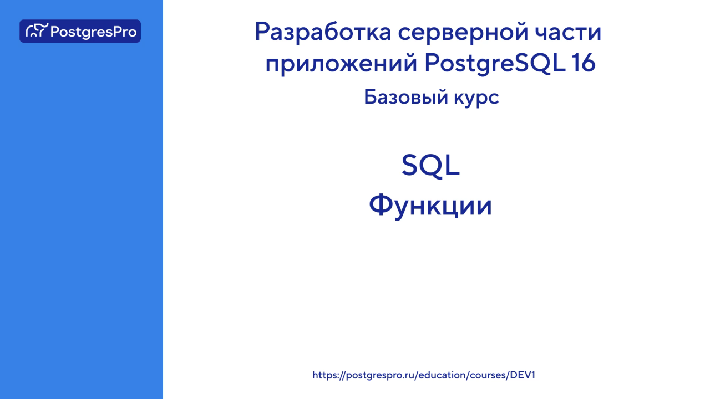
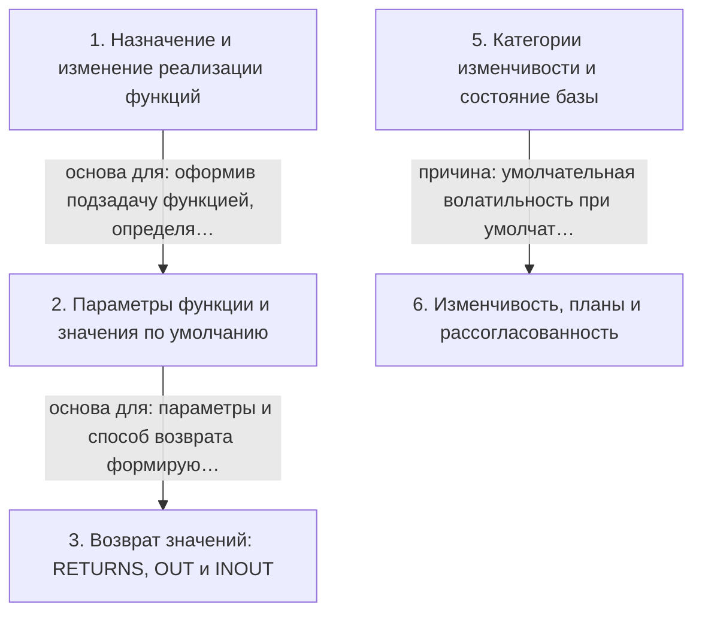

# SQL-функции в PostgreSQL: параметры, изменчивость и хранение

> [!abstract] Обзор
> Материал посвящён SQL-функциям в PostgreSQL: зачем их создают, как описывают интерфейс и параметры, как возвращают значения и какие категории изменчивости существуют. Отдельно разобрано, как категория изменчивости влияет на работу оптимизатора, планы запросов и на рассогласованность данных при умолчательном уровне транзакции, а также связанная с этим видимость изменений внутри транзакции. Показано, что функция — это объект базы данных: её определение хранится в системном каталоге pg_proc, тело — в столбце prosrc, а исходный текст можно посмотреть командой sf. Обсуждаются накладные расходы вызова и инлайн-подстановка, ограничения SQL-функций, объединение функций в схемы, граница клиента и сервера, долларовое обрамление строк и блок begin atomic.

> [!info] Курс
> [[index|Оглавление курса]]

## Оглавление
1. [[#1. Назначение и изменение реализации функций]]
2. [[#2. Параметры функции и значения по умолчанию]]
3. [[#3. Возврат значений: RETURNS, OUT и INOUT]]
4. [[#4. Определение, язык, тело и ограничения SQL-функций]]
5. [[#5. Категории изменчивости и состояние базы]]
6. [[#6. Изменчивость, планы и рассогласованность]]
7. [[#7. Объединение функций в схемы]]
8. [[#8. Граница клиента и сервера]]

**Схема** — [[#Схема]]
**Итог** — [[#Итог]]

## 1. Назначение и изменение реализации функций

Крупную задачу декомпозируют на мелкие подзадачи, и решение каждой подзадачи оформляют в виде функции. Это упрощает задачу, позволяет абстрагироваться от всей задачи, переиспользовать код и сосредоточиться на конкретной задаче. Определив интерфейс функции, можно в определённых пределах изменять её реализацию, но при этом нужно помнить о побочных эффектах.

*Источник: [00:00:04], [00:00:08]*

> [!quote]- Кадр [00:00:08]
> 

## 2. Параметры функции и значения по умолчанию

Формальный параметр — это его имя и его тип; параметр можно определить без имени, и тогда внутри тела функции на него ссылаются по номеру. У параметров могут стоять ключевые слова IN, но указывать их не обязательно; если для параметра не указан тип, он считается входным. Параметрам функции можно задать значение по умолчанию: при именованном вызове можно пропускать параметры, имеющие значения по умолчанию, а при вызове с полностью заполненными значениями параметров дефолтные значения не используются. При описании функции дефолтные параметры должны стоять в конце списка: нельзя указать дефолтный параметр, а после него — параметр без значения по умолчанию, иначе это вызовет ошибку. Можно комбинировать позиционный и именованный способы вызова, а функцию можно переопределить, не трогая её тело, а только изменив категорию изменчивости. Если добавить в описание strict, то при неопределённом значении в одном из входных параметров функция не будет вызываться и сразу вернёт null.

> [!info] Зачем это нужно
> Комбинирование способов удобно, когда у функции много дефолтных параметров.

*Источник: [00:00:04]*

> [!quote]- Кадр [00:00:04]
> 

## 3. Возврат значений: RETURNS, OUT и INOUT

Если нужно возвращать одно значение, чаще всего используют предложение RETURNS; в RETURN можно указать только одно значение, а выходных параметров при этом можно сделать несколько. Функция может возвращать значения не только через returns, но и с помощью параметров типа out и in out: если нужно вернуть несколько значений, returns не используют, а пишут out, и параметров out может быть несколько. Если указать сразу и returns, и out-параметры, то указанное в них должно быть согласовано — это дублирование одного и того же. INOUT-параметр причисляется к входным и одновременно служит для передачи значений и извлечения результата; при вызове этот же параметр участвует в формировании результирующей строки. Параметры передаются по значению, а не по ссылке; даже для INOUT-параметра можно указать константу, и Postgres не выдаст ошибку, так как возвращается другое значение. Функция может иметь несколько выходных параметров типа OUT, а возвращаемые значения представляют собой составной тип.

> [!info] Зачем это нужно
> INOUT-параметр служит для передачи значений в функцию и извлечения её результата.

*Источник: [00:00:04]*

## 4. Определение, язык, тело и ограничения SQL-функций

Функция всегда вызывается в контексте какого-то выражения — в списке select, во фразе from select или в условии where; в её теле нельзя использовать команды управления транзакциями (begin, commit, rollback), и ошибка на commit возникает уже на этапе определения функции. С точки зрения базы данных функция — это объект базы данных: определение сохраняется в системном каталоге pg_proc, тело — в столбце prosrc как строковая константа, а команда sf (исходная функция, source function) показывает исходный текст. При создании функции указывается язык через LANGUAGE; Postgres подключит нужный интерпретатор при вызове, а в SQL-функциях можно использовать параметры со значениями по умолчанию, но не все операторы SQL: служебные команды Vacuum, CreateIndex и подобные запрещены. В теле можно обрамлять литералы долларами вместо одинарных кавычек, чтобы не экранировать апострофы; двойные доллары работают как кавычки, а для вложенности между ними вставляют текст. Функция может состоять из нескольких операторов SQL: блок обрамляется begin atomic, завершается end, и возвращается то, что вернул последний оператор тела.

> [!info] Зачем это нужно
> Запрет обусловлен тем, что функция вызывается в контексте выражения.

*Источник: [00:00:04]*

## 5. Категории изменчивости и состояние базы

Каждой функции присваивается категория изменчивости, описывающая её поведение при одинаковых входных параметрах, и она влияет на работу планировщика; при неправильной категории можно получить не те результаты. volatile — умолчательная категория: по умолчанию создаваемые пользователем функции волатильные, они могут возвращать изменяющиеся значения при одинаковых входных параметрах и могут менять состояние базы данных с помощью insert, update, delete. Для стабильных функций (stable) подразумевается, что их значение может изменяться, но в пределах одного оператора SQL остаётся неизменным; функция stable не видит строки, вставленные незавершённым оператором SQL. Функции категории immutable полностью детерминированные: их возвращаемые значения зависят только от набора передаваемых параметров, они не могут изменять состояние базы данных, и оптимизатор имеет право вычислить её значение ещё на этапе планирования и использовать вычисленное значение в плане запроса. В PostgreSQL вся база данных является глобальной переменной, состояние которой может влиять на выполнение функции: значение, возвращаемое функцией, может зависеть не только от переданных параметров, но и от состояния базы.

*Источник: [00:00:04]*

## 6. Изменчивость, планы и рассогласованность

Использование умолчательного уровня транзакции и умолчательной категории изменчивости функции приводит к рассогласованным данным. Если использовать volatile-функцию на уровне изоляции read-committed, можно получить рассогласованные данные даже в рамках одного запроса, и в результате запрос вернёт либо 0, либо 10 строк. Если во фразе FROM стоит вызов функции generate_series, подзапрос выполняется несколько раз; с изменчивостью stable оптимизатор имеет право вызвать функцию всего один раз, условие вычислится один раз, и данные будут представлены в корректном виде. Функция, вызванная в транзакции, может не видеть изменений, сделанных этой же самой транзакцией, что связано с видимостью изменений; функция, вызываемая в запросе, всякий раз строит собственный снимок данных, что приводит к рассогласованности с вложенным подзапросом. При вызове функции передаются параметры и возникают накладные расходы: затем происходит вызов, а затем извлечение из стека; инлайн-подстановка — приём, при котором транслятор разворачивает написанную функцию непосредственно в вызывающем коде, и накладные расходы могут исчезнуть. Например, RND — это обёртка для стандартной функции random, и оптимизатор может залезть внутрь тела функции и развернуть его прямо в основной запрос, устранив обёртку, поэтому в плане запроса вместо имени функции RND видно random, взятый из тела функции.

> [!info] Зачем это нужно
> Обёртку сделали, чтобы показать, как категория изменчивости влияет на планы запросов.

*Источник: [00:00:04]*

## 7. Объединение функций в схемы

В Postgres для объединения функций нет библиотек или пакетов — есть только пространство имён, то есть схемы. Какие-то функции можно собрать в одной схеме; обычно так и делают расширения.

*Источник: [00:00:04]*

## 8. Граница клиента и сервера

В серверном программировании чётко прослеживается граница между клиентской и серверной сторонами. Код выполняется на сервере, а клиент пишет запрос, который вызывает выполнение серверного кода.

*Источник: [00:00:04]*

## Схема

## Итог

> [!success] Что в итоге
> SQL-функции упрощают крупную задачу через декомпозицию на подзадачи и переиспользование кода. Функция описывается параметрами (именованными или по номерам, с дефолтными значениями в конце списка), возвращает значения через returns или out- и inout-параметры, а её категория изменчивости определяет, как оптимизатор обращается с ней: volatile — умолчание, а stable и immutable позволяют вычислять значение один раз. Определение функции хранится в системном каталоге pg_proc, тело — в столбце prosrc как строковая константа, а посмотреть исходный текст позволяет команда sf. Неверная категория при умолчательном уровне транзакции приводит к рассогласованным данным, что связано с видимостью изменений внутри транзакции.

