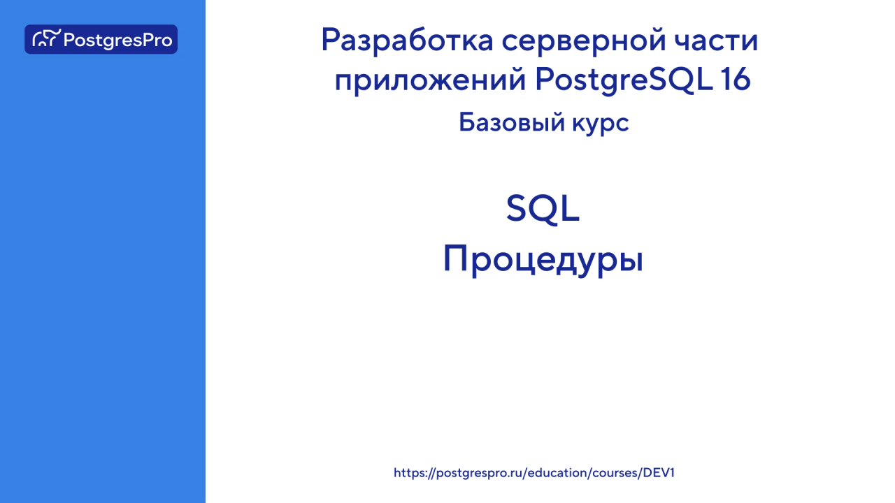
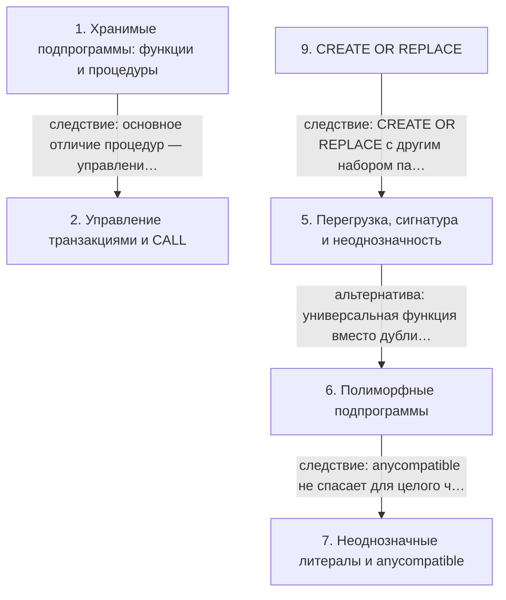

# SQL и процедуры в PostgreSQL 16: хранимые подпрограммы, перегрузка и полиморфизм

> [!abstract] Обзор
> Материал посвящён SQL и процедурам в PostgreSQL 16, которые вместе называют хранимыми подпрограммами. Разбирается основное отличие процедур от функций — возможность управления транзакциями — и контекст вызова: функции вызываются в выражениях, процедуры — отдельным оператором CALL. Рассматривается, как тело процедуры хранится в системном каталоге в разобранном виде и почему разбор через OID сохраняет работоспособность после переименования таблицы. Отдельно разобраны параметры вызова процедур, перегрузка и сигнатура подпрограмм, неоднозначность перегруженных функций с дефолтными параметрами, а также CREATE OR REPLACE. Также затронуты полиморфные подпрограммы с псевдотипами AnyElement и AnyCompatible, неоднозначные типы литералов и явное приведение типов, \df для перегруженных функций и отличие TRUNCATE от DELETE.

> [!info] Курс
> [[index|Оглавление курса]]

## Оглавление
1. [[#1. Хранимые подпрограммы: функции и процедуры]]
2. [[#2. Управление транзакциями и CALL]]
3. [[#3. Тело процедуры и системный каталог]]
4. [[#4. Параметры процедур]]
5. [[#5. Перегрузка, сигнатура и неоднозначность]]
6. [[#6. Полиморфные подпрограммы]]
7. [[#7. Неоднозначные литералы и anycompatible]]
8. [[#8. now и interval]]
9. [[#9. CREATE OR REPLACE]]
10. [[#10. TRUNCATE и DELETE]]

**Схема** — [[#Схема]]
**Итог** — [[#Итог]]

## 1. Хранимые подпрограммы: функции и процедуры

Функции и процедуры вместе называют хранимыми подпрограммами; Postgres поддерживает как хранимый код и функции, и процедуры, и они разделяют общее пространство имён. Нельзя создать функцию и процедуру с одинаковым именем и одинаковым набором параметров — они будут конфликтовать. Иногда функции отличают от процедур тем, что функции что-то возвращают, а процедура просто выполняет действие, однако процедуры в Postgres тоже могут возвращать результат. Основное отличие — возможность управления транзакциями и контекст вызова: функции всегда вызываются в контексте выражения, не могут управлять транзакциями и возвращают результат, а процедуры вызываются отдельным оператором. Функция определяется иначе: в ней обязательно нужно написать слово returns, и вернуть можно либо пустой результат void, либо осмысленное значение, например среднее значение из данных столбца.

*Источник: [00:00:04]*

> [!quote]- Кадр [00:00:04]
> 

## 2. Управление транзакциями и CALL

Процедуры вызываются отдельным оператором CALL, а не внутри выражения; они могут управлять транзакциями и могут возвращать результат. В процедурах на чистом SQL управление транзакциями не поддерживается. Если добавить оператор commit в тело функции, ошибка возникает уже на этапе определения функции. Процедуры, написанные на других языках, могут управлять транзакциями; в PostgreSQL управление транзакциями работает на процедурном языке PL/pgSQL. Процедуры появились начиная с 11-й версии PostgreSQL.

*Источник: [00:00:04]*

## 3. Тело процедуры и системный каталог

Тело процедуры заключается в долларовые кавычки. При определении процедуры её код преобразуется и хранится в системном каталоге в разобранном виде — так же, как и у функций. Процедура, прошедшая разбор в момент определения, продолжает работать после переименования таблицы, потому что в разобранном коде фигурирует идентификатор OID, а не символическое имя объекта, а при переименовании OID никуда не девается. Если процедура определена классическим образом с помощью строки, то после переименования таблицы она сломается при выполнении.

*Источник: [00:00:04]*

## 4. Параметры процедур

Фактические параметры процедуры можно указывать позиционно, а можно обращаться по имени; в этом смысле функции и процедуры похожи очень сильно. Процедуры могут иметь входные, выходные и совмещённые IN OUT параметры; с помощью IN OUT параметров процедура может возвращать значение. При вызове процедуры выходной параметр указывается как null или любое значение с подходящим типом.

> [!info] Зачем это нужно
> Указание выходного параметра при вызове — формальное требование синтаксиса.

*Источник: [00:00:04]*

## 5. Перегрузка, сигнатура и неоднозначность

Перегрузка — это возможность создавать несколько подпрограмм с одним и тем же именем, но с разным набором параметров; она доступна и для функций, и для процедур. При вызове Postgres выбирает нужную подпрограмму по сигнатуре: сигнатура — это имя подпрограммы и набор входных параметров, а тип возвращаемого результата и выходные параметры в сигнатуру не входят. Чтобы через \df в psql получить информацию о конкретной функции из перегруженных, недостаточно указать имя — нужно указать также соответствующий параметр или список параметров. Перегруженные функции с дефолтными параметрами могут вызвать неоднозначность, когда Postgres не может выбрать подходящую; тогда помогает удаление избыточной функции или явное преобразование типов. В PostgreSQL можно создавать функции с одинаковым именем, но разным набором или числом параметров, и все такие функции работают; например, среди стандартных функций есть перегруженная pg_database_size, принимающая имя базы данных или её идентификатор, а также можно определить функцию максимума с параметрами других типов, например для вещественных чисел. При перегрузке для разных типов создаются отдельные функции с одинаковым именем, тела которых содержат одни и те же операторы (if, else, сравнения, case).

> [!info] Зачем это нужно
> Для получения информации о конкретной функции из перегруженных.

*Источник: [00:00:04]*

## 6. Полиморфные подпрограммы

Полиморфная подпрограмма — это подпрограмма, которая может принимать параметры разных типов. Для этого используются полиморфные псевдотипы AnyElement или AnyCompatible; конкретный тип данных выбирается в момент вызова по типам фактических параметров. Для универсальной функции, принимающей значения разных типов, формальные параметры описываются как anyelement; при вызове можно подставлять в качестве фактических параметров разные типы данных. anyelement требует, чтобы типы были одинаковы или неявно приводимы друг к другу, и поддерживали операцию сравнения. Использование anycompatible вместо anyelement даёт более широкие перспективы: он использует приведение одного типа к другому и не требует полного соответствия применяемых типов — если приведение возможно, всё будет работать; функция Maximum с anycompatible работает с литералами.

| Псевдотип | Требования к типам |
|---|---|
| anyelement | типы должны быть одинаковы или неявно приводимы; поддерживать сравнение |
| anycompatible | не требует полного соответствия; использует приведение одного типа к другому |

> [!info] Зачем это нужно
> Для создания универсальной функции, принимающей значения разных типов.

*Источник: [00:00:04]*

## 7. Неоднозначные литералы и anycompatible

При сравнении строк с литералами Postgres не понимает, какие типы имелись в виду. Типы могут подразумевать char, varchar или text и различаться хранением, и такой вызов не срабатывает, пока типы не согласованы. Явное приведение типа выполняется двойным двоеточием; для литералов нужно уточнять типы, и в таком виде всё работает. С литералами приведение типов справляется, но anycompatible не спасает в некоторых ситуациях: если указать целое число и строковый литерал, возникает ошибка.

*Источник: [00:00:04]*

## 8. now и interval

Функция now в вызове возвращает текущую метку времени. now плюс интервал один день даёт то же время, но завтра; это значение больше, чем now.

*Источник: [00:00:04]*

## 9. CREATE OR REPLACE

CREATE OR REPLACE позволяет переопределить существующую процедуру или функцию, исправив только её код; можно изменять код тела подпрограммы, а для функции — категорию изменчивости и язык, на котором она написана. Не позволяет поменять тип подпрограммы (например, функцию на процедуру с тем же именем), изменить тип возвращаемого значения или типы выходных параметров — в таких случаях приходится уничтожить подпрограмму командой DROP и создать заново командой CREATE. Если указан другой набор параметров, не соответствующий существующей функции, будет создана новая перегруженная функция, и сообщений об ошибке не будет. При использовании CREATE OR REPLACE можно случайно создать ещё одну подпрограмму с тем же именем, если ошибиться в параметрах.

> [!info] Зачем это нужно
> Переопределение удобно при отладке.

*Источник: [00:00:04]*

## 10. TRUNCATE и DELETE

TRUNCATE зачищает таблицу и заводит под неё новые файлы на физическом уровне. DELETE удаляет данные построчно. Логически результат один и тот же.

| Операция | Как работает |
| TRUNCATE | зачищает таблицу, заводит под неё новые файлы на физическом уровне |
| DELETE | удаляет данные построчно |

*Источник: [00:00:04]*

## Схема

## Итог

> [!success] Что в итоге
> Функции и процедуры в PostgreSQL можно назвать хранимыми подпрограммами; они разделяют общее пространство имён. Основное отличие процедур — возможность управления транзакциями, которая на чистом SQL не поддерживается, но работает на PL/pgSQL; процедуры вызываются через CALL и появились с 11-й версии. Подпрограммы перегружаются по сигнатуре, могут быть полиморфными через anyelement и anycompatible, а явное приведение типов помогает при неоднозначных литералах. CREATE OR REPLACE позволяет править тело, но не тип и не возвращаемое значение.

