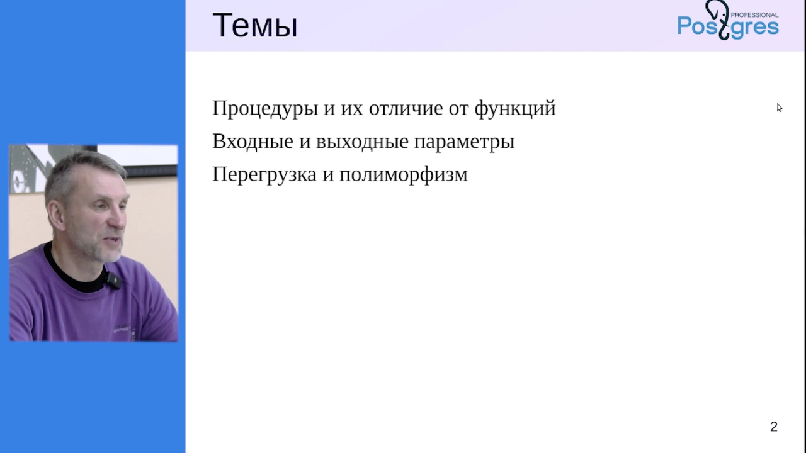
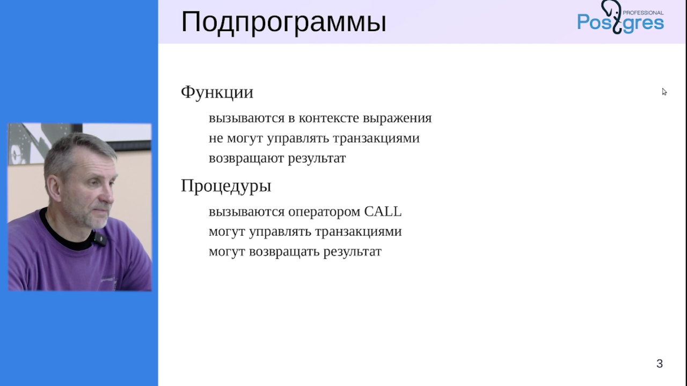
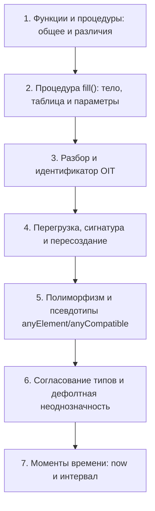

# Хранимые подпрограммы в PostgreSQL: функции, процедуры, перегрузка и полиморфизм

> [!abstract] Обзор
> Материал о хранимом коде в Postgres — функциях и процедурах как хранимых подпрограммах, у которых общее пространство имён. Разбираются отличия процедур (вызов через CALL, управление транзакциями) и способы их определения — долларовые кавычки и стиль стандарта SQL (BEGIN ATOMIC), а также поведение при переименовании из-за разбора и идентификатора OIT. На примере процедуры fill() и таблицы t показаны входные и выходные параметры, удаление строк через DELETE вместо TRUNCATE. Отдельно рассматриваются перегрузка и сигнатура, команда create or replace и пересоздание, полиморфные подпрограммы и псевдотипы anyElement и anyCompatible, согласование типов, явное приведение литералов и неоднозначность при дефолтных параметрах. Завершают материал примеры с now и интервалом в один день.

> [!info] Курс
> [[index|Оглавление курса]]

## Оглавление
1. [[#1. Функции и процедуры: общее и различия]]
2. [[#2. Процедура fill(): тело, таблица и параметры]]
3. [[#3. Разбор и идентификатор OIT]]
4. [[#4. Перегрузка, сигнатура и пересоздание]]
5. [[#5. Полиморфизм и псевдотипы anyElement/anyCompatible]]
6. [[#6. Согласование типов и дефолтная неоднозначность]]
7. [[#7. Моменты времени: now и интервал]]

**Схема** — [[#Схема]]
**Итог** — [[#Итог]]

## 1. Функции и процедуры: общее и различия

Хранимые подпрограммы — общее название для функций и процедур. Функции в Postgres существуют давно, процедуры появились только с 11-й версии; у них общее пространство имён, поэтому нельзя создать функцию и процедуру с одинаковым именем и одинаковым набором параметров. Функции вызываются в контексте выражения и не могут управлять транзакциями: commit в теле приводит к ошибке уже при определении, обязательно слово returns, а возвращать можно void или осмысленное значение. Процедуры вызываются оператором CALL, могут управлять транзакциями и могут возвращать результат; на чистом SQL управление транзакциями не поддерживается, но в PL/pgSQL работает. Основное отличие процедур от функций — возможность управления транзакциями.

| | Функции | Процедуры |
|---|---|---|
| Вызов | в контексте выражения | оператор CALL |
| Управление транзакциями | не могут | могут |
| Возврат результата | возвращают результат | могут возвращать результат |

> [!info] Зачем это нужно
> Управление транзакциями — основное отличие процедур от функций.

*Источник: [00:00:22], [00:00:42], [00:01:56], [00:04:38], [00:06:39], [00:06:59] и др.*

> [!quote]- Кадр [00:00:22]
> 

> [!quote]- Кадр [00:00:42]
> 

## 2. Процедура fill(): тело, таблица и параметры

Тело процедуры можно заключить в долларовые кавычки ($$ ... $$) или задать в стиле стандарта SQL через BEGIN ATOMIC, указав LANGUAGE sql. В варианте BEGIN ATOMIC на чистом SQL управление транзакциями не поддерживается, а команда TRUNCATE пока не поддерживается, поэтому в примере она заменена на DELETE FROM; DELETE удаляет данные построчно, а TRUNCATE зачищает таблицу. Процедура fill() без параметров очищает таблицу t и вставляет в неё три случайные строки, вызывается через CALL fill(); для демонстрации создаётся таблица t с одним столбцом a типа float. Вариант fill(nrows integer) удаляет все строки из таблицы t и вставляет nrows случайных чисел. Вариант fill(IN nrows integer, OUT average float) дополнительно выполняет SELECT avg(a) FROM t и возвращает среднее; фактические параметры можно указывать позиционно или по имени, а в выходной параметр можно вписать null или любое значение при совпадении типа.

```sql
CREATE PROCEDURE fill()
AS $$
    TRUNCATE t;
    INSERT INTO t SELECT random() FROM generate_series(1,3);
$$ LANGUAGE sql;

CREATE OR REPLACE PROCEDURE fill()
    LANGUAGE sql
    BEGIN ATOMIC
        DELETE FROM t;
        INSERT INTO t SELECT random() FROM generate_series(1,3);
    END;

CREATE OR REPLACE PROCEDURE fill()
    LANGUAGE sql
    BEGIN ATOMIC
        DELETE FROM t;  -- команда TRUNCATE пока что не поддерживается в таких подпрограммах
        INSERT INTO t SELECT random() FROM generate_series(1,3);
    END;

=> CREATE PROCEDURE fill(nrows integer)
LANGUAGE sql
BEGIN ATOMIC
    DELETE FROM t;
    INSERT INTO t SELECT random() FROM generate_series(1, nrows);
END;

> CREATE PROCEDURE fill(nrows integer)
LANGUAGE sql
BEGIN ATOMIC
    DELETE FROM t;
    INSERT INTO t SELECT random() FROM generate_series(1, nrows);
END;

> CREATE PROCEDURE fill(IN nrows integer, OUT average float)
LANGUAGE sql
BEGIN ATOMIC
    DELETE FROM t;
    INSERT INTO t SELECT random() FROM generate_series(1, nrows);
    SELECT avg(a) FROM t; -- как в функции
END;

=> CREATE PROCEDURE fill(IN nrows integer, OUT average float)
LANGUAGE sql
BEGIN ATOMIC
    DELETE FROM t;
    INSERT INTO t SELECT random() FROM generate_series(1, nrows);
    SELECT avg(a) FROM t; -- как в функции
END;

CREATE TABLE t(a float);

CALL fill();

CREATE PROCEDURE fill(IN nrows integer, OUT average float)
LANGUAGE sql
BEGIN ATOMIC
    DELETE FROM t;
    INSERT INTO t SELECT random() FROM generate_series(1, nrows);
    SELECT avg(a) FROM t; -- как в функции
END;
```

| Команда | Поведение |
|---|---|
| DELETE | удаляет данные построчно |
| TRUNCATE | зачищает таблицу |

> [!info] Зачем это нужно
> В BEGIN ATOMIC TRUNCATE не поддерживается, поэтому заменена на DELETE FROM.

*Источник: [00:01:59], [00:02:18], [00:02:38], [00:02:58], [00:03:18], [00:08:49] и др.*

## 3. Разбор и идентификатор OIT

При определении процедура проходит разбор, и в разобранном коде уже не фигурирует символическое имя объекта — там фигурирует идентификатор OIT. При переименовании OIT никуда не девается, поэтому процедура продолжает работать после переименования. В конспекте есть расхождение: одно утверждение — если таблицу, к которой обращается процедура fill(), переименовать, процедура при выполнении сломается, так как таблица не найдётся; другое — процедура продолжает работать после переименования, поскольку OIT сохраняется.

*Источник: [00:05:48]*

## 4. Перегрузка, сигнатура и пересоздание

Перегрузка — это возможность создавать несколько подпрограмм с одним именем, но разным набором параметров; они разделяют общее пространство имён, работают и для функций, и для процедур, а Postgres различает их по сигнатуре — имени и набору входных параметров, не включая тип возврата и выходные параметры. Если при определении забыть указать параметр, компилятор не сообщит об ошибке — появится ещё одна подпрограмма с тем же именем. Среди стандартных функций Postgres много перегруженных, например pg_database_size может воспринимать как имя базы данных, так и её идентификатор; чтобы через DF или другие команды psql получить информацию о конкретной функции из перегруженной, нужно указать соответствующий параметр или список параметров. Команда create or replace проверяет, существует ли функция с такой сигнатурой, и при перегрузке Postgres может не разобраться, о какой подпрограмме идёт речь; если набор параметров не соответствует ни одной существующей функции, будет создана новая. Команда позволяет изменять тело, язык, а для функции — категорию изменчивости, но не тип подпрограммы; чтобы добавить входной параметр к процедуре, её нужно удалить и пересоздать.

```sql
CREATE PROCEDURE fill(nrows integer)
LANGUAGE sql
BEGIN ATOMIC
    DELETE FROM t;
    INSERT INTO t SELECT random() FROM generate_series(1, nrows);
END;
```

> [!info] Зачем это нужно
> При отладке удобнее переопределить процедуру, написав create or replace с изменённым телом, — это позволяет перезаписать процедуру, исправив только её код.

*Источник: [00:01:59], [00:08:29], [00:10:10], [00:10:30], [00:10:50], [00:16:39] и др.*

## 5. Полиморфизм и псевдотипы anyElement/anyCompatible

Функция максимум принимает два входных параметра a и b типа integer и возвращает большее из двух целых чисел; максимальное значение возвращается оператором return, описанным одним выражением, при числах 10 и 20 возвращается 20. Возникает вопрос, как сделать функцию Maximum, которая принимала бы разные типы параметров, а к ним применялось бы сравнение однотипным образом — приходится писать одни и те же if/else и операторы сравнения; полиморфизм приходит на помощь. Полиморфная подпрограмма — это подпрограмма, которая может принимать параметры разных типов; формальные параметры полиморфной функции должны быть полиморфных псевдотипов, а конкретный тип выбирается в момент вызова по типу фактических параметров. Создаётся одна функция, принимающая на вход полиморфные псевдотипы; при вызове можно подставлять разные типы, и она заменяет три ранее созданные функции. Формальный параметр, описанный как anyElement, позволяет подставлять значения разных типов; anyCompatible не требует полного соответствия типов, использует приведение одного к другому и даёт более широкие перспективы, хотя бывают ситуации, когда он не спасает.

> [!info] Зачем это нужно
> Полиморфизм приходит на помощь для решения задачи; использование anyCompatible даёт более широкие перспективы.

*Источник: [00:14:35], [00:15:49], [00:20:02], [00:21:42], [00:24:14], [00:24:54] и др.*

## 6. Согласование типов и дефолтная неоднозначность

Типы параметров должны быть согласованы: если в первый параметр подставляется integer, то и во втором ожидается integer; аналогично для double, и для этих типов срабатывает код. Для работы с другими типами нужно, чтобы типы были одинаковыми или неявно приводимыми друг к другу, а также поддерживали операцию сравнения, которая есть в коде. Postgres не понимает, какие типы имелись в виду, если указаны просто литералы: типы могут различаться, в том числе хранением; чтобы литералы сработали, нужно уточнить типы явным приведением через двойное двоеточие (::). Функция принимает три параметра типа anyCompatible, последний параметр — дефолтный, его значение по умолчанию неопределенно (undefined). При вызове функции с двумя параметрами возникает неоднозначность: неясно, вызывается ли функция с двумя параметрами или функция с тремя, где третий имеет дефолт; Postgres не может найти подходящего кандидата, и для разрешения конфликта нужно выполнить явное преобразование типов.

> [!info] Зачем это нужно
> Чтобы литералы сработали.

*Источник: [00:22:02], [00:22:28], [00:22:48], [00:23:54], [00:25:54], [00:26:34]*

## 7. Моменты времени: now и интервал

Функция now в вызове возвращает текущую метку времени. Прибавление к текущему моменту интервала в один день даёт то же время, но завтра; это момент времени на сутки вперёд. Из двух значений больше то, которое является моментом времени на сутки вперёд (24 октября 10.29).

*Источник: [00:23:14], [00:23:34]*

## Схема



## Итог

> [!success] Что в итоге
> Функции и процедуры — это хранимые подпрограммы с общим пространством имён; процедуры появились с 11-й версии и отличаются возможностью управлять транзакциями, что и определяет вызов через CALL. Определение процедуры (долларовые кавычки или BEGIN ATOMIC) влияет на поведение при переименовании объектов из-за разбора и идентификатора OIT. Процедура fill() удаляет строки из таблицы t и вставляет заданное число случайных чисел, а её вариант с OUT average дополнительно возвращает среднее. Перегрузка и сигнатура задают правила создания, замены и пересоздания подпрограмм, а полиморфизм и псевдотипы anyElement/anyCompatible вместе с согласованием типов, явным приведением и дефолтными параметрами определяют, какую перегруженную функцию выберет Postgres.

