# Составные типы и функции в Postgres

> [!abstract] Обзор
> Материал о составных (композитных) типах в Postgres: как объявлять их явно через CREATE TYPE и как они возникают неявно при создании таблицы, а также где их искать в pg_type. Показано конструирование значений через литерал и конструктор ROW, доступ к атрибутам через скобки и поведение псевдотипа record, у которого атрибуты безымянны. Разобраны сравнение и подзапросы над составными типами, а также применение составного типа для вычисляемых полей: SQL-функция seat_no, представление и хранимые столбцы GENERATED ALWAYS AS ... STORED с возможностью отказа через DROP EXPRESSION. Отдельная часть посвящена функциям: однострочным и табличным, возвращающим составной тип или набор строк (RETURNS seats, RETURNS record, SETOF record, INOUT-параметры, RETURNS TABLE), column definition list, табличным функциям rect_hall и amphitheatre, WITH ORDINALITY и подстановке тела функции. Объяснено поведение Function Scan, неявный LATERAL и влияние пометки IMMUTABLE на план запроса; затронут generate_series.

> [!info] Курс
> [[index|Оглавление курса]]

## Оглавление
1. [[#1. Составной тип: определение и создание]]
2. [[#2. Конструирование составного значения]]
3. [[#3. Доступ к атрибутам составного значения]]
4. [[#4. Псевдотип record]]
5. [[#5. Сравнение и подзапросы над составными типами]]
6. [[#6. Вычисляемые поля: функции, представления и GENERATED столбцы]]
7. [[#7. Функции, возвращающие составной тип, и табличные функции]]
8. [[#8. RETURNS record, SETOF record и column definition list]]
9. [[#9. Выполнение функций в запросе: Function Scan, LATERAL, IMMUTABLE]]
10. [[#10. generate_series и строковые типы]]

**Схема** — [[#Схема]]
**Итог** — [[#Итог]]

## 1. Составной тип: определение и создание

Составной тип — это набор именованных атрибутов (полей), по сути табличная строка без ограничений целостности; обращение к отдельному атрибуту — то же, что обращение к столбцу таблицы, а сравнение составных типов происходит поэлементно, похоже на сравнение строковых данных. В Postgres составной тип можно объявить явно через CREATE TYPE, перечислив поля и их типы; в примере тип currency объединяет amount numeric и code text. Тип может создаваться неявно при создании таблицы: на основе её структуры Postgres создаёт составной тип, так при создании таблицы seats в pg_type появляется тип seats, а буква C в столбце TypeTab означает композитный тип. Команда \dT показывает пользовательские типы, но скрывает неявно созданные; их можно найти в системном каталоге pg_type по typname. Составное значение не обязательно связано с конкретным типом: оно может быть неопределённой записью псевдотипа record.

```sql
=> CREATE TYPE currency AS (
    amount numeric,
    code    text
);

CREATE TABLE transactions(
    account_id  integer,
    debit       currency,
    credit      currency,
    date_entered date DEFAULT current_date
);
```

*Источник: [00:00:34], [00:02:09], [00:02:11], [00:03:01], [00:08:23], [00:08:43]*

> [!quote]- Кадр [00:00:34]
> 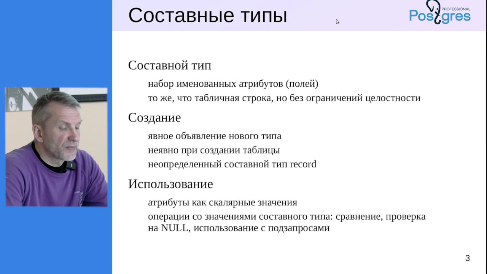

## 2. Конструирование составного значения

Значение составного типа можно сконструировать как литерал: в скобках перечисляются значения атрибутов, для типа currency литерал имеет вид '(100.00,"RUB")'; строковые значения внутри берутся в двойные кавычки. Альтернатива — конструктор row: значения атрибутов перечисляются через запятую, слово row можно опустить, если составной тип не вырожденный и содержит больше одного поля. В PostgreSQL составное значение вставляется несколькими способами: как строковый литерал, через ROW(80.00, RUB) или просто перечислением значений в скобках, например (20.00, RUB), и все варианты работают одинаково.

```sql
INSERT INTO transactions VALUES (1, NULL, '(100.00, RUB)');
INSERT INTO transactions VALUES (2, ROW(80.00, RUB), NULL);
INSERT INTO transactions VALUES (3, (20.00, RUB), NULL);

=> INSERT INTO transactions VALUES (1, NULL, '{"100.00", "RUB"}');

=> INSERT INTO transactions VALUES (2, ROW(80.00, 'RUB'), NULL);
```

*Источник: [00:03:51], [00:04:11], [00:04:32], [00:04:52], [00:05:12]*

## 3. Доступ к атрибутам составного значения

Как правило, составное значение требуется брать в скобки, например, чтобы отличать атрибут записи от столбца таблицы или когда используется выражение. Для доступа к отдельному атрибуту нужно взять соответствующую часть в скобки и затем через точку добавить имя атрибута, например (t.debit).amount; так же читается атрибут приведённого значения, например ((10.00,'RUB')::currency).amount.

```sql
SELECT (t.debit).amount, (t.credit).amount FROM transactions t;

SELECT ((10.00,'RUB')::currency).amount;

=> SELECT (t.debit).amount, (t.credit).amount FROM transactions t;
=> SELECT ((10.00,'RUB')::currency).amount;
```

*Источник: [00:05:32], [00:06:12], [00:06:52]*

> [!quote]- Кадр [00:06:12]
> 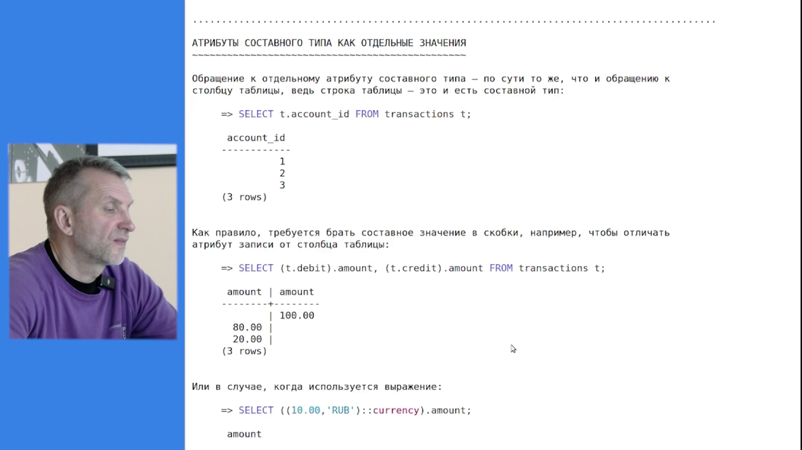

## 4. Псевдотип record

Псевдотип record — это неопределённая запись, у которой нет имён атрибутов. Составное значение можно привести к псевдотипу record, но его атрибуты остаются безымянными, поэтому обратиться к атрибуту такой записи по имени нельзя — возникает ошибка could not identify column.

```sql
SELECT ((10.00,'RUB')::record).amount;
ERROR:  could not identify column "amount" in record data type

=> SELECT ((10.00,'RUB')::record).amount;

ERROR:  could not identify column "amount" in record data type
```

| | составное значение типа currency | запись record |
|---|---|---|
| доступ к атрибуту через точку | (t.debit).amount работает | ошибка could not identify column "amount" in record data type |

*Источник: [00:06:52], [00:07:42], [00:08:03], [00:08:43]*

## 5. Сравнение и подзапросы над составными типами

Для составных типов работают проверка на неопределенность IS [NOT] NULL и сравнение IS [NOT] DISTINCT FROM, а значения сравниваются поэлементно, как строки посимвольно, с множеством тонкостей вокруг неопределённых значений внутри записей. Составные типы можно применять с подзапросами, при этом подзапрос может находиться во фразе IN — это удобно, например, для поиска мест среди билетов на сеанс. Билеты хранятся в таблице tickets с полями line (текст), number (целое) и movie_start (дата); запрос использует пару (line, number) как композитное значение и проверяет, входит ли она в подзапрос, выбирающий line и number из tickets с фильтром movie_start = current_date. Без этой возможности пришлось бы явно соединять таблицы.

```sql
=> SELECT * FROM seats WHERE (line, number) IN (
      SELECT line, number FROM tickets WHERE movie_start = current_date
  );

=> CREATE TABLE seats(
    line text,
    number integer
);
=> SELECT typname FROM pg_type WHERE typname = 'seats';

SELECT * FROM seats WHERE (line, number) IN (
    SELECT line, number FROM tickets WHERE movie_start = current_date
);
```

*Источник: [00:00:34], [00:09:23], [00:09:43], [00:10:33], [00:10:53], [00:11:22] и др.*

> [!quote]- Кадр [00:09:23]
> 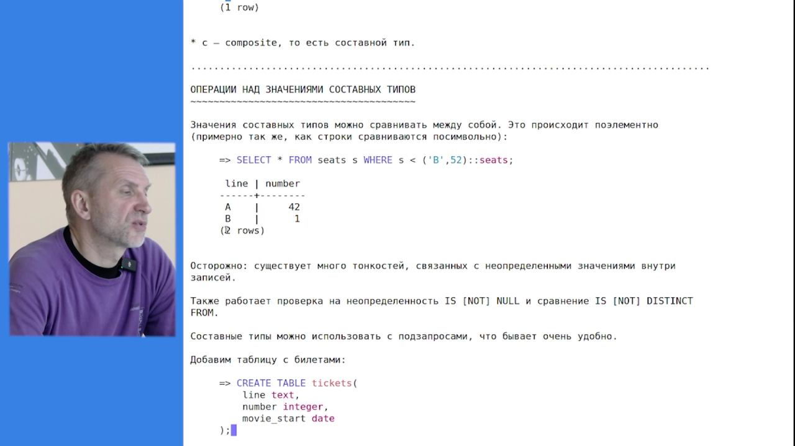

> [!quote]- Кадр [00:09:43]
> 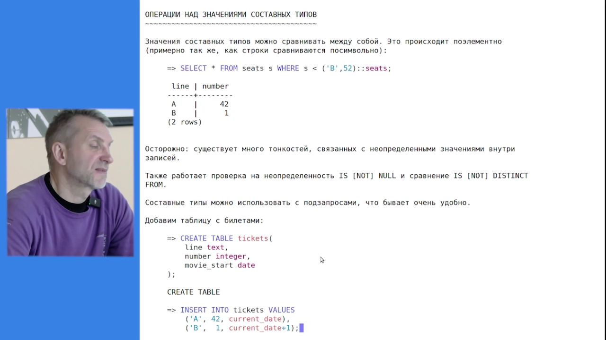

> [!quote]- Кадр [00:13:13]
> 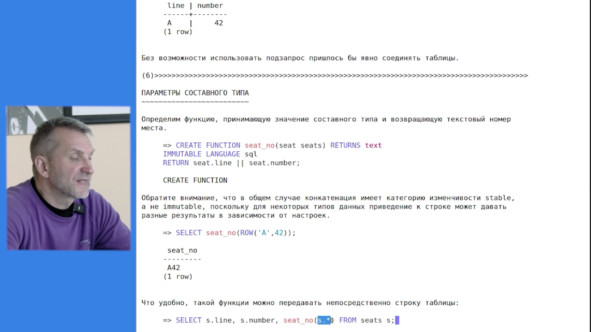

## 6. Вычисляемые поля: функции, представления и GENERATED столбцы

Подпрограмма может принимать параметры составного типа; с их помощью можно реализовывать подобие вычисляемых полей, хотя в Postgres вычисляемые поля уже появились с нюансами, отличающими реализацию от SQL-стандарта. Для типа seats создаётся SQL-функция seat_no, возвращающая text и вычисляющая seat.line || seat.number; в SQL-запросе s.seat_no — обращение к столбцу, seat_no(s) — вызов функции, а number(s) — тоже вызов функции, то есть table.column и column(table) взаимозаменяемы; аналогично функция подсчёта книг принимает составной тип books и возвращает целое число, и её можно использовать в представлении catalog_v как вычисляемое поле. В запросе удобно передавать целиком текущую строку таблицы в функцию, указав S.*: для каждой строки отрабатывает функция, происходит пробег по таблице, и значение выводится отдельным столбцом; создаётся представление seats_v на основе запроса SELECT s.line, s.number, seat_no(s) FROM seats s, и функцию можно использовать в представлении как вычисляемое поле. Настоящие вычисляемые столбцы определяются декларативно и появились в Postgres начиная с 12-й версии; в PostgreSQL столбцы можно определять как GENERATED ALWAYS AS ... STORED, ключевое слово STORED отличает эту реализацию от стандарта. Такие столбцы не вычисляются на лету, а сохраняются в таблице: Postgres вычисляет значение и записывает его, изменить напрямую нельзя; от вычисляемого столбца можно отказаться с помощью ALTER TABLE ... ALTER COLUMN ... DROP EXPRESSION — столбец становится обычным, в него можно вручную вносить значения, а существующие данные сохраняются.

```sql
CREATE FUNCTION seat_no(seat seats) RETURNS text
   IMMUTABLE LANGUAGE sql
   RETURN seat.line || seat.number;

CREATE VIEW seats_v AS
   SELECT s.line, s.number, seat_no(s) FROM seats s;

CREATE FUNCTION seat_no(seat seats) RETURNS text
   IMMUTABLE LANGUAGE sql
   RETURN seat.line || seat.number;

=> CREATE FUNCTION seat_no(seat seats

CREATE VIEW seats_v AS
   SELECT s.line, s.number, seat_no(s) FROM seats s;

SELECT * FROM seat('A', 42);

CREATE TABLE seats2(
    line text,
    number integer,
    seat_no text GENERATED ALWAYS AS (seat_no(ROW(line,number))) STORED
);

ALTER TABLE seats2 ALTER COLUMN seat_no DROP EXPRESSION;

\d seats2

ALTER TABLE seats2 ALTER COLUMN seat_no DROP EXPRESSION;

\d seats2
Table "public.seats2"
Column | Type | Collation | Nullable | Default
---------+--------+-----------+----------+---------
line | text | | |
number | integer | | |
seat_no | text | | |
```

| Выражение | Что это |
|---|---|
| s.seat_no | столбец |
| seat_no(s) | вызов функции |
| s.number | обращение к столбцу |
| number(s) | вызов функции |

*Источник: [00:11:42], [00:12:13], [00:12:53], [00:13:33], [00:15:23], [00:15:43] и др.*

> [!quote]- Кадр [00:11:42]
> 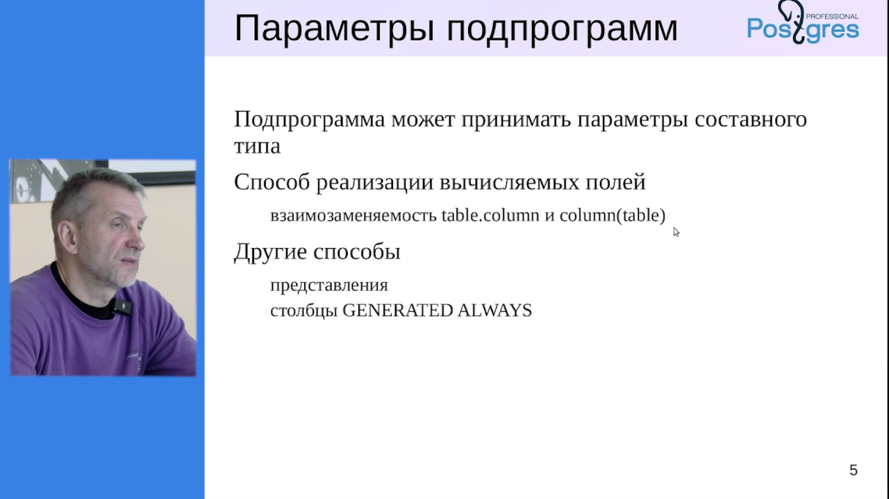

> [!quote]- Кадр [00:35:20]
> 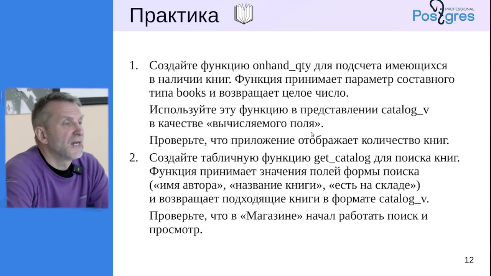

## 7. Функции, возвращающие составной тип, и табличные функции

Функцию можно объявить как RETURNS seats, чтобы она конструировала и возвращала табличную строку по отдельным компонентам через RETURN ROW(line, number)::seats; RETURNS SETOF seats означает возврат нескольких составных значений, то есть таблицы. Функция может быть объявлена с INOUT-параметрами line и number, при этом возвращаемый составной тип остаётся анонимным: значения берутся из выходных параметров, а названия столбцов — из параметров; однострочные функции возвращают одно значение составного типа и обычно вызываются в списке выборки (SELECT list), а в предложении FROM — возвращают однострочную таблицу. Результат составного типа можно развернуть в однострочную таблицу, дописав `.*`: SELECT (seat('A', 42)).*; SELECT * FROM seat('A', 42) возвращает таблицу с колонками line и number, а SELECT seat('A', 42) — одно значение (A,42); чтобы использовать вызов функции в FROM, нужно добавить псевдоним, уточняющий названия столбцов. Табличные функции возвращают несколько строк и объявляются через RETURNS SETOF или RETURNS TABLE; при RETURNS TABLE указываются названия и типы столбцов, и такие функции обычно вызываются в FROM как представление с параметрами. Примеры: rect_hall(max_line, max_number) возвращает SETOF seats и создаёт зал, формируя строки из generate_series(1,max_line) AS line и generate_series(1,max_number) AS number с SELECT chr(line+64), number; amphitheatre(max_line) возвращает TABLE(t_line text, t_number integer) и формирует амфитеатр, где внешний generate_series задаёт ряды, а внутренний generate_series(1, line) — места; WITH ORDINALITY нумерует строки, столбец ordinality идёт последним, но его можно переставить первым.

```sql
CREATE FUNCTION seat(line text, number integer) RETURNS seats
IMMUTABLE LANGUAGE sql
RETURN ROW(line, number)::seats;

CREATE FUNCTION seat(line INOUT text, number INOUT integer)
    IMMUTABLE LANGUAGE sql
    RETURN (line, number);

CREATE FUNCTION rect_hall(max_line integer, max_number integer)
RETURNS TABLE(t_line text, t_number integer)
LANGUAGE sql
BEGIN ATOMIC
        SELECT chr(line+64), number
          FROM generate_series(1,max_line) AS line,
               generate_series(1,max_number) AS number;
END;

SELECT (seat('A', 42)).*;

CREATE FUNCTION rect_hall(max_line integer, max_number integer)
   RETURNS SETOF seats
   IMMUTABLE LANGUAGE sql
   BEGIN ATOMIC
       SELECT chr(line+64), number
       FROM generate_series(1,max_line) AS line,
            generate_series(1,max_number) AS number;
   END;

CREATE FUNCTION amphitheatre(max_line integer)
   RETURNS TABLE(t_line text, t_number integer)
   IMMUTABLE LANGUAGE sql
   BEGIN ATOMIC
       SELECT chr(line + 64), number
       FROM generate_series(1,max_line) AS line,
            generate_series(1, line) AS number;
   END;

=> SELECT *
   FROM rect_hall(max_line => 2, max_number => 3) WITH ORDINALITY;

CREATE FUNCTION rect_hall(max_line integer, max_number integer)
   RETURNS SETOF seats
   IMMUTABLE LANGUAGE sql
   BEGIN ATOMIC
       SELECT chr(line+64), number
       FROM generate_series(1,max_line) AS line,
            generate_series(1,max_number) AS number;
   END;

CREATE FUNCTION amphitheatre(max_line integer)
   RETURNS TABLE(t_line text, t_number integer)
   IMMUTABLE LANGUAGE sql
   BEGIN ATOMIC
       SELECT chr(line + 64), number
       FROM generate_series(1,max_line) AS line,
            generate_series(1, line) AS number;
   END;

CREATE FUNCTION rect_hall(
       max_line integer, max_number integer,
       OUT p_line text, OUT p_number integer
  )
  RETURNS SETOF record
  IMMUTABLE LANGUAGE sql
  BEGIN ATOMIC
    SELECT chr(line+64), number
    FROM generate_series(1,max_line) AS line,
         generate_series(1,max_number) AS number;
  END;

CREATE FUNCTION amphitheatre(max_line integer)
RETURNS TABLE(t_line text, t_number integer)
IMMUTABLE LANGUAGE sql
BEGIN ATOMIC
        SELECT chr(line + 64), number
               FROM generate_series(1,max_line) AS line, -- <--+
                    generate_series(1, --                |
                                     line ----------------+
                                ) AS number;
END;
```

> [!info] Зачем это нужно
> Более правильный вариант в большинстве случаев использования таких функций.

*Источник: [00:18:24], [00:19:50], [00:20:10], [00:21:30], [00:21:50], [00:23:30] и др.*

> [!quote]- Кадр [00:18:24]
> 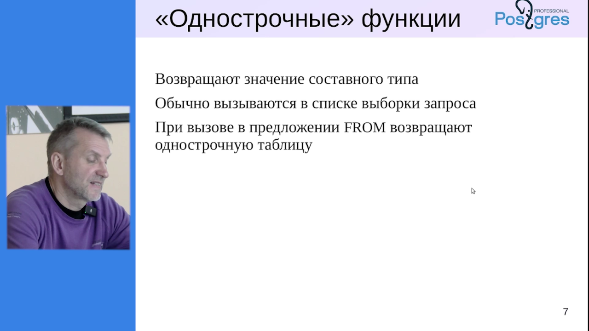

> [!quote]- Кадр [00:23:30]
> 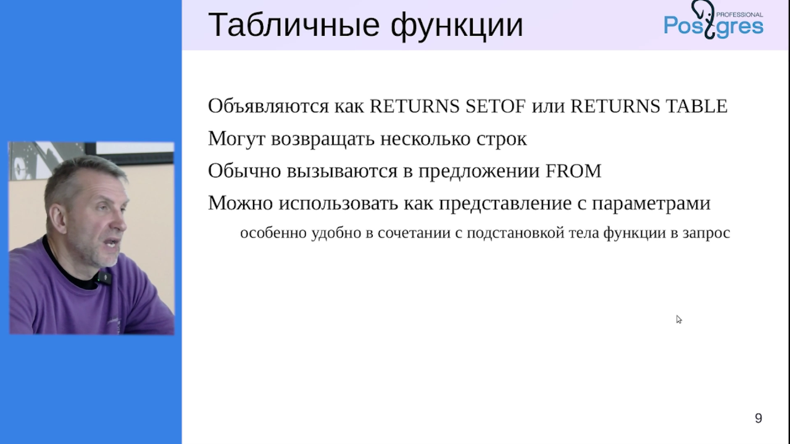

## 8. RETURNS record, SETOF record и column definition list

Функция может возвращать составной тип без уточнения структуры — для этого используется RETURNS record. При вызове функции с RETURNS record в FROM PostgreSQL требует список определения столбцов (column definition list); без него возникает ошибка, а решение — указать имена и типы столбцов через AS, например AS (line text, number integer). Вместо SETOF можно использовать безымянный тип record; RETURNS SETOF record дописывается, чтобы подчеркнуть, что возвращается не одна строка, а несколько, и при использовании record нужно уточнять, какие столбцы, каких типов и с какими названиями мы хотим получить.

```sql
CREATE FUNCTION seat(line text, number integer) RETURNS record
   IMMUTABLE LANGUAGE sql
   RETURN (line, number);

=> SELECT * FROM seat('A',42);
ERROR:  a column definition list is required for functions returning "record"
=> SELECT * FROM seat('A',42) AS (line text, number integer);

CREATE FUNCTION rect_hall(max_line integer, max_number integer)
RETURNS SETOF record
IMMUTABLE LANGUAGE sql
BEGIN ATOMIC
    SELECT chr(line+64), number
           FROM generate_series(1,max_line) AS line,
                generate_series(1,max_number) AS number;
END;

SELECT * FROM rect_hall(max_line => 2, max_number => 3)
           AS (a_line text, a_number integer);
```

| Возврат | Описание столбцов при вызове |
|---|---|
| SETOF seats | column definition list не нужен |
| SETOF record | нужен AS (имя тип, …) |

*Источник: [00:22:10], [00:22:50], [00:24:55], [00:25:15], [00:25:55]*

## 9. Выполнение функций в запросе: Function Scan, LATERAL, IMMUTABLE

Postgres сначала полностью выполняет функцию, а затем работает с полученными строками; при обращении к функции во фразе FROM (Function Scan) запросы из неё выполняются полностью, и только затем к результату применяются дополнительные условия из вызывающего запроса, а оптимизатор в большинстве случаев не может развернуть функцию до базового кода, что может быть неэффективно. Функцию можно использовать во фразе FROM как таблицу или представление, при этом можно использовать параметры; функцию, возвращающую скалярное значение, можно вызвать через SQL-запрос, результатом будет одна строка из одного столбца. Тело функции может подставляться прямо в вызывающий запрос, если функция написана на SQL, не имеет категорию VOLATILE, не является STRICT и содержит единственный оператор SELECT; изменчивость (VOLATILE) препятствует подстановке, также тело не подставляется при вызовах изменчивых функций; пометка IMMUTABLE позволяет развернуть функцию внутрь запроса и даёт более эффективный план. Если функция обращается к столбцам таблиц, стоящих левее, перед ней неявно подразумевается ключевое слово LATERAL; при использовании функций в FROM LATERAL работает по умолчанию, а для подзапросов его нужно указывать явно. К табличной функции можно обращаться не только в FROM, но и в списке SELECT: синтаксис Postgres допускает такой вызов, но по-хорошему вызов табличных функций должен происходить в предложении FROM.

```sql
=> ALTER FUNCTION rect_hall(integer, integer) IMMUTABLE;
ALTER FUNCTION
=> EXPLAIN (costs off)
SELECT * FROM rect_hall(3,4) WHERE t_line = 'A';
            QUERY PLAN
------------------------------------------------------------
 Nested Loop
  ->  Function Scan on generate_series line
         Filter: (chr((line + 64)) = 'A'::text)
  ->  Function Scan on generate_series number
(4 rows)

=> SELECT rect_hall(3,4);
```

*Источник: [00:21:10], [00:28:40], [00:29:41], [00:31:01], [00:31:41], [00:32:31] и др.*

> [!quote]- Кадр [00:21:10]
> 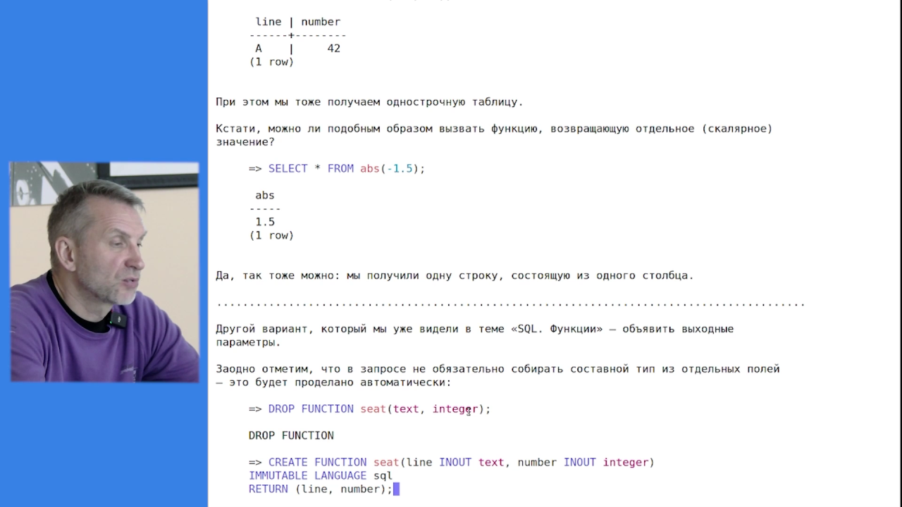

> [!quote]- Кадр [00:32:31]
> 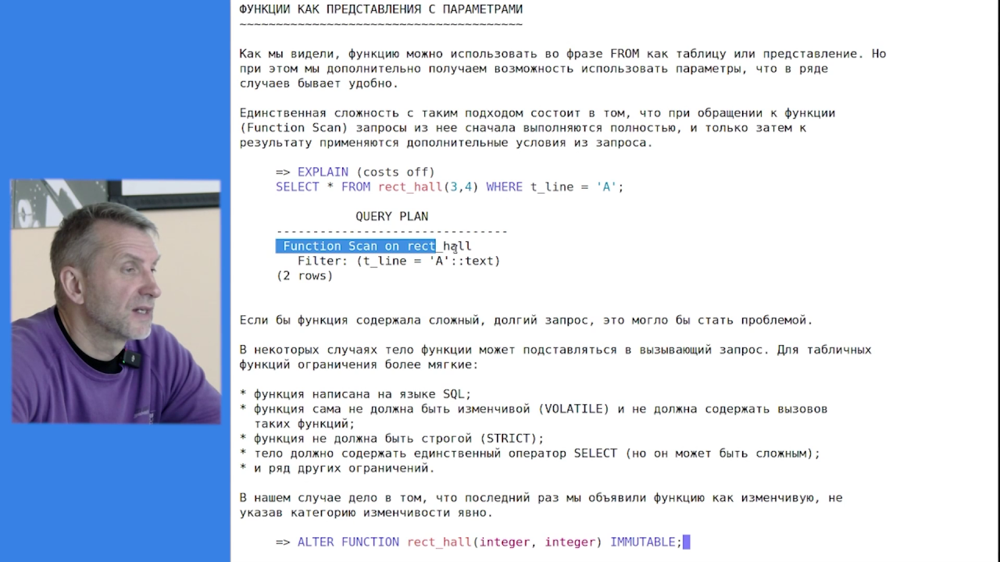

## 10. generate_series и строковые типы

Функция generate_series позволяет генерировать последовательные целочисленные значения, а также значения типа даты и времени, но не работает со строковыми типами из коробки.

*Источник: [00:37:10]*

> [!quote]- Кадр [00:37:10]
> 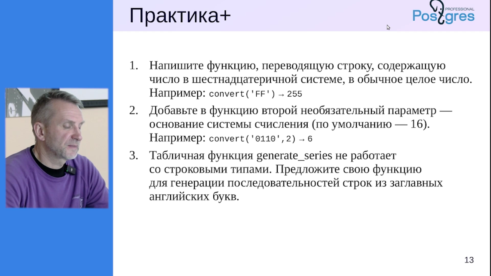

## Схема

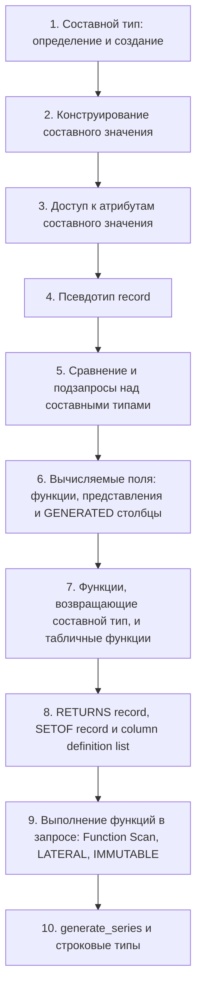

## Итог

> [!success] Что в итоге
> Составной тип в Postgres — это набор именованных атрибутов, по сути табличная строка без ограничений целостности, создаваемая явно через CREATE TYPE или неявно при создании таблицы. Его значения конструируются литералом или через ROW, атрибуты читаются через точку после заключения поля в скобки, а приведение к record делает атрибуты безымянными и запрещает такой доступ. На составных типах строятся функции, представления и хранимые вычисляемые столбцы GENERATED ALWAYS AS ... STORED, от которых можно отказаться через DROP EXPRESSION. Функции делятся на однострочные и табличные, для record в FROM требуется column definition list, а Function Scan, неявный LATERAL и пометка IMMUTABLE объясняют порядок выполнения и возможность развернуть функцию внутрь запроса для более эффективного плана.

