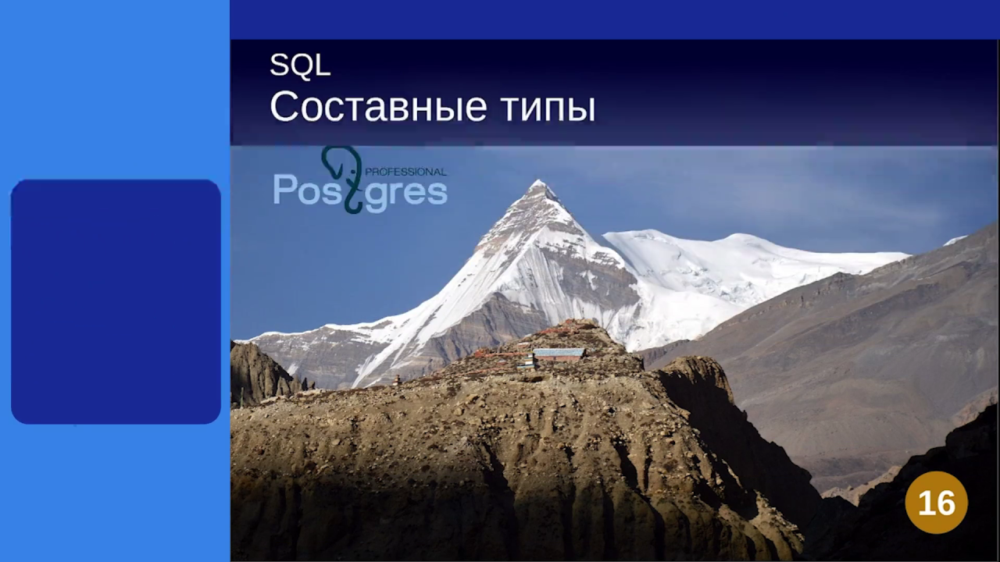
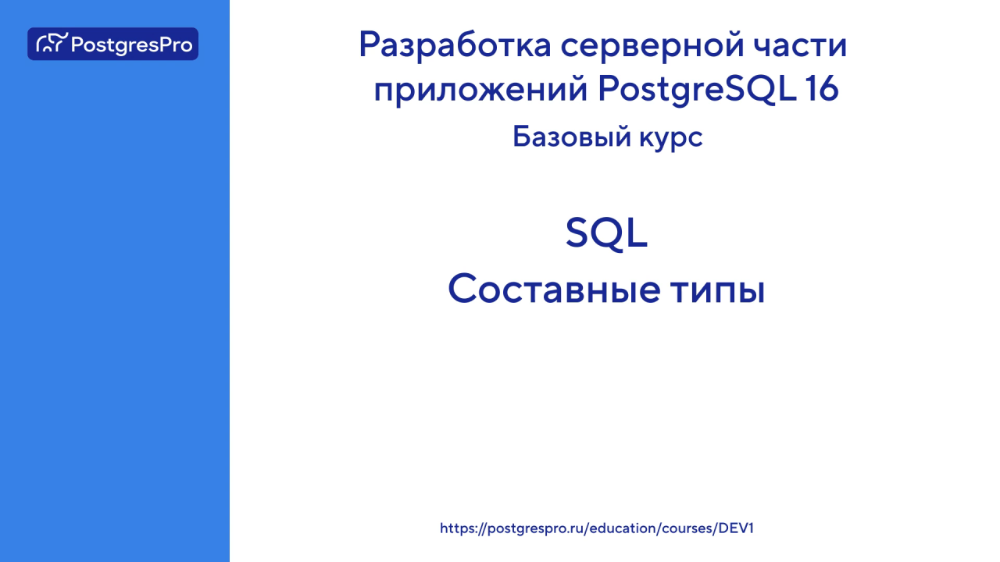
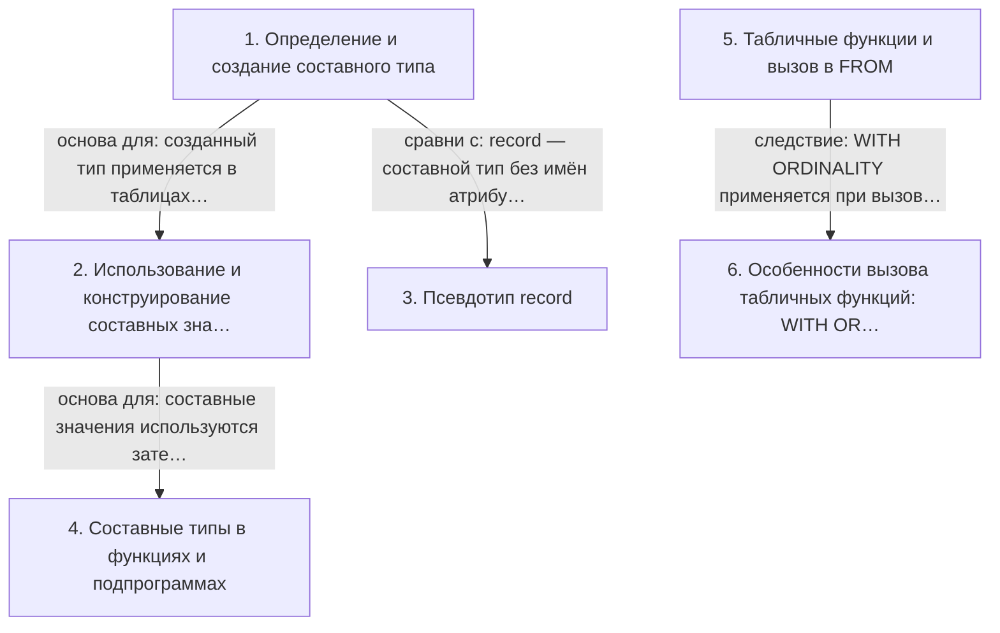

# Составные типы, табличные функции и генерируемые столбцы в PostgreSQL

> [!abstract] Обзор
> Конспект лекций об SQL-возможностях PostgreSQL: составных типах, их объявлении, использовании в таблицах и запросах, конструировании значений и псевдотипе record. Отдельно разобраны табличные функции и функции, возвращающие множество, их вызов в предложении FROM, разворачивание составных значений, WITH ORDINALITY и неявный LATERAL. Рассматриваются генерируемые и вычисляемые столбцы, в том числе отказ от выражения через DROP EXPRESSION, а также просмотр типов в системном каталоге. Замыкают материал развёртывание SQL-функции оптимизатором и влияние категории изменчивости на план запроса.

> [!info] Курс
> [[index|Оглавление курса]]

## Оглавление
1. [[#1. Определение и создание составного типа]]
2. [[#2. Использование и конструирование составных значений]]
3. [[#3. Псевдотип record]]
4. [[#4. Составные типы в функциях и подпрограммах]]
5. [[#5. Табличные функции и вызов в FROM]]
6. [[#6. Особенности вызова табличных функций: WITH ORDINALITY и LATERAL]]
7. [[#7. Разворачивание и сборка составного значения]]
8. [[#8. Развёртывание SQL-функции и категории изменчивости]]
9. [[#9. Генерируемые и вычисляемые столбцы]]
10. [[#10. Просмотр пользовательских и неявных типов]]

**Схема** — [[#Схема]]
**Итог** — [[#Итог]]

## 1. Определение и создание составного типа

Составной тип — это набор именованных атрибутов, аналог record или struct; фактически табличная строка, но без ограничений целостности. В первую очередь он используется при вызове и конструировании функций. Составной тип можно объявить явно командой CREATE TYPE; Postgres также неявно создаёт составной тип на основе структуры любой создаваемой таблицы. Пример: тип currency включает код валюты и величину, объединяя в одном целом значения и единицы.

*Источник: [00:00:04], [00:00:08]*

> [!quote]- Кадр [00:00:08]
> 

> [!quote]- Кадр [00:00:04]
> 

## 2. Использование и конструирование составных значений

Составной тип можно использовать как атрибут таблицы, обращаться к этому атрибуту и извлекать из него отдельные поля. Чтобы получить доступ к отдельному атрибуту составного поля, нужно взять составное поле в скобки и через точку указать имя атрибута, например (t.debet).amount. Поддерживаются сравнение, проверка на null, сравнение с null (is not distinct from), а также использование с подзапросами. Значение составного типа можно сконструировать как литерал: в скобках перечисляются значения атрибутов, строковые значения берутся в двойные кавычки. Также значение можно сконструировать с помощью фразы конструктора row.

*Источник: [00:00:04]*

## 3. Псевдотип record

Функцию с возвращаемым типом record нельзя использовать в FROM, так как названия столбцов не определены. Вызов такой функции в SELECT возвращает составное значение. При использовании типа record надо уточнять, какие столбцы каких типов и с какими названиями мы хотим получить. При конструировании составного значения без указания типа получается значение псевдотипа record без имён атрибутов. Функцию можно переопределить как возвращающую тип record — составной тип без уточнения структуры.

*Источник: [00:00:04]*

## 4. Составные типы в функциях и подпрограммах

Подпрограммы могут принимать параметры составного типа и возвращать значения составного типа. Подзапрос во фразе IN может возвращать несколько значений составного типа, например line и number, с которыми можно работать в основном запросе. Функция может принимать значение составного типа (в примере — SITS); внутри она вынимает отдельные столбцы и склеивает их в единую строку, которую возвращает. Функции, принимающей композитный тип, можно передавать целиком строку таблицы, например, через S.* (нотацию можно упростить, опустив звездочку). В PostgreSQL можно обратиться к функции как к столбцу таблицы, а к столбцу — как к функции.

*Источник: [00:00:04]*

## 5. Табличные функции и вызов в FROM

Функцию можно подставить в предложение FROM, и тогда она вернёт однострочную таблицу; обычно такие функции вызываются в списке выборки (select list). Табличная функция — это функция, возвращающая множество строк; её можно вызывать в предложении FROM или в списке SELECT, но по-хорошему вызов должен происходить в предложении FROM. Такие функции должны иметь в определении RETURNS SETOF или RETURNS TABLE. Можно описать табличную функцию по стандарту SQL с помощью CREATE FUNCTION ... RETURNS TABLE; после слова TABLE указывается структура возвращаемой таблицы. Вызов функции, возвращающей множество, можно использовать как вьюшку — представление с параметрами; вместо RETURNS SETOF можно использовать безымянный тип record, а для нескольких строк с выходными параметрами OUT нужно дописать RETURNS SETOF.

| Вариант | Что возвращает |
|---|---|
| RETURNS SETOF | набор строк определённого типа |
| record | безымянный тип |

> [!info] Зачем это нужно
> Чтобы возвращалось несколько строк.

*Источник: [00:00:04]*

## 6. Особенности вызова табличных функций: WITH ORDINALITY и LATERAL

При вызове табличных функций WITH ORDINALITY добавляет нумерацию строк; если ordinality оказывается последним столбцом, можно задать псевдонимы столбцов и переставить его первым. Если табличная функция используется в предложении FROM, перед ней неявно подразумевается ключевое слово LATERAL, поэтому функция может обращаться к столбцам таблиц, которые стоят в запросе левее неё. При использовании с функциями LATERAL работает по умолчанию. Функция с единственным параметром — количеством рядов — на каждой итерации берёт текущее значение из предыдущего выражения, последовательно наращивая размер ряда.

*Источник: [00:00:04]*

## 7. Разворачивание и сборка составного значения

Значение составного типа можно развернуть по столбцам в однострочную таблицу, дописав точку-звёздочку в список select. Того же результата можно добиться, поместив функцию в предложение FROM, что обычно более правильно. Составное значение можно собрать из отдельных полей, используя выходные параметры функции (OUT или INOUT). В самой функции при этом тип composite не указывается — возвращаемые значения берутся из выходных параметров.

> [!info] Зачем это нужно
> Помещение функции в FROM обычно более правильно.

*Источник: [00:00:04]*

## 8. Развёртывание SQL-функции и категории изменчивости

Оптимизатор в большинстве случаев не может развернуть функцию до базового кода, но иногда может подставить её тело прямо в вызывающий запрос. Для этого функция должна быть написана на чистом SQL, не иметь категорию volatile, не быть строгой и содержать один оператор SELECT. Если у функции не указана категория изменчивости, по умолчанию она volatile. Если переделать функцию на immutable, то при её вызове из FROM план запроса меняется: функция разворачивается внутрь запроса, и план становится более эффективным, чем при честной отработке и фильтрации всех возвращённых строк.

> [!info] Зачем это нужно
> Чтобы план стал более эффективным, функцию переделывают на immutable.

*Источник: [00:00:04]*

## 9. Генерируемые и вычисляемые столбцы

В Postgres вычисляемые поля уже появились, но есть нюансы, отличающие реализацию от SQL-стандарта: настоящие вычисляемые столбцы, определяемые декларативно, появились начиная с 12-й версии. Создав представление, в котором столбец описан как вызов функции, можно получить подобие вычисляемых столбцов. Генерируемый столбец задаётся выражением Generated always as ... stored; слово stored отличает реализацию от стандарта SQL. Postgres сам вычисляет значение такого столбца по заданному выражению и записывает его в этот столбец; такие столбцы не вычисляются на лету во время запроса, сохраняются в таблице и не могут быть изменены напрямую. Чтобы отказаться от использования столбца как вычисляемого и сделать его обычным, в команде ALTER TABLE для столбца указывают фразу DROP EXPRESSION.

> [!info] Зачем это нужно
> Позволяет отказаться от использования столбца как вычисляемого и сделать его обычным.

*Источник: [00:00:04]*

## 10. Просмотр пользовательских и неявных типов

С помощью короткой команды DT (T большое) можно обратиться к системному каталогу и получить информацию обо всех созданных пользовательских типах. Команда \dt скрывает типы, созданные неявно; их можно посмотреть, заглянув в системный каталог, в таблицу PG Types. В столбце TypeTab буква C означает композитный (составной) тип.

*Источник: [00:00:04]*

## Схема

## Итог

> [!success] Что в итоге
> Составной тип в PostgreSQL — это набор именованных атрибутов, аналог record или struct; его объявляют через CREATE TYPE, а Postgres неявно создаёт такие типы на основе таблиц. Составные типы применяются как атрибуты таблиц, в функциях и подзапросах, их значения конструируются литералом или row, а в функциях, возвращающих множество, используются RETURNS SETOF и RETURNS TABLE. Генерируемые столбцы хранятся в таблице и не изменяются напрямую, от вычисляемого выражения можно отказаться через DROP EXPRESSION. Категория изменчивости и вид SQL-функции влияют на то, развернёт ли оптимизатор её тело в вызывающий запрос.

