# PL/pgSQL: блоки, переменные, ветвления, циклы и функции

> [!abstract] Обзор
> Материал объединяет лекции по PL/pgSQL — процедурному языку Postgres, интегрированному с декларативным SQL и устанавливаемому по умолчанию как расширение с версии 9.0. Разобраны структура блока (метка, DECLARE, BEGIN, EXCEPTION, END), анонимные блоки DO, область видимости переменных, объявление и присваивание переменных с модификаторами CONSTANT и NOT NULL, а также вывод сообщений через RAISE NOTICE. Показаны подпрограммы с параметрами IN, OUT и INOUT и возвратом значений через RETURN, условные операторы IF и CASE с проверкой WHEN и трёхзначной логикой. Отдельно рассмотрены циклы LOOP, FOR и WHILE, управление ими через EXIT, CONTINUE, CONTINUE WHEN и метки, а также функции reverse_for, reverse_while и fmt. Завершают материал оптимизация вычисления выражений в Postgres 14, запуск psql, обращение к pg_proc и задание на ограничение длины в book_name.

> [!info] Курс
> [[index|Оглавление курса]]

## Оглавление
1. [[#1. Назначение и история PL/pgSQL]]
2. [[#2. Блоки, DO и синтаксис]]
3. [[#3. Переменные, присваивание и RAISE NOTICE]]
4. [[#4. Подпрограммы: параметры и возврат значений]]
5. [[#5. Условный оператор IF и CASE]]
6. [[#6. Циклы и управление итерациями]]
7. [[#7. Функции reverse и STRICT]]
8. [[#8. Функция fmt и форматирование телефонного номера]]
9. [[#9. Оптимизация, psql и pg_proc]]
10. [[#10. Задание: ограничение длины в book_name]]

**Схема** — [[#Схема]]
**Итог** — [[#Итог]]

## 1. Назначение и история PL/pgSQL

PL/pgSQL — доступный по умолчанию процедурный язык в Postgres, интегрированный с декларативным SQL и дополненный процедурными конструкциями. Он вдохновлён Oracle PL/SQL и продолжает традиции языков Ада, Паскаль, Алгол. Цели создания — иметь простой язык для написания пользовательских функций и триггеров и добавить к SQL управляющие структуры, циклы и логические условия. Появился он в первых версиях Postgres, в частности в версии 6.4 в 1998 году, а начиная с версии 9.0 устанавливается по умолчанию во все базы как расширение.

> [!info] Зачем это нужно
> Цель создания — простой язык для функций и триггеров с управляющими структурами поверх SQL.

*Источник: [00:00:10], [00:00:40], [00:01:00]*

> [!quote]- Кадр [00:00:10]
> 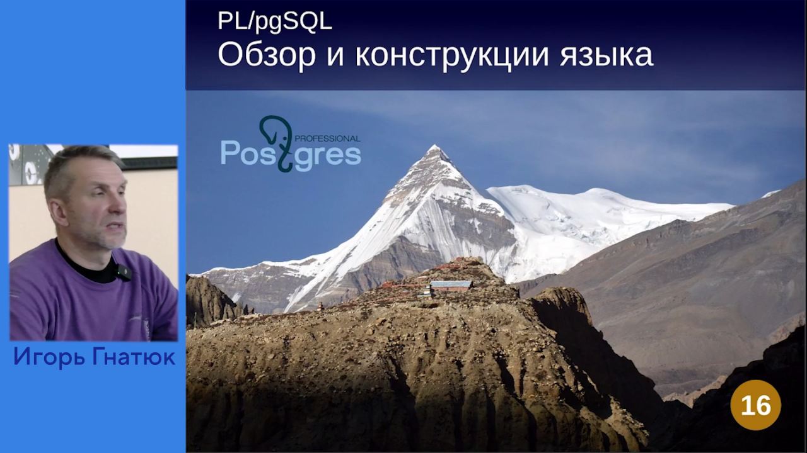

> [!quote]- Кадр [00:01:00]
> 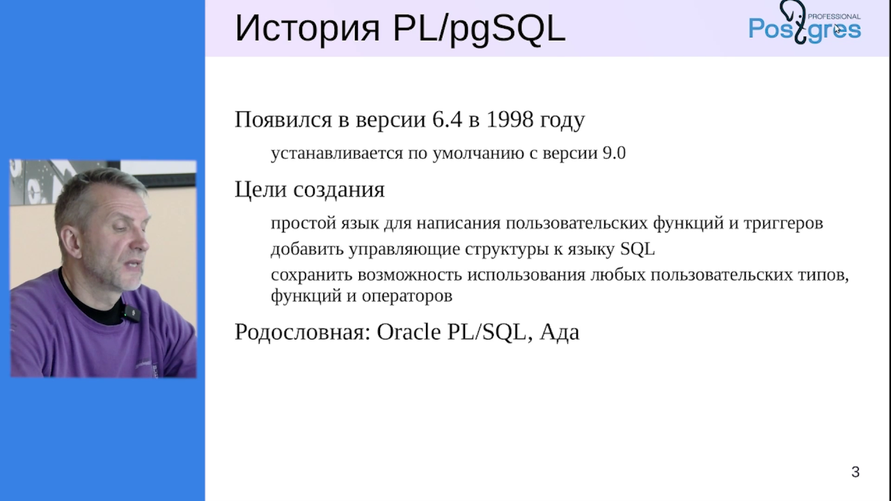

> [!quote]- Кадр [00:00:40]
> 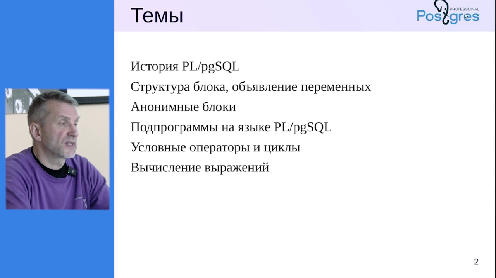

## 2. Блоки, DO и синтаксис

Блок включает необязательную метку, необязательную секцию DECLARE, обязательную секцию BEGIN (может быть пустой), необязательную EXCEPTION и завершается END с меткой; после BEGIN и END точка с запятой не ставится, а после объявлений и операторов — ставится. Блоки могут быть вложенными; переменные видны в своём блоке и вложенных, а переменная с тем же именем во вложенном блоке перекрывает внешнюю (с метками доступны обе). В PL/pgSQL есть однострочные и многострочные комментарии, правила такие же, как в SQL. Анонимный блок — нехранимый серверный код, выполняемый оператором DO $$ ... $$; в него нельзя передать параметры, он не возвращает значений, а по умолчанию используется PL/pgSQL.

```go
<<метка>>
DECLARE
    -- объявления переменных
BEGIN
    -- операторы
EXCEPTION
    -- обработка ошибок
END метка;

DO $$
<<outer_block>>
DECLARE
    foo text := 'Hello';
BEGIN
    <<inner_block>>
    DECLARE
        foo text := 'World';
    BEGIN
        RAISE NOTICE '%, %!', outer_block.foo, inner_block.foo;
        RAISE NOTICE 'Без метки — внутренняя переменная: %', foo;
    END inner_block;
END outer_block
$$;

DO $$
DECLARE
        -- Это однострочный комментарий.
        /* А это — многострочный.
           После каждого объявления ставится знак ';'.
           Этот же знак ставится после каждого оператора.
        */
        foo text;
        bar text := 'World'; -- также допускается = или DEFAULT
BEGIN
        foo := 'Hello'; -- это присваивание
        RAISE NOTICE '%, %!', foo, bar; -- вывод сообщения
END
$$;
```

> [!info] Зачем это нужно
> DO применяют для разового действия, когда не нужно создавать функцию.

*Источник: [00:02:20], [00:03:17], [00:03:53], [00:04:45], [00:05:36], [00:09:05] и др.*

> [!quote]- Кадр [00:02:20]
> 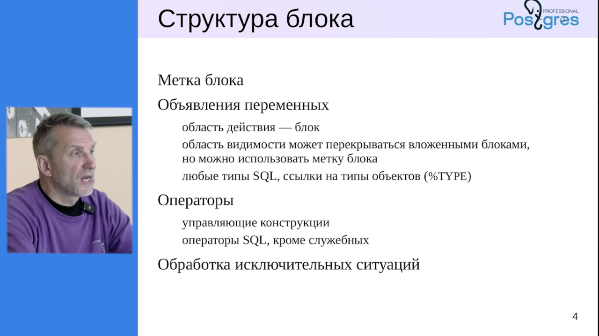

> [!quote]- Кадр [00:03:17]
> 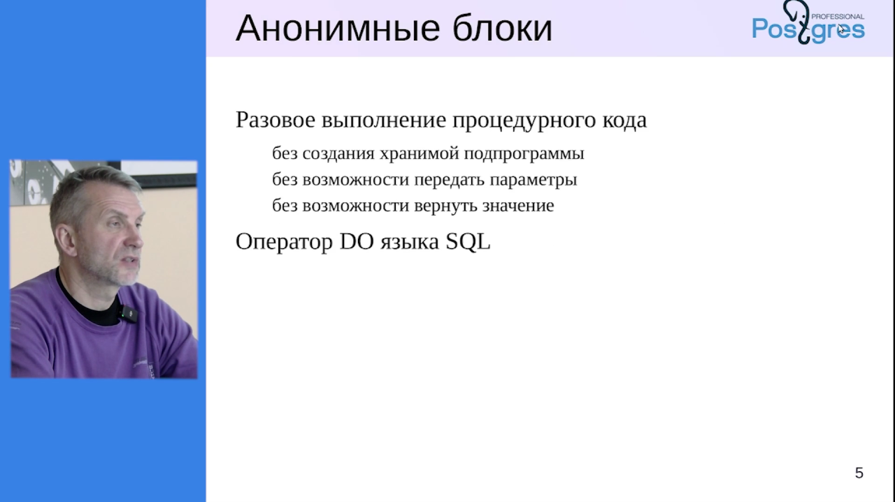

> [!quote]- Кадр [00:03:53]
> 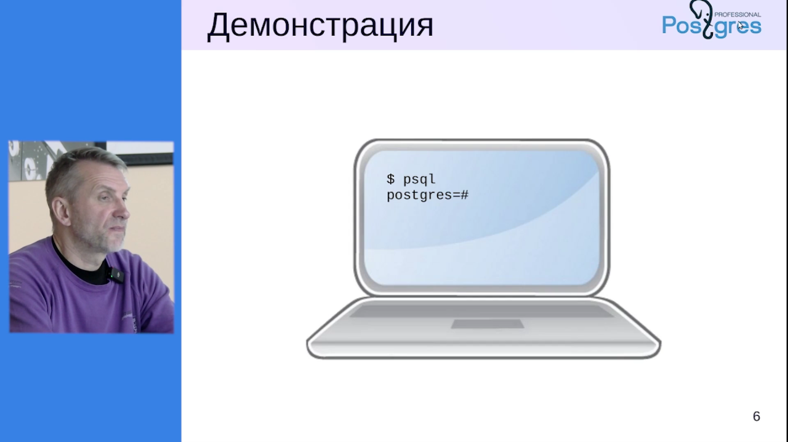

## 3. Переменные, присваивание и RAISE NOTICE

В секции DECLARE переменные объявляются как имя и тип, после каждого объявления ставится ';'; начальное значение задаётся через :=, = или DEFAULT, иначе переменная неопределена. Присваивание выполняется оператором :=, после оператора тоже ставится ';'. Модификаторы: CONSTANT запрещает изменение после инициализации, NOT NULL не допускает неопределённое значение; присваивание CONSTANT-переменной приводит к ошибке. Вывод сообщения выполняется оператором RAISE NOTICE с форматированием: в каждый знак % подставляется значение из списка после оператора, можно передавать подзапросы и CASE-выражения.

```go
DO $$
DECLARE
		foo text;
		bar text := 'World'; -- также допускается = или DEFAULT
BEGIN
		foo := 'Hello'; -- это присваивание
		RAISE NOTICE '%, %!', foo, bar; -- вывод сообщения
END
$$;

DO $$
DECLARE
  foo integer NOT NULL := 0;
  bar CONSTANT text := 42;
BEGIN
  bar := bar + 1; -- ошибка
END
$$;

ERROR:  variable "bar" is declared CONSTANT

RAISE NOTICE '%, %!', foo, bar; -- вывод сообщения
```

CONSTANT | NOT NULL
значение нельзя изменять после инициализации | не допускается неопределённое значение

*Источник: [00:05:36], [00:08:25], [00:08:45], [00:09:05], [00:09:28], [00:10:18] и др.*

## 4. Подпрограммы: параметры и возврат значений

Определение подпрограммы не зависит от языка и такое же, как в чистом SQL; в заголовке указываются имя, входные и выходные параметры, для функций — возвращаемое значение и категория изменчивости, а также LANGUAGE plpgsql. Возвращать значения из подпрограммы можно оператором RETURN (в том числе с выражением) или присваиванием значений выходным параметрам INOUT и OUT; при вызове эти значения возвращаются наружу. Функция sqr_out принимает IN a numeric и OUT retval numeric, результат a * a присваивается параметру retval; функция sqr_inout принимает INOUT a numeric и присваивает результат a * a тому же параметру a; функция sqr_in принимает IN a numeric и возвращает значение через RETURN. Категория изменчивости для этих функций — IMMUTABLE.

```go
CREATE FUNCTION sqr_in(IN a numeric) RETURNS numeric
   AS $$
BEGIN
    RETURN a * a;
END
$$ LANGUAGE plpgsql IMMUTABLE;

CREATE FUNCTION sqr_out(IN a numeric, OUT retval numeric)
   AS $$
BEGIN
    retval := a * a;
END
$$ LANGUAGE plpgsql IMMUTABLE;
```

*Источник: [00:00:10], [00:10:21], [00:10:50], [00:12:29], [00:13:19]*

> [!quote]- Кадр [00:10:50]
> 

> [!quote]- Кадр [00:10:21]
> 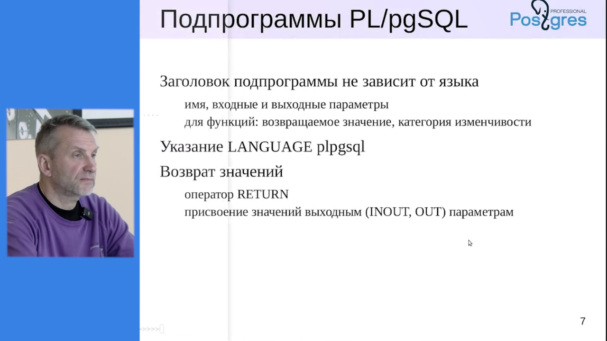

## 5. Условный оператор IF и CASE

IF — стандартный условный оператор в процедурном коде PostgreSQL: условие — это выражение, вычисляемое в значении логического типа, и оно должно быть истинно, false и NULL не подходят. Синтаксис: IF условие THEN операторы ELSIF условие THEN операторы ELSE операторы END IF; в простом случае секции ELSIF и ELSE могут отсутствовать. Если ни одно из условий не выполнено, выполняется то, что написано в секции ELSE. CASE похож на CASE языка SQL, но не возвращает значение; в форме по условию он записывается как CASE WHEN условие THEN ... ELSE ... END CASE. Секции WHEN проверяются по очереди, выполняются операторы первого условия, которое оказалось истинным; секций WHEN может быть несколько, а секция ELSE может отсутствовать. В форме по выражению после CASE указывается выражение, а в WHEN — значения, и выполняются операторы первого истинного условия «выражение = значение»; такая форма удобна и компактнее, когда условия однотипны. Если ни одно условие WHEN не истинно и секция ELSE отсутствует, возникает ошибка. Выражение CASE можно встраивать в список SELECT запроса и использовать в RAISE NOTICE; в примере CASE сопоставляет значение code с кодами регионов: 495 и 499 — Москва, 812 — Санкт-Петербург, 384 — Кемеровская область, для остальных — «Прочие».

```
IF условие THEN
    -- операторы
ELSIF условие THEN
    -- операторы
ELSE
    -- операторы
END IF;

CASE code
        WHEN '495', '499' THEN
            RAISE NOTICE '% — Москва', code;
        WHEN '812' THEN
            RAISE NOTICE '% — Санкт-Петербург', code;
        WHEN '384' THEN
            RAISE NOTICE '% — Кемеровская область', code;
        ELSE
            RAISE NOTICE '% — Прочие', code;
    END CASE;

CASE
  WHEN условие THEN
    -- операторы
  ELSE
    -- операторы
END CASE;

CASE выражение
    WHEN значение, ... THEN
        -- операторы
    ELSE
        -- операторы
END CASE;
```

| Форма CASE | После CASE | В WHEN |
|---|---|---|
| По условию | — | условие |
| По выражению | выражение | значение |

*Источник: [00:13:36], [00:13:56], [00:14:33], [00:14:53], [00:16:25], [00:16:45] и др.*

> [!quote]- Кадр [00:13:56]
> 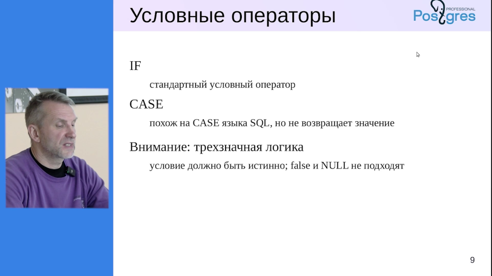

## 6. Циклы и управление итерациями

В PL/pgSQL есть цикл FOR по диапазону чисел, цикл WHILE с предусловием и бесконечный цикл LOOP. FOR перебирает значения счётчика; переменная цикла указывается в заголовке и не объявляется в DECLARE, инкремент задаётся через BY, а REVERSE меняет направление (границы тогда меняются местами). LOOP ... END LOOP создаёт бесконечный цикл, выход — по условию; WHILE выполняется, пока условие истинно, и инкремент делается явно. Управление: EXIT прерывает цикл, CONTINUE пропускает оставшиеся операторы текущей итерации, CONTINUE WHEN делает то же при истинном условии; метки позволяют указать нужный цикл при вложенности.

```go
LOOP
    -- операторы
END LOOP;

FOR имя IN низ .. верх BY инкремент
    LOOP
        -- операторы
    END LOOP;

WHILE условие
    LOOP
        -- операторы
    END LOOP;

FOR имя IN низ .. верх BY инкремент
LOOP
    -- операторы
END LOOP;

<<main_loop>>
    LOOP
        EXIT main_loop WHEN i > line_length;
        retval := substr(reverse_loop.line, i,1) || retval;
        i := i + 1;
    END LOOP;

FOR i IN 1 .. 100
LOOP
    s := s + i;
    CONTINUE WHEN mod(i, 10) != 0;
    RAISE NOTICE 'i = %, s = %', i, s;
END LOOP;

<<main_loop>>
LOOP
    EXIT main_loop WHEN i > line_length;
    retval := substr(reverse_loop.line, i,1) || retval;
    i := i + 1;
END LOOP;
```

*Источник: [00:19:38], [00:20:45], [00:21:05], [00:21:55], [00:23:25], [00:23:45] и др.*

> [!quote]- Кадр [00:19:38]
> 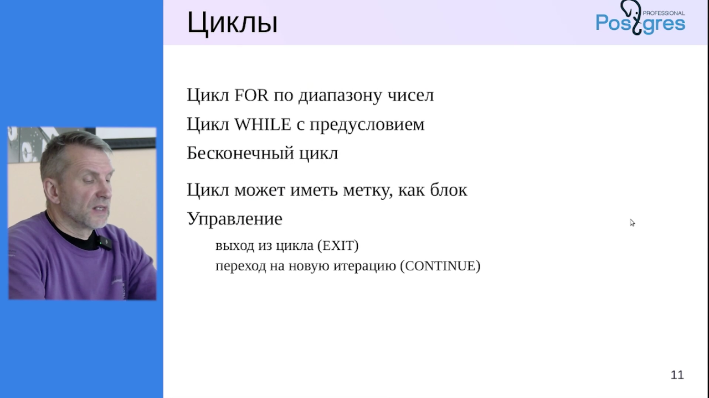

## 7. Функции reverse и STRICT

Функция reverse_for формирует перевёрнутую строку: в цикле FOR от 1 до line_length берёт i-й символ через substr и приклеивает его перед retval, возвращая результат. Функция reverse_while делает то же в цикле WHILE, увеличивая i на каждой итерации. Обе функции описаны как IMMUTABLE STRICT. Если в STRICT-функцию передать NULL или неопределённое значение, тело не выполняется, и функция сразу возвращает NULL.

```go
CREATE FUNCTION reverse_for (line text) RETURNS text
AS $$
DECLARE
    line_length CONSTANT int := length(line);
    retval text := '';
BEGIN
    FOR i IN 1 .. line_length
    LOOP
        retval := substr(line, i, 1) || retval;
    END LOOP;
    RETURN retval;
END
$$ LANGUAGE plpgsql IMMUTABLE STRICT;

CREATE FUNCTION reverse_while (line text) RETURNS text
AS $$
DECLARE
    line_length CONSTANT int := length(line);
    i int := 1;
    retval text := '';
BEGIN
    WHILE i <= line_length
    LOOP
        retval := substr(line, i, 1) || retval;
        i := i + 1;
    END LOOP;
    RETURN retval;
END
$$ LANGUAGE plpgsql IMMUTABLE STRICT;

CREATE FUNCTION sqr_out(IN a numeric, OUT retval numeric)
AS $$
BEGIN
    retval := a * a;
END
$$ LANGUAGE plpgsql IMMUTABLE;
```

*Источник: [00:22:15], [00:23:05], [00:23:25], [00:23:45], [00:24:09]*

## 8. Функция fmt и форматирование телефонного номера

Функция fmt принимает phone и возвращает code и num: если phone соответствует шаблону '^[0-9]*$' и его длина равна 10, code присваивается substr(phone,1,3), а num — substr(phone,4); иначе code и num присваиваются NULL. Вызов SELECT fmt('8122128506') возвращает (812,2128506). В более общем примере на вход подаётся текст, а на выходе нужно получить отформатированный телефонный номер, который в этом тексте передаётся: перед вытаскиванием и форматированием номера делается проверка соответствия входного параметра регулярному выражению и проверка длины входной строки. Форматирование производится с помощью вытаскивания из исходной строки подстрок, в том числе трёхзначного телефонного кода города; если входные данные корректны, происходит переход к форматированию, если что-то не так — выполняется выход с неопределёнными значениями.

```go
CREATE FUNCTION fmt( IN phone text, OUT code text, OUT num text)
AS $$
BEGIN
    IF phone ~ '^[0-9]*$' AND length(phone) = 10 THEN
        code := substr(phone,1,3);
        num  := substr(phone,4);
    ELSE
        code := NULL;
        num  := NULL;
    END IF;
END
$$ LANGUAGE plpgsql IMMUTABLE;
```

*Источник: [00:15:15], [00:15:35], [00:16:25], [00:16:45]*

## 9. Оптимизация, psql и pg_proc

В Postgres 14 появилась оптимизация: если выражение простое и не обращается к таблицам, обращение к планировщику не выполняется, срабатывает только синтаксический анализатор; скорость выполнения выражений невысокая, хотя разобранный запрос и план могут кэшироваться. Для работы в терминале вводится команда psql, после чего появляется приглашение postgres=#. Количество функций можно вычислить, обратившись к системному каталогу pg_proc с фильтрацией proname LIKE 'reverse%' и присвоив результат переменной, а затем вывести его через RAISE NOTICE.

```go
DO $$
DECLARE
    s integer;
BEGIN
    s := count(*) FROM pg_proc WHERE proname LIKE 'reverse%';
    RAISE NOTICE 'Всего функций "reverse" : %', s;
END
$$;
```

*Источник: [00:03:53], [00:27:07], [00:30:06]*

> [!quote]- Кадр [00:27:07]
> 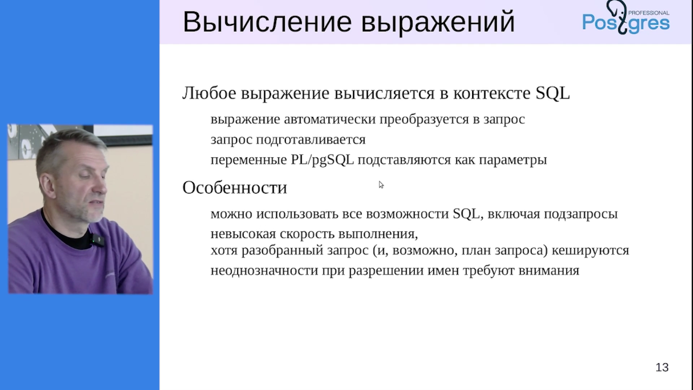


## 10. Задание: ограничение длины в book_name

Функция book_name должна возвращать значение длиной не более 45 символов. Избыточно длинное название книги должно обрезаться по границе целого слова, и если название обрезается, оно должно заканчиваться троеточием.

*Источник: [00:32:28]*

> [!quote]- Кадр [00:32:28]
> 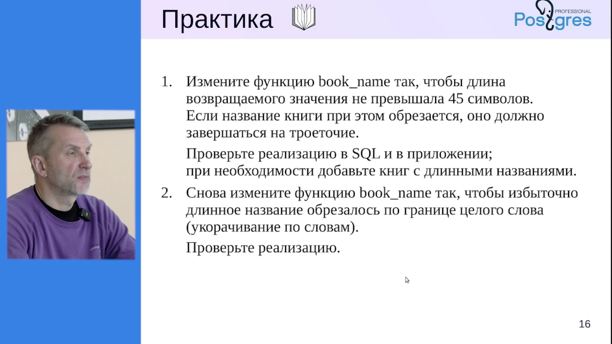

## Схема

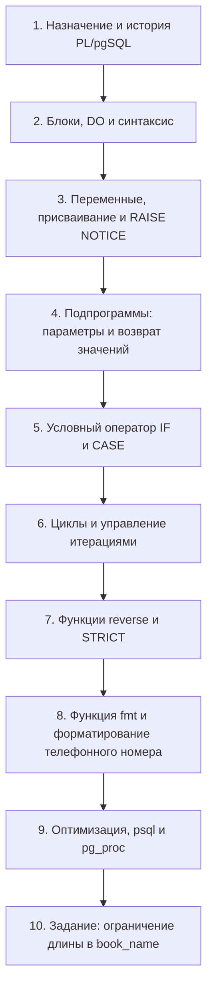

## Итог

> [!success] Что в итоге
> PL/pgSQL — процедурный язык Postgres по умолчанию, добавляющий к декларативному SQL управляющие структуры; его блок состоит из метки, DECLARE, BEGIN, EXCEPTION и END, а анонимный блок выполняется оператором DO без сохранения. Возврат значений возможен через RETURN или выходные параметры INOUT и OUT, а ветвление строится на строгой трёхзначной логике через IF и две формы CASE. Повтор реализуется циклами LOOP, FOR и WHILE с управлением через EXIT, CONTINUE, CONTINUE WHEN и метки, что демонстрируют функции reverse_for, reverse_while и fmt.

