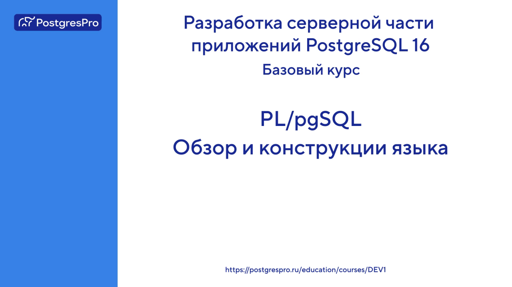
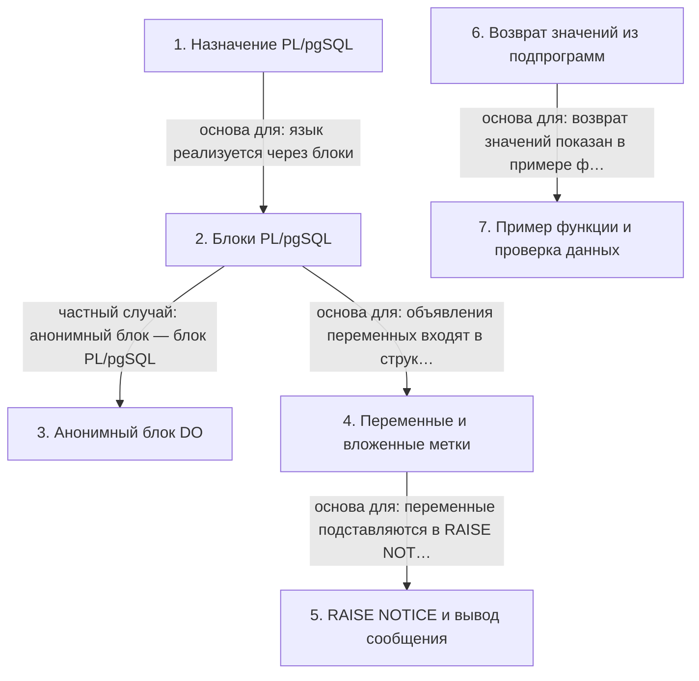

# PL/pgSQL: обзор и конструкции

> [!abstract] Обзор
> Материал объединяет обзор языка PL/pgSQL и его конструкций в Postgres: назначение языка, структуру блоков, анонимный блок DO, переменные, RAISE NOTICE, секцию exception, метки вложенных блоков, возврат значений, пример функции и проверку входных данных. Рассматриваются условный оператор if, два вида CASE, поведение CASE без ELSE, разновидности циклов, команды exit и continue, неявная переменная цикла, реверс в FOR, цикл while и бесконечный LOOP. Отдельно упоминаются STRICT-функции при передаче NULL и оптимизация простых выражений, появившаяся в Postgres 14. Темы связаны как части одного языка: блоки и переменные служат основой для выполнения операторов, а условные и циклические конструкции управляют логикой.

> [!info] Курс
> [[index|Оглавление курса]]

## Оглавление
1. [[#1. Назначение PL/pgSQL]]
2. [[#2. Блоки PL/pgSQL]]
3. [[#3. Анонимный блок (DO)]]
4. [[#4. Переменные и вложенные метки]]
5. [[#5. RAISE NOTICE и вывод сообщения]]
6. [[#6. Возврат значений из подпрограмм]]
7. [[#7. Пример функции и проверка данных]]
8. [[#8. Условные конструкции if и CASE]]
9. [[#9. Циклы и управление ими]]
10. [[#10. STRICT-функции и NULL]]
11. [[#11. Оптимизация простых выражений в Postgres 14]]

**Схема** — [[#Схема]]
**Итог** — [[#Итог]]

## 1. Назначение PL/pgSQL

PL/pgSQL — процедурный язык, который создан, чтобы добавить к декларативному SQL управляющие структуры, циклы и логические условия. Он продолжает традиции языков Ада, Паскаль, Алгол: используются if, end if, begin, end; такой синтаксис хорошо сочетается с декларативным SQL. PL/pgSQL всегда есть в базе данных Postgres и доступен по умолчанию, хорошо интегрирован с SQL; в нём доступно всё, что доступно в обычном SQL. Любое выражение вычисляется в контексте SQL: автоматически преобразуется в запрос вида SELECT и выполняется движком SQL, переменные подставляются в подготовленный запрос как параметры. В определении подпрограммы нужно указывать LANGUAGE plpgsql, а не SQL, а переменные могут использовать любые типы SQL, включая составные типы и массивы.

> [!info] Зачем это нужно
> Создан, чтобы дополнить декларативный SQL процедурными конструкциями.

*Источник: [00:00:04]*

> [!quote]- Кадр [00:00:04]
> 

## 2. Блоки PL/pgSQL

Код на PL/pgSQL состоит из блоков; блок может иметь метку и включать объявления переменных. Общая структура блока включает необязательную метку и необязательную секцию объявления переменных; секция операторов обязательна, но может быть пустой. Минимальный блок оформляется как DO $$ BEGIN END $$; begin и end — начало и конец блока, а не отдельные операторы; все операторы внутри блока разделяются точками с запятой, после begin и end точка с запятой не ставится. Областью видимости является сам блок и другие блоки, которые в него вложены; возможна вложенность блоков, а если не использовать метку, переменная будет взята локальной из текущего блока. Секция exception — необязательная секция для перехвата и обработки ошибок; если в блоке операторов попытаться изменить переменную, описанную как константа, возникает ошибка времени выполнения.

```
DO $$
BEGIN
    -- сами операторы могут и отсутствовать
END
$$;
```

*Источник: [00:00:04], [00:00:10], [00:07:35]*

> [!quote]- Кадр [00:00:10]
> 


## 3. Анонимный блок (DO)

Анонимный блок — это нехранимый серверный код, который выполняется единоразово; он записывается оператором DO, не именуется и нигде не сохраняется в системном каталоге. В DO-блоке может быть необязательный блок описания переменных. Команда do используется, если не нужно создавать функцию, для какого-то единоразового действия. В анонимный блок невозможно передать параметры, и он не возвращает значений; взаимодействовать с ним можно, записав данные в таблицы.

> [!info] Зачем это нужно
> Используется для разового действия, когда не нужно создавать функцию.

*Источник: [00:00:04]*


## 4. Переменные и вложенные метки

Блок описания переменных включает имя переменной, тип, возможно инициализацию. Для присваивания допустимо использовать `:=`, `=` или `DEFAULT`; если инициализация не производится, значение переменной будет неопределённым. Переменные могут иметь модификаторы: константа или not null (не допускающие неопределённые значения); пример — foo not null, bar определяется как константное значение. Во вложенном блоке можно объявить переменную с тем же именем, что и во внешнем блоке, а метки внешнего и внутреннего блоков позволяют квалифицировать, к какой переменной идёт обращение.

*Источник: [00:00:04]*


## 5. RAISE NOTICE и вывод сообщения

В RAISE NOTICE строка содержит форматные окна, и в каждый знак процента подставляется значение переменной из списка, перечисленного следом за оператором. Оператор RAISE NOTICE '% %!', foo, bar; выводит сообщение. В примере результат — NOTICE:  Hello, World!.

```go
DO $$
DECLARE
    foo text;
    bar text := 'World';
BEGIN
    foo := 'Hello';
    RAISE NOTICE '% %!', foo, bar; -- вывод сообщения
END
$$;

NOTICE:  Hello, World!
DO
```

*Источник: [00:00:04], [00:07:35]*


## 6. Возврат значений из подпрограмм

Возвращать значения из подпрограммы можно с помощью оператора RETURN или через выходные параметры OUT/INOUT, присваивая им значения. В PL/pgSQL результат функции можно вернуть через RETURN с выражением, через присваивание значения выходному параметру (OUT) или через параметр INOUT.

*Источник: [00:00:04]*


## 7. Пример функции и проверка данных

Функция возводит в квадрат число; тело функции берётся из входного параметра inA. Перед форматированием проверяется соответствие входного параметра регулярному выражению и длина входной строки. Если что-то не так во входных данных, происходит выход с неопределёнными значениями.

*Источник: [00:00:04]*


## 8. Условные конструкции if и CASE

В PL/pgSQL используется стандартный условный оператор if: условие имеет логический тип, затем пишется then и операторы; оператор может включать else if или else и заканчиваться end if, а простейший if может не иметь этих частей; если ни одно из условий не выполнено, выполняется секция else. CASE — это оператор выбора; его уместно сравнить с SWITCH или MATCH CASE, и он может встраиваться в список SELECT запроса. CASE может содержать несколько секций условия WHEN, которые проверяются по очереди, и выполняются операторы, соответствующие первому выполненному условию; CASE бывает по условию (обычный или поисковый) и по выражению: во втором случае после CASE сразу указывается выражение, а в WHEN — значения. Секции WHEN могут повторяться, секция ELSE может отсутствовать; управление передаётся в секцию ELSE, если ни одно условие WHEN не истинно, а если ELSE отсутствует, то при отсутствии сработавшего WHEN возникает ошибка. При оценке условий используется трехзначная логика: условие должно быть строго истинно; false и null не будут подходить под выполнение условий.

| Вид CASE | После CASE | В WHEN |
|---|---|---|
| По условию | — | условия |
| По выражению | выражение | значения |

> [!info] Зачем это нужно
> Форма по выражению может быть компактнее, когда проверяется значение уже вычисленного выражения.

*Источник: [00:00:04]*


## 9. Циклы и управление ими

В PL/pgSQL есть цикл с выходом по условию (exit), цикл for по диапазону чисел и цикл while с предусловием; цикл FOR по перебору чисел указывает переменную цикла, нижнюю и верхнюю границы и шаг, а переменную цикла достаточно указать в заголовке цикла, её не нужно явно описывать в DECLARE. Команда exit прерывает цикл, а continue прерывает текущую итерацию и передаёт управление в начало тела цикла для следующего прохода; в примере переменная цикла меняется от 1 до 100, и если она делится на 10 нацело, оставшиеся операторы игнорируются, поэтому выводятся только значения, кратные 10. Если нет вложенных циклов, метку можно опустить; при вложенных циклах метка указывает, из какого цикла выполняется выход; в цикл FOR можно добавить реверс, тогда значение счётчика на каждой итерации будет уменьшаться, а верхнюю и нижнюю границы нужно поменять местами. Цикл while выполняется, пока логическое условие истинно; в отличие от for, в цикле while переменную цикла нужно явно инкрементировать. Общая конструкция циклов без ограничивающих условий даёт бесконечный цикл; в PL/pgSQL можно организовать бесконечный цикл конструкцией LOOP, в нём нет предусловия while и конструкции for, а чтобы цикл не стал по-настоящему бесконечным, предусматривают условие выхода по превышению счётчиком длины строки.

| Цикл | Инкремент переменной цикла |
|---|---|
| for | явно не инкрементируют |
| while | нужно инкрементировать явно |

> [!info] Зачем это нужно
> Чтобы цикл не стал по-настоящему бесконечным, предусматривают условие выхода.

*Источник: [00:00:04]*


## 10. STRICT-функции и NULL

Если в strict-функцию передать неопределённое значение, тело функции не будет выполняться вообще.

*Источник: [00:00:04]*


## 11. Оптимизация простых выражений в Postgres 14

В Postgres 14 появилась оптимизация, которая вычисляет ряд выражений по упрощённой схеме. Если выражение простое и не обращается к таблицам, то вместо планировщика срабатывает только синтаксический анализатор.

*Источник: [00:00:04]*


## Схема



## Итог

> [!success] Что в итоге
> PL/pgSQL добавляет к декларативному SQL процедурные конструкции, а код на нём строится из блоков. Анонимный блок DO выполняется разово и не сохраняется; переменные объявляются с типами, инициализацией и модификаторами, а возврат значений возможен через RETURN и параметры OUT/INOUT. Условные конструкции представлены if и CASE; CASE бывает по условию и по выражению, а при оценке условий используется трехзначная логика. Циклы включают for, while и LOOP с управлением через exit и continue; отдельно отмечены STRICT-функции и оптимизация простых выражений в Postgres 14.

