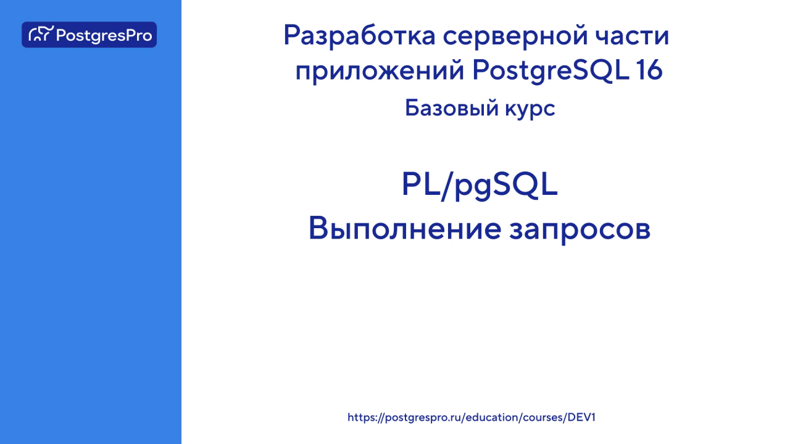
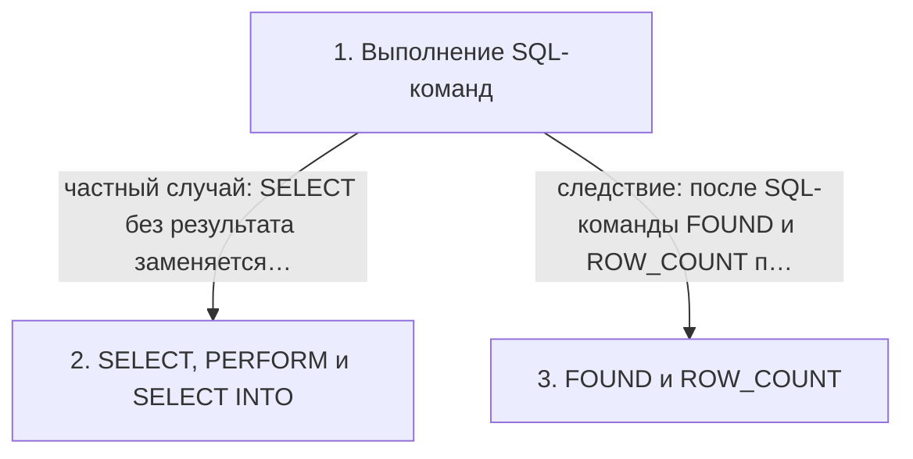

# Выполнение запросов в PL/pgSQL

> [!abstract] Обзор
> Материал посвящён выполнению запросов в PL/pgSQL и его интеграции с SQL. Рассмотрены основные способы работы с SQL-командами в процедурном коде: команды без возврата, подстановка переменных, замена SELECT на PERFORM, SELECT INTO и CTE, а также DML с returning и into. Отдельно разобраны управление транзакциями и требование чистого стека CALL для COMMIT. Значительная часть посвящена конфликтам имён между переменными и столбцами, способам их разрешения через квалификаторы, префиксы и параметр plpgsql.variable_conflict, а также диагностике через plpgsql.extrawarnings и расширение plpgsql_check. Завершают тему возврат строк из табличных функций через return next и return query, столбец Ordinality, категория STABLE для lc_time и получение pgRoutineAid.

> [!info] Курс
> [[index|Оглавление курса]]

## Оглавление
1. [[#1. Выполнение SQL-команд]]
2. [[#2. SELECT, PERFORM и SELECT INTO]]
3. [[#3. FOUND и ROW_COUNT]]
4. [[#4. DML с RETURNING, INTO и INTO STRICT]]
5. [[#5. Транзакции в процедурах и стек CALL]]
6. [[#6. Порядок строк без order by]]
7. [[#7. Конфликты имён: квалификаторы и префиксы]]
8. [[#8. Диагностика: extrawarnings и plpgsql_check]]
9. [[#9. Возврат строк из табличных функций]]
10. [[#10. lc_time и категория STABLE]]
11. [[#11. pgRoutineAid и схема функции]]

**Схема** — [[#Схема]]
**Итог** — [[#Итог]]

## 1. Выполнение SQL-команд

PL/pgSQL тесно интегрирован с SQL: выражения вычисляются как выражения SQL, а в процедурном коде можно использовать настоящие команды SQL, запрос пишется почти как на SQL. Можно использовать практически любые SQL-команды, кроме служебных: нельзя выполнять VACUUM или REINDEX. Команды без возврата, например insert, update, delete, просто пишутся в коде как есть. В запросах можно использовать локальные переменные: запросы подготавливаются, используется расширенный протокол запросов, и переменные подставляются как параметры; при выполнении на место параметров прозрачно подставляются значения. Если запрос читает из таблицы несколько строк, возвращается только одна; PL/pgSQL — интерпретируемый язык, поэтому при создании функции или процедуры нельзя сразу полностью оценить всю картину.

*Источник: [00:00:04], [00:00:08]*

> [!quote]- Кадр [00:00:08]
> 

## 2. SELECT, PERFORM и SELECT INTO

Чтобы выполнить SELECT, результат которого не важен (например, при вызове функции с побочным эффектом), в PL/pgSQL нужно заменить слово SELECT на PERFORM. SQL-версию SelectInto в PL/pgSQL использовать нельзя, так как интерпретатор не разберётся. Команда SELECT INTO в PL/pgSQL помещает результат запроса либо в одну переменную составного типа, либо в несколько скалярных переменных; если запрос возвращает несколько строк, в переменные попадает только первая. Функция, которая ничего не возвращает, имеет псевдотип void, и для её вызова используют PERFORM. Если есть общее табличное выражение (CTE), запрос придётся обернуть в ещё один select и уже этот внешний select заменить на perform.

*Источник: [00:00:04]*

> [!quote]- Кадр [00:00:04]
> 

## 3. FOUND и ROW_COUNT

Есть предопределённая переменная FOUND, которая всегда существует. После команды SQL переменная FOUND истинна, если команда что-то вернула или что-то сделала, и ложна, если ничего не вернула и ничего не сделала. После цикла её можно использовать, чтобы проверить, отработал ли цикл хотя бы один раз. После SQL-команды можно узнать количество обработанных строк через диагностику ROW_COUNT; получить ROW_COUNT можно с помощью getDiagnostics, при этом указывается целочисленная переменная.

*Источник: [00:00:04], [00:00:08]*

## 4. DML с RETURNING, INTO и INTO STRICT

Команды insert, update, delete могут возвращать результат, если у них есть предложение returning, и результат можно сохранить в переменные с помощью предложения into. В PL/pgSQL можно вернуть всю строку таблицы в переменную R типа record; переменная типа record — это составной тип без определённой структуры. Попытка вернуть несколько строк приводит к ошибке, в отличие от select: несколько строк нельзя поместить в переменную. INTO STRICT даёт гарантию, что запрос вернёт ровно одну строку, и избавляет от проверок в коде: если запрос вернёт ноль строк или более одной, возникает ошибка, которую можно отловить. То же самое работает с INSERT, UPDATE и DELETE: при UPDATE с INTO STRICT, если запрос не поменял ни одной строки, возникает ошибка, что запрос ничего не вернул; без STRICT, если ни одна строка не изменена, ошибки не возникает, но переменная (например, R) будет содержать NULL.

> [!info] Зачем это нужно
> INTO STRICT даёт гарантию, что запрос вернёт ровно одну строку, и избавляет от проверок в коде.

*Источник: [00:00:04]*

## 5. Транзакции в процедурах и стек CALL

В PostgreSQL DDL является транзакционным, благодаря чему SQL-команды в одном процедурном блоке выполняются в рамках одной транзакции. Команды управления транзакциями (BEGIN, COMMIT, ROLLBACK) допустимы только в процедурах и анонимных блоках, но не в функциях; например, процедура может вставить строку, выполнить commit, вставить ещё строку и выполнить rollback — в процедурах на языке SQL это невозможно. Внутри блока кода или процедуры PL/pgSQL можно управлять транзакциями, причём транзакция должна быть начата вызовом процедуры: если она уже начата ранее, вызвать процедуру не получится. В стеке вызовов не должно быть ничего, кроме операторов CALL; если где-то внутри появляется вызов функции, то ничего не выйдет. Если процедура вызывается из SELECT, она выполняется в контексте уже начатой транзакции и не может закончить ту транзакцию, которую начала не она.

*Источник: [00:00:04], [00:00:08]*

## 6. Порядок строк без order by

Если не написан order by, строки могут вернуться в любом порядке. Команда UPDATE вставляет новую версию строки, из-за чего версии могут перепутаться местами, и SELECT первым выбирает другую строку.

*Источник: [00:00:04]*

## 7. Конфликты имён: квалификаторы и префиксы

В PL/pgSQL при выполнении запросов может возникнуть конфликт имён между локальными переменными и столбцами таблицы. При совпадении имён используются квалификаторы: столбец таблицы квалифицируется через точку именем таблицы или алиасом (t.id, t.code), локальная переменная — именем блока (local.id, local.code), параметр функции — именем функции. Выражение id = id неоднозначно, и PL/pgSQL потребует явно определить, что такое id; в INTO могут быть только переменные, поэтому там конфликт не возникает. Локальная переменная перекрывает параметр с тем же именем, и при включённых предупреждениях PL/pgSQL сообщает о затенении; чтобы избежать неоднозначностей, переменные можно подписывать префиксами: параметры — P_, локальные переменные — L_, константы — C_, а таблицы и столбцы не подписываются. Альтернатива — параметр plpgsql.variable_conflict: по умолчанию error, можно установить use_column (приоритет столбцов) или use_variable (приоритет переменных); не рекомендуется писать код, зависящий от настройки, она сделана для облегчения миграции с Oracle PL/SQL, и в каждом запросе, читающем таблицу, следует придерживаться выбранных правил именования, даже если конфликт кажется невозможным: добавление в таблицу столбца с неподходящим именем может сломать код, и об ошибке узнаете только при выполнении из-за интерпретатора.

| Что | Квалификатор |
|---|---|
| Столбец таблицы | именем таблицы или алиасом (t.id) |
| Локальная переменная | именем блока (local.id) |
| Параметр функции | именем функции |

> [!info] Зачем это нужно
> Чтобы избежать неоднозначностей имён переменных и столбцов; настройка сделана для облегчения миграции с Oracle PL/SQL.

*Источник: [00:00:04]*

## 8. Диагностика: extrawarnings и plpgsql_check

Параметр plpgsql.extrawarnings по умолчанию имеет значение none, поэтому PL/pgSQL ничего не сообщает; если установить его в all, он будет сообщать обо всех вещах, которые с его точки зрения являются подозрительными. В PL/pgSQL при выполнении запроса, возвращающего более одной строки, возникает предупреждение во время выполнения; предупреждение содержит рекомендацию написать LIMIT 1. Существует расширение plpgsql_check, которое более детально проверяет код. Оно устанавливается командой create extension в отдельную схему; затем вызывается функция plpgsql_check.plpgsql_check_function, которой передаётся сигнатура проверяемой функции: название и типы параметров. Функция выводит предупреждения о проблемах в функции, включая неиспользуемые параметры, нечитаемые переменные и перекрытие параметра и переменной.

*Источник: [00:00:04]*

## 9. Возврат строк из табличных функций

В SQL табличная функция объявляется как RETURNS SETOF или RETURNS TABLE, и результат последней команды SELECT становится результатом функции; в PL/pgSQL это работает иначе. Команда return next записывает одну указанную строку в выходной буфер и не прекращает выполнение функции; если используются выходные параметры, можно присвоить им значения и затем вызвать return next, например функция с типом setof text перебирает числа, считает их юлианской датой, преобразует в обычную дату и возвращает текстовое описание дня недели. В PL/pgSQL функция должна дойти до конца и сформировать полностью всю выборку, и только после этого вся выборка будет отдана клиенту; в отличие от языков с yield, здесь нет приостановки выполнения. Команда return query записывает результат запроса в выходной буфер, но не прекращает выполнение функции; можно два раза написать return query, чередуя с return next, строки помещаются в буфер в порядке, заданном order by, а после завершения кода буфер возвращается как результат. Функция может добавлять к результату дополнительный столбец Ordinality, который нумерует строки по порядку; это позволяет сохранить порядок сортировки, если вызов функции находится в глубине запроса, и затем сортировать по этому столбцу.

*Источник: [00:00:04]*

## 10. lc_time и категория STABLE

Параметр lc_time — это локаль, значение которой определяет, как происходит работа со временем; установка lc_time в en_US делает названия дней недели английскими. Если функция зависит от такого параметра и выводит дни недели на английском, в пределах одного запроса она возвращает одинаковые значения, поэтому STABLE для неё оправдан, а immutable — нет.

| Категория | Подходит ли | Причина |
|---|---|---|
| STABLE | да | в пределах одного запроса возвращаются одинаковые значения |
| immutable | нет | функция зависит от параметра |

*Источник: [00:00:04]*

## 11. pgRoutineAid и схема функции

С помощью конструкции get diagnostics вместо rowCount можно получить pgRoutineAid — идентификатор текущей выполняемой функции. Функция находит схему, соответствующую этому идентификатору из таблички системного каталога, и возвращает её как выходной параметр name; затем в буфер записывается запрос, который выводит все функции, лежащие в той же схеме, а для собственной функции через CASE добавляется пометка.

*Источник: [00:00:04]*

## Схема

## Итог

> [!success] Что в итоге
> PL/pgSQL тесно интегрирован с SQL, поэтому запросы пишутся почти как на SQL, а команды без возврата, PERFORM, SELECT INTO и returning с into покрывают основные способы выполнения запросов в процедурном коде. Управление транзакциями доступно только в процедурах и анонимных блоках и требует чистого стека CALL. Конфликты имён решаются квалификаторами, префиксами или параметром variable_conflict, а для диагностики служат plpgsql.extrawarnings и расширение plpgsql_check. Возврат строк из функций строится через return next и return query и требует полностью сформировать выборку до отдачи клиенту, при этом INTO STRICT, ROW_COUNT и FOUND помогают контролировать результат команд.

