# PL/pgSQL: транзакции, интеграция с SQL и возврат таблиц

> [!abstract] Обзор
> Материал посвящён написанию функций и процедур на PL/pgSQL в PostgreSQL. Разбираются ограничения команд в функциях, управление транзакциями в процедурах и анонимных блоках DO, а также интеграция PL/pgSQL с SQL через PERFORM. Отдельно рассматриваются конфликты имён переменных и столбцов, поведение SELECT ... INTO и RETURNING при разном числе строк и строгий режим INTO STRICT, а также диагностика ROW_COUNT и FOUND. Завершают материал предупреждения PL/pgSQL и расширение plpgsql_check, табличные функции с RETURN QUERY, RETURN NEXT, RETURNS TABLE/SETOF и WITH ORDINALITY, а также практические задания.

> [!info] Курс
> [[index|Оглавление курса]]

## Оглавление
1. [[#1. Ограничения команд и анонимные блоки DO]]
2. [[#2. Интеграция с SQL и PERFORM]]
3. [[#3. Управление транзакциями в процедурах]]
4. [[#4. Конфликты имён и квалификация переменных]]
5. [[#5. SELECT INTO, RETURNING, STRICT и диагностика]]
6. [[#6. Предупреждения PL/pgSQL и plpgsql_check]]
7. [[#7. RETURN QUERY, RETURN NEXT и RETURNS TABLE/SETOF]]
8. [[#8. WITH ORDINALITY и волатильность STABLE]]
9. [[#9. OID текущей функции и where_am_i()]]
10. [[#10. Практические функции и дерево решений]]

**Схема** — [[#Схема]]
**Итог** — [[#Итог]]

## 1. Ограничения команд и анонимные блоки DO

В PL/pgSQL нельзя выполнять служебные команды, такие как VACUUM и REINDEX. Команды управления транзакциями (BEGIN, COMMIT, ROLLBACK) допустимы только в процедурах и анонимных блоках, но не в функциях. Анонимный блок DO записывается как DO $$ ... $$ и позволяет выполнить несколько SQL-команд подряд в одном блоке. В PostgreSQL DDL транзакционный, поэтому все команды в примере выполняются в рамках одной транзакции; если в DO-блоке что-то откатится, созданная таблица тоже будет удалена.

```go
DO $$
BEGIN
        PERFORM do_something();
END
$$;

DO $$
BEGIN
    CREATE TABLE test(n integer);
    INSERT INTO test VALUES (1),(2),(3);
    UPDATE test SET n = n + 1 WHERE n > 1;
    DELETE FROM test WHERE n = 1;
    DROP TABLE test;
END
$$;

CREATE FUNCTION do_something() RETURNS void
AS $$
BEGIN
    RAISE NOTICE 'Что-то случилось.';
END
$$ LANGUAGE plpgsql;

DO $$
BEGIN
    PERFORM do_something();
END
$$;

CREATE FUNCTION t() RETURNS TABLE(LIKE t)
AS $$
BEGIN
    RETURN QUERY SELECT id, code FROM t ORDER BY id;
END
$$ STABLE LANGUAGE plpgsql;

=> CREATE FUNCTION days_of_week() RETURNS SETOF text
AS $$
BEGIN
    FOR i IN 7 .. 13 LOOP
        RETURN NEXT to_char(to_date(i::text,'J'),'TMDy');
    END LOOP;
END;
$$ STABLE LANGUAGE plpgsql;

CREATE FUNCTION days_of_week() RETURNS SETOF text
AS $$
BEGIN
    FOR i IN 7 .. 13 LOOP
        RETURN NEXT to_char(to_date(i::text,'J'),'TMDy');
    END LOOP;
END;
$$ STABLE LANGUAGE plpgsql;

SELECT * FROM days_of_week() WITH ORDINALITY;

=> CREATE FUNCTION where_am_i() RETURNS TABLE(name text, isitme text)
AS $$
DECLARE
    my_oid oid;
    schema_oid oid;
BEGIN
    GET DIAGNOSTICS my_oid := PG_ROUTINE_OID;
    -- oid схемы
    schema_oid := pronamespace FROM pg_proc WHERE oid = my_oid;
    -- Заголовок
    name := '=== Схема: ' || schema_oid::regnamespace;
    RETURN NEXT;  -- заголовок с названием схемы
    -- Список подпрограмм
    RETURN QUERY
        SELECT proname::text, CASE WHEN oid = my_oid THEN 'It''s me!' END

-- oid схемы
schema_oid := pronamespace FROM pg_proc WHERE oid = my_oid;
-- Заголовок
name := '=== Схема: ' || schema_oid::regnamespace;
RETURN NEXT; -- заголовок с названием схемы
-- Список подпрограмм
RETURN QUERY
            SELECT proname::text, CASE WHEN oid = my_oid THEN 'It''s me!' END
            FROM pg_proc
            WHERE pronamespace = schema_oid
            ORDER BY 1;
END
$$ STABLE LANGUAGE plpgsql;

=> CREATE FUNCTION days_of_week() RETURNS SETOF text
AS $$
BEGIN
    FOR i IN 7 .. 13 LOOP
        RETURN NEXT to_char(to_date(i::text,'J'),'TMDy');
    END LOOP;
END;
$$ STABLE LANGUAGE plpgsql;

CREATE FUNCTION

=> SELECT * FROM days_of_week() WITH ORDINALITY;
```

*Источник: [00:01:05], [00:03:59], [00:04:19]*

> [!quote]- Кадр [00:01:05]
> 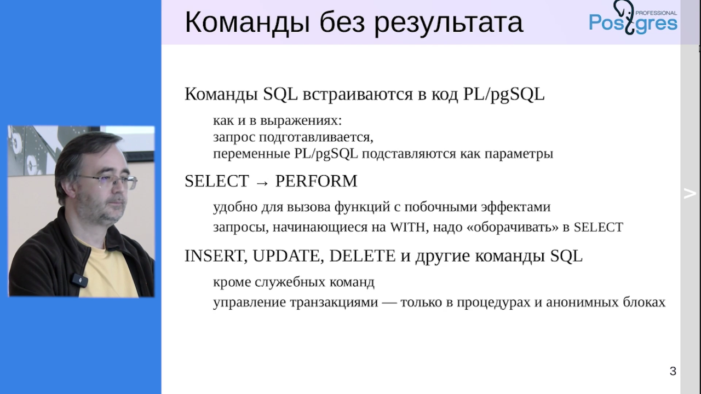

## 2. Интеграция с SQL и PERFORM

PL/pgSQL тесно интегрирован с SQL: SQL-запросы можно выполнять прямо в процедурном коде, а INSERT, UPDATE, DELETE и другие команды без результата писать как есть. В PL/pgSQL команда SELECT заменяется на PERFORM для выполнения SQL-команд без результата; PERFORM используется для вызова функций с побочными эффектами, которые не возвращают результат, например do_something. Запросы, начинающиеся на WITH, надо «оборачивать» в SELECT; внешний SELECT затем заменяется на PERFORM. В SQL-функциях последняя команда, которая что-то возвращает, возвращает свой результат как результат функции. Функция do_something создаётся на языке plpgsql с RETURNS void и выполняет RAISE NOTICE; псевдотип void означает отсутствие возвращаемого значения, а для вызова такой функции в блоке кода используется PERFORM.

```go
CREATE FUNCTION do_something() RETURNS void
AS $$
BEGIN
    RAISE NOTICE 'Что-то случилось.';
END
$$ LANGUAGE plpgsql;

DO $$
BEGIN
    PERFORM do_something();
END
$$;

DO $$
BEGIN
        CREATE TABLE test(n integer);
        INSERT INTO test VALUES (1),(2),(3);
        UPDATE test SET n = n + 1 WHERE n > 1;
        DELETE FROM test WHERE n = 1;
        DROP TABLE test;
END
$$;

DO $$
DECLARE
    id        integer := 1;
    code text;
BEGIN
    SELECT id, code INTO id, code
    FROM t WHERE id = id;
    RAISE NOTICE '%, %', id, code;
END
$$;

ERROR:  column reference "id" is ambiguous

SELECT id, code INTO id, code
FROM t WHERE id = id;
ERROR:  column reference "id" is ambiguous

name := '=== Схема: ' || schema_oid::regnamespace;
RETURN NEXT;  -- заголовок с названием схемы
RETURN QUERY
    SELECT proname::text, CASE WHEN oid = my_oid THEN 'It''s me!' END
    FROM pg_proc
    WHERE pronamespace = schema_oid
    ORDER BY 1;

=> CREATE FUNCTION where_am_i() RETURNS TABLE(name text, isme text)
AS $$
DECLARE
    my_oid oid;
    schema_oid oid;
BEGIN
    GET DIAGNOSTICS my_oid := PG_ROUTINE_OID;
    -- oid схемы
    schema_oid := pronamespace FROM pg_proc WHERE oid = my_oid;
    -- Заголовок
    name := '=== Схема: ' || schema_oid::regnamespace;
    RETURN NEXT;  -- заголовок с названием схемы
    -- Список подпрограмм
    RETURN QUERY
        SELECT proname::text, CASE WHEN oid = my_oid THEN 'It''s me!' END
```

> [!info] Зачем это нужно
> Благодаря интеграции код на PL/pgSQL получается короче и проще.

*Источник: [00:00:10], [00:00:15], [00:01:05], [00:03:11], [00:03:39], [00:03:59] и др.*

> [!quote]- Кадр [00:46:18]
> 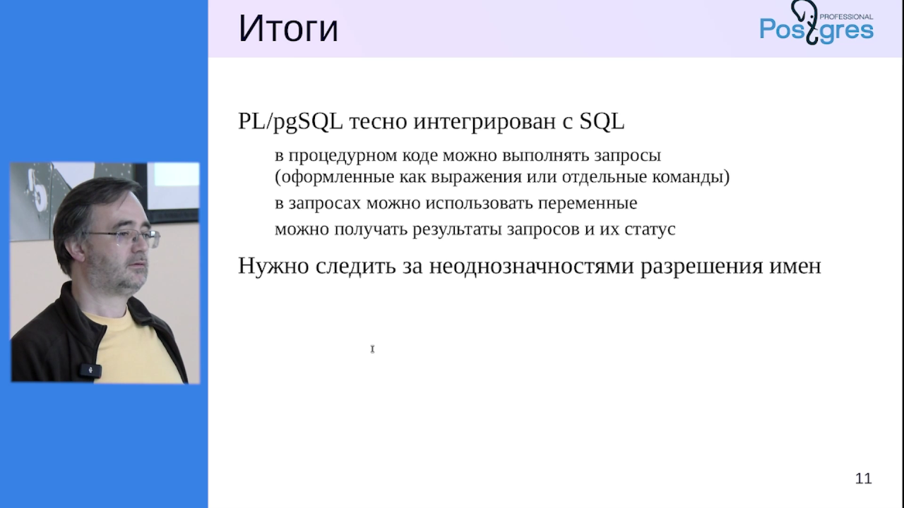


## 3. Управление транзакциями в процедурах

В процедуре или анонимном блоке DO, написанном на PL/pgSQL, можно управлять транзакциями. COMMIT фиксирует изменения, ROLLBACK откатывает. В примере первый INSERT зафиксируется, второй откатится, а SELECT вернёт единичку. Транзакция должна быть начата вызовом процедуры; если транзакция уже была начата ранее, управлять ею из процедуры не получится — процедура не может завершить транзакцию, которую начала не она. В стеке вызовов процедуры с управлением транзакциями не должно быть ничего, кроме операторов CALL: если внутри появится вызов функции, транзакция не сработает, и та же цепочка, запущенная из функции, даёт ошибку invalid transaction termination.

```sql
CREATE PROCEDURE foo()
AS $$
BEGIN
    INSERT INTO test VALUES (1);
    COMMIT;
    INSERT INTO test VALUES (2);
    ROLLBACK;
END
$$ LANGUAGE plpgsql;

=> CALL foo();

=> SELECT * FROM test;
n
---
1
(1 row)

CREATE OR REPLACE PROCEDURE foo()
AS $$
BEGIN
    CALL bar();
END
$$ LANGUAGE plpgsql;

CREATE PROCEDURE bar()
AS $$
BEGIN
    CALL baz();
END
$$ LANGUAGE plpgsql;

CREATE PROCEDURE baz()
AS $$
BEGIN
    COMMIT;
END
$$ LANGUAGE plpgsql;

=> CALL foo(); -- работает

CREATE FUNCTION qux() RETURNS void
AS $$
BEGIN
    CALL bar();
END
$$ LANGUAGE plpgsql;

=> SELECT qux(); -- ошибка
ERROR:  invalid transaction termination

BEGIN;

CALL foo(); -- ошибка

ERROR:  invalid transaction termination
CONTEXT:  PL/pgSQL function foo() line 4 at COMMIT
```

*Источник: [00:04:39], [00:04:59], [00:05:39], [00:06:00], [00:06:20], [00:06:40] и др.*

## 4. Конфликты имён и квалификация переменных

Чтобы избежать неоднозначности между именами столбцов и переменных, к переменным добавляют префиксы: p_ для параметров, l_ или v_ для локальных переменных, c_ для констант; префиксы никогда не используются в именах столбцов. При совпадении имени переменной с именем столбца таблицы в выражениях вида WHERE id = id и SELECT id, code INTO id, code неясно, что относится к переменной PL/pgSQL, а что к столбцу, и СУБД выдаёт ошибку column reference "id" is ambiguous. Блок можно пометить меткой local и обращаться к переменным как local.id и local.code, а t.id и t.code — к столбцам таблицы t. Параметр plpgsql.variable_conflict по умолчанию равен error: при конфликте имён PL/pgSQL выдаёт ошибку; use_variable заставляет использовать переменную, а use_column задаёт приоритет столбцов таблиц над переменными.

```go
DO $$
DECLARE
    l_id    integer := 1;
    l_code  text;
BEGIN
    SELECT id, code INTO l_id, l_code
    FROM t WHERE id = l_id;
    RAISE NOTICE '%, %', l_id, l_code;
END
$$;

DO $$
<<local>>
DECLARE
    id    integer := 1;
    code text;
BEGIN
    SELECT t.id, t.code INTO local.id, local.code
    FROM t WHERE t.id = local.id;
    RAISE NOTICE '%, %', id, code;
END
$$;

=> RESET plpgsql.variable_conflict; -- сбросим значение к умолчательному
RESET

=> SHOW plpgsql.variable_conflict;
 plpgsql.variable_conflict
------------------------------
 error
(1 row)
```

> [!info] Зачем это нужно
> Квалификация имён позволяет избежать неоднозначности; иначе добавление столбца с неподходящим именем сломает код, и ошибка проявится только при выполнении.

*Источник: [00:04:39], [00:20:52], [00:22:12], [00:23:03], [00:23:53], [00:25:02] и др.*

> [!quote]- Кадр [00:23:03]
> 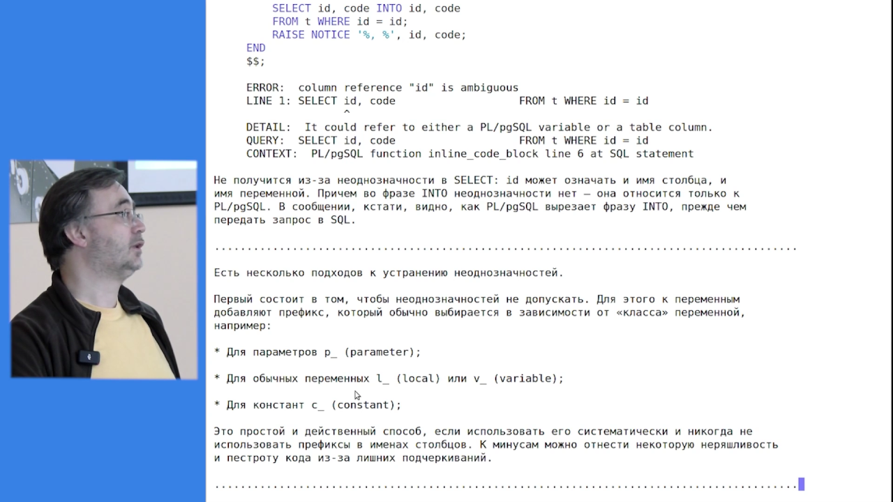


> [!quote]- Кадр [00:48:38]
> 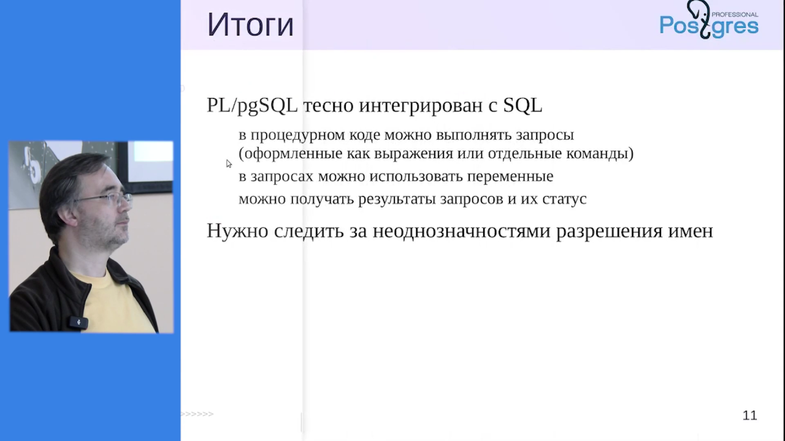

## 5. SELECT INTO, RETURNING, STRICT и диагностика

SELECT ... INTO помещает выбранную запросом строку в одну переменную составного типа либо в нужное количество скалярных переменных, перечисленных через запятую; в PL/pgSQL команда SELECT id, code INTO r FROM t помещает строку в переменную r типа record. Конструкция получает только первую по порядку строку результата, поэтому без ORDER BY порядок возвращаемых строк не определён. Команды INSERT, UPDATE, DELETE с предложением RETURNING возвращают результат, а с INTO его можно записать в переменную; если RETURNING собирается вернуть несколько строк, их нельзя поместить в переменную — будет ошибка, а при отсутствии строк SELECT INTO даёт NULL (запись из NULL), без ошибки. В режиме INTO STRICT запрос должен вернуть ровно одну строку: если строк больше одной, возникает ошибка query returned more than one row; если ни одной — query returned no rows. ROW_COUNT показывает число строк, возвращённых или обработанных последней командой SQL, через GET DIAGNOSTICS ... := ROW_COUNT; FOUND истинна, если команда вернула или обработала строку.

```go
DO $$
DECLARE
    r record;
BEGIN
        SELECT id, code INTO r FROM t;
        RAISE NOTICE '%', r;
END
$$;

NOTICE:  (2,Два)

DO $$
DECLARE
    r record;
BEGIN
    UPDATE t SET code = code || '!' RETURNING * INTO r;
    RAISE NOTICE 'Изменили: %', r;
END
$$;
ERROR:  query returned more than one row
HINT:  Make sure the query returns a single row, or use LIMIT 1.

DO $$
DECLARE
    r record;
BEGIN
    r := (-1,'!!!!');
    SELECT id, code INTO r FROM t WHERE false;
    RAISE NOTICE '%', r;
END
$$;

NOTICE:  (,)

DO $$
DECLARE
    r record;
BEGIN
    SELECT id, code INTO r FROM t;
    RAISE NOTICE '%', r;
END
$$;

UPDATE t SET code = code || '!' WHERE id = 1 RETURNING * INTO r;

UPDATE t SET code = code || '!' WHERE id = -1 RETURNING * INTO STRICT r;

UPDATE t SET code = code || '!' RETURNING * INTO r;

ERROR:  query returned more than one row
HINT:  Make sure the query returns a single row, or use LIMIT 1.

DO $$
DECLARE
    r record;
BEGIN
    UPDATE t SET code = code || '!' WHERE id = 1 RETURNING * INTO r;
    RAISE NOTICE 'Изменили: %', r;
END
$$;

DO $$
DECLARE
    r record;
BEGIN
    SELECT id, code INTO STRICT r FROM t;
    RAISE NOTICE '%', r;
END
$$;
ERROR:  query returned more than one row

GET DIAGNOSTICS rowcount := ROW_COUNT;

RAISE NOTICE 'found = %', FOUND;
```

| Что вернёт | SELECT INTO | SELECT INTO STRICT |
|---|---|---|
| нет строк | NULL (пустышки), без ошибки | возникает ошибка |

*Источник: [00:08:30], [00:08:50], [00:09:18], [00:10:18], [00:10:41], [00:11:01] и др.*

> [!quote]- Кадр [00:08:30]
> 

> [!quote]- Кадр [00:09:18]
> 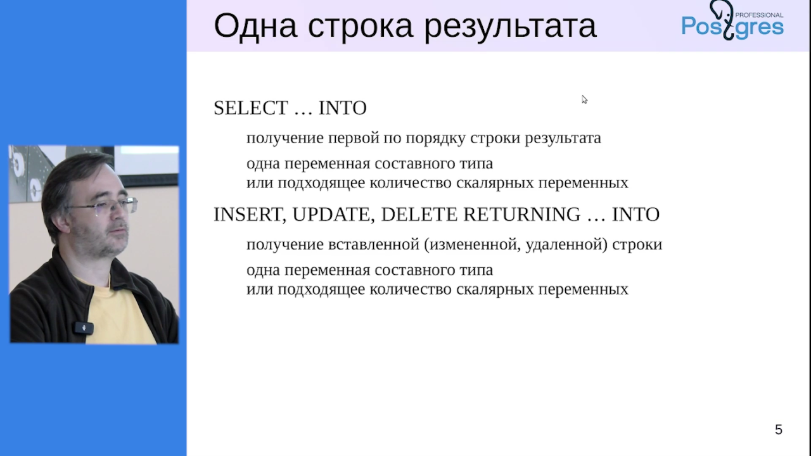

> [!quote]- Кадр [00:08:50]
> 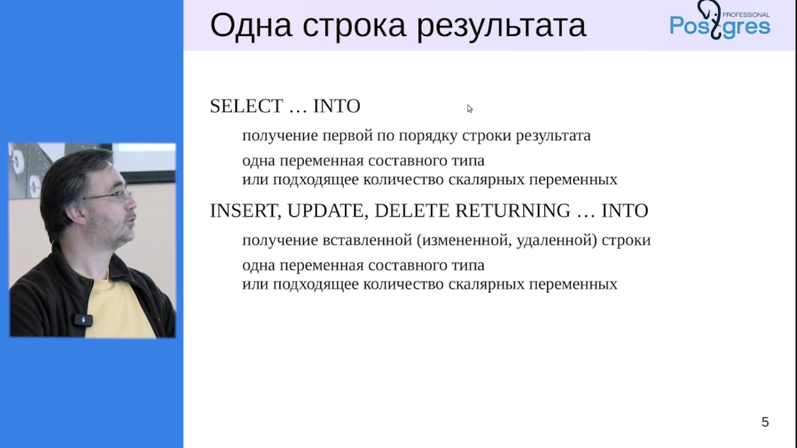

> [!quote]- Кадр [00:28:52]
> 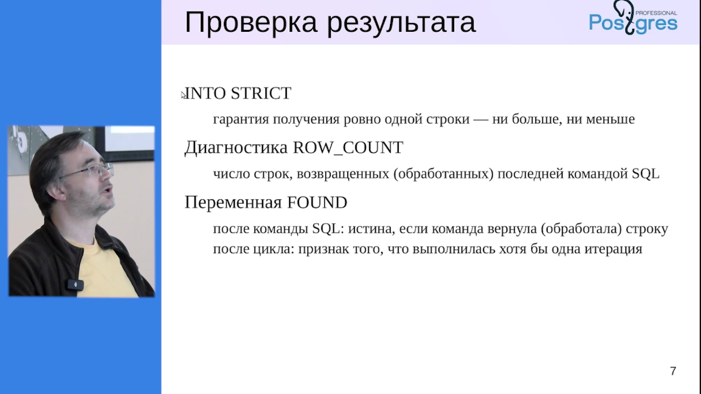

## 6. Предупреждения PL/pgSQL и plpgsql_check

PL/pgSQL умеет предупреждать о ситуациях, когда что-то может пойти не так, как ожидается; параметр plpgsql.extra_warnings по умолчанию равен 'none', поэтому о предупреждениях не сообщается, а при значении 'all' он сообщает обо всех подозрительных вещах. SET plpgsql.extra_warnings = 'all' включает дополнительные проверки: перекрывающиеся определения переменных, затенение параметра переменной из DECLARE, запрос, вернувший более одной строки; plpgsql.extra_errors превращает эти проверки в ошибки. В PL/pgSQL локальная переменная с тем же именем, что и параметр, перекрывает параметр: в процедуре bugs с параметром INOUT a и локальной переменной a команда SELECT id INTO a, b изменяет локальную переменную, а параметр остаётся 42. При этом выдаётся WARNING variable "a" shadows a previously defined variable, а при несовпадении числа полей в SELECT id INTO a, b — WARNING number of source and target fields in assignment does not match, но вызов не прерывается. plpgsql_check — стороннее расширение, написанное и развиваемое Павлом Стехуле, которое позволяет проверять код PL/pgSQL более детально; предупреждения включают перекрытие параметров, несоответствие атрибутов, неиспользуемые переменные и параметры, а проверка функции выполняется вызовом plpgsql_check.plpgsql_check_function('bugs(integer)').

```sql
CREATE PROCEDURE bugs(INOUT a integer)
AS $$
DECLARE
    a integer;
    b integer;
BEGIN
    SELECT id INTO a, b FROM t;
END
$$ LANGUAGE plpgsql;

SET plpgsql.extra_warnings = 'all';
WARNING:  query returned more than one row
HINT:  Make sure the query returns a single row, or use LIMIT 1.
WARNING:  number of source and target fields in assignment does not match

WARNING:  variable "a" shadows a previously defined variable
LINE 4:    a integer;

WARNING:  number of source and target fields in assignment does not match
DETAIL:  strict_multi_assignment check of extra_warnings is active.
```

*Источник: [00:13:04], [00:13:54], [00:16:14], [00:17:05], [00:17:25], [00:18:15] и др.*

> [!quote]- Кадр [00:18:15]
> 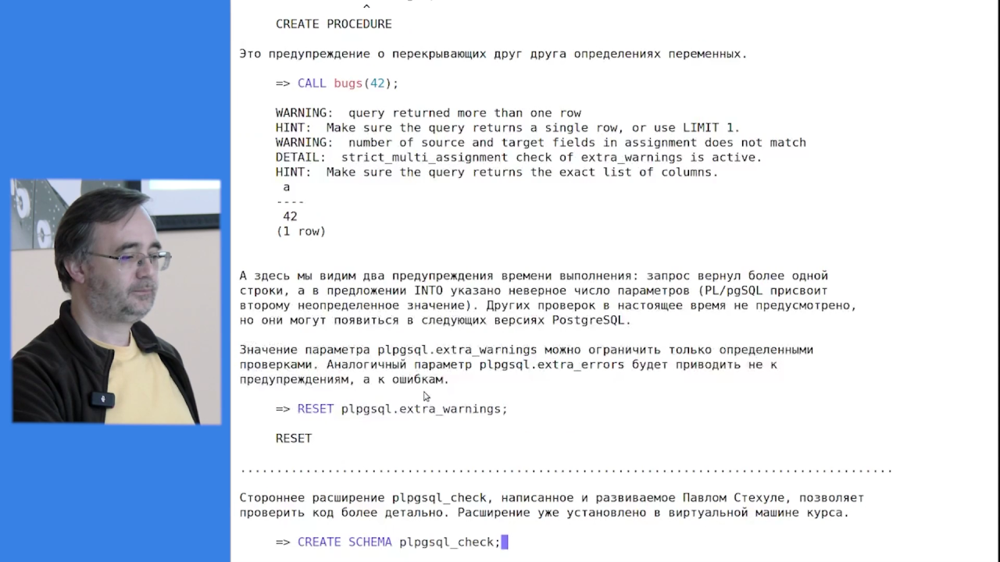

## 7. RETURN QUERY, RETURN NEXT и RETURNS TABLE/SETOF

RETURN QUERY и RETURN NEXT, несмотря на слово return, не прекращают выполнение функции: они записывают данные в выходной буфер, а выполнение продолжается дальше. RETURN NEXT записывает одну указанную строку, RETURN QUERY — результат запроса; команды можно чередовать, результаты попадают в один выходной буфер, а два запроса RETURN QUERY должны совпадать структурно. Когда функция доходит до конца или до простого return, всё, что накопилось в буфере, возвращается как результат таблицы. Для возврата таблицы, похожей на t, создаётся функция с RETURNS TABLE(LIKE t), а для множества строк — RETURNS SETOF; обращаться к такой функции нужно с круглыми скобочками, как к таблице.

```
CREATE FUNCTION t() RETURNS TABLE(LIKE t)
AS $$
BEGIN
    RETURN QUERY SELECT id, code FROM t ORDER BY id;
END
$$ STABLE LANGUAGE plpgsql;

RETURN QUERY запрос;
RETURN NEXT выражение;
RETURN NEXT;
```

*Источник: [00:37:17], [00:39:48], [00:40:08], [00:44:18], [00:45:58]*

## 8. WITH ORDINALITY и волатильность STABLE

Функция days_of_week() объявлена как RETURNS SETOF text; в цикле FOR i IN 7 .. 13 она возвращает строки через RETURN NEXT to_char(to_date(i::text,'J'),'TMDy'), то есть перебирает числа от 7 до 13, преобразует их в юлианскую дату, затем в обычную и возвращает текстовое описание дня недели. Функцию нельзя объявить IMMUTABLE, потому что её результат зависит от настроек локали базы данных; поэтому она объявлена как STABLE: в пределах одного запроса функция возвращает одинаковые значения, но при смене lc_time результат меняется. WITH ORDINALITY добавляет к результату функции дополнительный столбец ordinality с порядковой нумерацией строк, что позволяет не потерять порядок сортировки.

```javascript
CREATE FUNCTION days_of_week() RETURNS SETOF text
AS $$
BEGIN
    FOR i IN 7 .. 13 LOOP
        RETURN NEXT to_char(to_date(i::text,'J'),'TMDy');
    END LOOP;
END;
$$ STABLE LANGUAGE plpgsql;

=> SELECT * FROM days_of_week() WITH ORDINALITY;

days_of_week | ordinality
-------------+-----------
Пн           |          1
Вт           |          2
Ср           |          3
Чт           |          4
Пт           |          5
Сб           |          6
Вс           |          7
(7 rows)
```

*Источник: [00:40:58], [00:41:48], [00:43:18], [00:43:38]*

## 9. OID текущей функции и where_am_i()

В PL/pgSQL можно получить идентификатор выполняемой функции через GET DIAGNOSTICS my_oid := PG_ROUTINE_OID. Затем по OID находится схема функции в pg_proc (по полю pronamespace), и среди подпрограмм этой схемы функция может отметить себя как 'It''s me!'. Функция where_am_i() объявлена с RETURNS TABLE(name text, isitme text); она получает oid схемы по oid из pg_proc и формирует заголовок с именем схемы через schema_oid::regnamespace. Внутри комбинируются варианты возвращения строк: RETURN NEXT выводит заголовок с названием схемы, а RETURN QUERY — список подпрограмм. При вызове она возвращает схему public, перечисляет все созданные функции и напротив своего имени пишет 'It''s me!'.

```go
> CREATE FUNCTION where_am_i() RETURNS TABLE(name text, isitme text)
AS $$
DECLARE
    my_oid oid;
    schema_oid oid;
BEGIN
    GET DIAGNOSTICS my_oid := PG_ROUTINE_OID;
    -- oid схемы
    schema_oid := pronamespace FROM pg_proc WHERE oid = my_oid;
    -- Заголовок
    name := '=== Схема: ' || schema_oid::regnamespace;
    RETURN NEXT;  -- заголовок с названием схемы
    -- Список подпрограмм
    RETURN QUERY
        SELECT proname::text, CASE WHEN oid = my_oid THEN 'It''s me!' END

-- oid схемы
schema_oid := pronamespace FROM pg_proc WHERE oid = my_oid;
-- Заголовок
name := '=== Схема: ' || schema_oid::regnamespace;
RETURN NEXT; -- заголовок с названием схемы
-- Список подпрограмм
RETURN QUERY
            SELECT proname::text, CASE WHEN oid = my_oid THEN 'It''s me!' END
            FROM pg_proc
            WHERE pronamespace = schema_oid
            ORDER BY 1;
END
$$ STABLE LANGUAGE plpgsql;
```

*Источник: [00:44:18], [00:45:38], [00:45:58]*

## 10. Практические функции и дерево решений

Функция add_author добавляет новых авторов: принимает три параметра (фамилия, имя, отчество) и возвращает идентификатор нового автора. Функция buy_book принимает идентификатор книги и уменьшает количество таких книг на складе на единицу; возвращаемое значение отсутствует. В задании с деревом решений сервер угадывает загаданное животное, задавая последовательные уточняющие вопросы (follow-up) с ответами «да» или «нет», и спускается по дереву решения; это дерево решения нужно уложить в таблицу.

*Источник: [00:48:58], [00:49:56]*

> [!quote]- Кадр [00:48:58]
> 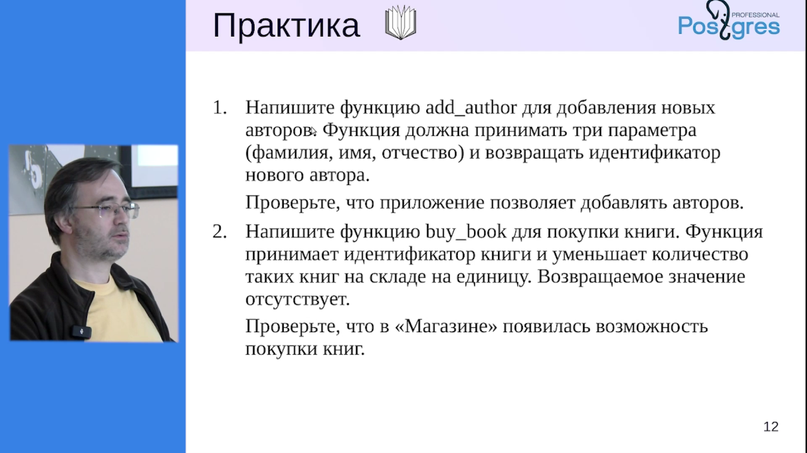

> [!quote]- Кадр [00:49:56]
> 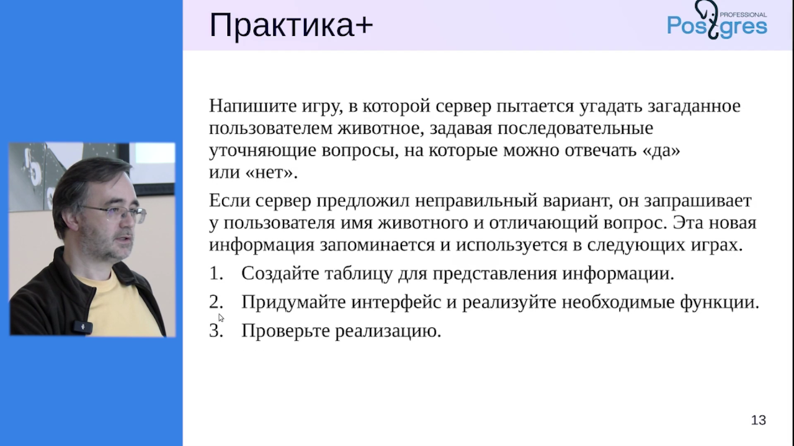

## Схема

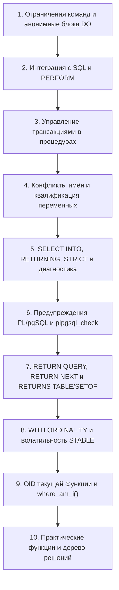

## Итог

> [!success] Что в итоге
> PL/pgSQL накладывает ограничения на команды в функциях: служебные команды запрещены, а управление транзакциями доступно только в процедурах и анонимных блоках DO. Процедура с управлением транзакциями должна сама начинать транзакцию, иначе возникает ошибка invalid transaction termination, а в стеке вызовов допустимы только операторы CALL. Конфликты имён решаются префиксами, квалификацией или параметром plpgsql.variable_conflict, а поведение SELECT ... INTO и RETURNING зависит от числа строк и может давать NULL или ошибку, при этом INTO STRICT требует ровно одну строку, а ROW_COUNT и FOUND помогают проверить результат. Функции возвращают таблицы и множества строк через RETURNS TABLE и RETURNS SETOF, наполняя выходной буфер командами RETURN NEXT и RETURN QUERY, а предупреждения PL/pgSQL не прерывают вызов и проверяются расширением plpgsql_check.

