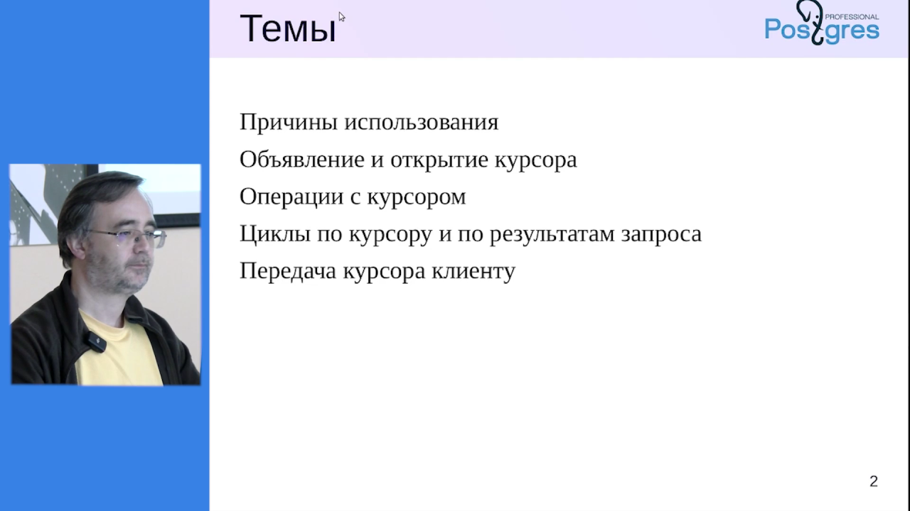
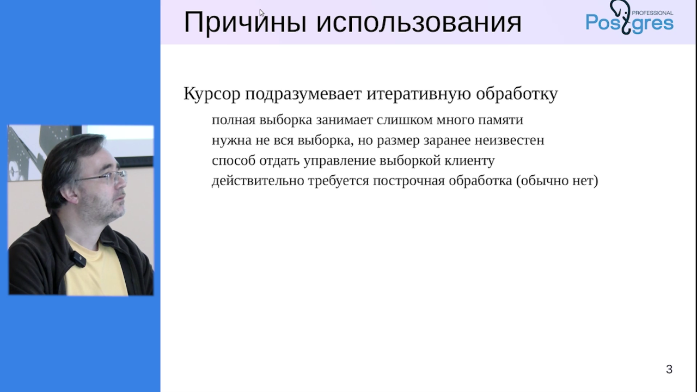
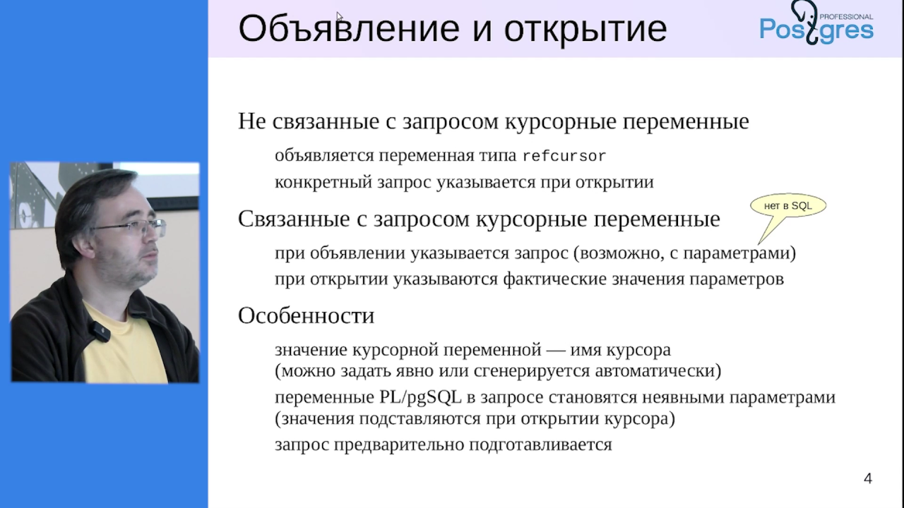
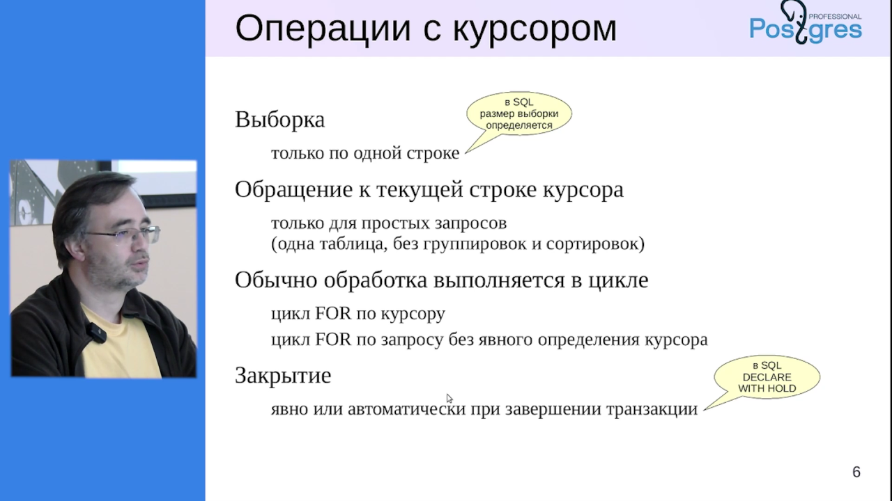
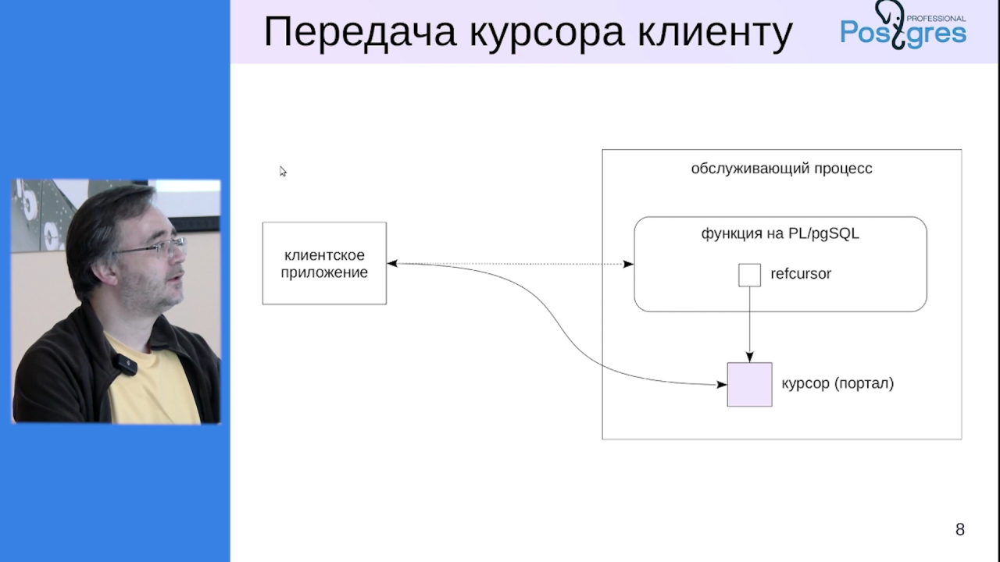
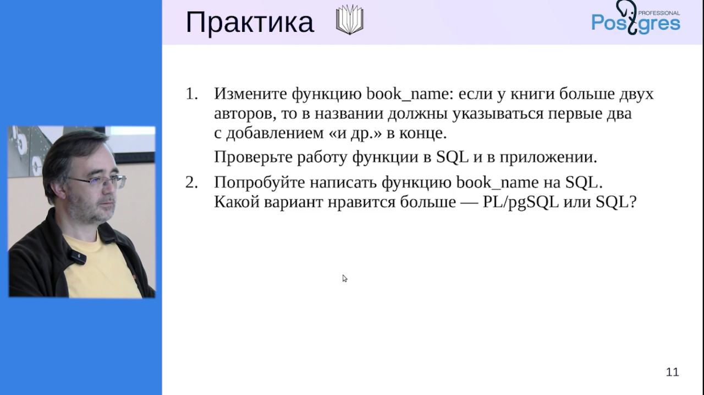
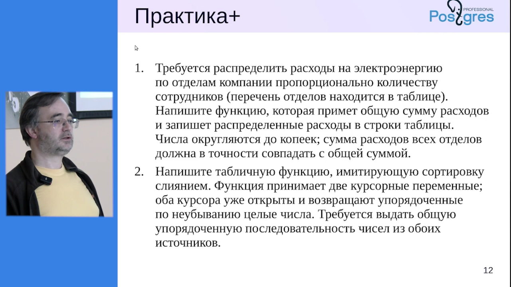
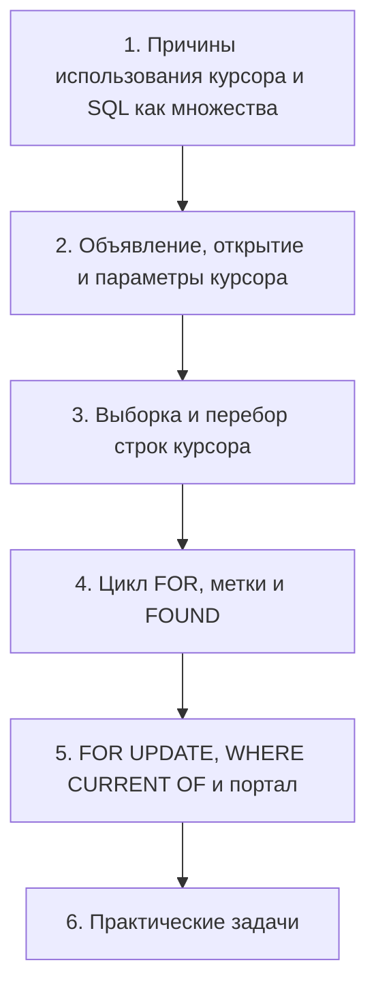

# Курсоры в PostgreSQL

> [!abstract] Обзор
> Материал посвящён курсорам в PostgreSQL: зачем они нужны, какие бывают курсорные переменные и как с ними работать в PL/pgSQL и SQL. Разбираются причины использования курсора, объявление и открытие несвязанных (refcursor) и связанных с запросом переменных, параметризованные курсоры и неявные параметры PL/pgSQL. Показаны чтение строк командами fetch и move, перебор в цикле с FETCH и EXIT WHEN NOT FOUND, циклы FOR по курсору и запросу, метки, FOUND и WHERE CURRENT OF. Отдельно рассмотрены портал, передача курсора клиенту через функцию, возвращающую refcursor, а также практические задачи — правило для book_name, табличная функция сортировки слиянием и распределение расходов с округлением до копеек. Подчёркивается, что SQL — это язык множеств, и процедурное удаление строк по одной можно заменить одной командой DELETE ... RETURNING.

> [!info] Курс
> [[index|Оглавление курса]]

## Оглавление
1. [[#1. Причины использования курсора и SQL как множества]]
2. [[#2. Объявление, открытие и параметры курсора]]
3. [[#3. Выборка и перебор строк курсора]]
4. [[#4. Цикл FOR, метки и FOUND]]
5. [[#5. FOR UPDATE, WHERE CURRENT OF и портал]]
6. [[#6. Практические задачи]]

**Схема** — [[#Схема]]
**Итог** — [[#Итог]]

## 1. Причины использования курсора и SQL как множества

Курсор подразумевает итеративную обработку и предназначен для получения и обработки данных построчно. Его используют, когда полная выборка занимает слишком много памяти, когда нужна не вся выборка с заранее неизвестным размером или когда нужно отдать управление выборкой клиенту для построчного выбора. Однако построчная обработка обычно не требуется: SQL — это язык множеств, и стоит подумать, нельзя ли сформулировать задачу в терминах множества. Процедурный цикл (в том числе PL/pgSQL), удаляющий строки по одной, можно заменить одной SQL-командой DELETE FROM t RETURNING *; чтобы увидеть удаляемые строки, можно использовать RETURNING * в команде DELETE, а ROLLBACK в конце возвращает всё обратно. В качестве запроса курсора можно использовать любую команду, которая что-то возвращает, в том числе UPDATE с фразой RETURNING.

```sql
>= BEGIN;
DELETE FROM t RETURNING *;
ROLLBACK;

DO $$
DECLARE
  rec record;
BEGIN
  FOR rec IN (SELECT * FROM t) LOOP
    RAISE NOTICE '%', rec;
    DELETE FROM t WHERE id = rec.id;
  END LOOP;
END
$$;
```

> [!info] Зачем это нужно
> Основная задача курсора — получать и обрабатывать данные построчно.

*Источник: [00:00:14], [00:01:04], [00:07:43], [00:19:50], [00:20:40], [00:21:00] и др.*

> [!quote]- Кадр [00:00:14]
> 

> [!quote]- Кадр [00:01:04]
> 

## 2. Объявление, открытие и параметры курсора

Курсорная переменная бывает несвязанной и связанной с запросом. Несвязанная объявляется как переменная типа refcursor (cur refcursor), а конкретный запрос указывается при открытии через OPEN cur FOR SELECT * FROM t; за уникальность имени нужно следить самостоятельно. В связанной с запросом при объявлении указывается запрос (возможно, с параметрами), а при открытии указываются фактические значения параметров; связывание со значениями переменных происходит в момент открытия (OPEN), а не в момент объявления. Переменные PL/pgSQL в запросе курсора становятся неявными параметрами, значения которых подставляются при открытии; существует и явный параметризованный курсор, например cur CURSOR(id integer) FOR ..., при открытии указываются фактические параметры, например OPEN cur(1), а для предотвращения конфликтов имён имя параметра квалифицируется именем курсора (cur.id). Курсоры не обязательно закрывать явно — они автоматически закрываются при завершении транзакции; можно закрыть и явно, а в SQL используется DECLARE WITH HOLD.

```go
CREATE TABLE t(id integer, s text);
INSERT INTO t VALUES (1, 'Раз'), (2, 'Два'), (3, 'Три');
DO $$
DECLARE
    lcur refcursor;
BEGIN
    OPEN cur FOR SELECT * FROM t;
END
$$;

DO $$
DECLARE
    cur CURSOR FOR SELECT * FROM t;
BEGIN
    OPEN cur;
END
$$;

DO $$
<<local>>
DECLARE
    id integer := 3;
    cur CURSOR FOR SELECT * FROM t WHERE t.id = local.id;
BEGIN
    id := 1;
    OPEN cur;
END
$$;

DO $$
DECLARE
    cur CURSOR(id integer) FOR SELECT * FROM t WHERE t.id = cur.id;
BEGIN
    OPEN cur(1);
END
$$;
```

| Признак | Несвязанная | Связанная с запросом |
|---|---|---|
| Объявление | переменная refcursor без запроса | указывается запрос, возможно с параметрами |
| Открытие | запрос задаётся при OPEN | указываются фактические параметры |
| Имя | за уникальностью следим самостоятельно | — |

*Источник: [00:02:54], [00:04:31], [00:04:52], [00:05:16], [00:05:56], [00:07:43] и др.*

> [!quote]- Кадр [00:02:54]
> 

> [!quote]- Кадр [00:08:26]
> 

## 3. Выборка и перебор строк курсора

В PL/pgSQL выборка из открытого курсора всегда происходит только по одной строке; в SQL можно указать размер выборки. В курсоре есть две команды: fetch и move — move просто сдвигает курсор к следующей строке, а fetch читает значение строки и сдвигается дальше; для чтения используется fetch into. Фраза INTO записывает текущую строку в переменную и полностью аналогична конструкции INTO с командами SQL; можно использовать не только запись, но и скалярные переменные. При явной итерации по курсору используется цикл LOOP: FETCH cur INTO rec извлекает очередную строку, EXIT WHEN NOT FOUND завершает цикл, когда строк больше нет, а FOUND показывает, была ли выбрана очередная строка; после выхода из цикла курсор закрывается через CLOSE cur.

```
>= DO $$
DECLARE
    cur refcursor;
    rec record; -- можно использовать и несколько скалярных переменных
BEGIN
    OPEN cur FOR SELECT * FROM t ORDER BY id;
    MOVE cur;
    FETCH cur INTO rec;
    RAISE NOTICE '%', rec;
    CLOSE cur;
END
$$;

DO $$
DECLARE
    cur refcursor;
    rec record;
BEGIN
    OPEN cur FOR SELECT * FROM t;
    LOOP
        FETCH cur INTO rec;
        EXIT WHEN NOT FOUND; -- FOUND: выбрана ли очередная строка?
        RAISE NOTICE '%', rec;
    END LOOP;
    CLOSE cur;
END
$$;

>= DO $$
DECLARE
    cur refcursor;
    rec record;
BEGIN
    OPEN cur FOR SELECT * FROM t;
LOOP
    FETCH cur INTO rec;
    EXIT WHEN NOT FOUND; -- FOUND: выбрана ли очередная строка?
    RAISE NOTICE '%', rec;
END LOOP;
    CLOSE cur;
END
$$;
```

*Источник: [00:08:06], [00:09:39], [00:09:59], [00:11:13], [00:12:03], [00:12:53]*

## 4. Цикл FOR, метки и FOUND

В PL/pgSQL цикл FOR rec IN cur LOOP автоматически объявляет переменную цикла rec, и она существует, пока работает цикл; команда FOR rec IN cur LOOP автоматически открывает курсор, проходит по нему и закрывает его в конце, для этого курсор объявляется со связанным запросом (CURSOR FOR SELECT ...). Есть FOR по курсору и FOR по запросу: в последнем можно обойтись без явной работы с курсором, если цикл — это всё, что требуется, но переменную цикла надо объявить явно (rec record), иначе цикл не будет работать; скобки вокруг запроса в цикле FOR не обязательны, но удобны для многоэтажных запросов. У цикла может быть метка, и команда EXIT с меткой позволяет выйти из конкретного цикла; вложенным циклам можно назначать метки, например <<outer>> и <<inner>>, и с помощью EXIT outer WHEN условие можно из внутреннего цикла завершить внешний. После завершения цикла переменная FOUND показывает, была ли выполнена хотя бы одна итерация: если цикл по запросу не вернул ни одной строки, FOUND будет false.

```
>= DO $$
DECLARE
    cur CURSOR FOR SELECT * FROM t;
    -- переменная цикла не объявляется
BEGIN
    FOR rec IN cur LOOP
        RAISE NOTICE '%', rec;
    END LOOP;
END
$$;

>= DO $$
DECLARE
    rec record; -- надо объявить явно
BEGIN
    FOR rec IN (SELECT * FROM t) LOOP
        RAISE NOTICE '%', rec;
    END LOOP;
END
$$;

>= DO $$
DECLARE
    rec_outer record;
    rec_inner record;
BEGIN
<<outer>>
    FOR rec_outer IN (SELECT * FROM t ORDER BY id) LOOP
<<inner>>
        FOR rec_inner IN (SELECT * FROM t ORDER BY id) LOOP
            EXIT outer WHEN rec_inner.id = 3;
            RAISE NOTICE '%, %', rec_outer, rec_inner;
        END LOOP INNER;
    END LOOP outer;
END
$$;

>= DO $$
DECLARE
    rec record;
BEGIN
    FOR rec IN (SELECT * FROM t WHERE false) LOOP
        RAISE NOTICE '%', rec;
    END LOOP;
    RAISE NOTICE 'Была ли как минимум одна итерация? %', FOUND;
END
$$;
```

| | FOR по курсору | FOR по запросу |
|---|---|---|
| Объявление курсора | CURSOR FOR SELECT ... | не нужен |
| Переменная цикла | объявляется автоматически | надо объявить явно |

> [!info] Зачем это нужно
> Цикл FOR упрощает работу с курсорами.

*Источник: [00:13:13], [00:14:03], [00:14:23], [00:16:13], [00:16:33], [00:16:59] и др.*

## 5. FOR UPDATE, WHERE CURRENT OF и портал

WHERE CURRENT OF использует прямую ссылку на текущую версию строки, поэтому работает даже без индекса на таблице; без индекса это может быть даже быстрее, чем с индексом. В PL/pgSQL курсор можно открыть с предложением FOR UPDATE (например, OPEN cur FOR SELECT * FROM t FOR UPDATE), при этом строки блокируются по мере обработки; текущая строка выбирается через FETCH cur INTO rec, завершение цикла — через EXIT WHEN NOT FOUND, а обновить текущую строку можно командой UPDATE t SET s = s || ' (обработано)' WHERE CURRENT OF cur. При открытии курсора на сервере в памяти создаётся буфер, в котором хранится текущее состояние курсора; он называется портал. В PL/pgSQL переменная типа refcursor — по сути строка, которая содержит имя серверного курсора, и клиент может обращаться к открытому на сервере курсору и вычитывать из него данные; можно написать функцию, которая внутри открывает курсор и возвращает курсорную переменную, а имя курсора можно задать вручную или позволить клиенту устанавливать его самому (например, t_cur('cursor12345')). Один из вариантов взаимодействия клиента и сервера — открыть курсор и отдать его клиенту, чтобы клиент выбирал данные в своём темпе и нужными порциями: клиент начинает транзакцию, открывает курсор, вызывая функцию, узнаёт имя курсора, читает данные через FETCH и завершает транзакцию через COMMIT.

```go
>= DO $$
DECLARE
    cur refcursor;
    rec record;
BEGIN
    OPEN cur FOR SELECT * FROM t
                 FOR UPDATE; -- строки блокируются по мере обработки
    LOOP
        FETCH cur INTO rec;
        EXIT WHEN NOT FOUND;
        UPDATE t SET s = s || ' (обработано)' WHERE CURRENT OF cur;
    END LOOP;
    CLOSE cur;
END
$$;

DO $$
DECLARE
    cur refcursor;
    rec record;
BEGIN
    OPEN cur FOR SELECT * FROM t
        FOR UPDATE; -- строки блокируются по мере обработки
    LOOP
        FETCH cur INTO rec;
        EXIT WHEN NOT FOUND;
        UPDATE t SET s = s || ' (обработано)' WHERE CURRENT OF cur;
    END LOOP;
    CLOSE cur;
END
$$;

CREATE FUNCTION
Клиент начинает транзакцию...
    => BEGIN;
        BEGIN
...вызывает функцию, узнает имя курсора...
    => SELECT t_cur();
            t_cur
            -----------------
            <unnamed portal 15>
            (1 row)
...и получает возможность читать из него данные (кавычки нужны из-за спецсимволов в имени):
    => FETCH "unnamed portal 15>";
        id | s
        --+----------
        1 | Раз (обработано)
        (1 row)
    => COMMIT;
        COMMIT

>= DO $$
DECLARE
  cur refcursor := 'cursor12345';
BEGIN
  OPEN cur FOR SELECT * FROM t;
  RAISE NOTICE '%', cur;
END
$$;

>= BEGIN;
   => SELECT t_cur('cursor12345');
   => FETCH cursor12345;
   => COMMIT;

=> BEGIN;

BEGIN
   => SELECT t_cur('cursor12345');
   t_cur
   -------
(1 row)

   => FETCH cursor12345;
   id |            s
   ------+----------------
   1 | Раз (обработано)
(1 row)

   => COMMIT;

COMMIT
```

*Источник: [00:17:19], [00:18:40], [00:19:00], [00:22:15], [00:24:23], [00:25:43] и др.*

> [!quote]- Кадр [00:22:15]
> 

## 6. Практические задачи

Если у книги больше двух авторов, в названии указываются первые два автора, а затем добавляется «и др.» в конце. Табличная функция имитирует сортировку слиянием: принимает две курсорные переменные, каждая из которых уже открыта и возвращает упорядоченные по неубыванию целые числа, и выдаёт общую упорядоченную последовательность чисел из обоих источников. При распределении общей суммы расходов пропорционально количеству сотрудников или по отделам числа округляются до копеек, и сумма расходов всех отделов должна в точности совпадать с общей суммой; при делении общей суммы на несколько частей и округлении до копеек образуется неучтённый остаток, который нужно отнести на одну из строк, поскольку потерянные копейки недопустимы для бухгалтерии.

*Источник: [00:28:55], [00:30:15]*

> [!quote]- Кадр [00:28:55]
> 

> [!quote]- Кадр [00:30:15]
> 

## Схема



## Итог

> [!success] Что в итоге
> Курсор нужен для итеративной построчной обработки, когда полная выборка не помещается в память, её размер заранее неизвестен или управление выборкой передаётся клиенту. Курсорные переменные бывают несвязанными (refcursor) и связанными с запросом, объявляются и открываются командой OPEN, в том числе с параметрами, а переменные PL/pgSQL в запросе становятся неявными параметрами. Чтение идёт командами fetch и move по одной строке, перебор удобно вести циклом FOR, а закрывается курсор явно или автоматически при завершении транзакции. При этом SQL работает с множествами: удаление по одной строке в цикле заменяется одной командой DELETE ... RETURNING.

