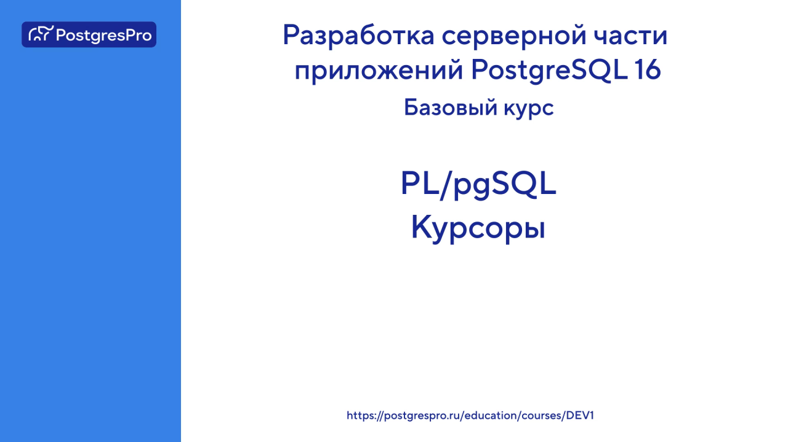
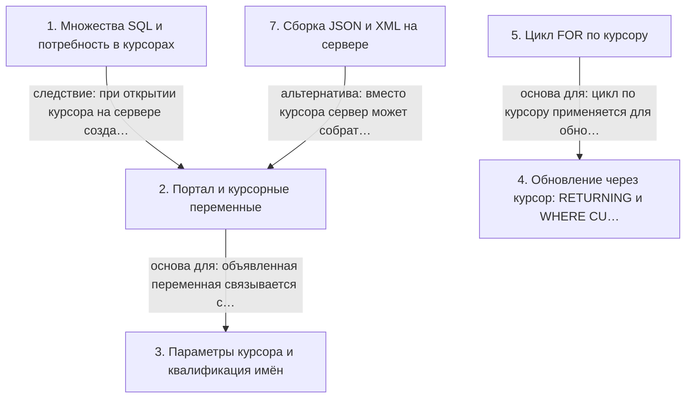

# Курсоры PL/pgSQL в PostgreSQL

> [!abstract] Обзор
> Материал о работе с курсорами в PL/pgSQL: почему множественный подход SQL отличается от построчной процедурной обработки и когда вообще нужны курсоры. Разбирается, что при открытии курсора на сервере создаётся буфер — портал, в котором хранится состояние курсора; курсорные переменные типа refcursor можно объявлять двумя способами, передавать им параметры и возвращать из функций. Показаны циклы FOR по курсору и по запросу, команды FETCH и MOVE, обращение к текущей строке через WHERE CURRENT OF и проверка found после цикла, а также использование UPDATE ... RETURNING. Отдельно упомянуты сборка JSON или XML на сервере, округление при распределении суммы и вопрос экономии при обновлении в цикле.

> [!info] Курс
> [[index|Оглавление курса]]

## Оглавление
1. [[#1. Множества SQL и потребность в курсорах]]
2. [[#2. Портал и курсорные переменные]]
3. [[#3. Параметры курсора и квалификация имён]]
4. [[#4. Обновление через курсор: RETURNING и WHERE CURRENT OF]]
5. [[#5. Цикл FOR по курсору]]
6. [[#6. FETCH, MOVE и приём значений]]
7. [[#7. Сборка JSON и XML на сервере]]
8. [[#8. Округление при распределении суммы]]
9. [[#9. Экономия при обновлении в цикле]]

**Схема** — [[#Схема]]
**Итог** — [[#Итог]]

## 1. Множества SQL и потребность в курсорах

SQL работает с множествами строк, а PL/pgSQL — процедурный язык, поэтому данные приходится обрабатывать строка за строкой в циклах. Если в PL/pgSQL хочется написать цикл и что-то почитать из таблицы, стоит подумать, нельзя ли это сделать просто SQL-запросом, и не злоупотреблять императивной обработкой по одной строке. Курсоры нужны, когда полная выборка занимает слишком много памяти и её обрабатывают порциями, либо когда нужны не все строки, но заранее неизвестно сколько. Строки читают строка за строкой до условия окончания; управление выборкой передаётся клиенту для построчного чтения в процедурном коде. Можно открыть несколько курсоров и вернуть клиенту сразу несколько курсорных переменных.

> [!info] Зачем это нужно
> Многие задачи удобнее и проще решать на SQL.

*Источник: [00:00:04]*

> [!quote]- Кадр [00:00:04]
> 

## 2. Портал и курсорные переменные

При открытии курсора на сервере в памяти создаётся буфер — портал, в котором хранится текущее состояние курсора. В PL/pgSQL с курсорами работают через специальные курсорные переменные типа refcursor; такая переменная по сути представляет собой строку с именем серверного курсора. Объявить курсор можно двумя способами: сначала объявить переменную refcursor, а затем при открытии указать связанный запрос, либо сразу при объявлении указать и запрос; варианты идентичны. В тексте запроса можно использовать переменные PL/pgSQL, которые неявно преобразуются в параметры запроса. Функция может открыть курсор и вернуть курсорную переменную; клиент начинает транзакцию, вызывает функцию и получает имя курсора, а функцию можно сделать с параметром refcursor и открывать переданное клиентом имя.

*Источник: [00:00:04]*

## 3. Параметры курсора и квалификация имён

Если переменная связана с запросом, в неё можно передавать параметры. Конкретное значение параметра подставляется в запрос в момент открытия курсора, а не в момент объявления, поэтому даже если переменная изменилась после объявления, курсор использует значение на момент открытия. Курсор можно закрыть явно, либо он автоматически закроется при завершении транзакции; закрывать курсоры не обязательно. Имя параметра квалифицируется именем курсора, чтобы предотвратить конфликты имён.

*Источник: [00:00:04]*

## 4. Обновление через курсор: RETURNING и WHERE CURRENT OF

В качестве запроса для курсора можно использовать любую команду, которая что-то возвращает, в том числе UPDATE с фразой RETURNING. Открытие курсора с предложением FOR UPDATE означает, что строки блокируются по мере чтения, чтобы другой процесс не изменил их раньше нас. Конструкция WHERE CURRENT OF позволяет обращаться к текущей строке курсора; в PL/pgSQL можно обновлять текущую строку с условием WHERE CURRENT OF cur. Преимущество этого способа в том, что он работает даже если на таблице нет индекса. Единственный пример её использования — обработка строк таблицы в цикле и обновление статуса обработанной строки.

*Источник: [00:00:04]*

## 5. Цикл FOR по курсору

Курсор обычно используют в цикле, потому что он предназначен для итеративной обработки. Цикл FOR по курсору автоматически открывает курсор, пробегает по нему и закрывает его в конце; переменная цикла объявляется самим циклом и существует, пока работает цикл. В PL/pgSQL есть два упрощающих цикла FOR: по курсору и просто по запросу; если нужно пробежаться по строкам запроса, достаточно цикла по запросу без явного объявления курсора, а скобки вокруг запроса необязательны, но удобны для многоэтажного запроса. После цикла по запросу переменная found показывает, была ли хотя бы одна итерация: если запрос не вернул ни одной строки, found будет false. При вложенных циклах внешний читает первую строку, внутренний — первую и вторую, а когда внутренний доходит до третьей, происходит выход сразу из внешнего цикла.

*Источник: [00:00:04]*

## 6. FETCH, MOVE и приём значений

FETCH — это SQL-команда, а не PL/pgSQL; к открытому курсору можно обращаться обычной командой FETCH. FETCH читает значение строки и сдвигается дальше, а MOVE просто сдвигается к следующей строке, не читая значение. Фраза INTO в FETCH полностью аналогична той, которую использовали с командами SQL: текущая строка помещается в переменную. Как и с фразой INTO, можно использовать не только запись, но и скалярные переменные; их использование аналогично INTO. Имя курсора берётся в кавычки, если содержит спецсимволы, пробелы или скобки.

| Команда | Что делает |
|---|---|
| FETCH | читает значение строки и сдвигается дальше |
| MOVE | просто сдвигается к следующей строке, не читая значение |

*Источник: [00:00:04]*

## 7. Сборка JSON и XML на сервере

Сервер может собрать всю нужную информацию из нужных таблиц и представить её в виде JSON или XML. Такой транспортный объект отдаётся клиенту, а клиент его разбирает и показывает нужное.

*Источник: [00:00:04]*

## 8. Округление при распределении суммы

Общую сумму нужно распределять пропорционально, округляя до копеек и следя, чтобы итоговая сумма совпала. Если 100 рублей делятся на три отдела, остаётся неучтённая копейка, которую нужно отнести на одну из строк.

*Источник: [00:00:04]*

## 9. Экономия при обновлении в цикле

Если вы взялись что-то в цикле обновлять, то на этих копеечках экономить большого смысла нет.

*Источник: [00:00:04]*

## Схема

## Итог

> [!success] Что в итоге
> Курсоры в PL/pgSQL позволяют читать данные построчно там, где множественный SQL неудобен: при больших выборках и заранее неизвестном числе нужных строк. При открытии курсора на сервере создаётся портал, хранящий его состояние; работа идёт через refcursor-переменные, которые объявляются двумя способами и могут принимать параметры на момент открытия. Функция может вернуть курсорную переменную или открыть переданный клиентом refcursor, а циклы FOR по курсору и по запросу, команды FETCH и MOVE, WHERE CURRENT OF и переменная found дают построчный контроль над обработкой. Отдельно разобраны сборка JSON или XML на сервере, округление при пропорциональном распределении суммы и нецелесообразность экономии при обновлении в цикле.

